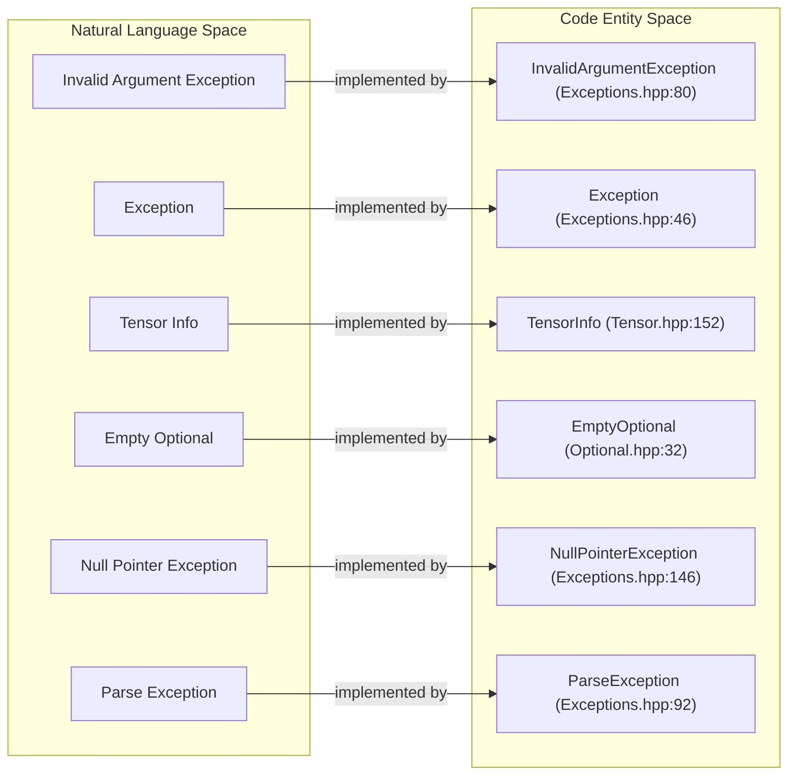
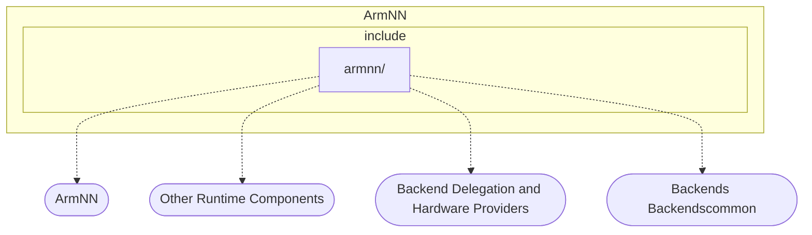
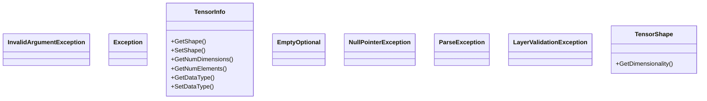
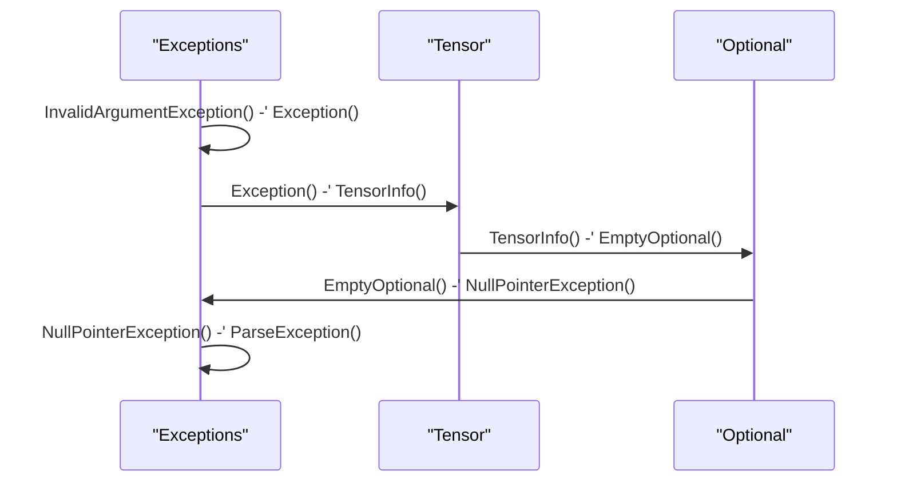

# 3-Source Context Packet (`git` + `CBM` + `llm-wiki`) for `5.2-armnn` — ArmNN

- **Target Wiki File**: `wiki/5.2-armnn.md`
- **Archetype**: `Leaf Technical Spec Page`
- **Parent Page**: `5-runtime-execution-and-kernel-dispatch`
- **Summary**: ArmNN subsystem (`include/armnn`), covering 21 files and 440 symbols. Key symbols include `GetShape`, `InvalidArgumentException`, `GetNumElements`, `Exception`.
- **Valid `[[wikilink]]` Neighbours**: `[[5-runtime-execution-and-kernel-dispatch|Runtime Execution and Kernel Dispatch]]`, `[[3-backend-delegation-and-hardware-providers|Backend Delegation and Hardware Providers]]`, `[[3.1-backends-backendscommon|Backends Backendscommon]]`, `[[3.2-backends-reference|Backends Reference]]`, `[[3.3-backends-opencl|Backends OpenCL]]`, `[[3.4-backends-aclcommon|Backends Aclcommon]]`, `[[3.6-other-backends|Other Backends]]`, `[[5.1-armnn|ArmNN]]`

## 1. Relevant Source Files (`git` + `CBM`, use verbatim in `<details>`)
- `[include/armnn/Exceptions.hpp](include/armnn/Exceptions.hpp)`
- `[include/armnn/Tensor.hpp](include/armnn/Tensor.hpp)`
- `[include/armnn/BackendId.hpp](include/armnn/BackendId.hpp)`
- `[include/armnn/Types.hpp](include/armnn/Types.hpp)`
- `[include/armnn/Optional.hpp](include/armnn/Optional.hpp)`
- `[include/armnn/LstmParams.hpp](include/armnn/LstmParams.hpp)`
- `[include/armnn/TypesUtils.hpp](include/armnn/TypesUtils.hpp)`
- `[include/armnn/Descriptors.hpp](include/armnn/Descriptors.hpp)`
- `[include/armnn/BackendOptions.hpp](include/armnn/BackendOptions.hpp)`
- `[include/armnn/QuantizedLstmParams.hpp](include/armnn/QuantizedLstmParams.hpp)`
- `[include/armnn/Numpy.hpp](include/armnn/Numpy.hpp)`
- `[include/armnn/IRuntime.hpp](include/armnn/IRuntime.hpp)`
- `[include/armnn/Logging.hpp](include/armnn/Logging.hpp)`
- `[include/armnn/INetwork.hpp](include/armnn/INetwork.hpp)`
- `[include/armnn/BackendHelper.hpp](include/armnn/BackendHelper.hpp)`
- `[include/armnn/BackendRegistry.hpp](include/armnn/BackendRegistry.hpp)`
- `[include/armnn/StrategyBase.hpp](include/armnn/StrategyBase.hpp)`
- `[include/armnn/IProfiler.hpp](include/armnn/IProfiler.hpp)`
- `[include/armnn/IStrategy.hpp](include/armnn/IStrategy.hpp)`
- `[include/armnn/MemorySources.hpp](include/armnn/MemorySources.hpp)`
- `[include/armnn/Utils.hpp](include/armnn/Utils.hpp)`

## 2. Grounded Code Symbols (`CBM`, use verbatim for `[file:start-end]()` pill citations)
- `InvalidArgumentException` (Class) @ `[include/armnn/Exceptions.hpp:80-84]()` [fan-in=273, fan-out=0] — 
- `Exception` (Class) @ `[include/armnn/Exceptions.hpp:46-65]()` [fan-in=181, fan-out=0] — /// Base class for all ArmNN exceptions so that users can filter to just those.
- `TensorInfo` (Class) @ `[include/armnn/Tensor.hpp:152-274]()` [fan-in=121, fan-out=0] — 
- `EmptyOptional` (Class) @ `[include/armnn/Optional.hpp:32-32]()` [fan-in=102, fan-out=0] — /// EmptyOptional is used to initialize the Optional class in case we want /// to have default value for an Optional in a function declaration.
- `NullPointerException` (Class) @ `[include/armnn/Exceptions.hpp:146-150]()` [fan-in=101, fan-out=0] — 
- `ParseException` (Class) @ `[include/armnn/Exceptions.hpp:92-96]()` [fan-in=98, fan-out=0] — 
- `LayerValidationException` (Class) @ `[include/armnn/Exceptions.hpp:105-108]()` [fan-in=73, fan-out=0] — 
- `TensorShape` (Class) @ `[include/armnn/Tensor.hpp:20-150]()` [fan-in=53, fan-out=0] — 
- `BackendId` (Class) @ `[include/armnn/BackendId.hpp:78-148]()` [fan-in=48, fan-out=0] — 
- `Tensor` (Class) @ `[include/armnn/Tensor.hpp:321-326]()` [fan-in=39, fan-out=0] — /// A tensor defined by a TensorInfo (shape and data type) and a mutable backing store.
- `BaseDescriptor` (Class) @ `[include/armnn/Descriptors.hpp:22-26]()` [fan-in=34, fan-out=0] — /// Base class for all descriptors.
- `ConstTensor` (Class) @ `[include/armnn/Tensor.hpp:329-392]()` [fan-in=32, fan-out=0] — /// A tensor defined by a TensorInfo (shape and data type) and an immutable backing store.
- `UnimplementedException` (Class) @ `[include/armnn/Exceptions.hpp:98-103]()` [fan-in=35, fan-out=0] — 
- `RuntimeException` (Class) @ `[include/armnn/Exceptions.hpp:120-123]()` [fan-in=18, fan-out=0] — 
- `BatchMatMulDescriptor` (Class) @ `[include/armnn/Descriptors.hpp:1584-1638]()` [fan-in=13, fan-out=0] — /// A BatchMatMulDescriptor for the BatchMatMul operator
- `CreationOptions` (Class) @ `[include/armnn/IRuntime.hpp:70-183]()` [fan-in=14, fan-out=0] — 
- `MemoryImportException` (Class) @ `[include/armnn/Exceptions.hpp:125-128]()` [fan-in=10, fan-out=0] — 
- `BroadcastToDescriptor` (Class) @ `[include/armnn/Descriptors.hpp:1659-1676]()` [fan-in=9, fan-out=0] — 
- `FileNotFoundException` (Class) @ `[include/armnn/Exceptions.hpp:86-90]()` [fan-in=7, fan-out=0] — 
- `GraphValidationException` (Class) @ `[include/armnn/Exceptions.hpp:110-113]()` [fan-in=6, fan-out=0] — 
- `BatchToSpaceNdDescriptor` (Class) @ `[include/armnn/Descriptors.hpp:875-903]()` [fan-in=2, fan-out=0] — /// A BatchToSpaceNdDescriptor for the BatchToSpaceNdLayer.
- `ComparisonDescriptor` (Class) @ `[include/armnn/Descriptors.hpp:89-106]()` [fan-in=2, fan-out=0] — /// A ComparisonDescriptor for the ComparisonLayer

## 3. Grounded Source Code Excerpts (`git` Working Tree)
### `InvalidArgumentException` in `[include/armnn/Exceptions.hpp:80-84]()`
```cpp
class InvalidArgumentException : public Exception
{
public:
    using Exception::Exception;
};
```

### `Exception` in `[include/armnn/Exceptions.hpp:46-61]()`
```cpp
class Exception : public std::exception
{
public:
    explicit Exception(const std::string& message);

    /// exception with context
    explicit Exception(const std::string& message,
                       const CheckLocation& location);

    /// preserving previous exception context
    /// and adding local context information
    explicit Exception(const Exception& other,
                       const std::string& message,
                       const CheckLocation& location);

    virtual const char* what() const noexcept override;
```

### `TensorInfo` in `[include/armnn/Tensor.hpp:152-167]()`
```cpp
class TensorInfo
{
public:
    /// Empty (invalid) constructor.
    TensorInfo();

    TensorInfo(const TensorShape& shape,
               DataType dataType,
               float quantizationScale = 1.0f,
               int32_t quantizationOffset = 0,
               bool isConstant = false);

    TensorInfo(unsigned int numDimensions,
               const unsigned int* dimensionSizes,
               DataType dataType,
               float quantizationScale = 1.0f,
```

### `NullPointerException` in `[include/armnn/Exceptions.hpp:146-150]()`
```cpp
class NullPointerException : public Exception
{
public:
    using Exception::Exception;
};
```

### `ParseException` in `[include/armnn/Exceptions.hpp:92-96]()`
```cpp
class ParseException : public Exception
{
public:
    using Exception::Exception;
};
```


## 4. Linked Official Docs (`llm-wiki` / `RAG`)
- **Runtime Execution and Kernel Dispatch** (`wiki/5-runtime-execution-and-kernel-dispatch.md`, score=84.991, shared_symbols=['BackendId', 'ConstTensor', 'EmptyOptional', 'Exception', 'InvalidArgumentException', 'NullPointerException', 'ParseException', 'Tensor']): # Runtime Execution and Kernel Dispatch > Architectural overview of Runtime Execution and Kernel Dispatch, spanning 157 source files and 3718 code symbols across 6 subsystems. <details> <summary>Relevant source files</summary> The following files were used as context for generating this wiki page: - [samples/common/include/Audio/DataStructures.hpp](sampl
- **Overview** (`wiki/1-overview.md`, score=76.158, shared_symbols=['Exception', 'InvalidArgumentException', 'LayerValidationException', 'NullPointerException', 'ParseException', 'TensorInfo']): # Overview > End-to-end architecture overview of ArmNN: core subsystems, compilation/execution pipeline, entry points, and cross-module dependencies. <details> <summary>Relevant source files</summary> The following files were used as context for generating this wiki page: - [src/armnn/Tensor.cpp](src/armnn/Tensor.cpp) - [include/armnn/Exceptions.hpp](inc
- **Glossary** (`wiki/7-glossary.md`, score=63.584, shared_symbols=['BackendId', 'ConstTensor', 'CreationOptions', 'Exception', 'InvalidArgumentException', 'LayerValidationException', 'NullPointerException', 'ParseException']): # Glossary > Definitions and technical context for ArmNN domain terms, acronyms, file formats, and core code entities. <details> <summary>Relevant source files</summary> The following files were used as context for generating this wiki page: - [src/armnn/Tensor.cpp](src/armnn/Tensor.cpp) - [include/armnn/Exceptions.hpp](include/armnn/Exceptions.hpp) - [i
- **ArmNN DeepWiki** (`wiki/index.md`, score=63.277, shared_symbols=['Exception', 'InvalidArgumentException']): # ArmNN DeepWiki Generated from `home-jason-Project-deepwiki-armnn` at commit `2b61cecc9df7` (2026-11-14T15:13:53+00:00). ## Pages - [[1-overview|Overview]] — End-to-end architecture overview of ArmNN: core subsystems, compilation/execution pipeline, entry points, and cross-module dependencies. - [[2-build-system-and-infrastructure|Build System and Infras
- **Profiling Common** (`wiki/6.1-profiling-common.md`, score=54.587, shared_symbols=['EmptyOptional', 'Exception', 'InvalidArgumentException', 'Tensor', 'UnimplementedException']): # Profiling Common ↑ [[6-developer-tools-and-platform-targets|Developer Tools and Platform Targets]] > Profiling Common subsystem (`profiling/common`), covering 28 files and 244 symbols. Key symbols include `IgnoreUnused`, `ProfilingException`, `CentreAlignFormatting`, `InvalidArgumentException`. <details> <summary>Relevant source files</summary> The fol
- **ArmNN** (`wiki/5.1-armnn.md`, score=43.224, shared_symbols=['Tensor', 'TensorInfo']): # ArmNN ↑ [[5-runtime-execution-and-kernel-dispatch|Runtime Execution and Kernel Dispatch]] > ArmNN subsystem (`src/armnn`), covering 28 files and 1007 symbols. Key symbols include `SetTensorInfo`, `Connect`, `end`, `GetName`. <details> <summary>Relevant source files</summary> The following files were used as context for generating this wiki page: - [sr

## 5. Pre-Verified DeepWiki v1.9.9.5 Mermaid Diagrams
### Natural Language Space <-> Code Entity Space


### Subsystem Architecture Flowchart


### Class Hierarchy Diagram


### Call Sequence Diagram


## 6. DeepWiki v1.9.9.5 Authoring Checklist for `wiki/5.2-armnn.md`
1. Keep YAML frontmatter at top (`id`, `title`, `parent`, `sources`, `linked_docs`, `bridge_symbols`).
2. Keep `<details><summary>Relevant source files</summary>` block immediately after `# Title`.
3. Start with `## Purpose and Scope`, then numbered `## 1. ...`, `## 2. ...` sections separated by `---`.
4. Include at least 2 ```mermaid``` diagrams (including a `Natural Language Space` <-> `Code Entity Space` mapping).
5. Cite code entities inline using `[path/to/file.ext:start-end]()` and end every `##` section with `Sources: [file:start-end]()`.
6. Run `deepwiki_cli.py build --enrich-only ...` and `deepwiki_cli.py validate ...` after editing.
