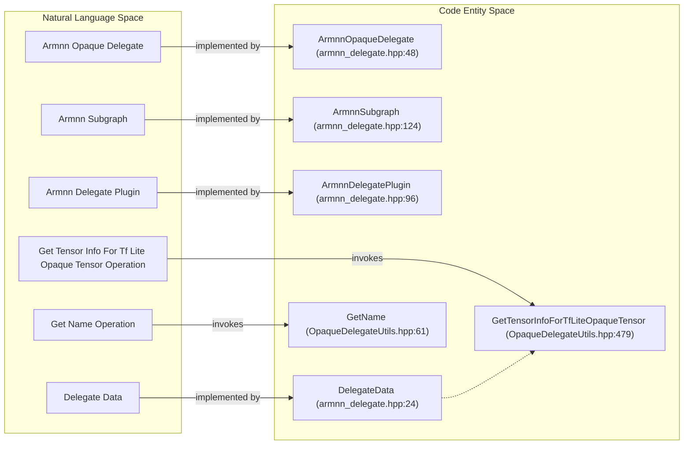
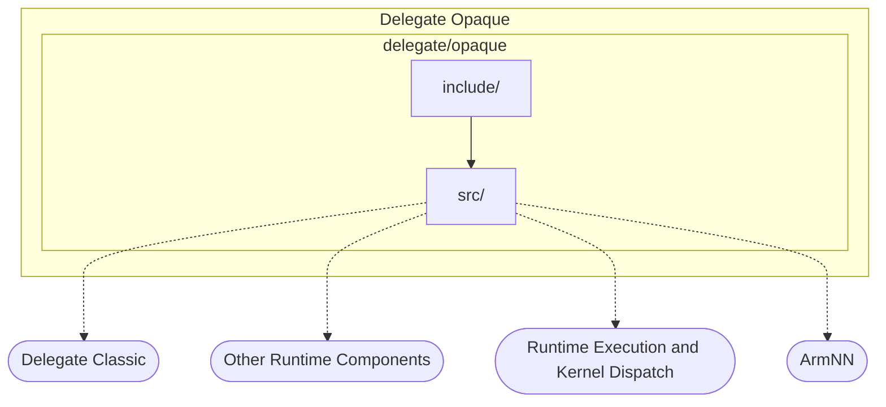
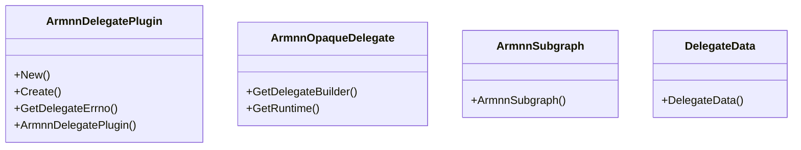
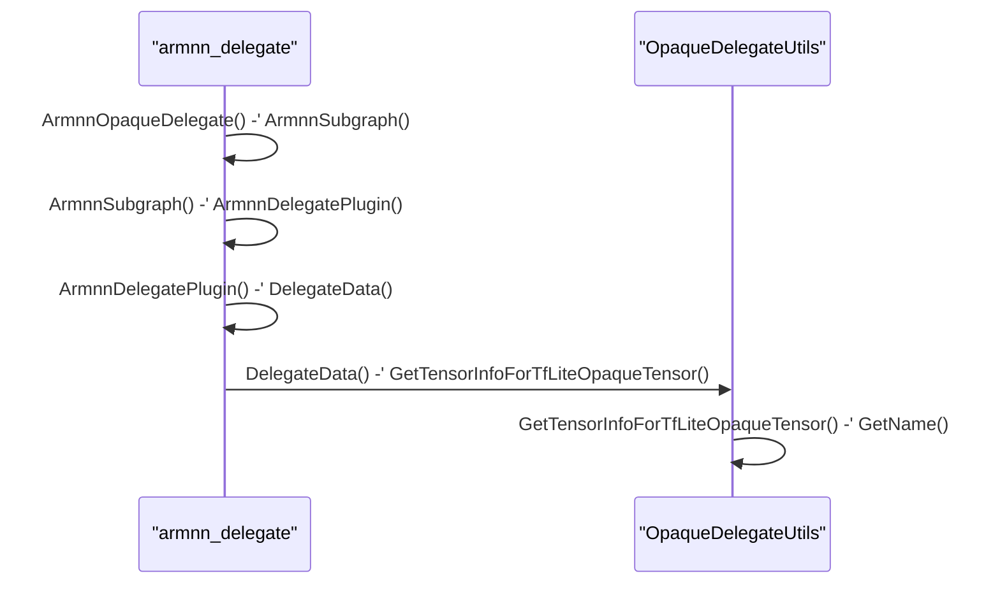

# 3-Source Context Packet (`git` + `CBM` + `llm-wiki`) for `5.3-delegate-opaque` — Delegate Opaque

- **Target Wiki File**: `wiki/5.3-delegate-opaque.md`
- **Archetype**: `Leaf Technical Spec Page`
- **Parent Page**: `5-runtime-execution-and-kernel-dispatch`
- **Summary**: Delegate Opaque subsystem (`delegate/opaque`), covering 28 files and 128 symbols. Key symbols include `GetTensorInfoForTfLiteOpaqueTensor`, `GetName`, `ValidateNumOutputs`, `IsValid`.
- **Valid `[[wikilink]]` Neighbours**: `[[5-runtime-execution-and-kernel-dispatch|Runtime Execution and Kernel Dispatch]]`, `[[3-backend-delegation-and-hardware-providers|Backend Delegation and Hardware Providers]]`, `[[3.1-backends-backendscommon|Backends Backendscommon]]`, `[[3.2-backends-reference|Backends Reference]]`, `[[3.3-backends-opencl|Backends OpenCL]]`, `[[3.4-backends-aclcommon|Backends Aclcommon]]`, `[[3.6-other-backends|Other Backends]]`, `[[5.2-armnn|ArmNN]]`

## 1. Relevant Source Files (`git` + `CBM`, use verbatim in `<details>`)
- `[delegate/opaque/src/OpaqueDelegateUtils.hpp](delegate/opaque/src/OpaqueDelegateUtils.hpp)`
- `[delegate/opaque/include/armnn_delegate.hpp](delegate/opaque/include/armnn_delegate.hpp)`
- `[delegate/opaque/src/Convolution.hpp](delegate/opaque/src/Convolution.hpp)`
- `[delegate/opaque/src/ElementwiseBinary.hpp](delegate/opaque/src/ElementwiseBinary.hpp)`
- `[delegate/opaque/src/armnn_delegate.cpp](delegate/opaque/src/armnn_delegate.cpp)`
- `[delegate/opaque/src/Control.hpp](delegate/opaque/src/Control.hpp)`
- `[delegate/opaque/src/Activation.hpp](delegate/opaque/src/Activation.hpp)`
- `[delegate/opaque/src/BatchSpace.hpp](delegate/opaque/src/BatchSpace.hpp)`
- `[delegate/opaque/src/ArgMinMax.hpp](delegate/opaque/src/ArgMinMax.hpp)`
- `[delegate/opaque/src/BatchMatMul.hpp](delegate/opaque/src/BatchMatMul.hpp)`
- `[delegate/opaque/src/BroadcastTo.hpp](delegate/opaque/src/BroadcastTo.hpp)`
- `[delegate/opaque/src/Comparison.hpp](delegate/opaque/src/Comparison.hpp)`
- `[delegate/opaque/src/Redefine.hpp](delegate/opaque/src/Redefine.hpp)`
- `[delegate/opaque/src/FullyConnected.hpp](delegate/opaque/src/FullyConnected.hpp)`
- `[delegate/opaque/src/ElementwiseUnary.hpp](delegate/opaque/src/ElementwiseUnary.hpp)`
- `[delegate/opaque/src/Fill.hpp](delegate/opaque/src/Fill.hpp)`
- `[delegate/opaque/src/Gather.hpp](delegate/opaque/src/Gather.hpp)`
- `[delegate/opaque/src/LogicalBinary.hpp](delegate/opaque/src/LogicalBinary.hpp)`
- `[delegate/opaque/src/Normalization.hpp](delegate/opaque/src/Normalization.hpp)`
- `[delegate/opaque/src/Pooling.hpp](delegate/opaque/src/Pooling.hpp)`
- `[delegate/opaque/src/GatherNd.hpp](delegate/opaque/src/GatherNd.hpp)`
- `[delegate/opaque/src/Lstm.hpp](delegate/opaque/src/Lstm.hpp)`
- `[delegate/opaque/src/Quantization.hpp](delegate/opaque/src/Quantization.hpp)`
- `[delegate/opaque/src/Pack.hpp](delegate/opaque/src/Pack.hpp)`
- `[delegate/opaque/src/Pad.hpp](delegate/opaque/src/Pad.hpp)`
- `[delegate/opaque/src/Prelu.hpp](delegate/opaque/src/Prelu.hpp)`
- `[delegate/opaque/src/SharedFunctions.cpp](delegate/opaque/src/SharedFunctions.cpp)`
- `[delegate/opaque/src/Split.hpp](delegate/opaque/src/Split.hpp)`

## 2. Grounded Code Symbols (`CBM`, use verbatim for `[file:start-end]()` pill citations)
- `ArmnnOpaqueDelegate` (Class) @ `[delegate/opaque/include/armnn_delegate.hpp:48-86]()` [fan-in=0, fan-out=0] — /// ArmNN Opaque Delegate
- `ArmnnSubgraph` (Class) @ `[delegate/opaque/include/armnn_delegate.hpp:124-167]()` [fan-in=0, fan-out=0] — /// ArmnnSubgraph class where parsing the nodes to ArmNN format and creating the ArmNN Graph
- `ArmnnDelegatePlugin` (Class) @ `[delegate/opaque/include/armnn_delegate.hpp:96-121]()` [fan-in=0, fan-out=0] — 
- `DelegateData` (Class) @ `[delegate/opaque/include/armnn_delegate.hpp:24-34]()` [fan-in=0, fan-out=0] — 
- `GetTensorInfoForTfLiteOpaqueTensor` (Function) @ `[delegate/opaque/src/OpaqueDelegateUtils.hpp:479-590]()` [fan-in=55, fan-out=12] — (const TfLiteOpaqueTensor* tfLiteTensor, bool isOutput = false)
- `GetName` (Function) @ `[delegate/opaque/src/OpaqueDelegateUtils.hpp:61-64]()` [fan-in=52, fan-out=8] — (armnn::LayerType layerType, int nodeIndex, std::string subname = \"\")
- `Connect` (Function) @ `[delegate/opaque/src/OpaqueDelegateUtils.hpp:205-258]()` [fan-in=47, fan-out=0] — // Connects the layer to the graph
- `ValidateNumOutputs` (Function) @ `[delegate/opaque/src/OpaqueDelegateUtils.hpp:129-143]()` [fan-in=49, fan-out=0] — (TfLiteOpaqueContext* tfLiteContext, TfLiteOpaqueNode* tfLiteNode, const unsigned int expectedSize, int nodeIn
- `IsValid` (Function) @ `[delegate/opaque/src/OpaqueDelegateUtils.hpp:170-192]()` [fan-in=48, fan-out=1] — (TfLiteOpaqueContext* tfLiteContext, const TfLiteOpaqueTensor* tfLiteTensor, int32_t operatorCode, int32_t nod
- `ProcessInputs` (Function) @ `[delegate/opaque/src/OpaqueDelegateUtils.hpp:637-692]()` [fan-in=41, fan-out=7] — (armnn::IConnectableLayer* layer, armnnOpaqueDelegate::DelegateData& delegateData, TfLiteOpaqueContext* tfLite
- `ValidateNumInputs` (Function) @ `[delegate/opaque/src/OpaqueDelegateUtils.hpp:113-127]()` [fan-in=41, fan-out=0] — (TfLiteOpaqueContext* tfLiteContext, TfLiteOpaqueNode* tfLiteNode, const unsigned int expectedSize, int nodeIn
- `VisitNode` (Method) @ `[delegate/opaque/src/armnn_delegate.cpp:706-1298]()` [fan-in=2, fan-out=47] — (DelegateData& delegateData, TfLiteOpaqueContext* tfLiteContext, TfLiteRegistrationExternal* tfLiteRegistratio
- `VisitElementwiseBinaryOperator` (Function) @ `[delegate/opaque/src/ElementwiseBinary.hpp:291-537]()` [fan-in=1, fan-out=25] — (DelegateData& delegateData, TfLiteOpaqueContext* tfLiteContext, TfLiteOpaqueNode* tfLiteNode, int nodeIndex, 
- `IsConstantTensor` (Function) @ `[delegate/opaque/src/OpaqueDelegateUtils.hpp:145-153]()` [fan-in=13, fan-out=0] — (const TfLiteOpaqueTensor* tfLiteTensor)
- `Create` (Method) @ `[delegate/opaque/src/armnn_delegate.cpp:471-619]()` [fan-in=1, fan-out=26] — (TfLiteOpaqueContext* tfLiteContext, const TfLiteOpaqueDelegateParams* parameters, const ArmnnOpaqueDelegate* 
- `VisitConv2dOperator` (Function) @ `[delegate/opaque/src/Convolution.hpp:18-246]()` [fan-in=1, fan-out=23] — (DelegateData& delegateData, TfLiteOpaqueContext* tfLiteContext, TfLiteOpaqueNode* tfLiteNode, int nodeIndex, 
- `VisitTransposeConv2dOperator` (Function) @ `[delegate/opaque/src/Convolution.hpp:687-965]()` [fan-in=1, fan-out=23] — (DelegateData& delegateData, TfLiteOpaqueContext* tfLiteContext, TfLiteOpaqueNode* tfLiteNode, int nodeIndex, 
- `VisitDepthwiseConv2dOperator` (Function) @ `[delegate/opaque/src/Convolution.hpp:248-469]()` [fan-in=1, fan-out=22] — (DelegateData& delegateData, TfLiteOpaqueContext* tfLiteContext, TfLiteOpaqueNode* tfLiteNode, int nodeIndex, 
- `FusedActivation` (Function) @ `[delegate/opaque/src/OpaqueDelegateUtils.hpp:260-357]()` [fan-in=9, fan-out=4] — (TfLiteOpaqueContext* tfLiteContext, TfLiteOpaqueNode* tfLiteNode, TfLiteFusedActivation activationType, armnn
- `VisitConv3dOperator` (Function) @ `[delegate/opaque/src/Convolution.hpp:471-683]()` [fan-in=1, fan-out=19] — (DelegateData& delegateData, TfLiteOpaqueContext* tfLiteContext, TfLiteOpaqueNode* tfLiteNode, int nodeIndex, 
- `VisitFullyConnectedOperator` (Function) @ `[delegate/opaque/src/FullyConnected.hpp:14-305]()` [fan-in=1, fan-out=23] — (DelegateData& delegateData, TfLiteOpaqueContext* tfLiteContext, TfLiteOpaqueNode* tfLiteNode, int nodeIndex, 
- `ArmnnOpaqueDelegate` (Method) @ `[delegate/opaque/src/armnn_delegate.cpp:133-172]()` [fan-in=1, fan-out=17] — (armnnDelegate::DelegateOptions options)

## 3. Grounded Source Code Excerpts (`git` Working Tree)
### `ArmnnOpaqueDelegate` in `[delegate/opaque/include/armnn_delegate.hpp:48-63]()`
```cpp
class ArmnnOpaqueDelegate
{
    friend class ArmnnSubgraph;
public:
    explicit ArmnnOpaqueDelegate(armnnDelegate::DelegateOptions options);

    TfLiteIntArray* IdentifyOperatorsToDelegate(TfLiteOpaqueContext* context);

    TfLiteOpaqueDelegateBuilder* GetDelegateBuilder() { return &m_Builder; }

    /// Retrieve version in X.Y.Z form
    static const std::string GetVersion();

private:
    /**
     * Returns a pointer to the armnn::IRuntime* this will be shared by all armnn_delegates.
```

### `ArmnnSubgraph` in `[delegate/opaque/include/armnn_delegate.hpp:124-139]()`
```cpp
class ArmnnSubgraph
{
public:
    static ArmnnSubgraph* Create(TfLiteOpaqueContext* tfLiteContext,
                                 const TfLiteOpaqueDelegateParams* parameters,
                                 const ArmnnOpaqueDelegate* delegate);

    ~ArmnnSubgraph();

    TfLiteStatus Prepare(TfLiteOpaqueContext* tfLiteContext);

    TfLiteStatus Invoke(TfLiteOpaqueContext* tfLiteContext, TfLiteOpaqueNode* tfLiteNode);

    static TfLiteStatus VisitNode(DelegateData& delegateData,
                                  TfLiteOpaqueContext* tfLiteContext,
                                  TfLiteRegistrationExternal* tfLiteRegistration,
```

### `ArmnnDelegatePlugin` in `[delegate/opaque/include/armnn_delegate.hpp:96-111]()`
```cpp
class ArmnnDelegatePlugin : public DelegatePluginInterface
{
public:
    static std::unique_ptr<ArmnnDelegatePlugin> New(const tflite::TFLiteSettings& tfliteSettings)
    {
        return std::make_unique<ArmnnDelegatePlugin>(tfliteSettings);
    }

    tflite::delegates::TfLiteDelegatePtr Create() override
    {
        return tflite::delegates::TfLiteDelegatePtr(TfLiteArmnnOpaqueDelegateCreate(m_delegateOptions),
                                                    TfLiteArmnnOpaqueDelegateDelete);
    }

    int GetDelegateErrno(TfLiteOpaqueDelegate* from_delegate) override
    {
```

### `DelegateData` in `[delegate/opaque/include/armnn_delegate.hpp:24-34]()`
```cpp
struct DelegateData
{
    DelegateData(const std::vector<armnn::BackendId>& backends)
    : m_Backends(backends)
    , m_Network(nullptr, nullptr)
    {}

    const std::vector<armnn::BackendId>       m_Backends;
    armnn::INetworkPtr                        m_Network;
    std::vector<armnn::IOutputSlot*>          m_OutputSlotForNode;
};
```

### `GetTensorInfoForTfLiteOpaqueTensor` in `[delegate/opaque/src/OpaqueDelegateUtils.hpp:479-494]()`
```cpp
armnn::TensorInfo GetTensorInfoForTfLiteOpaqueTensor(const TfLiteOpaqueTensor* tfLiteTensor, bool isOutput = false)
{
    armnn::DataType type = GetDataType(tfLiteTensor);
    armnn::TensorInfo ret;

    auto tensorDimensionSize = TfLiteOpaqueTensorNumDims(tfLiteTensor);
    if (tensorDimensionSize == 0)
    {
        // If input tensor does not have a shape
        // assuming that it has 1D tensor
        if (!isOutput)
        {
            std::vector<unsigned int> safeShape = { 1 };
            bool dimensionsSpecificity[1] = { true };

            armnn::TensorShape tensorShape(safeShape.size(),
```


## 4. Linked Official Docs (`llm-wiki` / `RAG`)
- **Delegate Classic** (`wiki/5.4-delegate-classic.md`, score=120.864, shared_symbols=['ArmnnSubgraph', 'Connect', 'FusedActivation', 'GetRuntime', 'GetTensorInfoForTfLiteOpaqueTensor', 'IsDynamicTensor', 'IsValid', 'ProcessInputs']): # Delegate Classic ↑ [[5-runtime-execution-and-kernel-dispatch|Runtime Execution and Kernel Dispatch]] > Delegate Classic subsystem (`delegate/classic`), covering 28 files and 114 symbols. Key symbols include `GetTensorInfoForTfLiteTensor`, `GetLayerName`, `Connect`, `ValidateNumOutputs`. <details> <summary>Relevant source files</summary> The following f
- **ArmNN DeepWiki** (`wiki/index.md`, score=96.935, shared_symbols=['Connect', 'GetTensorInfoForTfLiteOpaqueTensor', 'ValidateNumInputs', 'ValidateNumOutputs']): # ArmNN DeepWiki Generated from `home-jason-Project-deepwiki-armnn` at commit `2b61cecc9df7` (2026-11-14T15:13:53+00:00). ## Pages - [[1-overview|Overview]] — End-to-end architecture overview of ArmNN: core subsystems, compilation/execution pipeline, entry points, and cross-module dependencies. - [[2-build-system-and-infrastructure|Build System and Infras
- **Runtime Execution and Kernel Dispatch** (`wiki/5-runtime-execution-and-kernel-dispatch.md`, score=91.28, shared_symbols=['Connect', 'GetTensorInfoForTfLiteOpaqueTensor', 'IsValid', 'ValidateNumOutputs']): # Runtime Execution and Kernel Dispatch > Architectural overview of Runtime Execution and Kernel Dispatch, spanning 157 source files and 3718 code symbols across 6 subsystems. <details> <summary>Relevant source files</summary> The following files were used as context for generating this wiki page: - [samples/common/include/Audio/DataStructures.hpp](sampl
- **Overview** (`wiki/1-overview.md`, score=67.638, shared_symbols=['Connect', 'GetTensorInfoForTfLiteOpaqueTensor']): # Overview > End-to-end architecture overview of ArmNN: core subsystems, compilation/execution pipeline, entry points, and cross-module dependencies. <details> <summary>Relevant source files</summary> The following files were used as context for generating this wiki page: - [src/armnn/Tensor.cpp](src/armnn/Tensor.cpp) - [include/armnn/Exceptions.hpp](inc
- **ArmNN** (`wiki/5.1-armnn.md`, score=57.161, shared_symbols=['Connect']): # ArmNN ↑ [[5-runtime-execution-and-kernel-dispatch|Runtime Execution and Kernel Dispatch]] > ArmNN subsystem (`src/armnn`), covering 28 files and 1007 symbols. Key symbols include `SetTensorInfo`, `Connect`, `end`, `GetName`. <details> <summary>Relevant source files</summary> The following files were used as context for generating this wiki page: - [sr
- **ArmNN** (`wiki/5.2-armnn.md`, score=55.605, shared_symbols=[]): # ArmNN ↑ [[5-runtime-execution-and-kernel-dispatch|Runtime Execution and Kernel Dispatch]] > ArmNN subsystem (`include/armnn`), covering 21 files and 440 symbols. Key symbols include `GetShape`, `InvalidArgumentException`, `GetNumElements`, `Exception`. <details> <summary>Relevant source files</summary> The following files were used as context for gener

## 5. Pre-Verified DeepWiki v1.9.9.5 Mermaid Diagrams
### Natural Language Space <-> Code Entity Space


### Subsystem Architecture Flowchart


### Class Hierarchy Diagram


### Call Sequence Diagram


## 6. DeepWiki v1.9.9.5 Authoring Checklist for `wiki/5.3-delegate-opaque.md`
1. Keep YAML frontmatter at top (`id`, `title`, `parent`, `sources`, `linked_docs`, `bridge_symbols`).
2. Keep `<details><summary>Relevant source files</summary>` block immediately after `# Title`.
3. Start with `## Purpose and Scope`, then numbered `## 1. ...`, `## 2. ...` sections separated by `---`.
4. Include at least 2 ```mermaid``` diagrams (including a `Natural Language Space` <-> `Code Entity Space` mapping).
5. Cite code entities inline using `[path/to/file.ext:start-end]()` and end every `##` section with `Sources: [file:start-end]()`.
6. Run `deepwiki_cli.py build --enrich-only ...` and `deepwiki_cli.py validate ...` after editing.
