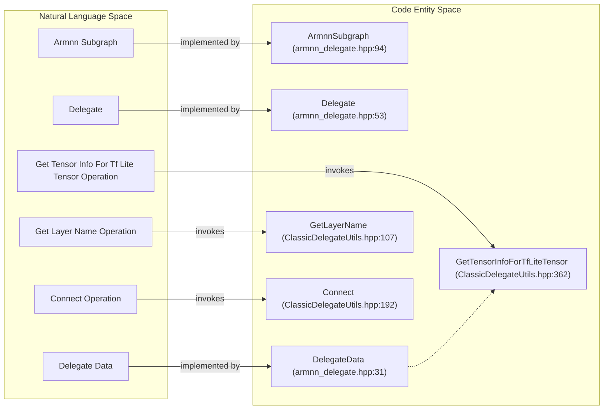
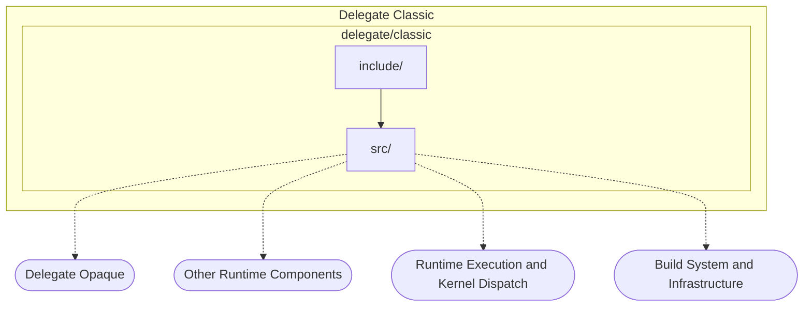
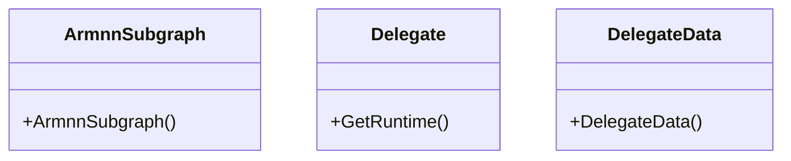
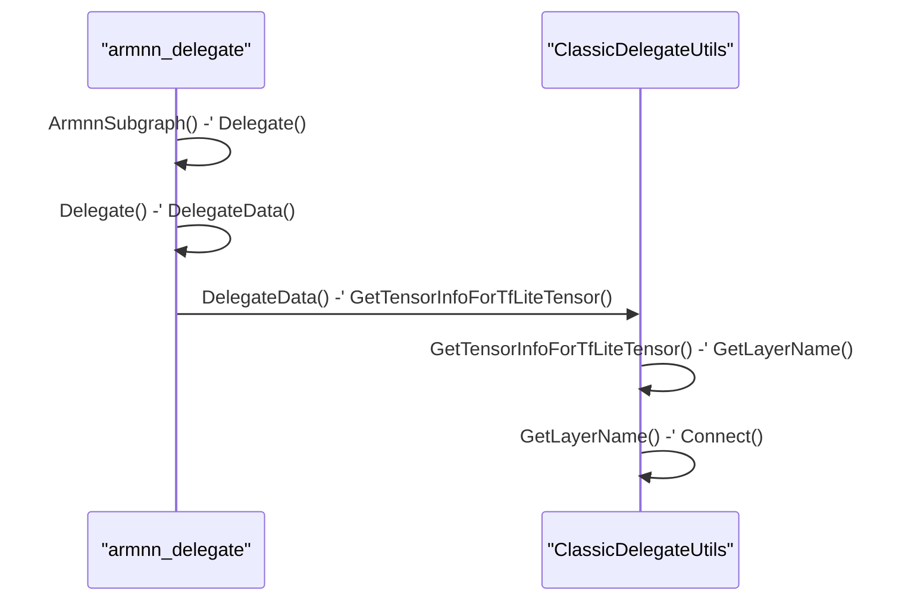

# 3-Source Context Packet (`git` + `CBM` + `llm-wiki`) for `5.4-delegate-classic` — Delegate Classic

- **Target Wiki File**: `wiki/5.4-delegate-classic.md`
- **Archetype**: `Leaf Technical Spec Page`
- **Parent Page**: `5-runtime-execution-and-kernel-dispatch`
- **Summary**: Delegate Classic subsystem (`delegate/classic`), covering 28 files and 114 symbols. Key symbols include `GetTensorInfoForTfLiteTensor`, `GetLayerName`, `Connect`, `ValidateNumOutputs`.
- **Valid `[[wikilink]]` Neighbours**: `[[5-runtime-execution-and-kernel-dispatch|Runtime Execution and Kernel Dispatch]]`, `[[3-backend-delegation-and-hardware-providers|Backend Delegation and Hardware Providers]]`, `[[3.1-backends-backendscommon|Backends Backendscommon]]`, `[[3.2-backends-reference|Backends Reference]]`, `[[3.3-backends-opencl|Backends OpenCL]]`, `[[3.4-backends-aclcommon|Backends Aclcommon]]`, `[[3.6-other-backends|Other Backends]]`, `[[5.2-armnn|ArmNN]]`

## 1. Relevant Source Files (`git` + `CBM`, use verbatim in `<details>`)
- `[delegate/classic/src/ClassicDelegateUtils.hpp](delegate/classic/src/ClassicDelegateUtils.hpp)`
- `[delegate/classic/src/Convolution.hpp](delegate/classic/src/Convolution.hpp)`
- `[delegate/classic/src/armnn_delegate.cpp](delegate/classic/src/armnn_delegate.cpp)`
- `[delegate/classic/include/armnn_delegate.hpp](delegate/classic/include/armnn_delegate.hpp)`
- `[delegate/classic/src/ElementwiseBinary.hpp](delegate/classic/src/ElementwiseBinary.hpp)`
- `[delegate/classic/src/Control.hpp](delegate/classic/src/Control.hpp)`
- `[delegate/classic/src/BatchSpace.hpp](delegate/classic/src/BatchSpace.hpp)`
- `[delegate/classic/src/Activation.hpp](delegate/classic/src/Activation.hpp)`
- `[delegate/classic/src/ArgMinMax.hpp](delegate/classic/src/ArgMinMax.hpp)`
- `[delegate/classic/src/BroadcastTo.hpp](delegate/classic/src/BroadcastTo.hpp)`
- `[delegate/classic/src/BatchMatMul.hpp](delegate/classic/src/BatchMatMul.hpp)`
- `[delegate/classic/src/Redefine.hpp](delegate/classic/src/Redefine.hpp)`
- `[delegate/classic/src/Comparison.hpp](delegate/classic/src/Comparison.hpp)`
- `[delegate/classic/src/FullyConnected.hpp](delegate/classic/src/FullyConnected.hpp)`
- `[delegate/classic/src/ElementwiseUnary.hpp](delegate/classic/src/ElementwiseUnary.hpp)`
- `[delegate/classic/src/Fill.hpp](delegate/classic/src/Fill.hpp)`
- `[delegate/classic/src/Pooling.hpp](delegate/classic/src/Pooling.hpp)`
- `[delegate/classic/src/Gather.hpp](delegate/classic/src/Gather.hpp)`
- `[delegate/classic/src/Normalization.hpp](delegate/classic/src/Normalization.hpp)`
- `[delegate/classic/src/GatherNd.hpp](delegate/classic/src/GatherNd.hpp)`
- `[delegate/classic/src/LogicalBinary.hpp](delegate/classic/src/LogicalBinary.hpp)`
- `[delegate/classic/src/Lstm.hpp](delegate/classic/src/Lstm.hpp)`
- `[delegate/classic/src/Quantization.hpp](delegate/classic/src/Quantization.hpp)`
- `[delegate/classic/src/Pack.hpp](delegate/classic/src/Pack.hpp)`
- `[delegate/classic/src/Pad.hpp](delegate/classic/src/Pad.hpp)`
- `[delegate/classic/src/Prelu.hpp](delegate/classic/src/Prelu.hpp)`
- `[delegate/classic/src/SharedFunctions.cpp](delegate/classic/src/SharedFunctions.cpp)`
- `[delegate/classic/src/Reduce.hpp](delegate/classic/src/Reduce.hpp)`

## 2. Grounded Code Symbols (`CBM`, use verbatim for `[file:start-end]()` pill citations)
- `ArmnnSubgraph` (Class) @ `[delegate/classic/include/armnn_delegate.hpp:94-141]()` [fan-in=0, fan-out=0] — /// ArmnnSubgraph class where parsing the nodes to ArmNN format and creating the ArmNN Graph
- `Delegate` (Class) @ `[delegate/classic/include/armnn_delegate.hpp:53-91]()` [fan-in=0, fan-out=0] — /// ArmNN Delegate
- `DelegateData` (Class) @ `[delegate/classic/include/armnn_delegate.hpp:31-41]()` [fan-in=0, fan-out=0] — 
- `GetTensorInfoForTfLiteTensor` (Function) @ `[delegate/classic/src/ClassicDelegateUtils.hpp:362-466]()` [fan-in=55, fan-out=12] — (const TfLiteTensor& tfLiteTensor, bool isOutput = false)
- `GetLayerName` (Function) @ `[delegate/classic/src/ClassicDelegateUtils.hpp:107-110]()` [fan-in=51, fan-out=8] — (armnn::LayerType layerType, int nodeIndex, std::string name = \"\")
- `Connect` (Function) @ `[delegate/classic/src/ClassicDelegateUtils.hpp:192-218]()` [fan-in=50, fan-out=0] — (armnn::IConnectableLayer* layer, TfLiteNode* tfLiteNode, armnnDelegate::DelegateData& data)
- `ValidateNumOutputs` (Function) @ `[delegate/classic/src/ClassicDelegateUtils.hpp:128-142]()` [fan-in=49, fan-out=0] — (TfLiteContext* tfLiteContext, TfLiteNode* tfLiteNode, const unsigned int expectedSize, int nodeIndex)
- `ProcessInputs` (Function) @ `[delegate/classic/src/ClassicDelegateUtils.hpp:498-540]()` [fan-in=40, fan-out=6] — (armnn::IConnectableLayer* layer, armnnDelegate::DelegateData& delegateData, TfLiteContext* tfLiteContext, TfL
- `ValidateNumInputs` (Function) @ `[delegate/classic/src/ClassicDelegateUtils.hpp:112-126]()` [fan-in=41, fan-out=0] — (TfLiteContext* tfLiteContext, TfLiteNode* tfLiteNode, const unsigned int expectedSize, int nodeIndex)
- `IsValid` (Function) @ `[delegate/classic/src/ClassicDelegateUtils.hpp:159-180]()` [fan-in=36, fan-out=1] — (TfLiteContext* tfLiteContext, const TfLiteTensor& tfLiteTensor, int32_t operatorCode, int32_t nodeIndex)
- `Create` (Method) @ `[delegate/classic/src/armnn_delegate.cpp:348-497]()` [fan-in=15, fan-out=26] — (TfLiteContext* tfLiteContext, const TfLiteDelegateParams* parameters, const Delegate* delegate)
- `VisitNode` (Method) @ `[delegate/classic/src/armnn_delegate.cpp:543-1131]()` [fan-in=2, fan-out=47] — (DelegateData& delegateData, TfLiteContext* tfLiteContext, TfLiteRegistration* tfLiteRegistration, TfLiteNode*
- `IsDynamicTensor` (Function) @ `[delegate/classic/src/ClassicDelegateUtils.hpp:144-152]()` [fan-in=18, fan-out=0] — (const TfLiteTensor& tfLiteTensor)
- `VisitTransposeConv2dOperator` (Function) @ `[delegate/classic/src/Convolution.hpp:613-880]()` [fan-in=1, fan-out=28] — (DelegateData& delegateData, TfLiteContext* tfLiteContext, TfLiteNode* tfLiteNode, int nodeIndex, int32_t oper
- `VisitConv2dOperator` (Function) @ `[delegate/classic/src/Convolution.hpp:21-224]()` [fan-in=1, fan-out=24] — (DelegateData& delegateData, TfLiteContext* tfLiteContext, TfLiteNode* tfLiteNode, int nodeIndex, int32_t oper
- `VisitDepthwiseConv2dOperator` (Function) @ `[delegate/classic/src/Convolution.hpp:416-611]()` [fan-in=1, fan-out=23] — (DelegateData& delegateData, TfLiteContext* tfLiteContext, TfLiteNode* tfLiteNode, int nodeIndex, int32_t oper
- `VisitElementwiseBinaryOperator` (Function) @ `[delegate/classic/src/ElementwiseBinary.hpp:299-525]()` [fan-in=1, fan-out=25] — (DelegateData& delegateData, TfLiteContext* tfLiteContext, TfLiteNode* tfLiteNode, int nodeIndex, int32_t elem
- `FusedActivation` (Function) @ `[delegate/classic/src/ClassicDelegateUtils.hpp:220-312]()` [fan-in=9, fan-out=4] — (TfLiteContext* tfLiteContext, TfLiteNode* tfLiteNode, TfLiteFusedActivation activationType, armnn::IConnectab
- `VisitConv3dOperator` (Function) @ `[delegate/classic/src/Convolution.hpp:228-413]()` [fan-in=1, fan-out=19] — (DelegateData& delegateData, TfLiteContext* tfLiteContext, TfLiteNode* tfLiteNode, int nodeIndex, int32_t oper
- `VisitFullyConnectedOperator` (Function) @ `[delegate/classic/src/FullyConnected.hpp:21-292]()` [fan-in=1, fan-out=23] — (DelegateData& delegateData, TfLiteContext* tfLiteContext, TfLiteNode* tfLiteNode, int nodeIndex, int32_t oper
- `Delegate` (Method) @ `[delegate/classic/src/armnn_delegate.cpp:140-179]()` [fan-in=1, fan-out=17] — (armnnDelegate::DelegateOptions options)
- `VisitMeanOperator` (Function) @ `[delegate/classic/src/Control.hpp:164-302]()` [fan-in=1, fan-out=16] — (DelegateData& delegateData, TfLiteContext* tfLiteContext, TfLiteNode* tfLiteNode, int nodeIndex, int32_t tfLi

## 3. Grounded Source Code Excerpts (`git` Working Tree)
### `ArmnnSubgraph` in `[delegate/classic/include/armnn_delegate.hpp:94-109]()`
```cpp
class ArmnnSubgraph
{
public:
    static ArmnnSubgraph* Create(TfLiteContext* tfLiteContext,
                                 const TfLiteDelegateParams* parameters,
                                 const Delegate* delegate);

    ~ArmnnSubgraph();

    TfLiteStatus Prepare(TfLiteContext* tfLiteContext);

    TfLiteStatus Invoke(TfLiteContext* tfLiteContext, TfLiteNode* tfLiteNode);

    static TfLiteStatus VisitNode(DelegateData& delegateData,
                                  TfLiteContext* tfLiteContext,
                                  TfLiteRegistration* tfLiteRegistration,
```

### `Delegate` in `[delegate/classic/include/armnn_delegate.hpp:53-68]()`
```cpp
class Delegate
{
    friend class ArmnnSubgraph;
public:
    explicit Delegate(armnnDelegate::DelegateOptions options);

    TfLiteIntArray* IdentifyOperatorsToDelegate(TfLiteContext* context);

    TfLiteDelegate* GetDelegate();

    /// Retrieve version in X.Y.Z form
    static const std::string GetVersion();

private:
    /**
     * Returns a pointer to the armnn::IRuntime* this will be shared by all armnn_delegates.
```

### `DelegateData` in `[delegate/classic/include/armnn_delegate.hpp:31-41]()`
```cpp
struct DelegateData
{
    DelegateData(const std::vector<armnn::BackendId>& backends)
            : m_Backends(backends)
            , m_Network(nullptr, nullptr)
    {}

    const std::vector<armnn::BackendId>       m_Backends;
    armnn::INetworkPtr                        m_Network;
    std::vector<armnn::IOutputSlot*>          m_OutputSlotForNode;
};
```

### `GetTensorInfoForTfLiteTensor` in `[delegate/classic/src/ClassicDelegateUtils.hpp:362-377]()`
```cpp
armnn::TensorInfo GetTensorInfoForTfLiteTensor(const TfLiteTensor& tfLiteTensor, bool isOutput = false)
{
    armnn::DataType type = GetDataType(tfLiteTensor);
    armnn::TensorInfo ret;
    auto tensorDimensionSize = tfLiteTensor.dims->size;
    if (tensorDimensionSize == 0)
    {
        // If input tensor does not have a shape
        // assuming that it has 1D tensor
        if (!isOutput)
        {
            std::vector<unsigned int> safeShape = { 1 };
            bool dimensionsSpecificity[1] = { true };
            armnn::TensorShape tensorShape(safeShape.size(),
                                           safeShape.data(),
                                           dimensionsSpecificity);
```

### `GetLayerName` in `[delegate/classic/src/ClassicDelegateUtils.hpp:107-110]()`
```cpp
std::string GetLayerName(armnn::LayerType layerType, int nodeIndex, std::string name = "")
{
    return fmt::format("{}{}:{}", GetLayerTypeAsCString(layerType), name, nodeIndex);
}
```


## 4. Linked Official Docs (`llm-wiki` / `RAG`)
- **Delegate Opaque** (`wiki/5.3-delegate-opaque.md`, score=109.359, shared_symbols=['Connect', 'FusedActivation', 'GetLayerName', 'GetRuntime', 'GetTensorInfoForTfLiteTensor', 'IsDynamicTensor', 'IsValid', 'ProcessInputs']): # Delegate Opaque ↑ [[5-runtime-execution-and-kernel-dispatch|Runtime Execution and Kernel Dispatch]] > Delegate Opaque subsystem (`delegate/opaque`), covering 28 files and 128 symbols. Key symbols include `GetTensorInfoForTfLiteOpaqueTensor`, `GetName`, `ValidateNumOutputs`, `IsValid`. <details> <summary>Relevant source files</summary> The following fil
- **ArmNN DeepWiki** (`wiki/index.md`, score=89.203, shared_symbols=['Connect', 'GetLayerName', 'GetTensorInfoForTfLiteTensor', 'ValidateNumInputs', 'ValidateNumOutputs']): # ArmNN DeepWiki Generated from `home-jason-Project-deepwiki-armnn` at commit `2b61cecc9df7` (2026-11-14T15:13:53+00:00). ## Pages - [[1-overview|Overview]] — End-to-end architecture overview of ArmNN: core subsystems, compilation/execution pipeline, entry points, and cross-module dependencies. - [[2-build-system-and-infrastructure|Build System and Infras
- **Runtime Execution and Kernel Dispatch** (`wiki/5-runtime-execution-and-kernel-dispatch.md`, score=81.068, shared_symbols=['Connect', 'GetLayerName', 'GetTensorInfoForTfLiteTensor', 'IsValid', 'ValidateNumOutputs']): # Runtime Execution and Kernel Dispatch > Architectural overview of Runtime Execution and Kernel Dispatch, spanning 157 source files and 3718 code symbols across 6 subsystems. <details> <summary>Relevant source files</summary> The following files were used as context for generating this wiki page: - [samples/common/include/Audio/DataStructures.hpp](sampl
- **Overview** (`wiki/1-overview.md`, score=61.592, shared_symbols=['Connect', 'GetLayerName', 'GetTensorInfoForTfLiteTensor']): # Overview > End-to-end architecture overview of ArmNN: core subsystems, compilation/execution pipeline, entry points, and cross-module dependencies. <details> <summary>Relevant source files</summary> The following files were used as context for generating this wiki page: - [src/armnn/Tensor.cpp](src/armnn/Tensor.cpp) - [include/armnn/Exceptions.hpp](inc
- **ArmNN** (`wiki/5.1-armnn.md`, score=53.023, shared_symbols=['Connect']): # ArmNN ↑ [[5-runtime-execution-and-kernel-dispatch|Runtime Execution and Kernel Dispatch]] > ArmNN subsystem (`src/armnn`), covering 28 files and 1007 symbols. Key symbols include `SetTensorInfo`, `Connect`, `end`, `GetName`. <details> <summary>Relevant source files</summary> The following files were used as context for generating this wiki page: - [sr
- **Armnnutils** (`wiki/5.5-armnnutils.md`, score=49.402, shared_symbols=['Delegate']): # Armnnutils ↑ [[5-runtime-execution-and-kernel-dispatch|Runtime Execution and Kernel Dispatch]] > Armnnutils subsystem (`src/armnnUtils`), covering 24 files and 134 symbols. Key symbols include `Permuted`, `Permute`, `GetTensorInfo`, `GetStream`. <details> <summary>Relevant source files</summary> The following files were used as context for generating t

## 5. Pre-Verified DeepWiki v1.9.9.5 Mermaid Diagrams
### Natural Language Space <-> Code Entity Space


### Subsystem Architecture Flowchart


### Class Hierarchy Diagram


### Call Sequence Diagram


## 6. DeepWiki v1.9.9.5 Authoring Checklist for `wiki/5.4-delegate-classic.md`
1. Keep YAML frontmatter at top (`id`, `title`, `parent`, `sources`, `linked_docs`, `bridge_symbols`).
2. Keep `<details><summary>Relevant source files</summary>` block immediately after `# Title`.
3. Start with `## Purpose and Scope`, then numbered `## 1. ...`, `## 2. ...` sections separated by `---`.
4. Include at least 2 ```mermaid``` diagrams (including a `Natural Language Space` <-> `Code Entity Space` mapping).
5. Cite code entities inline using `[path/to/file.ext:start-end]()` and end every `##` section with `Sources: [file:start-end]()`.
6. Run `deepwiki_cli.py build --enrich-only ...` and `deepwiki_cli.py validate ...` after editing.
