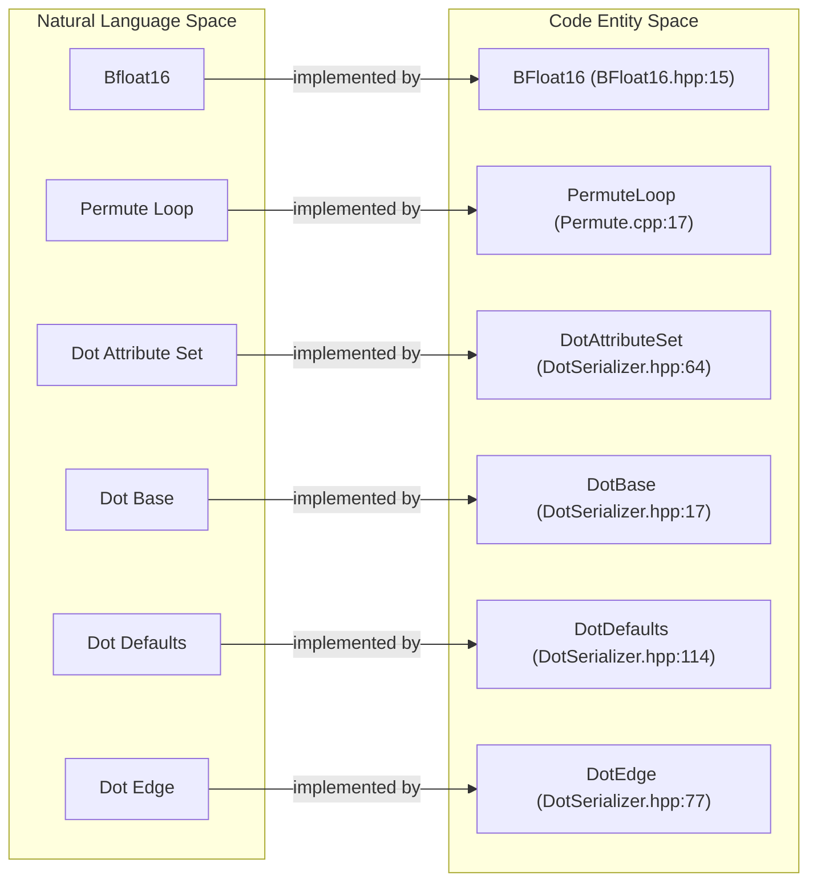
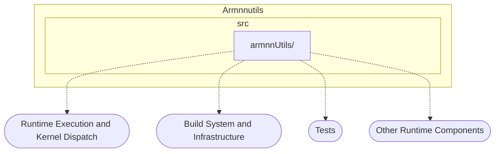
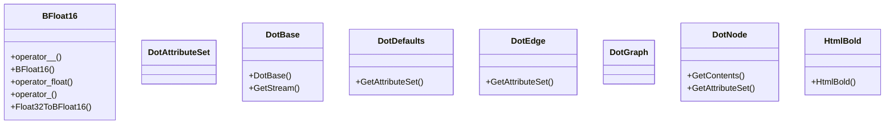
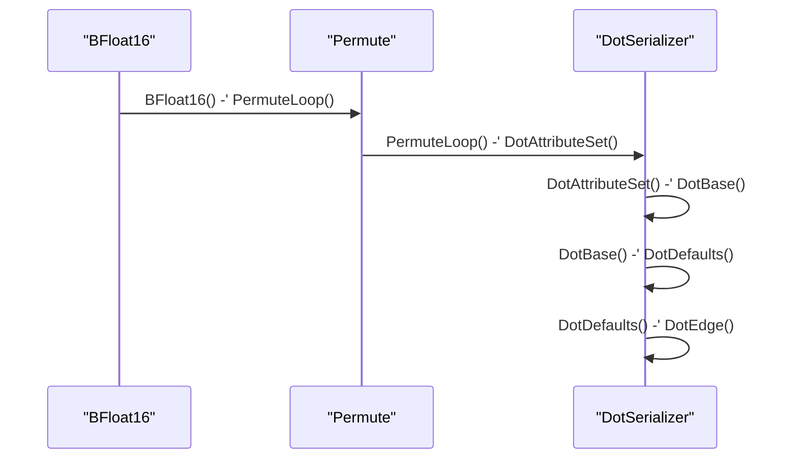

# 3-Source Context Packet (`git` + `CBM` + `llm-wiki`) for `5.5-armnnutils` — Armnnutils

- **Target Wiki File**: `wiki/5.5-armnnutils.md`
- **Archetype**: `Leaf Technical Spec Page`
- **Parent Page**: `5-runtime-execution-and-kernel-dispatch`
- **Summary**: Armnnutils subsystem (`src/armnnUtils`), covering 24 files and 134 symbols. Key symbols include `Permuted`, `Permute`, `GetTensorInfo`, `GetStream`.
- **Valid `[[wikilink]]` Neighbours**: `[[5-runtime-execution-and-kernel-dispatch|Runtime Execution and Kernel Dispatch]]`, `[[3-backend-delegation-and-hardware-providers|Backend Delegation and Hardware Providers]]`, `[[3.1-backends-backendscommon|Backends Backendscommon]]`, `[[3.2-backends-reference|Backends Reference]]`, `[[3.6-other-backends|Other Backends]]`, `[[5.1-armnn|ArmNN]]`, `[[5.2-armnn|ArmNN]]`, `[[5.6-other-runtime-components|Other Runtime Components]]`

## 1. Relevant Source Files (`git` + `CBM`, use verbatim in `<details>`)
- `[src/armnnUtils/Permute.cpp](src/armnnUtils/Permute.cpp)`
- `[src/armnnUtils/TensorUtils.cpp](src/armnnUtils/TensorUtils.cpp)`
- `[src/armnnUtils/DotSerializer.hpp](src/armnnUtils/DotSerializer.hpp)`
- `[src/armnnUtils/BFloat16.hpp](src/armnnUtils/BFloat16.hpp)`
- `[src/armnnUtils/LeakChecking.cpp](src/armnnUtils/LeakChecking.cpp)`
- `[src/armnnUtils/DotSerializer.cpp](src/armnnUtils/DotSerializer.cpp)`
- `[src/armnnUtils/Half.hpp](src/armnnUtils/Half.hpp)`
- `[src/armnnUtils/HeapProfiling.hpp](src/armnnUtils/HeapProfiling.hpp)`
- `[src/armnnUtils/LeakChecking.hpp](src/armnnUtils/LeakChecking.hpp)`
- `[src/armnnUtils/Transpose.cpp](src/armnnUtils/Transpose.cpp)`
- `[src/armnnUtils/ParserPrototxtFixture.hpp](src/armnnUtils/ParserPrototxtFixture.hpp)`
- `[src/armnnUtils/Filesystem.cpp](src/armnnUtils/Filesystem.cpp)`
- `[src/armnnUtils/ModelAccuracyChecker.hpp](src/armnnUtils/ModelAccuracyChecker.hpp)`
- `[src/armnnUtils/FloatingPointConverter.cpp](src/armnnUtils/FloatingPointConverter.cpp)`
- `[src/armnnUtils/DataLayoutIndexed.cpp](src/armnnUtils/DataLayoutIndexed.cpp)`
- `[src/armnnUtils/GraphTopologicalSort.hpp](src/armnnUtils/GraphTopologicalSort.hpp)`
- `[src/armnnUtils/CompatibleTypes.cpp](src/armnnUtils/CompatibleTypes.cpp)`
- `[src/armnnUtils/ParserHelper.cpp](src/armnnUtils/ParserHelper.cpp)`
- `[src/armnnUtils/HeapProfiling.cpp](src/armnnUtils/HeapProfiling.cpp)`
- `[src/armnnUtils/ModelAccuracyChecker.cpp](src/armnnUtils/ModelAccuracyChecker.cpp)`
- `[src/armnnUtils/TensorIOUtils.hpp](src/armnnUtils/TensorIOUtils.hpp)`
- `[src/armnnUtils/ProfilingOptionsConverter.cpp](src/armnnUtils/ProfilingOptionsConverter.cpp)`
- `[src/armnnUtils/PrototxtConversions.cpp](src/armnnUtils/PrototxtConversions.cpp)`
- `[src/armnnUtils/VerificationHelpers.cpp](src/armnnUtils/VerificationHelpers.cpp)`

## 2. Grounded Code Symbols (`CBM`, use verbatim for `[file:start-end]()` pill citations)
- `BFloat16` (Class) @ `[src/armnnUtils/BFloat16.hpp:15-120]()` [fan-in=1, fan-out=0] — 
- `PermuteLoop` (Class) @ `[src/armnnUtils/Permute.cpp:17-118]()` [fan-in=0, fan-out=0] — 
- `DotAttributeSet` (Class) @ `[src/armnnUtils/DotSerializer.hpp:64-75]()` [fan-in=0, fan-out=0] — 
- `DotBase` (Class) @ `[src/armnnUtils/DotSerializer.hpp:17-27]()` [fan-in=0, fan-out=0] — 
- `DotDefaults` (Class) @ `[src/armnnUtils/DotSerializer.hpp:114-123]()` [fan-in=0, fan-out=0] — 
- `DotEdge` (Class) @ `[src/armnnUtils/DotSerializer.hpp:77-86]()` [fan-in=0, fan-out=0] — 
- `DotGraph` (Class) @ `[src/armnnUtils/DotSerializer.hpp:125-131]()` [fan-in=0, fan-out=0] — 
- `DotNode` (Class) @ `[src/armnnUtils/DotSerializer.hpp:101-112]()` [fan-in=0, fan-out=0] — 
- `HtmlBold` (Class) @ `[src/armnnUtils/DotSerializer.hpp:49-54]()` [fan-in=0, fan-out=0] — 
- `HtmlFont` (Class) @ `[src/armnnUtils/DotSerializer.hpp:56-62]()` [fan-in=0, fan-out=0] — 
- `HtmlSection` (Class) @ `[src/armnnUtils/DotSerializer.hpp:29-35]()` [fan-in=0, fan-out=0] — 
- `HtmlSimpleTag` (Class) @ `[src/armnnUtils/DotSerializer.hpp:37-47]()` [fan-in=0, fan-out=0] — 
- `NodeContent` (Class) @ `[src/armnnUtils/DotSerializer.hpp:88-99]()` [fan-in=0, fan-out=0] — 
- `ScopedDisableLeakChecking::Impl` (Class) @ `[src/armnnUtils/LeakChecking.cpp:51-54]()` [fan-in=0, fan-out=0] — 
- `ScopedLeakChecker::Impl` (Class) @ `[src/armnnUtils/LeakChecking.cpp:14-22]()` [fan-in=0, fan-out=0] — 
- `IsArmnnHalf` (Class) @ `[src/armnnUtils/Half.hpp:25-27]()` [fan-in=0, fan-out=0] — 
- `IsFloatingPoint` (Class) @ `[src/armnnUtils/Half.hpp:30-32]()` [fan-in=0, fan-out=0] — 
- `ScopedHeapProfiler` (Class) @ `[src/armnnUtils/HeapProfiling.hpp:20-36]()` [fan-in=0, fan-out=0] — 
- `ScopedDisableLeakChecking` (Class) @ `[src/armnnUtils/LeakChecking.hpp:43-58]()` [fan-in=0, fan-out=0] — 
- `ScopedLeakChecker` (Class) @ `[src/armnnUtils/LeakChecking.hpp:16-41]()` [fan-in=0, fan-out=0] — 
- `TransposeLoop` (Class) @ `[src/armnnUtils/Transpose.cpp:17-118]()` [fan-in=0, fan-out=0] — 
- `ParserPrototxtFixture` (Class) @ `[src/armnnUtils/ParserPrototxtFixture.hpp:24-86]()` [fan-in=0, fan-out=0] — 

## 3. Grounded Source Code Excerpts (`git` Working Tree)
### `BFloat16` in `[src/armnnUtils/BFloat16.hpp:15-30]()`
```cpp
class BFloat16
{
public:
    BFloat16()
    : m_Value(0)
    {}

    BFloat16(const BFloat16& v) = default;

    explicit BFloat16(uint16_t v)
    : m_Value(v)
    {}

    explicit BFloat16(float v)
    {
        m_Value = Float32ToBFloat16(v).Val();
```

### `PermuteLoop` in `[src/armnnUtils/Permute.cpp:17-32]()`
```cpp
class PermuteLoop
{
public:
    using size_type = unsigned int;

    PermuteLoop(const armnn::TensorShape& dstShape, const armnn::PermutationVector& mappings)
        : m_DstShape(dstShape)
    {
        if (dstShape.GetNumDimensions() != mappings.GetSize())
        {
            std::stringstream msg;
            msg << "Permute: Number of shape dimensions (" << dstShape.GetNumDimensions() <<
                ") does not match the size of the mappings (" << mappings.GetSize() << ")";
            throw armnn::InvalidArgumentException(msg.str());
        }
```

### `DotAttributeSet` in `[src/armnnUtils/DotSerializer.hpp:64-75]()`
```cpp
class DotAttributeSet : public DotBase
{
public:
    explicit DotAttributeSet(std::ostream& stream);
    ~DotAttributeSet();

    DotAttributeSet & AddAttribute(const std::string& name, const std::stringstream& value);
    DotAttributeSet & AddAttribute(const std::string& name, int value);
    DotAttributeSet & AddAttribute(const std::string& name, const std::string& value);
private:
    std::vector<std::string> m_Attributes;
};
```

### `DotBase` in `[src/armnnUtils/DotSerializer.hpp:17-27]()`
```cpp
class DotBase
{
public:
    explicit DotBase(std::ostream& stream)
        : m_Stream(stream) {}

    std::ostream& GetStream() { return m_Stream; }

private:
    std::ostream& m_Stream;
};
```

### `DotDefaults` in `[src/armnnUtils/DotSerializer.hpp:114-123]()`
```cpp
class DotDefaults : public DotBase
{
public:
    explicit DotDefaults(std::ostream& stream, const char* type);
    ~DotDefaults();

    DotAttributeSet& GetAttributeSet() { return *m_Attributes.get(); }
private:
    std::unique_ptr<DotAttributeSet> m_Attributes;
};
```


## 4. Linked Official Docs (`llm-wiki` / `RAG`)
- **Runtime Execution and Kernel Dispatch** (`wiki/5-runtime-execution-and-kernel-dispatch.md`, score=72.944, shared_symbols=['Permuted']): # Runtime Execution and Kernel Dispatch > Architectural overview of Runtime Execution and Kernel Dispatch, spanning 157 source files and 3718 code symbols across 6 subsystems. <details> <summary>Relevant source files</summary> The following files were used as context for generating this wiki page: - [samples/common/include/Audio/DataStructures.hpp](sampl
- **ArmNN** (`wiki/5.1-armnn.md`, score=68.164, shared_symbols=[]): # ArmNN ↑ [[5-runtime-execution-and-kernel-dispatch|Runtime Execution and Kernel Dispatch]] > ArmNN subsystem (`src/armnn`), covering 28 files and 1007 symbols. Key symbols include `SetTensorInfo`, `Connect`, `end`, `GetName`. <details> <summary>Relevant source files</summary> The following files were used as context for generating this wiki page: - [sr
- **ArmNN** (`wiki/5.2-armnn.md`, score=68.164, shared_symbols=[]): # ArmNN ↑ [[5-runtime-execution-and-kernel-dispatch|Runtime Execution and Kernel Dispatch]] > ArmNN subsystem (`include/armnn`), covering 21 files and 440 symbols. Key symbols include `GetShape`, `InvalidArgumentException`, `GetNumElements`, `Exception`. <details> <summary>Relevant source files</summary> The following files were used as context for gener
- **Delegate Opaque** (`wiki/5.3-delegate-opaque.md`, score=68.164, shared_symbols=[]): # Delegate Opaque ↑ [[5-runtime-execution-and-kernel-dispatch|Runtime Execution and Kernel Dispatch]] > Delegate Opaque subsystem (`delegate/opaque`), covering 28 files and 128 symbols. Key symbols include `GetTensorInfoForTfLiteOpaqueTensor`, `GetName`, `ValidateNumOutputs`, `IsValid`. <details> <summary>Relevant source files</summary> The following fil
- **Overview** (`wiki/1-overview.md`, score=42.556, shared_symbols=[]): # Overview > End-to-end architecture overview of ArmNN: core subsystems, compilation/execution pipeline, entry points, and cross-module dependencies. <details> <summary>Relevant source files</summary> The following files were used as context for generating this wiki page: - [src/armnn/Tensor.cpp](src/armnn/Tensor.cpp) - [include/armnn/Exceptions.hpp](inc
- **ArmNN DeepWiki** (`wiki/index.md`, score=33.154, shared_symbols=[]): # ArmNN DeepWiki Generated from `home-jason-Project-deepwiki-armnn` at commit `2b61cecc9df7` (2026-11-14T15:13:53+00:00). ## Pages - [[1-overview|Overview]] — End-to-end architecture overview of ArmNN: core subsystems, compilation/execution pipeline, entry points, and cross-module dependencies. - [[2-build-system-and-infrastructure|Build System and Infras

## 5. Pre-Verified DeepWiki v1.9.9.5 Mermaid Diagrams
### Natural Language Space <-> Code Entity Space


### Subsystem Architecture Flowchart


### Class Hierarchy Diagram


### Call Sequence Diagram


## 6. DeepWiki v1.9.9.5 Authoring Checklist for `wiki/5.5-armnnutils.md`
1. Keep YAML frontmatter at top (`id`, `title`, `parent`, `sources`, `linked_docs`, `bridge_symbols`).
2. Keep `<details><summary>Relevant source files</summary>` block immediately after `# Title`.
3. Start with `## Purpose and Scope`, then numbered `## 1. ...`, `## 2. ...` sections separated by `---`.
4. Include at least 2 ```mermaid``` diagrams (including a `Natural Language Space` <-> `Code Entity Space` mapping).
5. Cite code entities inline using `[path/to/file.ext:start-end]()` and end every `##` section with `Sources: [file:start-end]()`.
6. Run `deepwiki_cli.py build --enrich-only ...` and `deepwiki_cli.py validate ...` after editing.
