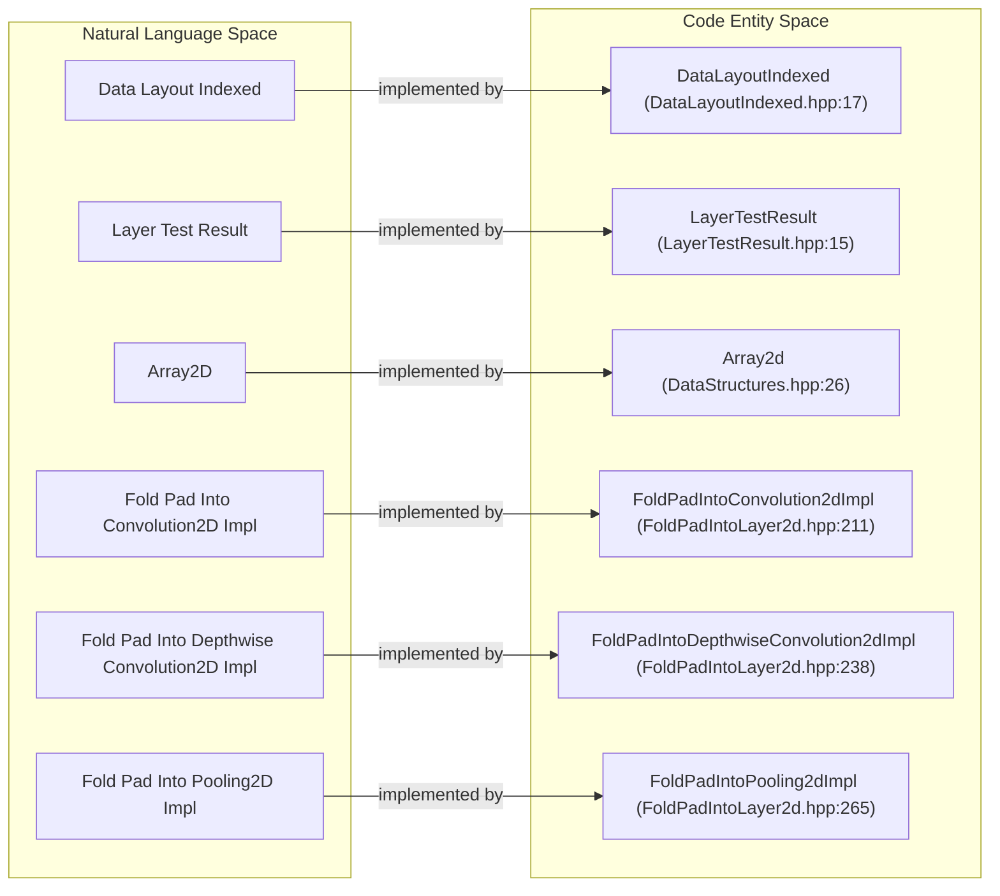
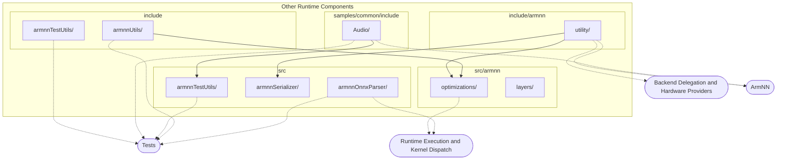
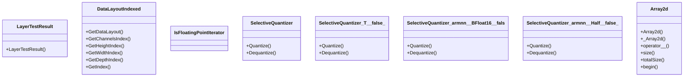
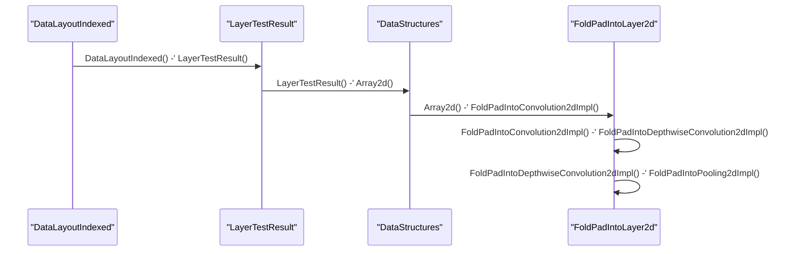

# 3-Source Context Packet (`git` + `CBM` + `llm-wiki`) for `5.6-other-runtime-components` — Other Runtime Components

- **Target Wiki File**: `wiki/5.6-other-runtime-components.md`
- **Archetype**: `Leaf Technical Spec Page`
- **Parent Page**: `5-runtime-execution-and-kernel-dispatch`
- **Summary**: Other Runtime Components subsystem (consolidating `ArmNN Optimizations`, `Armnntestutils`, `ArmNN Layers`, `Samples Common`, `Armnntestutils`, `Samples Objectdetection`), covering 28 files and 1895 symbols. Key symbols include `Run`, `FoldPadIntoLayer2dImpl`, `ReplaceConstDequantisationLayer`, `CreateWorkload`.
- **Valid `[[wikilink]]` Neighbours**: `[[5-runtime-execution-and-kernel-dispatch|Runtime Execution and Kernel Dispatch]]`, `[[3-backend-delegation-and-hardware-providers|Backend Delegation and Hardware Providers]]`, `[[3.1-backends-backendscommon|Backends Backendscommon]]`, `[[3.2-backends-reference|Backends Reference]]`, `[[3.3-backends-opencl|Backends OpenCL]]`, `[[3.4-backends-aclcommon|Backends Aclcommon]]`, `[[3.6-other-backends|Other Backends]]`, `[[5.2-armnn|ArmNN]]`

## 1. Relevant Source Files (`git` + `CBM`, use verbatim in `<details>`)
- `[samples/common/include/Audio/DataStructures.hpp](samples/common/include/Audio/DataStructures.hpp)`
- `[include/armnn/utility/IgnoreUnused.hpp](include/armnn/utility/IgnoreUnused.hpp)`
- `[src/armnnTestUtils/TensorCopyUtils.cpp](src/armnnTestUtils/TensorCopyUtils.cpp)`
- `[include/armnnTestUtils/WorkloadTestUtils.hpp](include/armnnTestUtils/WorkloadTestUtils.hpp)`
- `[include/armnn/utility/PolymorphicDowncast.hpp](include/armnn/utility/PolymorphicDowncast.hpp)`
- `[src/armnnSerializer/Serializer.cpp](src/armnnSerializer/Serializer.cpp)`
- `[include/armnnUtils/DataLayoutIndexed.hpp](include/armnnUtils/DataLayoutIndexed.hpp)`
- `[src/armnn/optimizations/FoldPadIntoLayer2d.hpp](src/armnn/optimizations/FoldPadIntoLayer2d.hpp)`
- `[include/armnnTestUtils/LayerTestResult.hpp](include/armnnTestUtils/LayerTestResult.hpp)`
- `[include/armnnUtils/QuantizeHelper.hpp](include/armnnUtils/QuantizeHelper.hpp)`
- `[src/armnnTestUtils/CreateWorkload.hpp](src/armnnTestUtils/CreateWorkload.hpp)`
- `[src/armnn/layers/LayerWithParameters.hpp](src/armnn/layers/LayerWithParameters.hpp)`
- `[src/armnn/optimizations/ConvertConstDequantisationLayersToConstLayers.hpp](src/armnn/optimizations/ConvertConstDequantisationLayersToConstLayers.hpp)`
- `[src/armnn/optimizations/MaxMinIntoBoundedRelu.hpp](src/armnn/optimizations/MaxMinIntoBoundedRelu.hpp)`
- `[src/armnn/optimizations/Optimization.hpp](src/armnn/optimizations/Optimization.hpp)`
- `[src/armnn/optimizations/ConvertConstants.hpp](src/armnn/optimizations/ConvertConstants.hpp)`
- `[src/armnn/optimizations/AddBroadcastReshapeLayer.hpp](src/armnn/optimizations/AddBroadcastReshapeLayer.hpp)`
- `[delegate/common/src/DelegateUtils.hpp](delegate/common/src/DelegateUtils.hpp)`
- `[src/armnn/optimizations/FuseBatchNorm.hpp](src/armnn/optimizations/FuseBatchNorm.hpp)`
- `[src/armnn/optimizations/AddDebug.hpp](src/armnn/optimizations/AddDebug.hpp)`
- `[src/armnn/optimizations/MovePermuteUp.hpp](src/armnn/optimizations/MovePermuteUp.hpp)`
- `[src/armnnOnnxParser/OnnxParser.cpp](src/armnnOnnxParser/OnnxParser.cpp)`
- `[src/armnnTestUtils/TestUtils.hpp](src/armnnTestUtils/TestUtils.hpp)`
- `[src/armnn/optimizations/MoveTransposeUp.hpp](src/armnn/optimizations/MoveTransposeUp.hpp)`
- `[src/armnn/optimizations/ConvertFp32NetworkToFp16.hpp](src/armnn/optimizations/ConvertFp32NetworkToFp16.hpp)`
- `[src/armnn/optimizations/TurboConvertConstDequantisationLayersToConstLayers.hpp](src/armnn/optimizations/TurboConvertConstDequantisationLayersToConstLayers.hpp)`
- `[src/armnn/optimizations/ConvertConstPermuteLayersToConstLayers.hpp](src/armnn/optimizations/ConvertConstPermuteLayersToConstLayers.hpp)`
- `[src/armnn/optimizations/PermuteAsReshape.hpp](src/armnn/optimizations/PermuteAsReshape.hpp)`

## 2. Grounded Code Symbols (`CBM`, use verbatim for `[file:start-end]()` pill citations)
- `DataLayoutIndexed` (Class) @ `[include/armnnUtils/DataLayoutIndexed.hpp:17-81]()` [fan-in=2, fan-out=0] — /// Provides access to the appropriate indexes for Channels, Height and Width based on DataLayout
- `LayerTestResult` (Class) @ `[include/armnnTestUtils/LayerTestResult.hpp:15-59]()` [fan-in=6, fan-out=0] — 
- `Array2d` (Class) @ `[samples/common/include/Audio/DataStructures.hpp:26-102]()` [fan-in=0, fan-out=0] — 
- `FoldPadIntoConvolution2dImpl` (Class) @ `[src/armnn/optimizations/FoldPadIntoLayer2d.hpp:211-236]()` [fan-in=0, fan-out=0] — 
- `FoldPadIntoDepthwiseConvolution2dImpl` (Class) @ `[src/armnn/optimizations/FoldPadIntoLayer2d.hpp:238-263]()` [fan-in=0, fan-out=0] — 
- `FoldPadIntoPooling2dImpl` (Class) @ `[src/armnn/optimizations/FoldPadIntoLayer2d.hpp:265-276]()` [fan-in=0, fan-out=0] — 
- `IsFloatingPointIterator` (Class) @ `[include/armnnUtils/QuantizeHelper.hpp:97-100]()` [fan-in=0, fan-out=0] — 
- `SelectiveQuantizer` (Class) @ `[include/armnnUtils/QuantizeHelper.hpp:23-34]()` [fan-in=0, fan-out=0] — 
- `SelectiveQuantizer<T, false>` (Class) @ `[include/armnnUtils/QuantizeHelper.hpp:37-50]()` [fan-in=0, fan-out=0] — 
- `SelectiveQuantizer<armnn::BFloat16, false>` (Class) @ `[include/armnnUtils/QuantizeHelper.hpp:69-82]()` [fan-in=0, fan-out=0] — 
- `SelectiveQuantizer<armnn::Half, false>` (Class) @ `[include/armnnUtils/QuantizeHelper.hpp:53-66]()` [fan-in=0, fan-out=0] — 
- `LayerWithParameters` (Class) @ `[src/armnn/layers/LayerWithParameters.hpp:14-77]()` [fan-in=0, fan-out=0] — 
- `ConvertConstDequantisationLayersToConstLayersImpl` (Class) @ `[src/armnn/optimizations/ConvertConstDequantisationLayersToConstLayers.hpp:18-168]()` [fan-in=0, fan-out=0] — 
- `MaxMinIntoBoundedReluImpl` (Class) @ `[src/armnn/optimizations/MaxMinIntoBoundedRelu.hpp:13-130]()` [fan-in=0, fan-out=0] — 
- `ConvertConstants` (Class) @ `[src/armnn/optimizations/ConvertConstants.hpp:64-80]()` [fan-in=0, fan-out=0] — 
- `Float16ToFloat32` (Class) @ `[src/armnn/optimizations/ConvertConstants.hpp:21-40]()` [fan-in=0, fan-out=0] — 
- `Float32ToFloat16` (Class) @ `[src/armnn/optimizations/ConvertConstants.hpp:42-61]()` [fan-in=0, fan-out=0] — 
- `IsFloat16Layer` (Class) @ `[src/armnn/optimizations/ConvertConstants.hpp:90-96]()` [fan-in=0, fan-out=0] — 
- `IsFloat32Layer` (Class) @ `[src/armnn/optimizations/ConvertConstants.hpp:82-88]()` [fan-in=0, fan-out=0] — 
- `Optimization` (Class) @ `[src/armnn/optimizations/Optimization.hpp:15-22]()` [fan-in=0, fan-out=0] — 
- `OptimizeForConnection` (Class) @ `[src/armnn/optimizations/Optimization.hpp:118-123]()` [fan-in=0, fan-out=0] — 
- `OptimizeForConnectionImpl` (Class) @ `[src/armnn/optimizations/Optimization.hpp:79-115]()` [fan-in=0, fan-out=0] — 

## 3. Grounded Source Code Excerpts (`git` Working Tree)
### `DataLayoutIndexed` in `[include/armnnUtils/DataLayoutIndexed.hpp:17-32]()`
```cpp
class DataLayoutIndexed
{
public:
    DataLayoutIndexed(armnn::DataLayout dataLayout);

    armnn::DataLayout GetDataLayout()    const { return m_DataLayout; }
    unsigned int      GetChannelsIndex() const { return m_ChannelsIndex; }
    unsigned int      GetHeightIndex()   const { return m_HeightIndex; }
    unsigned int      GetWidthIndex()    const { return m_WidthIndex; }
    unsigned int      GetDepthIndex()    const { return m_DepthIndex; }

    inline unsigned int GetIndex(const armnn::TensorShape& shape,
                                 unsigned int batchIndex, unsigned int channelIndex,
                                 unsigned int heightIndex, unsigned int widthIndex) const
    {
        if (batchIndex >= shape[0] && !( shape[0] == 0 && batchIndex == 0))
```

### `LayerTestResult` in `[include/armnnTestUtils/LayerTestResult.hpp:15-30]()`
```cpp
struct LayerTestResult
{
    LayerTestResult(const armnn::TensorInfo& outputInfo)
        : m_Supported(true)
        , m_CompareBoolean(false)
    {
        m_ActualData.reserve(outputInfo.GetNumElements());
        m_ExpectedData.reserve(outputInfo.GetNumElements());
        m_ActualShape = outputInfo.GetShape();
        m_ExpectedShape = outputInfo.GetShape();
    }

    LayerTestResult(const std::vector<T>& actualData,
                    const std::vector<T>& expectedData,
                    const armnn::TensorShape& actualShape,
                    const armnn::TensorShape& expectedShape)
```

### `Array2d` in `[samples/common/include/Audio/DataStructures.hpp:26-41]()`
```cpp
class Array2d
{
private:
    size_t m_rows;
    size_t m_cols;
    T* m_data;

public:
    /**
     * Creates the array2d with the given sizes.
     *
     * @param rows  number of rows.
     * @param cols  number of columns.
     */
    Array2d(unsigned rows, unsigned cols)
    {
```

### `FoldPadIntoConvolution2dImpl` in `[src/armnn/optimizations/FoldPadIntoLayer2d.hpp:211-226]()`
```cpp
class FoldPadIntoConvolution2dImpl
{
public:
    void Run(Graph& graph, InputSlot& connection) const
    {
        const auto newConv2dLayer = FoldPadIntoLayer2dImpl<Convolution2dLayer>(graph, connection);

        if (newConv2dLayer != nullptr)
        {
            const auto conv2dLayer = PolymorphicDowncast<Convolution2dLayer*>(&connection.GetOwningLayer());
            ARMNN_ASSERT_MSG(newConv2dLayer->GetInputSlot(1).GetConnection() != nullptr,
                             "FoldPadIntoConvolution2d: New convolution layer is missing connection to weights layer");

            if (conv2dLayer->GetParameters().m_BiasEnabled)
            {
                ARMNN_ASSERT_MSG(newConv2dLayer->GetInputSlot(2).GetConnection() != nullptr,
```

### `FoldPadIntoDepthwiseConvolution2dImpl` in `[src/armnn/optimizations/FoldPadIntoLayer2d.hpp:238-253]()`
```cpp
class FoldPadIntoDepthwiseConvolution2dImpl
{
public:
    void Run(Graph& graph, InputSlot& connection) const
    {
        const auto newConv2dLayer = FoldPadIntoLayer2dImpl<DepthwiseConvolution2dLayer>(graph, connection);

        if (newConv2dLayer != nullptr)
        {
            const auto conv2dLayer = PolymorphicDowncast<DepthwiseConvolution2dLayer*>(&connection.GetOwningLayer());
            ARMNN_ASSERT_MSG(newConv2dLayer->GetInputSlot(1).GetConnection() != nullptr,
                             "FoldPadIntoDepthwiseConvolution2d: New convolution layer is missing "
                             "connection to weights layer");

            if (conv2dLayer->GetParameters().m_BiasEnabled)
            {
```


## 4. Linked Official Docs (`llm-wiki` / `RAG`)
- **Runtime Execution and Kernel Dispatch** (`wiki/5-runtime-execution-and-kernel-dispatch.md`, score=114.936, shared_symbols=['IgnoreUnused', 'LayerTestResult', 'PolymorphicDowncast']): # Runtime Execution and Kernel Dispatch > Architectural overview of Runtime Execution and Kernel Dispatch, spanning 157 source files and 3718 code symbols across 6 subsystems. <details> <summary>Relevant source files</summary> The following files were used as context for generating this wiki page: - [samples/common/include/Audio/DataStructures.hpp](sampl
- **ArmNN** (`wiki/5.1-armnn.md`, score=114.393, shared_symbols=[]): # ArmNN ↑ [[5-runtime-execution-and-kernel-dispatch|Runtime Execution and Kernel Dispatch]] > ArmNN subsystem (`src/armnn`), covering 28 files and 1007 symbols. Key symbols include `SetTensorInfo`, `Connect`, `end`, `GetName`. <details> <summary>Relevant source files</summary> The following files were used as context for generating this wiki page: - [sr
- **ArmNN** (`wiki/5.2-armnn.md`, score=114.393, shared_symbols=[]): # ArmNN ↑ [[5-runtime-execution-and-kernel-dispatch|Runtime Execution and Kernel Dispatch]] > ArmNN subsystem (`include/armnn`), covering 21 files and 440 symbols. Key symbols include `GetShape`, `InvalidArgumentException`, `GetNumElements`, `Exception`. <details> <summary>Relevant source files</summary> The following files were used as context for gener
- **Delegate Opaque** (`wiki/5.3-delegate-opaque.md`, score=114.393, shared_symbols=[]): # Delegate Opaque ↑ [[5-runtime-execution-and-kernel-dispatch|Runtime Execution and Kernel Dispatch]] > Delegate Opaque subsystem (`delegate/opaque`), covering 28 files and 128 symbols. Key symbols include `GetTensorInfoForTfLiteOpaqueTensor`, `GetName`, `ValidateNumOutputs`, `IsValid`. <details> <summary>Relevant source files</summary> The following fil
- **ArmNN DeepWiki** (`wiki/index.md`, score=99.264, shared_symbols=['IgnoreUnused']): # ArmNN DeepWiki Generated from `home-jason-Project-deepwiki-armnn` at commit `2b61cecc9df7` (2026-11-14T15:13:53+00:00). ## Pages - [[1-overview|Overview]] — End-to-end architecture overview of ArmNN: core subsystems, compilation/execution pipeline, entry points, and cross-module dependencies. - [[2-build-system-and-infrastructure|Build System and Infras
- **Backends Reference** (`wiki/3.2-backends-reference.md`, score=74.927, shared_symbols=[]): # Backends Reference ↑ [[3-backend-delegation-and-hardware-providers|Backend Delegation and Hardware Providers]] > Backends Reference subsystem (`backends/reference`), covering 28 files and 634 symbols. Key symbols include `GetNumDimensions`, `GetTensorInfo`, `MakeDecoder`, `MakeEncoder`. <details> <summary>Relevant source files</summary> The following f

## 5. Pre-Verified DeepWiki v1.9.9.5 Mermaid Diagrams
### Natural Language Space <-> Code Entity Space


### Subsystem Architecture Flowchart


### Class Hierarchy Diagram


### Call Sequence Diagram


## 6. DeepWiki v1.9.9.5 Authoring Checklist for `wiki/5.6-other-runtime-components.md`
1. Keep YAML frontmatter at top (`id`, `title`, `parent`, `sources`, `linked_docs`, `bridge_symbols`).
2. Keep `<details><summary>Relevant source files</summary>` block immediately after `# Title`.
3. Start with `## Purpose and Scope`, then numbered `## 1. ...`, `## 2. ...` sections separated by `---`.
4. Include at least 2 ```mermaid``` diagrams (including a `Natural Language Space` <-> `Code Entity Space` mapping).
5. Cite code entities inline using `[path/to/file.ext:start-end]()` and end every `##` section with `Sources: [file:start-end]()`.
6. Run `deepwiki_cli.py build --enrich-only ...` and `deepwiki_cli.py validate ...` after editing.
