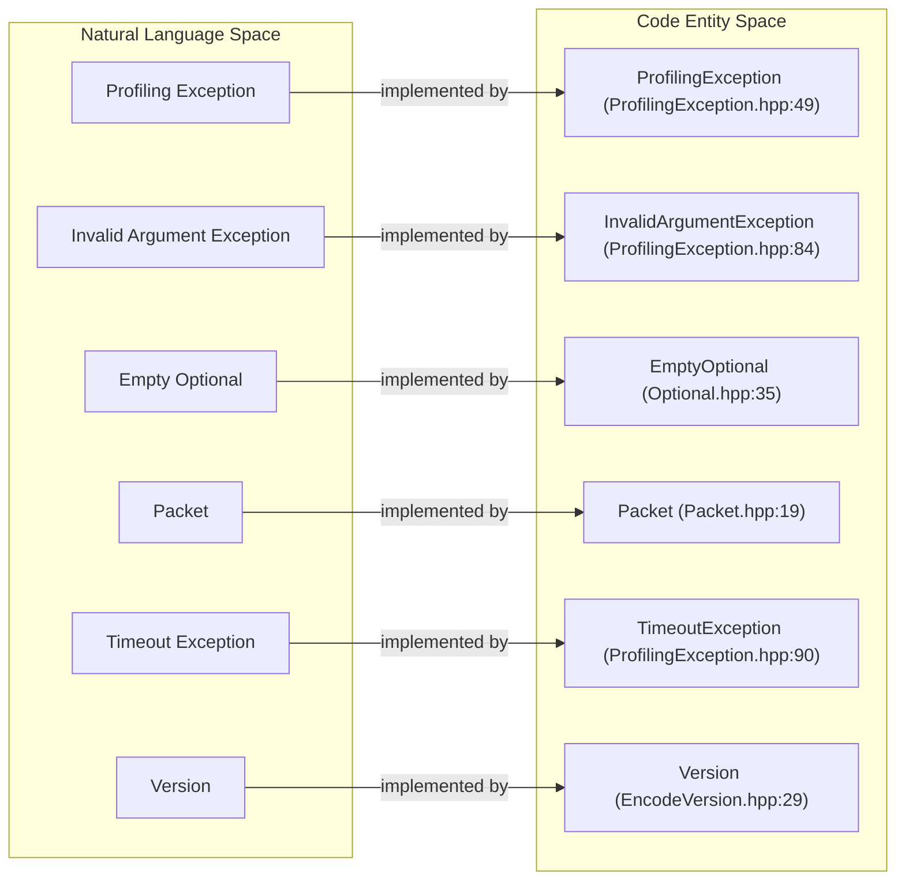
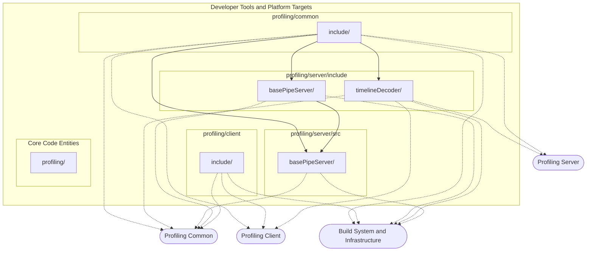
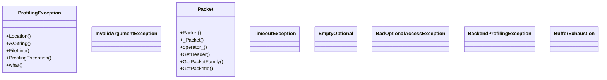
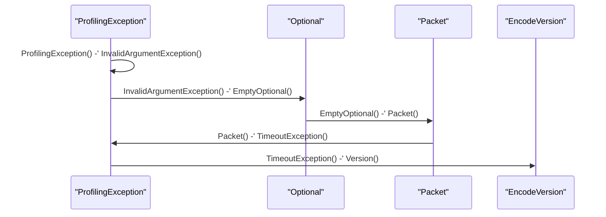

# 3-Source Context Packet (`git` + `CBM` + `llm-wiki`) for `6-developer-tools-and-platform-targets` — Developer Tools and Platform Targets

- **Target Wiki File**: `wiki/6-developer-tools-and-platform-targets.md`
- **Archetype**: `Parent Hub Page`
- **Parent Page**: `None (Top-Level Chapter)`
- **Summary**: Architectural overview of Developer Tools and Platform Targets, spanning 70 source files and 662 code symbols across 4 subsystems.
- **Valid `[[wikilink]]` Neighbours**: `[[1-overview|Overview]]`, `[[3-backend-delegation-and-hardware-providers|Backend Delegation and Hardware Providers]]`, `[[3.1-backends-backendscommon|Backends Backendscommon]]`, `[[3.2-backends-reference|Backends Reference]]`, `[[3.3-backends-opencl|Backends OpenCL]]`, `[[3.4-backends-aclcommon|Backends Aclcommon]]`, `[[3.6-other-backends|Other Backends]]`, `[[5-runtime-execution-and-kernel-dispatch|Runtime Execution and Kernel Dispatch]]`

## 1. Relevant Source Files (`git` + `CBM`, use verbatim in `<details>`)
- `[profiling/common/include/ProfilingException.hpp](profiling/common/include/ProfilingException.hpp)`
- `[profiling/common/include/Packet.hpp](profiling/common/include/Packet.hpp)`
- `[profiling/common/include/Optional.hpp](profiling/common/include/Optional.hpp)`
- `[profiling/common/include/EncodeVersion.hpp](profiling/common/include/EncodeVersion.hpp)`
- `[profiling/common/include/Logging.hpp](profiling/common/include/Logging.hpp)`
- `[profiling/common/include/CounterDirectory.hpp](profiling/common/include/CounterDirectory.hpp)`
- `[profiling/client/include/CounterIdMap.hpp](profiling/client/include/CounterIdMap.hpp)`
- `[profiling/client/include/ICounterValues.hpp](profiling/client/include/ICounterValues.hpp)`
- `[profiling/client/include/CounterStatus.hpp](profiling/client/include/CounterStatus.hpp)`
- `[profiling/client/include/Holder.hpp](profiling/client/include/Holder.hpp)`
- `[profiling/client/include/ILocalPacketHandler.hpp](profiling/client/include/ILocalPacketHandler.hpp)`
- `[profiling/client/include/CounterValue.hpp](profiling/client/include/CounterValue.hpp)`
- `[profiling/server/include/basePipeServer/BasePipeServer.hpp](profiling/server/include/basePipeServer/BasePipeServer.hpp)`
- `[profiling/server/include/timelineDecoder/DirectoryCaptureCommandHandler.hpp](profiling/server/include/timelineDecoder/DirectoryCaptureCommandHandler.hpp)`
- `[profiling/server/include/timelineDecoder/ITimelineDecoder.hpp](profiling/server/include/timelineDecoder/ITimelineDecoder.hpp)`
- `[profiling/server/include/basePipeServer/ConnectionHandler.hpp](profiling/server/include/basePipeServer/ConnectionHandler.hpp)`
- `[profiling/server/src/basePipeServer/BasePipeServer.cpp](profiling/server/src/basePipeServer/BasePipeServer.cpp)`
- `[profiling/server/include/timelineDecoder/TimelineCaptureCommandHandler.hpp](profiling/server/include/timelineDecoder/TimelineCaptureCommandHandler.hpp)`
- `[profiling/buildpipe.sh](profiling/buildpipe.sh)`

## 2. Grounded Code Symbols (`CBM`, use verbatim for `[file:start-end]()` pill citations)
- `ProfilingException` (Class) @ `[profiling/common/include/ProfilingException.hpp:49-65]()` [fan-in=32, fan-out=0] — /// General Exception class for Profiling code
- `InvalidArgumentException` (Class) @ `[profiling/common/include/ProfilingException.hpp:84-88]()` [fan-in=18, fan-out=0] — 
- `EmptyOptional` (Class) @ `[profiling/common/include/Optional.hpp:35-35]()` [fan-in=4, fan-out=0] — /// EmptyOptional is used to initialize the Optional class in case we want /// to have default value for an Optional in a function declaration.
- `Packet` (Class) @ `[profiling/common/include/Packet.hpp:19-88]()` [fan-in=6, fan-out=0] — 
- `TimeoutException` (Class) @ `[profiling/common/include/ProfilingException.hpp:90-94]()` [fan-in=6, fan-out=0] — 
- `Version` (Class) @ `[profiling/common/include/EncodeVersion.hpp:29-73]()` [fan-in=0, fan-out=0] — // Encodes a semantic version https://semver.org/ into a 32 bit integer in the following fashion // // bits 22:31 major: Unsigned 10-bit integer. Major componen
- `ConstructInPlace` (Class) @ `[profiling/common/include/Optional.hpp:39-42]()` [fan-in=0, fan-out=0] — /// Disambiguation tag that can be passed to the constructor to indicate that /// the contained object should be constructed in-place
- `OptionalBase` (Class) @ `[profiling/common/include/Optional.hpp:48-76]()` [fan-in=0, fan-out=0] — /// OptionalBase is the common functionality between reference and non-reference /// optional types.
- `IInternalProfilingConnection` (Class) @ `[profiling/client/include/ILocalPacketHandler.hpp:29-39]()` [fan-in=0, fan-out=0] — // the handlers need to be able to do two // things to service the FileOnlyProfilingConnection // and any other implementation of IProfilingConnection // set th
- `BadOptionalAccessException` (Class) @ `[profiling/common/include/ProfilingException.hpp:73-76]()` [fan-in=2, fan-out=0] — 
- `BackendProfilingException` (Class) @ `[profiling/common/include/ProfilingException.hpp:67-71]()` [fan-in=1, fan-out=0] — 
- `BufferExhaustion` (Class) @ `[profiling/common/include/ProfilingException.hpp:78-82]()` [fan-in=1, fan-out=0] — 
- `UnimplementedException` (Class) @ `[profiling/common/include/ProfilingException.hpp:96-100]()` [fan-in=1, fan-out=0] — 
- `Location` (Class) @ `[profiling/common/include/ProfilingException.hpp:17-46]()` [fan-in=0, fan-out=0] — 
- `Optional` (Class) @ `[profiling/common/include/Optional.hpp:273-303]()` [fan-in=0, fan-out=0] — 
- `OptionalReferenceSwitch` (Class) @ `[profiling/common/include/Optional.hpp:84-186]()` [fan-in=0, fan-out=0] — 
- `OptionalReferenceSwitch<true, T>` (Class) @ `[profiling/common/include/Optional.hpp:194-270]()` [fan-in=0, fan-out=0] — 
- `CounterDirectory` (Class) @ `[profiling/common/include/CounterDirectory.hpp:23-99]()` [fan-in=0, fan-out=0] — 
- `LogSink` (Class) @ `[profiling/common/include/Logging.hpp:65-73]()` [fan-in=0, fan-out=0] — 
- `ScopedRecord` (Class) @ `[profiling/common/include/Logging.hpp:84-130]()` [fan-in=0, fan-out=0] — 
- `SimpleLogger` (Class) @ `[profiling/common/include/Logging.hpp:133-171]()` [fan-in=0, fan-out=0] — 
- `StandardOutputSink` (Class) @ `[profiling/common/include/Logging.hpp:75-82]()` [fan-in=0, fan-out=0] — 

## 3. Grounded Source Code Excerpts (`git` Working Tree)
### `ProfilingException` in `[profiling/common/include/ProfilingException.hpp:49-64]()`
```cpp
class ProfilingException : public std::exception
{
public:
    explicit ProfilingException(const std::string& message) : m_Message(message) {};

    explicit ProfilingException(const std::string& message,
                                const Location& location) : m_Message(message + location.AsString()) {};

    /// @return - Error message of ProfilingException
    virtual const char *what() const noexcept override
    {
         return m_Message.c_str();
    }

private:
    std::string m_Message;
```

### `InvalidArgumentException` in `[profiling/common/include/ProfilingException.hpp:84-88]()`
```cpp
class InvalidArgumentException : public ProfilingException
{
public:
    using ProfilingException::ProfilingException;
};
```

### `Packet` in `[profiling/common/include/Packet.hpp:19-34]()`
```cpp
class Packet
{
public:
    Packet()
        : m_Header(0)
        , m_PacketFamily(0)
        , m_PacketId(0)
        , m_Length(0)
        , m_Data(nullptr)
    {}

    Packet(uint32_t header)
        : m_Header(header)
        , m_Length(0)
        , m_Data(nullptr)
    {
```

### `TimeoutException` in `[profiling/common/include/ProfilingException.hpp:90-94]()`
```cpp
class TimeoutException : public ProfilingException
{
public:
    using ProfilingException::ProfilingException;
};
```

### `Version` in `[profiling/common/include/EncodeVersion.hpp:29-44]()`
```cpp
class Version
{
public:
    Version(uint32_t encodedValue)
    {
        m_Major = (encodedValue >> 22) & 1023;
        m_Minor = (encodedValue >> 12) & 1023;
        m_Patch = encodedValue & 4095;
    }

    Version(uint32_t major, uint32_t minor, uint32_t patch) :
        m_Major(major),
        m_Minor(minor),
        m_Patch(patch)
    {}
```


## 4. Linked Official Docs (`llm-wiki` / `RAG`)
- **Profiling Common** (`wiki/6.1-profiling-common.md`, score=107.806, shared_symbols=['BadOptionalAccessException', 'EmptyOptional', 'InvalidArgumentException', 'Optional', 'Packet', 'ProfilingException', 'TimeoutException', 'UnimplementedException']): # Profiling Common ↑ [[6-developer-tools-and-platform-targets|Developer Tools and Platform Targets]] > Profiling Common subsystem (`profiling/common`), covering 28 files and 244 symbols. Key symbols include `IgnoreUnused`, `ProfilingException`, `CentreAlignFormatting`, `InvalidArgumentException`. <details> <summary>Relevant source files</summary> The fol
- **ArmNN** (`wiki/5.2-armnn.md`, score=72.576, shared_symbols=['EmptyOptional', 'InvalidArgumentException', 'ProfilingException', 'UnimplementedException']): # ArmNN ↑ [[5-runtime-execution-and-kernel-dispatch|Runtime Execution and Kernel Dispatch]] > ArmNN subsystem (`include/armnn`), covering 21 files and 440 symbols. Key symbols include `GetShape`, `InvalidArgumentException`, `GetNumElements`, `Exception`. <details> <summary>Relevant source files</summary> The following files were used as context for gener
- **Runtime Execution and Kernel Dispatch** (`wiki/5-runtime-execution-and-kernel-dispatch.md`, score=71.627, shared_symbols=['EmptyOptional', 'InvalidArgumentException', 'ProfilingException']): # Runtime Execution and Kernel Dispatch > Architectural overview of Runtime Execution and Kernel Dispatch, spanning 157 source files and 3718 code symbols across 6 subsystems. <details> <summary>Relevant source files</summary> The following files were used as context for generating this wiki page: - [samples/common/include/Audio/DataStructures.hpp](sampl
- **Profiling Client** (`wiki/6.2-profiling-client.md`, score=69.664, shared_symbols=['CaptureData', 'InvalidArgumentException', 'Packet', 'ProfilingException']): # Profiling Client ↑ [[6-developer-tools-and-platform-targets|Developer Tools and Platform Targets]] > Profiling Client subsystem (`profiling/client`), covering 28 files and 340 symbols. Key symbols include `ReadUint32`, `GetCurrentState`, `WriteUint32`, `GetNextGuid`. <details> <summary>Relevant source files</summary> The following files were used as co
- **Profiling Server** (`wiki/6.3-profiling-server.md`, score=68.439, shared_symbols=['InvalidArgumentException', 'Optional', 'Packet', 'ProfilingException']): # Profiling Server ↑ [[6-developer-tools-and-platform-targets|Developer Tools and Platform Targets]] > Profiling Server subsystem (`profiling/server`), covering 13 files and 77 symbols. Key symbols include `ParseData`, `ReceivePacket`, `ReadCategoryRecords`, `ParseData`. <details> <summary>Relevant source files</summary> The following files were used as 
- **Profiling** (`wiki/6.4-profiling.md`, score=52.403, shared_symbols=['Entity', 'Location', 'ProfilingException']): # Profiling ↑ [[6-developer-tools-and-platform-targets|Developer Tools and Platform Targets]] > Profiling subsystem (`profiling`), covering 1 files and 1 symbols. Key symbols include `usage`. <details> <summary>Relevant source files</summary> The following files were used as context for generating this wiki page: - [profiling/buildpipe.sh](profiling/bui

## 5. Pre-Verified DeepWiki v1.9.9.5 Mermaid Diagrams
### Natural Language Space <-> Code Entity Space


### Subsystem Architecture Flowchart


### Class Hierarchy Diagram


### Call Sequence Diagram


## 6. DeepWiki v1.9.9.5 Authoring Checklist for `wiki/6-developer-tools-and-platform-targets.md`
1. Keep YAML frontmatter at top (`id`, `title`, `parent`, `sources`, `linked_docs`, `bridge_symbols`).
2. Keep `<details><summary>Relevant source files</summary>` block immediately after `# Title`.
3. Start with `## Purpose and Scope`, then numbered `## 1. ...`, `## 2. ...` sections separated by `---`.
4. Include at least 2 ```mermaid``` diagrams (including a `Natural Language Space` <-> `Code Entity Space` mapping).
5. Cite code entities inline using `[path/to/file.ext:start-end]()` and end every `##` section with `Sources: [file:start-end]()`.
6. Run `deepwiki_cli.py build --enrich-only ...` and `deepwiki_cli.py validate ...` after editing.
