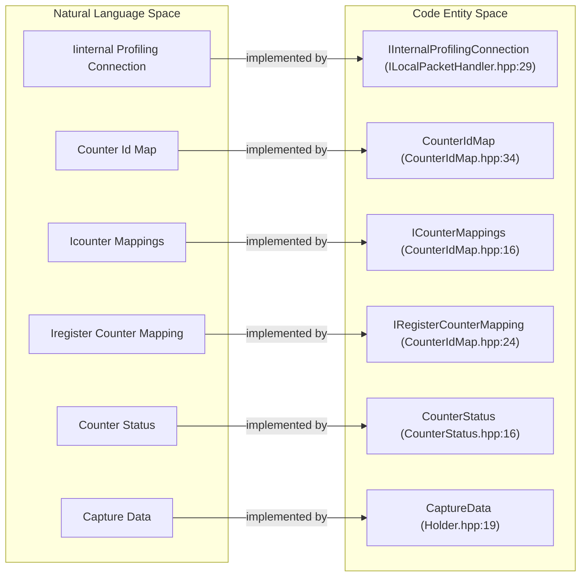
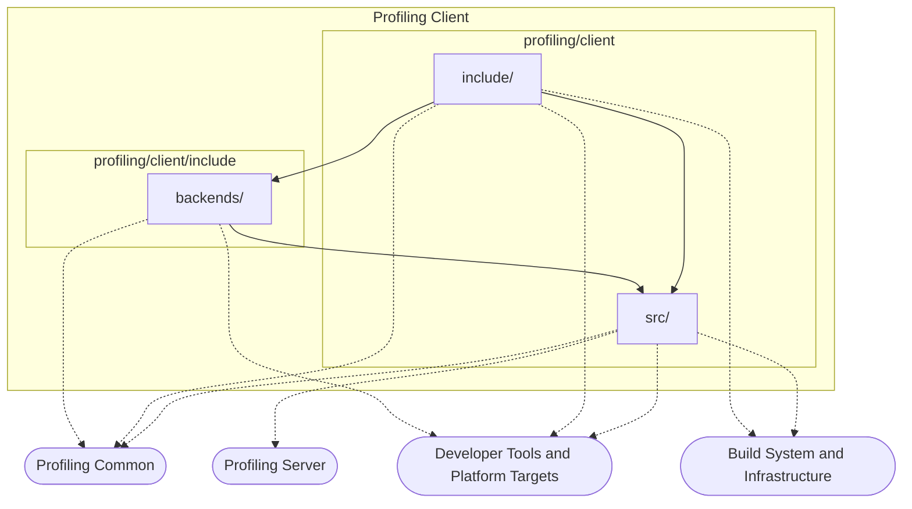
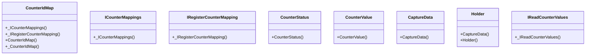
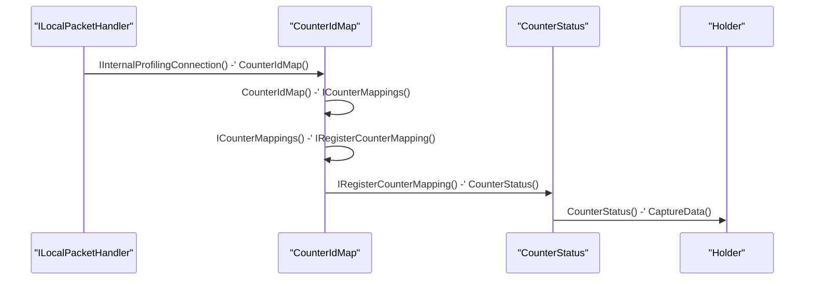

# 3-Source Context Packet (`git` + `CBM` + `llm-wiki`) for `6.2-profiling-client` — Profiling Client

- **Target Wiki File**: `wiki/6.2-profiling-client.md`
- **Archetype**: `Leaf Technical Spec Page`
- **Parent Page**: `6-developer-tools-and-platform-targets`
- **Summary**: Profiling Client subsystem (`profiling/client`), covering 28 files and 340 symbols. Key symbols include `ReadUint32`, `GetCurrentState`, `WriteUint32`, `GetNextGuid`.
- **Valid `[[wikilink]]` Neighbours**: `[[6-developer-tools-and-platform-targets|Developer Tools and Platform Targets]]`, `[[3-backend-delegation-and-hardware-providers|Backend Delegation and Hardware Providers]]`, `[[3.1-backends-backendscommon|Backends Backendscommon]]`, `[[3.2-backends-reference|Backends Reference]]`, `[[3.3-backends-opencl|Backends OpenCL]]`, `[[3.4-backends-aclcommon|Backends Aclcommon]]`, `[[3.6-other-backends|Other Backends]]`, `[[5-runtime-execution-and-kernel-dispatch|Runtime Execution and Kernel Dispatch]]`

## 1. Relevant Source Files (`git` + `CBM`, use verbatim in `<details>`)
- `[profiling/client/include/CounterIdMap.hpp](profiling/client/include/CounterIdMap.hpp)`
- `[profiling/client/include/CounterStatus.hpp](profiling/client/include/CounterStatus.hpp)`
- `[profiling/client/include/ICounterValues.hpp](profiling/client/include/ICounterValues.hpp)`
- `[profiling/client/include/Holder.hpp](profiling/client/include/Holder.hpp)`
- `[profiling/client/include/CounterValue.hpp](profiling/client/include/CounterValue.hpp)`
- `[profiling/client/include/ILocalPacketHandler.hpp](profiling/client/include/ILocalPacketHandler.hpp)`
- `[profiling/client/include/IInitialiseProfilingService.hpp](profiling/client/include/IInitialiseProfilingService.hpp)`
- `[profiling/client/include/IProfilingService.hpp](profiling/client/include/IProfilingService.hpp)`
- `[profiling/client/include/IProfilingServiceStatus.hpp](profiling/client/include/IProfilingServiceStatus.hpp)`
- `[profiling/client/include/IReportStructure.hpp](profiling/client/include/IReportStructure.hpp)`
- `[profiling/client/include/ISendCounterPacket.hpp](profiling/client/include/ISendCounterPacket.hpp)`
- `[profiling/client/include/TimelineUtilityMethods.hpp](profiling/client/include/TimelineUtilityMethods.hpp)`
- `[profiling/client/include/ISendTimelinePacket.hpp](profiling/client/include/ISendTimelinePacket.hpp)`
- `[profiling/client/include/ProfilingOptions.hpp](profiling/client/include/ProfilingOptions.hpp)`
- `[profiling/client/include/Timestamp.hpp](profiling/client/include/Timestamp.hpp)`
- `[profiling/client/src/CommandHandler.hpp](profiling/client/src/CommandHandler.hpp)`
- `[profiling/client/src/FileOnlyProfilingConnection.cpp](profiling/client/src/FileOnlyProfilingConnection.cpp)`
- `[profiling/client/src/ActivateTimelineReportingCommandHandler.hpp](profiling/client/src/ActivateTimelineReportingCommandHandler.hpp)`
- `[profiling/client/src/BufferManager.hpp](profiling/client/src/BufferManager.hpp)`
- `[profiling/client/include/backends/IBackendProfiling.hpp](profiling/client/include/backends/IBackendProfiling.hpp)`
- `[profiling/client/src/ConnectionAcknowledgedCommandHandler.hpp](profiling/client/src/ConnectionAcknowledgedCommandHandler.hpp)`
- `[profiling/client/src/ProfilingUtils.cpp](profiling/client/src/ProfilingUtils.cpp)`
- `[profiling/client/include/backends/IBackendProfilingContext.hpp](profiling/client/include/backends/IBackendProfilingContext.hpp)`
- `[profiling/client/src/BufferManager.cpp](profiling/client/src/BufferManager.cpp)`
- `[profiling/client/src/FileOnlyProfilingConnection.hpp](profiling/client/src/FileOnlyProfilingConnection.hpp)`
- `[profiling/client/src/DeactivateTimelineReportingCommandHandler.hpp](profiling/client/src/DeactivateTimelineReportingCommandHandler.hpp)`
- `[profiling/client/src/Holder.cpp](profiling/client/src/Holder.cpp)`
- `[profiling/client/src/IBufferManager.hpp](profiling/client/src/IBufferManager.hpp)`

## 2. Grounded Code Symbols (`CBM`, use verbatim for `[file:start-end]()` pill citations)
- `IInternalProfilingConnection` (Class) @ `[profiling/client/include/ILocalPacketHandler.hpp:29-39]()` [fan-in=0, fan-out=0] — // the handlers need to be able to do two // things to service the FileOnlyProfilingConnection // and any other implementation of IProfilingConnection // set th
- `CounterIdMap` (Class) @ `[profiling/client/include/CounterIdMap.hpp:34-49]()` [fan-in=0, fan-out=0] — 
- `ICounterMappings` (Class) @ `[profiling/client/include/CounterIdMap.hpp:16-22]()` [fan-in=0, fan-out=0] — 
- `IRegisterCounterMapping` (Class) @ `[profiling/client/include/CounterIdMap.hpp:24-32]()` [fan-in=0, fan-out=0] — 
- `CounterStatus` (Class) @ `[profiling/client/include/CounterStatus.hpp:16-30]()` [fan-in=0, fan-out=0] — 
- `CaptureData` (Class) @ `[profiling/client/include/Holder.hpp:19-49]()` [fan-in=0, fan-out=0] — 
- `Holder` (Class) @ `[profiling/client/include/Holder.hpp:51-66]()` [fan-in=0, fan-out=0] — 
- `IReadCounterValues` (Class) @ `[profiling/client/include/ICounterValues.hpp:16-26]()` [fan-in=0, fan-out=0] — 
- `IReadWriteCounterValues` (Class) @ `[profiling/client/include/ICounterValues.hpp:39-43]()` [fan-in=0, fan-out=0] — 
- `IWriteCounterValues` (Class) @ `[profiling/client/include/ICounterValues.hpp:28-37]()` [fan-in=0, fan-out=0] — 
- `CounterValue` (Class) @ `[profiling/client/include/CounterValue.hpp:14-20]()` [fan-in=0, fan-out=0] — 
- `ILocalPacketHandler` (Class) @ `[profiling/client/include/ILocalPacketHandler.hpp:41-61]()` [fan-in=0, fan-out=0] — 
- `IInitialiseProfilingService` (Class) @ `[profiling/client/include/IInitialiseProfilingService.hpp:17-22]()` [fan-in=0, fan-out=0] — 
- `IProfilingService` (Class) @ `[profiling/client/include/IProfilingService.hpp:33-79]()` [fan-in=0, fan-out=0] — 
- `IProfilingServiceStatus` (Class) @ `[profiling/client/include/IProfilingServiceStatus.hpp:20-26]()` [fan-in=0, fan-out=0] — 
- `IReportStructure` (Class) @ `[profiling/client/include/IReportStructure.hpp:16-21]()` [fan-in=0, fan-out=0] — 
- `ISendCounterPacket` (Class) @ `[profiling/client/include/ISendCounterPacket.hpp:18-37]()` [fan-in=0, fan-out=0] — 
- `TimelineUtilityMethods` (Class) @ `[profiling/client/include/TimelineUtilityMethods.hpp:17-94]()` [fan-in=0, fan-out=0] — 
- `ISendTimelinePacket` (Class) @ `[profiling/client/include/ISendTimelinePacket.hpp:27-58]()` [fan-in=0, fan-out=0] — 
- `ProfilingOptions` (Class) @ `[profiling/client/include/ProfilingOptions.hpp:20-41]()` [fan-in=0, fan-out=0] — 
- `Timestamp` (Class) @ `[profiling/client/include/Timestamp.hpp:16-20]()` [fan-in=0, fan-out=0] — 
- `CommandHandler` (Class) @ `[profiling/client/src/CommandHandler.hpp:24-62]()` [fan-in=0, fan-out=0] — 

## 3. Grounded Source Code Excerpts (`git` Working Tree)
### `IInternalProfilingConnection` in `[profiling/client/include/ILocalPacketHandler.hpp:29-39]()`
```cpp
class IInternalProfilingConnection
{
public:
    virtual ~IInternalProfilingConnection() {};

    virtual void SetEndianess(const TargetEndianness& endianness) = 0;

    virtual void ReturnPacket(Packet& packet) = 0;

    virtual void Close() = 0;
};
```

### `CounterIdMap` in `[profiling/client/include/CounterIdMap.hpp:34-49]()`
```cpp
class CounterIdMap : public ICounterMappings, public IRegisterCounterMapping
{

public:
    CounterIdMap() = default;
    virtual ~CounterIdMap() {}
    void RegisterMapping(uint16_t globalCounterId,
                         uint16_t backendCounterId,
                         const std::string& backendId) override;
    void Reset() override;
    uint16_t GetGlobalId(uint16_t backendCounterId, const std::string& backendId) const override;
    const std::pair<uint16_t, std::string>& GetBackendId(uint16_t globalCounterId) const override;
private:
    std::map<uint16_t, std::pair<uint16_t, std::string>> m_GlobalCounterIdMap;
    std::map<std::pair<uint16_t, std::string>, uint16_t> m_BackendCounterIdMap;
};
```

### `ICounterMappings` in `[profiling/client/include/CounterIdMap.hpp:16-22]()`
```cpp
class ICounterMappings
{
public:
    virtual uint16_t GetGlobalId(uint16_t backendCounterId, const std::string& backendId) const = 0;
    virtual const std::pair<uint16_t, std::string>& GetBackendId(uint16_t globalCounterId) const = 0;
    virtual ~ICounterMappings() {}
};
```

### `IRegisterCounterMapping` in `[profiling/client/include/CounterIdMap.hpp:24-32]()`
```cpp
class IRegisterCounterMapping
{
public:
    virtual void RegisterMapping(uint16_t globalCounterId,
                                 uint16_t backendCounterId,
                                 const std::string& backendId) = 0;
    virtual void Reset() = 0;
    virtual ~IRegisterCounterMapping() {}
};
```

### `CounterStatus` in `[profiling/client/include/CounterStatus.hpp:16-30]()`
```cpp
struct CounterStatus
{
    CounterStatus(uint16_t backendCounterId,
                  uint16_t globalCounterId,
                  bool enabled,
                  uint32_t samplingRateInMicroseconds)
                  : m_BackendCounterId(backendCounterId),
                    m_GlobalCounterId(globalCounterId),
                    m_Enabled(enabled),
                    m_SamplingRateInMicroseconds(samplingRateInMicroseconds) {}
    uint16_t m_BackendCounterId;
    uint16_t m_GlobalCounterId;
    bool     m_Enabled;
    uint32_t m_SamplingRateInMicroseconds;
};
```


## 4. Linked Official Docs (`llm-wiki` / `RAG`)
- **Developer Tools and Platform Targets** (`wiki/6-developer-tools-and-platform-targets.md`, score=139.809, shared_symbols=['ReadUint32', 'WriteUint32']): # Developer Tools and Platform Targets > Architectural overview of Developer Tools and Platform Targets, spanning 70 source files and 662 code symbols across 4 subsystems. <details> <summary>Relevant source files</summary> The following files were used as context for generating this wiki page: - [profiling/common/include/ProfilingException.hpp](profiling
- **Profiling Server** (`wiki/6.3-profiling-server.md`, score=98.718, shared_symbols=['ReadUint32', 'WriteUint32']): # Profiling Server ↑ [[6-developer-tools-and-platform-targets|Developer Tools and Platform Targets]] > Profiling Server subsystem (`profiling/server`), covering 13 files and 77 symbols. Key symbols include `ParseData`, `ReceivePacket`, `ReadCategoryRecords`, `ParseData`. <details> <summary>Relevant source files</summary> The following files were used as 
- **Profiling** (`wiki/6.4-profiling.md`, score=87.932, shared_symbols=[]): # Profiling ↑ [[6-developer-tools-and-platform-targets|Developer Tools and Platform Targets]] > Profiling subsystem (`profiling`), covering 1 files and 1 symbols. Key symbols include `usage`. <details> <summary>Relevant source files</summary> The following files were used as context for generating this wiki page: - [profiling/buildpipe.sh](profiling/bui
- **Build Infrastructure** (`wiki/2.1-build-infrastructure.md`, score=87.932, shared_symbols=[]): # Build Infrastructure ↑ [[2-build-system-and-infrastructure|Build System and Infrastructure]] > Build Infrastructure subsystem (`build/infrastructure`), covering 28 files and 2092 symbols. Key symbols include `push_back`, `data`, `move`, `get`. <details> <summary>Relevant source files</summary> The following files were used as context for generating thi
- **Build System and Infrastructure** (`wiki/2-build-system-and-infrastructure.md`, score=87.932, shared_symbols=[]): # Build System and Infrastructure > Architectural overview of Build System and Infrastructure, spanning 28 source files and 2092 code symbols across 1 subsystems. <details> <summary>Relevant source files</summary> The following files were used as context for generating this wiki page: - [third-party/fmt/format.h](third-party/fmt/format.h) - [third-party/
- **Profiling Common** (`wiki/6.1-profiling-common.md`, score=82.033, shared_symbols=[]): # Profiling Common ↑ [[6-developer-tools-and-platform-targets|Developer Tools and Platform Targets]] > Profiling Common subsystem (`profiling/common`), covering 28 files and 244 symbols. Key symbols include `IgnoreUnused`, `ProfilingException`, `CentreAlignFormatting`, `InvalidArgumentException`. <details> <summary>Relevant source files</summary> The fol

## 5. Pre-Verified DeepWiki v1.9.9.5 Mermaid Diagrams
### Natural Language Space <-> Code Entity Space


### Subsystem Architecture Flowchart


### Class Hierarchy Diagram


### Call Sequence Diagram


## 6. DeepWiki v1.9.9.5 Authoring Checklist for `wiki/6.2-profiling-client.md`
1. Keep YAML frontmatter at top (`id`, `title`, `parent`, `sources`, `linked_docs`, `bridge_symbols`).
2. Keep `<details><summary>Relevant source files</summary>` block immediately after `# Title`.
3. Start with `## Purpose and Scope`, then numbered `## 1. ...`, `## 2. ...` sections separated by `---`.
4. Include at least 2 ```mermaid``` diagrams (including a `Natural Language Space` <-> `Code Entity Space` mapping).
5. Cite code entities inline using `[path/to/file.ext:start-end]()` and end every `##` section with `Sources: [file:start-end]()`.
6. Run `deepwiki_cli.py build --enrich-only ...` and `deepwiki_cli.py validate ...` after editing.
