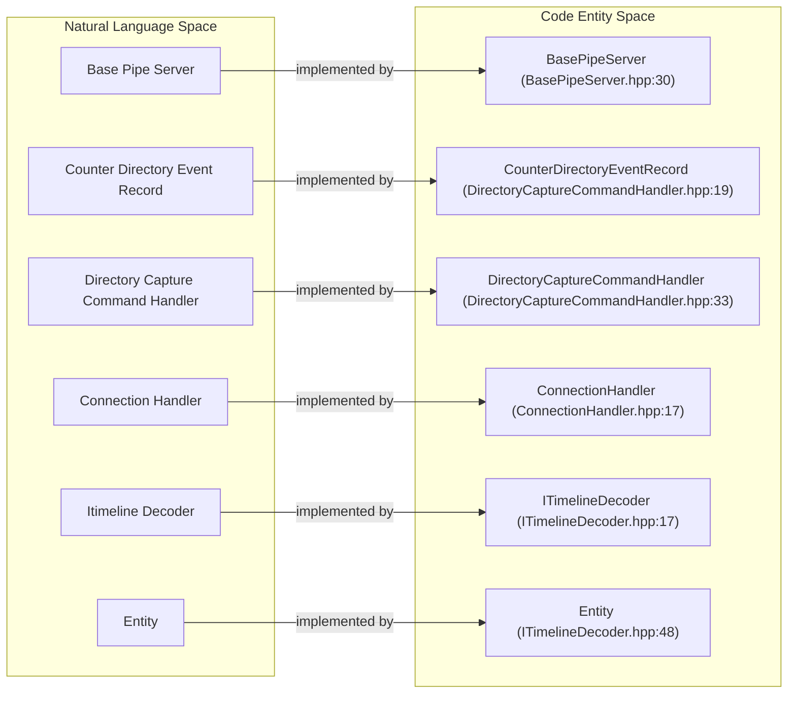
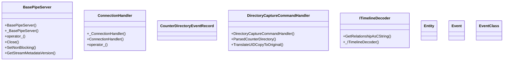
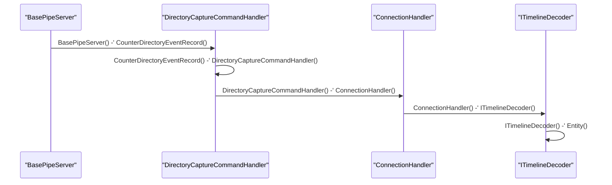

# 3-Source Context Packet (`git` + `CBM` + `llm-wiki`) for `6.3-profiling-server` — Profiling Server

- **Target Wiki File**: `wiki/6.3-profiling-server.md`
- **Archetype**: `Leaf Technical Spec Page`
- **Parent Page**: `6-developer-tools-and-platform-targets`
- **Summary**: Profiling Server subsystem (`profiling/server`), covering 13 files and 77 symbols. Key symbols include `ParseData`, `ReceivePacket`, `ReadCategoryRecords`, `ParseData`.
- **Valid `[[wikilink]]` Neighbours**: `[[6-developer-tools-and-platform-targets|Developer Tools and Platform Targets]]`, `[[3-backend-delegation-and-hardware-providers|Backend Delegation and Hardware Providers]]`, `[[3.1-backends-backendscommon|Backends Backendscommon]]`, `[[3.2-backends-reference|Backends Reference]]`, `[[3.3-backends-opencl|Backends OpenCL]]`, `[[3.4-backends-aclcommon|Backends Aclcommon]]`, `[[3.6-other-backends|Other Backends]]`, `[[5-runtime-execution-and-kernel-dispatch|Runtime Execution and Kernel Dispatch]]`

## 1. Relevant Source Files (`git` + `CBM`, use verbatim in `<details>`)
- `[profiling/server/include/basePipeServer/BasePipeServer.hpp](profiling/server/include/basePipeServer/BasePipeServer.hpp)`
- `[profiling/server/include/timelineDecoder/DirectoryCaptureCommandHandler.hpp](profiling/server/include/timelineDecoder/DirectoryCaptureCommandHandler.hpp)`
- `[profiling/server/include/timelineDecoder/ITimelineDecoder.hpp](profiling/server/include/timelineDecoder/ITimelineDecoder.hpp)`
- `[profiling/server/include/basePipeServer/ConnectionHandler.hpp](profiling/server/include/basePipeServer/ConnectionHandler.hpp)`
- `[profiling/server/include/timelineDecoder/TimelineCaptureCommandHandler.hpp](profiling/server/include/timelineDecoder/TimelineCaptureCommandHandler.hpp)`
- `[profiling/server/src/basePipeServer/BasePipeServer.cpp](profiling/server/src/basePipeServer/BasePipeServer.cpp)`
- `[profiling/server/include/timelineDecoder/TimelineDecoder.hpp](profiling/server/include/timelineDecoder/TimelineDecoder.hpp)`
- `[profiling/server/src/timelineDecoder/TimelineDecoder.cpp](profiling/server/src/timelineDecoder/TimelineDecoder.cpp)`
- `[profiling/server/include/timelineDecoder/TimelineDirectoryCaptureCommandHandler.hpp](profiling/server/include/timelineDecoder/TimelineDirectoryCaptureCommandHandler.hpp)`
- `[profiling/server/src/timelineDecoder/DirectoryCaptureCommandHandler.cpp](profiling/server/src/timelineDecoder/DirectoryCaptureCommandHandler.cpp)`
- `[profiling/server/src/timelineDecoder/TimelineCaptureCommandHandler.cpp](profiling/server/src/timelineDecoder/TimelineCaptureCommandHandler.cpp)`
- `[profiling/server/src/timelineDecoder/TimelineDirectoryCaptureCommandHandler.cpp](profiling/server/src/timelineDecoder/TimelineDirectoryCaptureCommandHandler.cpp)`
- `[profiling/server/src/basePipeServer/ConnectionHandler.cpp](profiling/server/src/basePipeServer/ConnectionHandler.cpp)`

## 2. Grounded Code Symbols (`CBM`, use verbatim for `[file:start-end]()` pill citations)
- `BasePipeServer` (Class) @ `[profiling/server/include/basePipeServer/BasePipeServer.hpp:30-112]()` [fan-in=0, fan-out=0] — 
- `CounterDirectoryEventRecord` (Class) @ `[profiling/server/include/timelineDecoder/DirectoryCaptureCommandHandler.hpp:19-31]()` [fan-in=0, fan-out=0] — 
- `DirectoryCaptureCommandHandler` (Class) @ `[profiling/server/include/timelineDecoder/DirectoryCaptureCommandHandler.hpp:33-86]()` [fan-in=0, fan-out=0] — 
- `ConnectionHandler` (Class) @ `[profiling/server/include/basePipeServer/ConnectionHandler.hpp:17-45]()` [fan-in=0, fan-out=0] — 
- `ITimelineDecoder` (Class) @ `[profiling/server/include/timelineDecoder/ITimelineDecoder.hpp:17-88]()` [fan-in=0, fan-out=0] — 
- `Entity` (Class) @ `[profiling/server/include/timelineDecoder/ITimelineDecoder.hpp:48-51]()` [fan-in=0, fan-out=0] — 
- `Event` (Class) @ `[profiling/server/include/timelineDecoder/ITimelineDecoder.hpp:59-64]()` [fan-in=0, fan-out=0] — 
- `EventClass` (Class) @ `[profiling/server/include/timelineDecoder/ITimelineDecoder.hpp:53-57]()` [fan-in=0, fan-out=0] — 
- `Label` (Class) @ `[profiling/server/include/timelineDecoder/ITimelineDecoder.hpp:66-70]()` [fan-in=0, fan-out=0] — 
- `Relationship` (Class) @ `[profiling/server/include/timelineDecoder/ITimelineDecoder.hpp:72-79]()` [fan-in=0, fan-out=0] — 
- `TimelineCaptureCommandHandler` (Class) @ `[profiling/server/include/timelineDecoder/TimelineCaptureCommandHandler.hpp:19-59]()` [fan-in=0, fan-out=0] — 
- `TimelineDecoder` (Class) @ `[profiling/server/include/timelineDecoder/TimelineDecoder.hpp:19-76]()` [fan-in=0, fan-out=0] — 
- `Model` (Class) @ `[profiling/server/include/timelineDecoder/TimelineDecoder.hpp:24-31]()` [fan-in=0, fan-out=0] — 
- `TimelineDirectoryCaptureCommandHandler` (Class) @ `[profiling/server/include/timelineDecoder/TimelineDirectoryCaptureCommandHandler.hpp:18-46]()` [fan-in=0, fan-out=0] — 
- `TranslateUIDCopyToOriginal` (Method) @ `[profiling/server/include/timelineDecoder/DirectoryCaptureCommandHandler.hpp:63-66]()` [fan-in=1, fan-out=0] — /** * Given a Uid that came from a copy of the counter directory translate it to the original. * * @param copyUid * @return the original Uid that the copy maps 
- `Close` (Method) @ `[profiling/server/include/basePipeServer/BasePipeServer.hpp:54-57]()` [fan-in=0, fan-out=1] — /// Close the client connection /// @return 0 if successful
- `SetNonBlocking` (Method) @ `[profiling/server/include/basePipeServer/BasePipeServer.hpp:65-68]()` [fan-in=0, fan-out=1] — /// Set the client socket to nonblocking /// @return true if successful.
- `ReceivePacket` (Method) @ `[profiling/server/src/basePipeServer/BasePipeServer.cpp:174-201]()` [fan-in=1, fan-out=7] — ()
- `EchoPacket` (Method) @ `[profiling/server/src/basePipeServer/BasePipeServer.cpp:248-276]()` [fan-in=4, fan-out=0] — (PacketDirection direction, uint8_t* packet, size_t lengthInBytes)
- `ParseData` (Method) @ `[profiling/server/src/timelineDecoder/DirectoryCaptureCommandHandler.cpp:23-148]()` [fan-in=1, fan-out=8] — (const arm::pipe::Packet& packet)
- `ReadFromSocket` (Method) @ `[profiling/server/src/basePipeServer/BasePipeServer.cpp:22-42]()` [fan-in=3, fan-out=1] — (uint8_t* packetData, uint32_t expectedLength)
- `WaitForPacket` (Method) @ `[profiling/server/src/basePipeServer/BasePipeServer.cpp:111-172]()` [fan-in=0, fan-out=7] — (uint32_t timeoutMs)

## 3. Grounded Source Code Excerpts (`git` Working Tree)
### `BasePipeServer` in `[profiling/server/include/basePipeServer/BasePipeServer.hpp:30-45]()`
```cpp
class BasePipeServer
{

public:

    BasePipeServer(arm::pipe::Socket clientConnection, bool echoPackets)
            : m_ClientConnection(clientConnection)
            , m_EchoPackets(echoPackets)
            {}

    ~BasePipeServer()
    {
        // We have set SOCK_CLOEXEC on this socket but we'll close it to be good citizens.
        arm::pipe::Close(m_ClientConnection);
    }
```

### `CounterDirectoryEventRecord` in `[profiling/server/include/timelineDecoder/DirectoryCaptureCommandHandler.hpp:19-31]()`
```cpp
struct CounterDirectoryEventRecord
{
    uint16_t m_CounterClass;
    std::string m_CounterDescription;
    uint16_t m_CounterInterpolation;
    double m_CounterMultiplier;
    std::string m_CounterName;
    uint16_t m_CounterSetUid;
    uint16_t m_CounterUid;
    arm::pipe::Optional<std::string> m_CounterUnits;
    uint16_t m_DeviceUid;
    uint16_t m_MaxCounterUid;
};
```

### `DirectoryCaptureCommandHandler` in `[profiling/server/include/timelineDecoder/DirectoryCaptureCommandHandler.hpp:33-48]()`
```cpp
class DirectoryCaptureCommandHandler : public arm::pipe::CommandHandlerFunctor
{

public:
    DirectoryCaptureCommandHandler(const std::string& applicationName,
                                   uint32_t familyId,
                                   uint32_t packetId,
                                   uint32_t version,
                                   bool quietOperation = true)
        : CommandHandlerFunctor(familyId, packetId, version)
        , m_ApplicationName(applicationName)
        , m_QuietOperation(quietOperation)
        , m_AlreadyParsed(false)
    {}

    void operator()(const arm::pipe::Packet& packet) override;
```

### `ConnectionHandler` in `[profiling/server/include/basePipeServer/ConnectionHandler.hpp:17-32]()`
```cpp
class ConnectionHandler
{
public:
    /// Constructor establishes the Unix domain socket and sets it to listen for connections.
    /// @param udsNamespace the namespace (socket address) associated with the listener.
    /// @throws SocketConnectionException if the socket has been incorrectly setup.
    ConnectionHandler(const std::string& udsNamespace, const bool setNonBlocking);

    ~ConnectionHandler()
    {
        // We have set SOCK_CLOEXEC on this socket but we'll close it to be good citizens.
        arm::pipe::Close(m_ListeningSocket);
    }

    ConnectionHandler(const ConnectionHandler&) = delete;
    ConnectionHandler& operator=(const ConnectionHandler&) = delete;
```

### `ITimelineDecoder` in `[profiling/server/include/timelineDecoder/ITimelineDecoder.hpp:17-32]()`
```cpp
class ITimelineDecoder
{

public:

    enum class TimelineStatus
    {
        TimelineStatus_Success,
        TimelineStatus_Fail
    };

    enum class RelationshipType
    {
        RetentionLink, /// Head retains(parents) Tail
        ExecutionLink, /// Head execution start depends on Tail execution completion
        DataLink,      /// Head uses data of Tail
```


## 4. Linked Official Docs (`llm-wiki` / `RAG`)
- **Developer Tools and Platform Targets** (`wiki/6-developer-tools-and-platform-targets.md`, score=152.215, shared_symbols=['BasePipeServer', 'ParseData', 'ReadCategoryRecords', 'ReceivePacket', 'TranslateUIDCopyToOriginal', 'print']): # Developer Tools and Platform Targets > Architectural overview of Developer Tools and Platform Targets, spanning 70 source files and 662 code symbols across 4 subsystems. <details> <summary>Relevant source files</summary> The following files were used as context for generating this wiki page: - [profiling/common/include/ProfilingException.hpp](profiling
- **Profiling Client** (`wiki/6.2-profiling-client.md`, score=102.428, shared_symbols=['ParseData', 'ReadCategoryRecords', 'ReceivePacket']): # Profiling Client ↑ [[6-developer-tools-and-platform-targets|Developer Tools and Platform Targets]] > Profiling Client subsystem (`profiling/client`), covering 28 files and 340 symbols. Key symbols include `ReadUint32`, `GetCurrentState`, `WriteUint32`, `GetNextGuid`. <details> <summary>Relevant source files</summary> The following files were used as co
- **Profiling** (`wiki/6.4-profiling.md`, score=81.145, shared_symbols=['Entity']): # Profiling ↑ [[6-developer-tools-and-platform-targets|Developer Tools and Platform Targets]] > Profiling subsystem (`profiling`), covering 1 files and 1 symbols. Key symbols include `usage`. <details> <summary>Relevant source files</summary> The following files were used as context for generating this wiki page: - [profiling/buildpipe.sh](profiling/bui
- **Build System and Infrastructure** (`wiki/2-build-system-and-infrastructure.md`, score=81.145, shared_symbols=['Entity']): # Build System and Infrastructure > Architectural overview of Build System and Infrastructure, spanning 28 source files and 2092 code symbols across 1 subsystems. <details> <summary>Relevant source files</summary> The following files were used as context for generating this wiki page: - [third-party/fmt/format.h](third-party/fmt/format.h) - [third-party/
- **Build Infrastructure** (`wiki/2.1-build-infrastructure.md`, score=79.645, shared_symbols=[]): # Build Infrastructure ↑ [[2-build-system-and-infrastructure|Build System and Infrastructure]] > Build Infrastructure subsystem (`build/infrastructure`), covering 28 files and 2092 symbols. Key symbols include `push_back`, `data`, `move`, `get`. <details> <summary>Relevant source files</summary> The following files were used as context for generating thi
- **Profiling Common** (`wiki/6.1-profiling-common.md`, score=78.704, shared_symbols=[]): # Profiling Common ↑ [[6-developer-tools-and-platform-targets|Developer Tools and Platform Targets]] > Profiling Common subsystem (`profiling/common`), covering 28 files and 244 symbols. Key symbols include `IgnoreUnused`, `ProfilingException`, `CentreAlignFormatting`, `InvalidArgumentException`. <details> <summary>Relevant source files</summary> The fol

## 5. Pre-Verified DeepWiki v1.9.9.5 Mermaid Diagrams
### Natural Language Space <-> Code Entity Space


### Subsystem Architecture Flowchart

```mermaid
flowchart TD
  subgraph sub_this["Profiling Server"]
    subgraph sg_0["profiling/server/include/basePipeServer"]
      n_profiling_server_include_basePipeServer_BasePipe["BasePipeServer (BasePipeServer.hpp)"]
      n_profiling_server_include_basePipeServer_Connecti["ConnectionHandler (ConnectionHandler.hpp)"]
    end
    subgraph sg_1["profiling/server/include/timelineDecoder"]
      n_profiling_server_include_timelineDecoder_Directo["CounterDirectoryEventRecord (DirectoryCaptureCommandHandler.hpp)"]
      n_profiling_server_include_timelineDecoder_ITimeli["ITimelineDecoder (ITimelineDecoder.hpp)"]
      n_profiling_server_include_timelineDecoder_Timelin["TimelineCaptureCommandHandler (TimelineCaptureCommandHandler.hpp)"]
    end
    subgraph sg_2["profiling/server/src/basePipeServer"]
      n_profiling_server_src_basePipeServer_BasePipeServ["ReceivePacket (BasePipeServer.cpp)"]
      n_profiling_server_src_basePipeServer_ConnectionHa["ConnectionHandler (ConnectionHandler.cpp)"]
    end
    subgraph sg_3["profiling/server/src/timelineDecoder"]
      n_profiling_server_src_timelineDecoder_TimelineDec["print (TimelineDecoder.cpp)"]
      n_profiling_server_src_timelineDecoder_DirectoryCa["ParseData (DirectoryCaptureCommandHandler.cpp)"]
      n_profiling_server_src_timelineDecoder_TimelineCap["ParseData (TimelineCaptureCommandHandler.cpp)"]
      n_profiling_server_src_timelineDecoder_TimelineDir["ParseData (TimelineDirectoryCaptureCommandHandler.cpp)"]
    end
  end
  n_page_2_build_system_and_infrastructure(["Build System and Infrastructure"])
  n_page_6_1_profiling_common(["Profiling Common"])
  n_page_6_2_profiling_client(["Profiling Client"])
  n_page_6_developer_tools_and_platform_targets(["Developer Tools and Platform Targets"])
  n_profiling_server_src_timelineDecoder_TimelineCap -.-> n_page_6_2_profiling_client
  n_profiling_server_include_timelineDecoder_Timelin -.-> n_page_6_1_profiling_common
  n_profiling_server_src_timelineDecoder_DirectoryCa -.-> n_page_6_2_profiling_client
  n_profiling_server_src_basePipeServer_BasePipeServ -.-> n_page_6_1_profiling_common
  n_profiling_server_include_timelineDecoder_ITimeli --> n_profiling_server_include_timelineDecoder_Timelin
  n_profiling_server_include_timelineDecoder_Timelin --> n_profiling_server_src_timelineDecoder_TimelineDec
  n_profiling_server_include_timelineDecoder_Directo -.-> n_page_6_1_profiling_common
  n_profiling_server_include_basePipeServer_BasePipe -.-> n_page_6_1_profiling_common
  n_profiling_server_src_timelineDecoder_TimelineDec -.-> n_page_6_1_profiling_common
  n_profiling_server_src_timelineDecoder_TimelineDec -.-> n_page_2_build_system_and_infrastructure
  n_profiling_server_src_timelineDecoder_TimelineCap -.-> n_page_6_developer_tools_and_platform_targets
  n_profiling_server_src_basePipeServer_ConnectionHa -.-> n_page_6_1_profiling_common
  n_profiling_server_include_timelineDecoder_Timelin --> n_profiling_server_src_timelineDecoder_TimelineDir
  n_profiling_server_src_timelineDecoder_TimelineDir -.-> n_page_2_build_system_and_infrastructure
  n_profiling_server_src_basePipeServer_BasePipeServ -.-> n_page_6_developer_tools_and_platform_targets
  n_profiling_server_src_timelineDecoder_TimelineDir -.-> n_page_6_1_profiling_common
  n_profiling_server_include_timelineDecoder_Directo --> n_profiling_server_src_timelineDecoder_DirectoryCa
  n_profiling_server_src_basePipeServer_BasePipeServ -.-> n_page_2_build_system_and_infrastructure
  n_profiling_server_src_basePipeServer_ConnectionHa -.-> n_page_2_build_system_and_infrastructure
  n_profiling_server_include_timelineDecoder_Directo -.-> n_page_6_2_profiling_client
  n_profiling_server_src_timelineDecoder_TimelineDir -.-> n_page_6_2_profiling_client
```


### Class Hierarchy Diagram


### Call Sequence Diagram


## 6. DeepWiki v1.9.9.5 Authoring Checklist for `wiki/6.3-profiling-server.md`
1. Keep YAML frontmatter at top (`id`, `title`, `parent`, `sources`, `linked_docs`, `bridge_symbols`).
2. Keep `<details><summary>Relevant source files</summary>` block immediately after `# Title`.
3. Start with `## Purpose and Scope`, then numbered `## 1. ...`, `## 2. ...` sections separated by `---`.
4. Include at least 2 ```mermaid``` diagrams (including a `Natural Language Space` <-> `Code Entity Space` mapping).
5. Cite code entities inline using `[path/to/file.ext:start-end]()` and end every `##` section with `Sources: [file:start-end]()`.
6. Run `deepwiki_cli.py build --enrich-only ...` and `deepwiki_cli.py validate ...` after editing.
