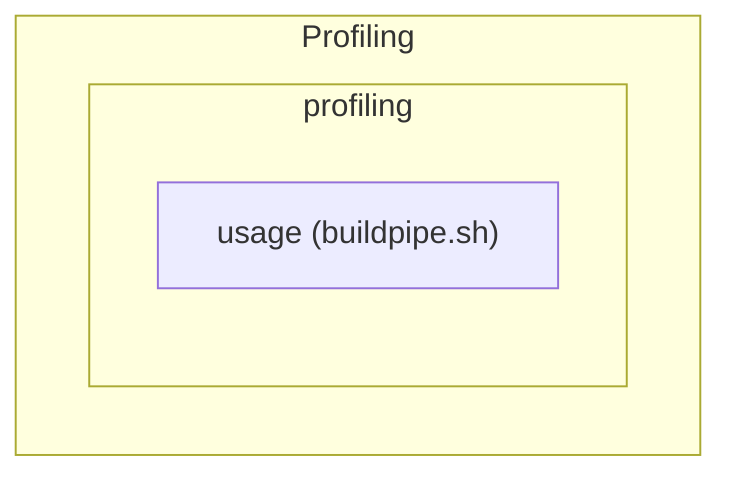
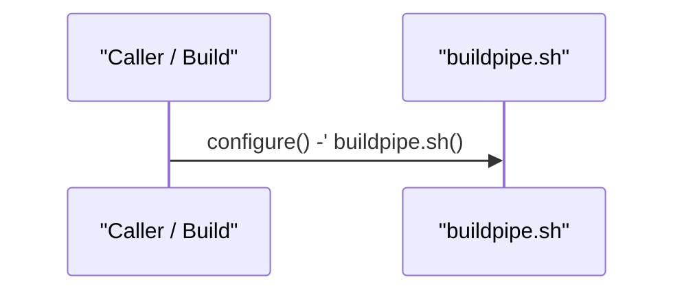

# 3-Source Context Packet (`git` + `CBM` + `llm-wiki`) for `6.4-profiling` — Profiling

- **Target Wiki File**: `wiki/6.4-profiling.md`
- **Archetype**: `Leaf Technical Spec Page`
- **Parent Page**: `6-developer-tools-and-platform-targets`
- **Summary**: Profiling subsystem (`profiling`), covering 1 files and 1 symbols. Key symbols include `usage`.
- **Valid `[[wikilink]]` Neighbours**: `[[6-developer-tools-and-platform-targets|Developer Tools and Platform Targets]]`

## 1. Relevant Source Files (`git` + `CBM`, use verbatim in `<details>`)
- `[profiling/buildpipe.sh](profiling/buildpipe.sh)`

## 2. Grounded Code Symbols (`CBM`, use verbatim for `[file:start-end]()` pill citations)
- `usage` (Function) @ `[profiling/buildpipe.sh:23-30]()` [fan-in=0, fan-out=0] — 

## 3. Grounded Source Code Excerpts (`git` Working Tree)
### `usage` in `[profiling/buildpipe.sh:23-30]()`
```bash
usage() {
  echo "Usage: $CMD [options]"
  echo "Options:        -t(type) <Debug or Release>"
  echo "                -c(lean) build"
  echo "                -s(tatic libraries) <1 or 0>"
  echo "                -w(indows) build"
  exit 1
}
```


## 4. Linked Official Docs (`llm-wiki` / `RAG`)
- **ArmNN DeepWiki** (`wiki/index.md`, score=18.524, shared_symbols=[]): # ArmNN DeepWiki Generated from `home-jason-Project-deepwiki-armnn` at commit `2b61cecc9df7` (2026-11-14T15:13:53+00:00). ## Pages - [[1-overview|Overview]] — End-to-end architecture overview of ArmNN: core subsystems, compilation/execution pipeline, entry points, and cross-module dependencies. - [[2-build-system-and-infrastructure|Build System and Infras
- **Overview** (`wiki/1-overview.md`, score=18.079, shared_symbols=[]): # Overview > End-to-end architecture overview of ArmNN: core subsystems, compilation/execution pipeline, entry points, and cross-module dependencies. <details> <summary>Relevant source files</summary> The following files were used as context for generating this wiki page: - [src/armnn/Tensor.cpp](src/armnn/Tensor.cpp) - [include/armnn/Exceptions.hpp](inc
- **Developer Tools and Platform Targets** (`wiki/6-developer-tools-and-platform-targets.md`, score=18.03, shared_symbols=[]): # Developer Tools and Platform Targets > Architectural overview of Developer Tools and Platform Targets, spanning 70 source files and 662 code symbols across 4 subsystems. <details> <summary>Relevant source files</summary> The following files were used as context for generating this wiki page: - [profiling/common/include/ProfilingException.hpp](profiling
- **Profiling Client** (`wiki/6.2-profiling-client.md`, score=12.174, shared_symbols=[]): # Profiling Client ↑ [[6-developer-tools-and-platform-targets|Developer Tools and Platform Targets]] > Profiling Client subsystem (`profiling/client`), covering 28 files and 340 symbols. Key symbols include `ReadUint32`, `GetCurrentState`, `WriteUint32`, `GetNextGuid`. <details> <summary>Relevant source files</summary> The following files were used as co
- **Profiling Server** (`wiki/6.3-profiling-server.md`, score=12.116, shared_symbols=[]): # Profiling Server ↑ [[6-developer-tools-and-platform-targets|Developer Tools and Platform Targets]] > Profiling Server subsystem (`profiling/server`), covering 13 files and 77 symbols. Key symbols include `ParseData`, `ReceivePacket`, `ReadCategoryRecords`, `ParseData`. <details> <summary>Relevant source files</summary> The following files were used as 
- **Profiling Common** (`wiki/6.1-profiling-common.md`, score=10.64, shared_symbols=[]): # Profiling Common ↑ [[6-developer-tools-and-platform-targets|Developer Tools and Platform Targets]] > Profiling Common subsystem (`profiling/common`), covering 28 files and 244 symbols. Key symbols include `IgnoreUnused`, `ProfilingException`, `CentreAlignFormatting`, `InvalidArgumentException`. <details> <summary>Relevant source files</summary> The fol

## 5. Pre-Verified DeepWiki v1.9.9.5 Mermaid Diagrams
### Subsystem Architecture Flowchart


### Call Sequence Diagram


## 6. DeepWiki v1.9.9.5 Authoring Checklist for `wiki/6.4-profiling.md`
1. Keep YAML frontmatter at top (`id`, `title`, `parent`, `sources`, `linked_docs`, `bridge_symbols`).
2. Keep `<details><summary>Relevant source files</summary>` block immediately after `# Title`.
3. Start with `## Purpose and Scope`, then numbered `## 1. ...`, `## 2. ...` sections separated by `---`.
4. Include at least 2 ```mermaid``` diagrams (including a `Natural Language Space` <-> `Code Entity Space` mapping).
5. Cite code entities inline using `[path/to/file.ext:start-end]()` and end every `##` section with `Sources: [file:start-end]()`.
6. Run `deepwiki_cli.py build --enrich-only ...` and `deepwiki_cli.py validate ...` after editing.
