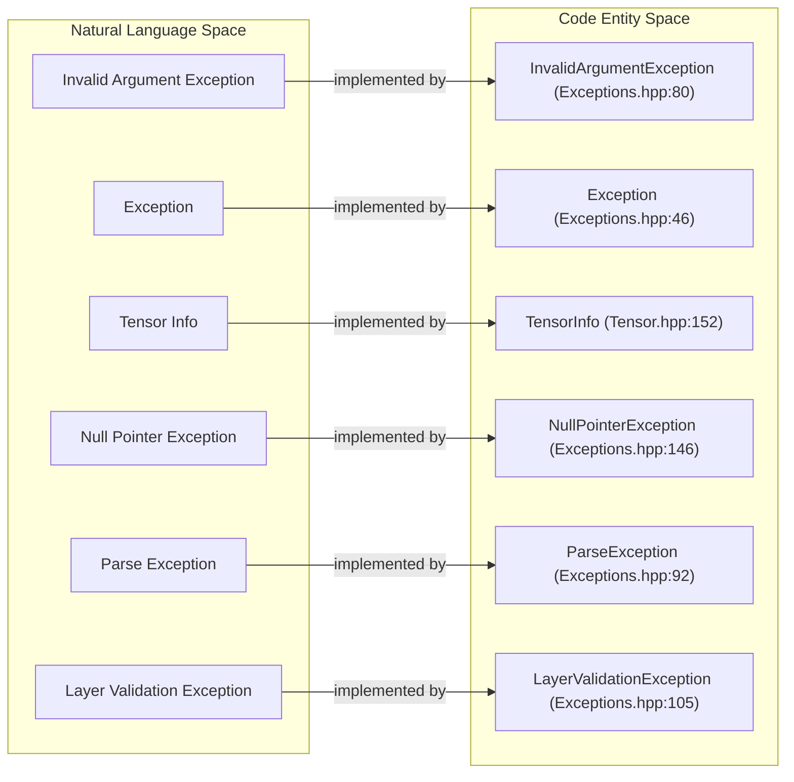
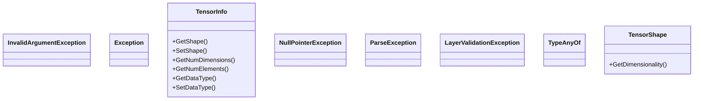
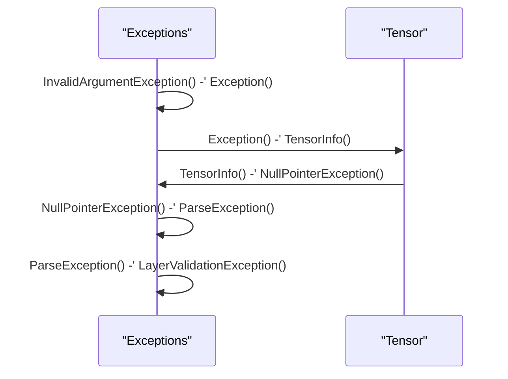

# 3-Source Context Packet (`git` + `CBM` + `llm-wiki`) for `7-glossary` — Glossary

- **Target Wiki File**: `wiki/7-glossary.md`
- **Archetype**: `Glossary Page`
- **Parent Page**: `None (Top-Level Chapter)`
- **Summary**: Definitions and technical context for ArmNN domain terms, acronyms, file formats, and core code entities.
- **Valid `[[wikilink]]` Neighbours**: `[[1-overview|Overview]]`, `[[3-backend-delegation-and-hardware-providers|Backend Delegation and Hardware Providers]]`, `[[3.1-backends-backendscommon|Backends Backendscommon]]`, `[[3.2-backends-reference|Backends Reference]]`, `[[3.3-backends-opencl|Backends OpenCL]]`, `[[3.4-backends-aclcommon|Backends Aclcommon]]`, `[[3.6-other-backends|Other Backends]]`, `[[5-runtime-execution-and-kernel-dispatch|Runtime Execution and Kernel Dispatch]]`

## 1. Relevant Source Files (`git` + `CBM`, use verbatim in `<details>`)
- `[src/armnn/Tensor.cpp](src/armnn/Tensor.cpp)`
- `[include/armnn/Exceptions.hpp](include/armnn/Exceptions.hpp)`
- `[include/armnn/Tensor.hpp](include/armnn/Tensor.hpp)`
- `[third-party/fmt/format.h](third-party/fmt/format.h)`
- `[src/armnn/Layer.cpp](src/armnn/Layer.cpp)`
- `[third-party/fmt/core.h](third-party/fmt/core.h)`
- `[include/armnn/BackendId.hpp](include/armnn/BackendId.hpp)`
- `[src/armnn/Descriptors.cpp](src/armnn/Descriptors.cpp)`
- `[src/backends/backendsCommon/LayerSupportRules.hpp](src/backends/backendsCommon/LayerSupportRules.hpp)`
- `[third-party/cxxopts/cxxopts.hpp](third-party/cxxopts/cxxopts.hpp)`
- `[src/backends/reference/workloads/BaseIterator.hpp](src/backends/reference/workloads/BaseIterator.hpp)`
- `[src/backends/backendsCommon/TensorHandleFactoryRegistry.cpp](src/backends/backendsCommon/TensorHandleFactoryRegistry.cpp)`
- `[src/backends/reference/workloads/Broadcast.hpp](src/backends/reference/workloads/Broadcast.hpp)`
- `[profiling/common/include/ProfilingException.hpp](profiling/common/include/ProfilingException.hpp)`
- `[src/backends/backendsCommon/DynamicBackendUtils.cpp](src/backends/backendsCommon/DynamicBackendUtils.cpp)`
- `[src/backends/reference/RefTensorHandle.hpp](src/backends/reference/RefTensorHandle.hpp)`
- `[tests/CMakeLists.txt](tests/CMakeLists.txt)`

## 2. Grounded Code Symbols (`CBM`, use verbatim for `[file:start-end]()` pill citations)
- `InvalidArgumentException` (Class) @ `[include/armnn/Exceptions.hpp:80-84]()` [fan-in=273, fan-out=0] — 
- `Exception` (Class) @ `[include/armnn/Exceptions.hpp:46-65]()` [fan-in=181, fan-out=0] — /// Base class for all ArmNN exceptions so that users can filter to just those.
- `TensorInfo` (Class) @ `[include/armnn/Tensor.hpp:152-274]()` [fan-in=121, fan-out=0] — 
- `NullPointerException` (Class) @ `[include/armnn/Exceptions.hpp:146-150]()` [fan-in=101, fan-out=0] — 
- `ParseException` (Class) @ `[include/armnn/Exceptions.hpp:92-96]()` [fan-in=98, fan-out=0] — 
- `LayerValidationException` (Class) @ `[include/armnn/Exceptions.hpp:105-108]()` [fan-in=73, fan-out=0] — 
- `TypeAnyOf` (Class) @ `[src/backends/backendsCommon/LayerSupportRules.hpp:89-99]()` [fan-in=64, fan-out=0] — 
- `TensorShape` (Class) @ `[include/armnn/Tensor.hpp:20-150]()` [fan-in=53, fan-out=0] — 
- `TypesAreEqual` (Class) @ `[src/backends/backendsCommon/LayerSupportRules.hpp:71-78]()` [fan-in=49, fan-out=0] — 
- `BackendId` (Class) @ `[include/armnn/BackendId.hpp:78-148]()` [fan-in=48, fan-out=0] — 
- `Tensor` (Class) @ `[include/armnn/Tensor.hpp:321-326]()` [fan-in=39, fan-out=0] — /// A tensor defined by a TensorInfo (shape and data type) and a mutable backing store.
- `ConstTensor` (Class) @ `[include/armnn/Tensor.hpp:329-392]()` [fan-in=32, fan-out=0] — /// A tensor defined by a TensorInfo (shape and data type) and an immutable backing store.
- `UnimplementedException` (Class) @ `[include/armnn/Exceptions.hpp:98-103]()` [fan-in=35, fan-out=0] — 
- `ProfilingException` (Class) @ `[profiling/common/include/ProfilingException.hpp:49-65]()` [fan-in=32, fan-out=0] — /// General Exception class for Profiling code
- `RuntimeException` (Class) @ `[include/armnn/Exceptions.hpp:120-123]()` [fan-in=18, fan-out=0] — 
- `InvalidArgumentException` (Class) @ `[profiling/common/include/ProfilingException.hpp:84-88]()` [fan-in=18, fan-out=0] — 
- `MemoryImportException` (Class) @ `[include/armnn/Exceptions.hpp:125-128]()` [fan-in=10, fan-out=0] — 
- `FileNotFoundException` (Class) @ `[include/armnn/Exceptions.hpp:86-90]()` [fan-in=7, fan-out=0] — 
- `GraphValidationException` (Class) @ `[include/armnn/Exceptions.hpp:110-113]()` [fan-in=6, fan-out=0] — 
- `basic_string_view` (Class) @ `[third-party/fmt/core.h:347-430]()` [fan-in=7, fan-out=0] — 
- `BackendUnavailableException` (Class) @ `[include/armnn/Exceptions.hpp:68-72]()` [fan-in=0, fan-out=0] — /// Class for non-fatal exceptions raised while initialising a backend
- `data` (Class) @ `[third-party/fmt/format.h:793-793]()` [fan-in=0, fan-out=0] — // This is a struct rather than an alias to avoid shadowing warnings in gcc.

## 3. Grounded Source Code Excerpts (`git` Working Tree)
### `InvalidArgumentException` in `[include/armnn/Exceptions.hpp:80-84]()`
```cpp
class InvalidArgumentException : public Exception
{
public:
    using Exception::Exception;
};
```

### `Exception` in `[include/armnn/Exceptions.hpp:46-61]()`
```cpp
class Exception : public std::exception
{
public:
    explicit Exception(const std::string& message);

    /// exception with context
    explicit Exception(const std::string& message,
                       const CheckLocation& location);

    /// preserving previous exception context
    /// and adding local context information
    explicit Exception(const Exception& other,
                       const std::string& message,
                       const CheckLocation& location);

    virtual const char* what() const noexcept override;
```

### `TensorInfo` in `[include/armnn/Tensor.hpp:152-167]()`
```cpp
class TensorInfo
{
public:
    /// Empty (invalid) constructor.
    TensorInfo();

    TensorInfo(const TensorShape& shape,
               DataType dataType,
               float quantizationScale = 1.0f,
               int32_t quantizationOffset = 0,
               bool isConstant = false);

    TensorInfo(unsigned int numDimensions,
               const unsigned int* dimensionSizes,
               DataType dataType,
               float quantizationScale = 1.0f,
```

### `NullPointerException` in `[include/armnn/Exceptions.hpp:146-150]()`
```cpp
class NullPointerException : public Exception
{
public:
    using Exception::Exception;
};
```

### `ParseException` in `[include/armnn/Exceptions.hpp:92-96]()`
```cpp
class ParseException : public Exception
{
public:
    using Exception::Exception;
};
```


## 4. Linked Official Docs (`llm-wiki` / `RAG`)
- **Overview** (`wiki/1-overview.md`, score=69.44, shared_symbols=['Exception', 'InvalidArgumentException', 'LayerValidationException', 'NullPointerException', 'ParseException', 'TensorInfo', 'TypeAnyOf']): # Overview > End-to-end architecture overview of ArmNN: core subsystems, compilation/execution pipeline, entry points, and cross-module dependencies. <details> <summary>Relevant source files</summary> The following files were used as context for generating this wiki page: - [src/armnn/Tensor.cpp](src/armnn/Tensor.cpp) - [include/armnn/Exceptions.hpp](inc
- **ArmNN** (`wiki/5.2-armnn.md`, score=67.138, shared_symbols=['BackendId', 'ConstTensor', 'Exception', 'InvalidArgumentException', 'LayerValidationException', 'NullPointerException', 'ParseException', 'ProfilingException']): # ArmNN ↑ [[5-runtime-execution-and-kernel-dispatch|Runtime Execution and Kernel Dispatch]] > ArmNN subsystem (`include/armnn`), covering 21 files and 440 symbols. Key symbols include `GetShape`, `InvalidArgumentException`, `GetNumElements`, `Exception`. <details> <summary>Relevant source files</summary> The following files were used as context for gener
- **Runtime Execution and Kernel Dispatch** (`wiki/5-runtime-execution-and-kernel-dispatch.md`, score=56.514, shared_symbols=['BackendId', 'ConstTensor', 'Exception', 'InvalidArgumentException', 'NullPointerException', 'ParseException', 'ProfilingException', 'Tensor']): # Runtime Execution and Kernel Dispatch > Architectural overview of Runtime Execution and Kernel Dispatch, spanning 157 source files and 3718 code symbols across 6 subsystems. <details> <summary>Relevant source files</summary> The following files were used as context for generating this wiki page: - [samples/common/include/Audio/DataStructures.hpp](sampl
- **ArmNN DeepWiki** (`wiki/index.md`, score=52.509, shared_symbols=['Exception', 'InvalidArgumentException']): # ArmNN DeepWiki Generated from `home-jason-Project-deepwiki-armnn` at commit `2b61cecc9df7` (2026-11-14T15:13:53+00:00). ## Pages - [[1-overview|Overview]] — End-to-end architecture overview of ArmNN: core subsystems, compilation/execution pipeline, entry points, and cross-module dependencies. - [[2-build-system-and-infrastructure|Build System and Infras
- **Backend Delegation and Hardware Providers** (`wiki/3-backend-delegation-and-hardware-providers.md`, score=47.766, shared_symbols=['Exception', 'InvalidArgumentException', 'TensorInfo', 'TypeAnyOf', 'TypesAreEqual']): # Backend Delegation and Hardware Providers > Architectural overview of Backend Delegation and Hardware Providers, spanning 150 source files and 2618 code symbols across 6 subsystems. <details> <summary>Relevant source files</summary> The following files were used as context for generating this wiki page: - [src/backends/aclCommon/ArmComputeTensorUtils.h
- **Backends Backendscommon** (`wiki/3.1-backends-backendscommon.md`, score=38.399, shared_symbols=['ConstTensor', 'TensorInfo', 'TypeAnyOf', 'TypesAreEqual']): # Backends Backendscommon ↑ [[3-backend-delegation-and-hardware-providers|Backend Delegation and Hardware Providers]] > Backends Backendscommon subsystem (`backends/backendsCommon`), covering 28 files and 312 symbols. Key symbols include `to_string`, `ValidateInputsOutputs`, `ValidateNumInputs`, `ValidateNumOutputs`. <details> <summary>Relevant source fil

## 5. Pre-Verified DeepWiki v1.9.9.5 Mermaid Diagrams
### Natural Language Space <-> Code Entity Space


### Subsystem Architecture Flowchart

```mermaid
flowchart TD
  subgraph sub_this["Glossary"]
    subgraph sg_0["src/armnn"]
      n_src_armnn_Tensor_cpp["SetQuantizationScale (Tensor.cpp)"]
      n_src_armnn_Layer_cpp["SetTensorInfo (Layer.cpp)"]
      n_src_armnn_Descriptors_cpp["GetNumDimensions (Descriptors.cpp)"]
    end
    subgraph sg_1["include/armnn"]
      n_include_armnn_Exceptions_hpp["InvalidArgumentException (Exceptions.hpp)"]
      n_include_armnn_Tensor_hpp["TensorInfo (Tensor.hpp)"]
      n_include_armnn_BackendId_hpp["BackendId (BackendId.hpp)"]
    end
    subgraph sg_2["third-party/fmt"]
      n_third_party_fmt_format_h["data (format.h)"]
      n_third_party_fmt_core_h["basic_string_view (core.h)"]
    end
    subgraph sg_3["src/backends/backendsCommon"]
      n_src_backends_backendsCommon_LayerSupportRules_hp["TypeAnyOf (LayerSupportRules.hpp)"]
      n_src_backends_backendsCommon_TensorHandleFactoryR["GetFactory (TensorHandleFactoryRegistry.cpp)"]
      n_src_backends_backendsCommon_DynamicBackendUtils_["OpenHandle (DynamicBackendUtils.cpp)"]
    end
    subgraph sg_4["third-party/cxxopts"]
      n_third_party_cxxopts_cxxopts_hpp["UnicodeStringIterator (cxxopts.hpp)"]
    end
  end
  n_page_3_backend_delegation_and_hardware_providers(["Backend Delegation and Hardware Providers"])
  n_page_4_1_tests(["Tests"])
  n_page_5_6_other_runtime_components(["Other Runtime Components"])
  n_page_5_runtime_execution_and_kernel_dispatch(["Runtime Execution and Kernel Dispatch"])
  n_src_backends_backendsCommon_LayerSupportRules_hp -.-> n_page_3_backend_delegation_and_hardware_providers
  n_third_party_fmt_core_h --> n_third_party_fmt_format_h
  n_src_armnn_Layer_cpp -.-> n_page_5_6_other_runtime_components
  n_third_party_fmt_core_h -.-> n_page_5_6_other_runtime_components
  n_src_armnn_Layer_cpp -.-> n_page_5_runtime_execution_and_kernel_dispatch
  n_third_party_fmt_core_h -.-> n_page_4_1_tests
  n_include_armnn_Tensor_hpp -.-> n_page_5_6_other_runtime_components
  n_third_party_cxxopts_cxxopts_hpp -.-> n_page_4_1_tests
  n_include_armnn_Exceptions_hpp -.-> n_page_5_6_other_runtime_components
  n_src_armnn_Tensor_cpp -.-> n_page_5_6_other_runtime_components
  n_third_party_fmt_format_h -.-> n_page_5_6_other_runtime_components
  n_include_armnn_Tensor_hpp -.-> n_page_4_1_tests
  n_src_armnn_Tensor_cpp -.-> n_page_5_runtime_execution_and_kernel_dispatch
  n_include_armnn_Exceptions_hpp -.-> n_page_5_runtime_execution_and_kernel_dispatch
```


### Class Hierarchy Diagram


### Call Sequence Diagram


## 6. DeepWiki v1.9.9.5 Authoring Checklist for `wiki/7-glossary.md`
1. Keep YAML frontmatter at top (`id`, `title`, `parent`, `sources`, `linked_docs`, `bridge_symbols`).
2. Keep `<details><summary>Relevant source files</summary>` block immediately after `# Title`.
3. Start with `## Purpose and Scope`, then numbered `## 1. ...`, `## 2. ...` sections separated by `---`.
4. Include at least 2 ```mermaid``` diagrams (including a `Natural Language Space` <-> `Code Entity Space` mapping).
5. Cite code entities inline using `[path/to/file.ext:start-end]()` and end every `##` section with `Sources: [file:start-end]()`.
6. Run `deepwiki_cli.py build --enrich-only ...` and `deepwiki_cli.py validate ...` after editing.
