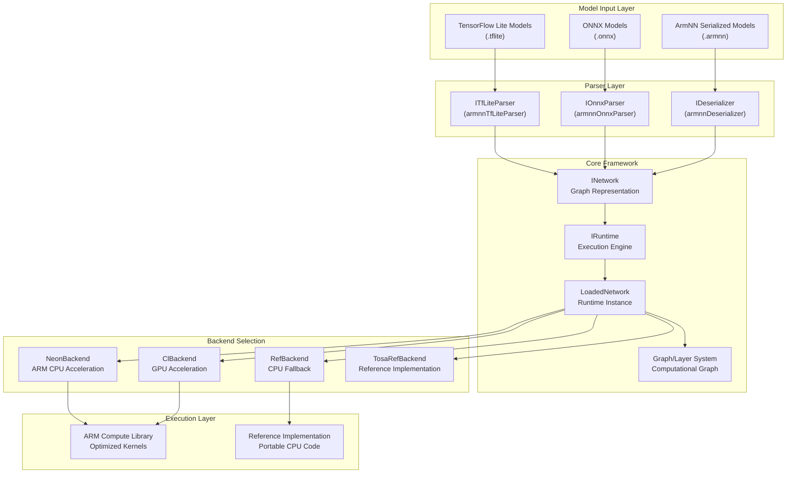
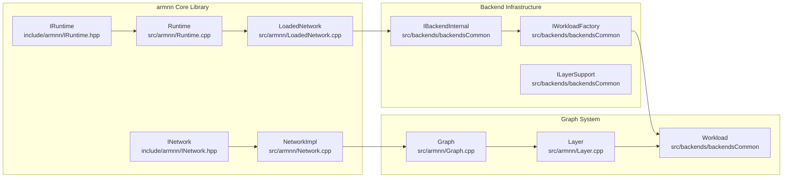
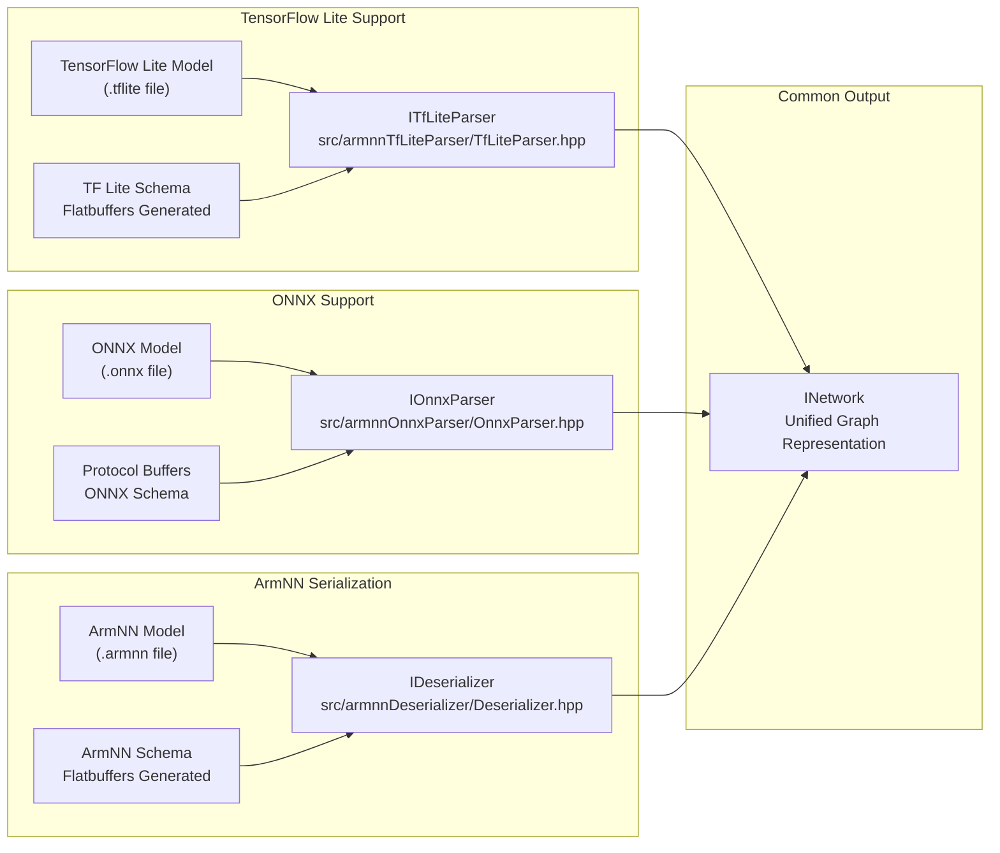

# ArmNN Overview

<details>
<summary>Relevant source files</summary>

The following files were used as context for generating this wiki page:

- [BuildGuideAndroidNDK.md](BuildGuideAndroidNDK.md)
- [CONTRIBUTING.md](CONTRIBUTING.md)
- [CONTRIBUTING.md.license](CONTRIBUTING.md.license)
- [InstallationViaAptRepository.md](InstallationViaAptRepository.md)
- [InstallationViaAptRepository.md.license](InstallationViaAptRepository.md.license)
- [README.md](README.md)
- [cmake/GlobalConfig.cmake](cmake/GlobalConfig.cmake)
- [delegate/BuildGuideNative.md](delegate/BuildGuideNative.md)
- [delegate/DelegateQuickStartGuide.md](delegate/DelegateQuickStartGuide.md)
- [delegate/armnnDelegateJNI/CMakeLists.txt](delegate/armnnDelegateJNI/CMakeLists.txt)
- [delegate/armnnDelegateJNI/README.md](delegate/armnnDelegateJNI/README.md)
- [delegate/armnnDelegateJNI/README.md.license](delegate/armnnDelegateJNI/README.md.license)
- [delegate/armnnDelegateJNI/src/armnn_delegate_jni.cpp](delegate/armnnDelegateJNI/src/armnn_delegate_jni.cpp)
- [delegate/armnnDelegateJNI/version_script](delegate/armnnDelegateJNI/version_script)
- [docs/FAQ.md](docs/FAQ.md)
- [profiling/client/src/ProfilingService.cpp](profiling/client/src/ProfilingService.cpp)
- [profiling/server/src/timelineDecoder/CMakeLists.txt](profiling/server/src/timelineDecoder/CMakeLists.txt)
- [samples/CMakeLists.txt](samples/CMakeLists.txt)
- [samples/ObjectDetection/Readme.md](samples/ObjectDetection/Readme.md)
- [samples/serialized/Readme.md.license](samples/serialized/Readme.md.license)
- [scripts/build_android_ndk_guide.sh](scripts/build_android_ndk_guide.sh)
- [src/armnnDeserializer/CMakeLists.txt](src/armnnDeserializer/CMakeLists.txt)
- [src/armnnSerializer/CMakeLists.txt](src/armnnSerializer/CMakeLists.txt)
- [src/armnnTestUtils/CMakeLists.txt](src/armnnTestUtils/CMakeLists.txt)
- [src/armnnTfLiteParser/CMakeLists.txt](src/armnnTfLiteParser/CMakeLists.txt)
- [src/backends/dynamic/reference/CMakeLists.txt](src/backends/dynamic/reference/CMakeLists.txt)

</details>


This document provides a comprehensive overview of ArmNN, covering its purpose, architecture, core components, and integration options. ArmNN is a machine learning inference engine designed specifically for Arm-based devices.

For detailed information about building ArmNN, see [[1.1-getting-started|Getting Started]]. For specific backend implementations, see [[4-compute-backends|Compute Backends]]. For model parsing and serialization, see [[3-model-support|Model Support]].

## What is ArmNN?

ArmNN is an open-source machine learning inference engine optimized for Arm Cortex-A CPUs and Arm Mali GPUs. It serves as a bridge between existing neural network frameworks (TensorFlow Lite, ONNX) and power-efficient Arm IP, providing significant performance improvements through Arm architecture-specific optimizations.

**Key Characteristics:**
- **Language**: Portable C++17 with CMake build system
- **License**: MIT license
- **Supported Platforms**: Android and Linux
- **Model Formats**: TensorFlow Lite (.tflite), ONNX (.onnx), ArmNN serialized (.armnn)
- **Acceleration**: Leverages ARM Compute Library (ACL) for optimized kernels

**Performance Advantage:**
ArmNN outperforms generic ML libraries by utilizing ARM Compute Library with architecture-specific optimizations including SVE2, NEON, and OpenCL acceleration.

Sources: [README.md:16-30](), [cmake/GlobalConfig.cmake:1-10]()

## System Architecture Overview

ArmNN follows a modular architecture that separates model parsing, graph optimization, backend selection, and execution into distinct but coordinated components.

### High-Level Architecture



Sources: [README.md:76-98](), [cmake/GlobalConfig.cmake:7-15]()

### Core Component Relationships



Sources: [src/armnn/](), [src/backends/backendsCommon/](), [include/armnn/]()

## Core Components

### Network and Graph System

The `INetwork` interface represents the computational graph of a neural network model. It serves as the primary abstraction for model representation before optimization and execution.

**Key Classes:**
- `INetwork`: Public interface for network construction and modification
- `NetworkImpl`: Internal implementation managing layers and connections
- `Graph`: Core graph data structure managing topological relationships
- `Layer`: Base class for all neural network operations

The network construction flow follows this pattern:
1. Parsers create `INetwork` instances from model files
2. `NetworkImpl` manages the internal graph structure
3. `Graph` handles layer connections and topological ordering
4. Individual `Layer` objects represent specific operations

Sources: [include/armnn/INetwork.hpp](), [src/armnn/Network.cpp](), [src/armnn/Graph.cpp](), [src/armnn/Layer.cpp]()

### Runtime and Execution System

The `IRuntime` interface manages the execution environment, including backend selection, network optimization, and inference execution.

**Execution Pipeline:**
1. `IRuntime::Create()` initializes the runtime environment
2. `LoadNetwork()` optimizes the network for target backends
3. `LoadedNetwork` manages the executable network instance
4. Backend-specific workloads execute individual operations

The `LoadedNetwork` class coordinates between the high-level network representation and backend-specific implementations, handling memory management and execution scheduling.

Sources: [include/armnn/IRuntime.hpp](), [src/armnn/Runtime.cpp](), [src/armnn/LoadedNetwork.cpp]()

### Backend Architecture

ArmNN's backend system provides a plugin architecture for different compute targets. Each backend implements the `IBackendInternal` interface to provide:

- **Layer Support**: `ILayerSupport` indicates which operations are supported
- **Workload Factory**: `IWorkloadFactory` creates backend-specific execution units
- **Memory Management**: `IMemoryManager` handles backend-specific memory allocation

```mermaid
graph TB
    subgraph "Backend Interface"
        IBackendInternal["IBackendInternal<br/>src/backends/backendsCommon/IBackendInternal.hpp"]
        IWorkloadFactory["IWorkloadFactory<br/>src/backends/backendsCommon/IWorkloadFactory.hpp"]
        ILayerSupport["ILayerSupport<br/>src/backends/backendsCommon/ILayerSupport.hpp"]
    end
    
    subgraph "Reference Backend"
        RefBackend["RefBackend<br/>src/backends/reference/RefBackend.cpp"]
        RefWorkloadFactory["RefWorkloadFactory<br/>src/backends/reference/RefWorkloadFactory.cpp"]
        RefLayerSupport["RefLayerSupport<br/>src/backends/reference/RefLayerSupport.cpp"]
    end
    
    subgraph "NEON Backend"
        NeonBackend["NeonBackend<br/>src/backends/neon/NeonBackend.cpp"]
        NeonWorkloadFactory["NeonWorkloadFactory<br/>src/backends/neon/NeonWorkloadFactory.cpp"]
        NeonLayerSupport["NeonLayerSupport<br/>src/backends/neon/NeonLayerSupport.cpp"]
    end
    
    subgraph "OpenCL Backend"
        ClBackend["ClBackend<br/>src/backends/cl/ClBackend.cpp"]
        ClWorkloadFactory["ClWorkloadFactory<br/>src/backends/cl/ClWorkloadFactory.cpp"]
        ClLayerSupport["ClLayerSupport<br/>src/backends/cl/ClLayerSupport.cpp"]
    end
    
    IBackendInternal --> RefBackend
    IBackendInternal --> NeonBackend
    IBackendInternal --> ClBackend
    
    IWorkloadFactory --> RefWorkloadFactory
    IWorkloadFactory --> NeonWorkloadFactory
    IWorkloadFactory --> ClWorkloadFactory
    
    ILayerSupport --> RefLayerSupport
    ILayerSupport --> NeonLayerSupport
    ILayerSupport --> ClLayerSupport
```



Sources: [src/backends/backendsCommon/](), [src/backends/reference/](), [src/backends/neon/](), [src/backends/cl/]()

## Model Support and Parsing

ArmNN supports multiple model formats through dedicated parser libraries that convert external formats into the internal `INetwork` representation.

### Supported Model Formats

| Format | Parser Library | File Extension | CMake Option |
|--------|---------------|----------------|--------------|
| TensorFlow Lite | `armnnTfLiteParser` | `.tflite` | `BUILD_TF_LITE_PARSER` |
| ONNX | `armnnOnnxParser` | `.onnx` | `BUILD_ONNX_PARSER` |
| ArmNN Serialized | `armnnDeserializer` | `.armnn` | `BUILD_ARMNN_SERIALIZER` |

### Parser Architecture



Sources: [src/armnnTfLiteParser/CMakeLists.txt:5-15](), [cmake/GlobalConfig.cmake:7-8](), [src/armnnDeserializer/CMakeLists.txt:5-10]()

### TensorFlow Lite Integration

ArmNN provides multiple integration paths for TensorFlow Lite models:

1. **TF Lite Parser**: Direct parsing of `.tflite` files using `ITfLiteParser`
2. **TF Lite Delegate**: Runtime acceleration of TF Lite models using the delegate mechanism
3. **Model Conversion**: Convert TF Lite models to ArmNN serialized format

The TF Lite Delegate (`libarmnnDelegate.so`) provides the widest operator support and seamless integration with existing TensorFlow Lite applications.

Sources: [README.md:32-44](), [delegate/DelegateQuickStartGuide.md:1-20]()

## Build System and Configuration

ArmNN uses CMake with extensive configuration options to control which components are built and which features are enabled.

### Key Build Options

| Option | Description | Default |
|--------|-------------|---------|
| `ARMCOMPUTENEON` | Enable ARM NEON backend | OFF |
| `ARMCOMPUTECL` | Enable OpenCL backend | OFF |
| `ARMNNREF` | Enable Reference backend | ON |
| `BUILD_TF_LITE_PARSER` | Build TensorFlow Lite parser | OFF |
| `BUILD_ONNX_PARSER` | Build ONNX parser | OFF |
| `BUILD_CLASSIC_DELEGATE` | Build TF Lite delegate | OFF |
| `BUILD_UNIT_TESTS` | Build unit tests | ON |

### Dependency Management

ArmNN manages external dependencies through CMake's find_package mechanism and custom scripts:

- **ARM Compute Library**: Core dependency for NEON and OpenCL backends
- **Flatbuffers**: Required for TF Lite parser and serialization
- **Protocol Buffers**: Required for ONNX parser
- **Third-party libraries**: Header-only libraries included in `third-party/` directory

Sources: [cmake/GlobalConfig.cmake:7-50](), [README.md:154-166]()

## Tools and Applications

ArmNN provides several tools and applications for model testing, benchmarking, and integration:

### ExecuteNetwork Tool

The `ExecuteNetwork` application is the primary command-line tool for testing and benchmarking models across different backends.

**Key Features:**
- Model loading and validation
- Multi-backend execution and fallback
- Performance profiling and timing
- Input/output data handling

**Usage Example:**
```bash
./ExecuteNetwork -f tflite-binary -m model.tflite -c CpuAcc,CpuRef
```

### TensorFlow Lite Delegate

The ArmNN TF Lite Delegate enables seamless acceleration of TensorFlow Lite models through the TF Lite delegation mechanism. It supports both C++ and Python APIs.

**Integration Modes:**
- **Classic Delegate**: `libarmnnDelegate.so` for standard TF Lite applications
- **Opaque Delegate**: Enhanced delegate interface for advanced features
- **JNI Interface**: Experimental Java interface for Android applications

Sources: [samples/ObjectDetection/Readme.md:67-73](), [delegate/DelegateQuickStartGuide.md:8-35](), [delegate/armnnDelegateJNI/README.md:1-8]()

### Model Serialization

ArmNN provides serialization capabilities to save optimized networks for faster loading:

- **Serializer**: `ISerializer` interface for saving networks to `.armnn` format  
- **Deserializer**: `IDeserializer` interface for loading serialized networks
- **Schema**: Flatbuffers-based schema for efficient serialization

This enables deployment scenarios where models are pre-optimized and serialized for specific target configurations.

Sources: [src/armnnSerializer/CMakeLists.txt:19-35](), [src/armnnDeserializer/CMakeLists.txt:19-30]()

## Related Wiki Pages

- [[1.1-getting-started|Getting Started]]
- [[4-compute-backends|Compute Backends]]
- [[3-model-support|Model Support]]


## Dynamic Knowledge Links (Code Graph ↔ LLM-Wiki / RAG)

### Linked Architecture & Design Documents

| Document | Match Channel | Score | Shared Code Symbols |
|---|---|---|---|
| [[2.1-network-and-graph-system|2.1 Network and Graph System]] | `bm25+entity(3)` | `37.809` | `Connect`, `SetTensorInfo`, `TopologicalSort` |
| [[2.3-runtime-and-execution|2.3 Runtime and Execution]] | `bm25+entity(5)` | `36.873` | `CreationOptions`, `EnqueueInput`, `EnqueueOutput`, `LoadedNetwork`, `RuntimeImpl` |
| [[1.1-getting-started|1.1 Getting Started]] | `bm25+entity(3)` | `34.286` | `CheckCounterUid`, `CreationOptions`, `Update` |
| [[3.2-onnx-parser|3.2 ONNX Parser]] | `bm25+entity(1)` | `34.04` | `Connect` |
| [[3.1-tensorflow-lite-parser|3.1 TensorFlow Lite Parser]] | `bm25+entity(1)` | `31.469` | `Connect` |
| [[5.1-executenetwork-tool|5.1 ExecuteNetwork Tool]] | `bm25` | `28.128` | *(lexical/graph match)* |

### High-Centrality Bridge Symbols (CBM Graph)

| Symbol | Kind | Source Location | Fan-In / Fan-Out |
|---|---|---|---|
| `SetTensorInfo` | Method | [src/armnn/Layer.cpp:609-612]() | in: `207` / out: `1` |
| `Connect` | Method | [src/armnn/Layer.cpp:123-129]() | in: `190` / out: `3` |
| `GetTensorInfo` | Method | [src/armnn/Layer.cpp:614-624]() | in: `122` / out: `3` |
| `SetTensorInfo` | Method | [src/armnn/Layer.cpp:95-98]() | in: `91` / out: `2` |
| `Create` | Method | [src/armnn/Network.cpp:683-686]() | in: `83` / out: `1` |
| `SetAdditionalInfo` | Method | [src/armnn/Layer.cpp:303-306]() | in: `74` / out: `1` |

Sources: [src/armnn/Layer.cpp:609-612](), [src/armnn/Layer.cpp:123-129](), [src/armnn/Layer.cpp:614-624](), [src/armnn/Layer.cpp:95-98]()

### Cross-Subsystem Coupling

- [[2-core-architecture|2 Core Architecture]] — call/import coupling weight `336.0`
- [[2.1-network-and-graph-system|2.1 Network and Graph System]] — call/import coupling weight `336.0`
- [[3-model-support|3 Model Support]] — call/import coupling weight `121.0`
- [[3.1-tensorflow-lite-parser|3.1 TensorFlow Lite Parser]] — call/import coupling weight `92.0`
- [[4.1-reference-backend|4.1 Reference Backend]] — call/import coupling weight `81.0`
- [[4.4-tosa-backend|4.4 TOSA Backend]] — call/import coupling weight `81.0`
