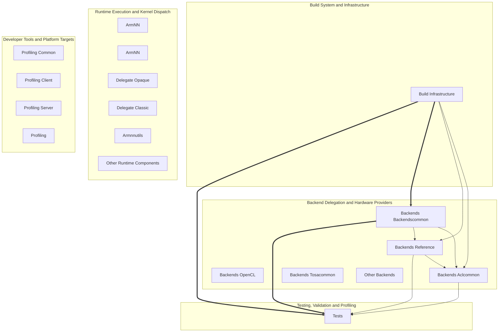
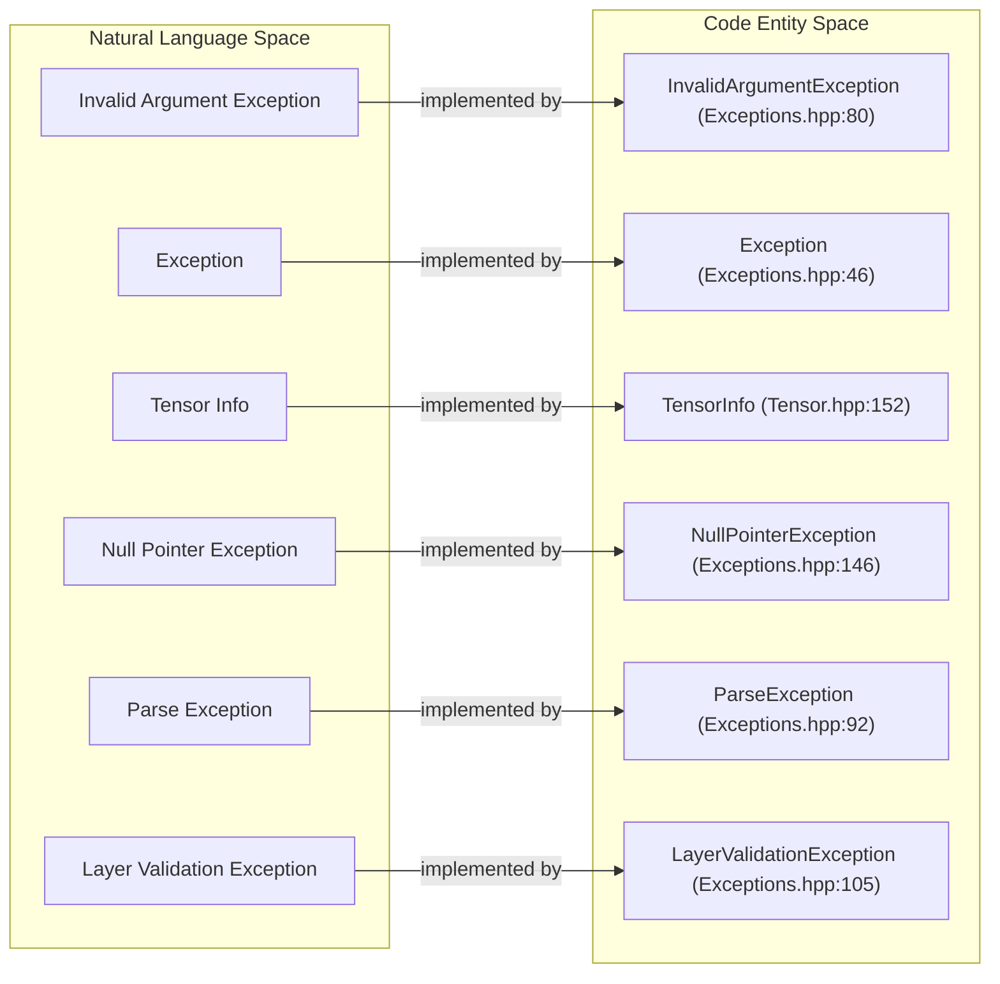
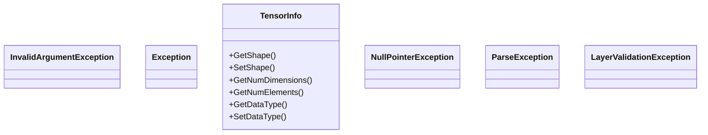

# Overview

> End-to-end architecture overview of ArmNN: core subsystems, compilation/execution pipeline, entry points, and cross-module dependencies.

Relevant source files

The following files were used as context for generating this wiki page:

- [src/armnn/Tensor.cpp](src/armnn/Tensor.cpp)
- [include/armnn/Exceptions.hpp](include/armnn/Exceptions.hpp)
- [include/armnn/Tensor.hpp](include/armnn/Tensor.hpp)
- [third-party/fmt/format.h](third-party/fmt/format.h)
- [src/armnn/Layer.cpp](src/armnn/Layer.cpp)
- [third-party/fmt/core.h](third-party/fmt/core.h)
- [include/armnn/BackendId.hpp](include/armnn/BackendId.hpp)
- [src/armnn/Descriptors.cpp](src/armnn/Descriptors.cpp)
- [src/backends/backendsCommon/LayerSupportRules.hpp](src/backends/backendsCommon/LayerSupportRules.hpp)
- [third-party/cxxopts/cxxopts.hpp](third-party/cxxopts/cxxopts.hpp)
- [src/backends/reference/workloads/BaseIterator.hpp](src/backends/reference/workloads/BaseIterator.hpp)
- [src/backends/backendsCommon/TensorHandleFactoryRegistry.cpp](src/backends/backendsCommon/TensorHandleFactoryRegistry.cpp)
- [src/backends/reference/workloads/Broadcast.hpp](src/backends/reference/workloads/Broadcast.hpp)
- [profiling/common/include/ProfilingException.hpp](profiling/common/include/ProfilingException.hpp)
- [src/backends/backendsCommon/DynamicBackendUtils.cpp](src/backends/backendsCommon/DynamicBackendUtils.cpp)
- [src/backends/reference/RefTensorHandle.hpp](src/backends/reference/RefTensorHandle.hpp)
- [tests/CMakeLists.txt](tests/CMakeLists.txt)
- [src/backends/aclCommon/ArmComputeTensorUtils.hpp](src/backends/aclCommon/ArmComputeTensorUtils.hpp)
- [src/backends/aclCommon/ArmComputeTensorUtils.cpp](src/backends/aclCommon/ArmComputeTensorUtils.cpp)
- [src/backends/backendsCommon/test/EndToEndTestImpl.hpp](src/backends/backendsCommon/test/EndToEndTestImpl.hpp)
- [samples/common/include/Audio/DataStructures.hpp](samples/common/include/Audio/DataStructures.hpp)
- [profiling/common/include/Packet.hpp](profiling/common/include/Packet.hpp)

**ArmNN** comprises **2332 indexed code files**, **13625 symbols**, and **13604 inter-file dependency edges** [README.md:1-30]().

**Scope**: This page provides a high-level architecture overview, compilation/execution lifecycle, and subsystem navigation map. For detailed technical specifications on each layer:
- **Build System and Infrastructure**: See [[2-build-system-and-infrastructure|Build System and Infrastructure]].
- **Backend Delegation and Hardware Providers**: See [[3-backend-delegation-and-hardware-providers|Backend Delegation and Hardware Providers]].
- **Testing, Validation and Profiling**: See [[4-testing-validation-and-profiling|Testing, Validation and Profiling]].
- **Runtime Execution and Kernel Dispatch**: See [[5-runtime-execution-and-kernel-dispatch|Runtime Execution and Kernel Dispatch]].
- **Developer Tools and Platform Targets**: See [[6-developer-tools-and-platform-targets|Developer Tools and Platform Targets]].
- **Glossary**: See [[7-glossary|Glossary]].

Sources: [src/armnn/Tensor.cpp](), [include/armnn/Exceptions.hpp](), [include/armnn/Tensor.hpp](), [third-party/fmt/format.h]()

---

## 1. Architecture Overview & System Component Map

This diagram maps the repository's high-level architectural chapters and subsystems to their primary modules:

### Core Concept to Code Entity Mapping

### Core Compilation & Runtime Class Hierarchy

### Architectural Principles (from Official Documentation)

- **04_contributor** ([raw/armnn/04_contributor.dox]()): /// Copyright (c) 2021 ARM Limited and Contributors. All rights reserved. /// /// SPDX-License-Identifier: MIT /// namespace armnn { /** @page contribguides Contribution Guides This is a collection of guides that should help you contribute code to Arm NN. Before you get started, please take a look into our /ref md_Contributor_Guide section. - @subpage md_src_backends_README \n 
- **Build Infrastructure** ([wiki/2.1-build-infrastructure.md]()): # Build Infrastructure ↑ [[2-build-system-and-infrastructure|Build System and Infrastructure]] > Build Infrastructure subsystem (`build/infrastructure`), covering 28 files and 2092 symbols. Key symbols include `push_back`, `data`, `move`, `get`. 
 
Relevant source files
 The following files were used as context for generating this wiki page: - [third-pa
- **Glossary** ([wiki/7-glossary.md]()): # Glossary > Definitions and technical context for ArmNN domain terms, acronyms, file formats, and core code entities. 
 
Relevant source files
 The following files were used as context for generating this wiki page: - [src/armnn/Tensor.cpp](src/armnn/Tensor.cpp) - [include/armnn/Exceptions.hpp](include/armnn/Exceptions.hpp) - [include/armnn/Tensor.hpp]
- **ArmNN** ([wiki/5.2-armnn.md]()): # ArmNN ↑ [[5-runtime-execution-and-kernel-dispatch|Runtime Execution and Kernel Dispatch]] > ArmNN subsystem (`include/armnn`), covering 21 files and 440 symbols. Key symbols include `GetShape`, `InvalidArgumentException`, `GetNumElements`, `Exception`. 
 
Relevant source files
 The following files were used as context for generating this wiki page: - 

Sources: [raw/armnn/04_contributor.dox](), [wiki/2.1-build-infrastructure.md](), [wiki/7-glossary.md](), [wiki/5.2-armnn.md]()

---

## 2. Subsystem Catalog & Navigation Matrix

| Section | Page | Files | Parent Chapter | Primary Focus & Code Entities |
|---|---|---|---|---|
| `2` | [[2-build-system-and-infrastructure|Build System and Infrastructure]] | 6 | **Top-Level Chapter** | Architectural overview of Build System and Infrastructure, spanning 28 source files and 2092 code symbols across 1 subsystems. |
| `2.1` | [[2.1-build-infrastructure|Build Infrastructure]] | 28 | [[2-build-system-and-infrastructure|Build System and Infrastructure]] | Build Infrastructure subsystem (`build/infrastructure`), covering 28 files and 2092 symbols. Key symbols include `push_back`, `data`, `move`, `get`. |
| `3` | [[3-backend-delegation-and-hardware-providers|Backend Delegation and Hardware Providers]] | 23 | **Top-Level Chapter** | Architectural overview of Backend Delegation and Hardware Providers, spanning 150 source files and 2618 code symbols across 6 subsystems. |
| `3.1` | [[3.1-backends-backendscommon|Backends Backendscommon]] | 28 | [[3-backend-delegation-and-hardware-providers|Backend Delegation and Hardware Providers]] | Backends Backendscommon subsystem (`backends/backendsCommon`), covering 28 files and 312 symbols. Key symbols include `to_string`, `ValidateInputsOutp |
| `3.2` | [[3.2-backends-reference|Backends Reference]] | 28 | [[3-backend-delegation-and-hardware-providers|Backend Delegation and Hardware Providers]] | Backends Reference subsystem (`backends/reference`), covering 28 files and 634 symbols. Key symbols include `GetNumDimensions`, `GetTensorInfo`, `Make |
| `3.3` | [[3.3-backends-opencl|Backends OpenCL]] | 28 | [[3-backend-delegation-and-hardware-providers|Backend Delegation and Hardware Providers]] | Backends OpenCL subsystem (`backends/cl`), covering 28 files and 648 symbols. Key symbols include `IsClBackendSupported`, `RunClFunction`, `GetDataTyp |
| `3.4` | [[3.4-backends-aclcommon|Backends Aclcommon]] | 10 | [[3-backend-delegation-and-hardware-providers|Backend Delegation and Hardware Providers]] | Backends Aclcommon subsystem (`backends/aclCommon`), covering 10 files and 89 symbols. Key symbols include `GetShape`, `BuildArmComputeTensorInfo`, `C |
| `3.5` | [[3.5-backends-tosacommon|Backends Tosacommon]] | 28 | [[3-backend-delegation-and-hardware-providers|Backend Delegation and Hardware Providers]] | Backends Tosacommon subsystem (`backends/tosaCommon`), covering 28 files and 86 symbols. Key symbols include `GetTosaTensorShape`, `GenerateUniqueOutp |
| `3.6` | [[3.6-other-backends|Other Backends]] | 28 | [[3-backend-delegation-and-hardware-providers|Backend Delegation and Hardware Providers]] | Other Backends subsystem (consolidating `Backends Neon`, `ArmNN Backends`, `Backends Tosareference`, `Backends Dynamic`), covering 28 files and 849 sy |
| `4` | [[4-testing-validation-and-profiling|Testing, Validation and Profiling]] | 6 | **Top-Level Chapter** | Architectural overview of Testing, Validation and Profiling, spanning 40 source files and 4535 code symbols across 1 subsystems. |
| `4.1` | [[4.1-tests|Tests]] | 40 | [[4-testing-validation-and-profiling|Testing, Validation and Profiling]] | Tests subsystem (`tests`), covering 40 files and 4535 symbols. Key symbols include `EndToEndLayerTestImpl`, `ElementwiseTestHelper`, `Setup`, `Compari |
| `5` | [[5-runtime-execution-and-kernel-dispatch|Runtime Execution and Kernel Dispatch]] | 23 | **Top-Level Chapter** | Architectural overview of Runtime Execution and Kernel Dispatch, spanning 157 source files and 3718 code symbols across 6 subsystems. |
| `5.1` | [[5.1-armnn|ArmNN]] | 28 | [[5-runtime-execution-and-kernel-dispatch|Runtime Execution and Kernel Dispatch]] | ArmNN subsystem (`src/armnn`), covering 28 files and 1007 symbols. Key symbols include `SetTensorInfo`, `Connect`, `end`, `GetName`. |
| `5.2` | [[5.2-armnn|ArmNN]] | 21 | [[5-runtime-execution-and-kernel-dispatch|Runtime Execution and Kernel Dispatch]] | ArmNN subsystem (`include/armnn`), covering 21 files and 440 symbols. Key symbols include `GetShape`, `InvalidArgumentException`, `GetNumElements`, `E |
| `5.3` | [[5.3-delegate-opaque|Delegate Opaque]] | 28 | [[5-runtime-execution-and-kernel-dispatch|Runtime Execution and Kernel Dispatch]] | Delegate Opaque subsystem (`delegate/opaque`), covering 28 files and 128 symbols. Key symbols include `GetTensorInfoForTfLiteOpaqueTensor`, `GetName`, |
| `5.4` | [[5.4-delegate-classic|Delegate Classic]] | 28 | [[5-runtime-execution-and-kernel-dispatch|Runtime Execution and Kernel Dispatch]] | Delegate Classic subsystem (`delegate/classic`), covering 28 files and 114 symbols. Key symbols include `GetTensorInfoForTfLiteTensor`, `GetLayerName` |
| `5.5` | [[5.5-armnnutils|Armnnutils]] | 24 | [[5-runtime-execution-and-kernel-dispatch|Runtime Execution and Kernel Dispatch]] | Armnnutils subsystem (`src/armnnUtils`), covering 24 files and 134 symbols. Key symbols include `Permuted`, `Permute`, `GetTensorInfo`, `GetStream`. |
| `5.6` | [[5.6-other-runtime-components|Other Runtime Components]] | 28 | [[5-runtime-execution-and-kernel-dispatch|Runtime Execution and Kernel Dispatch]] | Other Runtime Components subsystem (consolidating `ArmNN Optimizations`, `Armnntestutils`, `ArmNN Layers`, `Samples Common`, `Armnntestutils`, `Sample |
| `6` | [[6-developer-tools-and-platform-targets|Developer Tools and Platform Targets]] | 19 | **Top-Level Chapter** | Architectural overview of Developer Tools and Platform Targets, spanning 70 source files and 662 code symbols across 4 subsystems. |
| `6.1` | [[6.1-profiling-common|Profiling Common]] | 28 | [[6-developer-tools-and-platform-targets|Developer Tools and Platform Targets]] | Profiling Common subsystem (`profiling/common`), covering 28 files and 244 symbols. Key symbols include `IgnoreUnused`, `ProfilingException`, `CentreA |
| `6.2` | [[6.2-profiling-client|Profiling Client]] | 28 | [[6-developer-tools-and-platform-targets|Developer Tools and Platform Targets]] | Profiling Client subsystem (`profiling/client`), covering 28 files and 340 symbols. Key symbols include `ReadUint32`, `GetCurrentState`, `WriteUint32` |
| `6.3` | [[6.3-profiling-server|Profiling Server]] | 13 | [[6-developer-tools-and-platform-targets|Developer Tools and Platform Targets]] | Profiling Server subsystem (`profiling/server`), covering 13 files and 77 symbols. Key symbols include `ParseData`, `ReceivePacket`, `ReadCategoryReco |
| `6.4` | [[6.4-profiling|Profiling]] | 1 | [[6-developer-tools-and-platform-targets|Developer Tools and Platform Targets]] | Profiling subsystem (`profiling`), covering 1 files and 1 symbols. Key symbols include `usage`. |
| `7` | [[7-glossary|Glossary]] | 17 | **Top-Level Chapter** | Definitions and technical context for ArmNN domain terms, acronyms, file formats, and core code entities. |

---

## 3. Language Breakdown & Repository Statistics

| Language | Indexed File Count |
|---|---|
| `C++` | 1061 |
| `C` | 15 |
| `Bash` | 14 |
| `Python` | 3 |
| `TOML` | 1 |
| `HTML` | 1 |
| `CSS` | 1 |

---

## 4. Primary Entry Points

- `samples.BareMetalDeserializedGraph.main` in [samples/BareMetalDeserializedGraph.cpp]()
- `samples.CustomMemoryAllocatorSample.main` in [samples/CustomMemoryAllocatorSample.cpp]()
- `samples.DynamicSample.main` in [samples/DynamicSample.cpp]()
- `samples.KeywordSpotting.src.Main.main` in [samples/KeywordSpotting/src/Main.cpp]()
- `samples.ObjectDetection.src.Main.main` in [samples/ObjectDetection/src/Main.cpp]()
- `samples.SimpleSample.main` in [samples/SimpleSample.cpp]()
- `samples.SpeechRecognition.src.Main.main` in [samples/SpeechRecognition/src/Main.cpp]()

Sources: [samples/BareMetalDeserializedGraph.cpp](), [samples/CustomMemoryAllocatorSample.cpp](), [samples/DynamicSample.cpp](), [samples/KeywordSpotting/src/Main.cpp](), [samples/ObjectDetection/src/Main.cpp]()

## Sources

- [`src/armnn/Tensor.cpp`](https://github.com/ARM-software/armnn/blob/branches/armnn_24_11/src/armnn/Tensor.cpp)
- [`include/armnn/Exceptions.hpp`](https://github.com/ARM-software/armnn/blob/branches/armnn_24_11/include/armnn/Exceptions.hpp)
- [`include/armnn/Tensor.hpp`](https://github.com/ARM-software/armnn/blob/branches/armnn_24_11/include/armnn/Tensor.hpp)
- [`third-party/fmt/format.h`](https://github.com/ARM-software/armnn/blob/branches/armnn_24_11/third-party/fmt/format.h)
- [`src/armnn/Layer.cpp`](https://github.com/ARM-software/armnn/blob/branches/armnn_24_11/src/armnn/Layer.cpp)
- [`third-party/fmt/core.h`](https://github.com/ARM-software/armnn/blob/branches/armnn_24_11/third-party/fmt/core.h)
- [`include/armnn/BackendId.hpp`](https://github.com/ARM-software/armnn/blob/branches/armnn_24_11/include/armnn/BackendId.hpp)
- [`src/armnn/Descriptors.cpp`](https://github.com/ARM-software/armnn/blob/branches/armnn_24_11/src/armnn/Descriptors.cpp)
- [`src/backends/backendsCommon/LayerSupportRules.hpp`](https://github.com/ARM-software/armnn/blob/branches/armnn_24_11/src/backends/backendsCommon/LayerSupportRules.hpp)
- [`third-party/cxxopts/cxxopts.hpp`](https://github.com/ARM-software/armnn/blob/branches/armnn_24_11/third-party/cxxopts/cxxopts.hpp)
- [`src/backends/reference/workloads/BaseIterator.hpp`](https://github.com/ARM-software/armnn/blob/branches/armnn_24_11/src/backends/reference/workloads/BaseIterator.hpp)
- [`src/backends/backendsCommon/TensorHandleFactoryRegistry.cpp`](https://github.com/ARM-software/armnn/blob/branches/armnn_24_11/src/backends/backendsCommon/TensorHandleFactoryRegistry.cpp)
- [`src/backends/reference/workloads/Broadcast.hpp`](https://github.com/ARM-software/armnn/blob/branches/armnn_24_11/src/backends/reference/workloads/Broadcast.hpp)
- [`profiling/common/include/ProfilingException.hpp`](https://github.com/ARM-software/armnn/blob/branches/armnn_24_11/profiling/common/include/ProfilingException.hpp)
- [`src/backends/backendsCommon/DynamicBackendUtils.cpp`](https://github.com/ARM-software/armnn/blob/branches/armnn_24_11/src/backends/backendsCommon/DynamicBackendUtils.cpp)
- [`src/backends/reference/RefTensorHandle.hpp`](https://github.com/ARM-software/armnn/blob/branches/armnn_24_11/src/backends/reference/RefTensorHandle.hpp)
- [`tests/CMakeLists.txt`](https://github.com/ARM-software/armnn/blob/branches/armnn_24_11/tests/CMakeLists.txt)

## Dynamic Knowledge Links (Code Graph ↔ LLM-Wiki / RAG)

### Linked Architecture & Design Documents

| Document | Match Channel | Score | Shared Code Symbols |
|---|---|---|---|
| [[7-glossary|Glossary]] | `bm25+entity(16)` | `75.832` | `BackendId`, `ConstTensor`, `Exception`, `InvalidArgumentException`, `LayerValidationException` |
| [[5.2-armnn|ArmNN]] | `bm25+entity(13)` | `74.063` | `BackendId`, `ConstTensor`, `Exception`, `InvalidArgumentException`, `LayerValidationException` |
| [[5-runtime-execution-and-kernel-dispatch|Runtime Execution and Kernel Dispatch]] | `bm25+entity(10)` | `64.354` | `BackendId`, `ConstTensor`, `Exception`, `InvalidArgumentException`, `NullPointerException` |
| [[index|ArmNN DeepWiki]] | `bm25+entity(2)` | `44.692` | `Exception`, `InvalidArgumentException` |
| [[3-backend-delegation-and-hardware-providers|Backend Delegation and Hardware Providers]] | `bm25+entity(5)` | `41.962` | `Exception`, `InvalidArgumentException`, `TensorInfo`, `TypeAnyOf`, `TypesAreEqual` |
| [[2-build-system-and-infrastructure|Build System and Infrastructure]] | `wikilink:1-overview+entity(6)` | `36.844` | `UnicodeStringIterator`, `basic_string_view`, `compile_string`, `exception`, `format_args` |

### High-Centrality Bridge Symbols (CBM Graph)

| Symbol | Kind | Source Location | Fan-In / Fan-Out |
|---|---|---|---|
| `InvalidArgumentException` | Class | [include/armnn/Exceptions.hpp:80-84]() | in: `273` / out: `0` |
| `Exception` | Class | [include/armnn/Exceptions.hpp:46-65]() | in: `181` / out: `0` |
| `TensorInfo` | Class | [include/armnn/Tensor.hpp:152-274]() | in: `121` / out: `0` |
| `NullPointerException` | Class | [include/armnn/Exceptions.hpp:146-150]() | in: `101` / out: `0` |
| `ParseException` | Class | [include/armnn/Exceptions.hpp:92-96]() | in: `98` / out: `0` |
| `LayerValidationException` | Class | [include/armnn/Exceptions.hpp:105-108]() | in: `73` / out: `0` |

Sources: [include/armnn/Exceptions.hpp:80-84](), [include/armnn/Exceptions.hpp:46-65](), [include/armnn/Tensor.hpp:152-274](), [include/armnn/Exceptions.hpp:146-150]()

### Cross-Subsystem Coupling

- [[4.1-tests|Tests]] — call/import coupling weight `554.0`
- [[5.6-other-runtime-components|Other Runtime Components]] — call/import coupling weight `552.0`
- [[2.1-build-infrastructure|Build Infrastructure]] — call/import coupling weight `411.0`
- [[3-backend-delegation-and-hardware-providers|Backend Delegation and Hardware Providers]] — call/import coupling weight `409.0`
- [[5.1-armnn|ArmNN]] — call/import coupling weight `403.0`
- [[5-runtime-execution-and-kernel-dispatch|Runtime Execution and Kernel Dispatch]] — call/import coupling weight `367.0`
