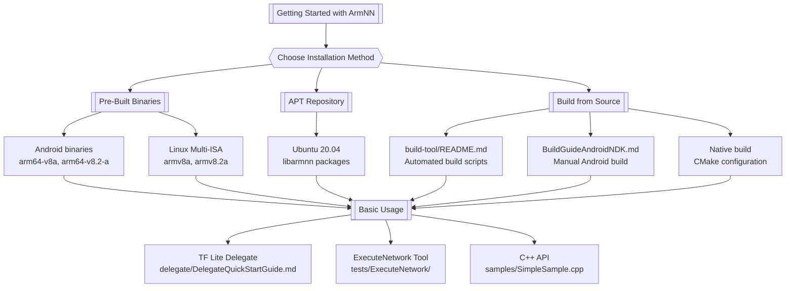
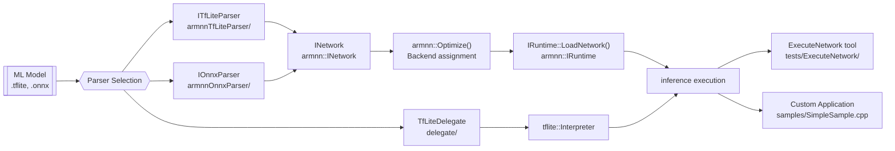

# Getting Started

<details>
<summary>Relevant source files</summary>

The following files were used as context for generating this wiki page:

- [BuildGuideAndroidNDK.md](BuildGuideAndroidNDK.md)
- [CONTRIBUTING.md](CONTRIBUTING.md)
- [CONTRIBUTING.md.license](CONTRIBUTING.md.license)
- [InstallationViaAptRepository.md](InstallationViaAptRepository.md)
- [InstallationViaAptRepository.md.license](InstallationViaAptRepository.md.license)
- [README.md](README.md)
- [cmake/GlobalConfig.cmake](cmake/GlobalConfig.cmake)
- [delegate/BuildGuideNative.md](delegate/BuildGuideNative.md)
- [delegate/DelegateQuickStartGuide.md](delegate/DelegateQuickStartGuide.md)
- [delegate/armnnDelegateJNI/CMakeLists.txt](delegate/armnnDelegateJNI/CMakeLists.txt)
- [delegate/armnnDelegateJNI/README.md](delegate/armnnDelegateJNI/README.md)
- [delegate/armnnDelegateJNI/README.md.license](delegate/armnnDelegateJNI/README.md.license)
- [delegate/armnnDelegateJNI/src/armnn_delegate_jni.cpp](delegate/armnnDelegateJNI/src/armnn_delegate_jni.cpp)
- [delegate/armnnDelegateJNI/version_script](delegate/armnnDelegateJNI/version_script)
- [docs/FAQ.md](docs/FAQ.md)
- [profiling/client/src/ProfilingService.cpp](profiling/client/src/ProfilingService.cpp)
- [profiling/server/src/timelineDecoder/CMakeLists.txt](profiling/server/src/timelineDecoder/CMakeLists.txt)
- [samples/CMakeLists.txt](samples/CMakeLists.txt)
- [samples/ObjectDetection/Readme.md](samples/ObjectDetection/Readme.md)
- [samples/serialized/Readme.md.license](samples/serialized/Readme.md.license)
- [scripts/build_android_ndk_guide.sh](scripts/build_android_ndk_guide.sh)
- [src/armnnDeserializer/CMakeLists.txt](src/armnnDeserializer/CMakeLists.txt)
- [src/armnnSerializer/CMakeLists.txt](src/armnnSerializer/CMakeLists.txt)
- [src/armnnTestUtils/CMakeLists.txt](src/armnnTestUtils/CMakeLists.txt)
- [src/armnnTfLiteParser/CMakeLists.txt](src/armnnTfLiteParser/CMakeLists.txt)
- [src/backends/dynamic/reference/CMakeLists.txt](src/backends/dynamic/reference/CMakeLists.txt)

</details>


This guide provides installation options, build instructions, and basic usage examples for new users of ArmNN. It covers the essential steps to get ArmNN running on your system and start accelerating machine learning inference.

For detailed information about ArmNN's architecture and components, see [[2-core-architecture|Core Architecture]]. For advanced development topics like backend implementation and profiling, see [[6-development-guide|Development Guide]].

## Installation Options Overview

ArmNN can be obtained and used through several different approaches, each suited to different use cases and development workflows.

### Installation Paths Diagram



**Sources:** [README.md:32-99](), [InstallationViaAptRepository.md:1-178](), [BuildGuideAndroidNDK.md:1-406]()

## Pre-Built Binaries

The fastest way to get started with ArmNN is using pre-built binaries available for download from GitHub releases.

### Available Pre-Built Packages

| Platform | Architecture | Download Links |
|----------|-------------|----------------|
| Android 11-14 | arm64-v8.2-a | Latest release packages |
| Android 11-14 | arm64-v8a | Latest release packages |
| Linux | Multi-ISA armv8a | Cross-platform binaries |
| Linux | Multi-ISA armv8.2-a | Optimized with SVE/SVE2 |

The pre-built binaries include:
- Core ArmNN library (`libarmnn.so`)
- Backend libraries (`libarmnnTfLiteParser.so`, `libarmnnDelegate.so`)
- ARM Compute Library dependencies
- Sample applications and tools

**Sources:** [README.md:53-73]()

### Quick Start with Pre-Built Binaries

1. Download the appropriate binary package for your platform
2. Extract the archive to your target directory
3. Set library path: `export LD_LIBRARY_PATH=<path_to_armnn_libs>:$LD_LIBRARY_PATH`
4. Use the TF Lite Delegate for immediate ML acceleration

**Sources:** [delegate/DelegateQuickStartGuide.md:45-49]()

## APT Repository Installation

For Ubuntu 20.04 systems, ArmNN packages are available through a dedicated APT repository.

### Setup Commands

```bash
# Add the PPA repository
sudo apt install software-properties-common
sudo add-apt-repository ppa:armnn/ppa
sudo apt update

# Install all ArmNN components
sudo apt-get install -y armnn-latest-all
```

### Available Package Types

| Package Type | Description | Example |
|-------------|-------------|---------|
| Runtime | Core libraries | `libarmnn{VERSION}`, `libarmnntfliteparser{VERSION}` |
| Development | Headers and build files | `libarmnn-dev`, `libarmnntfliteparser-dev` |
| Backend-specific | Individual backends | `libarmnn-cpuacc-backend{VERSION}` |
| Convenience | Meta-packages | `armnn-latest-all`, `armnn-latest-cpu-gpu` |

**Sources:** [InstallationViaAptRepository.md:20-133]()

## Building from Source

### Build Tool (Recommended)

The ArmNN Build Tool provides automated scripts for building ArmNN and its dependencies.

```bash
# Clone the repository
git clone https://github.com/ARM-software/armnn.git
cd armnn

# Use the build tool with Docker
cd build-tool
# See build-tool/README.md for detailed options
```

**Sources:** [README.md:46-50]()

### Android NDK Build

For Android development, use the Android NDK build process:

```bash
# Set environment variables
export ANDROID_API=30
export WORKING_DIR=$HOME/armnn-devenv
export NDK_DIR=$WORKING_DIR/android-ndk-r25

# Follow the complete build guide
# See BuildGuideAndroidNDK.md for full instructions
```

Key build dependencies managed by the build process:
- `get_compute_library.sh` - ARM Compute Library version management
- `get_tensorflow.sh` - TensorFlow Lite version compatibility
- CMake configuration in [cmake/GlobalConfig.cmake]()

**Sources:** [BuildGuideAndroidNDK.md:27-37](), [scripts/build_android_ndk_guide.sh:82-215]()

### Build Configuration Options

The build system uses CMake with extensive configuration options defined in `GlobalConfig.cmake`:

| Option | Description | Default |
|--------|-------------|---------|
| `ARMCOMPUTENEON` | Enable NEON backend | OFF |
| `ARMCOMPUTECL` | Enable OpenCL backend | OFF |
| `ARMNNREF` | Enable Reference backend | ON |
| `BUILD_TF_LITE_PARSER` | Build TensorFlow Lite parser | OFF |
| `BUILD_CLASSIC_DELEGATE` | Build TF Lite delegate | OFF |
| `BUILD_UNIT_TESTS` | Build unit tests | ON |

**Sources:** [cmake/GlobalConfig.cmake:7-66]()

## Basic Usage Pipeline

### ArmNN Usage Workflow



**Sources:** [samples/SimpleSample.cpp](), [delegate/DelegateQuickStartGuide.md:8-35]()

### TensorFlow Lite Delegate (Recommended)

The TF Lite Delegate provides the easiest integration path with extensive operator support:

```python
import tflite_runtime.interpreter as tflite

# Load the ArmNN delegate
armnn_delegate = tflite.load_delegate(
    library="libarmnnDelegate.so",
    options={"backends": "CpuAcc,GpuAcc,CpuRef", 
             "logging-severity": "info"}
)

# Create interpreter with delegate
interpreter = tflite.Interpreter(
    model_path="model.tflite",
    experimental_delegates=[armnn_delegate]
)
```

**Sources:** [delegate/DelegateQuickStartGuide.md:8-35]()

### ExecuteNetwork Command-Line Tool

For testing and benchmarking, use the `ExecuteNetwork` tool:

```bash
# Basic model execution
./ExecuteNetwork -f tflite-binary -m model.tflite -c CpuAcc,CpuRef

# With profiling enabled
./ExecuteNetwork -f tflite-binary -m model.tflite -c CpuAcc,CpuRef \
  --event-based-profiling
```

**Sources:** [docs/FAQ.md:67-73]()

### C++ API Integration

For direct C++ integration, use the core ArmNN API:

```cpp
#include "armnn/ArmNN.hpp"
#include "armnnTfLiteParser/ITfLiteParser.hpp"

// Create parser and load network
auto parser = armnnTfLiteParser::ITfLiteParser::Create();
auto network = parser->CreateNetworkFromBinaryFile("model.tflite");

// Create runtime and optimize
auto runtime = armnn::IRuntime::Create(armnn::IRuntime::CreationOptions());
std::vector<armnn::BackendId> backends{"CpuAcc", "GpuAcc", "CpuRef"};
auto optimizedNet = armnn::Optimize(*network, backends, runtime->GetDeviceSpec());
```

**Sources:** [samples/ObjectDetection/Readme.md:422-427]()

## Environment Setup

### Library Path Configuration

After installation, configure the library path to locate ArmNN libraries:

```bash
# For pre-built binaries
export LD_LIBRARY_PATH=/path/to/armnn/libs:$LD_LIBRARY_PATH

# For APT installation (usually automatic)
# Libraries installed to /usr/lib or /usr/lib64

# For local builds
export LD_LIBRARY_PATH=./build:$LD_LIBRARY_PATH
```

### Dependency Verification

Verify that required dependencies are available:

- ARM Compute Library (for NEON/OpenCL backends)
- Flatbuffers (for model parsing)
- TensorFlow Lite (for delegate usage)

**Sources:** [delegate/BuildGuideNative.md:52-54](), [BuildGuideAndroidNDK.md:336-406]()

## Common Issues and Troubleshooting

### Build Configuration Issues

**CMake Cache Problems**: Delete build directory when changing CMake options, as CMake uses cumulative caching.

```bash
# Clear CMake cache
rm -rf build/
mkdir build && cd build
cmake .. <new_options>
```

**Backend Compatibility**: Ensure selected backends match target hardware capabilities:
- `CpuRef`: Always available (software implementation)
- `CpuAcc`: Requires NEON support
- `GpuAcc`: Requires OpenCL and Mali GPU

**Sources:** [docs/FAQ.md:22-26]()

### Dynamic Backend Loading

For dynamic backend tests, ensure backend libraries are in the correct path:

```bash
# Set dynamic backend path
export DYNAMIC_BACKEND_PATHS=/path/to/backend/libs

# For unit tests, specify backend build directory
./UnitTests --dynamic-backend-build-dir /path/to/build
```

**Sources:** [docs/FAQ.md:27-29]()

### TensorFlow Lite Integration

For Android delegate usage, ensure proper library linking:

```bash
# Verify delegate library dependencies
ldd libarmnnDelegate.so

# Check for missing ARM Compute Library
# Should show libarm_compute.so dependencies
```

**Sources:** [docs/FAQ.md:32-44](), [delegate/DelegateQuickStartGuide.md:37-53]()

## Related Wiki Pages

- [[1-armnn-overview|ArmNN Overview]]
- [[2-core-architecture|Core Architecture]]
- [[6-development-guide|Development Guide]]


## Dynamic Knowledge Links (Code Graph ↔ LLM-Wiki / RAG)

### Linked Architecture & Design Documents

| Document | Match Channel | Score | Shared Code Symbols |
|---|---|---|---|
| [[6.3-profiling-system|6.3 Profiling System]] | `bm25+entity(3)` | `73.707` | `GetDeltaCounterValue`, `IncrementCounterValue`, `SetCounterValue` |
| [[2-core-architecture|2 Core Architecture]] | `wikilink:1.1-getting-started` | `38.548` | *(lexical/graph match)* |
| [[6-development-guide|6 Development Guide]] | `wikilink:1.1-getting-started` | `38.548` | *(lexical/graph match)* |
| [[1-armnn-overview|1 ArmNN Overview]] | `wikilink:1.1-getting-started` | `38.548` | *(lexical/graph match)* |
| [[index|ARM-software/armnn DeepWiki]] | `bm25` | `35.371` | *(lexical/graph match)* |
| [[2.3-runtime-and-execution|2.3 Runtime and Execution]] | `bm25` | `33.504` | *(lexical/graph match)* |

### High-Centrality Bridge Symbols (CBM Graph)

| Symbol | Kind | Source Location | Fan-In / Fan-Out |
|---|---|---|---|
| `CheckCounterUid` | Method | [profiling/client/src/ProfilingService.cpp:417-427]() | in: `6` / out: `4` |
| `Update` | Method | [profiling/client/src/ProfilingService.cpp:112-193]() | in: `1` / out: `13` |
| `Stop` | Method | [profiling/client/src/ProfilingService.cpp:390-415]() | in: `4` / out: `5` |
| `main` | Function | [samples/SimpleSample.cpp:14-91]() | in: `0` / out: `12` |
| `Reset` | Method | [profiling/client/src/ProfilingService.cpp:371-388]() | in: `1` / out: `6` |
| `NotifyBackendsForTimelineReporting` | Method | [profiling/client/src/ProfilingService.cpp:429-441]() | in: `2` / out: `2` |

Sources: [profiling/client/src/ProfilingService.cpp:417-427](), [profiling/client/src/ProfilingService.cpp:112-193](), [profiling/client/src/ProfilingService.cpp:390-415](), [samples/SimpleSample.cpp:14-91]()

### Cross-Subsystem Coupling

- [[6.3-profiling-system|6.3 Profiling System]] — call/import coupling weight `15.0`
- [[1-armnn-overview|1 ArmNN Overview]] — call/import coupling weight `8.0`
- [[2-core-architecture|2 Core Architecture]] — call/import coupling weight `5.0`
- [[2.1-network-and-graph-system|2.1 Network and Graph System]] — call/import coupling weight `5.0`
- [[2.3-runtime-and-execution|2.3 Runtime and Execution]] — call/import coupling weight `5.0`
- [[5-tools-and-applications|5 Tools and Applications]] — call/import coupling weight `2.0`
