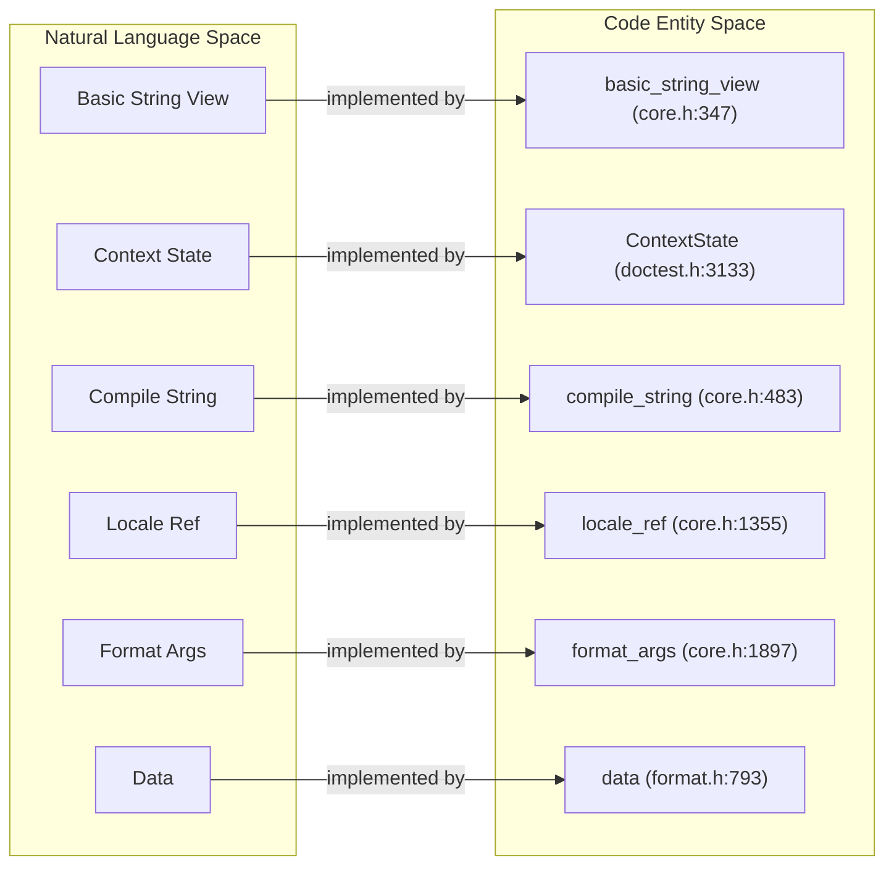
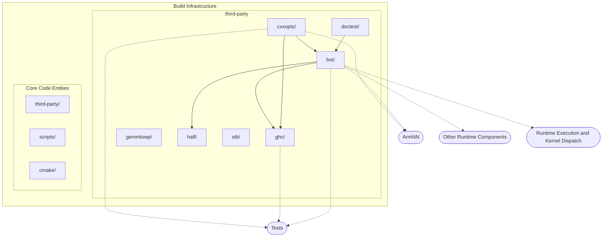

# Build System and Infrastructure

> Architectural overview of Build System and Infrastructure, spanning 28 source files and 2092 code symbols across 1 subsystems.

Relevant source files

The following files were used as context for generating this wiki page:

- [third-party/fmt/format.h](third-party/fmt/format.h)
- [third-party/fmt/core.h](third-party/fmt/core.h)
- [third-party/cxxopts/cxxopts.hpp](third-party/cxxopts/cxxopts.hpp)
- [third-party/fmt/format-inl.h](third-party/fmt/format-inl.h)
- [third-party/ghc/filesystem.hpp](third-party/ghc/filesystem.hpp)
- [third-party/doctest/doctest.h](third-party/doctest/doctest.h)

## Purpose and Scope

This chapter covers **Build System and Infrastructure** across the repository, detailing the core abstractions, data structures, transformation pipelines, and runtime/build integrations that implement this layer.

**Scope**: This document provides an architectural hub for the following child subsystems:
- **Build Infrastructure**: See [[2.1-build-infrastructure|Build Infrastructure]].

Sources: [third-party/fmt/core.h:347-430](), [third-party/doctest/doctest.h:3133-3206](), [third-party/fmt/core.h:483-483](), [third-party/fmt/core.h:1355-1366]()

---

## System Mapping: Natural Language Space to Code Entity Space

Sources: [third-party/fmt/core.h:347-430](), [third-party/doctest/doctest.h:3133-3206](), [third-party/fmt/core.h:483-483](), [third-party/fmt/core.h:1355-1366](), [third-party/fmt/core.h:1897-1900]()

---

## 1. Build Infrastructure

Build Infrastructure subsystem (`build/infrastructure`), covering 28 files and 2092 symbols. Key symbols include `push_back`, `data`, `move`, `get`. [third-party/half/half.hpp:1077-1191](), [third-party/fmt/core.h:347-430](), [third-party/doctest/doctest.h:3133-3206]()

### Primary Code Entities

- **`half`** (Class in [third-party/half/half.hpp:1077-1191]()): /// Half-precision floating point type. /// This class implements an IEEE-conformant half-precision floating point type with the usual arithmetic operators and /// conversions. It 
- **`basic_string_view`** (Class in [third-party/fmt/core.h:347-430]()): Core implementation entity.
- **`ContextState`** (Class in [third-party/doctest/doctest.h:3133-3206]()): // this holds both parameters from the command line and runtime data for tests
- **`compile_string`** (Class in [third-party/fmt/core.h:483-483]()): // A base class for compile-time strings. It is defined in the fmt namespace to // make formatting functions visible via ADL, e.g. format(FMT_STRING("{}"), 42).
- **`push_back`** (Method in [third-party/fmt/core.h:726-729]()): (const T& value)
- **`data`** (Method in [third-party/fmt/core.h:388-388]()): ()

### Build Infrastructure Architecture Flow

For details, see [[2.1-build-infrastructure|Build Infrastructure]].

Sources: [third-party/half/half.hpp:1077-1191](), [third-party/fmt/core.h:347-430](), [third-party/doctest/doctest.h:3133-3206](), [third-party/fmt/core.h:483-483]()

---

## Official Documentation & Architectural References

- **Build Infrastructure** ([wiki/2.1-build-infrastructure.md]()): # Build Infrastructure ↑ [[2-build-system-and-infrastructure|Build System and Infrastructure]] > Build Infrastructure subsystem (`build/infrastructure`), covering 28 files and 2092 symbols. Key symbols include `push_back`, `data`, `move`, `get`. 
 
Relevant source files
 The following files were used as context for generating this wi
- **Glossary** ([wiki/7-glossary.md]()): # Glossary > Definitions and technical context for ArmNN domain terms, acronyms, file formats, and core code entities. 
 
Relevant source files
 The following files were used as context for generating this wiki page: - [src/armnn/Tensor.cpp](src/armnn/Tensor.cpp) - [include/armnn/Exceptions.hpp](include/armnn/Exceptions.hpp) - [inclu
- **Overview** ([wiki/1-overview.md]()): # Overview > End-to-end architecture overview of ArmNN: core subsystems, compilation/execution pipeline, entry points, and cross-module dependencies. 
 
Relevant source files
 The following files were used as context for generating this wiki page: - [src/armnn/Tensor.cpp](src/armnn/Tensor.cpp) - [include/armnn/Exceptions.hpp](include
- **Profiling Client** ([wiki/6.2-profiling-client.md]()): # Profiling Client ↑ [[6-developer-tools-and-platform-targets|Developer Tools and Platform Targets]] > Profiling Client subsystem (`profiling/client`), covering 28 files and 340 symbols. Key symbols include `ReadUint32`, `GetCurrentState`, `WriteUint32`, `GetNextGuid`. 
 
Relevant source files
 The following files were used as contex

Sources: [wiki/2.1-build-infrastructure.md](), [wiki/7-glossary.md](), [wiki/1-overview.md](), [wiki/6.2-profiling-client.md]()

## Sub-pages

- [[2.1-build-infrastructure|Build Infrastructure]]

## Related pages

- [[1-overview|Overview]]
- [[3-backend-delegation-and-hardware-providers|Backend Delegation and Hardware Providers]]
- [[3.1-backends-backendscommon|Backends Backendscommon]]
- [[3.2-backends-reference|Backends Reference]]
- [[3.3-backends-opencl|Backends OpenCL]]
- [[3.4-backends-aclcommon|Backends Aclcommon]]
- [[3.6-other-backends|Other Backends]]
- [[5-runtime-execution-and-kernel-dispatch|Runtime Execution and Kernel Dispatch]]

## Related documents

- `wiki/2.1-build-infrastructure.md` — Build Infrastructure (score 98.59, via bm25)
- `wiki/7-glossary.md` — Glossary (score 72.5915, via bm25)
- `wiki/1-overview.md` — Overview (score 26.9288, via bm25)
- `wiki/6.2-profiling-client.md` — Profiling Client (score 24.8078, via bm25)
- `wiki/4.1-tests.md` — Tests (score 24.5767, via bm25)

## Sources

- [`third-party/fmt/format.h`](https://github.com/ARM-software/armnn/blob/branches/armnn_24_11/third-party/fmt/format.h)
- [`third-party/fmt/core.h`](https://github.com/ARM-software/armnn/blob/branches/armnn_24_11/third-party/fmt/core.h)
- [`third-party/cxxopts/cxxopts.hpp`](https://github.com/ARM-software/armnn/blob/branches/armnn_24_11/third-party/cxxopts/cxxopts.hpp)
- [`third-party/fmt/format-inl.h`](https://github.com/ARM-software/armnn/blob/branches/armnn_24_11/third-party/fmt/format-inl.h)
- [`third-party/ghc/filesystem.hpp`](https://github.com/ARM-software/armnn/blob/branches/armnn_24_11/third-party/ghc/filesystem.hpp)
- [`third-party/doctest/doctest.h`](https://github.com/ARM-software/armnn/blob/branches/armnn_24_11/third-party/doctest/doctest.h)

## Dynamic Knowledge Links (Code Graph ↔ LLM-Wiki / RAG)

### Linked Architecture & Design Documents

| Document | Match Channel | Score | Shared Code Symbols |
|---|---|---|---|
| [[2.1-build-infrastructure|Build Infrastructure]] | `bm25+entity(6)` | `107.59` | `Approx`, `UnicodeStringIterator`, `XmlEncode`, `basic_string_view`, `exception` |
| [[7-glossary|Glossary]] | `bm25+entity(3)` | `77.091` | `basic_format_args`, `basic_string_view`, `locale_ref` |
| [[5.6-other-runtime-components|Other Runtime Components]] | `wikilink:2.1-build-infrastructure` | `49.295` | *(lexical/graph match)* |
| [[5.1-armnn|ArmNN]] | `wikilink:2.1-build-infrastructure` | `49.295` | *(lexical/graph match)* |
| [[5-runtime-execution-and-kernel-dispatch|Runtime Execution and Kernel Dispatch]] | `wikilink:2.1-build-infrastructure` | `49.295` | *(lexical/graph match)* |
| [[1-overview|Overview]] | `bm25` | `26.929` | *(lexical/graph match)* |

### High-Centrality Bridge Symbols (CBM Graph)

| Symbol | Kind | Source Location | Fan-In / Fan-Out |
|---|---|---|---|
| `basic_string_view` | Class | [third-party/fmt/core.h:347-430]() | in: `7` / out: `0` |
| `ContextState` | Class | [third-party/doctest/doctest.h:3133-3206]() | in: `1` / out: `0` |
| `compile_string` | Class | [third-party/fmt/core.h:483-483]() | in: `0` / out: `0` |
| `locale_ref` | Class | [third-party/fmt/core.h:1355-1366]() | in: `0` / out: `0` |
| `format_args` | Class | [third-party/fmt/core.h:1897-1900]() | in: `0` / out: `0` |
| `data` | Class | [third-party/fmt/format.h:793-793]() | in: `0` / out: `0` |

Sources: [third-party/fmt/core.h:347-430](), [third-party/doctest/doctest.h:3133-3206](), [third-party/fmt/core.h:483-483](), [third-party/fmt/core.h:1355-1366]()

### Cross-Subsystem Coupling

- [[4.1-tests|Tests]] — call/import coupling weight `380.0`
- [[5.6-other-runtime-components|Other Runtime Components]] — call/import coupling weight `205.0`
- [[5.1-armnn|ArmNN]] — call/import coupling weight `201.0`
- [[5-runtime-execution-and-kernel-dispatch|Runtime Execution and Kernel Dispatch]] — call/import coupling weight `175.0`
- [[3-backend-delegation-and-hardware-providers|Backend Delegation and Hardware Providers]] — call/import coupling weight `115.0`
- [[2.1-build-infrastructure|Build Infrastructure]] — call/import coupling weight `114.0`
