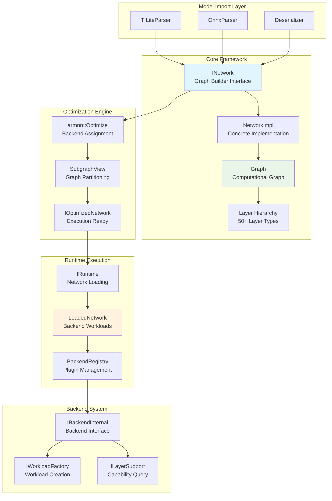
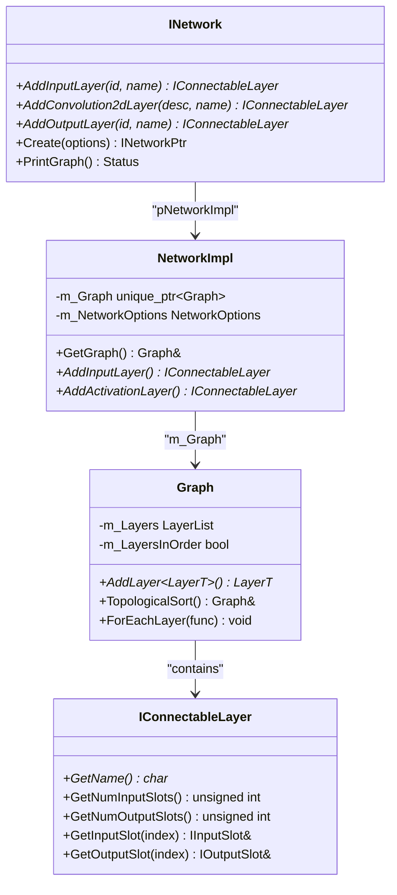
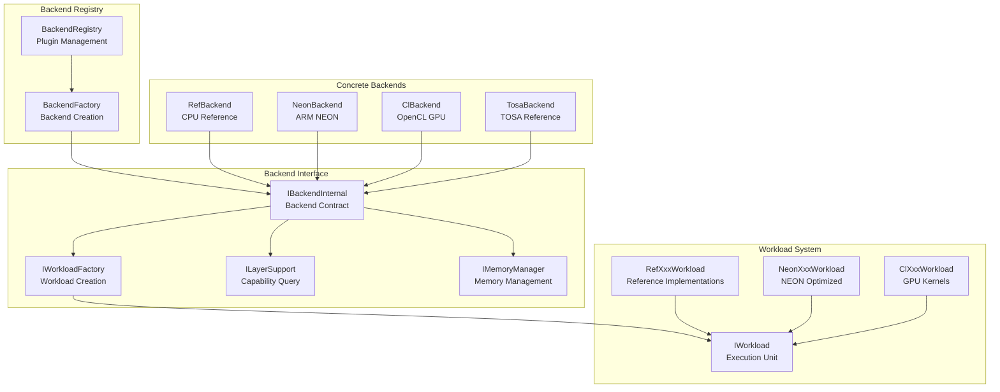
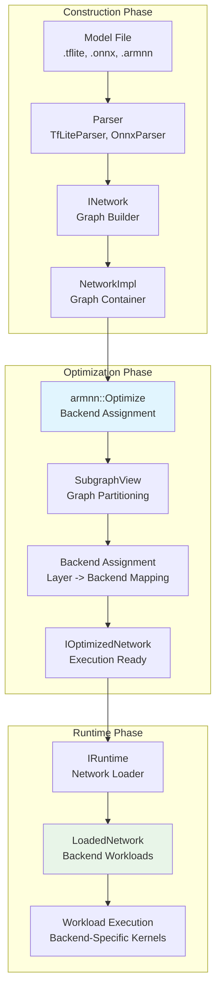
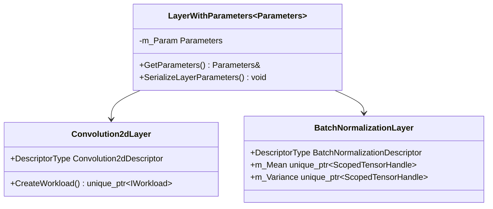
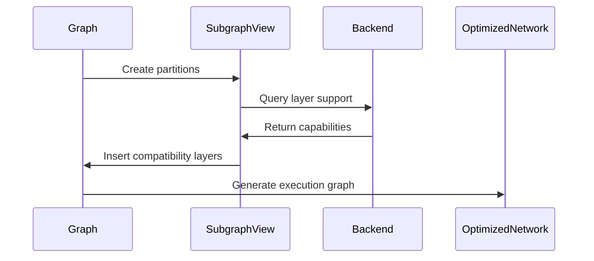

# Core Architecture

<details>
<summary>Relevant source files</summary>

The following files were used as context for generating this wiki page:

- [Android.mk](Android.mk)
- [include/armnn/INetwork.hpp](include/armnn/INetwork.hpp)
- [include/armnn/backends/OptimizationViews.hpp](include/armnn/backends/OptimizationViews.hpp)
- [include/armnn/backends/SubgraphView.hpp](include/armnn/backends/SubgraphView.hpp)
- [include/armnn/backends/WorkloadFactory.hpp](include/armnn/backends/WorkloadFactory.hpp)
- [include/armnnTestUtils/MockBackend.hpp](include/armnnTestUtils/MockBackend.hpp)
- [src/armnn/Graph.cpp](src/armnn/Graph.cpp)
- [src/armnn/Graph.hpp](src/armnn/Graph.hpp)
- [src/armnn/InternalTypes.hpp](src/armnn/InternalTypes.hpp)
- [src/armnn/Layer.cpp](src/armnn/Layer.cpp)
- [src/armnn/Layer.hpp](src/armnn/Layer.hpp)
- [src/armnn/LayersFwd.hpp](src/armnn/LayersFwd.hpp)
- [src/armnn/Network.cpp](src/armnn/Network.cpp)
- [src/armnn/Network.hpp](src/armnn/Network.hpp)
- [src/armnn/SubgraphView.cpp](src/armnn/SubgraphView.cpp)
- [src/armnn/SubgraphViewSelector.cpp](src/armnn/SubgraphViewSelector.cpp)
- [src/armnn/SubgraphViewSelector.hpp](src/armnn/SubgraphViewSelector.hpp)
- [src/armnn/layers/LayerWithParameters.hpp](src/armnn/layers/LayerWithParameters.hpp)
- [src/armnn/test/GraphTests.cpp](src/armnn/test/GraphTests.cpp)
- [src/armnn/test/SubgraphViewTests.cpp](src/armnn/test/SubgraphViewTests.cpp)
- [src/armnnTestUtils/MockBackend.cpp](src/armnnTestUtils/MockBackend.cpp)
- [src/backends/backendsCommon/LayerSupportBase.cpp](src/backends/backendsCommon/LayerSupportBase.cpp)
- [src/backends/backendsCommon/LayerSupportBase.hpp](src/backends/backendsCommon/LayerSupportBase.hpp)
- [src/backends/backendsCommon/WorkloadFactory.cpp](src/backends/backendsCommon/WorkloadFactory.cpp)
- [src/backends/backendsCommon/test/IsLayerSupportedTestImpl.hpp](src/backends/backendsCommon/test/IsLayerSupportedTestImpl.hpp)
- [src/backends/backendsCommon/test/OptimizationViewsTests.cpp](src/backends/backendsCommon/test/OptimizationViewsTests.cpp)
- [src/backends/backendsCommon/test/OptimizeSubgraphViewTests.cpp](src/backends/backendsCommon/test/OptimizeSubgraphViewTests.cpp)
- [src/backends/backendsCommon/test/mockBackend/MockImportBackend.cpp](src/backends/backendsCommon/test/mockBackend/MockImportBackend.cpp)
- [src/backends/reference/test/RefMemCopyTests.cpp](src/backends/reference/test/RefMemCopyTests.cpp)

</details>


This document provides a high-level overview of ArmNN's system architecture, covering the core components, design principles, and interaction patterns that form the foundation of the machine learning inference engine. For information about specific model format support, see [[3-model-support|Model Support]]. For details about individual compute backends, see [[4-compute-backends|Compute Backends]]. For runtime execution specifics, see [[2.3-runtime-and-execution|Runtime and Execution]].

## System Overview

ArmNN is designed as a modular inference engine that abstracts machine learning models into computational graphs and executes them across heterogeneous compute backends. The architecture follows a clear separation between model representation (`INetwork`/`Graph`), optimization (`Optimize`), and execution (`IRuntime`/`LoadedNetwork`).

### High-Level Architecture



**Sources:** [src/armnn/Network.cpp:45-689](), [src/armnn/Graph.hpp:30-97](), [include/armnn/INetwork.hpp:345-347](), [src/armnn/Network.hpp:32-261]()

## Core Components

### INetwork and NetworkImpl

The `INetwork` interface serves as the primary entry point for building computational graphs. It provides a factory pattern for creating layers and maintains the graph structure through its implementation `NetworkImpl`.



**Sources:** [include/armnn/INetwork.hpp:345-352](), [src/armnn/Network.hpp:32-261](), [src/armnn/Network.cpp:45-47](), [src/armnn/Graph.hpp:30-148]()

### Graph and Layer System

The `Graph` class manages the computational graph structure, maintaining layers in topological order and providing iteration capabilities. Layers inherit from the `Layer` base class, which implements the `IConnectableLayer` interface.

```mermaid
graph TD
    subgraph "Graph Management"
        Graph["Graph<br/>-m_Layers: LayerList<br/>-m_LayersInOrder: bool"]
        LayerList["std::list&lt;Layer*&gt;<br/>Topologically Ordered"]
    end
    
    subgraph "Layer Hierarchy"
        Layer["Layer<br/>Base Implementation"]
        IConnectableLayer["IConnectableLayer<br/>Public Interface"]
        InputLayer["InputLayer"]
        Convolution2dLayer["Convolution2dLayer"]
        OutputLayer["OutputLayer"]
        LayerWithParameters["LayerWithParameters&lt;T&gt;<br/>Template for Parameterized Layers"]
    end
    
    subgraph "Connection System"
        InputSlot["InputSlot<br/>-m_Connection: OutputSlot*<br/>-m_SlotIndex: unsigned int"]
        OutputSlot["OutputSlot<br/>-m_Connections: vector&lt;InputSlot*&gt;<br/>-m_OutputHandler: OutputHandler&"]
        IInputSlot["IInputSlot<br/>Interface"]
        IOutputSlot["IOutputSlot<br/>Interface"]
    end
    
    Graph --> LayerList
    LayerList --> Layer
    
    Layer --> IConnectableLayer
    InputLayer --> Layer
    Convolution2dLayer --> LayerWithParameters
    LayerWithParameters --> Layer
    OutputLayer --> Layer
    
    Layer --> InputSlot
    Layer --> OutputSlot
    InputSlot --> IInputSlot
    OutputSlot --> IOutputSlot
    
    OutputSlot --> InputSlot : "connects to"
```

**Sources:** [src/armnn/Graph.hpp:50-197](), [src/armnn/Layer.hpp:42-284](), [src/armnn/LayersFwd.hpp:1-143](), [src/armnn/layers/LayerWithParameters.hpp:13-42]()

## Backend Architecture

ArmNN uses a plugin-based backend system where each backend implements the `IBackendInternal` interface. Backends provide workload factories for layer execution and layer support queries for optimization.



**Sources:** [src/backends/backendsCommon/WorkloadFactory.cpp:70-95](), [src/backends/backendsCommon/LayerSupportBase.hpp:13-64](), [include/armnn/backends/WorkloadFactory.hpp:22-136]()

## Network Lifecycle

The ArmNN architecture supports a clear pipeline from model construction to execution, with distinct phases for building, optimization, and runtime execution.

### Construction to Execution Pipeline



**Sources:** [src/armnn/Network.cpp:844-1077](), [src/armnn/SubgraphView.cpp:48-57](), [src/armnn/SubgraphViewSelector.cpp:24-42]()

## Design Patterns and Principles

### Interface Segregation and Abstraction

ArmNN employs extensive interface segregation to separate concerns:

- **`INetwork`/`IOptimizedNetwork`**: Public interfaces for graph building and optimized representations
- **`IConnectableLayer`/`IInputSlot`/`IOutputSlot`**: Abstraction over internal layer implementations
- **`IBackendInternal`/`IWorkloadFactory`/`ILayerSupport`**: Backend plugin interfaces
- **`IRuntime`**: Runtime execution interface

### Template-Based Layer System

Layers with parameters use a template-based approach for type safety:



**Sources:** [src/armnn/layers/LayerWithParameters.hpp:13-62](), [src/backends/backendsCommon/test/IsLayerSupportedTestImpl.hpp:49-80]()

### Graph Modification and Optimization

The architecture supports dynamic graph modification through:

- **Subgraph Views**: Partition graphs for backend-specific optimization
- **Layer Insertion**: Insert compatibility layers (MemCopy, MemImport) between backends  
- **Graph Substitution**: Replace subgraphs with optimized implementations



**Sources:** [src/armnn/Graph.cpp:330-473](), [src/armnn/SubgraphView.cpp:604-671](), [src/armnn/SubgraphViewSelector.cpp:170-298]()

This architecture provides ArmNN with the flexibility to support multiple model formats, optimize for diverse hardware backends, and maintain a clean separation between graph representation and execution concerns.

## Related Wiki Pages

- [[2.1-network-and-graph-system|Network and Graph System]]
- [[2.2-backend-system|Backend System]]
- [[2.3-runtime-and-execution|Runtime and Execution]]
- [[3-model-support|Model Support]]
- [[4-compute-backends|Compute Backends]]


## Dynamic Knowledge Links (Code Graph ↔ LLM-Wiki / RAG)

### Linked Architecture & Design Documents

| Document | Match Channel | Score | Shared Code Symbols |
|---|---|---|---|
| [[2.1-network-and-graph-system|2.1 Network and Graph System]] | `bm25+entity(8)` | `54.799` | `Connect`, `EraseLayer`, `GetInputSlot`, `GetNumInputSlots`, `GetNumOutputSlots` |
| [[1-armnn-overview|1 ArmNN Overview]] | `bm25+entity(3)` | `32.855` | `Connect`, `SetAdditionalInfo`, `SetTensorInfo` |
| [[2.3-runtime-and-execution|2.3 Runtime and Execution]] | `bm25` | `32.216` | *(lexical/graph match)* |
| [[3.3-model-serialization|3.3 Model Serialization]] | `bm25` | `30.749` | *(lexical/graph match)* |
| [[5.2-tensorflow-lite-delegate|5.2 TensorFlow Lite Delegate]] | `bm25` | `30.488` | *(lexical/graph match)* |
| [[2.2-backend-system|2.2 Backend System]] | `wikilink:2.1-network-and-graph-system+entity(1)` | `22.899` | `GetType` |

### High-Centrality Bridge Symbols (CBM Graph)

| Symbol | Kind | Source Location | Fan-In / Fan-Out |
|---|---|---|---|
| `SetTensorInfo` | Method | [src/armnn/Layer.cpp:609-612]() | in: `207` / out: `1` |
| `Connect` | Method | [src/armnn/Layer.cpp:123-129]() | in: `190` / out: `3` |
| `CreateWorkload` | Method | [src/armnnTestUtils/MockBackend.cpp:43-60]() | in: `188` / out: `3` |
| `end` | Method | [src/armnn/Graph.hpp:70-74]() | in: `186` / out: `2` |
| `GetName` | Method | [src/armnn/Layer.hpp:332-332]() | in: `168` / out: `1` |
| `GetInputSlot` | Method | [src/armnn/Layer.hpp:338-338]() | in: `160` / out: `0` |

Sources: [src/armnn/Layer.cpp:609-612](), [src/armnn/Layer.cpp:123-129](), [src/armnnTestUtils/MockBackend.cpp:43-60](), [src/armnn/Graph.hpp:70-74]()

### Cross-Subsystem Coupling

- [[3-model-support|3 Model Support]] — call/import coupling weight `171.0`
- [[4.1-reference-backend|4.1 Reference Backend]] — call/import coupling weight `134.0`
- [[6.2-testing-framework|6.2 Testing Framework]] — call/import coupling weight `134.0`
- [[2.3-runtime-and-execution|2.3 Runtime and Execution]] — call/import coupling weight `121.0`
- [[3.1-tensorflow-lite-parser|3.1 TensorFlow Lite Parser]] — call/import coupling weight `112.0`
- [[2.2-backend-system|2.2 Backend System]] — call/import coupling weight `111.0`
