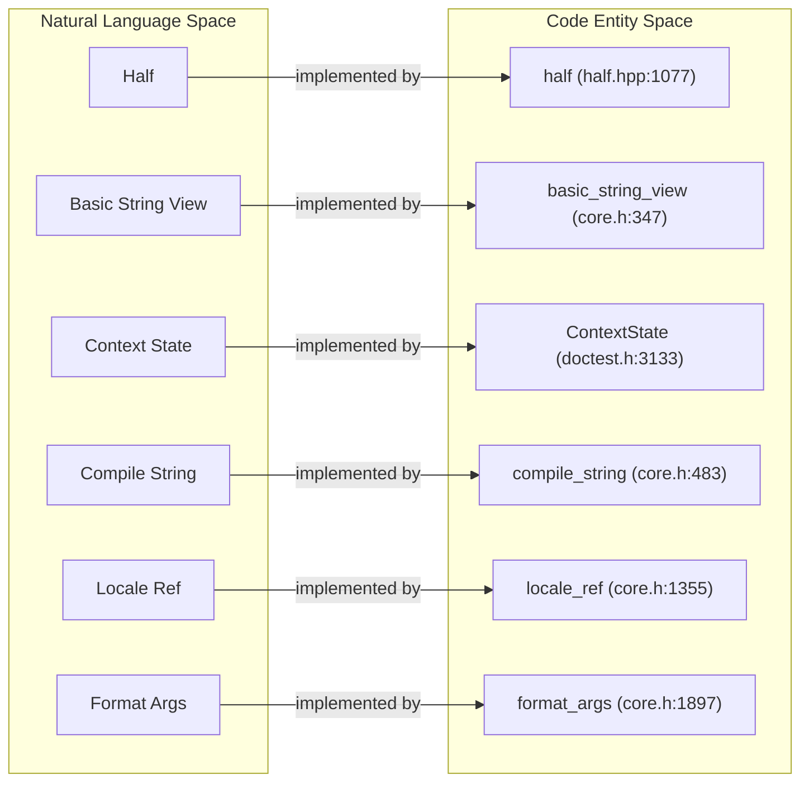
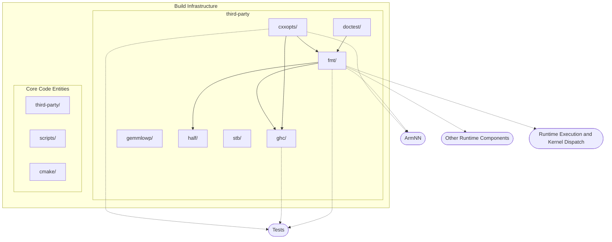
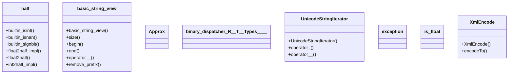
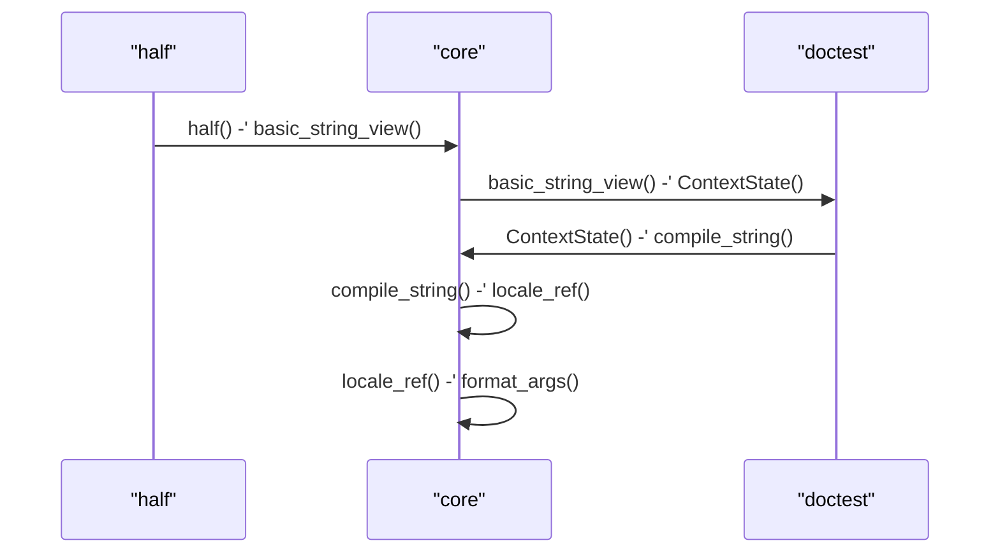

# Build Infrastructure

↑ [[2-build-system-and-infrastructure|Build System and Infrastructure]]

> Build Infrastructure subsystem (`build/infrastructure`), covering 28 files and 2092 symbols. Key symbols include `push_back`, `data`, `move`, `get`.

<details>
<summary>Relevant source files</summary>

The following files were used as context for generating this wiki page:

- [third-party/fmt/format.h](third-party/fmt/format.h)
- [third-party/fmt/core.h](third-party/fmt/core.h)
- [third-party/cxxopts/cxxopts.hpp](third-party/cxxopts/cxxopts.hpp)
- [third-party/fmt/format-inl.h](third-party/fmt/format-inl.h)
- [third-party/doctest/doctest.h](third-party/doctest/doctest.h)
- [third-party/ghc/filesystem.hpp](third-party/ghc/filesystem.hpp)
- [third-party/gemmlowp/fixedpoint.h](third-party/gemmlowp/fixedpoint.h)
- [third-party/gemmlowp/fixedpoint_avx.h](third-party/gemmlowp/fixedpoint_avx.h)
- [third-party/half/half.hpp](third-party/half/half.hpp)
- [third-party/stb/stb_image.h](third-party/stb/stb_image.h)
- [third-party/stb/stb_image_resize.h](third-party/stb/stb_image_resize.h)
- [third-party/gemmlowp/fixedpoint_sse.h](third-party/gemmlowp/fixedpoint_sse.h)
- [third-party/stb/stb_image_write.h](third-party/stb/stb_image_write.h)
- [third-party/mapbox/variant.hpp](third-party/mapbox/variant.hpp)
- [third-party/gemmlowp/fixedpoint_wasmsimd.h](third-party/gemmlowp/fixedpoint_wasmsimd.h)
- [third-party/gemmlowp/fixedpoint_msa.h](third-party/gemmlowp/fixedpoint_msa.h)
- [third-party/gemmlowp/fixedpoint_neon.h](third-party/gemmlowp/fixedpoint_neon.h)
- [third-party/REUSE.toml](third-party/REUSE.toml)
- [third-party/mapbox/recursive_wrapper.hpp](third-party/mapbox/recursive_wrapper.hpp)
- [scripts/build_android_ndk_guide.sh](scripts/build_android_ndk_guide.sh)
- [cmake/Utils.cmake](cmake/Utils.cmake)
- [cmake/AddDllCopyCommands.cmake](cmake/AddDllCopyCommands.cmake)
- [third-party/mapbox/optional.hpp](third-party/mapbox/optional.hpp)
- [third-party/mapbox/variant_cast.hpp](third-party/mapbox/variant_cast.hpp)
- [scripts/get_compute_library.sh](scripts/get_compute_library.sh)
- [scripts/generate_tensorflow_protobuf.sh](scripts/generate_tensorflow_protobuf.sh)
- [third-party/mapbox/variant_io.hpp](third-party/mapbox/variant_io.hpp)
- [scripts/get_tensorflow.sh](scripts/get_tensorflow.sh)

</details>

## Purpose and Scope

Build Infrastructure subsystem (`build/infrastructure`), covering 28 files and 2092 symbols. Key symbols include `push_back`, `data`, `move`, `get`.

Primary code entities analyzed on this page include `half` ([third-party/half/half.hpp:1077-1191]()), `basic_string_view` ([third-party/fmt/core.h:347-430]()), `ContextState` ([third-party/doctest/doctest.h:3133-3206]()), `compile_string` ([third-party/fmt/core.h:483-483]()), `locale_ref` ([third-party/fmt/core.h:1355-1366]()).

For the parent architectural layer, see [[2-build-system-and-infrastructure|Build System and Infrastructure]].

Sources: [third-party/half/half.hpp:1077-1191](), [third-party/fmt/core.h:347-430](), [third-party/doctest/doctest.h:3133-3206](), [third-party/fmt/core.h:483-483]()

---

## 1. High-Level Architecture and Data Flow

### Natural Language Space to Code Entity Space Mapping

The following diagram maps domain concepts in this subsystem to their concrete code entities:



### Subsystem Component & Dependency Flow



Cross-subsystem call and import edges connect **Build Infrastructure** with [[4.1-tests|Tests]] (coupling `399.0`), [[5.6-other-runtime-components|Other Runtime Components]] (coupling `210.0`), [[5.1-armnn|ArmNN]] (coupling `208.0`), [[5-runtime-execution-and-kernel-dispatch|Runtime Execution and Kernel Dispatch]] (coupling `182.0`), [[3-backend-delegation-and-hardware-providers|Backend Delegation and Hardware Providers]] (coupling `128.0`).

| Module Directory | Files | Primary Code Entities | Source Citations |
|---|---|---|---|
| `third-party/gemmlowp` | 6 | `int16x8_m128i`, `int16x8_v128_t`, `AddSaturatingIf16BitImpl`, `AddSaturatingIf16BitImpl<IntegerType, true>` | [third-party/gemmlowp/fixedpoint_sse.h:34-36]() [third-party/gemmlowp/fixedpoint_wasmsimd.h:33-35]() |
| `third-party/mapbox` | 5 | `hasher`, `bad_variant_access`, `binary_dispatcher<R, T, Types...>`, `equal_comp` | [third-party/mapbox/variant.hpp:509-516]() [third-party/mapbox/variant.hpp:71-81]() |
| `scripts` | 4 | `PushBuildSourcesToBoard`, `Usage`, `AssertZeroExitCode`, `GetAndBuildTFLite` | [scripts/build_android_ndk_guide.sh:403-470]() [scripts/build_android_ndk_guide.sh:7-29]() |
| `third-party/fmt` | 3 | `basic_string_view`, `compile_string`, `locale_ref`, `format_args` | [third-party/fmt/core.h:347-430]() [third-party/fmt/core.h:483-483]() |
| `third-party/stb` | 3 | `stbi__context`, `stbi__zhuffman`, `stbir__contributors`, `stbi__bmp_data` | [third-party/stb/stb_image.h:687-701]() [third-party/stb/stb_image.h:3750-3758]() |
| `cmake` | 2 | `add_executable_ex`, `setup_target`, `addDllCopyCommand`, `createSourceGroups` | [cmake/Utils.cmake:35-39]() [cmake/Utils.cmake:19-30]() |
| `third-party` | 1 | `annotations` | [third-party/REUSE.toml:4-8]() |
| `third-party/cxxopts` | 1 | `UnicodeStringIterator`, `exception`, `OptionValue`, `HelpGroupDetails` | [third-party/cxxopts/cxxopts.hpp:148-198]() [third-party/cxxopts/cxxopts.hpp:402-419]() |

Sources: [third-party/half/half.hpp:1077-1191](), [third-party/fmt/core.h:347-430](), [third-party/doctest/doctest.h:3133-3206](), [third-party/fmt/core.h:483-483](), [third-party/fmt/core.h:1355-1366]()

---

## 2. Core Data Structures and Implementation Details

### Class and Entity Relationship Diagram



### `half` (Class)

- **Source Location**: [third-party/half/half.hpp:1077-1191]()
- **Declaration**: `Class half`
- **Graph Centrality**: fan-in `9` callers, fan-out `0` callees
- **Responsibility**: /// Half-precision floating point type. /// This class implements an IEEE-conformant half-precision floating point type with the usual arithmetic operators and /// conversions. It is implicitly convertible to single-precision floating point, which makes artihmetic expressions and /// functions with mixed-type operands 

```cpp
// third-party/half/half.hpp:1077-1092
	class half
	{
		friend struct detail::functions;
		friend struct detail::unary_specialized<half>;
		friend struct detail::binary_specialized<half,half>;
		template<typename,typename,std::float_round_style> friend struct detail::half_caster;
		friend class std::numeric_limits<half>;
	#if HALF_ENABLE_CPP11_HASH
		friend struct std::hash<half>;
	#endif
	#if HALF_ENABLE_CPP11_USER_LITERALS
		friend half literal::operator""_h(long double);
	#endif

	public:
		/// Default constructor.
```

### `basic_string_view` (Class)

- **Source Location**: [third-party/fmt/core.h:347-430]()
- **Declaration**: `Class basic_string_view`
- **Graph Centrality**: fan-in `7` callers, fan-out `0` callees

```cpp
// third-party/fmt/core.h:347-362
template <typename Char> class basic_string_view {
 private:
  const Char* data_;
  size_t size_;

 public:
  using value_type = Char;
  using iterator = const Char*;

  constexpr basic_string_view() FMT_NOEXCEPT : data_(nullptr), size_(0) {}

  /** Constructs a string reference object from a C string and a size. */
  constexpr basic_string_view(const Char* s, size_t count) FMT_NOEXCEPT
      : data_(s),
        size_(count) {}
```

### `ContextState` (Class)

- **Source Location**: [third-party/doctest/doctest.h:3133-3206]()
- **Declaration**: `Class ContextState`
- **Graph Centrality**: fan-in `1` callers, fan-out `0` callees
- **Responsibility**: // this holds both parameters from the command line and runtime data for tests

```cpp
// third-party/doctest/doctest.h:3133-3148
    struct ContextState : ContextOptions, TestRunStats, CurrentTestCaseStats
    {
        AtomicOrMultiLaneAtomic<int> numAssertsCurrentTest_atomic;
        AtomicOrMultiLaneAtomic<int> numAssertsFailedCurrentTest_atomic;

        std::vector<std::vector<String>> filters = decltype(filters)(9); // 9 different filters

        std::vector<IReporter*> reporters_currently_used;

        assert_handler ah = nullptr;

        Timer timer;

        std::vector<String> stringifiedContexts; // logging from INFO() due to an exception

        // stuff for subcases
```

### `compile_string` (Class)

- **Source Location**: [third-party/fmt/core.h:483-483]()
- **Declaration**: `Class compile_string`
- **Graph Centrality**: fan-in `0` callers, fan-out `0` callees
- **Responsibility**: // A base class for compile-time strings. It is defined in the fmt namespace to // make formatting functions visible via ADL, e.g. format(FMT_STRING("{}"), 42).

### `locale_ref` (Class)

- **Source Location**: [third-party/fmt/core.h:1355-1366]()
- **Declaration**: `Class locale_ref`
- **Graph Centrality**: fan-in `0` callers, fan-out `0` callees
- **Responsibility**: // A type-erased reference to an std::locale to avoid heavy <locale> include.

### `push_back` (Method)

- **Source Location**: [third-party/fmt/core.h:726-729]()
- **Declaration**: `(const T& value)`
- **Graph Centrality**: fan-in `426` callers, fan-out `1` callees

Sources: [third-party/half/half.hpp:1077-1191](), [third-party/fmt/core.h:347-430](), [third-party/doctest/doctest.h:3133-3206](), [third-party/fmt/core.h:483-483](), [third-party/fmt/core.h:1355-1366]()

---

## 3. Execution and Call Flow

The sequence diagram below traces the runtime/compile-time call chain across components in this module:



Sources: [third-party/half/half.hpp:1077-1191](), [third-party/fmt/core.h:347-430](), [third-party/doctest/doctest.h:3133-3206](), [third-party/fmt/core.h:483-483](), [third-party/fmt/core.h:1355-1366]()

---

## 4. Key API and Symbol Reference

| Code Entity | Kind | Location | Fan-In / Out | Role & Signature |
|---|---|---|---|---|
| `half` | Class | [third-party/half/half.hpp:1077-1191]() | `9` / `0` | /// Half-precision floating point type. |
| `basic_string_view` | Class | [third-party/fmt/core.h:347-430]() | `7` / `0` | — |
| `ContextState` | Class | [third-party/doctest/doctest.h:3133-3206]() | `1` / `0` | // this holds both parameters from the command line and runtime data for tests |
| `compile_string` | Class | [third-party/fmt/core.h:483-483]() | `0` / `0` | // A base class for compile-time strings. It is defined in the fmt namespace to |
| `locale_ref` | Class | [third-party/fmt/core.h:1355-1366]() | `0` / `0` | // A type-erased reference to an std::locale to avoid heavy <locale> include. |
| `format_args` | Class | [third-party/fmt/core.h:1897-1900]() | `0` / `0` | /** An alias to ``basic_format_args<context>``. */ |
| `data` | Class | [third-party/fmt/format.h:793-793]() | `0` / `0` | // This is a struct rather than an alias to avoid shadowing warnings in gcc. |
| `utf8_to_utf16` | Class | [third-party/fmt/format.h:996-1006]() | `0` / `0` | // A converter from UTF-8 to UTF-16. |
| `format_int` | Class | [third-party/fmt/format.h:3042-3099]() | `0` / `0` | /** Fast integer formatter. */ |
| `accumulator` | Class | [third-party/fmt/format-inl.h:506-523]() | `0` / `0` | // A simple accumulator to hold the sums of terms in bigint::square if uint128_t |
| `boundaries` | Class | [third-party/fmt/format-inl.h:357-360]() | `0` / `0` | // Lower (upper) boundary is a value half way between a floating-point value |
| `fixed_handler` | Class | [third-party/fmt/format-inl.h:889-940]() | `0` / `0` | // The fixed precision digit handler. |
| `fp` | Class | [third-party/fmt/format-inl.h:363-446]() | `0` / `0` | // A handmade floating-point number f * pow(2, e). |
| `grisu_shortest_handler` | Class | [third-party/fmt/format-inl.h:943-982]() | `0` / `0` | // The shortest representation digit handler. |
| `JUnitReporter` | Class | [third-party/doctest/doctest.h:5269-5483]() | `0` / `0` | // TODO: |
| `Approx` | Class | [third-party/doctest/doctest.h:945-1024]() | `5` / `0` | — |
| `hasher` | Class | [third-party/mapbox/variant.hpp:509-516]() | `2` / `0` | // hashing visitor |
| `binary_t` | Class | [third-party/half/half.hpp:348-348]() | `0` / `0` | /// Tag type for binary construction.\r |
| `expr` | Class | [third-party/half/half.hpp:355-368]() | `0` / `0` | /// Temporary half-precision expression. |
| `functions` | Class | [third-party/half/half.hpp:1208-1980]() | `0` / `0` | /// Wrapper implementing unspecialized half-precision functions.\r |
| `stbi__context` | Class | [third-party/stb/stb_image.h:687-701]() | `0` / `0` | // stbi__context structure is our basic context used by all images, so it |
| `stbi__zhuffman` | Class | [third-party/stb/stb_image.h:3750-3758]() | `0` / `0` | // zlib-style huffman encoding |

Sources: [third-party/half/half.hpp:1077-1191](), [third-party/fmt/core.h:347-430](), [third-party/doctest/doctest.h:3133-3206](), [third-party/fmt/core.h:483-483](), [third-party/fmt/core.h:1355-1366](), [third-party/fmt/core.h:1897-1900]()

---

## 5. Official Documentation and Design Context

The following linked documentation sections from `llm-wiki` (`raw/`) provide additional architectural context, tutorials, and design invariants for this subsystem:

- **Build System and Infrastructure** ([wiki/2-build-system-and-infrastructure.md](), score `79.7493`) (sections: `Build System and Infrastructure`, `Purpose and Scope`, `System Mapping: Natural Language Space to Code Entity Space`, `1. Build Infrastructure`): # Build System and Infrastructure > Architectural overview of Build System and Infrastructure, spanning 28 source files and 2092 code symbols across 1 subsystems. <details> <summary>Relevant source files</summary> The following files were used as context for generating this wiki page: - [third-party/fmt/format.h](third-party/fmt/format.h) - [third-party/fmt/core.h](third-party/fmt/core.h) - [third-party/cxxopts/cxxop
- **Glossary** ([wiki/7-glossary.md](), score `73.805`) (sections: `Glossary`, `Purpose and Scope`, `1. Core Compilation, IR & Graph Concepts`, ``compile_string` (Compile String)`): # Glossary > Definitions and technical context for ArmNN domain terms, acronyms, file formats, and core code entities. <details> <summary>Relevant source files</summary> The following files were used as context for generating this wiki page: - [src/armnn/Tensor.cpp](src/armnn/Tensor.cpp) - [include/armnn/Exceptions.hpp](include/armnn/Exceptions.hpp) - [include/armnn/Tensor.hpp](include/armnn/Tensor.hpp) - [third-part
- **ArmNN DeepWiki** ([wiki/index.md](), score `33.1055`) (sections: `ArmNN DeepWiki`, `Pages`): # ArmNN DeepWiki Generated from `home-jason-Project-deepwiki-armnn` at commit `2b61cecc9df7` (2026-11-14T15:13:53+00:00). ## Pages - [[1-overview|Overview]] — End-to-end architecture overview of ArmNN: core subsystems, compilation/execution pipeline, entry points, and cross-module dependencies. - [[2-build-system-and-infrastructure|Build System and Infrastructure]] — Architectural overview of Build System and Infrast
- **Overview** ([wiki/1-overview.md](), score `32.9397`) (sections: `Overview`, `1. Architecture Overview & System Component Map`, `Core Concept to Code Entity Mapping`, `Core Compilation & Runtime Class Hierarchy`): # Overview > End-to-end architecture overview of ArmNN: core subsystems, compilation/execution pipeline, entry points, and cross-module dependencies. <details> <summary>Relevant source files</summary> The following files were used as context for generating this wiki page: - [src/armnn/Tensor.cpp](src/armnn/Tensor.cpp) - [include/armnn/Exceptions.hpp](include/armnn/Exceptions.hpp) - [include/armnn/Tensor.hpp](include/

Sources: [wiki/2-build-system-and-infrastructure.md](), [wiki/7-glossary.md](), [wiki/index.md](), [wiki/1-overview.md]()

## Related pages

- [[2-build-system-and-infrastructure|Build System and Infrastructure]]
- [[3-backend-delegation-and-hardware-providers|Backend Delegation and Hardware Providers]]
- [[3.1-backends-backendscommon|Backends Backendscommon]]
- [[3.2-backends-reference|Backends Reference]]
- [[3.3-backends-opencl|Backends OpenCL]]
- [[3.4-backends-aclcommon|Backends Aclcommon]]
- [[3.6-other-backends|Other Backends]]
- [[5-runtime-execution-and-kernel-dispatch|Runtime Execution and Kernel Dispatch]]

## Related documents

- `wiki/2-build-system-and-infrastructure.md` — Build System and Infrastructure (score 79.7493, via bm25)
- `wiki/7-glossary.md` — Glossary (score 73.805, via bm25)
- `wiki/index.md` — ArmNN DeepWiki (score 33.1055, via bm25)
- `wiki/1-overview.md` — Overview (score 32.9397, via bm25)
- `wiki/6.4-profiling.md` — Profiling (score 30.0548, via bm25)

## Sources

- [`third-party/fmt/format.h`](https://github.com/ARM-software/armnn/blob/branches/armnn_24_11/third-party/fmt/format.h)
- [`third-party/fmt/core.h`](https://github.com/ARM-software/armnn/blob/branches/armnn_24_11/third-party/fmt/core.h)
- [`third-party/cxxopts/cxxopts.hpp`](https://github.com/ARM-software/armnn/blob/branches/armnn_24_11/third-party/cxxopts/cxxopts.hpp)
- [`third-party/fmt/format-inl.h`](https://github.com/ARM-software/armnn/blob/branches/armnn_24_11/third-party/fmt/format-inl.h)
- [`third-party/doctest/doctest.h`](https://github.com/ARM-software/armnn/blob/branches/armnn_24_11/third-party/doctest/doctest.h)
- [`third-party/ghc/filesystem.hpp`](https://github.com/ARM-software/armnn/blob/branches/armnn_24_11/third-party/ghc/filesystem.hpp)
- [`third-party/gemmlowp/fixedpoint.h`](https://github.com/ARM-software/armnn/blob/branches/armnn_24_11/third-party/gemmlowp/fixedpoint.h)
- [`third-party/gemmlowp/fixedpoint_avx.h`](https://github.com/ARM-software/armnn/blob/branches/armnn_24_11/third-party/gemmlowp/fixedpoint_avx.h)
- [`third-party/half/half.hpp`](https://github.com/ARM-software/armnn/blob/branches/armnn_24_11/third-party/half/half.hpp)
- [`third-party/stb/stb_image.h`](https://github.com/ARM-software/armnn/blob/branches/armnn_24_11/third-party/stb/stb_image.h)
- [`third-party/stb/stb_image_resize.h`](https://github.com/ARM-software/armnn/blob/branches/armnn_24_11/third-party/stb/stb_image_resize.h)
- [`third-party/gemmlowp/fixedpoint_sse.h`](https://github.com/ARM-software/armnn/blob/branches/armnn_24_11/third-party/gemmlowp/fixedpoint_sse.h)
- [`third-party/stb/stb_image_write.h`](https://github.com/ARM-software/armnn/blob/branches/armnn_24_11/third-party/stb/stb_image_write.h)
- [`third-party/mapbox/variant.hpp`](https://github.com/ARM-software/armnn/blob/branches/armnn_24_11/third-party/mapbox/variant.hpp)
- [`third-party/gemmlowp/fixedpoint_wasmsimd.h`](https://github.com/ARM-software/armnn/blob/branches/armnn_24_11/third-party/gemmlowp/fixedpoint_wasmsimd.h)
- [`third-party/gemmlowp/fixedpoint_msa.h`](https://github.com/ARM-software/armnn/blob/branches/armnn_24_11/third-party/gemmlowp/fixedpoint_msa.h)
- [`third-party/gemmlowp/fixedpoint_neon.h`](https://github.com/ARM-software/armnn/blob/branches/armnn_24_11/third-party/gemmlowp/fixedpoint_neon.h)
- [`third-party/REUSE.toml`](https://github.com/ARM-software/armnn/blob/branches/armnn_24_11/third-party/REUSE.toml)
- [`third-party/mapbox/recursive_wrapper.hpp`](https://github.com/ARM-software/armnn/blob/branches/armnn_24_11/third-party/mapbox/recursive_wrapper.hpp)
- [`scripts/build_android_ndk_guide.sh`](https://github.com/ARM-software/armnn/blob/branches/armnn_24_11/scripts/build_android_ndk_guide.sh)
- [`cmake/Utils.cmake`](https://github.com/ARM-software/armnn/blob/branches/armnn_24_11/cmake/Utils.cmake)
- [`cmake/AddDllCopyCommands.cmake`](https://github.com/ARM-software/armnn/blob/branches/armnn_24_11/cmake/AddDllCopyCommands.cmake)
- [`third-party/mapbox/optional.hpp`](https://github.com/ARM-software/armnn/blob/branches/armnn_24_11/third-party/mapbox/optional.hpp)
- [`third-party/mapbox/variant_cast.hpp`](https://github.com/ARM-software/armnn/blob/branches/armnn_24_11/third-party/mapbox/variant_cast.hpp)
- [`scripts/get_compute_library.sh`](https://github.com/ARM-software/armnn/blob/branches/armnn_24_11/scripts/get_compute_library.sh)
- [`scripts/generate_tensorflow_protobuf.sh`](https://github.com/ARM-software/armnn/blob/branches/armnn_24_11/scripts/generate_tensorflow_protobuf.sh)
- [`third-party/mapbox/variant_io.hpp`](https://github.com/ARM-software/armnn/blob/branches/armnn_24_11/third-party/mapbox/variant_io.hpp)
- [`scripts/get_tensorflow.sh`](https://github.com/ARM-software/armnn/blob/branches/armnn_24_11/scripts/get_tensorflow.sh)


## Dynamic Knowledge Links (Code Graph ↔ LLM-Wiki / RAG)

### Linked Architecture & Design Documents

| Document | Match Channel | Score | Shared Code Symbols |
|---|---|---|---|
| [[2-build-system-and-infrastructure|Build System and Infrastructure]] | `bm25+entity(11)` | `96.249` | `Approx`, `ContextState`, `UnicodeStringIterator`, `XmlEncode`, `basic_string_view` |
| [[7-glossary|Glossary]] | `bm25+entity(3)` | `78.305` | `basic_format_args`, `basic_string_view`, `locale_ref` |
| [[4.1-tests|Tests]] | `wikilink:2.1-build-infrastructure` | `55.171` | *(lexical/graph match)* |
| [[5.6-other-runtime-components|Other Runtime Components]] | `wikilink:2.1-build-infrastructure` | `55.171` | *(lexical/graph match)* |
| [[5.1-armnn|ArmNN]] | `wikilink:2.1-build-infrastructure` | `55.171` | *(lexical/graph match)* |
| [[index|ArmNN DeepWiki]] | `bm25` | `33.105` | *(lexical/graph match)* |

### High-Centrality Bridge Symbols (CBM Graph)

| Symbol | Kind | Source Location | Fan-In / Fan-Out |
|---|---|---|---|
| `half` | Class | [third-party/half/half.hpp:1077-1191]() | in: `9` / out: `0` |
| `basic_string_view` | Class | [third-party/fmt/core.h:347-430]() | in: `7` / out: `0` |
| `ContextState` | Class | [third-party/doctest/doctest.h:3133-3206]() | in: `1` / out: `0` |
| `compile_string` | Class | [third-party/fmt/core.h:483-483]() | in: `0` / out: `0` |
| `locale_ref` | Class | [third-party/fmt/core.h:1355-1366]() | in: `0` / out: `0` |
| `format_args` | Class | [third-party/fmt/core.h:1897-1900]() | in: `0` / out: `0` |

Sources: [third-party/half/half.hpp:1077-1191](), [third-party/fmt/core.h:347-430](), [third-party/doctest/doctest.h:3133-3206](), [third-party/fmt/core.h:483-483]()

### Cross-Subsystem Coupling

- [[4.1-tests|Tests]] — call/import coupling weight `399.0`
- [[5.6-other-runtime-components|Other Runtime Components]] — call/import coupling weight `210.0`
- [[5.1-armnn|ArmNN]] — call/import coupling weight `208.0`
- [[5-runtime-execution-and-kernel-dispatch|Runtime Execution and Kernel Dispatch]] — call/import coupling weight `182.0`
- [[3-backend-delegation-and-hardware-providers|Backend Delegation and Hardware Providers]] — call/import coupling weight `128.0`
- [[5.5-armnnutils|Armnnutils]] — call/import coupling weight `128.0`
