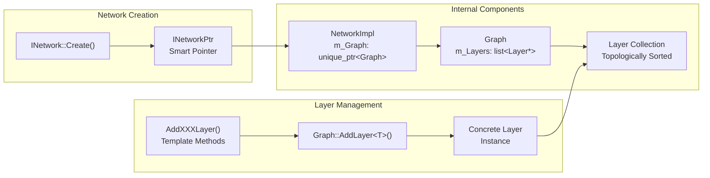
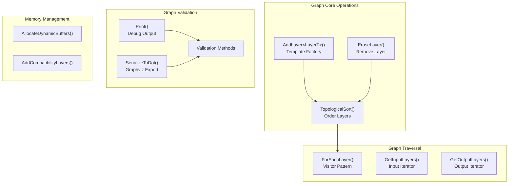
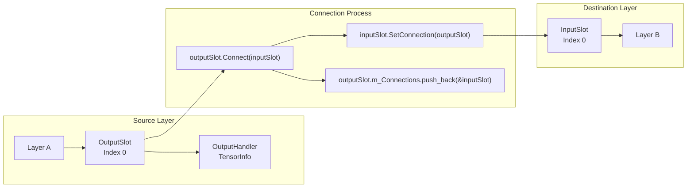
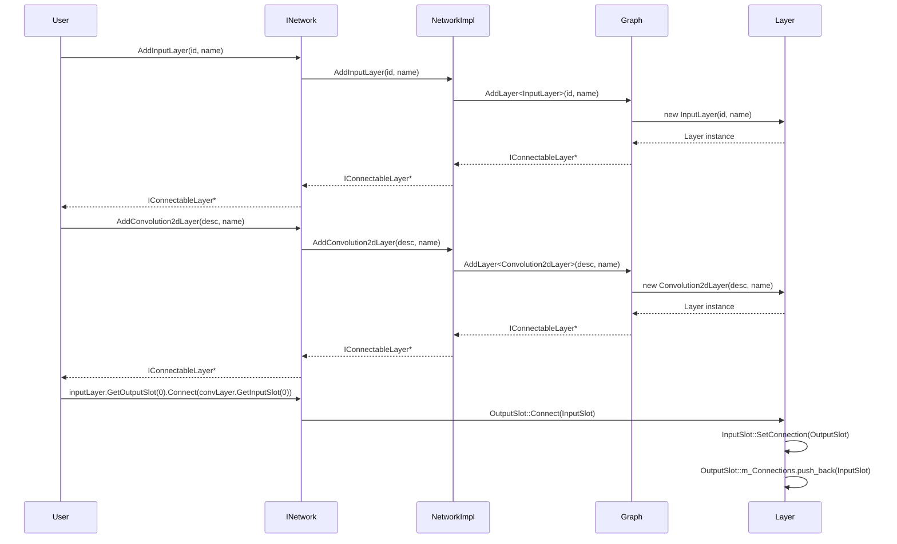
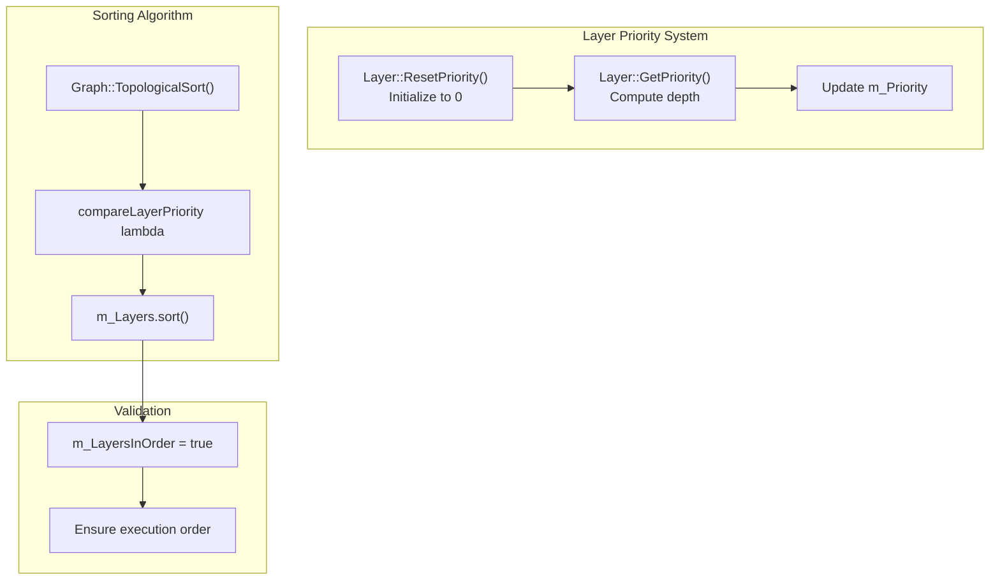

# Network and Graph System

<details>
<summary>Relevant source files</summary>

The following files were used as context for generating this wiki page:

- [Android.mk](Android.mk)
- [include/armnn/INetwork.hpp](include/armnn/INetwork.hpp)
- [include/armnn/backends/OptimizationViews.hpp](include/armnn/backends/OptimizationViews.hpp)
- [include/armnn/backends/SubgraphView.hpp](include/armnn/backends/SubgraphView.hpp)
- [include/armnn/backends/WorkloadFactory.hpp](include/armnn/backends/WorkloadFactory.hpp)
- [include/armnnTestUtils/MockBackend.hpp](include/armnnTestUtils/MockBackend.hpp)
- [src/armnn/Graph.cpp](src/armnn/Graph.cpp)
- [src/armnn/Graph.hpp](src/armnn/Graph.hpp)
- [src/armnn/InternalTypes.hpp](src/armnn/InternalTypes.hpp)
- [src/armnn/Layer.cpp](src/armnn/Layer.cpp)
- [src/armnn/Layer.hpp](src/armnn/Layer.hpp)
- [src/armnn/LayersFwd.hpp](src/armnn/LayersFwd.hpp)
- [src/armnn/Network.cpp](src/armnn/Network.cpp)
- [src/armnn/Network.hpp](src/armnn/Network.hpp)
- [src/armnn/SubgraphView.cpp](src/armnn/SubgraphView.cpp)
- [src/armnn/SubgraphViewSelector.cpp](src/armnn/SubgraphViewSelector.cpp)
- [src/armnn/SubgraphViewSelector.hpp](src/armnn/SubgraphViewSelector.hpp)
- [src/armnn/layers/LayerWithParameters.hpp](src/armnn/layers/LayerWithParameters.hpp)
- [src/armnn/test/GraphTests.cpp](src/armnn/test/GraphTests.cpp)
- [src/armnn/test/SubgraphViewTests.cpp](src/armnn/test/SubgraphViewTests.cpp)
- [src/armnnTestUtils/MockBackend.cpp](src/armnnTestUtils/MockBackend.cpp)
- [src/backends/backendsCommon/LayerSupportBase.cpp](src/backends/backendsCommon/LayerSupportBase.cpp)
- [src/backends/backendsCommon/LayerSupportBase.hpp](src/backends/backendsCommon/LayerSupportBase.hpp)
- [src/backends/backendsCommon/WorkloadFactory.cpp](src/backends/backendsCommon/WorkloadFactory.cpp)
- [src/backends/backendsCommon/test/IsLayerSupportedTestImpl.hpp](src/backends/backendsCommon/test/IsLayerSupportedTestImpl.hpp)
- [src/backends/backendsCommon/test/OptimizationViewsTests.cpp](src/backends/backendsCommon/test/OptimizationViewsTests.cpp)
- [src/backends/backendsCommon/test/OptimizeSubgraphViewTests.cpp](src/backends/backendsCommon/test/OptimizeSubgraphViewTests.cpp)
- [src/backends/backendsCommon/test/mockBackend/MockImportBackend.cpp](src/backends/backendsCommon/test/mockBackend/MockImportBackend.cpp)
- [src/backends/reference/test/RefMemCopyTests.cpp](src/backends/reference/test/RefMemCopyTests.cpp)

</details>


This document describes ArmNN's network and graph system, which provides the foundational data structures and interfaces for constructing and representing neural network computational graphs. This covers the `INetwork` interface for building networks, the internal `Graph` data structure for managing computational graphs, and the `Layer` hierarchy with connection mechanisms.

For information about optimizing and executing networks, see [[2.3-runtime-and-execution|Runtime and Execution]]. For details about specific compute backends, see [[2.2-backend-system|Backend System]].

## System Overview

The Network and Graph System forms the core of ArmNN's computational graph representation. The system consists of several key components that work together to enable flexible network construction and management.

### Core Architecture

```mermaid
graph TD
    subgraph "Public API"
        INetwork["INetwork<br/>Public Interface"]
        IConnectableLayer["IConnectableLayer<br/>Layer Interface"]
        IInputSlot["IInputSlot<br/>Input Connection"]
        IOutputSlot["IOutputSlot<br/>Output Connection"]
    end
    
    subgraph "Internal Implementation"
        NetworkImpl["NetworkImpl<br/>Private Implementation"]
        Graph["Graph<br/>Computational Graph"]
        Layer["Layer<br/>Base Layer Class"]
        InputSlot["InputSlot<br/>Input Connection"]
        OutputSlot["OutputSlot<br/>Output Connection"]
    end
    
    subgraph "Layer Types"
        ConvLayer["Convolution2dLayer"]
        FCLayer["FullyConnectedLayer"]
        ActivationLayer["ActivationLayer"]
        InputLayer["InputLayer"]
        OutputLayer["OutputLayer"]
    end
    
    INetwork --> NetworkImpl
    NetworkImpl --> Graph
    Graph --> Layer
    Layer --> InputSlot
    Layer --> OutputSlot
    
    Layer <|-- ConvLayer
    Layer <|-- FCLayer
    Layer <|-- ActivationLayer
    Layer <|-- InputLayer
    Layer <|-- OutputLayer
    
    IConnectableLayer <|.. Layer
    IInputSlot <|.. InputSlot
    IOutputSlot <|.. OutputSlot
    
    INetwork --> IConnectableLayer
    IConnectableLayer --> IInputSlot
    IConnectableLayer --> IOutputSlot
```

**Sources:** [src/armnn/Network.hpp:32-261](), [src/armnn/Graph.hpp:30-240](), [src/armnn/Layer.hpp:230-284](), [include/armnn/INetwork.hpp:79-149]()

## INetwork Interface

The `INetwork` class provides the primary API for constructing neural networks. It acts as a builder pattern interface that allows users to add layers and establish connections between them.

### Network Construction Methods

The `INetwork` interface exposes factory methods for creating different types of layers:

| Layer Type | Method | Purpose |
|------------|--------|---------|
| Input | `AddInputLayer()` | Network input points |
| Convolution | `AddConvolution2dLayer()` | 2D convolution operations |
| Fully Connected | `AddFullyConnectedLayer()` | Dense matrix operations |
| Activation | `AddActivationLayer()` | Non-linear activations |
| Output | `AddOutputLayer()` | Network output points |

### Network Implementation Structure



**Sources:** [src/armnn/Network.cpp:45-47](), [src/armnn/Network.hpp:32-39](), [include/armnn/INetwork.hpp:345-685]()

## Graph Management

The `Graph` class is the central data structure that manages the computational graph. It maintains layers in topological order and provides algorithms for graph manipulation and validation.

### Graph Data Structure

The `Graph` class uses a list-based storage for layers with additional indexing for inputs and outputs:

```cpp
// Core graph storage from Graph.hpp
std::list<Layer*> m_Layers;           // All layers in topological order
std::vector<LayerBindingId> m_InputIds;  // Input layer bindings
std::vector<LayerBindingId> m_OutputIds; // Output layer bindings
```

### Graph Operations



**Sources:** [src/armnn/Graph.hpp:154-173](), [src/armnn/Graph.cpp:307-328](), [src/armnn/Graph.cpp:68-144]()

## Layer System

Layers are the fundamental computational units in ArmNN's graph system. Each layer represents a specific neural network operation and manages its own input/output connections.

### Layer Hierarchy and Connections

```mermaid
graph TD
    subgraph "Layer Base Classes"
        IConnectableLayer["IConnectableLayer<br/>Public Interface"]
        Layer["Layer<br/>Base Implementation"]
        LayerWithParameters["LayerWithParameters&lt;T&gt;<br/>Parameterized Layers"]
    end
    
    subgraph "Connection System"
        InputSlot["InputSlot<br/>m_Connection: OutputSlot*<br/>m_SlotIndex: unsigned int"]
        OutputSlot["OutputSlot<br/>m_Connections: vector&lt;InputSlot*&gt;<br/>m_OutputHandler: OutputHandler&amp;"]
        OutputHandler["OutputHandler<br/>Tensor Management"]
    end
    
    subgraph "Concrete Layers"
        InputLayer["InputLayer<br/>Network Entry Point"]
        ConvLayer["Convolution2dLayer<br/>2D Convolution"]
        FCLayer["FullyConnectedLayer<br/>Dense Operation"]
        OutputLayer["OutputLayer<br/>Network Exit Point"]
    end
    
    IConnectableLayer <|.. Layer
    Layer <|-- LayerWithParameters
    Layer <|-- InputLayer
    LayerWithParameters <|-- ConvLayer
    LayerWithParameters <|-- FCLayer
    Layer <|-- OutputLayer
    
    Layer --> InputSlot
    Layer --> OutputSlot
    OutputSlot --> OutputHandler
    InputSlot --> OutputSlot
```

**Sources:** [src/armnn/Layer.hpp:42-98](), [src/armnn/Layer.hpp:100-195](), [src/armnn/Layer.hpp:230-284]()

### Connection Mechanism

Layers connect through `InputSlot` and `OutputSlot` objects that manage tensor data flow:



**Sources:** [src/armnn/Layer.cpp:123-129](), [src/armnn/Layer.cpp:53-81]()

## Network Construction Pipeline

The network construction process involves creating layers, establishing connections, and preparing the graph for optimization and execution.

### Layer Addition and Connection Flow



**Sources:** [src/armnn/Network.cpp:242-245](), [src/armnn/Network.cpp:272-276](), [src/armnn/Graph.hpp:154-161]()

### Graph Topological Ordering

The graph maintains layers in topological order to ensure correct execution dependencies:



**Sources:** [src/armnn/Graph.cpp:307-328](), [src/armnn/Layer.cpp:283-330]()

The Network and Graph System provides the foundational infrastructure for all neural network operations in ArmNN, enabling flexible graph construction while maintaining efficient execution order and memory management.

## Related Wiki Pages

- [[2-core-architecture|Core Architecture]]
- [[2.3-runtime-and-execution|Runtime and Execution]]
- [[2.2-backend-system|Backend System]]


## Dynamic Knowledge Links (Code Graph ↔ LLM-Wiki / RAG)

### Linked Architecture & Design Documents

| Document | Match Channel | Score | Shared Code Symbols |
|---|---|---|---|
| [[2-core-architecture|2 Core Architecture]] | `bm25+entity(8)` | `50.758` | `Connect`, `EraseLayer`, `GetInputSlot`, `GetNumInputSlots`, `GetNumOutputSlots` |
| [[1-armnn-overview|1 ArmNN Overview]] | `bm25+entity(3)` | `35.34` | `Connect`, `SetAdditionalInfo`, `SetTensorInfo` |
| [[2.3-runtime-and-execution|2.3 Runtime and Execution]] | `bm25` | `34.73` | *(lexical/graph match)* |
| [[3.3-model-serialization|3.3 Model Serialization]] | `bm25` | `33.309` | *(lexical/graph match)* |
| [[5.2-tensorflow-lite-delegate|5.2 TensorFlow Lite Delegate]] | `bm25` | `32.398` | *(lexical/graph match)* |
| [[2.2-backend-system|2.2 Backend System]] | `wikilink:2.1-network-and-graph-system+entity(1)` | `24.235` | `GetType` |

### High-Centrality Bridge Symbols (CBM Graph)

| Symbol | Kind | Source Location | Fan-In / Fan-Out |
|---|---|---|---|
| `SetTensorInfo` | Method | [src/armnn/Layer.cpp:609-612]() | in: `207` / out: `1` |
| `Connect` | Method | [src/armnn/Layer.cpp:123-129]() | in: `190` / out: `3` |
| `CreateWorkload` | Method | [src/armnnTestUtils/MockBackend.cpp:43-60]() | in: `188` / out: `3` |
| `end` | Method | [src/armnn/Graph.hpp:70-74]() | in: `186` / out: `2` |
| `GetName` | Method | [src/armnn/Layer.hpp:332-332]() | in: `168` / out: `1` |
| `GetInputSlot` | Method | [src/armnn/Layer.hpp:338-338]() | in: `160` / out: `0` |

Sources: [src/armnn/Layer.cpp:609-612](), [src/armnn/Layer.cpp:123-129](), [src/armnnTestUtils/MockBackend.cpp:43-60](), [src/armnn/Graph.hpp:70-74]()

### Cross-Subsystem Coupling

- [[3-model-support|3 Model Support]] — call/import coupling weight `171.0`
- [[4.1-reference-backend|4.1 Reference Backend]] — call/import coupling weight `134.0`
- [[6.2-testing-framework|6.2 Testing Framework]] — call/import coupling weight `134.0`
- [[2.3-runtime-and-execution|2.3 Runtime and Execution]] — call/import coupling weight `121.0`
- [[3.1-tensorflow-lite-parser|3.1 TensorFlow Lite Parser]] — call/import coupling weight `112.0`
- [[2.2-backend-system|2.2 Backend System]] — call/import coupling weight `111.0`
