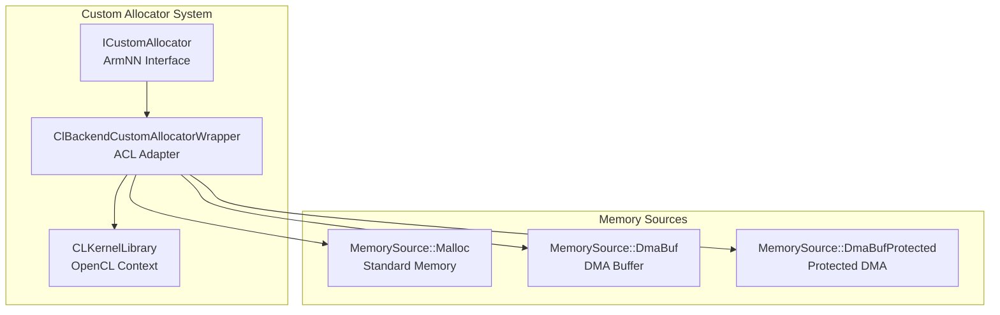
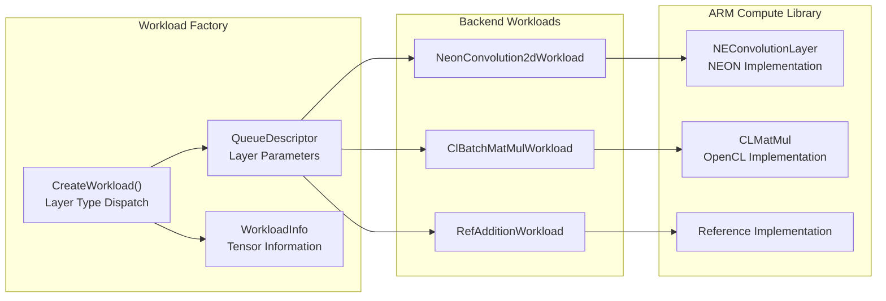
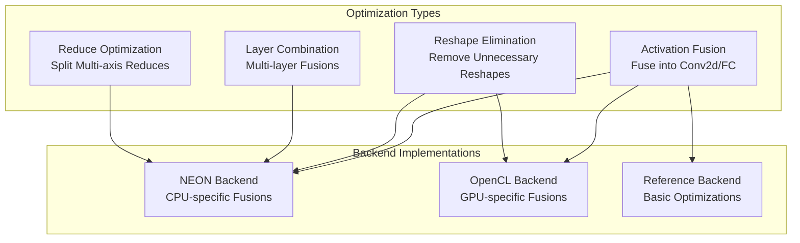

# Backend System

<details>
<summary>Relevant source files</summary>

The following files were used as context for generating this wiki page:

- [delegate/test/BatchMatMulTest.cpp](delegate/test/BatchMatMulTest.cpp)
- [include/armnn/backends/IBackendInternal.hpp](include/armnn/backends/IBackendInternal.hpp)
- [scripts/get_compute_library.sh](scripts/get_compute_library.sh)
- [src/backends/aclCommon/ArmComputeSubgraphUtils.hpp](src/backends/aclCommon/ArmComputeSubgraphUtils.hpp)
- [src/backends/backendsCommon/IBackendInternal.cpp](src/backends/backendsCommon/IBackendInternal.cpp)
- [src/backends/backendsCommon/test/CompatibilityTests.cpp](src/backends/backendsCommon/test/CompatibilityTests.cpp)
- [src/backends/backendsCommon/test/JsonPrinterTestImpl.cpp](src/backends/backendsCommon/test/JsonPrinterTestImpl.cpp)
- [src/backends/backendsCommon/test/layerTests/BatchMatMulTestImpl.cpp](src/backends/backendsCommon/test/layerTests/BatchMatMulTestImpl.cpp)
- [src/backends/cl/ClBackend.cpp](src/backends/cl/ClBackend.cpp)
- [src/backends/cl/ClBackend.hpp](src/backends/cl/ClBackend.hpp)
- [src/backends/cl/workloads/ClBatchMatMulWorkload.cpp](src/backends/cl/workloads/ClBatchMatMulWorkload.cpp)
- [src/backends/cl/workloads/ClBatchMatMulWorkload.hpp](src/backends/cl/workloads/ClBatchMatMulWorkload.hpp)
- [src/backends/cl/workloads/ClQLstmWorkload.cpp](src/backends/cl/workloads/ClQLstmWorkload.cpp)
- [src/backends/neon/NeonBackend.cpp](src/backends/neon/NeonBackend.cpp)
- [src/backends/neon/NeonBackend.hpp](src/backends/neon/NeonBackend.hpp)
- [src/backends/neon/NeonInterceptorScheduler.cpp](src/backends/neon/NeonInterceptorScheduler.cpp)
- [src/backends/neon/NeonInterceptorScheduler.hpp](src/backends/neon/NeonInterceptorScheduler.hpp)
- [src/backends/neon/workloads/NeonBatchMatMulWorkload.cpp](src/backends/neon/workloads/NeonBatchMatMulWorkload.cpp)
- [src/backends/neon/workloads/NeonBatchMatMulWorkload.hpp](src/backends/neon/workloads/NeonBatchMatMulWorkload.hpp)
- [src/backends/neon/workloads/NeonQLstmWorkload.cpp](src/backends/neon/workloads/NeonQLstmWorkload.cpp)
- [src/backends/reference/RefBackend.cpp](src/backends/reference/RefBackend.cpp)
- [src/backends/reference/RefBackend.hpp](src/backends/reference/RefBackend.hpp)

</details>


The Backend System provides ArmNN's multi-target compute acceleration architecture, enabling inference execution across different hardware platforms including ARM CPUs (NEON), GPUs (OpenCL), and reference implementations. This system implements a plugin-like architecture where different compute backends can be dynamically selected and used based on hardware availability and optimization requirements.

For information about the runtime execution and workload management, see [[2.3-runtime-and-execution|Runtime and Execution]]. For details about specific compute backend implementations, see [[4-compute-backends|Compute Backends]].

## Backend Architecture Overview

The backend system is built around the `IBackendInternal` interface, which provides a standardized way for different compute implementations to integrate with ArmNN's core infrastructure.

**Backend Architecture and Core Components**

```mermaid
graph TB
    subgraph "Core Interface"
        IBackendInternal["IBackendInternal<br/>Main Backend Interface"]
    end
    
    subgraph "Backend Implementations"
        RefBackend["RefBackend<br/>CPU Reference"]
        NeonBackend["NeonBackend<br/>ARM NEON CPU"]
        ClBackend["ClBackend<br/>OpenCL GPU"]
        TosaBackend["TosaBackend<br/>TOSA Reference"]
    end
    
    subgraph "Factory System"
        IWorkloadFactory["IWorkloadFactory<br/>Creates Workloads"]
        RefWorkloadFactory["RefWorkloadFactory"]
        NeonWorkloadFactory["NeonWorkloadFactory"]
        ClWorkloadFactory["ClWorkloadFactory"]
        ITensorHandleFactory["ITensorHandleFactory<br/>Manages Tensors"]
    end
    
    subgraph "Support System"
        ILayerSupport["ILayerSupport<br/>Layer Capability Query"]
        RefLayerSupport["RefLayerSupport"]
        NeonLayerSupport["NeonLayerSupport"]
        ClLayerSupport["ClLayerSupport"]
    end
    
    subgraph "Memory Management"
        IMemoryManager["IMemoryManager<br/>Memory Allocation"]
        RefMemoryManager["RefMemoryManager"]
        NeonMemoryManager["NeonMemoryManager"]
        ClMemoryManager["ClMemoryManager"]
    end
    
    IBackendInternal <|-- RefBackend
    IBackendInternal <|-- NeonBackend
    IBackendInternal <|-- ClBackend
    IBackendInternal <|-- TosaBackend
    
    RefBackend --> RefWorkloadFactory
    NeonBackend --> NeonWorkloadFactory
    ClBackend --> ClWorkloadFactory
    
    RefBackend --> RefLayerSupport
    NeonBackend --> NeonLayerSupport
    ClBackend --> ClLayerSupport
    
    RefBackend --> RefMemoryManager
    NeonBackend --> NeonMemoryManager
    ClBackend --> ClMemoryManager
    
    RefWorkloadFactory --> ITensorHandleFactory
    NeonWorkloadFactory --> ITensorHandleFactory
    ClWorkloadFactory --> ITensorHandleFactory
```

Sources: [include/armnn/backends/IBackendInternal.hpp:75-212](), [src/backends/neon/NeonBackend.hpp:29-74](), [src/backends/cl/ClBackend.hpp:24-285](), [src/backends/reference/RefBackend.hpp:30-67]()

## IBackendInternal Interface

The `IBackendInternal` interface serves as the foundation for all backend implementations, defining the contract that each compute backend must fulfill.

**Core Interface Methods**

| Method | Purpose | Return Type |
|--------|---------|-------------|
| `CreateMemoryManager()` | Creates backend-specific memory manager | `IMemoryManagerUniquePtr` |
| `CreateWorkloadFactory()` | Creates factory for backend workloads | `IWorkloadFactoryPtr` |
| `GetLayerSupport()` | Returns layer support capabilities | `ILayerSupportSharedPtr` |
| `OptimizeSubgraphView()` | Performs backend-specific optimizations | `OptimizationViews` |
| `RegisterTensorHandleFactories()` | Registers tensor handle factories | `void` |
| `GetCapabilities()` | Returns backend capability information | `BackendCapabilities` |

**Backend Lifecycle and Factory Creation**

```mermaid
graph LR
    subgraph "Backend Registration"
        BackendRegistry["BackendRegistry<br/>Global Registry"]
        GetIdStatic["GetIdStatic()<br/>Backend Identifier"]
    end
    
    subgraph "Factory Creation"
        CreateMemoryManager["CreateMemoryManager()<br/>Memory Allocation"]
        CreateWorkloadFactory["CreateWorkloadFactory()<br/>Workload Creation"]
        GetLayerSupport["GetLayerSupport()<br/>Capability Query"]
    end
    
    subgraph "Runtime Integration"
        TensorHandleFactoryRegistry["TensorHandleFactoryRegistry<br/>Tensor Management"]
        OptimizeSubgraphView["OptimizeSubgraphView()<br/>Graph Optimization"]
    end
    
    BackendRegistry --> GetIdStatic
    GetIdStatic --> CreateMemoryManager
    CreateMemoryManager --> CreateWorkloadFactory
    CreateWorkloadFactory --> GetLayerSupport
    GetLayerSupport --> TensorHandleFactoryRegistry
    TensorHandleFactoryRegistry --> OptimizeSubgraphView
```



Sources: [include/armnn/backends/IBackendInternal.hpp:99-155](), [src/backends/backendsCommon/IBackendInternal.cpp:13-148]()

## Backend Implementations

### Reference Backend (RefBackend)

The Reference Backend provides a CPU-based reference implementation for all supported operations, serving as both a fallback option and a baseline for correctness testing.

```cpp
class RefBackend : public IBackendInternal
{
    static const BackendId& GetIdStatic();
    IMemoryManagerUniquePtr CreateMemoryManager() const override;
    IWorkloadFactoryPtr CreateWorkloadFactory(...) const override;
    ILayerSupportSharedPtr GetLayerSupport() const override;
    BackendCapabilities GetCapabilities() const override;
};
```

**Reference Backend Capabilities:**
- **NonConstWeights**: `true` - Supports non-constant weights
- **ProtectedContentAllocation**: `false` - No protected memory support
- **ConstantTensorsAsInputs**: `true` - Accepts constant tensors as inputs
- **PreImportIOTensors**: `true` - Supports pre-imported I/O tensors
- **ExternallyManagedMemory**: `true` - Supports external memory management

Sources: [src/backends/reference/RefBackend.hpp:30-67](), [src/backends/reference/RefBackend.cpp:22-162]()

### NEON Backend (NeonBackend)

The NEON Backend leverages ARM's NEON SIMD instructions for accelerated CPU execution, integrating with ARM Compute Library (ACL) for optimized kernel implementations.

```cpp
class NeonBackend : public IBackendInternal
{
    static const BackendId& GetIdStatic();
    IMemoryManagerUniquePtr CreateMemoryManager() const override;
    IWorkloadFactoryPtr CreateWorkloadFactory(...) const override;
    OptimizationViews OptimizeSubgraphView(...) const override;
    BackendCapabilities GetCapabilities() const override;
};
```

**NEON-Specific Features:**
- **Activation Fusion**: Fuses activation functions into preceding layers (convolution, batch normalization, etc.)
- **Reshape Optimization**: Removes unnecessary reshape operations
- **Multi-Axis Reduce**: Splits reduce operations with multiple axes into single-axis operations
- **ARM Compute Library Integration**: Uses ACL for optimized NEON kernels

Sources: [src/backends/neon/NeonBackend.hpp:29-74](), [src/backends/neon/NeonBackend.cpp:46-649]()

### OpenCL Backend (ClBackend)

The OpenCL Backend provides GPU acceleration through OpenCL, supporting both standard and custom memory allocators for protected content scenarios.

```cpp
class ClBackend : public IBackendInternal
{
    static const BackendId& GetIdStatic();
    IMemoryManagerUniquePtr CreateMemoryManager() const override;
    IWorkloadFactoryPtr CreateWorkloadFactory(...) const override;
    BackendCapabilities GetCapabilities() const override;
    bool UseCustomMemoryAllocator(...) override;
};
```

**OpenCL-Specific Features:**
- **Custom Memory Allocators**: Supports DMA buffer and protected memory allocation
- **GPU Kernel Compilation**: Manages OpenCL kernel compilation and caching
- **Import/Export Tensors**: Advanced tensor memory import/export capabilities
- **Protected Content**: Supports protected content allocation for secure inference

**OpenCL Custom Allocator Implementation:**


Sources: [src/backends/cl/ClBackend.hpp:24-285](), [src/backends/cl/ClBackend.cpp:44-675]()

## Workload System Integration

Backends integrate with ArmNN's workload system through factory patterns, creating backend-specific workload implementations for each supported layer type.

**Backend Workload Creation Flow**



**Example: BatchMatMul Workload Implementation**

The `ClBatchMatMulWorkload` demonstrates backend-specific workload implementation:

- **Validation**: `ClBatchMatMulValidate()` checks parameter compatibility
- **Configuration**: Sets up ARM Compute Library's `CLMatMul` function
- **Execution**: Runs the configured OpenCL kernel

Sources: [src/backends/cl/workloads/ClBatchMatMulWorkload.cpp:24-114](), [src/backends/neon/workloads/NeonBatchMatMulWorkload.cpp:19-108]()

## Memory Management

Each backend implements its own memory management strategy through the `IMemoryManager` interface, optimizing for the specific characteristics of the target hardware.

**Backend Memory Manager Responsibilities**

| Backend | Memory Manager | Key Features |
|---------|----------------|--------------|
| Reference | `RefMemoryManager` | Simple host memory allocation |
| NEON | `NeonMemoryManager` | ARM Compute Library allocator integration |
| OpenCL | `ClMemoryManager` | GPU memory buffers, custom allocator support |

**Memory Manager Integration:**
```cpp
// From NeonBackend::CreateMemoryManager()
IBackendInternal::IMemoryManagerUniquePtr NeonBackend::CreateMemoryManager() const
{
    return std::make_unique<NeonMemoryManager>(
        std::make_unique<arm_compute::Allocator>(),
        BaseMemoryManager::MemoryAffinity::Offset);
}
```

Sources: [src/backends/neon/NeonBackend.cpp:52-56](), [src/backends/cl/ClBackend.cpp:50-57](), [src/backends/reference/RefBackend.cpp:61-64]()

## Backend Registration and Discovery

Backends register themselves with the ArmNN runtime through static backend identifiers and factory registration mechanisms.

**Backend Registration Pattern:**
```cpp
// Each backend provides a static identifier
const BackendId& NeonBackend::GetIdStatic()
{
    static const BackendId s_Id{NeonBackendId()};
    return s_Id;
}

// Backends register tensor handle factories
void NeonBackend::RegisterTensorHandleFactories(TensorHandleFactoryRegistry& registry)
{
    auto memoryManager = std::make_shared<NeonMemoryManager>(...);
    registry.RegisterMemoryManager(memoryManager);
    
    auto factory = std::make_unique<NeonTensorHandleFactory>(memoryManager);
    registry.RegisterFactory(std::move(factory));
}
```

**Backend Discovery and Preferences:**
Each backend specifies its tensor handle factory preferences through `GetHandleFactoryPreferences()`, allowing the runtime to select the most appropriate backend for tensor operations.

Sources: [src/backends/neon/NeonBackend.cpp:46-50](), [src/backends/neon/NeonBackend.cpp:629-641](), [src/backends/cl/ClBackend.cpp:169-172]()

## Optimization and Subgraph Views

Backends can perform specialized optimizations through the `OptimizeSubgraphView()` method, implementing fusions and transformations specific to their target hardware.

**Common Backend Optimizations**



**Activation Fusion Example:**
Both NEON and OpenCL backends implement activation fusion, where activation functions are fused into preceding convolution or fully connected layers for improved performance:

```cpp
// From NeonBackend::OptimizeSubgraphView()
if (base.GetType() == LayerType::Convolution2d) {
    // Validate fusion compatibility
    arm_compute::Status status = NeonConvolution2dWorkloadValidate(..., &activationDesc);
    if (status) {
        // Create fused replacement layer
        FuseConvolution2dLayer<Convolution2dLayer>(optimizationViews, ...);
    }
}
```

Sources: [src/backends/neon/NeonBackend.cpp:144-622](), [src/backends/cl/ClBackend.cpp:292-675](), [src/backends/aclCommon/ArmComputeSubgraphUtils.hpp:52-375]()

## Related Wiki Pages

- [[2-core-architecture|Core Architecture]]
- [[2.3-runtime-and-execution|Runtime and Execution]]
- [[4-compute-backends|Compute Backends]]


## Dynamic Knowledge Links (Code Graph ↔ LLM-Wiki / RAG)

### Linked Architecture & Design Documents

| Document | Match Channel | Score | Shared Code Symbols |
|---|---|---|---|
| [[4-compute-backends|4 Compute Backends]] | `bm25+entity(6)` | `75.346` | `AreParenthesesMatching`, `BatchMatMulTestImpl`, `ExtractMeasurements`, `FuseConvolution2dLayer`, `FuseLayer` |
| [[4.2-neon-backend|4.2 NEON Backend]] | `bm25+entity(5)` | `59.795` | `AreParenthesesMatching`, `BatchMatMulTestImpl`, `ClBatchMatMulWorkload`, `ExtractMeasurements`, `GetSoftmaxProfilerJson` |
| [[6.1-build-system|6.1 Build System]] | `bm25+entity(5)` | `57.225` | `AreParenthesesMatching`, `BatchMatMulTestImpl`, `ClBatchMatMulWorkload`, `ClQLstmWorkloadValidate`, `GetSoftmaxProfilerJson` |
| [[7-advanced-topics|7 Advanced Topics]] | `bm25+entity(6)` | `56.739` | `AreParenthesesMatching`, `BatchMatMulTestImpl`, `ExtractMeasurements`, `GetSoftmaxProfilerJson`, `ValidateProfilerJson` |
| [[7.2-workload-system|7.2 Workload System]] | `bm25+entity(4)` | `54.749` | `AreParenthesesMatching`, `BatchMatMulTestImpl`, `ExtractMeasurements`, `GetSoftmaxProfilerJson` |
| [[2.3-runtime-and-execution|2.3 Runtime and Execution]] | `wikilink:2.2-backend-system` | `36.156` | *(lexical/graph match)* |

### High-Centrality Bridge Symbols (CBM Graph)

| Symbol | Kind | Source Location | Fan-In / Fan-Out |
|---|---|---|---|
| `OptimizeSubgraphView` | Method | [src/backends/neon/NeonBackend.cpp:140-618]() | in: `0` / out: `53` |
| `OptimizeSubgraphView` | Method | [src/backends/cl/ClBackend.cpp:292-729]() | in: `0` / out: `49` |
| `BatchMatMulTestImpl` | Function | [src/backends/backendsCommon/test/layerTests/BatchMatMulTestImpl.cpp:20-80]() | in: `13` / out: `16` |
| `ClQLstmWorkloadValidate` | Function | [src/backends/cl/workloads/ClQLstmWorkload.cpp:247-395]() | in: `0` / out: `22` |
| `NeonQLstmWorkloadValidate` | Function | [src/backends/neon/workloads/NeonQLstmWorkload.cpp:243-391]() | in: `0` / out: `22` |
| `FuseLayer` | Function | [src/backends/aclCommon/ArmComputeSubgraphUtils.hpp:52-70]() | in: `9` / out: `3` |

Sources: [src/backends/neon/NeonBackend.cpp:140-618](), [src/backends/cl/ClBackend.cpp:292-729](), [src/backends/backendsCommon/test/layerTests/BatchMatMulTestImpl.cpp:20-80](), [src/backends/cl/workloads/ClQLstmWorkload.cpp:247-395]()

### Cross-Subsystem Coupling

- [[2-core-architecture|2 Core Architecture]] — call/import coupling weight `111.0`
- [[2.1-network-and-graph-system|2.1 Network and Graph System]] — call/import coupling weight `111.0`
- [[1-armnn-overview|1 ArmNN Overview]] — call/import coupling weight `26.0`
- [[3.3-model-serialization|3.3 Model Serialization]] — call/import coupling weight `19.0`
- [[2.3-runtime-and-execution|2.3 Runtime and Execution]] — call/import coupling weight `14.0`
- [[4.2-neon-backend|4.2 NEON Backend]] — call/import coupling weight `12.0`
