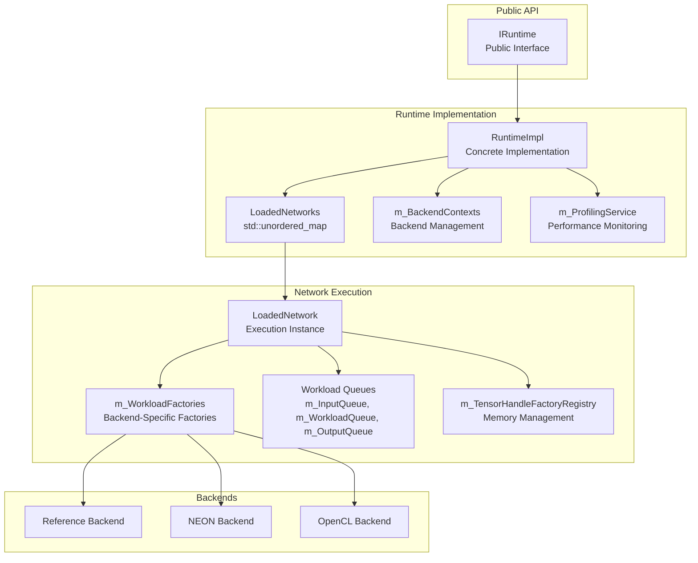
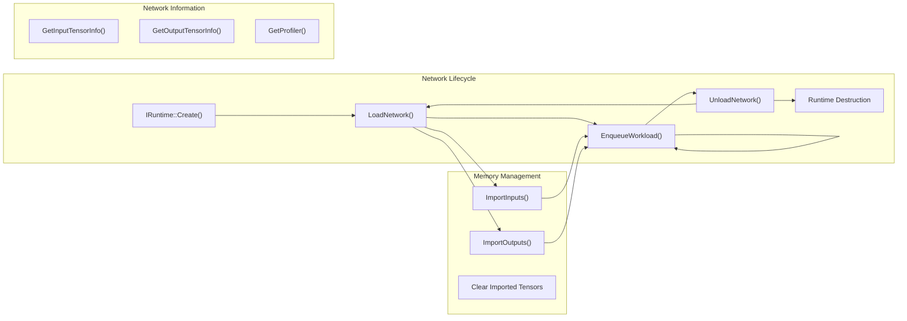
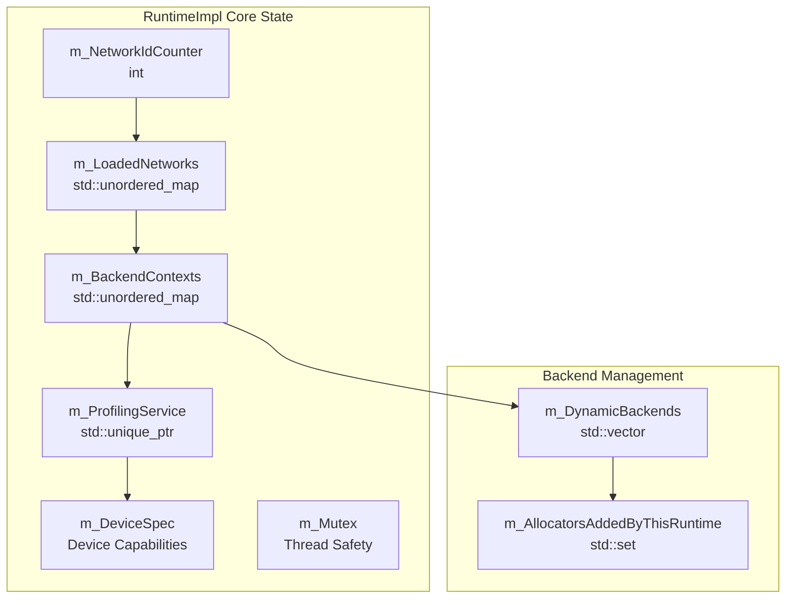
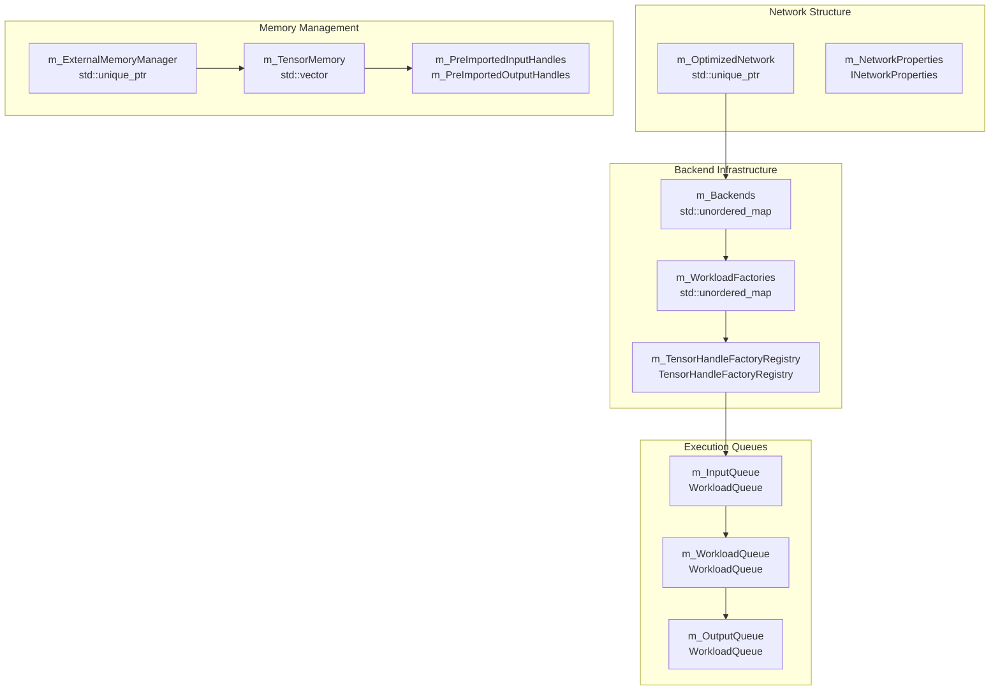
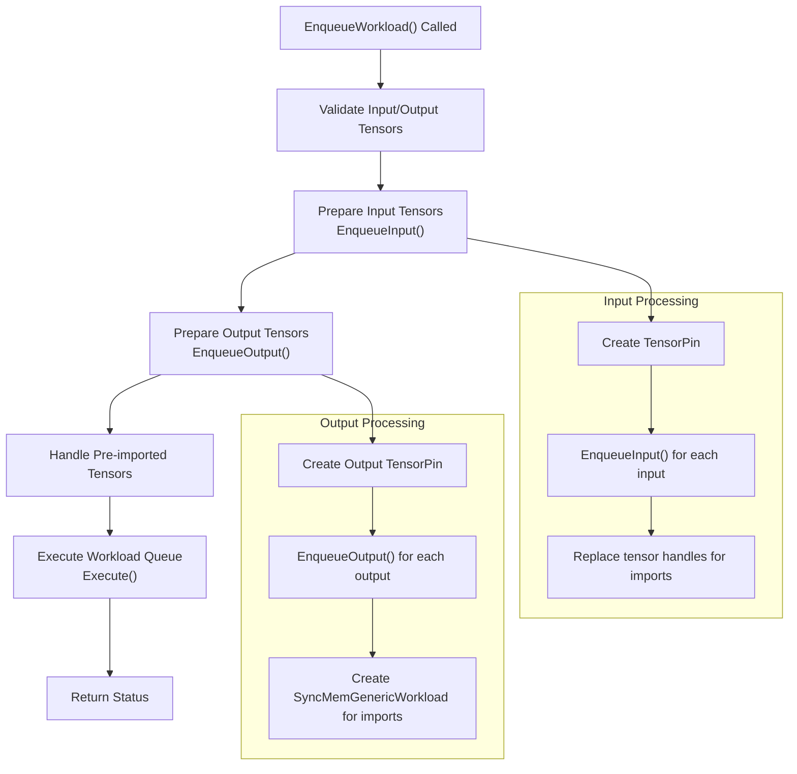
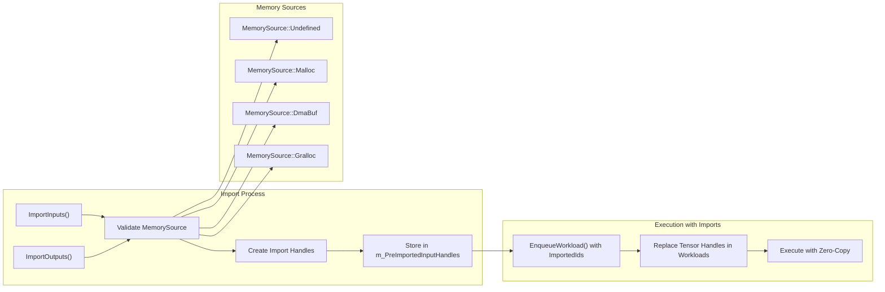

# Runtime and Execution

Relevant source files

The following files were used as context for generating this wiki page:

- [include/armnn/IRuntime.hpp](include/armnn/IRuntime.hpp)
- [include/armnn/Types.hpp](include/armnn/Types.hpp)
- [include/armnn/TypesUtils.hpp](include/armnn/TypesUtils.hpp)
- [src/armnn/LoadedNetwork.cpp](src/armnn/LoadedNetwork.cpp)
- [src/armnn/LoadedNetwork.hpp](src/armnn/LoadedNetwork.hpp)
- [src/armnn/Runtime.cpp](src/armnn/Runtime.cpp)
- [src/armnn/Runtime.hpp](src/armnn/Runtime.hpp)
- [src/armnn/test/RuntimeTests.cpp](src/armnn/test/RuntimeTests.cpp)
- [src/profiling/test/ProfilingGuidTest.cpp](src/profiling/test/ProfilingGuidTest.cpp)
- [src/profiling/test/ProfilingTestUtils.cpp](src/profiling/test/ProfilingTestUtils.cpp)
- [src/profiling/test/ProfilingTestUtils.hpp](src/profiling/test/ProfilingTestUtils.hpp)
- [src/profiling/test/TimelineUtilityMethodsTests.cpp](src/profiling/test/TimelineUtilityMethodsTests.cpp)

This document explains ArmNN's runtime system and execution pipeline, covering the `IRuntime` interface, `LoadedNetwork` implementation, and the workload execution flow. The runtime is responsible for loading optimized networks, managing their lifecycle, and executing inference operations across different compute backends.

For information about network optimization and backend selection, see [[2.2-backend-system|Backend System]]. For details about the computational graph representation, see [[2.1-network-and-graph-system|Network and Graph System]].

## Runtime Architecture Overview

The ArmNN runtime system consists of three main components that work together to provide network execution capabilities:

Sources: [src/armnn/Runtime.hpp:30-150](), [src/armnn/LoadedNetwork.hpp:42-210](), [include/armnn/IRuntime.hpp:67-264]()

## IRuntime Interface

The `IRuntime` class provides the primary API for loading and executing neural networks. It follows a factory pattern with static creation methods and manages network lifecycles through unique identifiers.

### Core Methods

| Method | Purpose | Key Parameters |
|--------|---------|----------------|
| `LoadNetwork()` | Load optimized network into runtime | `NetworkId&`, `IOptimizedNetworkPtr`, `INetworkProperties` |
| `EnqueueWorkload()` | Execute inference on loaded network | `NetworkId`, `InputTensors`, `OutputTensors` |
| `UnloadNetwork()` | Remove network from runtime | `NetworkId` |
| `ImportInputs()`/`ImportOutputs()` | Pre-import tensors for efficient execution | `NetworkId`, tensor arrays, `MemorySource` |

Sources: [include/armnn/IRuntime.hpp:194-256](), [src/armnn/Runtime.cpp:62-132]()

## RuntimeImpl Implementation

`RuntimeImpl` provides the concrete implementation of the `IRuntime` interface and manages the internal state required for network execution.

### Key Components

### Network Loading Process

The `LoadNetwork()` method follows a specific sequence to prepare networks for execution:

1. **Network ID Generation**: `GenerateNetworkId()` creates unique identifier
2. **Backend Notification**: Call `BeforeLoadNetwork()` on all backend contexts
3. **LoadedNetwork Creation**: `LoadedNetwork::MakeLoadedNetwork()` constructs execution instance
4. **Registration**: Store in `m_LoadedNetworks` map
5. **Backend Notification**: Call `AfterLoadNetwork()` on all backend contexts

Sources: [src/armnn/Runtime.cpp:153-202](), [src/armnn/Runtime.hpp:30-150]()

## LoadedNetwork and Execution Pipeline

`LoadedNetwork` represents a network instance ready for execution. It manages the entire execution pipeline from input tensor processing to output tensor generation.

### LoadedNetwork Architecture

### LoadedNetwork Construction Process

The `LoadedNetwork` constructor performs complex initialization to prepare for execution:

1. **Backend Setup**: Create backends and workload factories for each compute device
2. **Tensor Handle Creation**: Generate tensor handles for all layers using `CreateTensorHandles()`
3. **Workload Creation**: Build workloads for each layer via `CreateWorkload()`
4. **Queue Organization**: Sort workloads into input, processing, and output queues
5. **Memory Configuration**: Set up memory management and import/export capabilities

Sources: [src/armnn/LoadedNetwork.cpp:205-570](), [src/armnn/LoadedNetwork.hpp:101-210]()

## Workload Execution Flow

The `EnqueueWorkload()` method implements the core execution pipeline that processes inference requests.

### Execution Sequence

### Key Execution Components

The execution process involves several critical data structures:

- **WorkloadData**: Manages input/output tensor lifetime during execution
- **TensorPin**: Wrapper for tensor handles with binding information  
- **ImportedTensorHandlePin**: Pre-imported tensors for efficient memory management
- **WorkloadIndices**: Maps between network layers and workload queue positions

Sources: [src/armnn/LoadedNetwork.cpp:783-979](), [src/armnn/LoadedNetwork.cpp:690-780]()

## Memory Management and Tensor Import

ArmNN provides sophisticated memory management capabilities to optimize inference performance and reduce memory copies.

### Tensor Import/Export System

The tensor import system allows applications to:
- Pre-allocate tensors in specific memory regions
- Avoid memory copies during inference
- Support hardware-specific memory types (DMA buffers, protected memory)
- Enable zero-copy execution for supported backends

Sources: [src/armnn/LoadedNetwork.cpp:98-168](), [include/armnn/IRuntime.hpp:214-230](), [include/armnn/Types.hpp:244-252]()

## Related Wiki Pages

- [[2-core-architecture|Core Architecture]]
- [[2.2-backend-system|Backend System]]
- [[2.1-network-and-graph-system|Network and Graph System]]

## Dynamic Knowledge Links (Code Graph ↔ LLM-Wiki / RAG)

### Linked Architecture & Design Documents

| Document | Match Channel | Score | Shared Code Symbols |
|---|---|---|---|
| [[6.3-profiling-system|6.3 Profiling System]] | `bm25+entity(4)` | `44.676` | `CreationOptions`, `LoadedNetwork`, `VerifyTimelineEventBinaryPacket`, `VerifyTimelineLabelBinaryPacketData` |
| [[3.1-tensorflow-lite-parser|3.1 TensorFlow Lite Parser]] | `bm25` | `35.853` | *(lexical/graph match)* |
| [[5.2-tensorflow-lite-delegate|5.2 TensorFlow Lite Delegate]] | `bm25+entity(2)` | `31.754` | `LoadNetwork`, `LoadedNetwork` |
| [[2-core-architecture|2 Core Architecture]] | `bm25` | `30.136` | *(lexical/graph match)* |
| [[3.3-model-serialization|3.3 Model Serialization]] | `bm25` | `28.793` | *(lexical/graph match)* |
| [[7-advanced-topics|7 Advanced Topics]] | `wikilink:6.3-profiling-system` | `19.338` | *(lexical/graph match)* |

### High-Centrality Bridge Symbols (CBM Graph)

| Symbol | Kind | Source Location | Fan-In / Fan-Out |
|---|---|---|---|
| `end` | Method | [include/armnn/Types.hpp:366-366]() | in: `77` / out: `1` |
| `GetSize` | Method | [include/armnn/Types.hpp:359-359]() | in: `68` / out: `0` |
| `begin` | Method | [include/armnn/Types.hpp:361-361]() | in: `61` / out: `0` |
| `Create` | Method | [src/armnn/Runtime.cpp:52-55]() | in: `42` / out: `1` |
| `IsQuantizedType` | Function | [include/armnn/TypesUtils.hpp:324-327]() | in: `23` / out: `1` |
| `GetDataTypeName` | Function | [include/armnn/TypesUtils.hpp:234-252]() | in: `23` / out: `0` |

Sources: [include/armnn/Types.hpp:366-366](), [include/armnn/Types.hpp:359-359](), [include/armnn/Types.hpp:361-361](), [src/armnn/Runtime.cpp:52-55]()

### Cross-Subsystem Coupling

- [[2-core-architecture|2 Core Architecture]] — call/import coupling weight `121.0`
- [[2.1-network-and-graph-system|2.1 Network and Graph System]] — call/import coupling weight `121.0`
- [[4.1-reference-backend|4.1 Reference Backend]] — call/import coupling weight `43.0`
- [[6.2-testing-framework|6.2 Testing Framework]] — call/import coupling weight `43.0`
- [[1-armnn-overview|1 ArmNN Overview]] — call/import coupling weight `32.0`
- [[6-development-guide|6 Development Guide]] — call/import coupling weight `26.0`
