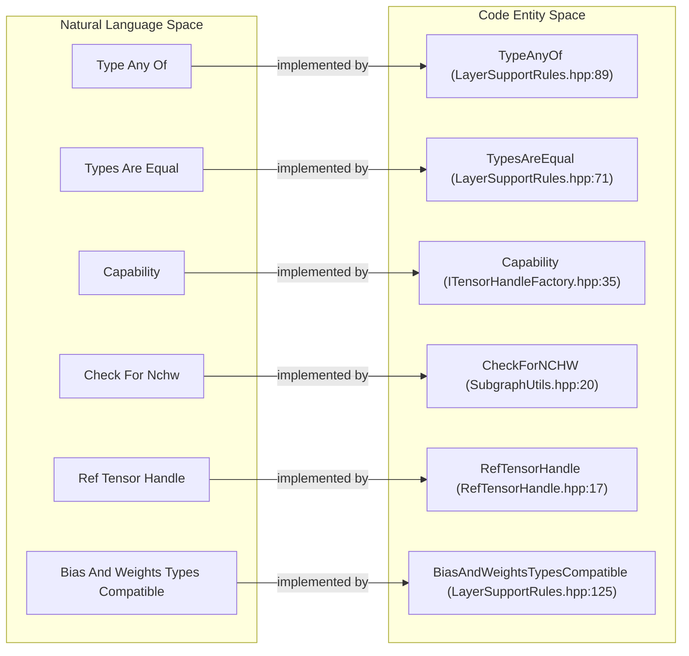
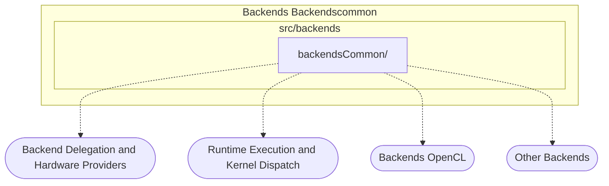
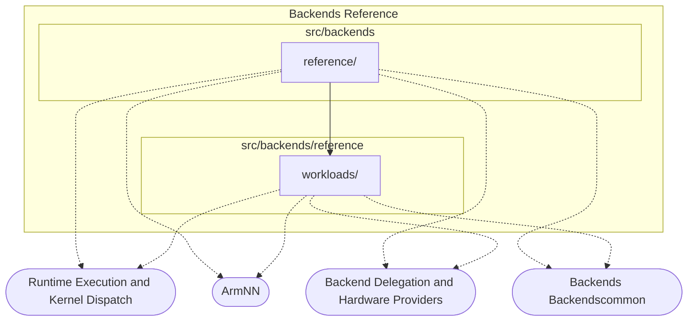
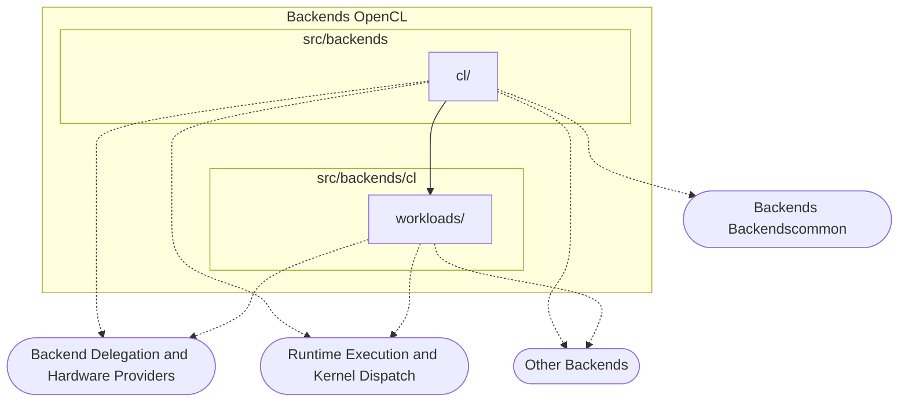
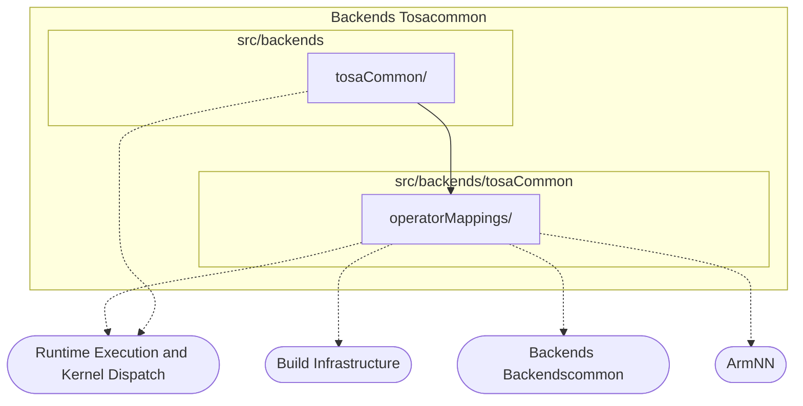
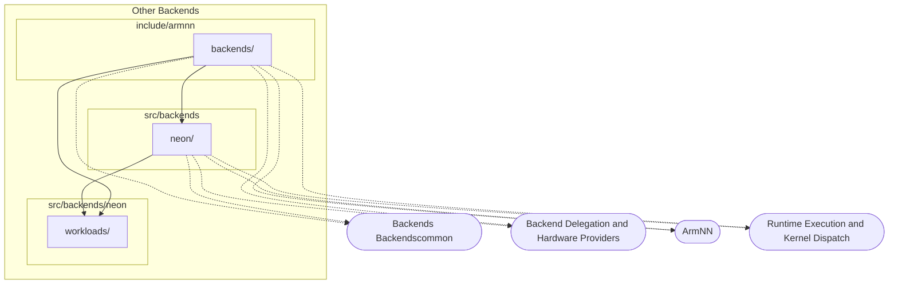

# Backend Delegation and Hardware Providers

> Architectural overview of Backend Delegation and Hardware Providers, spanning 150 source files and 2618 code symbols across 6 subsystems.

Relevant source files

The following files were used as context for generating this wiki page:

- [src/backends/aclCommon/ArmComputeTensorUtils.hpp](src/backends/aclCommon/ArmComputeTensorUtils.hpp)
- [src/backends/aclCommon/ArmComputeTensorUtils.cpp](src/backends/aclCommon/ArmComputeTensorUtils.cpp)
- [src/backends/tosaCommon/operatorMappings/TosaOperatorUtils.hpp](src/backends/tosaCommon/operatorMappings/TosaOperatorUtils.hpp)
- [src/backends/backendsCommon/LayerSupportRules.hpp](src/backends/backendsCommon/LayerSupportRules.hpp)
- [include/armnn/backends/ITensorHandleFactory.hpp](include/armnn/backends/ITensorHandleFactory.hpp)
- [src/backends/reference/workloads/BaseIterator.hpp](src/backends/reference/workloads/BaseIterator.hpp)
- [src/backends/aclCommon/ArmComputeUtils.hpp](src/backends/aclCommon/ArmComputeUtils.hpp)
- [src/backends/cl/ClImportTensorHandle.hpp](src/backends/cl/ClImportTensorHandle.hpp)
- [src/backends/backendsCommon/TensorHandleFactoryRegistry.cpp](src/backends/backendsCommon/TensorHandleFactoryRegistry.cpp)
- [src/backends/reference/workloads/Broadcast.hpp](src/backends/reference/workloads/Broadcast.hpp)
- [src/backends/backendsCommon/DynamicBackendUtils.cpp](src/backends/backendsCommon/DynamicBackendUtils.cpp)
- [src/backends/backendsCommon/SubgraphUtils.hpp](src/backends/backendsCommon/SubgraphUtils.hpp)
- [src/backends/reference/RefTensorHandle.hpp](src/backends/reference/RefTensorHandle.hpp)
- [include/armnn/backends/OptimizationViews.hpp](include/armnn/backends/OptimizationViews.hpp)
- [src/backends/aclCommon/ArmComputeSubgraphUtils.hpp](src/backends/aclCommon/ArmComputeSubgraphUtils.hpp)
- [src/backends/reference/RefLayerSupport.cpp](src/backends/reference/RefLayerSupport.cpp)
- [src/backends/cl/ClContextSchema_generated.h](src/backends/cl/ClContextSchema_generated.h)
- [src/backends/reference/RefWorkloadFactory.cpp](src/backends/reference/RefWorkloadFactory.cpp)
- [src/backends/backendsCommon/LayerSupportBase.cpp](src/backends/backendsCommon/LayerSupportBase.cpp)
- [src/backends/cl/ClBackend.cpp](src/backends/cl/ClBackend.cpp)
- [src/backends/cl/ClTensorHandle.hpp](src/backends/cl/ClTensorHandle.hpp)
- [src/backends/cl/ClBackend.hpp](src/backends/cl/ClBackend.hpp)
- [src/backends/backendsCommon/DefaultAllocator.hpp](src/backends/backendsCommon/DefaultAllocator.hpp)

## Purpose and Scope

This chapter covers **Backend Delegation and Hardware Providers** across the repository, detailing the core abstractions, data structures, transformation pipelines, and runtime/build integrations that implement this layer.

**Scope**: This document provides an architectural hub for the following child subsystems:
- **Backends Backendscommon**: See [[3.1-backends-backendscommon|Backends Backendscommon]].
- **Backends Reference**: See [[3.2-backends-reference|Backends Reference]].
- **Backends OpenCL**: See [[3.3-backends-opencl|Backends OpenCL]].
- **Backends Aclcommon**: See [[3.4-backends-aclcommon|Backends Aclcommon]].
- **Backends Tosacommon**: See [[3.5-backends-tosacommon|Backends Tosacommon]].
- **Other Backends**: See [[3.6-other-backends|Other Backends]].

Sources: [src/backends/backendsCommon/LayerSupportRules.hpp:89-99](), [src/backends/backendsCommon/LayerSupportRules.hpp:71-78](), [include/armnn/backends/ITensorHandleFactory.hpp:35-44](), [src/backends/backendsCommon/SubgraphUtils.hpp:20-129]()

---

## System Mapping: Natural Language Space to Code Entity Space

Sources: [src/backends/backendsCommon/LayerSupportRules.hpp:89-99](), [src/backends/backendsCommon/LayerSupportRules.hpp:71-78](), [include/armnn/backends/ITensorHandleFactory.hpp:35-44](), [src/backends/backendsCommon/SubgraphUtils.hpp:20-129](), [src/backends/reference/RefTensorHandle.hpp:17-82]()

---

## 1. Backends Backendscommon

Backends Backendscommon subsystem (`backends/backendsCommon`), covering 28 files and 312 symbols. Key symbols include `to_string`, `ValidateInputsOutputs`, `ValidateNumInputs`, `ValidateNumOutputs`. [src/backends/backendsCommon/LayerSupportRules.hpp:89-99](), [src/backends/backendsCommon/LayerSupportRules.hpp:71-78](), [src/backends/backendsCommon/SubgraphUtils.hpp:20-129]()

### Primary Code Entities

- **`TypeAnyOf`** (Class in [src/backends/backendsCommon/LayerSupportRules.hpp:89-99]()): Core implementation entity.
- **`TypesAreEqual`** (Class in [src/backends/backendsCommon/LayerSupportRules.hpp:71-78]()): Core implementation entity.
- **`CheckForNCHW`** (Class in [src/backends/backendsCommon/SubgraphUtils.hpp:20-129]()): /// Checks if a Layer has a DataLayout that is either NCHW or NCDHW.
- **`DefaultAllocator`** (Class in [src/backends/backendsCommon/DefaultAllocator.hpp:17-43]()): /** Default Memory Allocator class returned from IBackendInternal::GetDefaultAllocator(MemorySource) */
- **`to_string`** (Function in [src/backends/backendsCommon/WorkloadData.cpp:52-58]()): //--------------------------------------------------------------- //android ndk does not support std::to_string function.
- **`ValidateInputsOutputs`** (Method in [src/backends/backendsCommon/WorkloadData.cpp:447-452]()): (const std::string& descName, unsigned int numExpectedIn, unsigned int numExpectedOut)

### Backends Backendscommon Architecture Flow

For details, see [[3.1-backends-backendscommon|Backends Backendscommon]].

Sources: [src/backends/backendsCommon/LayerSupportRules.hpp:89-99](), [src/backends/backendsCommon/LayerSupportRules.hpp:71-78](), [src/backends/backendsCommon/SubgraphUtils.hpp:20-129](), [src/backends/backendsCommon/DefaultAllocator.hpp:17-43]()

---

## 2. Backends Reference

Backends Reference subsystem (`backends/reference`), covering 28 files and 634 symbols. Key symbols include `GetNumDimensions`, `GetTensorInfo`, `MakeDecoder`, `MakeEncoder`. [src/backends/reference/RefTensorHandle.hpp:17-82](), [src/backends/reference/workloads/Abs.hpp:13-23](), [src/backends/reference/RefMemoryManager.hpp:16-57]()

### Primary Code Entities

- **`RefTensorHandle`** (Class in [src/backends/reference/RefTensorHandle.hpp:17-82]()): // An implementation of ITensorHandle with simple "bump the pointer" memory-management behaviour
- **`abs`** (Class in [src/backends/reference/workloads/Abs.hpp:13-23]()): Core implementation entity.
- **`RefMemoryManager`** (Class in [src/backends/reference/RefMemoryManager.hpp:16-57]()): // An implementation of IMemoryManager to be used with RefTensorHandle
- **`exp`** (Class in [src/backends/reference/workloads/Exp.hpp:13-23]()): Core implementation entity.
- **`GetNumDimensions`** (Method in [src/backends/reference/workloads/Broadcast.hpp:20-23]()): ()
- **`GetTensorInfo`** (Function in [src/backends/reference/workloads/RefWorkloadUtils.hpp:32-39]()): /// float32 helpers

### Backends Reference Architecture Flow

For details, see [[3.2-backends-reference|Backends Reference]].

Sources: [src/backends/reference/RefTensorHandle.hpp:17-82](), [src/backends/reference/workloads/Abs.hpp:13-23](), [src/backends/reference/RefMemoryManager.hpp:16-57](), [src/backends/reference/workloads/Exp.hpp:13-23]()

---

## 3. Backends OpenCL

Backends OpenCL subsystem (`backends/cl`), covering 28 files and 648 symbols. Key symbols include `IsClBackendSupported`, `RunClFunction`, `GetDataType`, `IsLayerSupported`. [src/backends/cl/ClTensorHandle.hpp:379-417](), [src/backends/cl/ClBackendDefaultAllocator.hpp:14-46](), [src/backends/cl/ClBackendModelContext.hpp:28-47]()

### Primary Code Entities

- **`ClTensorDecorator`** (Class in [src/backends/cl/ClTensorHandle.hpp:379-417]()): /** ClTensorDecorator wraps an existing CL tensor allowing us to override the TensorInfo for it */
- **`ClBackendDefaultAllocator`** (Class in [src/backends/cl/ClBackendDefaultAllocator.hpp:14-46]()): /** Default Memory Allocator class returned from IBackendInternal::GetDefaultAllocator(MemorySource) */
- **`ClBackendModelContext`** (Class in [src/backends/cl/ClBackendModelContext.hpp:28-47]()): /// The ClBackendModelContext is used to pass in CL specific backend ModelOptions. The supported backend ModelOptions /// are: /// - "FastMathEnabled" /// Using the fast_math flag 
- **`ClContextControl`** (Class in [src/backends/cl/ClContextControl.hpp:13-40]()): // ARM Compute OpenCL context control.
- **`IsClBackendSupported`** (Function in [src/backends/cl/ClLayerSupport.cpp:120-133]()): (Optional<std::string&> reasonIfUnsupported, Args... args)
- **`RunClFunction`** (Function in [src/backends/cl/workloads/ClWorkloadUtils.hpp:167-177]()): (arm_compute::IFunction& function, const CheckLocation& location)

### Backends OpenCL Architecture Flow

For details, see [[3.3-backends-opencl|Backends OpenCL]].

Sources: [src/backends/cl/ClTensorHandle.hpp:379-417](), [src/backends/cl/ClBackendDefaultAllocator.hpp:14-46](), [src/backends/cl/ClBackendModelContext.hpp:28-47](), [src/backends/cl/ClContextControl.hpp:13-40]()

---

## 4. Backends Aclcommon

Backends Aclcommon subsystem (`backends/aclCommon`), covering 10 files and 89 symbols. Key symbols include `GetShape`, `BuildArmComputeTensorInfo`, `ConvertDataLayout`, `ConvertActivationDescriptorToAclActivationLayerInfo`. [src/backends/aclCommon/BaseMemoryManager.hpp:24-57](), [src/backends/aclCommon/BaseMemoryManager.hpp:79-95](), [src/backends/aclCommon/BaseMemoryManager.hpp:60-75]()

### Primary Code Entities

- **`BaseMemoryManager`** (Class in [src/backends/aclCommon/BaseMemoryManager.hpp:24-57]()): Core implementation entity.
- **`ClMemoryManager`** (Class in [src/backends/aclCommon/BaseMemoryManager.hpp:79-95]()): Core implementation entity.
- **`NeonMemoryManager`** (Class in [src/backends/aclCommon/BaseMemoryManager.hpp:60-75]()): Core implementation entity.
- **`IAclTensorHandle`** (Class in [src/backends/aclCommon/ArmComputeTensorHandle.hpp:16-23]()): Core implementation entity.
- **`GetShape`** (Function in [src/backends/aclCommon/ArmComputeTensorUtils.hpp:317-320]()): /// Get the shape from an ACL shape object
- **`BuildArmComputeTensorInfo`** (Function in [src/backends/aclCommon/ArmComputeTensorUtils.cpp:242-249]()): (const armnn::TensorInfo& tensorInfo, armnn::DataLayout dataLayout, unsigned int dimensions)

### Backends Aclcommon Architecture Flow

```mermaid
flowchart TD
  subgraph sub_this["Backends Aclcommon"]
    subgraph sg_0["src/backends/aclCommon"]
      n_src_backends_aclCommon_ArmComputeTensorUtils_hpp["GetShape (ArmComputeTensorUtils.hpp)"]
      n_src_backends_aclCommon_ArmComputeTensorUtils_cpp["BuildArmComputeTensorInfo (ArmComputeTensorUtils.cpp)"]
      n_src_backends_aclCommon_ArmComputeUtils_hpp["ConvertActivationDescriptorToAclActivationLayerInfo (ArmComputeUtils.hpp)"]
      n_src_backends_aclCommon_ArmComputeSubgraphUtils_h["ChainReduceLayers (ArmComputeSubgraphUtils.hpp)"]
      n_src_backends_aclCommon_ArmComputeTuningUtils_cpp["Create (ArmComputeTuningUtils.cpp)"]
      n_src_backends_aclCommon_BaseMemoryManager_hpp["BaseMemoryManager (BaseMemoryManager.hpp)"]
      n_src_backends_aclCommon_ArmComputeTensorHandle_hp["IAclTensorHandle (ArmComputeTensorHandle.hpp)"]
    end
  end
  n_page_3_3_backends_opencl(["Backends OpenCL"])
  n_page_3_6_other_backends(["Other Backends"])
  n_page_3_backend_delegation_and_hardware_providers(["Backend Delegation and Hardware Providers"])
  n_page_5_runtime_execution_and_kernel_dispatch(["Runtime Execution and Kernel Dispatch"])
  n_src_backends_aclCommon_ArmComputeSubgraphUtils_h -.-> n_page_3_backend_delegation_and_hardware_providers
  n_src_backends_aclCommon_ArmComputeTensorUtils_hpp -.-> n_page_3_backend_delegation_and_hardware_providers
  n_src_backends_aclCommon_ArmComputeSubgraphUtils_h -.-> n_page_5_runtime_execution_and_kernel_dispatch
  n_src_backends_aclCommon_ArmComputeTensorUtils_hpp -.-> n_page_3_6_other_backends
  n_src_backends_aclCommon_IClTensorHandle_hpp -.-> n_page_3_backend_delegation_and_hardware_providers
  n_src_backends_aclCommon_ArmComputeSubgraphUtils_h -.-> n_page_3_6_other_backends
  n_src_backends_aclCommon_ArmComputeTensorHandle_hp -.-> n_page_3_6_other_backends
  n_src_backends_aclCommon_ArmComputeTensorUtils_hpp -.-> n_page_3_3_backends_opencl
  n_src_backends_aclCommon_ArmComputeTensorUtils_cpp -.-> n_page_5_runtime_execution_and_kernel_dispatch
  n_src_backends_aclCommon_ArmComputeTensorUtils_cpp --> n_src_backends_aclCommon_ArmComputeUtils_hpp
  n_src_backends_aclCommon_ArmComputeTensorUtils_cpp -.-> n_page_3_3_backends_opencl
  n_src_backends_aclCommon_ArmComputeUtils_hpp -.-> n_page_3_6_other_backends
  n_src_backends_aclCommon_ArmComputeUtils_hpp -.-> n_page_5_runtime_execution_and_kernel_dispatch
  n_src_backends_aclCommon_ArmComputeTuningUtils_cpp -.-> n_page_5_runtime_execution_and_kernel_dispatch
  n_src_backends_aclCommon_ArmComputeTensorHandle_hp -.-> n_page_3_backend_delegation_and_hardware_providers
  n_src_backends_aclCommon_ArmComputeTuningUtils_hpp -.-> n_page_3_3_backends_opencl
  n_src_backends_aclCommon_BaseMemoryManager_cpp --> n_src_backends_aclCommon_BaseMemoryManager_hpp
  n_src_backends_aclCommon_BaseMemoryManager_hpp -.-> n_page_3_backend_delegation_and_hardware_providers
  n_src_backends_aclCommon_BaseMemoryManager_hpp -.-> n_page_3_6_other_backends
```

For details, see [[3.4-backends-aclcommon|Backends Aclcommon]].

Sources: [src/backends/aclCommon/BaseMemoryManager.hpp:24-57](), [src/backends/aclCommon/BaseMemoryManager.hpp:79-95](), [src/backends/aclCommon/BaseMemoryManager.hpp:60-75](), [src/backends/aclCommon/ArmComputeTensorHandle.hpp:16-23]()

---

## 5. Backends Tosacommon

Backends Tosacommon subsystem (`backends/tosaCommon`), covering 28 files and 86 symbols. Key symbols include `GetTosaTensorShape`, `GenerateUniqueOutputName`, `GetUniqueTosaMappingID`, `GenerateUniqueInputName`. [src/backends/tosaCommon/TosaLayerSupportRules.hpp:47-54](), [src/backends/tosaCommon/TosaLayerSupportRules.hpp:74-91](), [src/backends/tosaCommon/TosaLayerSupportRules.hpp:56-72]()

### Primary Code Entities

- **`TosaAssertSize`** (Class in [src/backends/tosaCommon/TosaLayerSupportRules.hpp:47-54]()): Core implementation entity.
- **`TosaContainerContainsThreeTypes`** (Class in [src/backends/tosaCommon/TosaLayerSupportRules.hpp:74-91]()): Core implementation entity.
- **`TosaContainerContainsTwoTypes`** (Class in [src/backends/tosaCommon/TosaLayerSupportRules.hpp:56-72]()): Core implementation entity.
- **`TosaOperatorAttributeOfAny`** (Class in [src/backends/tosaCommon/TosaLayerSupportRules.hpp:15-25]()): Core implementation entity.
- **`GetTosaTensorShape`** (Function in [src/backends/tosaCommon/operatorMappings/TosaOperatorUtils.hpp:83-91]()): // Function to return Tosa tensor shape from input ArmNN tensor shape.
- **`GenerateUniqueOutputName`** (Function in [src/backends/tosaCommon/operatorMappings/TosaOperatorUtils.hpp:137-151]()): // Function that generates unique output name using the layer type, input slot and layer guid.

### Backends Tosacommon Architecture Flow

For details, see [[3.5-backends-tosacommon|Backends Tosacommon]].

Sources: [src/backends/tosaCommon/TosaLayerSupportRules.hpp:47-54](), [src/backends/tosaCommon/TosaLayerSupportRules.hpp:74-91](), [src/backends/tosaCommon/TosaLayerSupportRules.hpp:56-72](), [src/backends/tosaCommon/TosaLayerSupportRules.hpp:15-25]()

---

## 6. Other Backends

Other Backends subsystem (consolidating `Backends Neon`, `ArmNN Backends`, `Backends Tosareference`, `Backends Dynamic`), covering 28 files and 849 symbols. Key symbols include `IsNeonBackendSupported`, `info`, `IsLayerTypeSupported`, `CreateTensorHandle`. [include/armnn/backends/ITensorHandleFactory.hpp:35-44](), [src/backends/neon/NeonTensorHandle.hpp:416-443](), [include/armnn/backends/TensorHandle.hpp:166-176]()

### Primary Code Entities

- **`Capability`** (Class in [include/armnn/backends/ITensorHandleFactory.hpp:35-44]()): /// Capability of the TensorHandleFactory
- **`NeonTensorDecorator`** (Class in [src/backends/neon/NeonTensorHandle.hpp:416-443]()): /// NeonTensorDecorator wraps an existing Neon tensor allowing us to override the TensorInfo for it
- **`ConstPassthroughTensorHandle`** (Class in [include/armnn/backends/TensorHandle.hpp:166-176]()): // A ConstTensorHandle that wraps an already allocated memory region. // // This allows users to pass in const memory to a network. // Clients must make sure the passed in memory r
- **`ConstTensorHandle`** (Class in [include/armnn/backends/TensorHandle.hpp:24-73]()): // Abstract tensor handles wrapping a readable region of memory, interpreting it as tensor data.
- **`CreateTensorHandle`** (Method in [include/armnn/backends/ITensorHandleFactory.hpp:74-80]()): (const TensorInfo& tensorInfo, DataLayout dataLayout, const bool IsMemoryManaged)
- **`IsNeonBackendSupported`** (Function in [src/backends/neon/NeonLayerSupport.cpp:124-134]()): (Optional<std::string&> reasonIfUnsupported, Args... args)

### Other Backends Architecture Flow

For details, see [[3.6-other-backends|Other Backends]].

Sources: [include/armnn/backends/ITensorHandleFactory.hpp:35-44](), [src/backends/neon/NeonTensorHandle.hpp:416-443](), [include/armnn/backends/TensorHandle.hpp:166-176](), [include/armnn/backends/TensorHandle.hpp:24-73]()

---

## Official Documentation & Architectural References

- **Backends Backendscommon** ([wiki/3.1-backends-backendscommon.md]()): # Backends Backendscommon ↑ [[3-backend-delegation-and-hardware-providers|Backend Delegation and Hardware Providers]] > Backends Backendscommon subsystem (`backends/backendsCommon`), covering 28 files and 312 symbols. Key symbols include `to_string`, `ValidateInputsOutputs`, `ValidateNumInputs`, `ValidateNumOutputs`. 
 
Relevant source files<
- **Glossary** ([wiki/7-glossary.md]()): # Glossary > Definitions and technical context for ArmNN domain terms, acronyms, file formats, and core code entities. 
 
Relevant source files
 The following files were used as context for generating this wiki page: - [src/armnn/Tensor.cpp](src/armnn/Tensor.cpp) - [include/armnn/Exceptions.hpp](include/armnn/Exceptions.hpp) - [inclu
- **Overview** ([wiki/1-overview.md]()): # Overview > End-to-end architecture overview of ArmNN: core subsystems, compilation/execution pipeline, entry points, and cross-module dependencies. 
 
Relevant source files
 The following files were used as context for generating this wiki page: - [src/armnn/Tensor.cpp](src/armnn/Tensor.cpp) - [include/armnn/Exceptions.hpp](include
- **Backends Tosacommon** ([wiki/3.5-backends-tosacommon.md]()): # Backends Tosacommon ↑ [[3-backend-delegation-and-hardware-providers|Backend Delegation and Hardware Providers]] > Backends Tosacommon subsystem (`backends/tosaCommon`), covering 28 files and 86 symbols. Key symbols include `GetTosaTensorShape`, `GenerateUniqueOutputName`, `GetUniqueTosaMappingID`, `GenerateUniqueInputName`. 
 
Relevant sour

Sources: [wiki/3.1-backends-backendscommon.md](), [wiki/7-glossary.md](), [wiki/1-overview.md](), [wiki/3.5-backends-tosacommon.md]()

## Sub-pages

- [[3.1-backends-backendscommon|Backends Backendscommon]]
- [[3.2-backends-reference|Backends Reference]]
- [[3.3-backends-opencl|Backends OpenCL]]
- [[3.4-backends-aclcommon|Backends Aclcommon]]
- [[3.5-backends-tosacommon|Backends Tosacommon]]
- [[3.6-other-backends|Other Backends]]

## Related pages

- [[1-overview|Overview]]
- [[3.1-backends-backendscommon|Backends Backendscommon]]
- [[3.2-backends-reference|Backends Reference]]
- [[3.6-other-backends|Other Backends]]
- [[5-runtime-execution-and-kernel-dispatch|Runtime Execution and Kernel Dispatch]]
- [[5.1-armnn|ArmNN]]
- [[5.2-armnn|ArmNN]]
- [[5.6-other-runtime-components|Other Runtime Components]]

## Related documents

- `wiki/3.1-backends-backendscommon.md` — Backends Backendscommon (score 101.0794, via bm25)
- `wiki/7-glossary.md` — Glossary (score 75.1637, via bm25)
- `wiki/1-overview.md` — Overview (score 42.2258, via bm25)
- `wiki/3.5-backends-tosacommon.md` — Backends Tosacommon (score 39.6961, via bm25)
- `wiki/3.6-other-backends.md` — Other Backends (score 38.3348, via bm25)

## Sources

- [`src/backends/aclCommon/ArmComputeTensorUtils.hpp`](https://github.com/ARM-software/armnn/blob/branches/armnn_24_11/src/backends/aclCommon/ArmComputeTensorUtils.hpp)
- [`src/backends/aclCommon/ArmComputeTensorUtils.cpp`](https://github.com/ARM-software/armnn/blob/branches/armnn_24_11/src/backends/aclCommon/ArmComputeTensorUtils.cpp)
- [`src/backends/tosaCommon/operatorMappings/TosaOperatorUtils.hpp`](https://github.com/ARM-software/armnn/blob/branches/armnn_24_11/src/backends/tosaCommon/operatorMappings/TosaOperatorUtils.hpp)
- [`src/backends/backendsCommon/LayerSupportRules.hpp`](https://github.com/ARM-software/armnn/blob/branches/armnn_24_11/src/backends/backendsCommon/LayerSupportRules.hpp)
- [`include/armnn/backends/ITensorHandleFactory.hpp`](https://github.com/ARM-software/armnn/blob/branches/armnn_24_11/include/armnn/backends/ITensorHandleFactory.hpp)
- [`src/backends/reference/workloads/BaseIterator.hpp`](https://github.com/ARM-software/armnn/blob/branches/armnn_24_11/src/backends/reference/workloads/BaseIterator.hpp)
- [`src/backends/aclCommon/ArmComputeUtils.hpp`](https://github.com/ARM-software/armnn/blob/branches/armnn_24_11/src/backends/aclCommon/ArmComputeUtils.hpp)
- [`src/backends/cl/ClImportTensorHandle.hpp`](https://github.com/ARM-software/armnn/blob/branches/armnn_24_11/src/backends/cl/ClImportTensorHandle.hpp)
- [`src/backends/backendsCommon/TensorHandleFactoryRegistry.cpp`](https://github.com/ARM-software/armnn/blob/branches/armnn_24_11/src/backends/backendsCommon/TensorHandleFactoryRegistry.cpp)
- [`src/backends/reference/workloads/Broadcast.hpp`](https://github.com/ARM-software/armnn/blob/branches/armnn_24_11/src/backends/reference/workloads/Broadcast.hpp)
- [`src/backends/backendsCommon/DynamicBackendUtils.cpp`](https://github.com/ARM-software/armnn/blob/branches/armnn_24_11/src/backends/backendsCommon/DynamicBackendUtils.cpp)
- [`src/backends/backendsCommon/SubgraphUtils.hpp`](https://github.com/ARM-software/armnn/blob/branches/armnn_24_11/src/backends/backendsCommon/SubgraphUtils.hpp)
- [`src/backends/reference/RefTensorHandle.hpp`](https://github.com/ARM-software/armnn/blob/branches/armnn_24_11/src/backends/reference/RefTensorHandle.hpp)
- [`include/armnn/backends/OptimizationViews.hpp`](https://github.com/ARM-software/armnn/blob/branches/armnn_24_11/include/armnn/backends/OptimizationViews.hpp)
- [`src/backends/aclCommon/ArmComputeSubgraphUtils.hpp`](https://github.com/ARM-software/armnn/blob/branches/armnn_24_11/src/backends/aclCommon/ArmComputeSubgraphUtils.hpp)
- [`src/backends/reference/RefLayerSupport.cpp`](https://github.com/ARM-software/armnn/blob/branches/armnn_24_11/src/backends/reference/RefLayerSupport.cpp)
- [`src/backends/cl/ClContextSchema_generated.h`](https://github.com/ARM-software/armnn/blob/branches/armnn_24_11/src/backends/cl/ClContextSchema_generated.h)
- [`src/backends/reference/RefWorkloadFactory.cpp`](https://github.com/ARM-software/armnn/blob/branches/armnn_24_11/src/backends/reference/RefWorkloadFactory.cpp)
- [`src/backends/backendsCommon/LayerSupportBase.cpp`](https://github.com/ARM-software/armnn/blob/branches/armnn_24_11/src/backends/backendsCommon/LayerSupportBase.cpp)
- [`src/backends/cl/ClBackend.cpp`](https://github.com/ARM-software/armnn/blob/branches/armnn_24_11/src/backends/cl/ClBackend.cpp)
- [`src/backends/cl/ClTensorHandle.hpp`](https://github.com/ARM-software/armnn/blob/branches/armnn_24_11/src/backends/cl/ClTensorHandle.hpp)
- [`src/backends/cl/ClBackend.hpp`](https://github.com/ARM-software/armnn/blob/branches/armnn_24_11/src/backends/cl/ClBackend.hpp)
- [`src/backends/backendsCommon/DefaultAllocator.hpp`](https://github.com/ARM-software/armnn/blob/branches/armnn_24_11/src/backends/backendsCommon/DefaultAllocator.hpp)

## Dynamic Knowledge Links (Code Graph ↔ LLM-Wiki / RAG)

### Linked Architecture & Design Documents

| Document | Match Channel | Score | Shared Code Symbols |
|---|---|---|---|
| [[3.1-backends-backendscommon|Backends Backendscommon]] | `bm25+entity(6)` | `110.079` | `ShapesAreBroadcastCompatible`, `ShapesAreSameTotalSize`, `TensorNumDimensionsAreCorrect`, `TypeAnyOf`, `TypeIs` |
| [[7-glossary|Glossary]] | `bm25+entity(3)` | `79.664` | `BiasAndWeightsTypesCompatible`, `TypeAnyOf`, `TypesAreEqual` |
| [[3.2-backends-reference|Backends Reference]] | `wikilink:3.1-backends-backendscommon` | `50.54` | *(lexical/graph match)* |
| [[3.3-backends-opencl|Backends OpenCL]] | `wikilink:3.1-backends-backendscommon` | `50.54` | *(lexical/graph match)* |
| [[3.4-backends-aclcommon|Backends Aclcommon]] | `wikilink:3.1-backends-backendscommon` | `50.54` | *(lexical/graph match)* |
| [[1-overview|Overview]] | `bm25+entity(1)` | `43.726` | `TypeAnyOf` |

### High-Centrality Bridge Symbols (CBM Graph)

| Symbol | Kind | Source Location | Fan-In / Fan-Out |
|---|---|---|---|
| `TypeAnyOf` | Class | [src/backends/backendsCommon/LayerSupportRules.hpp:89-99]() | in: `64` / out: `0` |
| `TypesAreEqual` | Class | [src/backends/backendsCommon/LayerSupportRules.hpp:71-78]() | in: `49` / out: `0` |
| `Capability` | Class | [include/armnn/backends/ITensorHandleFactory.hpp:35-44]() | in: `0` / out: `0` |
| `CheckForNCHW` | Class | [src/backends/backendsCommon/SubgraphUtils.hpp:20-129]() | in: `0` / out: `0` |
| `RefTensorHandle` | Class | [src/backends/reference/RefTensorHandle.hpp:17-82]() | in: `0` / out: `0` |
| `BiasAndWeightsTypesCompatible` | Class | [src/backends/backendsCommon/LayerSupportRules.hpp:125-135]() | in: `1` / out: `0` |

Sources: [src/backends/backendsCommon/LayerSupportRules.hpp:89-99](), [src/backends/backendsCommon/LayerSupportRules.hpp:71-78](), [include/armnn/backends/ITensorHandleFactory.hpp:35-44](), [src/backends/backendsCommon/SubgraphUtils.hpp:20-129]()

### Cross-Subsystem Coupling

- [[5-runtime-execution-and-kernel-dispatch|Runtime Execution and Kernel Dispatch]] — call/import coupling weight `431.0`
- [[7-glossary|Glossary]] — call/import coupling weight `272.0`
- [[5.2-armnn|ArmNN]] — call/import coupling weight `226.0`
- [[5.1-armnn|ArmNN]] — call/import coupling weight `183.0`
- [[3.5-backends-tosacommon|Backends Tosacommon]] — call/import coupling weight `155.0`
- [[5.6-other-runtime-components|Other Runtime Components]] — call/import coupling weight `129.0`
