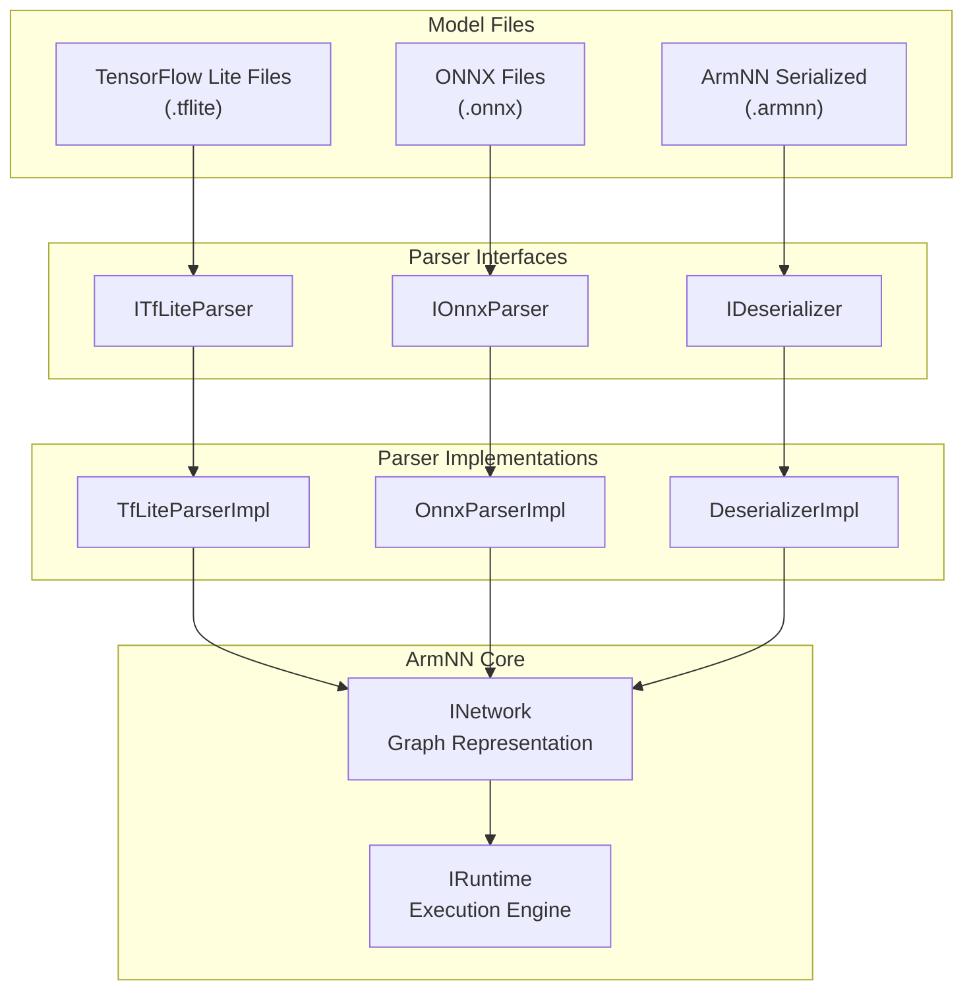
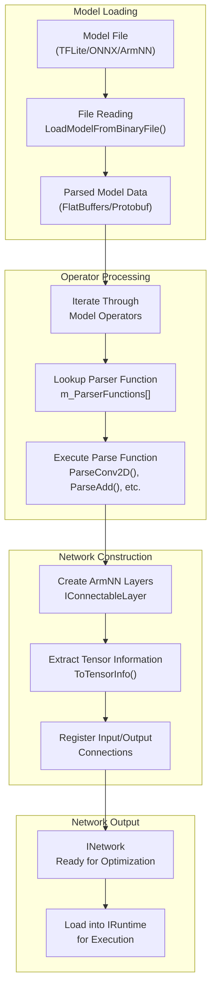

# Model Support

<details>
<summary>Relevant source files</summary>

The following files were used as context for generating this wiki page:

- [CMakeLists.txt](CMakeLists.txt)
- [docs/03_build_guides.dox](docs/03_build_guides.dox)
- [docs/04_contributor.dox](docs/04_contributor.dox)
- [docs/05_01_parsers.dox](docs/05_01_parsers.dox)
- [include/armnnOnnxParser/IOnnxParser.hpp](include/armnnOnnxParser/IOnnxParser.hpp)
- [src/armnn/layers/GatherLayer.cpp](src/armnn/layers/GatherLayer.cpp)
- [src/armnn/layers/GatherLayer.hpp](src/armnn/layers/GatherLayer.hpp)
- [src/armnnOnnxParser/OnnxParser.cpp](src/armnnOnnxParser/OnnxParser.cpp)
- [src/armnnOnnxParser/OnnxParser.hpp](src/armnnOnnxParser/OnnxParser.hpp)
- [src/armnnOnnxParser/test/Clip.cpp](src/armnnOnnxParser/test/Clip.cpp)
- [src/armnnOnnxParser/test/Gather.cpp](src/armnnOnnxParser/test/Gather.cpp)
- [src/armnnOnnxParser/test/GetInputsOutputs.cpp](src/armnnOnnxParser/test/GetInputsOutputs.cpp)
- [src/armnnOnnxParser/test/LoadScopeDynamicTensor.cpp](src/armnnOnnxParser/test/LoadScopeDynamicTensor.cpp)
- [src/armnnOnnxParser/test/OnnxParserTestUtils.cpp](src/armnnOnnxParser/test/OnnxParserTestUtils.cpp)
- [src/armnnOnnxParser/test/OnnxParserTestUtils.hpp](src/armnnOnnxParser/test/OnnxParserTestUtils.hpp)
- [src/armnnOnnxParser/test/Shape.cpp](src/armnnOnnxParser/test/Shape.cpp)
- [src/armnnOnnxParser/test/Unsqueeze.cpp](src/armnnOnnxParser/test/Unsqueeze.cpp)
- [src/armnnTfLiteParser/TfLiteParser.cpp](src/armnnTfLiteParser/TfLiteParser.cpp)
- [src/armnnTfLiteParser/TfLiteParser.hpp](src/armnnTfLiteParser/TfLiteParser.hpp)
- [src/armnnTfLiteParser/test/Activations.cpp](src/armnnTfLiteParser/test/Activations.cpp)
- [src/armnnTfLiteParser/test/ElementWiseUnary.cpp](src/armnnTfLiteParser/test/ElementWiseUnary.cpp)
- [src/armnnTfLiteParser/test/ScatterNd.cpp](src/armnnTfLiteParser/test/ScatterNd.cpp)
- [src/armnnTfLiteParser/test/SpaceToDepth.cpp](src/armnnTfLiteParser/test/SpaceToDepth.cpp)
- [src/armnnTfLiteParser/test/Unsupported.cpp](src/armnnTfLiteParser/test/Unsupported.cpp)

</details>


This document covers ArmNN's model format support system, including the parser architecture and supported model formats. ArmNN provides parsers to import machine learning models from various frameworks into its internal network representation.

For information about building and using specific parsers, see [[1.1-getting-started|Getting Started]]. For details about the network representation that parsers create, see [[2.1-network-and-graph-system|Network and Graph System]].

## Supported Model Formats

ArmNN supports importing models from the following formats:

### TensorFlow Lite (.tflite)
TensorFlow Lite models using FlatBuffers serialization format. Supports a comprehensive set of TFLite operators including quantized models.

### ONNX (.onnx) 
Open Neural Network Exchange protobuf models. **Note: ONNX parser support will be removed in ArmNN 24.08.**

### ArmNN Serialized (.armnn)
ArmNN's native serialization format for optimized networks that have been previously processed.

Sources: [docs/05_01_parsers.dox:23-26](), [CMakeLists.txt:62-64]()

## Parser Architecture Overview

**Parser System Architecture**



The parser system follows a consistent pattern where each format has a public interface and private implementation. All parsers convert external model formats into ArmNN's `INetwork` representation.

Sources: [src/armnnTfLiteParser/TfLiteParser.hpp:26-71](), [include/armnnOnnxParser/IOnnxParser.hpp:23-79](), [CMakeLists.txt:122-145]()

## TensorFlow Lite Parser

### Interface and Implementation

The TensorFlow Lite parser consists of:

- **`ITfLiteParser`** - Public interface for loading TFLite models
- **`TfLiteParserImpl`** - Internal implementation handling FlatBuffers parsing

**Key Methods:**
- `CreateNetworkFromBinaryFile()` - Load from .tflite file
- `CreateNetworkFromBinary()` - Load from memory buffer
- `GetNetworkInputBindingInfo()` - Retrieve input tensor information
- `GetNetworkOutputBindingInfo()` - Retrieve output tensor information
- `GetSubgraphCount()` - Number of subgraphs in model

### Operator Support System

The TfLite parser uses a function pointer mapping system to handle different operators:

```cpp
m_ParserFunctions[tflite::BuiltinOperator_ABS] = &TfLiteParserImpl::ParseAbs;
m_ParserFunctions[tflite::BuiltinOperator_ADD] = &TfLiteParserImpl::ParseAdd;
m_ParserFunctions[tflite::BuiltinOperator_CONV_2D] = &TfLiteParserImpl::ParseConv2D;
```

Each supported operator has a dedicated parsing function that:
1. Extracts operator parameters from FlatBuffers
2. Creates appropriate ArmNN layer descriptors
3. Registers input/output connections
4. Handles quantization parameters

### Supported TensorFlow Lite Operators

The parser supports over 80 TensorFlow Lite operators including:

**Fully Supported:**
- Arithmetic: `ADD`, `MUL`, `SUB`, `DIV`
- Activation: `RELU`, `RELU6`, `TANH`, `LOGISTIC`, `ELU`, `HARD_SWISH`, `GELU`
- Convolution: `CONV_2D`, `CONV_3D`, `DEPTHWISE_CONV_2D`, `TRANSPOSE_CONV`
- Pooling: `AVERAGE_POOL_2D`, `MAX_POOL_2D`
- Shape manipulation: `RESHAPE`, `TRANSPOSE`, `SQUEEZE`, `EXPAND_DIMS`
- Data movement: `GATHER`, `GATHER_ND`, `SCATTER_ND`, `SLICE`, `STRIDED_SLICE`

**Custom Operators:**
- `TFLite_Detection_PostProcess` for object detection models

Sources: [src/armnnTfLiteParser/TfLiteParser.cpp:749-826](), [docs/05_01_parsers.dox:107-222](), [src/armnnTfLiteParser/TfLiteParser.hpp:42-67]()

## ONNX Parser

### Interface and Implementation  

**Note: ONNX parser support will be removed in ArmNN 24.08.**

The ONNX parser consists of:

- **`IOnnxParser`** - Public interface for loading ONNX models  
- **`OnnxParserImpl`** - Internal implementation handling protobuf parsing

**Key Methods:**
- `CreateNetworkFromBinary()` - Load from protobuf binary
- `CreateNetworkFromBinaryFile()` - Load from .onnx file
- `CreateNetworkFromTextFile()` - Load from text protobuf
- `CreateNetworkFromString()` - Load from protobuf string

### Operator Mapping System

The ONNX parser uses a string-based operator mapping:

```cpp
const std::map<std::string, OnnxParserImpl::OperationParsingFunction> m_ParserFunctions = {
    { "BatchNormalization", &OnnxParserImpl::ParseBatchNormalization},
    { "Conv", &OnnxParserImpl::ParseConv },
    { "Add", &OnnxParserImpl::ParseAdd }
};
```

### Supported ONNX Operators

**Fully Supported:**
- Arithmetic: `Add`, `Concat`, `Clip` 
- Convolution: `Conv` (2D only, limited group support)
- Pooling: `AveragePool`, `GlobalAveragePool`, `MaxPool`
- Activation: `Relu`, `LeakyRelu`, `Sigmoid`, `Tanh`
- Shape: `Reshape`, `Flatten`, `Shape`, `Gather`, `Unsqueeze`

**Partially Supported:**
- `BatchNormalization` (inference mode only)
- `Gemm` (limited bias support)

Sources: [src/armnnOnnxParser/OnnxParser.cpp:473-493](), [include/armnnOnnxParser/IOnnxParser.hpp:25-79](), [docs/05_01_parsers.dox:22-101]()

## Model Serialization

ArmNN provides its own serialization format for saving and loading optimized networks:

### Serialization Components
- **`armnnSerializer`** - Converts `INetwork` to binary format
- **`armnnDeserializer`** - Recreates `INetwork` from binary format

This allows saving networks after optimization and loading them directly without re-parsing the original model format.

Sources: [CMakeLists.txt:63-64]()

## Parser Integration Workflow

**Model Import and Network Creation Process**



### Key Processing Steps

1. **Model Loading**: Parse file format (FlatBuffers for TFLite, protobuf for ONNX)
2. **Operator Iteration**: Walk through model operators in topological order  
3. **Function Dispatch**: Use operator type to call appropriate parsing function
4. **Layer Creation**: Convert operator to ArmNN `IConnectableLayer` with descriptors
5. **Connection Registration**: Link layers via `RegisterInputSlots()` and `RegisterOutputSlots()`
6. **Network Assembly**: Create final `INetwork` with all layers connected

### Error Handling

Parsers implement comprehensive validation:
- **Unsupported Operators**: Creates `StandInLayer` for unknown operators
- **Shape Validation**: Verifies tensor shapes match layer requirements  
- **Type Checking**: Ensures data types are compatible
- **Attribute Validation**: Checks operator parameters are within valid ranges

Sources: [src/armnnTfLiteParser/TfLiteParser.cpp:102-113](), [src/armnnOnnxParser/OnnxParser.cpp:91-103](), [src/armnnTfLiteParser/test/Unsupported.cpp:79-228]()

## Related Wiki Pages

- [[3.1-tensorflow-lite-parser|TensorFlow Lite Parser]]
- [[3.2-onnx-parser|ONNX Parser]]
- [[3.3-model-serialization|Model Serialization]]
- [[1.1-getting-started|Getting Started]]
- [[2.1-network-and-graph-system|Network and Graph System]]


## Dynamic Knowledge Links (Code Graph ↔ LLM-Wiki / RAG)

### Linked Architecture & Design Documents

| Document | Match Channel | Score | Shared Code Symbols |
|---|---|---|---|
| [[3.1-tensorflow-lite-parser|3.1 TensorFlow Lite Parser]] | `bm25+entity(9)` | `64.588` | `AsUnsignedVector`, `CheckModel`, `CheckSubgraph`, `GetInputs`, `GetOutputs` |
| [[3.2-onnx-parser|3.2 ONNX Parser]] | `bm25+entity(6)` | `61.161` | `Cleanup`, `ComputeOutputInfo`, `ParseActivation`, `RegisterInputSlots`, `RegisterOutputSlots` |
| [[2.1-network-and-graph-system|2.1 Network and Graph System]] | `bm25+entity(1)` | `42.052` | `CheckSubgraph` |
| [[3.3-model-serialization|3.3 Model Serialization]] | `bm25+entity(2)` | `39.109` | `ParseActivation`, `ToTensorInfo` |
| [[2.3-runtime-and-execution|2.3 Runtime and Execution]] | `bm25` | `34.492` | *(lexical/graph match)* |
| [[5.2-tensorflow-lite-delegate|5.2 TensorFlow Lite Delegate]] | `wikilink:3.2-onnx-parser` | `26.081` | *(lexical/graph match)* |

### High-Centrality Bridge Symbols (CBM Graph)

| Symbol | Kind | Source Location | Fan-In / Fan-Out |
|---|---|---|---|
| `CheckModel` | Function | [src/armnnTfLiteParser/TfLiteParser.cpp:147-184]() | in: `65` / out: `5` |
| `RegisterInputSlots` | Method | [src/armnnTfLiteParser/TfLiteParser.cpp:5636-5668]() | in: `60` / out: `7` |
| `RegisterOutputSlots` | Method | [src/armnnTfLiteParser/TfLiteParser.cpp:5670-5701]() | in: `59` / out: `7` |
| `AsUnsignedVector` | Function | [src/armnnTfLiteParser/TfLiteParser.cpp:385-399]() | in: `61` / out: `3` |
| `GetInputs` | Method | [src/armnnTfLiteParser/TfLiteParser.cpp:5536-5561]() | in: `59` / out: `4` |
| `GetOutputs` | Method | [src/armnnTfLiteParser/TfLiteParser.cpp:5563-5581]() | in: `59` / out: `4` |

Sources: [src/armnnTfLiteParser/TfLiteParser.cpp:147-184](), [src/armnnTfLiteParser/TfLiteParser.cpp:5636-5668](), [src/armnnTfLiteParser/TfLiteParser.cpp:5670-5701](), [src/armnnTfLiteParser/TfLiteParser.cpp:385-399]()

### Cross-Subsystem Coupling

- [[2-core-architecture|2 Core Architecture]] — call/import coupling weight `171.0`
- [[2.1-network-and-graph-system|2.1 Network and Graph System]] — call/import coupling weight `171.0`
- [[1-armnn-overview|1 ArmNN Overview]] — call/import coupling weight `121.0`
- [[3.3-model-serialization|3.3 Model Serialization]] — call/import coupling weight `21.0`
- [[2.3-runtime-and-execution|2.3 Runtime and Execution]] — call/import coupling weight `15.0`
- [[5-tools-and-applications|5 Tools and Applications]] — call/import coupling weight `7.0`
