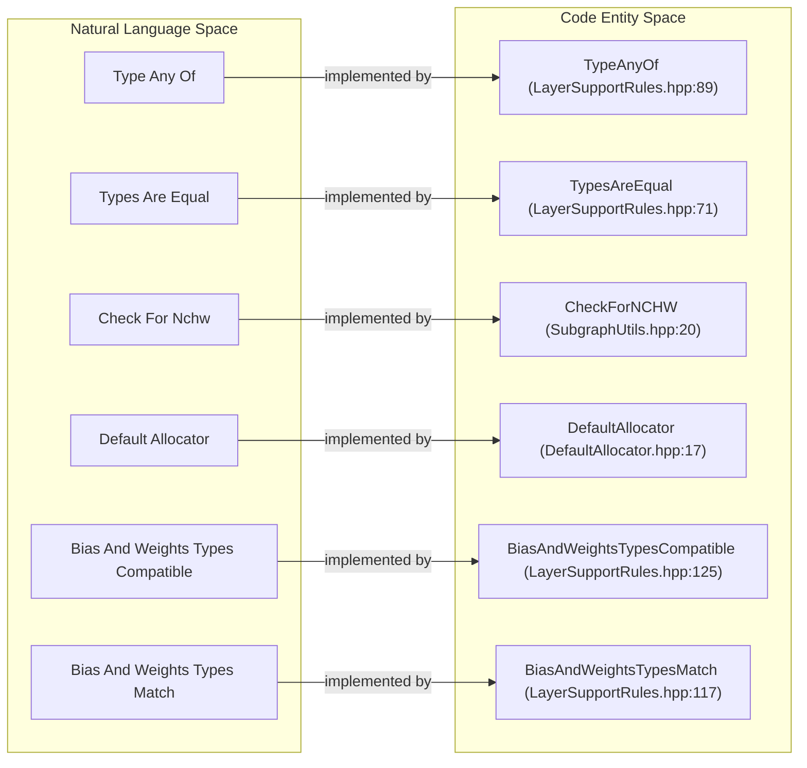
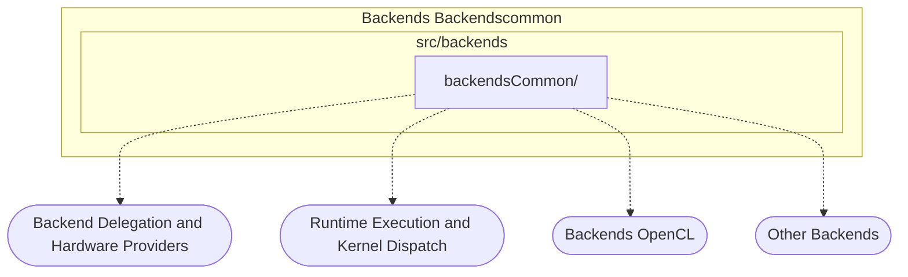
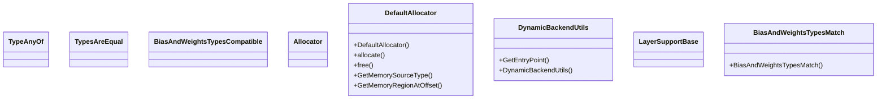
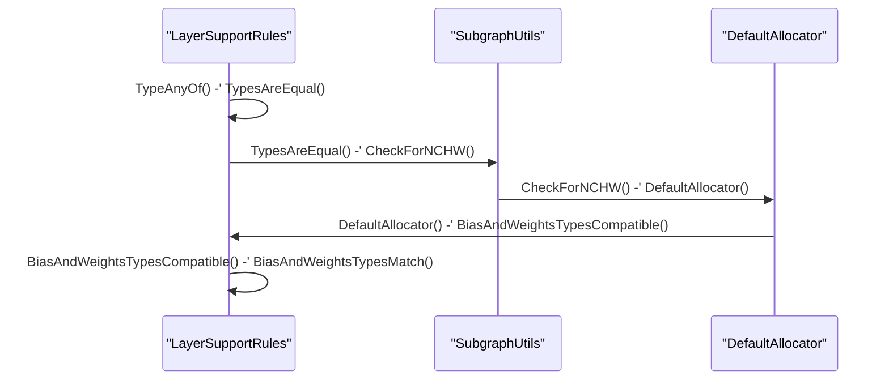

# Backends Backendscommon

↑ [[3-backend-delegation-and-hardware-providers|Backend Delegation and Hardware Providers]]

> Backends Backendscommon subsystem (`backends/backendsCommon`), covering 28 files and 312 symbols. Key symbols include `to_string`, `ValidateInputsOutputs`, `ValidateNumInputs`, `ValidateNumOutputs`.

<details>
<summary>Relevant source files</summary>

The following files were used as context for generating this wiki page:

- [src/backends/backendsCommon/LayerSupportRules.hpp](src/backends/backendsCommon/LayerSupportRules.hpp)
- [src/backends/backendsCommon/DynamicBackendUtils.cpp](src/backends/backendsCommon/DynamicBackendUtils.cpp)
- [src/backends/backendsCommon/TensorHandleFactoryRegistry.cpp](src/backends/backendsCommon/TensorHandleFactoryRegistry.cpp)
- [src/backends/backendsCommon/SubgraphUtils.hpp](src/backends/backendsCommon/SubgraphUtils.hpp)
- [src/backends/backendsCommon/DefaultAllocator.hpp](src/backends/backendsCommon/DefaultAllocator.hpp)
- [src/backends/backendsCommon/LayerSupportBase.cpp](src/backends/backendsCommon/LayerSupportBase.cpp)
- [src/backends/backendsCommon/DynamicBackend.cpp](src/backends/backendsCommon/DynamicBackend.cpp)
- [src/backends/backendsCommon/WorkloadData.cpp](src/backends/backendsCommon/WorkloadData.cpp)
- [src/backends/backendsCommon/WorkloadFactory.cpp](src/backends/backendsCommon/WorkloadFactory.cpp)
- [src/backends/backendsCommon/DynamicBackendUtils.hpp](src/backends/backendsCommon/DynamicBackendUtils.hpp)
- [src/backends/backendsCommon/MakeWorkloadHelper.hpp](src/backends/backendsCommon/MakeWorkloadHelper.hpp)
- [src/backends/backendsCommon/WorkloadUtils.cpp](src/backends/backendsCommon/WorkloadUtils.cpp)
- [src/backends/backendsCommon/LayerSupportBase.hpp](src/backends/backendsCommon/LayerSupportBase.hpp)
- [src/backends/backendsCommon/IBackendInternal.cpp](src/backends/backendsCommon/IBackendInternal.cpp)
- [src/backends/backendsCommon/MapWorkload.hpp](src/backends/backendsCommon/MapWorkload.hpp)
- [src/backends/backendsCommon/TensorHandle.cpp](src/backends/backendsCommon/TensorHandle.cpp)
- [src/backends/backendsCommon/MemImportWorkload.hpp](src/backends/backendsCommon/MemImportWorkload.hpp)
- [src/backends/backendsCommon/MemoryManager.hpp](src/backends/backendsCommon/MemoryManager.hpp)
- [src/backends/backendsCommon/MemSyncWorkload.hpp](src/backends/backendsCommon/MemSyncWorkload.hpp)
- [src/backends/backendsCommon/TensorHandleFactoryRegistry.hpp](src/backends/backendsCommon/TensorHandleFactoryRegistry.hpp)
- [src/backends/backendsCommon/WorkloadDataCollector.hpp](src/backends/backendsCommon/WorkloadDataCollector.hpp)
- [src/backends/backendsCommon/UnmapWorkload.hpp](src/backends/backendsCommon/UnmapWorkload.hpp)
- [src/backends/backendsCommon/WorkloadFactoryBase.hpp](src/backends/backendsCommon/WorkloadFactoryBase.hpp)
- [src/backends/backendsCommon/MemCopyWorkload.cpp](src/backends/backendsCommon/MemCopyWorkload.cpp)
- [src/backends/backendsCommon/MapWorkload.cpp](src/backends/backendsCommon/MapWorkload.cpp)
- [src/backends/backendsCommon/MemImportWorkload.cpp](src/backends/backendsCommon/MemImportWorkload.cpp)
- [src/backends/backendsCommon/MemSyncWorkload.cpp](src/backends/backendsCommon/MemSyncWorkload.cpp)
- [src/backends/backendsCommon/MemoryManager.cpp](src/backends/backendsCommon/MemoryManager.cpp)

</details>

## Purpose and Scope

Backends Backendscommon subsystem (`backends/backendsCommon`), covering 28 files and 312 symbols. Key symbols include `to_string`, `ValidateInputsOutputs`, `ValidateNumInputs`, `ValidateNumOutputs`.

Primary code entities analyzed on this page include `TypeAnyOf` ([src/backends/backendsCommon/LayerSupportRules.hpp:89-99]()), `TypesAreEqual` ([src/backends/backendsCommon/LayerSupportRules.hpp:71-78]()), `CheckForNCHW` ([src/backends/backendsCommon/SubgraphUtils.hpp:20-129]()), `DefaultAllocator` ([src/backends/backendsCommon/DefaultAllocator.hpp:17-43]()), `BiasAndWeightsTypesCompatible` ([src/backends/backendsCommon/LayerSupportRules.hpp:125-135]()).

For the parent architectural layer, see [[3-backend-delegation-and-hardware-providers|Backend Delegation and Hardware Providers]]. Related sibling subsystems: [[3.2-backends-reference|Backends Reference]], [[3.3-backends-opencl|Backends OpenCL]], [[3.4-backends-aclcommon|Backends Aclcommon]], [[3.5-backends-tosacommon|Backends Tosacommon]].

Sources: [src/backends/backendsCommon/LayerSupportRules.hpp:89-99](), [src/backends/backendsCommon/LayerSupportRules.hpp:71-78](), [src/backends/backendsCommon/SubgraphUtils.hpp:20-129](), [src/backends/backendsCommon/DefaultAllocator.hpp:17-43]()

---

## 1. High-Level Architecture and Data Flow

### Natural Language Space to Code Entity Space Mapping

The following diagram maps domain concepts in this subsystem to their concrete code entities:



### Subsystem Component & Dependency Flow



Cross-subsystem call and import edges connect **Backends Backendscommon** with [[5-runtime-execution-and-kernel-dispatch|Runtime Execution and Kernel Dispatch]] (coupling `362.0`), [[3-backend-delegation-and-hardware-providers|Backend Delegation and Hardware Providers]] (coupling `332.0`), [[7-glossary|Glossary]] (coupling `324.0`), [[3.2-backends-reference|Backends Reference]] (coupling `270.0`), [[5.2-armnn|ArmNN]] (coupling `218.0`).

| Module Directory | Files | Primary Code Entities | Source Citations |
|---|---|---|---|
| `src/backends/backendsCommon` | 28 | `TypeAnyOf`, `TypesAreEqual`, `CheckForNCHW`, `DefaultAllocator` | [src/backends/backendsCommon/LayerSupportRules.hpp:89-99]() [src/backends/backendsCommon/LayerSupportRules.hpp:71-78]() |

Sources: [src/backends/backendsCommon/LayerSupportRules.hpp:89-99](), [src/backends/backendsCommon/LayerSupportRules.hpp:71-78](), [src/backends/backendsCommon/SubgraphUtils.hpp:20-129](), [src/backends/backendsCommon/DefaultAllocator.hpp:17-43](), [src/backends/backendsCommon/LayerSupportRules.hpp:125-135]()

---

## 2. Core Data Structures and Implementation Details

### Class and Entity Relationship Diagram



### `TypeAnyOf` (Class)

- **Source Location**: [src/backends/backendsCommon/LayerSupportRules.hpp:89-99]()
- **Declaration**: `Class TypeAnyOf`
- **Graph Centrality**: fan-in `64` callers, fan-out `0` callees

```cpp
// src/backends/backendsCommon/LayerSupportRules.hpp:89-99
struct TypeAnyOf : public Rule
{
    template<typename Container>
    TypeAnyOf(const TensorInfo& info, const Container& c)
    {
        m_Res = std::any_of(c.begin(), c.end(), [&info](DataType dt)
        {
            return dt == info.GetDataType();
        });
    }
};
```

### `TypesAreEqual` (Class)

- **Source Location**: [src/backends/backendsCommon/LayerSupportRules.hpp:71-78]()
- **Declaration**: `Class TypesAreEqual`
- **Graph Centrality**: fan-in `49` callers, fan-out `0` callees

```cpp
// src/backends/backendsCommon/LayerSupportRules.hpp:71-78
struct TypesAreEqual : public Rule
{
    template<typename ... Ts>
    TypesAreEqual(const Ts&... ts)
    {
        m_Res = AllTypesAreEqualImpl(ts...);
    }
};
```

### `CheckForNCHW` (Class)

- **Source Location**: [src/backends/backendsCommon/SubgraphUtils.hpp:20-129]()
- **Declaration**: `Class CheckForNCHW`
- **Graph Centrality**: fan-in `0` callers, fan-out `0` callees
- **Responsibility**: /// Checks if a Layer has a DataLayout that is either NCHW or NCDHW.

```cpp
// src/backends/backendsCommon/SubgraphUtils.hpp:20-35
class CheckForNCHW : public StrategyBase<NoThrowStrategy>
{
public:
    CheckForNCHW()
    {}

    void ExecuteStrategy(const armnn::IConnectableLayer* layer,
                         const armnn::BaseDescriptor& descriptor,
                         const std::vector<armnn::ConstTensor>& constants,
                         const char* name,
                         const armnn::LayerBindingId id = 0) override
    {
        armnn::IgnoreUnused(layer, constants, id, name);
        switch (layer->GetType())
        {
            case armnn::LayerType::BatchMatMul:
```

### `DefaultAllocator` (Class)

- **Source Location**: [src/backends/backendsCommon/DefaultAllocator.hpp:17-43]()
- **Declaration**: `Class DefaultAllocator`
- **Graph Centrality**: fan-in `0` callers, fan-out `0` callees
- **Responsibility**: /** Default Memory Allocator class returned from IBackendInternal::GetDefaultAllocator(MemorySource) */

### `BiasAndWeightsTypesCompatible` (Class)

- **Source Location**: [src/backends/backendsCommon/LayerSupportRules.hpp:125-135]()
- **Declaration**: `Class BiasAndWeightsTypesCompatible`
- **Graph Centrality**: fan-in `1` callers, fan-out `0` callees

### `to_string` (Function)

- **Source Location**: [src/backends/backendsCommon/WorkloadData.cpp:52-58]()
- **Declaration**: `(T value)`
- **Graph Centrality**: fan-in `218` callers, fan-out `1` callees
- **Responsibility**: //--------------------------------------------------------------- //android ndk does not support std::to_string function.

Sources: [src/backends/backendsCommon/LayerSupportRules.hpp:89-99](), [src/backends/backendsCommon/LayerSupportRules.hpp:71-78](), [src/backends/backendsCommon/SubgraphUtils.hpp:20-129](), [src/backends/backendsCommon/DefaultAllocator.hpp:17-43](), [src/backends/backendsCommon/LayerSupportRules.hpp:125-135]()

---

## 3. Execution and Call Flow

The sequence diagram below traces the runtime/compile-time call chain across components in this module:



Sources: [src/backends/backendsCommon/LayerSupportRules.hpp:89-99](), [src/backends/backendsCommon/LayerSupportRules.hpp:71-78](), [src/backends/backendsCommon/SubgraphUtils.hpp:20-129](), [src/backends/backendsCommon/DefaultAllocator.hpp:17-43](), [src/backends/backendsCommon/LayerSupportRules.hpp:125-135]()

---

## 4. Key API and Symbol Reference

| Code Entity | Kind | Location | Fan-In / Out | Role & Signature |
|---|---|---|---|---|
| `TypeAnyOf` | Class | [src/backends/backendsCommon/LayerSupportRules.hpp:89-99]() | `64` / `0` | — |
| `TypesAreEqual` | Class | [src/backends/backendsCommon/LayerSupportRules.hpp:71-78]() | `49` / `0` | — |
| `CheckForNCHW` | Class | [src/backends/backendsCommon/SubgraphUtils.hpp:20-129]() | `0` / `0` | /// Checks if a Layer has a DataLayout that is either NCHW or NCDHW. |
| `DefaultAllocator` | Class | [src/backends/backendsCommon/DefaultAllocator.hpp:17-43]() | `0` / `0` | /** Default Memory Allocator class returned from IBackendInternal::GetDefaultAllocator(MemorySource) */ |
| `BiasAndWeightsTypesCompatible` | Class | [src/backends/backendsCommon/LayerSupportRules.hpp:125-135]() | `1` / `0` | — |
| `BiasAndWeightsTypesMatch` | Class | [src/backends/backendsCommon/LayerSupportRules.hpp:117-123]() | `0` / `0` | — |
| `QuantizationParametersAreEqual` | Class | [src/backends/backendsCommon/LayerSupportRules.hpp:80-87]() | `0` / `0` | — |
| `Rule` | Class | [src/backends/backendsCommon/LayerSupportRules.hpp:47-55]() | `0` / `0` | — |
| `ShapesAreBroadcastCompatible` | Class | [src/backends/backendsCommon/LayerSupportRules.hpp:153-178]() | `0` / `0` | — |
| `ShapesAreSameRank` | Class | [src/backends/backendsCommon/LayerSupportRules.hpp:137-143]() | `0` / `0` | — |
| `ShapesAreSameTotalSize` | Class | [src/backends/backendsCommon/LayerSupportRules.hpp:145-151]() | `0` / `0` | — |
| `TensorNumDimensionsAreCorrect` | Class | [src/backends/backendsCommon/LayerSupportRules.hpp:180-186]() | `0` / `0` | — |
| `TensorNumDimensionsAreGreaterOrEqualTo` | Class | [src/backends/backendsCommon/LayerSupportRules.hpp:188-194]() | `0` / `0` | — |
| `TypeIs` | Class | [src/backends/backendsCommon/LayerSupportRules.hpp:101-107]() | `0` / `0` | — |
| `TypeNotPerAxisQuantized` | Class | [src/backends/backendsCommon/LayerSupportRules.hpp:109-115]() | `0` / `0` | — |
| `IsValidPair` | Class | [src/backends/backendsCommon/SubgraphUtils.hpp:222-222]() | `0` / `0` | — |
| `IsValidPair<Convolution2dLayer, Convolution2dDescriptor>` | Class | [src/backends/backendsCommon/SubgraphUtils.hpp:229-229]() | `0` / `0` | — |
| `IsValidPair<DepthwiseConvolution2dLayer, DepthwiseConvolution2dDescriptor>` | Class | [src/backends/backendsCommon/SubgraphUtils.hpp:232-232]() | `0` / `0` | — |
| `IsValidPair<Pooling2dLayer, Pooling2dDescriptor>` | Class | [src/backends/backendsCommon/SubgraphUtils.hpp:226-226]() | `0` / `0` | — |
| `OpBlockSequencer` | Class | [src/backends/backendsCommon/SubgraphUtils.hpp:552-641]() | `0` / `0` | — |
| `Pair` | Class | [src/backends/backendsCommon/SubgraphUtils.hpp:555-559]() | `0` / `0` | — |
| `DynamicBackendUtils` | Class | [src/backends/backendsCommon/DynamicBackendUtils.hpp:28-59]() | `0` / `0` | — |

Sources: [src/backends/backendsCommon/LayerSupportRules.hpp:89-99](), [src/backends/backendsCommon/LayerSupportRules.hpp:71-78](), [src/backends/backendsCommon/SubgraphUtils.hpp:20-129](), [src/backends/backendsCommon/DefaultAllocator.hpp:17-43](), [src/backends/backendsCommon/LayerSupportRules.hpp:125-135](), [src/backends/backendsCommon/LayerSupportRules.hpp:117-123]()

---

## 5. Official Documentation and Design Context

The following linked documentation sections from `llm-wiki` (`raw/`) provide additional architectural context, tutorials, and design invariants for this subsystem:

- **Backend Delegation and Hardware Providers** ([wiki/3-backend-delegation-and-hardware-providers.md](), score `123.0075`) (sections: `Backend Delegation and Hardware Providers`, `Purpose and Scope`, `System Mapping: Natural Language Space to Code Entity Space`, `1. Backends Backendscommon`): # Backend Delegation and Hardware Providers > Architectural overview of Backend Delegation and Hardware Providers, spanning 150 source files and 2618 code symbols across 6 subsystems. <details> <summary>Relevant source files</summary> The following files were used as context for generating this wiki page: - [src/backends/aclCommon/ArmComputeTensorUtils.hpp](src/backends/aclCommon/ArmComputeTensorUtils.hpp) - [src/bac
- **Glossary** ([wiki/7-glossary.md](), score `69.151`) (sections: `Glossary`, `Purpose and Scope`, `1. Core Compilation, IR & Graph Concepts`, ``compile_string` (Compile String)`): # Glossary > Definitions and technical context for ArmNN domain terms, acronyms, file formats, and core code entities. <details> <summary>Relevant source files</summary> The following files were used as context for generating this wiki page: - [src/armnn/Tensor.cpp](src/armnn/Tensor.cpp) - [include/armnn/Exceptions.hpp](include/armnn/Exceptions.hpp) - [include/armnn/Tensor.hpp](include/armnn/Tensor.hpp) - [third-part
- **05_04_runtimeoptions** ([raw/armnn/05_04_runtimeoptions.dox](), score `50.8716`): /// Copyright (c) 2022 ARM Limited and Contributors. All rights reserved. /// /// SPDX-License-Identifier: MIT /// namespace armnn { /** @page runtimeoptions Runtime options for Arm NN Across all software interfaces to Arm NN there are a set of common configuration parameters. These parameters control how a model is loaded or how the inference is executed. The widest set of options are available at the lowest, Arm NN
- **ArmNN DeepWiki** ([wiki/index.md](), score `50.0648`) (sections: `ArmNN DeepWiki`, `Pages`): # ArmNN DeepWiki Generated from `home-jason-Project-deepwiki-armnn` at commit `2b61cecc9df7` (2026-11-14T15:13:53+00:00). ## Pages - [[1-overview|Overview]] — End-to-end architecture overview of ArmNN: core subsystems, compilation/execution pipeline, entry points, and cross-module dependencies. - [[2-build-system-and-infrastructure|Build System and Infrastructure]] — Architectural overview of Build System and Infrast

Sources: [wiki/3-backend-delegation-and-hardware-providers.md](), [wiki/7-glossary.md](), [raw/armnn/05_04_runtimeoptions.dox](), [wiki/index.md]()

## Related pages

- [[3-backend-delegation-and-hardware-providers|Backend Delegation and Hardware Providers]]
- [[3.2-backends-reference|Backends Reference]]
- [[3.6-other-backends|Other Backends]]
- [[5-runtime-execution-and-kernel-dispatch|Runtime Execution and Kernel Dispatch]]
- [[5.1-armnn|ArmNN]]
- [[5.2-armnn|ArmNN]]
- [[5.6-other-runtime-components|Other Runtime Components]]
- [[7-glossary|Glossary]]

## Related documents

- `wiki/3-backend-delegation-and-hardware-providers.md` — Backend Delegation and Hardware Providers (score 123.0075, via bm25)
- `wiki/7-glossary.md` — Glossary (score 69.151, via bm25)
- `raw/armnn/05_04_runtimeoptions.dox` — 05_04_runtimeoptions (score 50.8716, via bm25)
- `wiki/index.md` — ArmNN DeepWiki (score 50.0648, via bm25)
- `wiki/1-overview.md` — Overview (score 49.8277, via bm25)

## Sources

- [`src/backends/backendsCommon/LayerSupportRules.hpp`](https://github.com/ARM-software/armnn/blob/branches/armnn_24_11/src/backends/backendsCommon/LayerSupportRules.hpp)
- [`src/backends/backendsCommon/DynamicBackendUtils.cpp`](https://github.com/ARM-software/armnn/blob/branches/armnn_24_11/src/backends/backendsCommon/DynamicBackendUtils.cpp)
- [`src/backends/backendsCommon/TensorHandleFactoryRegistry.cpp`](https://github.com/ARM-software/armnn/blob/branches/armnn_24_11/src/backends/backendsCommon/TensorHandleFactoryRegistry.cpp)
- [`src/backends/backendsCommon/SubgraphUtils.hpp`](https://github.com/ARM-software/armnn/blob/branches/armnn_24_11/src/backends/backendsCommon/SubgraphUtils.hpp)
- [`src/backends/backendsCommon/DefaultAllocator.hpp`](https://github.com/ARM-software/armnn/blob/branches/armnn_24_11/src/backends/backendsCommon/DefaultAllocator.hpp)
- [`src/backends/backendsCommon/LayerSupportBase.cpp`](https://github.com/ARM-software/armnn/blob/branches/armnn_24_11/src/backends/backendsCommon/LayerSupportBase.cpp)
- [`src/backends/backendsCommon/DynamicBackend.cpp`](https://github.com/ARM-software/armnn/blob/branches/armnn_24_11/src/backends/backendsCommon/DynamicBackend.cpp)
- [`src/backends/backendsCommon/WorkloadData.cpp`](https://github.com/ARM-software/armnn/blob/branches/armnn_24_11/src/backends/backendsCommon/WorkloadData.cpp)
- [`src/backends/backendsCommon/WorkloadFactory.cpp`](https://github.com/ARM-software/armnn/blob/branches/armnn_24_11/src/backends/backendsCommon/WorkloadFactory.cpp)
- [`src/backends/backendsCommon/DynamicBackendUtils.hpp`](https://github.com/ARM-software/armnn/blob/branches/armnn_24_11/src/backends/backendsCommon/DynamicBackendUtils.hpp)
- [`src/backends/backendsCommon/MakeWorkloadHelper.hpp`](https://github.com/ARM-software/armnn/blob/branches/armnn_24_11/src/backends/backendsCommon/MakeWorkloadHelper.hpp)
- [`src/backends/backendsCommon/WorkloadUtils.cpp`](https://github.com/ARM-software/armnn/blob/branches/armnn_24_11/src/backends/backendsCommon/WorkloadUtils.cpp)
- [`src/backends/backendsCommon/LayerSupportBase.hpp`](https://github.com/ARM-software/armnn/blob/branches/armnn_24_11/src/backends/backendsCommon/LayerSupportBase.hpp)
- [`src/backends/backendsCommon/IBackendInternal.cpp`](https://github.com/ARM-software/armnn/blob/branches/armnn_24_11/src/backends/backendsCommon/IBackendInternal.cpp)
- [`src/backends/backendsCommon/MapWorkload.hpp`](https://github.com/ARM-software/armnn/blob/branches/armnn_24_11/src/backends/backendsCommon/MapWorkload.hpp)
- [`src/backends/backendsCommon/TensorHandle.cpp`](https://github.com/ARM-software/armnn/blob/branches/armnn_24_11/src/backends/backendsCommon/TensorHandle.cpp)
- [`src/backends/backendsCommon/MemImportWorkload.hpp`](https://github.com/ARM-software/armnn/blob/branches/armnn_24_11/src/backends/backendsCommon/MemImportWorkload.hpp)
- [`src/backends/backendsCommon/MemoryManager.hpp`](https://github.com/ARM-software/armnn/blob/branches/armnn_24_11/src/backends/backendsCommon/MemoryManager.hpp)
- [`src/backends/backendsCommon/MemSyncWorkload.hpp`](https://github.com/ARM-software/armnn/blob/branches/armnn_24_11/src/backends/backendsCommon/MemSyncWorkload.hpp)
- [`src/backends/backendsCommon/TensorHandleFactoryRegistry.hpp`](https://github.com/ARM-software/armnn/blob/branches/armnn_24_11/src/backends/backendsCommon/TensorHandleFactoryRegistry.hpp)
- [`src/backends/backendsCommon/WorkloadDataCollector.hpp`](https://github.com/ARM-software/armnn/blob/branches/armnn_24_11/src/backends/backendsCommon/WorkloadDataCollector.hpp)
- [`src/backends/backendsCommon/UnmapWorkload.hpp`](https://github.com/ARM-software/armnn/blob/branches/armnn_24_11/src/backends/backendsCommon/UnmapWorkload.hpp)
- [`src/backends/backendsCommon/WorkloadFactoryBase.hpp`](https://github.com/ARM-software/armnn/blob/branches/armnn_24_11/src/backends/backendsCommon/WorkloadFactoryBase.hpp)
- [`src/backends/backendsCommon/MemCopyWorkload.cpp`](https://github.com/ARM-software/armnn/blob/branches/armnn_24_11/src/backends/backendsCommon/MemCopyWorkload.cpp)
- [`src/backends/backendsCommon/MapWorkload.cpp`](https://github.com/ARM-software/armnn/blob/branches/armnn_24_11/src/backends/backendsCommon/MapWorkload.cpp)
- [`src/backends/backendsCommon/MemImportWorkload.cpp`](https://github.com/ARM-software/armnn/blob/branches/armnn_24_11/src/backends/backendsCommon/MemImportWorkload.cpp)
- [`src/backends/backendsCommon/MemSyncWorkload.cpp`](https://github.com/ARM-software/armnn/blob/branches/armnn_24_11/src/backends/backendsCommon/MemSyncWorkload.cpp)
- [`src/backends/backendsCommon/MemoryManager.cpp`](https://github.com/ARM-software/armnn/blob/branches/armnn_24_11/src/backends/backendsCommon/MemoryManager.cpp)


## Dynamic Knowledge Links (Code Graph ↔ LLM-Wiki / RAG)

### Linked Architecture & Design Documents

| Document | Match Channel | Score | Shared Code Symbols |
|---|---|---|---|
| [[3-backend-delegation-and-hardware-providers|Backend Delegation and Hardware Providers]] | `bm25+entity(6)` | `132.007` | `TypeAnyOf`, `TypesAreEqual`, `ValidateInputsOutputs`, `ValidateNumInputs`, `ValidateNumOutputs` |
| [[3.3-backends-opencl|Backends OpenCL]] | `wikilink:3.1-backends-backendscommon+entity(5)` | `83.699` | `Allocator`, `ValidateInputsOutputs`, `ValidateNumInputs`, `ValidateNumOutputs`, `to_string` |
| [[3.2-backends-reference|Backends Reference]] | `wikilink:3.1-backends-backendscommon` | `76.199` | *(lexical/graph match)* |
| [[3.4-backends-aclcommon|Backends Aclcommon]] | `wikilink:3.1-backends-backendscommon` | `76.199` | *(lexical/graph match)* |
| [[7-glossary|Glossary]] | `bm25+entity(3)` | `73.651` | `BiasAndWeightsTypesCompatible`, `TypeAnyOf`, `TypesAreEqual` |
| [[index|ArmNN DeepWiki]] | `bm25+entity(4)` | `56.065` | `ValidateInputsOutputs`, `ValidateNumInputs`, `ValidateNumOutputs`, `to_string` |

### High-Centrality Bridge Symbols (CBM Graph)

| Symbol | Kind | Source Location | Fan-In / Fan-Out |
|---|---|---|---|
| `TypeAnyOf` | Class | [src/backends/backendsCommon/LayerSupportRules.hpp:89-99]() | in: `64` / out: `0` |
| `TypesAreEqual` | Class | [src/backends/backendsCommon/LayerSupportRules.hpp:71-78]() | in: `49` / out: `0` |
| `CheckForNCHW` | Class | [src/backends/backendsCommon/SubgraphUtils.hpp:20-129]() | in: `0` / out: `0` |
| `DefaultAllocator` | Class | [src/backends/backendsCommon/DefaultAllocator.hpp:17-43]() | in: `0` / out: `0` |
| `BiasAndWeightsTypesCompatible` | Class | [src/backends/backendsCommon/LayerSupportRules.hpp:125-135]() | in: `1` / out: `0` |
| `BiasAndWeightsTypesMatch` | Class | [src/backends/backendsCommon/LayerSupportRules.hpp:117-123]() | in: `0` / out: `0` |

Sources: [src/backends/backendsCommon/LayerSupportRules.hpp:89-99](), [src/backends/backendsCommon/LayerSupportRules.hpp:71-78](), [src/backends/backendsCommon/SubgraphUtils.hpp:20-129](), [src/backends/backendsCommon/DefaultAllocator.hpp:17-43]()

### Cross-Subsystem Coupling

- [[5-runtime-execution-and-kernel-dispatch|Runtime Execution and Kernel Dispatch]] — call/import coupling weight `362.0`
- [[3-backend-delegation-and-hardware-providers|Backend Delegation and Hardware Providers]] — call/import coupling weight `332.0`
- [[7-glossary|Glossary]] — call/import coupling weight `324.0`
- [[3.2-backends-reference|Backends Reference]] — call/import coupling weight `270.0`
- [[5.2-armnn|ArmNN]] — call/import coupling weight `218.0`
- [[5.1-armnn|ArmNN]] — call/import coupling weight `137.0`
