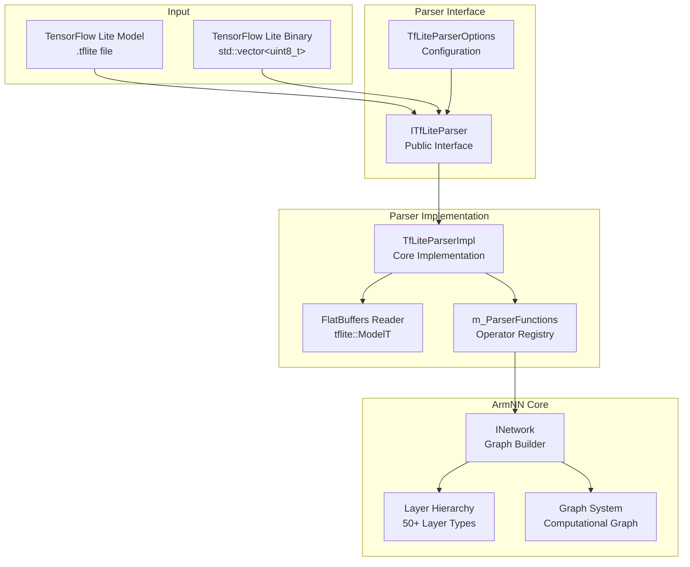
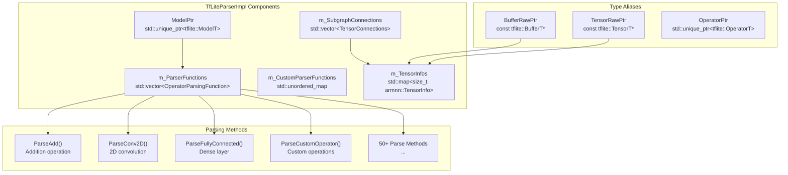
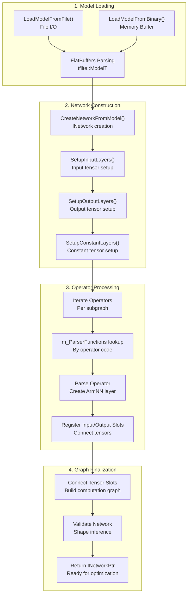
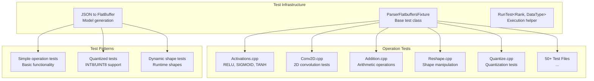

# TensorFlow Lite Parser

<details>
<summary>Relevant source files</summary>

The following files were used as context for generating this wiki page:

- [CMakeLists.txt](CMakeLists.txt)
- [docs/03_build_guides.dox](docs/03_build_guides.dox)
- [docs/04_contributor.dox](docs/04_contributor.dox)
- [docs/05_01_parsers.dox](docs/05_01_parsers.dox)
- [include/armnnTfLiteParser/ITfLiteParser.hpp](include/armnnTfLiteParser/ITfLiteParser.hpp)
- [profiling/server/src/basePipeServer/ConnectionHandler.cpp](profiling/server/src/basePipeServer/ConnectionHandler.cpp)
- [src/armnnTfLiteParser/TfLiteParser.cpp](src/armnnTfLiteParser/TfLiteParser.cpp)
- [src/armnnTfLiteParser/TfLiteParser.hpp](src/armnnTfLiteParser/TfLiteParser.hpp)
- [src/armnnTfLiteParser/test/Activations.cpp](src/armnnTfLiteParser/test/Activations.cpp)
- [src/armnnTfLiteParser/test/ElementWiseUnary.cpp](src/armnnTfLiteParser/test/ElementWiseUnary.cpp)
- [src/armnnTfLiteParser/test/ScatterNd.cpp](src/armnnTfLiteParser/test/ScatterNd.cpp)
- [src/armnnTfLiteParser/test/SpaceToDepth.cpp](src/armnnTfLiteParser/test/SpaceToDepth.cpp)
- [src/armnnTfLiteParser/test/StridedSlice.cpp](src/armnnTfLiteParser/test/StridedSlice.cpp)

</details>


The TensorFlow Lite Parser (`armnnTfLiteParser`) is a library component that loads neural networks defined in TensorFlow Lite FlatBuffers files into the ArmNN runtime. It converts TensorFlow Lite models into ArmNN's internal network representation, enabling execution on ArmNN's various compute backends.

This document covers the parser's architecture, supported operations, and usage patterns. For information about executing TensorFlow Lite models using the delegate approach, see [[5.2-tensorflow-lite-delegate|TensorFlow Lite Delegate]]. For details about ArmNN's core network and graph system, see [[2.1-network-and-graph-system|Network and Graph System]].

## Architecture Overview

The TensorFlow Lite Parser follows a two-layer architecture with a public interface and internal implementation:

### Parser Architecture Flow


Sources: [src/armnnTfLiteParser/TfLiteParser.hpp:26-344](), [include/armnnTfLiteParser/ITfLiteParser.hpp:26-77]()

## Key Components

### ITfLiteParser Interface

The `ITfLiteParser` class provides the public API for parsing TensorFlow Lite models:

| Method | Purpose |
|--------|---------|
| `CreateNetworkFromBinaryFile` | Load model from `.tflite` file |
| `CreateNetworkFromBinary` | Load model from memory buffer |
| `GetNetworkInputBindingInfo` | Retrieve input tensor information |
| `GetNetworkOutputBindingInfo` | Retrieve output tensor information |
| `GetSubgraphCount` | Get number of subgraphs in model |
| `GetSubgraphInputTensorNames` | Get input tensor names for subgraph |
| `GetSubgraphOutputTensorNames` | Get output tensor names for subgraph |

The parser supports configuration through `TfLiteParserOptions`:

```cpp
struct TfLiteParserOptions {
    bool m_AllowExpandedDims;          // Handle dimension expansion
    bool m_StandInLayerForUnsupported; // Insert placeholder layers
    bool m_InferAndValidate;           // Enable shape inference
};
```

Sources: [include/armnnTfLiteParser/ITfLiteParser.hpp:26-77]()

### TfLiteParserImpl Core Implementation

The `TfLiteParserImpl` class handles the actual parsing logic:

### Parser Implementation Structure


Sources: [src/armnnTfLiteParser/TfLiteParser.hpp:26-344](), [src/armnnTfLiteParser/TfLiteParser.cpp:744-748]()

## Parser Workflow

The parsing process follows these main stages:

### Parsing Pipeline


Sources: [src/armnnTfLiteParser/TfLiteParser.cpp:1034-1110](), [src/armnnTfLiteParser/TfLiteParser.cpp:747-820]()

## Supported Operations

The parser supports over 50 TensorFlow Lite operations through dedicated parsing methods:

### Core Operations
| Category | Operations |
|----------|------------|
| **Arithmetic** | `ADD`, `SUB`, `MUL`, `DIV`, `POW` |
| **Activation** | `RELU`, `RELU6`, `SIGMOID` (`LOGISTIC`), `TANH`, `ELU`, `GELU`, `HARD_SWISH` |
| **Convolution** | `CONV_2D`, `CONV_3D`, `DEPTHWISE_CONV_2D`, `TRANSPOSE_CONV` |
| **Pooling** | `AVERAGE_POOL_2D`, `MAX_POOL_2D` |
| **Reshape** | `RESHAPE`, `SQUEEZE`, `EXPAND_DIMS`, `TRANSPOSE` |
| **Reduction** | `MEAN`, `SUM`, `REDUCE_MAX`, `REDUCE_MIN`, `REDUCE_PROD` |

### Specialized Operations
| Category | Operations |
|----------|------------|
| **Quantization** | `QUANTIZE`, `DEQUANTIZE`, `CAST` |
| **Comparison** | `EQUAL`, `NOT_EQUAL`, `GREATER`, `GREATER_EQUAL`, `LESS`, `LESS_EQUAL` |
| **Logical** | `LOGICAL_NOT` |
| **Data Movement** | `GATHER`, `GATHER_ND`, `SCATTER_ND`, `PACK`, `UNPACK`, `SPLIT`, `SPLIT_V` |
| **Spatial** | `SPACE_TO_BATCH_ND`, `BATCH_TO_SPACE_ND`, `SPACE_TO_DEPTH`, `DEPTH_TO_SPACE` |

### Parser Function Registration
The parser maintains a function table mapping TensorFlow Lite operator codes to parsing functions:

```cpp
// From TfLiteParser.cpp initialization
m_ParserFunctions[tflite::BuiltinOperator_ADD] = &TfLiteParserImpl::ParseAdd;
m_ParserFunctions[tflite::BuiltinOperator_CONV_2D] = &TfLiteParserImpl::ParseConv2D;
m_ParserFunctions[tflite::BuiltinOperator_FULLY_CONNECTED] = &TfLiteParserImpl::ParseFullyConnected;
```

Sources: [src/armnnTfLiteParser/TfLiteParser.cpp:750-820](), [docs/05_01_parsers.dox:107-221]()

## Usage Examples

### Basic Model Loading

```cpp
#include "armnnTfLiteParser/ITfLiteParser.hpp"

// Create parser with options
armnnTfLiteParser::ITfLiteParser::TfLiteParserOptions options;
options.m_InferAndValidate = true;
auto parser = armnnTfLiteParser::ITfLiteParser::Create(options);

// Load model from file
armnn::INetworkPtr network = parser->CreateNetworkFromBinaryFile("model.tflite");

// Get input/output information
size_t subgraphId = 0;
auto inputBinding = parser->GetNetworkInputBindingInfo(subgraphId, "input");
auto outputBinding = parser->GetNetworkOutputBindingInfo(subgraphId, "output");
```

### Memory-based Loading

```cpp
// Load model from memory buffer
std::vector<uint8_t> modelData = LoadModelData();
armnn::INetworkPtr network = parser->CreateNetworkFromBinary(modelData);

// Query subgraph information
size_t numSubgraphs = parser->GetSubgraphCount();
auto inputNames = parser->GetSubgraphInputTensorNames(0);
auto outputNames = parser->GetSubgraphOutputTensorNames(0);
```

Sources: [src/armnnTfLiteParser/TfLiteParser.cpp:77-112]()

## Tensor and Data Type Support

The parser handles TensorFlow Lite's type system and converts it to ArmNN's type system:

### Data Type Mapping
| TensorFlow Lite Type | ArmNN DataType | Notes |
|---------------------|----------------|--------|
| `FLOAT32` | `Float32` | 32-bit floating point |
| `FLOAT16` | `Float16` | 16-bit floating point |
| `UINT8` | `QAsymmU8` | Unsigned 8-bit quantized |
| `INT8` | `QAsymmS8` / `QSymmS8` | Signed 8-bit quantized |
| `INT16` | `QSymmS16` | Signed 16-bit quantized |
| `INT32` | `Signed32` | 32-bit signed integer |
| `INT64` | `Signed64` | 64-bit signed integer |
| `BOOL` | `Boolean` | Boolean values |

### Quantization Support
The parser handles both per-tensor and per-channel quantization:

- **Per-tensor**: Single scale and zero-point for entire tensor
- **Per-channel**: Multiple scales for different channels (weights)
- **Dynamic tensors**: Support for runtime shape determination

Sources: [src/armnnTfLiteParser/TfLiteParser.cpp:432-598]()

## Testing Framework

The parser includes comprehensive tests for each supported operation:

### Test Structure


Each test file follows a consistent pattern:
1. **Fixture Definition**: JSON model definition using TensorFlow Lite schema
2. **Test Execution**: `RunTest` with input/expected output data
3. **Validation**: Automatic comparison of actual vs expected results

Sources: [src/armnnTfLiteParser/test/Activations.cpp:10-145](), [src/armnnTfLiteParser/test/ElementWiseUnary.cpp:9-194](), [CMakeLists.txt:680-765]()

## Custom Operations

The parser supports custom TensorFlow Lite operations through the `ParseCustomOperator` method:

- **Detection PostProcess**: Custom operation for object detection models
- **Extensible Framework**: Add support for additional custom operations
- **FlexBuffers**: Handle custom operation parameters

Custom operations are registered in `m_CustomParserFunctions` map for specialized parsing logic.

Sources: [src/armnnTfLiteParser/TfLiteParser.cpp:766](), [docs/05_01_parsers.dox:202-204]()

## Related Wiki Pages

- [[3-model-support|Model Support]]
- [[5.2-tensorflow-lite-delegate|TensorFlow Lite Delegate]]
- [[2.1-network-and-graph-system|Network and Graph System]]


## Dynamic Knowledge Links (Code Graph ↔ LLM-Wiki / RAG)

### Linked Architecture & Design Documents

| Document | Match Channel | Score | Shared Code Symbols |
|---|---|---|---|
| [[3-model-support|3 Model Support]] | `bm25+entity(9)` | `68.514` | `AsUnsignedVector`, `CheckModel`, `CheckSubgraph`, `GetInputs`, `GetOutputs` |
| [[3.2-onnx-parser|3.2 ONNX Parser]] | `bm25+entity(4)` | `60.543` | `ParseActivation`, `RegisterInputSlots`, `RegisterOutputSlots`, `ToTensorInfo` |
| [[2.1-network-and-graph-system|2.1 Network and Graph System]] | `bm25+entity(1)` | `47.991` | `CheckSubgraph` |
| [[3.3-model-serialization|3.3 Model Serialization]] | `bm25+entity(2)` | `47.873` | `ParseActivation`, `ToTensorInfo` |
| [[2.3-runtime-and-execution|2.3 Runtime and Execution]] | `bm25` | `41.444` | *(lexical/graph match)* |
| [[5.2-tensorflow-lite-delegate|5.2 TensorFlow Lite Delegate]] | `wikilink:3.1-tensorflow-lite-parser` | `30.476` | *(lexical/graph match)* |

### High-Centrality Bridge Symbols (CBM Graph)

| Symbol | Kind | Source Location | Fan-In / Fan-Out |
|---|---|---|---|
| `CheckModel` | Function | [src/armnnTfLiteParser/TfLiteParser.cpp:147-184]() | in: `65` / out: `5` |
| `RegisterInputSlots` | Method | [src/armnnTfLiteParser/TfLiteParser.cpp:5636-5668]() | in: `60` / out: `7` |
| `RegisterOutputSlots` | Method | [src/armnnTfLiteParser/TfLiteParser.cpp:5670-5701]() | in: `59` / out: `7` |
| `AsUnsignedVector` | Function | [src/armnnTfLiteParser/TfLiteParser.cpp:385-399]() | in: `61` / out: `3` |
| `GetInputs` | Method | [src/armnnTfLiteParser/TfLiteParser.cpp:5536-5561]() | in: `59` / out: `4` |
| `GetOutputs` | Method | [src/armnnTfLiteParser/TfLiteParser.cpp:5563-5581]() | in: `59` / out: `4` |

Sources: [src/armnnTfLiteParser/TfLiteParser.cpp:147-184](), [src/armnnTfLiteParser/TfLiteParser.cpp:5636-5668](), [src/armnnTfLiteParser/TfLiteParser.cpp:5670-5701](), [src/armnnTfLiteParser/TfLiteParser.cpp:385-399]()

### Cross-Subsystem Coupling

- [[2-core-architecture|2 Core Architecture]] — call/import coupling weight `112.0`
- [[2.1-network-and-graph-system|2.1 Network and Graph System]] — call/import coupling weight `112.0`
- [[1-armnn-overview|1 ArmNN Overview]] — call/import coupling weight `92.0`
- [[2.3-runtime-and-execution|2.3 Runtime and Execution]] — call/import coupling weight `14.0`
- [[3.3-model-serialization|3.3 Model Serialization]] — call/import coupling weight `7.0`
- [[5-tools-and-applications|5 Tools and Applications]] — call/import coupling weight `4.0`
