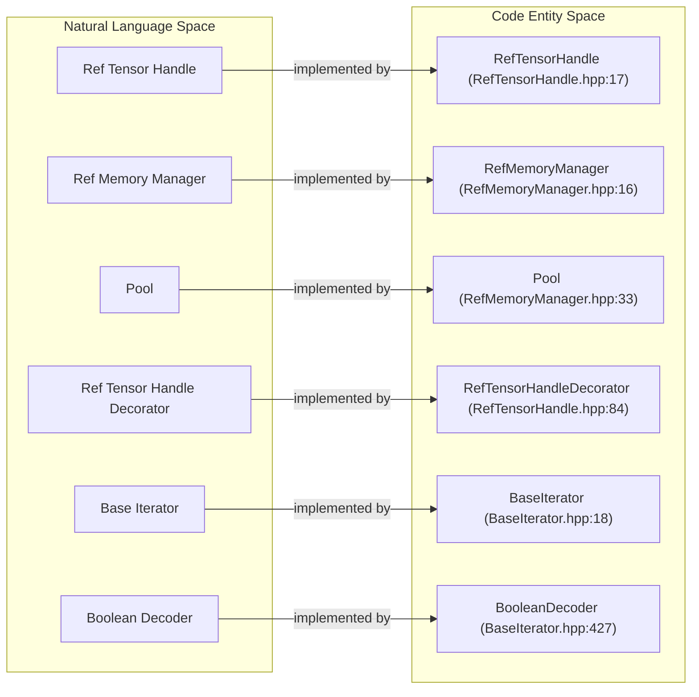
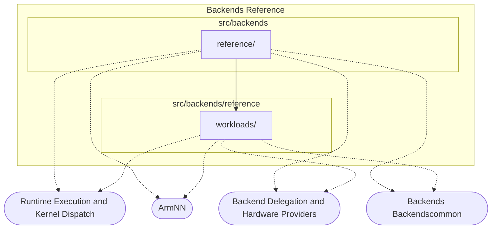
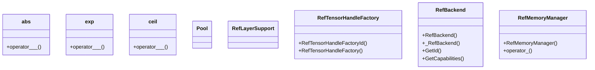
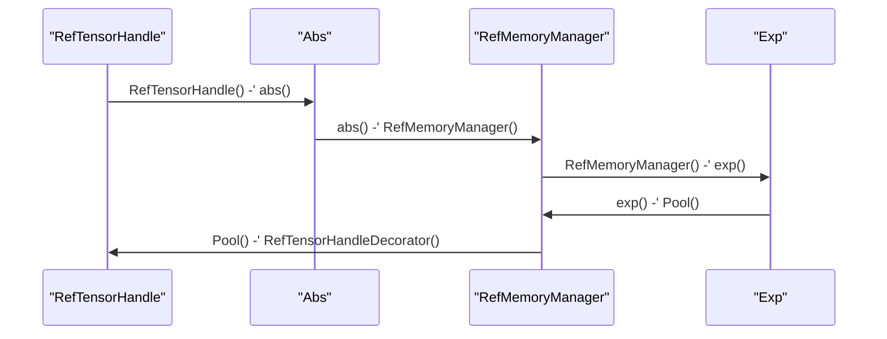

# Backends Reference

↑ [[3-backend-delegation-and-hardware-providers|Backend Delegation and Hardware Providers]]

> Backends Reference subsystem (`backends/reference`), covering 28 files and 634 symbols. Key symbols include `GetNumDimensions`, `GetTensorInfo`, `MakeDecoder`, `MakeEncoder`.

<details>
<summary>Relevant source files</summary>

The following files were used as context for generating this wiki page:

- [src/backends/reference/workloads/BaseIterator.hpp](src/backends/reference/workloads/BaseIterator.hpp)
- [src/backends/reference/RefTensorHandle.hpp](src/backends/reference/RefTensorHandle.hpp)
- [src/backends/reference/workloads/Broadcast.hpp](src/backends/reference/workloads/Broadcast.hpp)
- [src/backends/reference/RefLayerSupport.cpp](src/backends/reference/RefLayerSupport.cpp)
- [src/backends/reference/RefWorkloadFactory.cpp](src/backends/reference/RefWorkloadFactory.cpp)
- [src/backends/reference/RefBackend.hpp](src/backends/reference/RefBackend.hpp)
- [src/backends/reference/RefMemoryManager.hpp](src/backends/reference/RefMemoryManager.hpp)
- [src/backends/reference/RefBackend.cpp](src/backends/reference/RefBackend.cpp)
- [src/backends/reference/RefLayerSupport.hpp](src/backends/reference/RefLayerSupport.hpp)
- [src/backends/reference/RefTensorHandle.cpp](src/backends/reference/RefTensorHandle.cpp)
- [src/backends/reference/RefTensorHandleFactory.hpp](src/backends/reference/RefTensorHandleFactory.hpp)
- [src/backends/reference/workloads/BatchMatMulImpl.cpp](src/backends/reference/workloads/BatchMatMulImpl.cpp)
- [src/backends/reference/workloads/Abs.hpp](src/backends/reference/workloads/Abs.hpp)
- [src/backends/reference/workloads/Decoders.hpp](src/backends/reference/workloads/Decoders.hpp)
- [src/backends/reference/RefMemoryManager.cpp](src/backends/reference/RefMemoryManager.cpp)
- [src/backends/reference/RefBackendId.hpp](src/backends/reference/RefBackendId.hpp)
- [src/backends/reference/RefTensorHandleFactory.cpp](src/backends/reference/RefTensorHandleFactory.cpp)
- [src/backends/reference/workloads/BatchMatMulImpl.hpp](src/backends/reference/workloads/BatchMatMulImpl.hpp)
- [src/backends/reference/workloads/Ceil.hpp](src/backends/reference/workloads/Ceil.hpp)
- [src/backends/reference/workloads/Encoders.hpp](src/backends/reference/workloads/Encoders.hpp)
- [src/backends/reference/workloads/RefWorkloadUtils.hpp](src/backends/reference/workloads/RefWorkloadUtils.hpp)
- [src/backends/reference/RefWorkloadFactory.hpp](src/backends/reference/RefWorkloadFactory.hpp)
- [src/backends/reference/workloads/LstmUtils.cpp](src/backends/reference/workloads/LstmUtils.cpp)
- [src/backends/reference/workloads/ConvImpl.hpp](src/backends/reference/workloads/ConvImpl.hpp)
- [src/backends/reference/workloads/Exp.hpp](src/backends/reference/workloads/Exp.hpp)
- [src/backends/reference/workloads/Activation.cpp](src/backends/reference/workloads/Activation.cpp)
- [src/backends/reference/workloads/ArgMinMax.cpp](src/backends/reference/workloads/ArgMinMax.cpp)
- [src/backends/reference/workloads/BatchToSpaceNd.cpp](src/backends/reference/workloads/BatchToSpaceNd.cpp)

</details>

## Purpose and Scope

Backends Reference subsystem (`backends/reference`), covering 28 files and 634 symbols. Key symbols include `GetNumDimensions`, `GetTensorInfo`, `MakeDecoder`, `MakeEncoder`.

Primary code entities analyzed on this page include `RefTensorHandle` ([src/backends/reference/RefTensorHandle.hpp:17-82]()), `abs` ([src/backends/reference/workloads/Abs.hpp:13-23]()), `RefMemoryManager` ([src/backends/reference/RefMemoryManager.hpp:16-57]()), `exp` ([src/backends/reference/workloads/Exp.hpp:13-23]()), `Pool` ([src/backends/reference/RefMemoryManager.hpp:33-49]()).

For the parent architectural layer, see [[3-backend-delegation-and-hardware-providers|Backend Delegation and Hardware Providers]]. Related sibling subsystems: [[3.1-backends-backendscommon|Backends Backendscommon]], [[3.3-backends-opencl|Backends OpenCL]], [[3.4-backends-aclcommon|Backends Aclcommon]], [[3.5-backends-tosacommon|Backends Tosacommon]].

Sources: [src/backends/reference/RefTensorHandle.hpp:17-82](), [src/backends/reference/workloads/Abs.hpp:13-23](), [src/backends/reference/RefMemoryManager.hpp:16-57](), [src/backends/reference/workloads/Exp.hpp:13-23]()

---

## 1. High-Level Architecture and Data Flow

### Natural Language Space to Code Entity Space Mapping

The following diagram maps domain concepts in this subsystem to their concrete code entities:



### Subsystem Component & Dependency Flow



Cross-subsystem call and import edges connect **Backends Reference** with [[7-glossary|Glossary]] (coupling `328.0`), [[3.1-backends-backendscommon|Backends Backendscommon]] (coupling `270.0`), [[3-backend-delegation-and-hardware-providers|Backend Delegation and Hardware Providers]] (coupling `244.0`), [[5-runtime-execution-and-kernel-dispatch|Runtime Execution and Kernel Dispatch]] (coupling `215.0`), [[5.2-armnn|ArmNN]] (coupling `118.0`).

| Module Directory | Files | Primary Code Entities | Source Citations |
|---|---|---|---|
| `src/backends/reference/workloads` | 15 | `abs`, `exp`, `BaseIterator`, `BooleanDecoder` | [src/backends/reference/workloads/Abs.hpp:13-23]() [src/backends/reference/workloads/Exp.hpp:13-23]() |
| `src/backends/reference` | 13 | `RefTensorHandle`, `RefMemoryManager`, `Pool`, `RefTensorHandleDecorator` | [src/backends/reference/RefTensorHandle.hpp:17-82]() [src/backends/reference/RefMemoryManager.hpp:16-57]() |

Sources: [src/backends/reference/RefTensorHandle.hpp:17-82](), [src/backends/reference/workloads/Abs.hpp:13-23](), [src/backends/reference/RefMemoryManager.hpp:16-57](), [src/backends/reference/workloads/Exp.hpp:13-23](), [src/backends/reference/RefMemoryManager.hpp:33-49]()

---

## 2. Core Data Structures and Implementation Details

### Class and Entity Relationship Diagram



### `RefTensorHandle` (Class)

- **Source Location**: [src/backends/reference/RefTensorHandle.hpp:17-82]()
- **Declaration**: `Class RefTensorHandle`
- **Graph Centrality**: fan-in `0` callers, fan-out `0` callees
- **Responsibility**: // An implementation of ITensorHandle with simple "bump the pointer" memory-management behaviour

```cpp
// src/backends/reference/RefTensorHandle.hpp:17-32
class RefTensorHandle : public ITensorHandle
{
public:
    RefTensorHandle(const TensorInfo& tensorInfo, std::shared_ptr<RefMemoryManager>& memoryManager);

    RefTensorHandle(const TensorInfo& tensorInfo);

    RefTensorHandle(const TensorInfo& tensorInfo, const RefTensorHandle& parent);

    ~RefTensorHandle();

    virtual void Manage() override;

    virtual void Allocate() override;

    virtual ITensorHandle* GetParent() const override
```

### `abs` (Class)

- **Source Location**: [src/backends/reference/workloads/Abs.hpp:13-23]()
- **Declaration**: `Class abs`
- **Graph Centrality**: fan-in `8` callers, fan-out `0` callees

```cpp
// src/backends/reference/workloads/Abs.hpp:13-23
struct abs
    {
        typedef T result_type;
        typedef T argument_type;

        T
        operator () (const T&  inputData) const
        {
            return std::abs(inputData);
        }
    };
```

### `RefMemoryManager` (Class)

- **Source Location**: [src/backends/reference/RefMemoryManager.hpp:16-57]()
- **Declaration**: `Class RefMemoryManager`
- **Graph Centrality**: fan-in `0` callers, fan-out `0` callees
- **Responsibility**: // An implementation of IMemoryManager to be used with RefTensorHandle

```cpp
// src/backends/reference/RefMemoryManager.hpp:16-31
class RefMemoryManager : public IMemoryManager
{
public:
    RefMemoryManager();
    virtual ~RefMemoryManager();

    class Pool;

    Pool* Manage(unsigned int numBytes);

    void Allocate(Pool *pool);

    void* GetPointer(Pool *pool);

    void Acquire() override;
    void Release() override;
```

### `exp` (Class)

- **Source Location**: [src/backends/reference/workloads/Exp.hpp:13-23]()
- **Declaration**: `Class exp`
- **Graph Centrality**: fan-in `8` callers, fan-out `0` callees

### `Pool` (Class)

- **Source Location**: [src/backends/reference/RefMemoryManager.hpp:33-49]()
- **Declaration**: `Class Pool`
- **Graph Centrality**: fan-in `2` callers, fan-out `0` callees

### `GetNumDimensions` (Method)

- **Source Location**: [src/backends/reference/workloads/Broadcast.hpp:20-23]()
- **Declaration**: `()`
- **Graph Centrality**: fan-in `82` callers, fan-out `1` callees

Sources: [src/backends/reference/RefTensorHandle.hpp:17-82](), [src/backends/reference/workloads/Abs.hpp:13-23](), [src/backends/reference/RefMemoryManager.hpp:16-57](), [src/backends/reference/workloads/Exp.hpp:13-23](), [src/backends/reference/RefMemoryManager.hpp:33-49]()

---

## 3. Execution and Call Flow

The sequence diagram below traces the runtime/compile-time call chain across components in this module:



Sources: [src/backends/reference/RefTensorHandle.hpp:17-82](), [src/backends/reference/workloads/Abs.hpp:13-23](), [src/backends/reference/RefMemoryManager.hpp:16-57](), [src/backends/reference/workloads/Exp.hpp:13-23](), [src/backends/reference/RefMemoryManager.hpp:33-49]()

---

## 4. Key API and Symbol Reference

| Code Entity | Kind | Location | Fan-In / Out | Role & Signature |
|---|---|---|---|---|
| `RefTensorHandle` | Class | [src/backends/reference/RefTensorHandle.hpp:17-82]() | `0` / `0` | // An implementation of ITensorHandle with simple "bump the pointer" memory-management behaviour |
| `abs` | Class | [src/backends/reference/workloads/Abs.hpp:13-23]() | `8` / `0` | — |
| `RefMemoryManager` | Class | [src/backends/reference/RefMemoryManager.hpp:16-57]() | `0` / `0` | // An implementation of IMemoryManager to be used with RefTensorHandle |
| `exp` | Class | [src/backends/reference/workloads/Exp.hpp:13-23]() | `8` / `0` | — |
| `Pool` | Class | [src/backends/reference/RefMemoryManager.hpp:33-49]() | `2` / `0` | — |
| `RefTensorHandleDecorator` | Class | [src/backends/reference/RefTensorHandle.hpp:84-156]() | `0` / `0` | — |
| `BaseIterator` | Class | [src/backends/reference/workloads/BaseIterator.hpp:18-32]() | `0` / `0` | — |
| `BooleanDecoder` | Class | [src/backends/reference/workloads/BaseIterator.hpp:427-454]() | `0` / `0` | — |
| `BooleanDecoderBool` | Class | [src/backends/reference/workloads/BaseIterator.hpp:456-484]() | `0` / `0` | — |
| `BooleanEncoder` | Class | [src/backends/reference/workloads/BaseIterator.hpp:684-702]() | `0` / `0` | — |
| `Decoder` | Class | [src/backends/reference/workloads/BaseIterator.hpp:35-47]() | `0` / `0` | — |
| `Encoder` | Class | [src/backends/reference/workloads/BaseIterator.hpp:50-62]() | `0` / `0` | — |
| `Float16Decoder` | Class | [src/backends/reference/workloads/BaseIterator.hpp:247-280]() | `0` / `0` | — |
| `Float16Encoder` | Class | [src/backends/reference/workloads/BaseIterator.hpp:582-602]() | `0` / `0` | — |
| `Float32Decoder` | Class | [src/backends/reference/workloads/BaseIterator.hpp:282-305]() | `0` / `0` | — |
| `Float32Encoder` | Class | [src/backends/reference/workloads/BaseIterator.hpp:604-622]() | `0` / `0` | — |
| `Int32Decoder` | Class | [src/backends/reference/workloads/BaseIterator.hpp:340-367]() | `0` / `0` | — |
| `Int32Encoder` | Class | [src/backends/reference/workloads/BaseIterator.hpp:624-642]() | `0` / `0` | — |
| `Int32ToInt32tDecoder` | Class | [src/backends/reference/workloads/BaseIterator.hpp:369-396]() | `0` / `0` | — |
| `Int32ToInt32tEncoder` | Class | [src/backends/reference/workloads/BaseIterator.hpp:644-662]() | `0` / `0` | — |
| `Int64Decoder` | Class | [src/backends/reference/workloads/BaseIterator.hpp:398-425]() | `0` / `0` | — |
| `Int64Encoder` | Class | [src/backends/reference/workloads/BaseIterator.hpp:664-682]() | `0` / `0` | — |

Sources: [src/backends/reference/RefTensorHandle.hpp:17-82](), [src/backends/reference/workloads/Abs.hpp:13-23](), [src/backends/reference/RefMemoryManager.hpp:16-57](), [src/backends/reference/workloads/Exp.hpp:13-23](), [src/backends/reference/RefMemoryManager.hpp:33-49](), [src/backends/reference/RefTensorHandle.hpp:84-156]()

---

## 5. Official Documentation and Design Context

The following linked documentation sections from `llm-wiki` (`raw/`) provide additional architectural context, tutorials, and design invariants for this subsystem:

- **Backend Delegation and Hardware Providers** ([wiki/3-backend-delegation-and-hardware-providers.md](), score `80.6626`) (sections: `Backend Delegation and Hardware Providers`, `Purpose and Scope`, `System Mapping: Natural Language Space to Code Entity Space`, `1. Backends Backendscommon`): # Backend Delegation and Hardware Providers > Architectural overview of Backend Delegation and Hardware Providers, spanning 150 source files and 2618 code symbols across 6 subsystems. <details> <summary>Relevant source files</summary> The following files were used as context for generating this wiki page: - [src/backends/aclCommon/ArmComputeTensorUtils.hpp](src/backends/aclCommon/ArmComputeTensorUtils.hpp) - [src/bac
- **ArmNN DeepWiki** ([wiki/index.md](), score `53.0561`) (sections: `ArmNN DeepWiki`, `Pages`): # ArmNN DeepWiki Generated from `home-jason-Project-deepwiki-armnn` at commit `2b61cecc9df7` (2026-11-14T15:13:53+00:00). ## Pages - [[1-overview|Overview]] — End-to-end architecture overview of ArmNN: core subsystems, compilation/execution pipeline, entry points, and cross-module dependencies. - [[2-build-system-and-infrastructure|Build System and Infrastructure]] — Architectural overview of Build System and Infrast
- **Overview** ([wiki/1-overview.md](), score `41.0355`) (sections: `Overview`, `1. Architecture Overview & System Component Map`, `Core Concept to Code Entity Mapping`, `Core Compilation & Runtime Class Hierarchy`): # Overview > End-to-end architecture overview of ArmNN: core subsystems, compilation/execution pipeline, entry points, and cross-module dependencies. <details> <summary>Relevant source files</summary> The following files were used as context for generating this wiki page: - [src/armnn/Tensor.cpp](src/armnn/Tensor.cpp) - [include/armnn/Exceptions.hpp](include/armnn/Exceptions.hpp) - [include/armnn/Tensor.hpp](include/
- **Other Backends** ([wiki/3.6-other-backends.md](), score `37.8872`) (sections: `Other Backends`, `Purpose and Scope`, `1. High-Level Architecture and Data Flow`, `Natural Language Space to Code Entity Space Mapping`): # Other Backends ↑ [[3-backend-delegation-and-hardware-providers|Backend Delegation and Hardware Providers]] > Other Backends subsystem (consolidating `Backends Neon`, `ArmNN Backends`, `Backends Tosareference`, `Backends Dynamic`), covering 28 files and 849 symbols. Key symbols include `IsNeonBackendSupported`, `info`, `IsLayerTypeSupported`, `CreateTensorHandle`. <details> <summary>Relevant source files</summary> T

Sources: [wiki/3-backend-delegation-and-hardware-providers.md](), [wiki/index.md](), [wiki/1-overview.md](), [wiki/3.6-other-backends.md]()

## Related pages

- [[3-backend-delegation-and-hardware-providers|Backend Delegation and Hardware Providers]]
- [[3.1-backends-backendscommon|Backends Backendscommon]]
- [[3.6-other-backends|Other Backends]]
- [[5-runtime-execution-and-kernel-dispatch|Runtime Execution and Kernel Dispatch]]
- [[5.1-armnn|ArmNN]]
- [[5.2-armnn|ArmNN]]
- [[5.6-other-runtime-components|Other Runtime Components]]
- [[7-glossary|Glossary]]

## Related documents

- `wiki/3-backend-delegation-and-hardware-providers.md` — Backend Delegation and Hardware Providers (score 80.6626, via bm25)
- `wiki/index.md` — ArmNN DeepWiki (score 53.0561, via bm25)
- `wiki/1-overview.md` — Overview (score 41.0355, via bm25)
- `wiki/3.6-other-backends.md` — Other Backends (score 37.8872, via bm25)
- `wiki/7-glossary.md` — Glossary (score 37.5512, via bm25)

## Sources

- [`src/backends/reference/workloads/BaseIterator.hpp`](https://github.com/ARM-software/armnn/blob/branches/armnn_24_11/src/backends/reference/workloads/BaseIterator.hpp)
- [`src/backends/reference/RefTensorHandle.hpp`](https://github.com/ARM-software/armnn/blob/branches/armnn_24_11/src/backends/reference/RefTensorHandle.hpp)
- [`src/backends/reference/workloads/Broadcast.hpp`](https://github.com/ARM-software/armnn/blob/branches/armnn_24_11/src/backends/reference/workloads/Broadcast.hpp)
- [`src/backends/reference/RefLayerSupport.cpp`](https://github.com/ARM-software/armnn/blob/branches/armnn_24_11/src/backends/reference/RefLayerSupport.cpp)
- [`src/backends/reference/RefWorkloadFactory.cpp`](https://github.com/ARM-software/armnn/blob/branches/armnn_24_11/src/backends/reference/RefWorkloadFactory.cpp)
- [`src/backends/reference/RefBackend.hpp`](https://github.com/ARM-software/armnn/blob/branches/armnn_24_11/src/backends/reference/RefBackend.hpp)
- [`src/backends/reference/RefMemoryManager.hpp`](https://github.com/ARM-software/armnn/blob/branches/armnn_24_11/src/backends/reference/RefMemoryManager.hpp)
- [`src/backends/reference/RefBackend.cpp`](https://github.com/ARM-software/armnn/blob/branches/armnn_24_11/src/backends/reference/RefBackend.cpp)
- [`src/backends/reference/RefLayerSupport.hpp`](https://github.com/ARM-software/armnn/blob/branches/armnn_24_11/src/backends/reference/RefLayerSupport.hpp)
- [`src/backends/reference/RefTensorHandle.cpp`](https://github.com/ARM-software/armnn/blob/branches/armnn_24_11/src/backends/reference/RefTensorHandle.cpp)
- [`src/backends/reference/RefTensorHandleFactory.hpp`](https://github.com/ARM-software/armnn/blob/branches/armnn_24_11/src/backends/reference/RefTensorHandleFactory.hpp)
- [`src/backends/reference/workloads/BatchMatMulImpl.cpp`](https://github.com/ARM-software/armnn/blob/branches/armnn_24_11/src/backends/reference/workloads/BatchMatMulImpl.cpp)
- [`src/backends/reference/workloads/Abs.hpp`](https://github.com/ARM-software/armnn/blob/branches/armnn_24_11/src/backends/reference/workloads/Abs.hpp)
- [`src/backends/reference/workloads/Decoders.hpp`](https://github.com/ARM-software/armnn/blob/branches/armnn_24_11/src/backends/reference/workloads/Decoders.hpp)
- [`src/backends/reference/RefMemoryManager.cpp`](https://github.com/ARM-software/armnn/blob/branches/armnn_24_11/src/backends/reference/RefMemoryManager.cpp)
- [`src/backends/reference/RefBackendId.hpp`](https://github.com/ARM-software/armnn/blob/branches/armnn_24_11/src/backends/reference/RefBackendId.hpp)
- [`src/backends/reference/RefTensorHandleFactory.cpp`](https://github.com/ARM-software/armnn/blob/branches/armnn_24_11/src/backends/reference/RefTensorHandleFactory.cpp)
- [`src/backends/reference/workloads/BatchMatMulImpl.hpp`](https://github.com/ARM-software/armnn/blob/branches/armnn_24_11/src/backends/reference/workloads/BatchMatMulImpl.hpp)
- [`src/backends/reference/workloads/Ceil.hpp`](https://github.com/ARM-software/armnn/blob/branches/armnn_24_11/src/backends/reference/workloads/Ceil.hpp)
- [`src/backends/reference/workloads/Encoders.hpp`](https://github.com/ARM-software/armnn/blob/branches/armnn_24_11/src/backends/reference/workloads/Encoders.hpp)
- [`src/backends/reference/workloads/RefWorkloadUtils.hpp`](https://github.com/ARM-software/armnn/blob/branches/armnn_24_11/src/backends/reference/workloads/RefWorkloadUtils.hpp)
- [`src/backends/reference/RefWorkloadFactory.hpp`](https://github.com/ARM-software/armnn/blob/branches/armnn_24_11/src/backends/reference/RefWorkloadFactory.hpp)
- [`src/backends/reference/workloads/LstmUtils.cpp`](https://github.com/ARM-software/armnn/blob/branches/armnn_24_11/src/backends/reference/workloads/LstmUtils.cpp)
- [`src/backends/reference/workloads/ConvImpl.hpp`](https://github.com/ARM-software/armnn/blob/branches/armnn_24_11/src/backends/reference/workloads/ConvImpl.hpp)
- [`src/backends/reference/workloads/Exp.hpp`](https://github.com/ARM-software/armnn/blob/branches/armnn_24_11/src/backends/reference/workloads/Exp.hpp)
- [`src/backends/reference/workloads/Activation.cpp`](https://github.com/ARM-software/armnn/blob/branches/armnn_24_11/src/backends/reference/workloads/Activation.cpp)
- [`src/backends/reference/workloads/ArgMinMax.cpp`](https://github.com/ARM-software/armnn/blob/branches/armnn_24_11/src/backends/reference/workloads/ArgMinMax.cpp)
- [`src/backends/reference/workloads/BatchToSpaceNd.cpp`](https://github.com/ARM-software/armnn/blob/branches/armnn_24_11/src/backends/reference/workloads/BatchToSpaceNd.cpp)


## Dynamic Knowledge Links (Code Graph ↔ LLM-Wiki / RAG)

### Linked Architecture & Design Documents

| Document | Match Channel | Score | Shared Code Symbols |
|---|---|---|---|
| [[3-backend-delegation-and-hardware-providers|Backend Delegation and Hardware Providers]] | `bm25` | `80.663` | *(lexical/graph match)* |
| [[3.1-backends-backendscommon|Backends Backendscommon]] | `wikilink:3.2-backends-reference` | `57.125` | *(lexical/graph match)* |
| [[3.3-backends-opencl|Backends OpenCL]] | `wikilink:3.2-backends-reference` | `57.125` | *(lexical/graph match)* |
| [[3.4-backends-aclcommon|Backends Aclcommon]] | `wikilink:3.2-backends-reference` | `57.125` | *(lexical/graph match)* |
| [[index|ArmNN DeepWiki]] | `bm25` | `53.056` | *(lexical/graph match)* |
| [[1-overview|Overview]] | `bm25` | `41.035` | *(lexical/graph match)* |

### High-Centrality Bridge Symbols (CBM Graph)

| Symbol | Kind | Source Location | Fan-In / Fan-Out |
|---|---|---|---|
| `RefTensorHandle` | Class | [src/backends/reference/RefTensorHandle.hpp:17-82]() | in: `0` / out: `0` |
| `abs` | Class | [src/backends/reference/workloads/Abs.hpp:13-23]() | in: `8` / out: `0` |
| `RefMemoryManager` | Class | [src/backends/reference/RefMemoryManager.hpp:16-57]() | in: `0` / out: `0` |
| `exp` | Class | [src/backends/reference/workloads/Exp.hpp:13-23]() | in: `8` / out: `0` |
| `Pool` | Class | [src/backends/reference/RefMemoryManager.hpp:33-49]() | in: `2` / out: `0` |
| `RefTensorHandleDecorator` | Class | [src/backends/reference/RefTensorHandle.hpp:84-156]() | in: `0` / out: `0` |

Sources: [src/backends/reference/RefTensorHandle.hpp:17-82](), [src/backends/reference/workloads/Abs.hpp:13-23](), [src/backends/reference/RefMemoryManager.hpp:16-57](), [src/backends/reference/workloads/Exp.hpp:13-23]()

### Cross-Subsystem Coupling

- [[7-glossary|Glossary]] — call/import coupling weight `328.0`
- [[3.1-backends-backendscommon|Backends Backendscommon]] — call/import coupling weight `270.0`
- [[3-backend-delegation-and-hardware-providers|Backend Delegation and Hardware Providers]] — call/import coupling weight `244.0`
- [[5-runtime-execution-and-kernel-dispatch|Runtime Execution and Kernel Dispatch]] — call/import coupling weight `215.0`
- [[5.2-armnn|ArmNN]] — call/import coupling weight `118.0`
- [[5.6-other-runtime-components|Other Runtime Components]] — call/import coupling weight `87.0`
