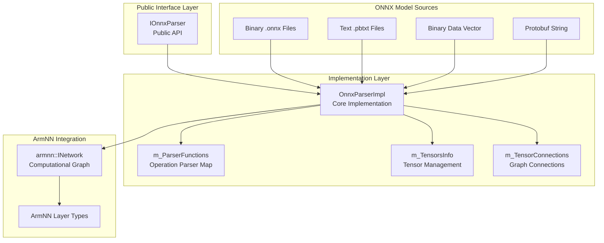
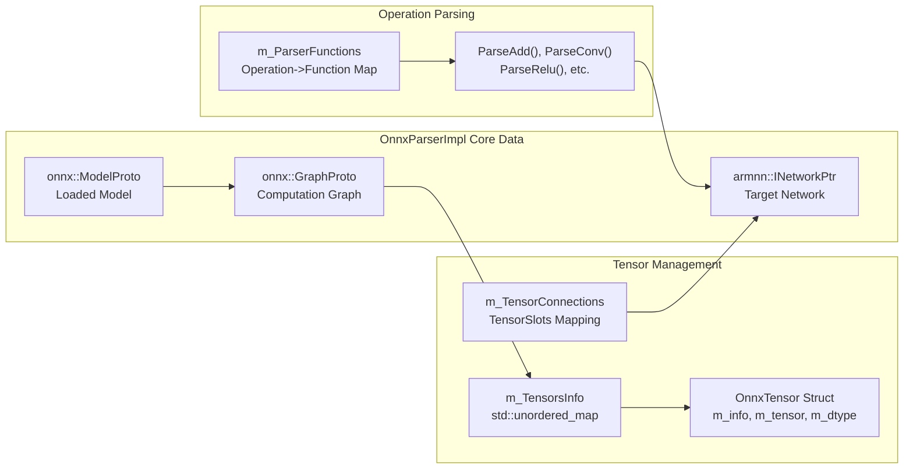
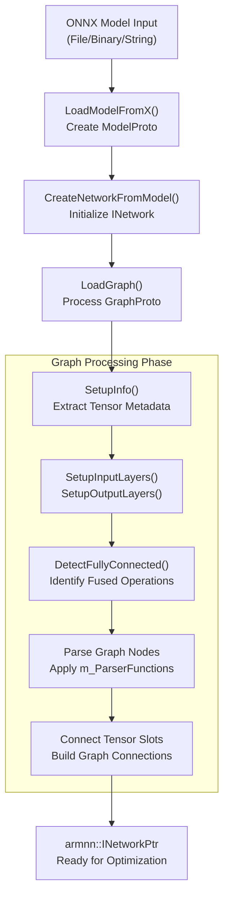

# ONNX Parser

<details>
<summary>Relevant source files</summary>

The following files were used as context for generating this wiki page:

- [include/armnnOnnxParser/IOnnxParser.hpp](include/armnnOnnxParser/IOnnxParser.hpp)
- [src/armnn/layers/GatherLayer.cpp](src/armnn/layers/GatherLayer.cpp)
- [src/armnn/layers/GatherLayer.hpp](src/armnn/layers/GatherLayer.hpp)
- [src/armnnOnnxParser/OnnxParser.cpp](src/armnnOnnxParser/OnnxParser.cpp)
- [src/armnnOnnxParser/OnnxParser.hpp](src/armnnOnnxParser/OnnxParser.hpp)
- [src/armnnOnnxParser/test/Clip.cpp](src/armnnOnnxParser/test/Clip.cpp)
- [src/armnnOnnxParser/test/Gather.cpp](src/armnnOnnxParser/test/Gather.cpp)
- [src/armnnOnnxParser/test/GetInputsOutputs.cpp](src/armnnOnnxParser/test/GetInputsOutputs.cpp)
- [src/armnnOnnxParser/test/LoadScopeDynamicTensor.cpp](src/armnnOnnxParser/test/LoadScopeDynamicTensor.cpp)
- [src/armnnOnnxParser/test/OnnxParserTestUtils.cpp](src/armnnOnnxParser/test/OnnxParserTestUtils.cpp)
- [src/armnnOnnxParser/test/OnnxParserTestUtils.hpp](src/armnnOnnxParser/test/OnnxParserTestUtils.hpp)
- [src/armnnOnnxParser/test/Shape.cpp](src/armnnOnnxParser/test/Shape.cpp)
- [src/armnnOnnxParser/test/Unsqueeze.cpp](src/armnnOnnxParser/test/Unsqueeze.cpp)
- [src/armnnTfLiteParser/test/Unsupported.cpp](src/armnnTfLiteParser/test/Unsupported.cpp)

</details>


The ONNX Parser provides functionality to import ONNX (Open Neural Network Exchange) models into ArmNN's computational graph representation. It converts ONNX protobuf models into ArmNN `INetwork` objects that can be optimized and executed on ArmNN's various compute backends.

**Note**: The ONNX Parser is deprecated and will be removed from ArmNN in version 24.08. For TensorFlow Lite model support, see [[3.1-tensorflow-lite-parser|TensorFlow Lite Parser]].

## Architecture Overview

The ONNX Parser follows a two-layer architecture with a public interface delegating to a comprehensive implementation class:



Sources: [src/armnnOnnxParser/OnnxParser.hpp:25-233](), [include/armnnOnnxParser/IOnnxParser.hpp:23-81]()

## Public Interface

The `IOnnxParser` class provides the main entry point for ONNX model parsing through factory methods and network creation functions:

| Method | Purpose | Input Format |
|--------|---------|--------------|
| `CreateNetworkFromBinaryFile()` | Load from .onnx file | File path |
| `CreateNetworkFromTextFile()` | Load from .pbtxt file | File path |
| `CreateNetworkFromBinary()` | Load from memory | `std::vector<uint8_t>` |
| `CreateNetworkFromString()` | Load from text | Protobuf string |

All methods support optional input shape specification through a `std::map<std::string, armnn::TensorShape>` parameter for dynamic tensor handling.

Sources: [include/armnnOnnxParser/IOnnxParser.hpp:32-66](), [src/armnnOnnxParser/OnnxParser.cpp:50-93]()

## Core Implementation Classes

### OnnxParserImpl Structure

The `OnnxParserImpl` class manages the complete parsing pipeline through several key data structures:



Sources: [src/armnnOnnxParser/OnnxParser.hpp:176-231](), [src/armnnOnnxParser/OnnxParser.hpp:183-191]()

### Tensor Information Management

The parser maintains tensor metadata through the `OnnxTensor` structure:

```cpp
struct OnnxTensor
{
    std::unique_ptr<armnn::TensorInfo>          m_info;     // Shape and data type
    std::unique_ptr<const onnx::TensorProto>    m_tensor;   // Constant tensor data
    onnx::TensorProto::DataType                 m_dtype;    // ONNX data type
};
```

Sources: [src/armnnOnnxParser/OnnxParser.hpp:183-191]()

## Supported Operations

The parser supports ONNX operations through a static function pointer map that maps operation names to parsing methods:

| ONNX Op Type | Parser Method | ArmNN Layer |
|--------------|---------------|-------------|
| `BatchNormalization` | `ParseBatchNormalization` | BatchNormalization |
| `Conv` | `ParseConv` | Convolution2d |
| `Add` | `ParseAdd` | Addition |
| `Relu` | `ParseRelu` | Activation |
| `MaxPool` | `ParseMaxPool` | Pooling2d |
| `Reshape` | `ParseReshape` | Reshape |
| `Gather` | `ParseGather` | Gather |
| `Concat` | `ParseConcat` | Concat |
| `Gemm` | `ParseGemm` | FullyConnected |

Sources: [src/armnnOnnxParser/OnnxParser.cpp:473-493]()

## Model Loading and Network Creation Process

The parsing pipeline follows a structured approach from ONNX model to ArmNN network:



Sources: [src/armnnOnnxParser/OnnxParser.cpp:892-991](), [src/armnnOnnxParser/OnnxParser.cpp:909-984]()

### Graph Loading Implementation

The `LoadGraph()` method orchestrates the parsing process:

1. **Tensor Information Setup**: Processes `output`, `input`, and `value_info` from the ONNX graph
2. **Initializer Processing**: Handles constant tensors and weights
3. **Layer Setup**: Creates input and output layers for the network
4. **Operation Parsing**: Iterates through graph nodes and applies appropriate parsing functions
5. **Connection Resolution**: Links output slots to input slots based on tensor names

Sources: [src/armnnOnnxParser/OnnxParser.cpp:916-990]()

## Data Type Support

The parser supports a limited set of ONNX data types mapped to ArmNN types:

| ONNX Type | ArmNN Type | Usage |
|-----------|------------|--------|
| `FLOAT` | `DataType::Float32` | Primary floating-point operations |
| `INT32` | `DataType::Signed32` | Integer operations and indices |
| `INT64` | `DataType::Signed32` | Converted to 32-bit integers |

Sources: [src/armnnOnnxParser/OnnxParser.cpp:298-320](), [src/armnnOnnxParser/OnnxParser.cpp:546-565]()

## Error Handling and Validation

The parser implements comprehensive validation through several mechanisms:

- **Data Type Validation**: `CheckValidDataType()` ensures supported data types
- **Attribute Validation**: Mandatory and optional attribute readers with type checking
- **Tensor Shape Validation**: Dynamic tensor support with dimensionality checking
- **Node Connection Validation**: Ensures proper graph connectivity

Sources: [src/armnnOnnxParser/OnnxParser.cpp:107-127](), [src/armnnOnnxParser/OnnxParser.cpp:136-200]()

## Usage Example

```cpp
// Create parser instance
auto parser = armnnOnnxParser::IOnnxParser::Create();

// Load ONNX model with optional input shapes
std::map<std::string, armnn::TensorShape> inputShapes = {
    {"input_tensor", armnn::TensorShape({1, 3, 224, 224})}
};

auto network = parser->CreateNetworkFromBinaryFile("model.onnx", inputShapes);

// Get binding information
auto inputBinding = parser->GetNetworkInputBindingInfo("input_tensor");
auto outputBinding = parser->GetNetworkOutputBindingInfo("output_tensor");
```

Sources: [include/armnnOnnxParser/IOnnxParser.hpp:27-72]()

## Related Wiki Pages

- [[3-model-support|Model Support]]
- [[3.1-tensorflow-lite-parser|TensorFlow Lite Parser]]


## Dynamic Knowledge Links (Code Graph ↔ LLM-Wiki / RAG)

### Linked Architecture & Design Documents

| Document | Match Channel | Score | Shared Code Symbols |
|---|---|---|---|
| [[3.1-tensorflow-lite-parser|3.1 TensorFlow Lite Parser]] | `bm25+entity(6)` | `76.887` | `CreateNetworkFromModel`, `LoadModelFromBinary`, `ParseActivation`, `RegisterInputSlots`, `RegisterOutputSlots` |
| [[3-model-support|3 Model Support]] | `bm25+entity(4)` | `69.938` | `ParseActivation`, `RegisterInputSlots`, `RegisterOutputSlots`, `ToTensorInfo` |
| [[5.2-tensorflow-lite-delegate|5.2 TensorFlow Lite Delegate]] | `bm25` | `40.974` | *(lexical/graph match)* |
| [[2.1-network-and-graph-system|2.1 Network and Graph System]] | `bm25` | `40.342` | *(lexical/graph match)* |
| `raw/armnn/05_01_parsers.dox` (Note: Arm NN will be dropping support for Onnx Parser in 24.08.) | `bm25` | `38.419` | *(lexical/graph match)* |
| [[3.3-model-serialization|3.3 Model Serialization]] | `wikilink:3.2-onnx-parser+entity(2)` | `38.307` | `ParseActivation`, `ToTensorInfo` |

### High-Centrality Bridge Symbols (CBM Graph)

| Symbol | Kind | Source Location | Fan-In / Fan-Out |
|---|---|---|---|
| `Cleanup` | Method | [src/armnnOnnxParser/OnnxParser.cpp:593-600]() | in: `49` / out: `1` |
| `RegisterOutputSlots` | Method | [src/armnnOnnxParser/OnnxParser.cpp:2581-2623]() | in: `16` / out: `8` |
| `ComputeOutputInfo` | Method | [src/armnnOnnxParser/OnnxParser.cpp:516-578]() | in: `12` / out: `12` |
| `RegisterInputSlots` | Method | [src/armnnOnnxParser/OnnxParser.cpp:2549-2579]() | in: `13` / out: `9` |
| `AddFullyConnected` | Method | [src/armnnOnnxParser/OnnxParser.cpp:1185-1347]() | in: `1` / out: `21` |
| `CreateConstTensor` | Method | [src/armnnOnnxParser/OnnxParser.cpp:629-673]() | in: `7` / out: `9` |

Sources: [src/armnnOnnxParser/OnnxParser.cpp:593-600](), [src/armnnOnnxParser/OnnxParser.cpp:2581-2623](), [src/armnnOnnxParser/OnnxParser.cpp:516-578](), [src/armnnOnnxParser/OnnxParser.cpp:2549-2579]()

### Cross-Subsystem Coupling

- [[2-core-architecture|2 Core Architecture]] — call/import coupling weight `61.0`
- [[2.1-network-and-graph-system|2.1 Network and Graph System]] — call/import coupling weight `61.0`
- [[1-armnn-overview|1 ArmNN Overview]] — call/import coupling weight `31.0`
- [[3.3-model-serialization|3.3 Model Serialization]] — call/import coupling weight `14.0`
- [[5-tools-and-applications|5 Tools and Applications]] — call/import coupling weight `7.0`
- [[5.1-executenetwork-tool|5.1 ExecuteNetwork Tool]] — call/import coupling weight `6.0`
