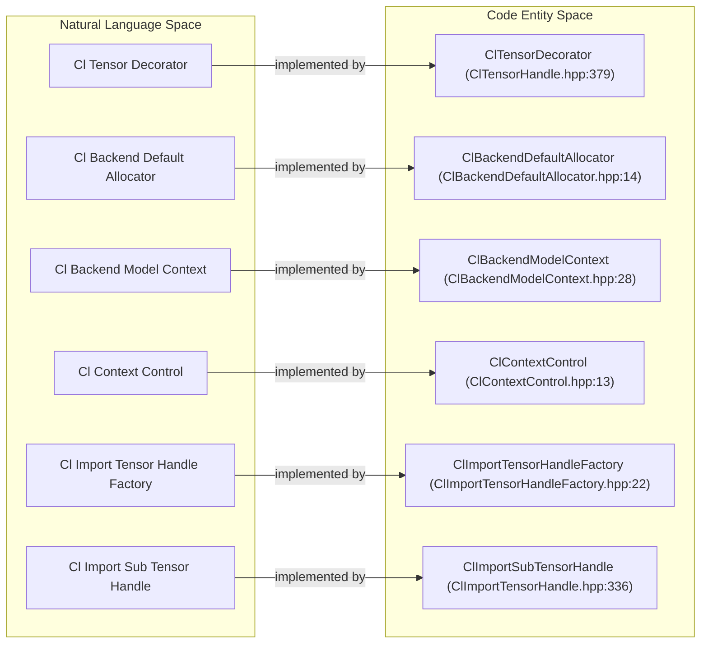
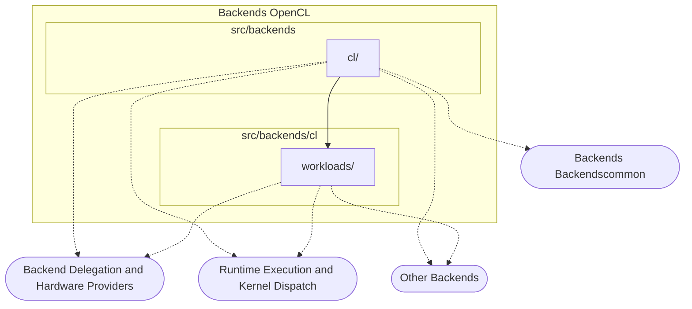
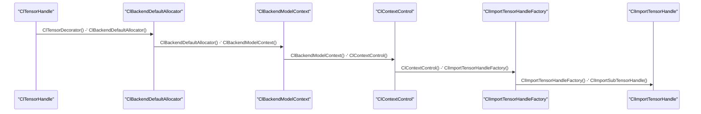

# Backends OpenCL

↑ [[3-backend-delegation-and-hardware-providers|Backend Delegation and Hardware Providers]]

> Backends OpenCL subsystem (`backends/cl`), covering 28 files and 648 symbols. Key symbols include `IsClBackendSupported`, `RunClFunction`, `GetDataType`, `IsLayerSupported`.

<details>
<summary>Relevant source files</summary>

The following files were used as context for generating this wiki page:

- [src/backends/cl/ClImportTensorHandle.hpp](src/backends/cl/ClImportTensorHandle.hpp)
- [src/backends/cl/ClBackend.cpp](src/backends/cl/ClBackend.cpp)
- [src/backends/cl/ClBackend.hpp](src/backends/cl/ClBackend.hpp)
- [src/backends/cl/ClContextSchema_generated.h](src/backends/cl/ClContextSchema_generated.h)
- [src/backends/cl/ClBackendContext.cpp](src/backends/cl/ClBackendContext.cpp)
- [src/backends/cl/ClTensorHandle.hpp](src/backends/cl/ClTensorHandle.hpp)
- [src/backends/cl/ClBackendDefaultAllocator.hpp](src/backends/cl/ClBackendDefaultAllocator.hpp)
- [src/backends/cl/ClLayerSupport.cpp](src/backends/cl/ClLayerSupport.cpp)
- [src/backends/cl/ClBackendContext.hpp](src/backends/cl/ClBackendContext.hpp)
- [src/backends/cl/ClBackendModelContext.hpp](src/backends/cl/ClBackendModelContext.hpp)
- [src/backends/cl/ICLTensorProxy.hpp](src/backends/cl/ICLTensorProxy.hpp)
- [src/backends/cl/ClContextControl.hpp](src/backends/cl/ClContextControl.hpp)
- [src/backends/cl/ClContextDeserializer.hpp](src/backends/cl/ClContextDeserializer.hpp)
- [src/backends/cl/ClContextSerializer.hpp](src/backends/cl/ClContextSerializer.hpp)
- [src/backends/cl/ClTensorHandle.cpp](src/backends/cl/ClTensorHandle.cpp)
- [src/backends/cl/ClImportTensorHandleFactory.hpp](src/backends/cl/ClImportTensorHandleFactory.hpp)
- [src/backends/cl/ClContextControl.cpp](src/backends/cl/ClContextControl.cpp)
- [src/backends/cl/ClBackendModelContext.cpp](src/backends/cl/ClBackendModelContext.cpp)
- [src/backends/cl/ClLayerSupport.hpp](src/backends/cl/ClLayerSupport.hpp)
- [src/backends/cl/ClTensorHandleFactory.hpp](src/backends/cl/ClTensorHandleFactory.hpp)
- [src/backends/cl/ClContextDeserializer.cpp](src/backends/cl/ClContextDeserializer.cpp)
- [src/backends/cl/OpenClTimer.hpp](src/backends/cl/OpenClTimer.hpp)
- [src/backends/cl/ClBackendId.hpp](src/backends/cl/ClBackendId.hpp)
- [src/backends/cl/ClWorkloadFactory.cpp](src/backends/cl/ClWorkloadFactory.cpp)
- [src/backends/cl/ClImportTensorHandleFactory.cpp](src/backends/cl/ClImportTensorHandleFactory.cpp)
- [src/backends/cl/ClContextSerializer.cpp](src/backends/cl/ClContextSerializer.cpp)
- [src/backends/cl/workloads/ClWorkloadUtils.hpp](src/backends/cl/workloads/ClWorkloadUtils.hpp)
- [src/backends/cl/ClTensorHandleFactory.cpp](src/backends/cl/ClTensorHandleFactory.cpp)

</details>

## Purpose and Scope

Backends OpenCL subsystem (`backends/cl`), covering 28 files and 648 symbols. Key symbols include `IsClBackendSupported`, `RunClFunction`, `GetDataType`, `IsLayerSupported`.

Primary code entities analyzed on this page include `ClTensorDecorator` ([src/backends/cl/ClTensorHandle.hpp:379-417]()), `ClBackendDefaultAllocator` ([src/backends/cl/ClBackendDefaultAllocator.hpp:14-46]()), `ClBackendModelContext` ([src/backends/cl/ClBackendModelContext.hpp:28-47]()), `ClContextControl` ([src/backends/cl/ClContextControl.hpp:13-40]()), `ClImportTensorHandleFactory` ([src/backends/cl/ClImportTensorHandleFactory.hpp:22-73]()).

For the parent architectural layer, see [[3-backend-delegation-and-hardware-providers|Backend Delegation and Hardware Providers]]. Related sibling subsystems: [[3.1-backends-backendscommon|Backends Backendscommon]], [[3.2-backends-reference|Backends Reference]], [[3.4-backends-aclcommon|Backends Aclcommon]], [[3.5-backends-tosacommon|Backends Tosacommon]].

Sources: [src/backends/cl/ClTensorHandle.hpp:379-417](), [src/backends/cl/ClBackendDefaultAllocator.hpp:14-46](), [src/backends/cl/ClBackendModelContext.hpp:28-47](), [src/backends/cl/ClContextControl.hpp:13-40]()

---

## 1. High-Level Architecture and Data Flow

### Natural Language Space to Code Entity Space Mapping

The following diagram maps domain concepts in this subsystem to their concrete code entities:



### Subsystem Component & Dependency Flow



Cross-subsystem call and import edges connect **Backends OpenCL** with [[5-runtime-execution-and-kernel-dispatch|Runtime Execution and Kernel Dispatch]] (coupling `131.0`), [[7-glossary|Glossary]] (coupling `119.0`), [[3.1-backends-backendscommon|Backends Backendscommon]] (coupling `118.0`), [[3-backend-delegation-and-hardware-providers|Backend Delegation and Hardware Providers]] (coupling `101.0`), [[3.4-backends-aclcommon|Backends Aclcommon]] (coupling `95.0`).

| Module Directory | Files | Primary Code Entities | Source Citations |
|---|---|---|---|
| `src/backends/cl` | 27 | `ClTensorDecorator`, `ClBackendDefaultAllocator`, `ClBackendModelContext`, `ClContextControl` | [src/backends/cl/ClTensorHandle.hpp:379-417]() [src/backends/cl/ClBackendDefaultAllocator.hpp:14-46]() |
| `src/backends/cl/workloads` | 1 | `RunClFunction`, `InitializeArmComputeClTensorData`, `CopyArmComputeClTensorData`, `SetClSliceData` | [src/backends/cl/workloads/ClWorkloadUtils.hpp:167-177]() [src/backends/cl/workloads/ClWorkloadUtils.hpp:124-157]() |

Sources: [src/backends/cl/ClTensorHandle.hpp:379-417](), [src/backends/cl/ClBackendDefaultAllocator.hpp:14-46](), [src/backends/cl/ClBackendModelContext.hpp:28-47](), [src/backends/cl/ClContextControl.hpp:13-40](), [src/backends/cl/ClImportTensorHandleFactory.hpp:22-73]()

---

## 2. Core Data Structures and Implementation Details

### Class and Entity Relationship Diagram

```mermaid
classDiagram
  class ClTensorHandleFactory {
    +ClTensorHandleFactoryId()
    +ClTensorHandleFactory()
  }
  class ClBackend {
    +ClBackend()
    +_ClBackend()
    +GetId()
    +UseCustomMemoryAllocator()
    +GetNumberOfCacheFiles()
    +ClBackendCustomAllocatorMemoryRe()
  }
  class ClBackendCustomAllocatorMemoryRegion {
    +ClBackendCustomAllocatorMemoryRe()
    +ptr()
    +map()
    +unmap()
  }
  class ClBackendCustomAllocatorWrapper {
    +ClBackendCustomAllocatorWrapper()
    +allocate()
    +free()
    +make_region()
    +MapAllocatedMemory()
  }
  class ClBackendContext {
  }
  class ClBackendContext__ClContextControlWrappe {
    +ClContextControlWrapper()
    +Sync()
    +ClearClCache()
  }
  class ClBackendDefaultAllocator {
    +ClBackendDefaultAllocator()
    +allocate()
    +free()
    +GetMemorySourceType()
    +GetMemoryRegionAtOffset()
  }
  class ClBackendModelContext {
  }
```



### `ClTensorDecorator` (Class)

- **Source Location**: [src/backends/cl/ClTensorHandle.hpp:379-417]()
- **Declaration**: `Class ClTensorDecorator`
- **Graph Centrality**: fan-in `0` callers, fan-out `0` callees
- **Responsibility**: /** ClTensorDecorator wraps an existing CL tensor allowing us to override the TensorInfo for it */

```cpp
// src/backends/cl/ClTensorHandle.hpp:379-394
class ClTensorDecorator : public arm_compute::ICLTensor
{
public:
    ClTensorDecorator();

    ClTensorDecorator(arm_compute::ICLTensor* original, const TensorInfo& info);

    ~ClTensorDecorator() = default;

    ClTensorDecorator(const ClTensorDecorator&) = delete;

    ClTensorDecorator& operator=(const ClTensorDecorator&) = delete;

    ClTensorDecorator(ClTensorDecorator&&) = default;

    ClTensorDecorator& operator=(ClTensorDecorator&&) = default;
```

### `ClBackendDefaultAllocator` (Class)

- **Source Location**: [src/backends/cl/ClBackendDefaultAllocator.hpp:14-46]()
- **Declaration**: `Class ClBackendDefaultAllocator`
- **Graph Centrality**: fan-in `0` callers, fan-out `0` callees
- **Responsibility**: /** Default Memory Allocator class returned from IBackendInternal::GetDefaultAllocator(MemorySource) */

```cpp
// src/backends/cl/ClBackendDefaultAllocator.hpp:14-29
class ClBackendDefaultAllocator : public armnn::ICustomAllocator
{
public:
    ClBackendDefaultAllocator() = default;

    void* allocate(size_t size, size_t alignment = 0) override
    {
        IgnoreUnused(alignment);
        cl_mem buf{ clCreateBuffer(arm_compute::CLScheduler::get().context().get(),
                                   CL_MEM_ALLOC_HOST_PTR | CL_MEM_READ_WRITE,
                                   size,
                                   nullptr,
                                   nullptr)};
        return static_cast<void *>(buf);
    }
```

### `ClBackendModelContext` (Class)

- **Source Location**: [src/backends/cl/ClBackendModelContext.hpp:28-47]()
- **Declaration**: `Class ClBackendModelContext`
- **Graph Centrality**: fan-in `0` callers, fan-out `0` callees
- **Responsibility**: /// The ClBackendModelContext is used to pass in CL specific backend ModelOptions. The supported backend ModelOptions /// are: /// - "FastMathEnabled" /// Using the fast_math flag can lead to performance improvements in fp32 and fp16 layers but may result in /// results with reduced or different precision. The fast_mat

```cpp
// src/backends/cl/ClBackendModelContext.hpp:28-43
class ClBackendModelContext : public IBackendModelContext
{
public:
    ClBackendModelContext(const ModelOptions& modelOptions);

    std::string GetCachedNetworkFilePath() const;

    bool IsFastMathEnabled() const;

    bool SaveCachedNetwork() const;

    int GetCachedFileDescriptor() const;

private:
    std::string m_CachedNetworkFilePath;
    bool m_IsFastMathEnabled;
```

### `ClContextControl` (Class)

- **Source Location**: [src/backends/cl/ClContextControl.hpp:13-40]()
- **Declaration**: `Class ClContextControl`
- **Graph Centrality**: fan-in `0` callers, fan-out `0` callees
- **Responsibility**: // ARM Compute OpenCL context control.

### `ClImportTensorHandleFactory` (Class)

- **Source Location**: [src/backends/cl/ClImportTensorHandleFactory.hpp:22-73]()
- **Declaration**: `Class ClImportTensorHandleFactory`
- **Graph Centrality**: fan-in `0` callers, fan-out `0` callees
- **Responsibility**: /** * This factory creates ClImportTensorHandles that refer to imported memory tensors. */

### `IsClBackendSupported` (Function)

- **Source Location**: [src/backends/cl/ClLayerSupport.cpp:120-133]()
- **Declaration**: `(Optional<std::string&> reasonIfUnsupported, Args... args)`
- **Graph Centrality**: fan-in `64` callers, fan-out `2` callees

Sources: [src/backends/cl/ClTensorHandle.hpp:379-417](), [src/backends/cl/ClBackendDefaultAllocator.hpp:14-46](), [src/backends/cl/ClBackendModelContext.hpp:28-47](), [src/backends/cl/ClContextControl.hpp:13-40](), [src/backends/cl/ClImportTensorHandleFactory.hpp:22-73]()

---

## 3. Execution and Call Flow

The sequence diagram below traces the runtime/compile-time call chain across components in this module:



Sources: [src/backends/cl/ClTensorHandle.hpp:379-417](), [src/backends/cl/ClBackendDefaultAllocator.hpp:14-46](), [src/backends/cl/ClBackendModelContext.hpp:28-47](), [src/backends/cl/ClContextControl.hpp:13-40](), [src/backends/cl/ClImportTensorHandleFactory.hpp:22-73]()

---

## 4. Key API and Symbol Reference

| Code Entity | Kind | Location | Fan-In / Out | Role & Signature |
|---|---|---|---|---|
| `ClTensorDecorator` | Class | [src/backends/cl/ClTensorHandle.hpp:379-417]() | `0` / `0` | /** ClTensorDecorator wraps an existing CL tensor allowing us to override the TensorInfo for it */ |
| `ClBackendDefaultAllocator` | Class | [src/backends/cl/ClBackendDefaultAllocator.hpp:14-46]() | `0` / `0` | /** Default Memory Allocator class returned from IBackendInternal::GetDefaultAllocator(MemorySource) */ |
| `ClBackendModelContext` | Class | [src/backends/cl/ClBackendModelContext.hpp:28-47]() | `0` / `0` | /// The ClBackendModelContext is used to pass in CL specific backend ModelOptions. The supported backend Model |
| `ClContextControl` | Class | [src/backends/cl/ClContextControl.hpp:13-40]() | `0` / `0` | // ARM Compute OpenCL context control. |
| `ClImportTensorHandleFactory` | Class | [src/backends/cl/ClImportTensorHandleFactory.hpp:22-73]() | `0` / `0` | /** |
| `ClImportSubTensorHandle` | Class | [src/backends/cl/ClImportTensorHandle.hpp:336-467]() | `0` / `0` | — |
| `ClImportTensorHandle` | Class | [src/backends/cl/ClImportTensorHandle.hpp:30-334]() | `0` / `0` | — |
| `OpenClTimer` | Class | [src/backends/cl/OpenClTimer.hpp:20-60]() | `0` / `0` | /// OpenClTimer instrument that times all OpenCl kernels executed between calls to Start() and Stop(). |
| `ClBackend` | Class | [src/backends/cl/ClBackend.hpp:24-285]() | `0` / `0` | — |
| `ClBackendCustomAllocatorMemoryRegion` | Class | [src/backends/cl/ClBackend.hpp:213-281]() | `0` / `0` | — |
| `ClBackendCustomAllocatorWrapper` | Class | [src/backends/cl/ClBackend.hpp:97-211]() | `0` / `0` | — |
| `ClContextBuilder` | Class | [src/backends/cl/ClContextSchema_generated.h:38-55]() | `0` / `0` | — |
| `ProgramBuilder` | Class | [src/backends/cl/ClContextSchema_generated.h:96-116]() | `0` / `0` | — |
| `ClBackendContext::ClContextControlWrapper` | Class | [src/backends/cl/ClBackendContext.cpp:20-59]() | `0` / `0` | — |
| `ClSubTensorHandle` | Class | [src/backends/cl/ClTensorHandle.hpp:246-376]() | `0` / `0` | — |
| `ClTensorHandle` | Class | [src/backends/cl/ClTensorHandle.hpp:28-244]() | `0` / `0` | — |
| `ClTensorHandleDecorator` | Class | [src/backends/cl/ClTensorHandle.hpp:419-551]() | `0` / `0` | — |
| `ClBackendContext` | Class | [src/backends/cl/ClBackendContext.hpp:17-45]() | `0` / `0` | — |
| `ICLTensorProxy` | Class | [src/backends/cl/ICLTensorProxy.hpp:13-76]() | `0` / `0` | — |
| `ClContextDeserializer` | Class | [src/backends/cl/ClContextDeserializer.hpp:13-39]() | `0` / `0` | — |
| `ClContextSerializer` | Class | [src/backends/cl/ClContextSerializer.hpp:15-33]() | `0` / `0` | — |
| `ClTensorHandleFactory` | Class | [src/backends/cl/ClTensorHandleFactory.hpp:20-57]() | `1` / `0` | — |

Sources: [src/backends/cl/ClTensorHandle.hpp:379-417](), [src/backends/cl/ClBackendDefaultAllocator.hpp:14-46](), [src/backends/cl/ClBackendModelContext.hpp:28-47](), [src/backends/cl/ClContextControl.hpp:13-40](), [src/backends/cl/ClImportTensorHandleFactory.hpp:22-73](), [src/backends/cl/ClImportTensorHandle.hpp:336-467]()

---

## 5. Official Documentation and Design Context

The following linked documentation sections from `llm-wiki` (`raw/`) provide additional architectural context, tutorials, and design invariants for this subsystem:

- **Backend Delegation and Hardware Providers** ([wiki/3-backend-delegation-and-hardware-providers.md](), score `92.8207`) (sections: `Backend Delegation and Hardware Providers`, `Purpose and Scope`, `System Mapping: Natural Language Space to Code Entity Space`, `1. Backends Backendscommon`): # Backend Delegation and Hardware Providers > Architectural overview of Backend Delegation and Hardware Providers, spanning 150 source files and 2618 code symbols across 6 subsystems. <details> <summary>Relevant source files</summary> The following files were used as context for generating this wiki page: - [src/backends/aclCommon/ArmComputeTensorUtils.hpp](src/backends/aclCommon/ArmComputeTensorUtils.hpp) - [src/bac
- **Other Backends** ([wiki/3.6-other-backends.md](), score `83.6084`) (sections: `Other Backends`, `Purpose and Scope`, `1. High-Level Architecture and Data Flow`, `Natural Language Space to Code Entity Space Mapping`): # Other Backends ↑ [[3-backend-delegation-and-hardware-providers|Backend Delegation and Hardware Providers]] > Other Backends subsystem (consolidating `Backends Neon`, `ArmNN Backends`, `Backends Tosareference`, `Backends Dynamic`), covering 28 files and 849 symbols. Key symbols include `IsNeonBackendSupported`, `info`, `IsLayerTypeSupported`, `CreateTensorHandle`. <details> <summary>Relevant source files</summary> T
- **Overview** ([wiki/1-overview.md](), score `73.9548`) (sections: `Overview`, `1. Architecture Overview & System Component Map`, `Core Concept to Code Entity Mapping`, `Core Compilation & Runtime Class Hierarchy`): # Overview > End-to-end architecture overview of ArmNN: core subsystems, compilation/execution pipeline, entry points, and cross-module dependencies. <details> <summary>Relevant source files</summary> The following files were used as context for generating this wiki page: - [src/armnn/Tensor.cpp](src/armnn/Tensor.cpp) - [include/armnn/Exceptions.hpp](include/armnn/Exceptions.hpp) - [include/armnn/Tensor.hpp](include/
- **Backends Backendscommon** ([wiki/3.1-backends-backendscommon.md](), score `71.8064`) (sections: `Backends Backendscommon`, `Purpose and Scope`, `1. High-Level Architecture and Data Flow`, `Natural Language Space to Code Entity Space Mapping`): # Backends Backendscommon ↑ [[3-backend-delegation-and-hardware-providers|Backend Delegation and Hardware Providers]] > Backends Backendscommon subsystem (`backends/backendsCommon`), covering 28 files and 312 symbols. Key symbols include `to_string`, `ValidateInputsOutputs`, `ValidateNumInputs`, `ValidateNumOutputs`. <details> <summary>Relevant source files</summary> The following files were used as context for gener

Sources: [wiki/3-backend-delegation-and-hardware-providers.md](), [wiki/3.6-other-backends.md](), [wiki/1-overview.md](), [wiki/3.1-backends-backendscommon.md]()

## Related pages

- [[3-backend-delegation-and-hardware-providers|Backend Delegation and Hardware Providers]]
- [[3.1-backends-backendscommon|Backends Backendscommon]]
- [[3.2-backends-reference|Backends Reference]]
- [[3.6-other-backends|Other Backends]]
- [[5-runtime-execution-and-kernel-dispatch|Runtime Execution and Kernel Dispatch]]
- [[5.1-armnn|ArmNN]]
- [[5.2-armnn|ArmNN]]
- [[5.6-other-runtime-components|Other Runtime Components]]

## Related documents

- `wiki/3-backend-delegation-and-hardware-providers.md` — Backend Delegation and Hardware Providers (score 92.8207, via bm25)
- `wiki/3.6-other-backends.md` — Other Backends (score 83.6084, via bm25)
- `wiki/1-overview.md` — Overview (score 73.9548, via bm25)
- `wiki/3.1-backends-backendscommon.md` — Backends Backendscommon (score 71.8064, via bm25)
- `wiki/3.4-backends-aclcommon.md` — Backends Aclcommon (score 69.04, via bm25)

## Sources

- [`src/backends/cl/ClImportTensorHandle.hpp`](https://github.com/ARM-software/armnn/blob/branches/armnn_24_11/src/backends/cl/ClImportTensorHandle.hpp)
- [`src/backends/cl/ClBackend.cpp`](https://github.com/ARM-software/armnn/blob/branches/armnn_24_11/src/backends/cl/ClBackend.cpp)
- [`src/backends/cl/ClBackend.hpp`](https://github.com/ARM-software/armnn/blob/branches/armnn_24_11/src/backends/cl/ClBackend.hpp)
- [`src/backends/cl/ClContextSchema_generated.h`](https://github.com/ARM-software/armnn/blob/branches/armnn_24_11/src/backends/cl/ClContextSchema_generated.h)
- [`src/backends/cl/ClBackendContext.cpp`](https://github.com/ARM-software/armnn/blob/branches/armnn_24_11/src/backends/cl/ClBackendContext.cpp)
- [`src/backends/cl/ClTensorHandle.hpp`](https://github.com/ARM-software/armnn/blob/branches/armnn_24_11/src/backends/cl/ClTensorHandle.hpp)
- [`src/backends/cl/ClBackendDefaultAllocator.hpp`](https://github.com/ARM-software/armnn/blob/branches/armnn_24_11/src/backends/cl/ClBackendDefaultAllocator.hpp)
- [`src/backends/cl/ClLayerSupport.cpp`](https://github.com/ARM-software/armnn/blob/branches/armnn_24_11/src/backends/cl/ClLayerSupport.cpp)
- [`src/backends/cl/ClBackendContext.hpp`](https://github.com/ARM-software/armnn/blob/branches/armnn_24_11/src/backends/cl/ClBackendContext.hpp)
- [`src/backends/cl/ClBackendModelContext.hpp`](https://github.com/ARM-software/armnn/blob/branches/armnn_24_11/src/backends/cl/ClBackendModelContext.hpp)
- [`src/backends/cl/ICLTensorProxy.hpp`](https://github.com/ARM-software/armnn/blob/branches/armnn_24_11/src/backends/cl/ICLTensorProxy.hpp)
- [`src/backends/cl/ClContextControl.hpp`](https://github.com/ARM-software/armnn/blob/branches/armnn_24_11/src/backends/cl/ClContextControl.hpp)
- [`src/backends/cl/ClContextDeserializer.hpp`](https://github.com/ARM-software/armnn/blob/branches/armnn_24_11/src/backends/cl/ClContextDeserializer.hpp)
- [`src/backends/cl/ClContextSerializer.hpp`](https://github.com/ARM-software/armnn/blob/branches/armnn_24_11/src/backends/cl/ClContextSerializer.hpp)
- [`src/backends/cl/ClTensorHandle.cpp`](https://github.com/ARM-software/armnn/blob/branches/armnn_24_11/src/backends/cl/ClTensorHandle.cpp)
- [`src/backends/cl/ClImportTensorHandleFactory.hpp`](https://github.com/ARM-software/armnn/blob/branches/armnn_24_11/src/backends/cl/ClImportTensorHandleFactory.hpp)
- [`src/backends/cl/ClContextControl.cpp`](https://github.com/ARM-software/armnn/blob/branches/armnn_24_11/src/backends/cl/ClContextControl.cpp)
- [`src/backends/cl/ClBackendModelContext.cpp`](https://github.com/ARM-software/armnn/blob/branches/armnn_24_11/src/backends/cl/ClBackendModelContext.cpp)
- [`src/backends/cl/ClLayerSupport.hpp`](https://github.com/ARM-software/armnn/blob/branches/armnn_24_11/src/backends/cl/ClLayerSupport.hpp)
- [`src/backends/cl/ClTensorHandleFactory.hpp`](https://github.com/ARM-software/armnn/blob/branches/armnn_24_11/src/backends/cl/ClTensorHandleFactory.hpp)
- [`src/backends/cl/ClContextDeserializer.cpp`](https://github.com/ARM-software/armnn/blob/branches/armnn_24_11/src/backends/cl/ClContextDeserializer.cpp)
- [`src/backends/cl/OpenClTimer.hpp`](https://github.com/ARM-software/armnn/blob/branches/armnn_24_11/src/backends/cl/OpenClTimer.hpp)
- [`src/backends/cl/ClBackendId.hpp`](https://github.com/ARM-software/armnn/blob/branches/armnn_24_11/src/backends/cl/ClBackendId.hpp)
- [`src/backends/cl/ClWorkloadFactory.cpp`](https://github.com/ARM-software/armnn/blob/branches/armnn_24_11/src/backends/cl/ClWorkloadFactory.cpp)
- [`src/backends/cl/ClImportTensorHandleFactory.cpp`](https://github.com/ARM-software/armnn/blob/branches/armnn_24_11/src/backends/cl/ClImportTensorHandleFactory.cpp)
- [`src/backends/cl/ClContextSerializer.cpp`](https://github.com/ARM-software/armnn/blob/branches/armnn_24_11/src/backends/cl/ClContextSerializer.cpp)
- [`src/backends/cl/workloads/ClWorkloadUtils.hpp`](https://github.com/ARM-software/armnn/blob/branches/armnn_24_11/src/backends/cl/workloads/ClWorkloadUtils.hpp)
- [`src/backends/cl/ClTensorHandleFactory.cpp`](https://github.com/ARM-software/armnn/blob/branches/armnn_24_11/src/backends/cl/ClTensorHandleFactory.cpp)


## Dynamic Knowledge Links (Code Graph ↔ LLM-Wiki / RAG)

### Linked Architecture & Design Documents

| Document | Match Channel | Score | Shared Code Symbols |
|---|---|---|---|
| [[3-backend-delegation-and-hardware-providers|Backend Delegation and Hardware Providers]] | `bm25+entity(2)` | `95.821` | `IsClBackendSupported`, `RunClFunction` |
| [[3.6-other-backends|Other Backends]] | `bm25+entity(2)` | `86.608` | `IsClBackendSupported`, `RunClFunction` |
| [[1-overview|Overview]] | `bm25+entity(2)` | `76.955` | `IsClBackendSupported`, `RunClFunction` |
| [[3.4-backends-aclcommon|Backends Aclcommon]] | `bm25+entity(2)` | `72.04` | `IsClBackendSupported`, `RunClFunction` |
| [[3.1-backends-backendscommon|Backends Backendscommon]] | `bm25` | `71.806` | *(lexical/graph match)* |
| [[3.2-backends-reference|Backends Reference]] | `wikilink:3.3-backends-opencl` | `61.645` | *(lexical/graph match)* |

### High-Centrality Bridge Symbols (CBM Graph)

| Symbol | Kind | Source Location | Fan-In / Fan-Out |
|---|---|---|---|
| `ClTensorDecorator` | Class | [src/backends/cl/ClTensorHandle.hpp:379-417]() | in: `0` / out: `0` |
| `ClBackendDefaultAllocator` | Class | [src/backends/cl/ClBackendDefaultAllocator.hpp:14-46]() | in: `0` / out: `0` |
| `ClBackendModelContext` | Class | [src/backends/cl/ClBackendModelContext.hpp:28-47]() | in: `0` / out: `0` |
| `ClContextControl` | Class | [src/backends/cl/ClContextControl.hpp:13-40]() | in: `0` / out: `0` |
| `ClImportTensorHandleFactory` | Class | [src/backends/cl/ClImportTensorHandleFactory.hpp:22-73]() | in: `0` / out: `0` |
| `ClImportSubTensorHandle` | Class | [src/backends/cl/ClImportTensorHandle.hpp:336-467]() | in: `0` / out: `0` |

Sources: [src/backends/cl/ClTensorHandle.hpp:379-417](), [src/backends/cl/ClBackendDefaultAllocator.hpp:14-46](), [src/backends/cl/ClBackendModelContext.hpp:28-47](), [src/backends/cl/ClContextControl.hpp:13-40]()

### Cross-Subsystem Coupling

- [[5-runtime-execution-and-kernel-dispatch|Runtime Execution and Kernel Dispatch]] — call/import coupling weight `131.0`
- [[7-glossary|Glossary]] — call/import coupling weight `119.0`
- [[3.1-backends-backendscommon|Backends Backendscommon]] — call/import coupling weight `118.0`
- [[3-backend-delegation-and-hardware-providers|Backend Delegation and Hardware Providers]] — call/import coupling weight `101.0`
- [[3.4-backends-aclcommon|Backends Aclcommon]] — call/import coupling weight `95.0`
- [[5.2-armnn|ArmNN]] — call/import coupling weight `89.0`
