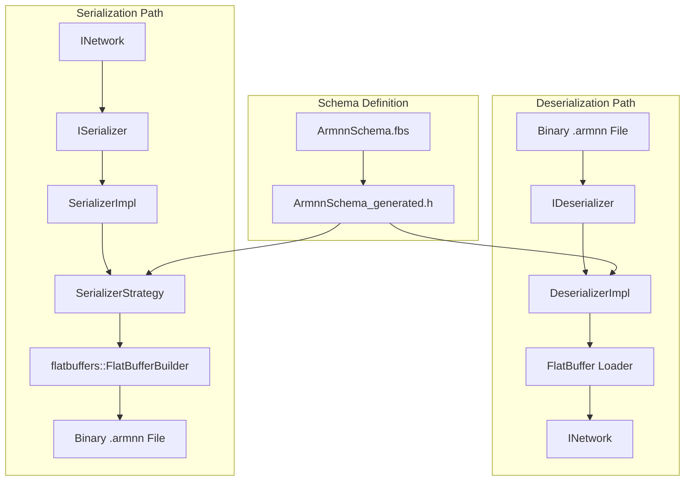
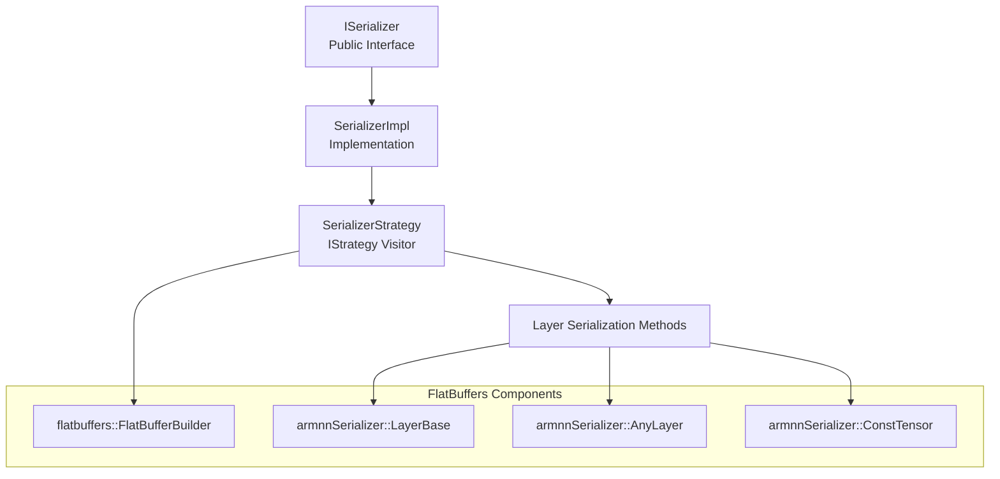
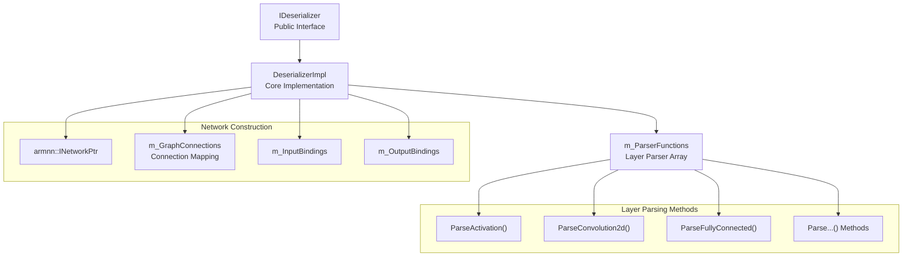
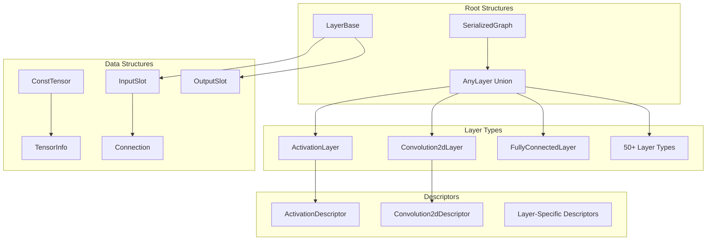

# Model Serialization

<details>
<summary>Relevant source files</summary>

The following files were used as context for generating this wiki page:

- [include/armnn/Descriptors.hpp](include/armnn/Descriptors.hpp)
- [include/armnn/DescriptorsFwd.hpp](include/armnn/DescriptorsFwd.hpp)
- [src/armnnDeserializer/Deserializer.cpp](src/armnnDeserializer/Deserializer.cpp)
- [src/armnnDeserializer/Deserializer.hpp](src/armnnDeserializer/Deserializer.hpp)
- [src/armnnSerializer/ArmnnSchema.fbs](src/armnnSerializer/ArmnnSchema.fbs)
- [src/armnnSerializer/Serializer.cpp](src/armnnSerializer/Serializer.cpp)
- [src/armnnSerializer/Serializer.hpp](src/armnnSerializer/Serializer.hpp)
- [src/armnnSerializer/SerializerUtils.cpp](src/armnnSerializer/SerializerUtils.cpp)
- [src/armnnSerializer/SerializerUtils.hpp](src/armnnSerializer/SerializerUtils.hpp)
- [src/armnnSerializer/test/SerializerTests.cpp](src/armnnSerializer/test/SerializerTests.cpp)

</details>


This document covers ArmNN's model serialization and deserialization system, which enables saving optimized neural networks to disk and loading them for inference. This system provides a binary format based on Google FlatBuffers for efficient storage and retrieval of ArmNN network graphs, layer parameters, and weights.

For information about importing models from external formats like TensorFlow Lite, see [[3.1-tensorflow-lite-parser|TensorFlow Lite Parser]]. For ONNX model support, see [[3.2-onnx-parser|ONNX Parser]].

## System Overview

ArmNN's serialization system converts `INetwork` objects into a compact binary format and provides the reverse operation to reconstruct networks from stored data. The system uses Google FlatBuffers as the underlying serialization technology, providing efficient binary encoding with forward/backward compatibility.

### Core Components Architecture



Sources: [src/armnnSerializer/Serializer.hpp:24-42](), [src/armnnDeserializer/Deserializer.hpp:34-51](), [src/armnnSerializer/ArmnnSchema.fbs:1-10]()

## Serialization Process

The serialization process transforms an `INetwork` into a binary representation through the visitor pattern implementation in `SerializerStrategy`.

### Serializer Class Hierarchy



Sources: [src/armnnSerializer/Serializer.hpp:22-33](), [src/armnnSerializer/Serializer.cpp:24-28]()

### Layer Serialization Methods

The `SerializerStrategy` class implements specific serialization methods for each layer type:

| Layer Type | Serialization Method |
|------------|---------------------|
| Input/Output | `SerializeInputLayer`, `SerializeOutputLayer` |
| Activation | `SerializeActivationLayer` |
| Convolution2d | `SerializeConvolution2dLayer` |
| FullyConnected | `SerializeFullyConnectedLayer` |
| BatchNormalization | `SerializeBatchNormalizationLayer` |
| Pooling2d/3d | `SerializePooling2dLayer`, `SerializePooling3dLayer` |

Each method follows the pattern of creating FlatBuffer descriptors and layer representations before adding them to the serialized graph.

Sources: [src/armnnSerializer/Serializer.hpp:105-350](), [src/armnnSerializer/Serializer.cpp:136-155]()

## Deserialization Process

The deserialization process reconstructs an `INetwork` from binary data by parsing FlatBuffer structures and recreating ArmNN layers.

### Deserializer Implementation Structure



Sources: [src/armnnDeserializer/Deserializer.hpp:34-51](), [src/armnnDeserializer/Deserializer.cpp:207-284]()

### Layer Parsing Function Registry

The deserializer maintains a function pointer array for efficient layer type dispatch:

```cpp
// From DeserializerImpl constructor
m_ParserFunctions[Layer_ActivationLayer] = &DeserializerImpl::ParseActivation;
m_ParserFunctions[Layer_AdditionLayer] = &DeserializerImpl::ParseAdd;
m_ParserFunctions[Layer_Convolution2dLayer] = &DeserializerImpl::ParseConvolution2d;
```

Sources: [src/armnnDeserializer/Deserializer.cpp:210-284]()

## FlatBuffers Schema Definition

The serialization format is defined in `ArmnnSchema.fbs`, which specifies the structure of all serialized components.

### Core Schema Components



Sources: [src/armnnSerializer/ArmnnSchema.fbs:203-216](), [src/armnnSerializer/ArmnnSchema.fbs:1091-1150]()

### File Format Structure

The binary file format uses the FlatBuffers identifier "ARMN" and extension ".armnn":

| Component | Description |
|-----------|-------------|
| File Identifier | "ARMN" (4 bytes) |
| Root Table | `SerializedGraph` |
| Layers Array | Vector of `AnyLayer` unions |
| Input/Output IDs | Binding layer identifiers |
| Feature Versions | Compatibility information |

Sources: [src/armnnSerializer/ArmnnSchema.fbs:8-10]()

## Usage Examples

### Serializing a Network

```cpp
// Create serializer
armnnSerializer::ISerializerPtr serializer = armnnSerializer::ISerializer::Create();

// Serialize network
serializer->Serialize(*network);

// Save to file
std::ofstream file("model.armnn", std::ios::binary);
serializer->SaveSerializedToStream(file);
```

### Deserializing a Network

```cpp
// Create deserializer  
armnnDeserializer::IDeserializerPtr deserializer = armnnDeserializer::IDeserializer::Create();

// Load from file
std::ifstream file("model.armnn", std::ios::binary);
std::vector<uint8_t> data((std::istreambuf_iterator<char>(file)), 
                          std::istreambuf_iterator<char>());

// Deserialize network
armnn::INetworkPtr network = deserializer->CreateNetworkFromBinary(data);

// Get binding information
auto inputBinding = deserializer->GetNetworkInputBindingInfo(0, "input");
auto outputBinding = deserializer->GetNetworkOutputBindingInfo(0, "output");
```

Sources: [src/armnnSerializer/Serializer.cpp:45-53](), [src/armnnDeserializer/Deserializer.cpp:57-75]()

### Data Type and Layout Conversion

The serialization system handles conversion between ArmNN and FlatBuffer enumerations through utility functions:

```cpp
// Data type conversion
armnnSerializer::DataType GetFlatBufferDataType(armnn::DataType dataType);

// Layout conversion  
armnnSerializer::DataLayout GetFlatBufferDataLayout(armnn::DataLayout dataLayout);

// Operation conversion
armnnSerializer::ActivationFunction GetFlatBufferActivationFunction(armnn::ActivationFunction function);
```

Sources: [src/armnnSerializer/SerializerUtils.cpp:67-92](), [src/armnnSerializer/SerializerUtils.cpp:94-108](), [src/armnnSerializer/Serializer.cpp:55-86]()

## Compatibility and Versioning

The serialization format includes feature version tracking to maintain backward compatibility:

```cpp
struct FeatureVersions {
    unsigned int m_BindingIdScheme = 0;
    unsigned int m_WeightsLayoutScheme = 0; 
    unsigned int m_ConstTensorsAsInputs = 0;
};
```

This allows newer deserializers to handle models created with older serializers by detecting and adapting to format differences.

Sources: [src/armnnDeserializer/Deserializer.hpp:182-193]()

## Related Wiki Pages

- [[3-model-support|Model Support]]
- [[3.1-tensorflow-lite-parser|TensorFlow Lite Parser]]
- [[3.2-onnx-parser|ONNX Parser]]


## Dynamic Knowledge Links (Code Graph ↔ LLM-Wiki / RAG)

### Linked Architecture & Design Documents

| Document | Match Channel | Score | Shared Code Symbols |
|---|---|---|---|
| [[2.2-backend-system|2.2 Backend System]] | `bm25` | `45.653` | *(lexical/graph match)* |
| [[7.2-workload-system|7.2 Workload System]] | `bm25` | `45.237` | *(lexical/graph match)* |
| [[4.3-opencl-backend|4.3 OpenCL Backend]] | `bm25` | `44.76` | *(lexical/graph match)* |
| [[6.2-testing-framework|6.2 Testing Framework]] | `bm25` | `41.391` | *(lexical/graph match)* |
| [[3.1-tensorflow-lite-parser|3.1 TensorFlow Lite Parser]] | `bm25+entity(1)` | `37.828` | `ToTensorInfo` |
| [[3.2-onnx-parser|3.2 ONNX Parser]] | `wikilink:3.3-model-serialization+entity(1)` | `37.709` | `ToTensorInfo` |

### High-Centrality Bridge Symbols (CBM Graph)

| Symbol | Kind | Source Location | Fan-In / Fan-Out |
|---|---|---|---|
| `CreateLayerBase` | Method | [src/armnnSerializer/Serializer.cpp:1872-1887]() | in: `67` / out: `3` |
| `CreateAnyLayer` | Method | [src/armnnSerializer/Serializer.cpp:1889-1894]() | in: `67` / out: `1` |
| `ExecuteStrategy` | Method | [src/armnnSerializer/Serializer.cpp:2074-2541]() | in: `0` / out: `70` |
| `BaseDescriptor` | Class | [include/armnn/Descriptors.hpp:22-26]() | in: `34` / out: `0` |
| `GetFlatBufferDataLayout` | Function | [src/armnnSerializer/SerializerUtils.cpp:94-108]() | in: `17` / out: `0` |
| `BatchMatMulDescriptor` | Class | [include/armnn/Descriptors.hpp:1584-1638]() | in: `13` / out: `0` |

Sources: [src/armnnSerializer/Serializer.cpp:1872-1887](), [src/armnnSerializer/Serializer.cpp:1889-1894](), [src/armnnSerializer/Serializer.cpp:2074-2541](), [include/armnn/Descriptors.hpp:22-26]()

### Cross-Subsystem Coupling

- [[2-core-architecture|2 Core Architecture]] — call/import coupling weight `35.0`
- [[2.1-network-and-graph-system|2.1 Network and Graph System]] — call/import coupling weight `35.0`
- [[2.3-runtime-and-execution|2.3 Runtime and Execution]] — call/import coupling weight `23.0`
- [[3-model-support|3 Model Support]] — call/import coupling weight `21.0`
- [[1-armnn-overview|1 ArmNN Overview]] — call/import coupling weight `20.0`
- [[2.2-backend-system|2.2 Backend System]] — call/import coupling weight `19.0`
