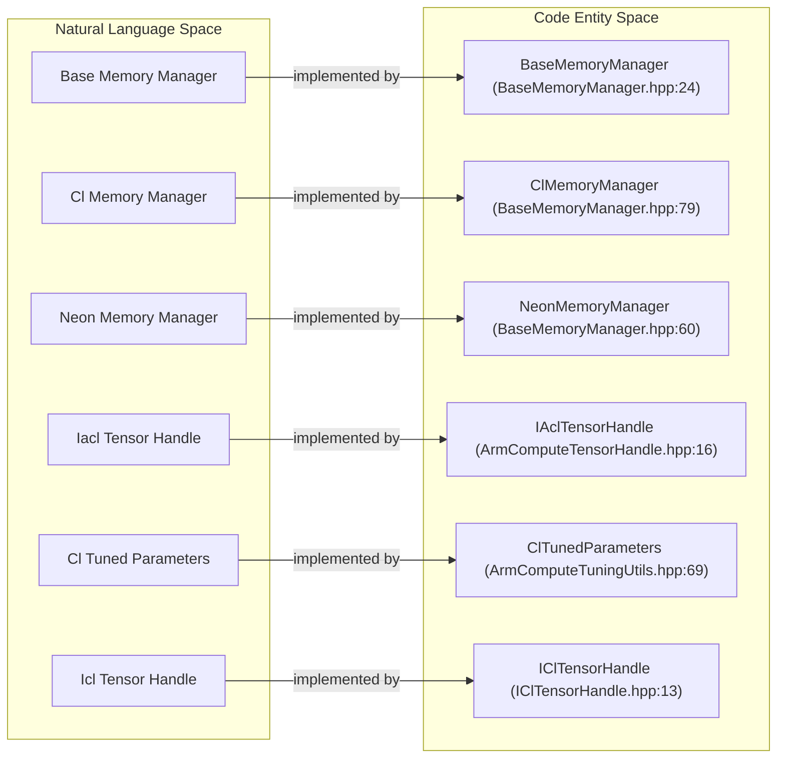
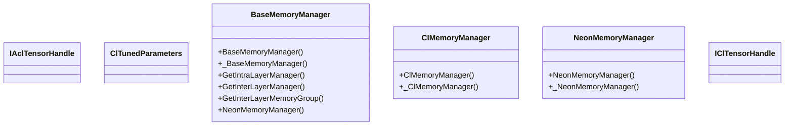
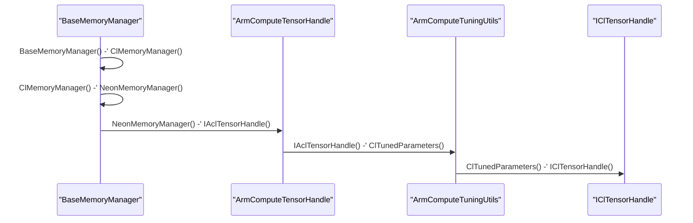

# Backends Aclcommon

↑ [[3-backend-delegation-and-hardware-providers|Backend Delegation and Hardware Providers]]

> Backends Aclcommon subsystem (`backends/aclCommon`), covering 10 files and 89 symbols. Key symbols include `GetShape`, `BuildArmComputeTensorInfo`, `ConvertDataLayout`, `ConvertActivationDescriptorToAclActivationLayerInfo`.

<details>
<summary>Relevant source files</summary>

The following files were used as context for generating this wiki page:

- [src/backends/aclCommon/ArmComputeTensorUtils.hpp](src/backends/aclCommon/ArmComputeTensorUtils.hpp)
- [src/backends/aclCommon/ArmComputeTensorUtils.cpp](src/backends/aclCommon/ArmComputeTensorUtils.cpp)
- [src/backends/aclCommon/ArmComputeUtils.hpp](src/backends/aclCommon/ArmComputeUtils.hpp)
- [src/backends/aclCommon/ArmComputeSubgraphUtils.hpp](src/backends/aclCommon/ArmComputeSubgraphUtils.hpp)
- [src/backends/aclCommon/ArmComputeTuningUtils.cpp](src/backends/aclCommon/ArmComputeTuningUtils.cpp)
- [src/backends/aclCommon/BaseMemoryManager.hpp](src/backends/aclCommon/BaseMemoryManager.hpp)
- [src/backends/aclCommon/ArmComputeTensorHandle.hpp](src/backends/aclCommon/ArmComputeTensorHandle.hpp)
- [src/backends/aclCommon/ArmComputeTuningUtils.hpp](src/backends/aclCommon/ArmComputeTuningUtils.hpp)
- [src/backends/aclCommon/IClTensorHandle.hpp](src/backends/aclCommon/IClTensorHandle.hpp)
- [src/backends/aclCommon/BaseMemoryManager.cpp](src/backends/aclCommon/BaseMemoryManager.cpp)

</details>

## Purpose and Scope

Backends Aclcommon subsystem (`backends/aclCommon`), covering 10 files and 89 symbols. Key symbols include `GetShape`, `BuildArmComputeTensorInfo`, `ConvertDataLayout`, `ConvertActivationDescriptorToAclActivationLayerInfo`.

Primary code entities analyzed on this page include `BaseMemoryManager` ([src/backends/aclCommon/BaseMemoryManager.hpp:24-57]()), `ClMemoryManager` ([src/backends/aclCommon/BaseMemoryManager.hpp:79-95]()), `NeonMemoryManager` ([src/backends/aclCommon/BaseMemoryManager.hpp:60-75]()), `IAclTensorHandle` ([src/backends/aclCommon/ArmComputeTensorHandle.hpp:16-23]()), `ClTunedParameters` ([src/backends/aclCommon/ArmComputeTuningUtils.hpp:69-82]()).

For the parent architectural layer, see [[3-backend-delegation-and-hardware-providers|Backend Delegation and Hardware Providers]]. Related sibling subsystems: [[3.1-backends-backendscommon|Backends Backendscommon]], [[3.2-backends-reference|Backends Reference]], [[3.3-backends-opencl|Backends OpenCL]], [[3.5-backends-tosacommon|Backends Tosacommon]].

Sources: [src/backends/aclCommon/BaseMemoryManager.hpp:24-57](), [src/backends/aclCommon/BaseMemoryManager.hpp:79-95](), [src/backends/aclCommon/BaseMemoryManager.hpp:60-75](), [src/backends/aclCommon/ArmComputeTensorHandle.hpp:16-23]()

---

## 1. High-Level Architecture and Data Flow

### Natural Language Space to Code Entity Space Mapping

The following diagram maps domain concepts in this subsystem to their concrete code entities:



### Subsystem Component & Dependency Flow

```mermaid
flowchart TD
  subgraph sub_this["Backends Aclcommon"]
    subgraph sg_0["src/backends/aclCommon"]
      n_src_backends_aclCommon_ArmComputeTensorUtils_hpp["GetShape (ArmComputeTensorUtils.hpp)"]
      n_src_backends_aclCommon_ArmComputeTensorUtils_cpp["BuildArmComputeTensorInfo (ArmComputeTensorUtils.cpp)"]
      n_src_backends_aclCommon_ArmComputeUtils_hpp["ConvertActivationDescriptorToAclActivationLayerInfo (ArmComputeUtils.hpp)"]
      n_src_backends_aclCommon_ArmComputeSubgraphUtils_h["ChainReduceLayers (ArmComputeSubgraphUtils.hpp)"]
      n_src_backends_aclCommon_ArmComputeTuningUtils_cpp["Create (ArmComputeTuningUtils.cpp)"]
      n_src_backends_aclCommon_BaseMemoryManager_hpp["BaseMemoryManager (BaseMemoryManager.hpp)"]
      n_src_backends_aclCommon_ArmComputeTensorHandle_hp["IAclTensorHandle (ArmComputeTensorHandle.hpp)"]
    end
  end
  n_page_3_3_backends_opencl(["Backends OpenCL"])
  n_page_3_6_other_backends(["Other Backends"])
  n_page_3_backend_delegation_and_hardware_providers(["Backend Delegation and Hardware Providers"])
  n_page_5_runtime_execution_and_kernel_dispatch(["Runtime Execution and Kernel Dispatch"])
  n_src_backends_aclCommon_ArmComputeSubgraphUtils_h -.-> n_page_3_backend_delegation_and_hardware_providers
  n_src_backends_aclCommon_ArmComputeTensorUtils_hpp -.-> n_page_3_backend_delegation_and_hardware_providers
  n_src_backends_aclCommon_ArmComputeSubgraphUtils_h -.-> n_page_5_runtime_execution_and_kernel_dispatch
  n_src_backends_aclCommon_ArmComputeTensorUtils_hpp -.-> n_page_3_6_other_backends
  n_src_backends_aclCommon_IClTensorHandle_hpp -.-> n_page_3_backend_delegation_and_hardware_providers
  n_src_backends_aclCommon_ArmComputeSubgraphUtils_h -.-> n_page_3_6_other_backends
  n_src_backends_aclCommon_ArmComputeTensorHandle_hp -.-> n_page_3_6_other_backends
  n_src_backends_aclCommon_ArmComputeTensorUtils_hpp -.-> n_page_3_3_backends_opencl
  n_src_backends_aclCommon_ArmComputeTensorUtils_cpp -.-> n_page_5_runtime_execution_and_kernel_dispatch
  n_src_backends_aclCommon_ArmComputeTensorUtils_cpp --> n_src_backends_aclCommon_ArmComputeUtils_hpp
  n_src_backends_aclCommon_ArmComputeTensorUtils_cpp -.-> n_page_3_3_backends_opencl
  n_src_backends_aclCommon_ArmComputeUtils_hpp -.-> n_page_3_6_other_backends
  n_src_backends_aclCommon_ArmComputeUtils_hpp -.-> n_page_5_runtime_execution_and_kernel_dispatch
  n_src_backends_aclCommon_ArmComputeTuningUtils_cpp -.-> n_page_5_runtime_execution_and_kernel_dispatch
  n_src_backends_aclCommon_ArmComputeTensorHandle_hp -.-> n_page_3_backend_delegation_and_hardware_providers
  n_src_backends_aclCommon_ArmComputeTuningUtils_hpp -.-> n_page_3_3_backends_opencl
  n_src_backends_aclCommon_BaseMemoryManager_cpp --> n_src_backends_aclCommon_BaseMemoryManager_hpp
  n_src_backends_aclCommon_BaseMemoryManager_hpp -.-> n_page_3_backend_delegation_and_hardware_providers
  n_src_backends_aclCommon_BaseMemoryManager_hpp -.-> n_page_3_6_other_backends
```



Cross-subsystem call and import edges connect **Backends Aclcommon** with [[5-runtime-execution-and-kernel-dispatch|Runtime Execution and Kernel Dispatch]] (coupling `108.0`), [[7-glossary|Glossary]] (coupling `98.0`), [[3-backend-delegation-and-hardware-providers|Backend Delegation and Hardware Providers]] (coupling `96.0`), [[3.3-backends-opencl|Backends OpenCL]] (coupling `95.0`), [[3.6-other-backends|Other Backends]] (coupling `81.0`).

| Module Directory | Files | Primary Code Entities | Source Citations |
|---|---|---|---|
| `src/backends/aclCommon` | 10 | `BaseMemoryManager`, `ClMemoryManager`, `NeonMemoryManager`, `IAclTensorHandle` | [src/backends/aclCommon/BaseMemoryManager.hpp:24-57]() [src/backends/aclCommon/BaseMemoryManager.hpp:79-95]() |

Sources: [src/backends/aclCommon/BaseMemoryManager.hpp:24-57](), [src/backends/aclCommon/BaseMemoryManager.hpp:79-95](), [src/backends/aclCommon/BaseMemoryManager.hpp:60-75](), [src/backends/aclCommon/ArmComputeTensorHandle.hpp:16-23](), [src/backends/aclCommon/ArmComputeTuningUtils.hpp:69-82]()

---

## 2. Core Data Structures and Implementation Details

### Class and Entity Relationship Diagram



### `BaseMemoryManager` (Class)

- **Source Location**: [src/backends/aclCommon/BaseMemoryManager.hpp:24-57]()
- **Declaration**: `Class BaseMemoryManager`
- **Graph Centrality**: fan-in `0` callers, fan-out `0` callees

```cpp
// src/backends/aclCommon/BaseMemoryManager.hpp:24-39
class BaseMemoryManager : public IMemoryManager
{
public:
    enum class MemoryAffinity
    {
        Buffer,
        Offset
    };

    BaseMemoryManager() { }
    virtual ~BaseMemoryManager() { }

    void Acquire() override;
    void Release() override;

#if defined(ARMCOMPUTENEON_ENABLED) || defined(ARMCOMPUTECL_ENABLED)
```

### `ClMemoryManager` (Class)

- **Source Location**: [src/backends/aclCommon/BaseMemoryManager.hpp:79-95]()
- **Declaration**: `Class ClMemoryManager`
- **Graph Centrality**: fan-in `0` callers, fan-out `0` callees

```cpp
// src/backends/aclCommon/BaseMemoryManager.hpp:79-94
class ClMemoryManager : public BaseMemoryManager
{
public:
    ClMemoryManager() {}
    virtual ~ClMemoryManager() {}

    ClMemoryManager(std::shared_ptr<arm_compute::IAllocator> alloc)
    : BaseMemoryManager(std::move(alloc), MemoryAffinity::Buffer)
    {
        arm_compute::CLTensorAllocator::set_global_allocator(alloc.get());
        m_InterLayerMemoryGroup = CreateMemoryGroup(m_InterLayerMemoryMgr);
    }

protected:
    std::shared_ptr<arm_compute::IMemoryGroup>
    CreateMemoryGroup(const std::shared_ptr<arm_compute::MemoryManagerOnDemand>& memoryManager) override;
```

### `NeonMemoryManager` (Class)

- **Source Location**: [src/backends/aclCommon/BaseMemoryManager.hpp:60-75]()
- **Declaration**: `Class NeonMemoryManager`
- **Graph Centrality**: fan-in `0` callers, fan-out `0` callees

```cpp
// src/backends/aclCommon/BaseMemoryManager.hpp:60-75
class NeonMemoryManager : public BaseMemoryManager
{
public:
    NeonMemoryManager() {}
    virtual ~NeonMemoryManager() {}

    NeonMemoryManager(std::unique_ptr<arm_compute::IAllocator> alloc, MemoryAffinity memoryAffinity)
    : BaseMemoryManager(std::move(alloc), memoryAffinity)
    {
        m_InterLayerMemoryGroup = CreateMemoryGroup(m_InterLayerMemoryMgr);
    }

protected:
    std::shared_ptr<arm_compute::IMemoryGroup>
    CreateMemoryGroup(const std::shared_ptr<arm_compute::MemoryManagerOnDemand>& memoryManager) override;
};
```

### `IAclTensorHandle` (Class)

- **Source Location**: [src/backends/aclCommon/ArmComputeTensorHandle.hpp:16-23]()
- **Declaration**: `Class IAclTensorHandle`
- **Graph Centrality**: fan-in `0` callers, fan-out `0` callees

### `ClTunedParameters` (Class)

- **Source Location**: [src/backends/aclCommon/ArmComputeTuningUtils.hpp:69-82]()
- **Declaration**: `Class ClTunedParameters`
- **Graph Centrality**: fan-in `0` callers, fan-out `0` callees

### `GetShape` (Function)

- **Source Location**: [src/backends/aclCommon/ArmComputeTensorUtils.hpp:317-320]()
- **Declaration**: `(const arm_compute::TensorShape& shape)`
- **Graph Centrality**: fan-in `177` callers, fan-out `1` callees
- **Responsibility**: /// Get the shape from an ACL shape object

Sources: [src/backends/aclCommon/BaseMemoryManager.hpp:24-57](), [src/backends/aclCommon/BaseMemoryManager.hpp:79-95](), [src/backends/aclCommon/BaseMemoryManager.hpp:60-75](), [src/backends/aclCommon/ArmComputeTensorHandle.hpp:16-23](), [src/backends/aclCommon/ArmComputeTuningUtils.hpp:69-82]()

---

## 3. Execution and Call Flow

The sequence diagram below traces the runtime/compile-time call chain across components in this module:



Sources: [src/backends/aclCommon/BaseMemoryManager.hpp:24-57](), [src/backends/aclCommon/BaseMemoryManager.hpp:79-95](), [src/backends/aclCommon/BaseMemoryManager.hpp:60-75](), [src/backends/aclCommon/ArmComputeTensorHandle.hpp:16-23](), [src/backends/aclCommon/ArmComputeTuningUtils.hpp:69-82]()

---

## 4. Key API and Symbol Reference

| Code Entity | Kind | Location | Fan-In / Out | Role & Signature |
|---|---|---|---|---|
| `BaseMemoryManager` | Class | [src/backends/aclCommon/BaseMemoryManager.hpp:24-57]() | `0` / `0` | — |
| `ClMemoryManager` | Class | [src/backends/aclCommon/BaseMemoryManager.hpp:79-95]() | `0` / `0` | — |
| `NeonMemoryManager` | Class | [src/backends/aclCommon/BaseMemoryManager.hpp:60-75]() | `0` / `0` | — |
| `IAclTensorHandle` | Class | [src/backends/aclCommon/ArmComputeTensorHandle.hpp:16-23]() | `0` / `0` | — |
| `ClTunedParameters` | Class | [src/backends/aclCommon/ArmComputeTuningUtils.hpp:69-82]() | `0` / `0` | — |
| `IClTensorHandle` | Class | [src/backends/aclCommon/IClTensorHandle.hpp:13-20]() | `0` / `0` | — |
| `GetShape` | Function | [src/backends/aclCommon/ArmComputeTensorUtils.hpp:317-320]() | `177` / `1` | /// Get the shape from an ACL shape object |
| `BuildArmComputeTensorInfo` | Function | [src/backends/aclCommon/ArmComputeTensorUtils.cpp:242-249]() | `145` / `10` | (const armnn::TensorInfo& tensorInfo, armnn::DataLayout dataLayout, unsigned int dimensions) |
| `ConvertDataLayout` | Function | [src/backends/aclCommon/ArmComputeTensorUtils.cpp:252-267]() | `40` / `2` | (armnn::DataLayout dataLayout) |
| `ConvertActivationDescriptorToAclActivationLayerInfo` | Function | [src/backends/aclCommon/ArmComputeUtils.hpp:93-102]() | `32` / `1` | (const ActivationDescriptor* activationDescPtr) |
| `Create` | Method | [src/backends/aclCommon/ArmComputeTuningUtils.cpp:17-21]() | `31` / `1` | (IGpuAccTunedParameters::Mode mode, IGpuAccTunedParameters::TuningLevel tuningLevel) |
| `BuildArmComputeTensor` | Function | [src/backends/aclCommon/ArmComputeTensorUtils.hpp:166-170]() | `23` / `1` | /// Sets up the given ArmCompute tensor's dimensions based on the given ArmNN tensor. |
| `ConvertAdditionalInfoToAclActivationLayerInfo` | Function | [src/backends/aclCommon/ArmComputeUtils.hpp:104-115]() | `24` / `1` | (const QueueDescriptor& queueDescriptor) |
| `ComputeAclAxis` | Function | [src/backends/aclCommon/ArmComputeUtils.hpp:246-258]() | `16` / `2` | /// Function to convert ArmNN axis (left to right) to ACL axis (right to left) ranging from [-rank, rank) |
| `CopyArmComputeITensorData` | Function | [src/backends/aclCommon/ArmComputeTensorUtils.hpp:257-291]() | `19` / `4` | (const T* srcData, arm_compute::ITensor& dstTensor) |
| `FreeTensorIfUnused` | Function | [src/backends/aclCommon/ArmComputeTensorUtils.hpp:179-186]() | `15` / `1` | /// Utility function to free unused tensors after a workload is configured and prepared |
| `BuildArmComputePadStrideInfo` | Function | [src/backends/aclCommon/ArmComputeTensorUtils.hpp:116-126]() | `12` / `0` | /// Utility function used to setup an arm_compute::PadStrideInfo object from an ArmNN layer descriptor. |
| `InitialiseArmComputeTensorEmpty` | Function | [src/backends/aclCommon/ArmComputeTensorUtils.hpp:172-176]() | `17` / `0` | (Tensor& tensor) |
| `ChainReduceLayers` | Function | [src/backends/aclCommon/ArmComputeSubgraphUtils.hpp:277-333]() | `2` / `15` | // |
| `BuildArmComputeReductionCoordinates` | Function | [src/backends/aclCommon/ArmComputeTensorUtils.cpp:91-131]() | `12` / `4` | (size_t inputDimensions, unsigned int originalInputRank, const std::vector<unsigned int>& armnnAxes) |
| `BuildArmComputeTensorShape` | Function | [src/backends/aclCommon/ArmComputeTensorUtils.cpp:184-200]() | `12` / `4` | (const armnn::TensorShape& tensorShape, unsigned int dimensions) |
| `GetTensorShape` | Function | [src/backends/aclCommon/ArmComputeTensorUtils.hpp:299-308]() | `8` / `2` | /// Construct a TensorShape object from an ArmCompute object based on arm_compute::Dimensions. |

Sources: [src/backends/aclCommon/BaseMemoryManager.hpp:24-57](), [src/backends/aclCommon/BaseMemoryManager.hpp:79-95](), [src/backends/aclCommon/BaseMemoryManager.hpp:60-75](), [src/backends/aclCommon/ArmComputeTensorHandle.hpp:16-23](), [src/backends/aclCommon/ArmComputeTuningUtils.hpp:69-82](), [src/backends/aclCommon/IClTensorHandle.hpp:13-20]()

---

## 5. Official Documentation and Design Context

The following linked documentation sections from `llm-wiki` (`raw/`) provide additional architectural context, tutorials, and design invariants for this subsystem:

- **Backend Delegation and Hardware Providers** ([wiki/3-backend-delegation-and-hardware-providers.md](), score `112.3197`) (sections: `Backend Delegation and Hardware Providers`, `Purpose and Scope`, `System Mapping: Natural Language Space to Code Entity Space`, `1. Backends Backendscommon`): # Backend Delegation and Hardware Providers > Architectural overview of Backend Delegation and Hardware Providers, spanning 150 source files and 2618 code symbols across 6 subsystems. <details> <summary>Relevant source files</summary> The following files were used as context for generating this wiki page: - [src/backends/aclCommon/ArmComputeTensorUtils.hpp](src/backends/aclCommon/ArmComputeTensorUtils.hpp) - [src/bac
- **Other Backends** ([wiki/3.6-other-backends.md](), score `87.5443`) (sections: `Other Backends`, `Purpose and Scope`, `1. High-Level Architecture and Data Flow`, `Natural Language Space to Code Entity Space Mapping`): # Other Backends ↑ [[3-backend-delegation-and-hardware-providers|Backend Delegation and Hardware Providers]] > Other Backends subsystem (consolidating `Backends Neon`, `ArmNN Backends`, `Backends Tosareference`, `Backends Dynamic`), covering 28 files and 849 symbols. Key symbols include `IsNeonBackendSupported`, `info`, `IsLayerTypeSupported`, `CreateTensorHandle`. <details> <summary>Relevant source files</summary> T
- **ArmNN DeepWiki** ([wiki/index.md](), score `83.7176`) (sections: `ArmNN DeepWiki`, `Pages`): # ArmNN DeepWiki Generated from `home-jason-Project-deepwiki-armnn` at commit `2b61cecc9df7` (2026-11-14T15:13:53+00:00). ## Pages - [[1-overview|Overview]] — End-to-end architecture overview of ArmNN: core subsystems, compilation/execution pipeline, entry points, and cross-module dependencies. - [[2-build-system-and-infrastructure|Build System and Infrastructure]] — Architectural overview of Build System and Infrast
- **Backends Reference** ([wiki/3.2-backends-reference.md](), score `68.0048`) (sections: `Backends Reference`, `Purpose and Scope`, `1. High-Level Architecture and Data Flow`, `Natural Language Space to Code Entity Space Mapping`): # Backends Reference ↑ [[3-backend-delegation-and-hardware-providers|Backend Delegation and Hardware Providers]] > Backends Reference subsystem (`backends/reference`), covering 28 files and 634 symbols. Key symbols include `GetNumDimensions`, `GetTensorInfo`, `MakeDecoder`, `MakeEncoder`. <details> <summary>Relevant source files</summary> The following files were used as context for generating this wiki page: - [src/

Sources: [wiki/3-backend-delegation-and-hardware-providers.md](), [wiki/3.6-other-backends.md](), [wiki/index.md](), [wiki/3.2-backends-reference.md]()

## Related pages

- [[3-backend-delegation-and-hardware-providers|Backend Delegation and Hardware Providers]]
- [[3.1-backends-backendscommon|Backends Backendscommon]]
- [[3.2-backends-reference|Backends Reference]]
- [[3.6-other-backends|Other Backends]]
- [[5-runtime-execution-and-kernel-dispatch|Runtime Execution and Kernel Dispatch]]
- [[5.1-armnn|ArmNN]]
- [[5.2-armnn|ArmNN]]
- [[5.6-other-runtime-components|Other Runtime Components]]

## Related documents

- `wiki/3-backend-delegation-and-hardware-providers.md` — Backend Delegation and Hardware Providers (score 112.3197, via bm25)
- `wiki/3.6-other-backends.md` — Other Backends (score 87.5443, via bm25)
- `wiki/index.md` — ArmNN DeepWiki (score 83.7176, via bm25)
- `wiki/3.2-backends-reference.md` — Backends Reference (score 68.0048, via bm25)
- `wiki/3.1-backends-backendscommon.md` — Backends Backendscommon (score 67.5869, via bm25)

## Sources

- [`src/backends/aclCommon/ArmComputeTensorUtils.hpp`](https://github.com/ARM-software/armnn/blob/branches/armnn_24_11/src/backends/aclCommon/ArmComputeTensorUtils.hpp)
- [`src/backends/aclCommon/ArmComputeTensorUtils.cpp`](https://github.com/ARM-software/armnn/blob/branches/armnn_24_11/src/backends/aclCommon/ArmComputeTensorUtils.cpp)
- [`src/backends/aclCommon/ArmComputeUtils.hpp`](https://github.com/ARM-software/armnn/blob/branches/armnn_24_11/src/backends/aclCommon/ArmComputeUtils.hpp)
- [`src/backends/aclCommon/ArmComputeSubgraphUtils.hpp`](https://github.com/ARM-software/armnn/blob/branches/armnn_24_11/src/backends/aclCommon/ArmComputeSubgraphUtils.hpp)
- [`src/backends/aclCommon/ArmComputeTuningUtils.cpp`](https://github.com/ARM-software/armnn/blob/branches/armnn_24_11/src/backends/aclCommon/ArmComputeTuningUtils.cpp)
- [`src/backends/aclCommon/BaseMemoryManager.hpp`](https://github.com/ARM-software/armnn/blob/branches/armnn_24_11/src/backends/aclCommon/BaseMemoryManager.hpp)
- [`src/backends/aclCommon/ArmComputeTensorHandle.hpp`](https://github.com/ARM-software/armnn/blob/branches/armnn_24_11/src/backends/aclCommon/ArmComputeTensorHandle.hpp)
- [`src/backends/aclCommon/ArmComputeTuningUtils.hpp`](https://github.com/ARM-software/armnn/blob/branches/armnn_24_11/src/backends/aclCommon/ArmComputeTuningUtils.hpp)
- [`src/backends/aclCommon/IClTensorHandle.hpp`](https://github.com/ARM-software/armnn/blob/branches/armnn_24_11/src/backends/aclCommon/IClTensorHandle.hpp)
- [`src/backends/aclCommon/BaseMemoryManager.cpp`](https://github.com/ARM-software/armnn/blob/branches/armnn_24_11/src/backends/aclCommon/BaseMemoryManager.cpp)


## Dynamic Knowledge Links (Code Graph ↔ LLM-Wiki / RAG)

### Linked Architecture & Design Documents

| Document | Match Channel | Score | Shared Code Symbols |
|---|---|---|---|
| [[3-backend-delegation-and-hardware-providers|Backend Delegation and Hardware Providers]] | `bm25+entity(2)` | `115.32` | `BuildArmComputeTensorInfo`, `ConvertDataLayout` |
| [[3.6-other-backends|Other Backends]] | `bm25+entity(3)` | `92.044` | `BuildArmComputeTensorInfo`, `ConvertActivationDescriptorToAclActivationLayerInfo`, `ConvertDataLayout` |
| [[index|ArmNN DeepWiki]] | `bm25+entity(1)` | `85.218` | `BuildArmComputeTensorInfo` |
| [[3.3-backends-opencl|Backends OpenCL]] | `wikilink:3.4-backends-aclcommon` | `70.788` | *(lexical/graph match)* |
| [[3.5-backends-tosacommon|Backends Tosacommon]] | `wikilink:3.4-backends-aclcommon` | `70.788` | *(lexical/graph match)* |
| [[5-runtime-execution-and-kernel-dispatch|Runtime Execution and Kernel Dispatch]] | `wikilink:3.4-backends-aclcommon` | `70.788` | *(lexical/graph match)* |

### High-Centrality Bridge Symbols (CBM Graph)

| Symbol | Kind | Source Location | Fan-In / Fan-Out |
|---|---|---|---|
| `BaseMemoryManager` | Class | [src/backends/aclCommon/BaseMemoryManager.hpp:24-57]() | in: `0` / out: `0` |
| `ClMemoryManager` | Class | [src/backends/aclCommon/BaseMemoryManager.hpp:79-95]() | in: `0` / out: `0` |
| `NeonMemoryManager` | Class | [src/backends/aclCommon/BaseMemoryManager.hpp:60-75]() | in: `0` / out: `0` |
| `IAclTensorHandle` | Class | [src/backends/aclCommon/ArmComputeTensorHandle.hpp:16-23]() | in: `0` / out: `0` |
| `ClTunedParameters` | Class | [src/backends/aclCommon/ArmComputeTuningUtils.hpp:69-82]() | in: `0` / out: `0` |
| `IClTensorHandle` | Class | [src/backends/aclCommon/IClTensorHandle.hpp:13-20]() | in: `0` / out: `0` |

Sources: [src/backends/aclCommon/BaseMemoryManager.hpp:24-57](), [src/backends/aclCommon/BaseMemoryManager.hpp:79-95](), [src/backends/aclCommon/BaseMemoryManager.hpp:60-75](), [src/backends/aclCommon/ArmComputeTensorHandle.hpp:16-23]()

### Cross-Subsystem Coupling

- [[5-runtime-execution-and-kernel-dispatch|Runtime Execution and Kernel Dispatch]] — call/import coupling weight `108.0`
- [[7-glossary|Glossary]] — call/import coupling weight `98.0`
- [[3-backend-delegation-and-hardware-providers|Backend Delegation and Hardware Providers]] — call/import coupling weight `96.0`
- [[3.3-backends-opencl|Backends OpenCL]] — call/import coupling weight `95.0`
- [[3.6-other-backends|Other Backends]] — call/import coupling weight `81.0`
- [[5.2-armnn|ArmNN]] — call/import coupling weight `66.0`
