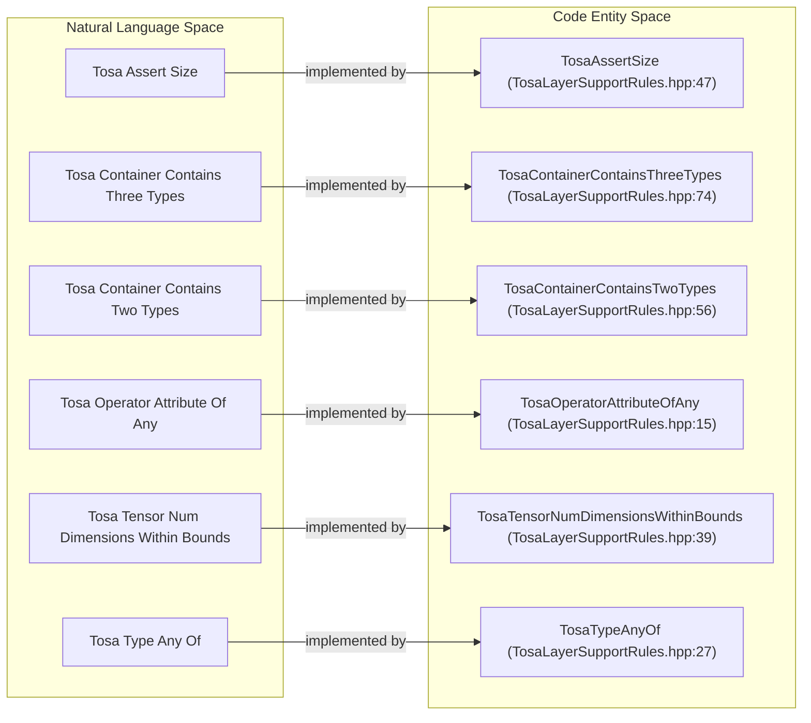
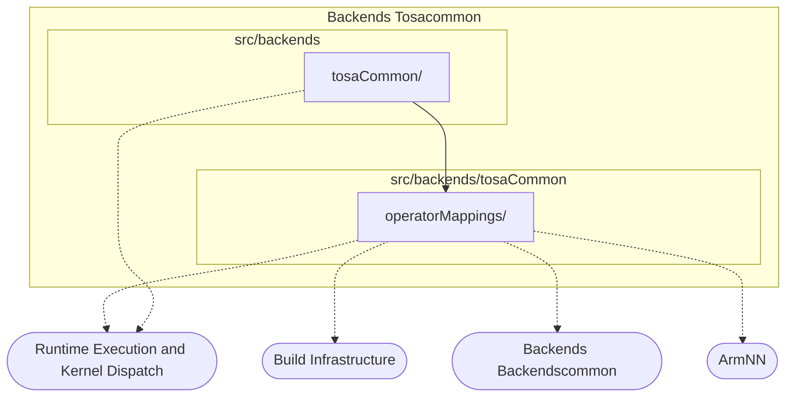
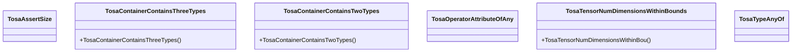
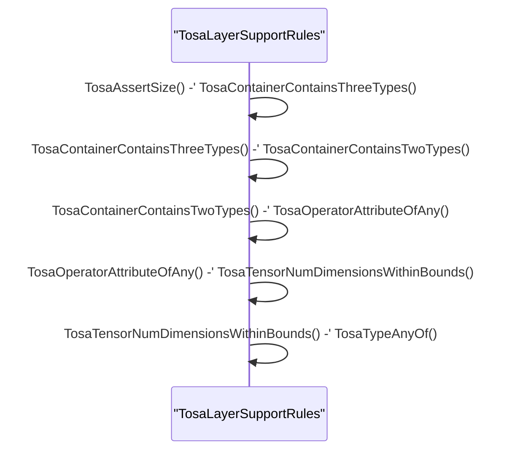

# Backends Tosacommon

↑ [[3-backend-delegation-and-hardware-providers|Backend Delegation and Hardware Providers]]

> Backends Tosacommon subsystem (`backends/tosaCommon`), covering 28 files and 86 symbols. Key symbols include `GetTosaTensorShape`, `GenerateUniqueOutputName`, `GetUniqueTosaMappingID`, `GenerateUniqueInputName`.

<details>
<summary>Relevant source files</summary>

The following files were used as context for generating this wiki page:

- [src/backends/tosaCommon/operatorMappings/TosaOperatorUtils.hpp](src/backends/tosaCommon/operatorMappings/TosaOperatorUtils.hpp)
- [src/backends/tosaCommon/TosaLayerSupportRules.hpp](src/backends/tosaCommon/TosaLayerSupportRules.hpp)
- [src/backends/tosaCommon/TosaMappings.cpp](src/backends/tosaCommon/TosaMappings.cpp)
- [src/backends/tosaCommon/operatorMappings/ElementwiseBinaryOperator.cpp](src/backends/tosaCommon/operatorMappings/ElementwiseBinaryOperator.cpp)
- [src/backends/tosaCommon/operatorMappings/BatchMatMulOperator.cpp](src/backends/tosaCommon/operatorMappings/BatchMatMulOperator.cpp)
- [src/backends/tosaCommon/operatorMappings/AvgPool2DIgnoreValueOperator.cpp](src/backends/tosaCommon/operatorMappings/AvgPool2DIgnoreValueOperator.cpp)
- [src/backends/tosaCommon/operatorMappings/BatchToSpaceOperator.cpp](src/backends/tosaCommon/operatorMappings/BatchToSpaceOperator.cpp)
- [src/backends/tosaCommon/operatorMappings/ConstantOperator.cpp](src/backends/tosaCommon/operatorMappings/ConstantOperator.cpp)
- [src/backends/tosaCommon/operatorMappings/ConcatOperator.cpp](src/backends/tosaCommon/operatorMappings/ConcatOperator.cpp)
- [src/backends/tosaCommon/operatorMappings/HardSwishOperator.cpp](src/backends/tosaCommon/operatorMappings/HardSwishOperator.cpp)
- [src/backends/tosaCommon/operatorMappings/Conv2dOperator.cpp](src/backends/tosaCommon/operatorMappings/Conv2dOperator.cpp)
- [src/backends/tosaCommon/operatorMappings/Conv3dOperator.cpp](src/backends/tosaCommon/operatorMappings/Conv3dOperator.cpp)
- [src/backends/tosaCommon/operatorMappings/DepthToSpaceOperator.cpp](src/backends/tosaCommon/operatorMappings/DepthToSpaceOperator.cpp)
- [src/backends/tosaCommon/operatorMappings/DepthwiseConv2dOperator.cpp](src/backends/tosaCommon/operatorMappings/DepthwiseConv2dOperator.cpp)
- [src/backends/tosaCommon/operatorMappings/DequantizeOperator.cpp](src/backends/tosaCommon/operatorMappings/DequantizeOperator.cpp)
- [src/backends/tosaCommon/operatorMappings/ExpOperator.cpp](src/backends/tosaCommon/operatorMappings/ExpOperator.cpp)
- [src/backends/tosaCommon/operatorMappings/FullyConnectedOperator.cpp](src/backends/tosaCommon/operatorMappings/FullyConnectedOperator.cpp)
- [src/backends/tosaCommon/operatorMappings/GatherOperator.cpp](src/backends/tosaCommon/operatorMappings/GatherOperator.cpp)
- [src/backends/tosaCommon/operatorMappings/GeluOperator.cpp](src/backends/tosaCommon/operatorMappings/GeluOperator.cpp)
- [src/backends/tosaCommon/operatorMappings/LeakyReluOperator.cpp](src/backends/tosaCommon/operatorMappings/LeakyReluOperator.cpp)
- [src/backends/tosaCommon/operatorMappings/LogOperator.cpp](src/backends/tosaCommon/operatorMappings/LogOperator.cpp)
- [src/backends/tosaCommon/operatorMappings/TosaRescaleOperatorUtils.hpp](src/backends/tosaCommon/operatorMappings/TosaRescaleOperatorUtils.hpp)
- [src/backends/tosaCommon/operatorMappings/PReluOperator.cpp](src/backends/tosaCommon/operatorMappings/PReluOperator.cpp)
- [src/backends/tosaCommon/operatorMappings/QuantizeOperator.cpp](src/backends/tosaCommon/operatorMappings/QuantizeOperator.cpp)
- [src/backends/tosaCommon/operatorMappings/PadOperator.cpp](src/backends/tosaCommon/operatorMappings/PadOperator.cpp)
- [src/backends/tosaCommon/operatorMappings/ReduceOperator.cpp](src/backends/tosaCommon/operatorMappings/ReduceOperator.cpp)
- [src/backends/tosaCommon/operatorMappings/Pooling2DOperator.cpp](src/backends/tosaCommon/operatorMappings/Pooling2DOperator.cpp)
- [src/backends/tosaCommon/operatorMappings/ReluOperator.cpp](src/backends/tosaCommon/operatorMappings/ReluOperator.cpp)

</details>

## Purpose and Scope

Backends Tosacommon subsystem (`backends/tosaCommon`), covering 28 files and 86 symbols. Key symbols include `GetTosaTensorShape`, `GenerateUniqueOutputName`, `GetUniqueTosaMappingID`, `GenerateUniqueInputName`.

Primary code entities analyzed on this page include `TosaAssertSize` ([src/backends/tosaCommon/TosaLayerSupportRules.hpp:47-54]()), `TosaContainerContainsThreeTypes` ([src/backends/tosaCommon/TosaLayerSupportRules.hpp:74-91]()), `TosaContainerContainsTwoTypes` ([src/backends/tosaCommon/TosaLayerSupportRules.hpp:56-72]()), `TosaOperatorAttributeOfAny` ([src/backends/tosaCommon/TosaLayerSupportRules.hpp:15-25]()), `TosaTensorNumDimensionsWithinBounds` ([src/backends/tosaCommon/TosaLayerSupportRules.hpp:39-45]()).

For the parent architectural layer, see [[3-backend-delegation-and-hardware-providers|Backend Delegation and Hardware Providers]]. Related sibling subsystems: [[3.1-backends-backendscommon|Backends Backendscommon]], [[3.2-backends-reference|Backends Reference]], [[3.3-backends-opencl|Backends OpenCL]], [[3.4-backends-aclcommon|Backends Aclcommon]].

Sources: [src/backends/tosaCommon/TosaLayerSupportRules.hpp:47-54](), [src/backends/tosaCommon/TosaLayerSupportRules.hpp:74-91](), [src/backends/tosaCommon/TosaLayerSupportRules.hpp:56-72](), [src/backends/tosaCommon/TosaLayerSupportRules.hpp:15-25]()

---

## 1. High-Level Architecture and Data Flow

### Natural Language Space to Code Entity Space Mapping

The following diagram maps domain concepts in this subsystem to their concrete code entities:



### Subsystem Component & Dependency Flow



Cross-subsystem call and import edges connect **Backends Tosacommon** with [[5-runtime-execution-and-kernel-dispatch|Runtime Execution and Kernel Dispatch]] (coupling `170.0`), [[7-glossary|Glossary]] (coupling `156.0`), [[2.1-build-infrastructure|Build Infrastructure]] (coupling `92.0`), [[5.1-armnn|ArmNN]] (coupling `89.0`), [[2-build-system-and-infrastructure|Build System and Infrastructure]] (coupling `66.0`).

| Module Directory | Files | Primary Code Entities | Source Citations |
|---|---|---|---|
| `src/backends/tosaCommon/operatorMappings` | 26 | `GetTosaTensorShape`, `GenerateUniqueOutputName`, `GenerateUniqueInputName`, `ArmNNToDType` | [src/backends/tosaCommon/operatorMappings/TosaOperatorUtils.hpp:83-91]() [src/backends/tosaCommon/operatorMappings/TosaOperatorUtils.hpp:137-151]() |
| `src/backends/tosaCommon` | 2 | `TosaAssertSize`, `TosaContainerContainsThreeTypes`, `TosaContainerContainsTwoTypes`, `TosaOperatorAttributeOfAny` | [src/backends/tosaCommon/TosaLayerSupportRules.hpp:47-54]() [src/backends/tosaCommon/TosaLayerSupportRules.hpp:74-91]() |

Sources: [src/backends/tosaCommon/TosaLayerSupportRules.hpp:47-54](), [src/backends/tosaCommon/TosaLayerSupportRules.hpp:74-91](), [src/backends/tosaCommon/TosaLayerSupportRules.hpp:56-72](), [src/backends/tosaCommon/TosaLayerSupportRules.hpp:15-25](), [src/backends/tosaCommon/TosaLayerSupportRules.hpp:39-45]()

---

## 2. Core Data Structures and Implementation Details

### Class and Entity Relationship Diagram



### `TosaAssertSize` (Class)

- **Source Location**: [src/backends/tosaCommon/TosaLayerSupportRules.hpp:47-54]()
- **Declaration**: `Class TosaAssertSize`
- **Graph Centrality**: fan-in `0` callers, fan-out `0` callees

```cpp
// src/backends/tosaCommon/TosaLayerSupportRules.hpp:47-54
struct TosaAssertSize : public Rule
{
    template<typename Container>
    explicit TosaAssertSize(const Container& c1, const Container& c2)
    {
        m_Res = (c1.size() == c2.size());
    }
};
```

### `TosaContainerContainsThreeTypes` (Class)

- **Source Location**: [src/backends/tosaCommon/TosaLayerSupportRules.hpp:74-91]()
- **Declaration**: `Class TosaContainerContainsThreeTypes`
- **Graph Centrality**: fan-in `0` callers, fan-out `0` callees

```cpp
// src/backends/tosaCommon/TosaLayerSupportRules.hpp:74-89
struct TosaContainerContainsThreeTypes : public Rule
{
    explicit TosaContainerContainsThreeTypes(std::tuple<DType, DType, DType>& check,
                                             const std::vector<std::tuple<DType, DType, DType>>& c)
    {
        for (auto item: c)
        {
            if (std::get<0>(check) == std::get<0>(item) &&
                std::get<1>(check) == std::get<1>(item) &&
                std::get<2>(check) == std::get<2>(item))
            {
                m_Res = true;
                return;
            }
        }
        m_Res = false;
```

### `TosaContainerContainsTwoTypes` (Class)

- **Source Location**: [src/backends/tosaCommon/TosaLayerSupportRules.hpp:56-72]()
- **Declaration**: `Class TosaContainerContainsTwoTypes`
- **Graph Centrality**: fan-in `0` callers, fan-out `0` callees

```cpp
// src/backends/tosaCommon/TosaLayerSupportRules.hpp:56-71
struct TosaContainerContainsTwoTypes : public Rule
{
    explicit TosaContainerContainsTwoTypes(std::tuple<DType, DType>& check,
                                           const std::vector<std::tuple<DType, DType>>& c)
    {
        for (auto item: c)
        {
            if (std::get<0>(check) == std::get<0>(item) &&
                std::get<1>(check) == std::get<1>(item))
            {
                m_Res = true;
                return;
            }
        }
        m_Res = false;
    }
```

### `TosaOperatorAttributeOfAny` (Class)

- **Source Location**: [src/backends/tosaCommon/TosaLayerSupportRules.hpp:15-25]()
- **Declaration**: `Class TosaOperatorAttributeOfAny`
- **Graph Centrality**: fan-in `0` callers, fan-out `0` callees

### `TosaTensorNumDimensionsWithinBounds` (Class)

- **Source Location**: [src/backends/tosaCommon/TosaLayerSupportRules.hpp:39-45]()
- **Declaration**: `Class TosaTensorNumDimensionsWithinBounds`
- **Graph Centrality**: fan-in `0` callers, fan-out `0` callees

### `GetTosaTensorShape` (Function)

- **Source Location**: [src/backends/tosaCommon/operatorMappings/TosaOperatorUtils.hpp:83-91]()
- **Declaration**: `(const TensorShape& shape)`
- **Graph Centrality**: fan-in `39` callers, fan-out `2` callees
- **Responsibility**: // Function to return Tosa tensor shape from input ArmNN tensor shape.

Sources: [src/backends/tosaCommon/TosaLayerSupportRules.hpp:47-54](), [src/backends/tosaCommon/TosaLayerSupportRules.hpp:74-91](), [src/backends/tosaCommon/TosaLayerSupportRules.hpp:56-72](), [src/backends/tosaCommon/TosaLayerSupportRules.hpp:15-25](), [src/backends/tosaCommon/TosaLayerSupportRules.hpp:39-45]()

---

## 3. Execution and Call Flow

The sequence diagram below traces the runtime/compile-time call chain across components in this module:



Sources: [src/backends/tosaCommon/TosaLayerSupportRules.hpp:47-54](), [src/backends/tosaCommon/TosaLayerSupportRules.hpp:74-91](), [src/backends/tosaCommon/TosaLayerSupportRules.hpp:56-72](), [src/backends/tosaCommon/TosaLayerSupportRules.hpp:15-25](), [src/backends/tosaCommon/TosaLayerSupportRules.hpp:39-45]()

---

## 4. Key API and Symbol Reference

| Code Entity | Kind | Location | Fan-In / Out | Role & Signature |
|---|---|---|---|---|
| `TosaAssertSize` | Class | [src/backends/tosaCommon/TosaLayerSupportRules.hpp:47-54]() | `0` / `0` | — |
| `TosaContainerContainsThreeTypes` | Class | [src/backends/tosaCommon/TosaLayerSupportRules.hpp:74-91]() | `0` / `0` | — |
| `TosaContainerContainsTwoTypes` | Class | [src/backends/tosaCommon/TosaLayerSupportRules.hpp:56-72]() | `0` / `0` | — |
| `TosaOperatorAttributeOfAny` | Class | [src/backends/tosaCommon/TosaLayerSupportRules.hpp:15-25]() | `0` / `0` | — |
| `TosaTensorNumDimensionsWithinBounds` | Class | [src/backends/tosaCommon/TosaLayerSupportRules.hpp:39-45]() | `0` / `0` | — |
| `TosaTypeAnyOf` | Class | [src/backends/tosaCommon/TosaLayerSupportRules.hpp:27-37]() | `0` / `0` | — |
| `GetTosaTensorShape` | Function | [src/backends/tosaCommon/operatorMappings/TosaOperatorUtils.hpp:83-91]() | `39` / `2` | // Function to return Tosa tensor shape from input ArmNN tensor shape. |
| `GenerateUniqueOutputName` | Function | [src/backends/tosaCommon/operatorMappings/TosaOperatorUtils.hpp:137-151]() | `37` / `5` | // Function that generates unique output name using the layer type, input slot and layer guid. |
| `GenerateUniqueInputName` | Function | [src/backends/tosaCommon/operatorMappings/TosaOperatorUtils.hpp:113-121]() | `37` / `4` | // Function that generates unique name for the parent layer from the child layer input slot. |
| `ArmNNToDType` | Function | [src/backends/tosaCommon/operatorMappings/TosaOperatorUtils.hpp:26-53]() | `38` / `0` | // Function to return Tosa datatype from input ArmNN datatype. |
| `GetUniqueTosaMappingID` | Function | [src/backends/tosaCommon/operatorMappings/TosaOperatorUtils.hpp:155-158]() | `39` / `1` | () |
| `GetTosaMapping` | Function | [src/backends/tosaCommon/TosaMappings.cpp:21-275]() | `2` / `45` | (const Layer* layer, const LayerType type, const std::vector<const TensorInfo*>& inputs, const std::vector<con |
| `GetInputSlicedToItsUsedSize` | Function | [src/backends/tosaCommon/operatorMappings/TosaOperatorUtils.hpp:602-655]() | `5` / `8` | // This function is paraphrased from: |
| `ConvertBatchMatMulToTosaOperator` | Function | [src/backends/tosaCommon/operatorMappings/BatchMatMulOperator.cpp:14-306]() | `1` / `15` | // This function is paraphrased from: |
| `ConvertQuantizeToTosaOperator` | Function | [src/backends/tosaCommon/operatorMappings/QuantizeOperator.cpp:17-200]() | `1` / `22` | // This function is paraphrased from: |
| `ConvertHardSwishToTosaOperator` | Function | [src/backends/tosaCommon/operatorMappings/HardSwishOperator.cpp:160-241]() | `1` / `13` | // This function is paraphrased from: |
| `CreateRescaleTosaOperator` | Function | [src/backends/tosaCommon/operatorMappings/TosaRescaleOperatorUtils.hpp:197-235]() | `9` / `3` | /// @brief Creates a Tosa rescale operator. |
| `ConvertConv3dToTosaOperator` | Function | [src/backends/tosaCommon/operatorMappings/Conv3dOperator.cpp:16-228]() | `1` / `13` | // This function is paraphrased from: |
| `ConvertReduceToTosaOperator` | Function | [src/backends/tosaCommon/operatorMappings/ReduceOperator.cpp:17-387]() | `1` / `19` | // This function is paraphrased from: |
| `ConvertFullyConnectedToTosaOperator` | Function | [src/backends/tosaCommon/operatorMappings/FullyConnectedOperator.cpp:16-197]() | `1` / `14` | // This function is paraphrased from: |
| `ConvertGatherToTosaOperator` | Function | [src/backends/tosaCommon/operatorMappings/GatherOperator.cpp:16-343]() | `1` / `14` | // This function is paraphrased from: |
| `getTosaConstHardSwish8bitTable` | Function | [src/backends/tosaCommon/operatorMappings/HardSwishOperator.cpp:90-156]() | `1` / `10` | // This function is paraphrased from: |

Sources: [src/backends/tosaCommon/TosaLayerSupportRules.hpp:47-54](), [src/backends/tosaCommon/TosaLayerSupportRules.hpp:74-91](), [src/backends/tosaCommon/TosaLayerSupportRules.hpp:56-72](), [src/backends/tosaCommon/TosaLayerSupportRules.hpp:15-25](), [src/backends/tosaCommon/TosaLayerSupportRules.hpp:39-45](), [src/backends/tosaCommon/TosaLayerSupportRules.hpp:27-37]()

---

## 5. Official Documentation and Design Context

The following linked documentation sections from `llm-wiki` (`raw/`) provide additional architectural context, tutorials, and design invariants for this subsystem:

- **Backend Delegation and Hardware Providers** ([wiki/3-backend-delegation-and-hardware-providers.md](), score `154.0161`) (sections: `Backend Delegation and Hardware Providers`, `Purpose and Scope`, `System Mapping: Natural Language Space to Code Entity Space`, `1. Backends Backendscommon`): # Backend Delegation and Hardware Providers > Architectural overview of Backend Delegation and Hardware Providers, spanning 150 source files and 2618 code symbols across 6 subsystems. <details> <summary>Relevant source files</summary> The following files were used as context for generating this wiki page: - [src/backends/aclCommon/ArmComputeTensorUtils.hpp](src/backends/aclCommon/ArmComputeTensorUtils.hpp) - [src/bac
- **ArmNN DeepWiki** ([wiki/index.md](), score `127.6634`) (sections: `ArmNN DeepWiki`, `Pages`): # ArmNN DeepWiki Generated from `home-jason-Project-deepwiki-armnn` at commit `2b61cecc9df7` (2026-11-14T15:13:53+00:00). ## Pages - [[1-overview|Overview]] — End-to-end architecture overview of ArmNN: core subsystems, compilation/execution pipeline, entry points, and cross-module dependencies. - [[2-build-system-and-infrastructure|Build System and Infrastructure]] — Architectural overview of Build System and Infrast
- **ArmNN** ([wiki/5.1-armnn.md](), score `117.2534`) (sections: `ArmNN`, `Purpose and Scope`, `1. High-Level Architecture and Data Flow`, `Natural Language Space to Code Entity Space Mapping`): # ArmNN ↑ [[5-runtime-execution-and-kernel-dispatch|Runtime Execution and Kernel Dispatch]] > ArmNN subsystem (`src/armnn`), covering 28 files and 1007 symbols. Key symbols include `SetTensorInfo`, `Connect`, `end`, `GetName`. <details> <summary>Relevant source files</summary> The following files were used as context for generating this wiki page: - [src/armnn/Tensor.cpp](src/armnn/Tensor.cpp) - [src/armnn/Layer.cpp]
- **Overview** ([wiki/1-overview.md](), score `92.4621`) (sections: `Overview`, `1. Architecture Overview & System Component Map`, `Core Concept to Code Entity Mapping`, `Core Compilation & Runtime Class Hierarchy`): # Overview > End-to-end architecture overview of ArmNN: core subsystems, compilation/execution pipeline, entry points, and cross-module dependencies. <details> <summary>Relevant source files</summary> The following files were used as context for generating this wiki page: - [src/armnn/Tensor.cpp](src/armnn/Tensor.cpp) - [include/armnn/Exceptions.hpp](include/armnn/Exceptions.hpp) - [include/armnn/Tensor.hpp](include/

Sources: [wiki/3-backend-delegation-and-hardware-providers.md](), [wiki/index.md](), [wiki/5.1-armnn.md](), [wiki/1-overview.md]()

## Related pages

- [[3-backend-delegation-and-hardware-providers|Backend Delegation and Hardware Providers]]
- [[3.1-backends-backendscommon|Backends Backendscommon]]
- [[3.2-backends-reference|Backends Reference]]
- [[3.3-backends-opencl|Backends OpenCL]]
- [[3.4-backends-aclcommon|Backends Aclcommon]]
- [[3.6-other-backends|Other Backends]]
- [[5-runtime-execution-and-kernel-dispatch|Runtime Execution and Kernel Dispatch]]
- [[5.2-armnn|ArmNN]]

## Related documents

- `wiki/3-backend-delegation-and-hardware-providers.md` — Backend Delegation and Hardware Providers (score 154.0161, via bm25)
- `wiki/index.md` — ArmNN DeepWiki (score 127.6634, via bm25)
- `wiki/5.1-armnn.md` — ArmNN (score 117.2534, via bm25)
- `wiki/1-overview.md` — Overview (score 92.4621, via bm25)
- `wiki/3.1-backends-backendscommon.md` — Backends Backendscommon (score 50.0387, via bm25)

## Sources

- [`src/backends/tosaCommon/operatorMappings/TosaOperatorUtils.hpp`](https://github.com/ARM-software/armnn/blob/branches/armnn_24_11/src/backends/tosaCommon/operatorMappings/TosaOperatorUtils.hpp)
- [`src/backends/tosaCommon/TosaLayerSupportRules.hpp`](https://github.com/ARM-software/armnn/blob/branches/armnn_24_11/src/backends/tosaCommon/TosaLayerSupportRules.hpp)
- [`src/backends/tosaCommon/TosaMappings.cpp`](https://github.com/ARM-software/armnn/blob/branches/armnn_24_11/src/backends/tosaCommon/TosaMappings.cpp)
- [`src/backends/tosaCommon/operatorMappings/ElementwiseBinaryOperator.cpp`](https://github.com/ARM-software/armnn/blob/branches/armnn_24_11/src/backends/tosaCommon/operatorMappings/ElementwiseBinaryOperator.cpp)
- [`src/backends/tosaCommon/operatorMappings/BatchMatMulOperator.cpp`](https://github.com/ARM-software/armnn/blob/branches/armnn_24_11/src/backends/tosaCommon/operatorMappings/BatchMatMulOperator.cpp)
- [`src/backends/tosaCommon/operatorMappings/AvgPool2DIgnoreValueOperator.cpp`](https://github.com/ARM-software/armnn/blob/branches/armnn_24_11/src/backends/tosaCommon/operatorMappings/AvgPool2DIgnoreValueOperator.cpp)
- [`src/backends/tosaCommon/operatorMappings/BatchToSpaceOperator.cpp`](https://github.com/ARM-software/armnn/blob/branches/armnn_24_11/src/backends/tosaCommon/operatorMappings/BatchToSpaceOperator.cpp)
- [`src/backends/tosaCommon/operatorMappings/ConstantOperator.cpp`](https://github.com/ARM-software/armnn/blob/branches/armnn_24_11/src/backends/tosaCommon/operatorMappings/ConstantOperator.cpp)
- [`src/backends/tosaCommon/operatorMappings/ConcatOperator.cpp`](https://github.com/ARM-software/armnn/blob/branches/armnn_24_11/src/backends/tosaCommon/operatorMappings/ConcatOperator.cpp)
- [`src/backends/tosaCommon/operatorMappings/HardSwishOperator.cpp`](https://github.com/ARM-software/armnn/blob/branches/armnn_24_11/src/backends/tosaCommon/operatorMappings/HardSwishOperator.cpp)
- [`src/backends/tosaCommon/operatorMappings/Conv2dOperator.cpp`](https://github.com/ARM-software/armnn/blob/branches/armnn_24_11/src/backends/tosaCommon/operatorMappings/Conv2dOperator.cpp)
- [`src/backends/tosaCommon/operatorMappings/Conv3dOperator.cpp`](https://github.com/ARM-software/armnn/blob/branches/armnn_24_11/src/backends/tosaCommon/operatorMappings/Conv3dOperator.cpp)
- [`src/backends/tosaCommon/operatorMappings/DepthToSpaceOperator.cpp`](https://github.com/ARM-software/armnn/blob/branches/armnn_24_11/src/backends/tosaCommon/operatorMappings/DepthToSpaceOperator.cpp)
- [`src/backends/tosaCommon/operatorMappings/DepthwiseConv2dOperator.cpp`](https://github.com/ARM-software/armnn/blob/branches/armnn_24_11/src/backends/tosaCommon/operatorMappings/DepthwiseConv2dOperator.cpp)
- [`src/backends/tosaCommon/operatorMappings/DequantizeOperator.cpp`](https://github.com/ARM-software/armnn/blob/branches/armnn_24_11/src/backends/tosaCommon/operatorMappings/DequantizeOperator.cpp)
- [`src/backends/tosaCommon/operatorMappings/ExpOperator.cpp`](https://github.com/ARM-software/armnn/blob/branches/armnn_24_11/src/backends/tosaCommon/operatorMappings/ExpOperator.cpp)
- [`src/backends/tosaCommon/operatorMappings/FullyConnectedOperator.cpp`](https://github.com/ARM-software/armnn/blob/branches/armnn_24_11/src/backends/tosaCommon/operatorMappings/FullyConnectedOperator.cpp)
- [`src/backends/tosaCommon/operatorMappings/GatherOperator.cpp`](https://github.com/ARM-software/armnn/blob/branches/armnn_24_11/src/backends/tosaCommon/operatorMappings/GatherOperator.cpp)
- [`src/backends/tosaCommon/operatorMappings/GeluOperator.cpp`](https://github.com/ARM-software/armnn/blob/branches/armnn_24_11/src/backends/tosaCommon/operatorMappings/GeluOperator.cpp)
- [`src/backends/tosaCommon/operatorMappings/LeakyReluOperator.cpp`](https://github.com/ARM-software/armnn/blob/branches/armnn_24_11/src/backends/tosaCommon/operatorMappings/LeakyReluOperator.cpp)
- [`src/backends/tosaCommon/operatorMappings/LogOperator.cpp`](https://github.com/ARM-software/armnn/blob/branches/armnn_24_11/src/backends/tosaCommon/operatorMappings/LogOperator.cpp)
- [`src/backends/tosaCommon/operatorMappings/TosaRescaleOperatorUtils.hpp`](https://github.com/ARM-software/armnn/blob/branches/armnn_24_11/src/backends/tosaCommon/operatorMappings/TosaRescaleOperatorUtils.hpp)
- [`src/backends/tosaCommon/operatorMappings/PReluOperator.cpp`](https://github.com/ARM-software/armnn/blob/branches/armnn_24_11/src/backends/tosaCommon/operatorMappings/PReluOperator.cpp)
- [`src/backends/tosaCommon/operatorMappings/QuantizeOperator.cpp`](https://github.com/ARM-software/armnn/blob/branches/armnn_24_11/src/backends/tosaCommon/operatorMappings/QuantizeOperator.cpp)
- [`src/backends/tosaCommon/operatorMappings/PadOperator.cpp`](https://github.com/ARM-software/armnn/blob/branches/armnn_24_11/src/backends/tosaCommon/operatorMappings/PadOperator.cpp)
- [`src/backends/tosaCommon/operatorMappings/ReduceOperator.cpp`](https://github.com/ARM-software/armnn/blob/branches/armnn_24_11/src/backends/tosaCommon/operatorMappings/ReduceOperator.cpp)
- [`src/backends/tosaCommon/operatorMappings/Pooling2DOperator.cpp`](https://github.com/ARM-software/armnn/blob/branches/armnn_24_11/src/backends/tosaCommon/operatorMappings/Pooling2DOperator.cpp)
- [`src/backends/tosaCommon/operatorMappings/ReluOperator.cpp`](https://github.com/ARM-software/armnn/blob/branches/armnn_24_11/src/backends/tosaCommon/operatorMappings/ReluOperator.cpp)


## Dynamic Knowledge Links (Code Graph ↔ LLM-Wiki / RAG)

### Linked Architecture & Design Documents

| Document | Match Channel | Score | Shared Code Symbols |
|---|---|---|---|
| [[3-backend-delegation-and-hardware-providers|Backend Delegation and Hardware Providers]] | `bm25+entity(2)` | `157.016` | `GetTosaTensorShape`, `GetUniqueTosaMappingID` |
| [[index|ArmNN DeepWiki]] | `bm25` | `127.663` | *(lexical/graph match)* |
| [[5.1-armnn|ArmNN]] | `bm25+entity(4)` | `123.253` | `GenerateUniqueInputName`, `GenerateUniqueOutputName`, `GetTosaTensorShape`, `GetUniqueTosaMappingID` |
| [[3.2-backends-reference|Backends Reference]] | `wikilink:3.5-backends-tosacommon` | `111.812` | *(lexical/graph match)* |
| [[3.3-backends-opencl|Backends OpenCL]] | `wikilink:3.5-backends-tosacommon` | `111.812` | *(lexical/graph match)* |
| [[3.4-backends-aclcommon|Backends Aclcommon]] | `wikilink:3.5-backends-tosacommon` | `111.812` | *(lexical/graph match)* |

### High-Centrality Bridge Symbols (CBM Graph)

| Symbol | Kind | Source Location | Fan-In / Fan-Out |
|---|---|---|---|
| `TosaAssertSize` | Class | [src/backends/tosaCommon/TosaLayerSupportRules.hpp:47-54]() | in: `0` / out: `0` |
| `TosaContainerContainsThreeTypes` | Class | [src/backends/tosaCommon/TosaLayerSupportRules.hpp:74-91]() | in: `0` / out: `0` |
| `TosaContainerContainsTwoTypes` | Class | [src/backends/tosaCommon/TosaLayerSupportRules.hpp:56-72]() | in: `0` / out: `0` |
| `TosaOperatorAttributeOfAny` | Class | [src/backends/tosaCommon/TosaLayerSupportRules.hpp:15-25]() | in: `0` / out: `0` |
| `TosaTensorNumDimensionsWithinBounds` | Class | [src/backends/tosaCommon/TosaLayerSupportRules.hpp:39-45]() | in: `0` / out: `0` |
| `TosaTypeAnyOf` | Class | [src/backends/tosaCommon/TosaLayerSupportRules.hpp:27-37]() | in: `0` / out: `0` |

Sources: [src/backends/tosaCommon/TosaLayerSupportRules.hpp:47-54](), [src/backends/tosaCommon/TosaLayerSupportRules.hpp:74-91](), [src/backends/tosaCommon/TosaLayerSupportRules.hpp:56-72](), [src/backends/tosaCommon/TosaLayerSupportRules.hpp:15-25]()

### Cross-Subsystem Coupling

- [[5-runtime-execution-and-kernel-dispatch|Runtime Execution and Kernel Dispatch]] — call/import coupling weight `170.0`
- [[7-glossary|Glossary]] — call/import coupling weight `156.0`
- [[2.1-build-infrastructure|Build Infrastructure]] — call/import coupling weight `92.0`
- [[5.1-armnn|ArmNN]] — call/import coupling weight `89.0`
- [[2-build-system-and-infrastructure|Build System and Infrastructure]] — call/import coupling weight `66.0`
- [[5.2-armnn|ArmNN]] — call/import coupling weight `62.0`
