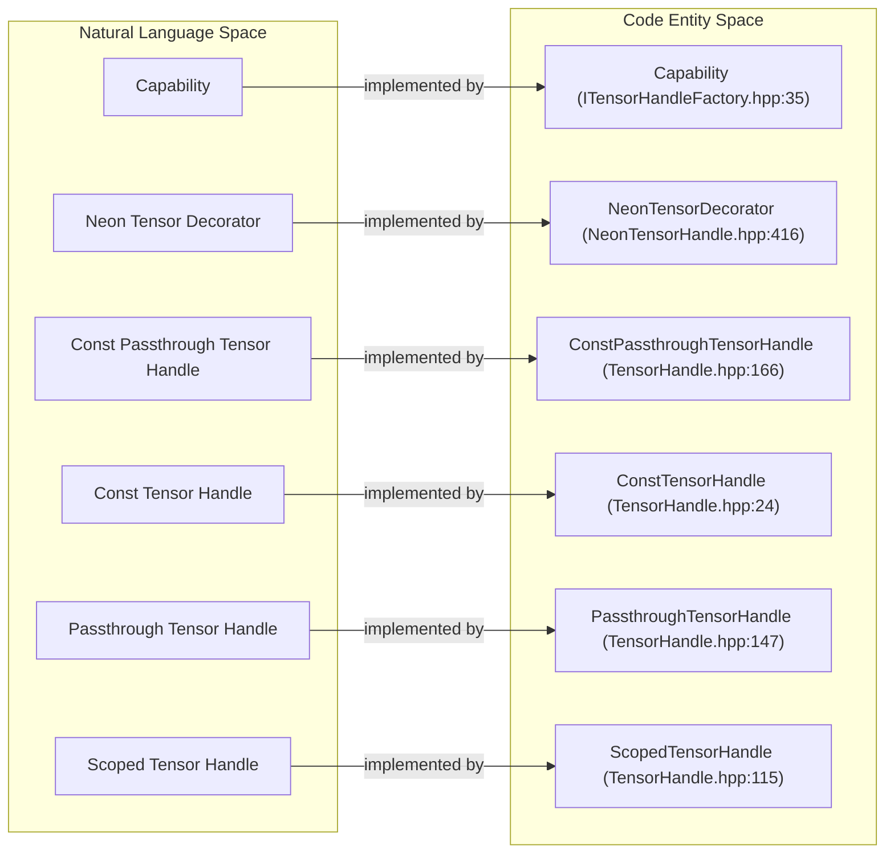
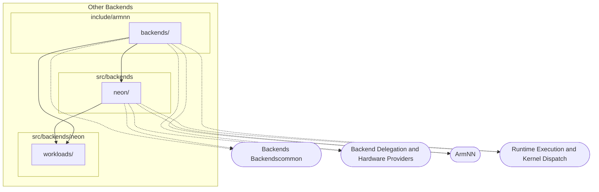
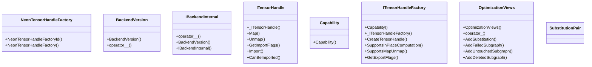
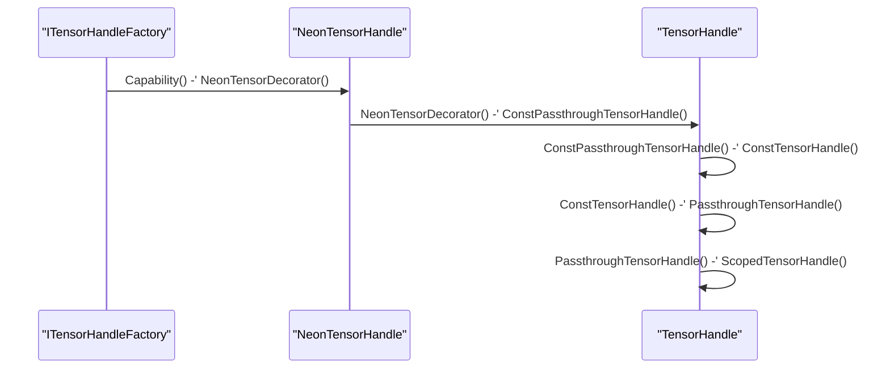

# Other Backends

↑ [[3-backend-delegation-and-hardware-providers|Backend Delegation and Hardware Providers]]

> Other Backends subsystem (consolidating `Backends Neon`, `ArmNN Backends`, `Backends Tosareference`, `Backends Dynamic`), covering 28 files and 849 symbols. Key symbols include `IsNeonBackendSupported`, `info`, `IsLayerTypeSupported`, `CreateTensorHandle`.

<details>
<summary>Relevant source files</summary>

The following files were used as context for generating this wiki page:

- [include/armnn/backends/ITensorHandleFactory.hpp](include/armnn/backends/ITensorHandleFactory.hpp)
- [src/backends/neon/NeonTensorHandle.cpp](src/backends/neon/NeonTensorHandle.cpp)
- [src/backends/neon/NeonTensorHandle.hpp](src/backends/neon/NeonTensorHandle.hpp)
- [include/armnn/backends/OptimizationViews.hpp](include/armnn/backends/OptimizationViews.hpp)
- [src/backends/neon/NeonBackend.cpp](src/backends/neon/NeonBackend.cpp)
- [src/backends/neon/NeonLayerSupport.cpp](src/backends/neon/NeonLayerSupport.cpp)
- [include/armnn/backends/TensorHandle.hpp](include/armnn/backends/TensorHandle.hpp)
- [src/backends/neon/NeonBackend.hpp](src/backends/neon/NeonBackend.hpp)
- [src/backends/neon/NeonInterceptorScheduler.hpp](src/backends/neon/NeonInterceptorScheduler.hpp)
- [src/backends/neon/NeonBackendModelContext.hpp](src/backends/neon/NeonBackendModelContext.hpp)
- [src/backends/neon/NeonTensorHandleFactory.hpp](src/backends/neon/NeonTensorHandleFactory.hpp)
- [src/backends/neon/NeonLayerSupport.hpp](src/backends/neon/NeonLayerSupport.hpp)
- [src/backends/neon/NeonTimer.hpp](src/backends/neon/NeonTimer.hpp)
- [include/armnn/backends/IBackendInternal.hpp](include/armnn/backends/IBackendInternal.hpp)
- [include/armnn/backends/ITensorHandle.hpp](include/armnn/backends/ITensorHandle.hpp)
- [include/armnn/backends/Workload.hpp](include/armnn/backends/Workload.hpp)
- [src/backends/neon/NeonBackendModelContext.cpp](src/backends/neon/NeonBackendModelContext.cpp)
- [src/backends/neon/NeonBackendOptimizationUtils.hpp](src/backends/neon/NeonBackendOptimizationUtils.hpp)
- [src/backends/neon/NeonTensorHandleFactory.cpp](src/backends/neon/NeonTensorHandleFactory.cpp)
- [src/backends/neon/workloads/NeonBaseWorkload.hpp](src/backends/neon/workloads/NeonBaseWorkload.hpp)
- [src/backends/neon/NeonInterceptorScheduler.cpp](src/backends/neon/NeonInterceptorScheduler.cpp)
- [src/backends/neon/NeonWorkloadFactory.cpp](src/backends/neon/NeonWorkloadFactory.cpp)
- [include/armnn/backends/WorkloadData.hpp](include/armnn/backends/WorkloadData.hpp)
- [src/backends/neon/workloads/NeonAbsWorkload.hpp](src/backends/neon/workloads/NeonAbsWorkload.hpp)
- [src/backends/neon/workloads/NeonActivationWorkload.hpp](src/backends/neon/workloads/NeonActivationWorkload.hpp)
- [src/backends/neon/NeonTimer.cpp](src/backends/neon/NeonTimer.cpp)
- [src/backends/neon/workloads/NeonAdditionWorkload.hpp](src/backends/neon/workloads/NeonAdditionWorkload.hpp)
- [src/backends/neon/workloads/NeonArgMinMaxWorkload.hpp](src/backends/neon/workloads/NeonArgMinMaxWorkload.hpp)

</details>

## Purpose and Scope

Other Backends subsystem (consolidating `Backends Neon`, `ArmNN Backends`, `Backends Tosareference`, `Backends Dynamic`), covering 28 files and 849 symbols. Key symbols include `IsNeonBackendSupported`, `info`, `IsLayerTypeSupported`, `CreateTensorHandle`.

Primary code entities analyzed on this page include `Capability` ([include/armnn/backends/ITensorHandleFactory.hpp:35-44]()), `NeonTensorDecorator` ([src/backends/neon/NeonTensorHandle.hpp:416-443]()), `ConstPassthroughTensorHandle` ([include/armnn/backends/TensorHandle.hpp:166-176]()), `ConstTensorHandle` ([include/armnn/backends/TensorHandle.hpp:24-73]()), `PassthroughTensorHandle` ([include/armnn/backends/TensorHandle.hpp:147-157]()).

For the parent architectural layer, see [[3-backend-delegation-and-hardware-providers|Backend Delegation and Hardware Providers]]. Related sibling subsystems: [[3.1-backends-backendscommon|Backends Backendscommon]], [[3.2-backends-reference|Backends Reference]], [[3.3-backends-opencl|Backends OpenCL]], [[3.4-backends-aclcommon|Backends Aclcommon]].

Sources: [include/armnn/backends/ITensorHandleFactory.hpp:35-44](), [src/backends/neon/NeonTensorHandle.hpp:416-443](), [include/armnn/backends/TensorHandle.hpp:166-176](), [include/armnn/backends/TensorHandle.hpp:24-73]()

---

## 1. High-Level Architecture and Data Flow

### Natural Language Space to Code Entity Space Mapping

The following diagram maps domain concepts in this subsystem to their concrete code entities:



### Subsystem Component & Dependency Flow



Cross-subsystem call and import edges connect **Other Backends** with [[5-runtime-execution-and-kernel-dispatch|Runtime Execution and Kernel Dispatch]] (coupling `183.0`), [[3-backend-delegation-and-hardware-providers|Backend Delegation and Hardware Providers]] (coupling `129.0`), [[7-glossary|Glossary]] (coupling `124.0`), [[5.2-armnn|ArmNN]] (coupling `115.0`), [[3.4-backends-aclcommon|Backends Aclcommon]] (coupling `81.0`).

| Module Directory | Files | Primary Code Entities | Source Citations |
|---|---|---|---|
| `src/backends/neon` | 16 | `NeonTensorDecorator`, `NeonBackendModelContext`, `NeonSubTensorHandle`, `NeonTensorHandle` | [src/backends/neon/NeonTensorHandle.hpp:416-443]() [src/backends/neon/NeonBackendModelContext.hpp:23-39]() |
| `include/armnn/backends` | 7 | `Capability`, `ConstPassthroughTensorHandle`, `ConstTensorHandle`, `PassthroughTensorHandle` | [include/armnn/backends/ITensorHandleFactory.hpp:35-44]() [include/armnn/backends/TensorHandle.hpp:166-176]() |
| `src/backends/neon/workloads` | 5 | `NeonBaseWorkload`, `NeonAbsWorkload`, `NeonActivationWorkload`, `NeonAdditionWorkload` | [src/backends/neon/workloads/NeonBaseWorkload.hpp:13-60]() [src/backends/neon/workloads/NeonAbsWorkload.hpp:18-26]() |

Sources: [include/armnn/backends/ITensorHandleFactory.hpp:35-44](), [src/backends/neon/NeonTensorHandle.hpp:416-443](), [include/armnn/backends/TensorHandle.hpp:166-176](), [include/armnn/backends/TensorHandle.hpp:24-73](), [include/armnn/backends/TensorHandle.hpp:147-157]()

---

## 2. Core Data Structures and Implementation Details

### Class and Entity Relationship Diagram



### `Capability` (Class)

- **Source Location**: [include/armnn/backends/ITensorHandleFactory.hpp:35-44]()
- **Declaration**: `Class Capability`
- **Graph Centrality**: fan-in `0` callers, fan-out `0` callees
- **Responsibility**: /// Capability of the TensorHandleFactory

```cpp
// include/armnn/backends/ITensorHandleFactory.hpp:35-44
struct Capability
{
    Capability(CapabilityClass capabilityClass, bool value)
        : m_CapabilityClass(capabilityClass)
        , m_Value(value)
    {}

    CapabilityClass m_CapabilityClass;
    bool            m_Value;
};
```

### `NeonTensorDecorator` (Class)

- **Source Location**: [src/backends/neon/NeonTensorHandle.hpp:416-443]()
- **Declaration**: `Class NeonTensorDecorator`
- **Graph Centrality**: fan-in `0` callers, fan-out `0` callees
- **Responsibility**: /// NeonTensorDecorator wraps an existing Neon tensor allowing us to override the TensorInfo for it

```cpp
// src/backends/neon/NeonTensorHandle.hpp:416-431
class NeonTensorDecorator : public arm_compute::ITensor
{
public:
    NeonTensorDecorator();

    NeonTensorDecorator(arm_compute::ITensor* original, const TensorInfo& info);

    ~NeonTensorDecorator() = default;

    NeonTensorDecorator(const NeonTensorDecorator&) = delete;

    NeonTensorDecorator& operator=(const NeonTensorDecorator&) = delete;

    NeonTensorDecorator(NeonTensorDecorator&&) = default;

    NeonTensorDecorator& operator=(NeonTensorDecorator&&) = default;
```

### `ConstPassthroughTensorHandle` (Class)

- **Source Location**: [include/armnn/backends/TensorHandle.hpp:166-176]()
- **Declaration**: `Class ConstPassthroughTensorHandle`
- **Graph Centrality**: fan-in `0` callers, fan-out `0` callees
- **Responsibility**: // A ConstTensorHandle that wraps an already allocated memory region. // // This allows users to pass in const memory to a network. // Clients must make sure the passed in memory region stays alive for the lifetime of // the PassthroughTensorHandle instance. // // Note there is no polymorphism to/from PassthroughTensor

```cpp
// include/armnn/backends/TensorHandle.hpp:166-176
class ConstPassthroughTensorHandle : public ConstTensorHandle
{
public:
    ConstPassthroughTensorHandle(const TensorInfo& tensorInfo, const void* mem)
    :   ConstTensorHandle(tensorInfo)
    {
        SetConstMemory(mem);
    }

    virtual void Allocate() override;
};
```

### `ConstTensorHandle` (Class)

- **Source Location**: [include/armnn/backends/TensorHandle.hpp:24-73]()
- **Declaration**: `Class ConstTensorHandle`
- **Graph Centrality**: fan-in `0` callers, fan-out `0` callees
- **Responsibility**: // Abstract tensor handles wrapping a readable region of memory, interpreting it as tensor data.

### `PassthroughTensorHandle` (Class)

- **Source Location**: [include/armnn/backends/TensorHandle.hpp:147-157]()
- **Declaration**: `Class PassthroughTensorHandle`
- **Graph Centrality**: fan-in `0` callers, fan-out `0` callees
- **Responsibility**: // A TensorHandle that wraps an already allocated memory region. // // Clients must make sure the passed in memory region stays alive for the lifetime of // the PassthroughTensorHandle instance. // // Note there is no polymorphism to/from ConstPassthroughTensorHandle.

### `CreateTensorHandle` (Method)

- **Source Location**: [include/armnn/backends/ITensorHandleFactory.hpp:74-80]()
- **Declaration**: `(const TensorInfo& tensorInfo, DataLayout dataLayout, const bool IsMemoryManaged)`
- **Graph Centrality**: fan-in `119` callers, fan-out `1` callees

Sources: [include/armnn/backends/ITensorHandleFactory.hpp:35-44](), [src/backends/neon/NeonTensorHandle.hpp:416-443](), [include/armnn/backends/TensorHandle.hpp:166-176](), [include/armnn/backends/TensorHandle.hpp:24-73](), [include/armnn/backends/TensorHandle.hpp:147-157]()

---

## 3. Execution and Call Flow

The sequence diagram below traces the runtime/compile-time call chain across components in this module:



Sources: [include/armnn/backends/ITensorHandleFactory.hpp:35-44](), [src/backends/neon/NeonTensorHandle.hpp:416-443](), [include/armnn/backends/TensorHandle.hpp:166-176](), [include/armnn/backends/TensorHandle.hpp:24-73](), [include/armnn/backends/TensorHandle.hpp:147-157]()

---

## 4. Key API and Symbol Reference

| Code Entity | Kind | Location | Fan-In / Out | Role & Signature |
|---|---|---|---|---|
| `Capability` | Class | [include/armnn/backends/ITensorHandleFactory.hpp:35-44]() | `0` / `0` | /// Capability of the TensorHandleFactory |
| `NeonTensorDecorator` | Class | [src/backends/neon/NeonTensorHandle.hpp:416-443]() | `0` / `0` | /// NeonTensorDecorator wraps an existing Neon tensor allowing us to override the TensorInfo for it |
| `ConstPassthroughTensorHandle` | Class | [include/armnn/backends/TensorHandle.hpp:166-176]() | `0` / `0` | // A ConstTensorHandle that wraps an already allocated memory region. |
| `ConstTensorHandle` | Class | [include/armnn/backends/TensorHandle.hpp:24-73]() | `0` / `0` | // Abstract tensor handles wrapping a readable region of memory, interpreting it as tensor data. |
| `PassthroughTensorHandle` | Class | [include/armnn/backends/TensorHandle.hpp:147-157]() | `0` / `0` | // A TensorHandle that wraps an already allocated memory region. |
| `ScopedTensorHandle` | Class | [include/armnn/backends/TensorHandle.hpp:115-139]() | `0` / `0` | // A TensorHandle that owns the wrapped memory region. |
| `TensorHandle` | Class | [include/armnn/backends/TensorHandle.hpp:79-109]() | `0` / `0` | // Abstract specialization of ConstTensorHandle that allows write access to the same data. |
| `NeonBackendModelContext` | Class | [src/backends/neon/NeonBackendModelContext.hpp:23-39]() | `0` / `0` | /// The NeonBackendModelContext is used to pass in Neon specific backend ModelOptions. The supported backend |
| `NullWorkload` | Class | [include/armnn/backends/Workload.hpp:25-28]() | `0` / `0` | // NullWorkload used to denote an unsupported workload when used by the MakeWorkload<> template |
| `ITensorHandleFactory` | Class | [include/armnn/backends/ITensorHandleFactory.hpp:46-102]() | `0` / `0` | — |
| `OptimizationViews` | Class | [include/armnn/backends/OptimizationViews.hpp:17-81]() | `0` / `0` | — |
| `SubstitutionPair` | Class | [include/armnn/backends/OptimizationViews.hpp:26-33]() | `0` / `0` | — |
| `ActivationQueueDescriptor` | Class | [include/armnn/backends/WorkloadData.hpp:158-161]() | `0` / `0` | // Activation layer workload data. |
| `AdditionQueueDescriptor` | Class | [include/armnn/backends/WorkloadData.hpp:258-261]() | `0` / `0` | // Add layer workload data. |
| `BatchNormalizationQueueDescriptor` | Class | [include/armnn/backends/WorkloadData.hpp:311-327]() | `0` / `0` | // Batch norm layer workload data. |
| `ConcatQueueDescriptor` | Class | [include/armnn/backends/WorkloadData.hpp:130-146]() | `0` / `0` | // Concat layer workload data. |
| `Convolution2dQueueDescriptor` | Class | [include/armnn/backends/WorkloadData.hpp:210-213]() | `0` / `0` | // Convolution 2D layer workload data. |
| `Convolution3dQueueDescriptor` | Class | [include/armnn/backends/WorkloadData.hpp:216-219]() | `0` / `0` | // Convolution 3D layer workload data. |
| `DepthwiseConvolution2dQueueDescriptor` | Class | [include/armnn/backends/WorkloadData.hpp:234-237]() | `0` / `0` | /// Depthwise Convolution 2D layer workload data. |
| `DivisionQueueDescriptor` | Class | [include/armnn/backends/WorkloadData.hpp:270-273]() | `0` / `0` | // Division layer workload data. |
| `EqualQueueDescriptor` | Class | [include/armnn/backends/WorkloadData.hpp:305-308]() | `0` / `0` | // Deprecated use ComparisonQueueDescriptor instead |
| `FillQueueDescriptor` | Class | [include/armnn/backends/WorkloadData.hpp:174-177]() | `0` / `0` | // Fill layer workload data. |

Sources: [include/armnn/backends/ITensorHandleFactory.hpp:35-44](), [src/backends/neon/NeonTensorHandle.hpp:416-443](), [include/armnn/backends/TensorHandle.hpp:166-176](), [include/armnn/backends/TensorHandle.hpp:24-73](), [include/armnn/backends/TensorHandle.hpp:147-157](), [include/armnn/backends/TensorHandle.hpp:115-139]()

---

## 5. Official Documentation and Design Context

The following linked documentation sections from `llm-wiki` (`raw/`) provide additional architectural context, tutorials, and design invariants for this subsystem:

- **Backend Delegation and Hardware Providers** ([wiki/3-backend-delegation-and-hardware-providers.md](), score `97.2834`) (sections: `Backend Delegation and Hardware Providers`, `Purpose and Scope`, `System Mapping: Natural Language Space to Code Entity Space`, `1. Backends Backendscommon`): # Backend Delegation and Hardware Providers > Architectural overview of Backend Delegation and Hardware Providers, spanning 150 source files and 2618 code symbols across 6 subsystems. <details> <summary>Relevant source files</summary> The following files were used as context for generating this wiki page: - [src/backends/aclCommon/ArmComputeTensorUtils.hpp](src/backends/aclCommon/ArmComputeTensorUtils.hpp) - [src/bac
- **Backends OpenCL** ([wiki/3.3-backends-opencl.md](), score `75.7896`) (sections: `Backends OpenCL`, `Purpose and Scope`, `1. High-Level Architecture and Data Flow`, `Natural Language Space to Code Entity Space Mapping`): # Backends OpenCL ↑ [[3-backend-delegation-and-hardware-providers|Backend Delegation and Hardware Providers]] > Backends OpenCL subsystem (`backends/cl`), covering 28 files and 648 symbols. Key symbols include `IsClBackendSupported`, `RunClFunction`, `GetDataType`, `IsLayerSupported`. <details> <summary>Relevant source files</summary> The following files were used as context for generating this wiki page: - [src/back
- **Backends Reference** ([wiki/3.2-backends-reference.md](), score `73.9225`) (sections: `Backends Reference`, `Purpose and Scope`, `1. High-Level Architecture and Data Flow`, `Natural Language Space to Code Entity Space Mapping`): # Backends Reference ↑ [[3-backend-delegation-and-hardware-providers|Backend Delegation and Hardware Providers]] > Backends Reference subsystem (`backends/reference`), covering 28 files and 634 symbols. Key symbols include `GetNumDimensions`, `GetTensorInfo`, `MakeDecoder`, `MakeEncoder`. <details> <summary>Relevant source files</summary> The following files were used as context for generating this wiki page: - [src/
- **Backends Aclcommon** ([wiki/3.4-backends-aclcommon.md](), score `69.8638`) (sections: `Backends Aclcommon`, `Purpose and Scope`, `1. High-Level Architecture and Data Flow`, `Natural Language Space to Code Entity Space Mapping`): # Backends Aclcommon ↑ [[3-backend-delegation-and-hardware-providers|Backend Delegation and Hardware Providers]] > Backends Aclcommon subsystem (`backends/aclCommon`), covering 10 files and 89 symbols. Key symbols include `GetShape`, `BuildArmComputeTensorInfo`, `ConvertDataLayout`, `ConvertActivationDescriptorToAclActivationLayerInfo`. <details> <summary>Relevant source files</summary> The following files were used 

Sources: [wiki/3-backend-delegation-and-hardware-providers.md](), [wiki/3.3-backends-opencl.md](), [wiki/3.2-backends-reference.md](), [wiki/3.4-backends-aclcommon.md]()

## Related pages

- [[3-backend-delegation-and-hardware-providers|Backend Delegation and Hardware Providers]]
- [[3.1-backends-backendscommon|Backends Backendscommon]]
- [[3.2-backends-reference|Backends Reference]]
- [[3.3-backends-opencl|Backends OpenCL]]
- [[3.4-backends-aclcommon|Backends Aclcommon]]
- [[5-runtime-execution-and-kernel-dispatch|Runtime Execution and Kernel Dispatch]]
- [[5.1-armnn|ArmNN]]
- [[5.2-armnn|ArmNN]]

## Related documents

- `wiki/3-backend-delegation-and-hardware-providers.md` — Backend Delegation and Hardware Providers (score 97.2834, via bm25)
- `wiki/3.3-backends-opencl.md` — Backends OpenCL (score 75.7896, via bm25)
- `wiki/3.2-backends-reference.md` — Backends Reference (score 73.9225, via bm25)
- `wiki/3.4-backends-aclcommon.md` — Backends Aclcommon (score 69.8638, via bm25)
- `wiki/index.md` — ArmNN DeepWiki (score 63.1877, via bm25)

## Sources

- [`include/armnn/backends/ITensorHandleFactory.hpp`](https://github.com/ARM-software/armnn/blob/branches/armnn_24_11/include/armnn/backends/ITensorHandleFactory.hpp)
- [`src/backends/neon/NeonTensorHandle.cpp`](https://github.com/ARM-software/armnn/blob/branches/armnn_24_11/src/backends/neon/NeonTensorHandle.cpp)
- [`src/backends/neon/NeonTensorHandle.hpp`](https://github.com/ARM-software/armnn/blob/branches/armnn_24_11/src/backends/neon/NeonTensorHandle.hpp)
- [`include/armnn/backends/OptimizationViews.hpp`](https://github.com/ARM-software/armnn/blob/branches/armnn_24_11/include/armnn/backends/OptimizationViews.hpp)
- [`src/backends/neon/NeonBackend.cpp`](https://github.com/ARM-software/armnn/blob/branches/armnn_24_11/src/backends/neon/NeonBackend.cpp)
- [`src/backends/neon/NeonLayerSupport.cpp`](https://github.com/ARM-software/armnn/blob/branches/armnn_24_11/src/backends/neon/NeonLayerSupport.cpp)
- [`include/armnn/backends/TensorHandle.hpp`](https://github.com/ARM-software/armnn/blob/branches/armnn_24_11/include/armnn/backends/TensorHandle.hpp)
- [`src/backends/neon/NeonBackend.hpp`](https://github.com/ARM-software/armnn/blob/branches/armnn_24_11/src/backends/neon/NeonBackend.hpp)
- [`src/backends/neon/NeonInterceptorScheduler.hpp`](https://github.com/ARM-software/armnn/blob/branches/armnn_24_11/src/backends/neon/NeonInterceptorScheduler.hpp)
- [`src/backends/neon/NeonBackendModelContext.hpp`](https://github.com/ARM-software/armnn/blob/branches/armnn_24_11/src/backends/neon/NeonBackendModelContext.hpp)
- [`src/backends/neon/NeonTensorHandleFactory.hpp`](https://github.com/ARM-software/armnn/blob/branches/armnn_24_11/src/backends/neon/NeonTensorHandleFactory.hpp)
- [`src/backends/neon/NeonLayerSupport.hpp`](https://github.com/ARM-software/armnn/blob/branches/armnn_24_11/src/backends/neon/NeonLayerSupport.hpp)
- [`src/backends/neon/NeonTimer.hpp`](https://github.com/ARM-software/armnn/blob/branches/armnn_24_11/src/backends/neon/NeonTimer.hpp)
- [`include/armnn/backends/IBackendInternal.hpp`](https://github.com/ARM-software/armnn/blob/branches/armnn_24_11/include/armnn/backends/IBackendInternal.hpp)
- [`include/armnn/backends/ITensorHandle.hpp`](https://github.com/ARM-software/armnn/blob/branches/armnn_24_11/include/armnn/backends/ITensorHandle.hpp)
- [`include/armnn/backends/Workload.hpp`](https://github.com/ARM-software/armnn/blob/branches/armnn_24_11/include/armnn/backends/Workload.hpp)
- [`src/backends/neon/NeonBackendModelContext.cpp`](https://github.com/ARM-software/armnn/blob/branches/armnn_24_11/src/backends/neon/NeonBackendModelContext.cpp)
- [`src/backends/neon/NeonBackendOptimizationUtils.hpp`](https://github.com/ARM-software/armnn/blob/branches/armnn_24_11/src/backends/neon/NeonBackendOptimizationUtils.hpp)
- [`src/backends/neon/NeonTensorHandleFactory.cpp`](https://github.com/ARM-software/armnn/blob/branches/armnn_24_11/src/backends/neon/NeonTensorHandleFactory.cpp)
- [`src/backends/neon/workloads/NeonBaseWorkload.hpp`](https://github.com/ARM-software/armnn/blob/branches/armnn_24_11/src/backends/neon/workloads/NeonBaseWorkload.hpp)
- [`src/backends/neon/NeonInterceptorScheduler.cpp`](https://github.com/ARM-software/armnn/blob/branches/armnn_24_11/src/backends/neon/NeonInterceptorScheduler.cpp)
- [`src/backends/neon/NeonWorkloadFactory.cpp`](https://github.com/ARM-software/armnn/blob/branches/armnn_24_11/src/backends/neon/NeonWorkloadFactory.cpp)
- [`include/armnn/backends/WorkloadData.hpp`](https://github.com/ARM-software/armnn/blob/branches/armnn_24_11/include/armnn/backends/WorkloadData.hpp)
- [`src/backends/neon/workloads/NeonAbsWorkload.hpp`](https://github.com/ARM-software/armnn/blob/branches/armnn_24_11/src/backends/neon/workloads/NeonAbsWorkload.hpp)
- [`src/backends/neon/workloads/NeonActivationWorkload.hpp`](https://github.com/ARM-software/armnn/blob/branches/armnn_24_11/src/backends/neon/workloads/NeonActivationWorkload.hpp)
- [`src/backends/neon/NeonTimer.cpp`](https://github.com/ARM-software/armnn/blob/branches/armnn_24_11/src/backends/neon/NeonTimer.cpp)
- [`src/backends/neon/workloads/NeonAdditionWorkload.hpp`](https://github.com/ARM-software/armnn/blob/branches/armnn_24_11/src/backends/neon/workloads/NeonAdditionWorkload.hpp)
- [`src/backends/neon/workloads/NeonArgMinMaxWorkload.hpp`](https://github.com/ARM-software/armnn/blob/branches/armnn_24_11/src/backends/neon/workloads/NeonArgMinMaxWorkload.hpp)


## Dynamic Knowledge Links (Code Graph ↔ LLM-Wiki / RAG)

### Linked Architecture & Design Documents

| Document | Match Channel | Score | Shared Code Symbols |
|---|---|---|---|
| [[3-backend-delegation-and-hardware-providers|Backend Delegation and Hardware Providers]] | `bm25` | `97.283` | *(lexical/graph match)* |
| [[3.3-backends-opencl|Backends OpenCL]] | `bm25` | `75.79` | *(lexical/graph match)* |
| [[3.2-backends-reference|Backends Reference]] | `bm25` | `73.922` | *(lexical/graph match)* |
| [[3.4-backends-aclcommon|Backends Aclcommon]] | `bm25` | `69.864` | *(lexical/graph match)* |
| [[3.1-backends-backendscommon|Backends Backendscommon]] | `wikilink:3.6-other-backends` | `65.402` | *(lexical/graph match)* |
| [[5-runtime-execution-and-kernel-dispatch|Runtime Execution and Kernel Dispatch]] | `wikilink:3.6-other-backends` | `65.402` | *(lexical/graph match)* |

### High-Centrality Bridge Symbols (CBM Graph)

| Symbol | Kind | Source Location | Fan-In / Fan-Out |
|---|---|---|---|
| `Capability` | Class | [include/armnn/backends/ITensorHandleFactory.hpp:35-44]() | in: `0` / out: `0` |
| `NeonTensorDecorator` | Class | [src/backends/neon/NeonTensorHandle.hpp:416-443]() | in: `0` / out: `0` |
| `ConstPassthroughTensorHandle` | Class | [include/armnn/backends/TensorHandle.hpp:166-176]() | in: `0` / out: `0` |
| `ConstTensorHandle` | Class | [include/armnn/backends/TensorHandle.hpp:24-73]() | in: `0` / out: `0` |
| `PassthroughTensorHandle` | Class | [include/armnn/backends/TensorHandle.hpp:147-157]() | in: `0` / out: `0` |
| `ScopedTensorHandle` | Class | [include/armnn/backends/TensorHandle.hpp:115-139]() | in: `0` / out: `0` |

Sources: [include/armnn/backends/ITensorHandleFactory.hpp:35-44](), [src/backends/neon/NeonTensorHandle.hpp:416-443](), [include/armnn/backends/TensorHandle.hpp:166-176](), [include/armnn/backends/TensorHandle.hpp:24-73]()

### Cross-Subsystem Coupling

- [[5-runtime-execution-and-kernel-dispatch|Runtime Execution and Kernel Dispatch]] — call/import coupling weight `183.0`
- [[3-backend-delegation-and-hardware-providers|Backend Delegation and Hardware Providers]] — call/import coupling weight `129.0`
- [[7-glossary|Glossary]] — call/import coupling weight `124.0`
- [[5.2-armnn|ArmNN]] — call/import coupling weight `115.0`
- [[3.4-backends-aclcommon|Backends Aclcommon]] — call/import coupling weight `81.0`
- [[5.6-other-runtime-components|Other Runtime Components]] — call/import coupling weight `77.0`
