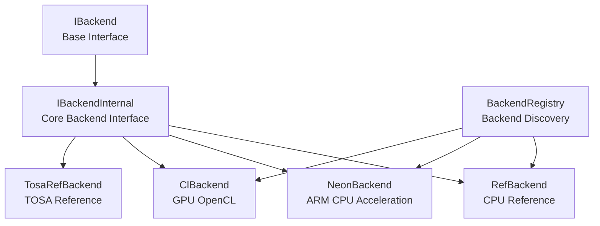
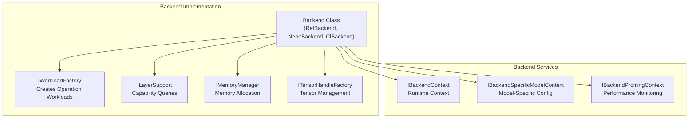
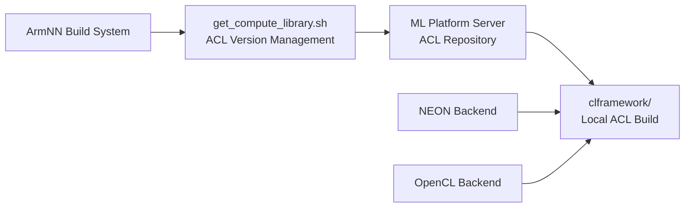
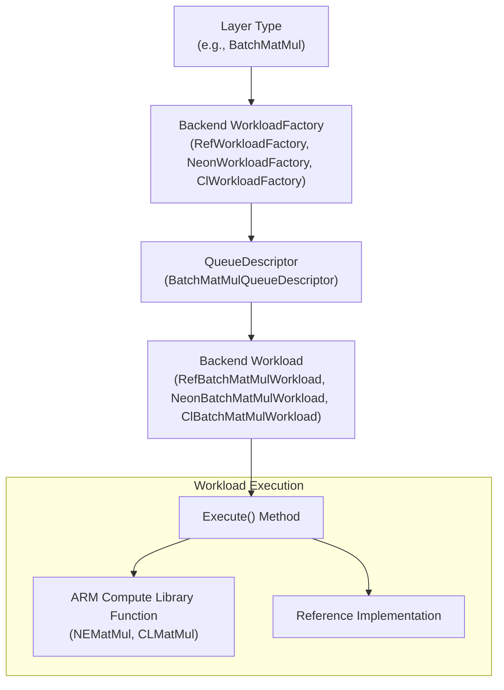
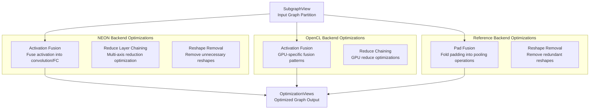
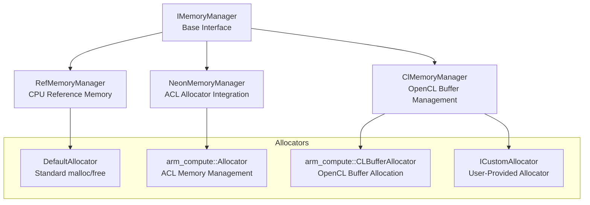
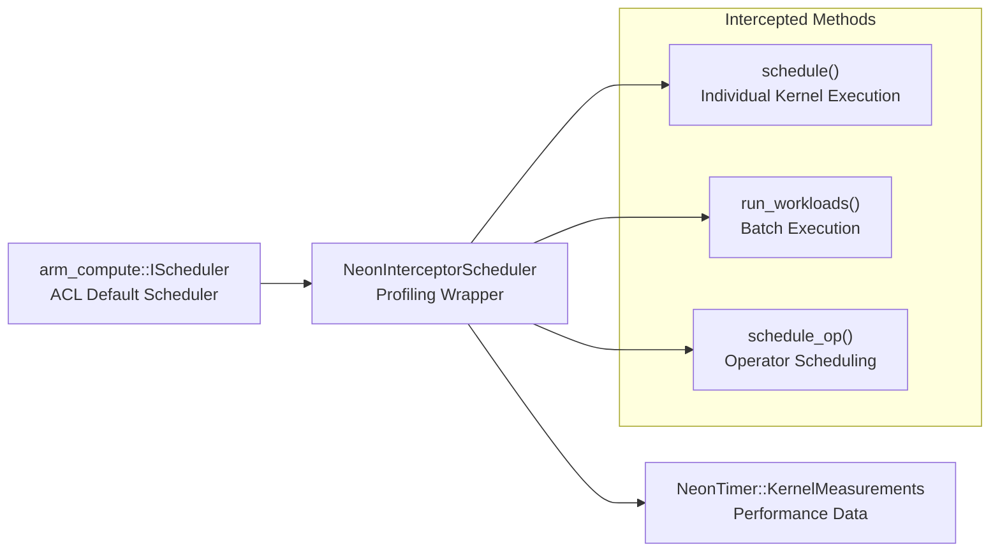
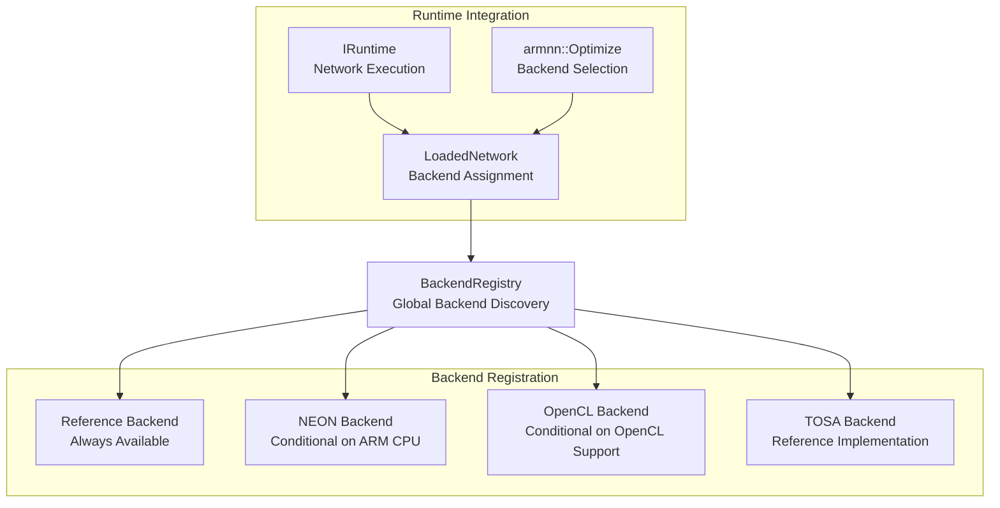

# Compute Backends

Relevant source files

The following files were used as context for generating this wiki page:

- [delegate/test/BatchMatMulTest.cpp](delegate/test/BatchMatMulTest.cpp)
- [include/armnn/backends/IBackendInternal.hpp](include/armnn/backends/IBackendInternal.hpp)
- [scripts/get_compute_library.sh](scripts/get_compute_library.sh)
- [src/backends/aclCommon/ArmComputeSubgraphUtils.hpp](src/backends/aclCommon/ArmComputeSubgraphUtils.hpp)
- [src/backends/backendsCommon/IBackendInternal.cpp](src/backends/backendsCommon/IBackendInternal.cpp)
- [src/backends/backendsCommon/test/CompatibilityTests.cpp](src/backends/backendsCommon/test/CompatibilityTests.cpp)
- [src/backends/backendsCommon/test/JsonPrinterTestImpl.cpp](src/backends/backendsCommon/test/JsonPrinterTestImpl.cpp)
- [src/backends/backendsCommon/test/layerTests/BatchMatMulTestImpl.cpp](src/backends/backendsCommon/test/layerTests/BatchMatMulTestImpl.cpp)
- [src/backends/cl/ClBackend.cpp](src/backends/cl/ClBackend.cpp)
- [src/backends/cl/ClBackend.hpp](src/backends/cl/ClBackend.hpp)
- [src/backends/cl/workloads/ClBatchMatMulWorkload.cpp](src/backends/cl/workloads/ClBatchMatMulWorkload.cpp)
- [src/backends/cl/workloads/ClBatchMatMulWorkload.hpp](src/backends/cl/workloads/ClBatchMatMulWorkload.hpp)
- [src/backends/cl/workloads/ClQLstmWorkload.cpp](src/backends/cl/workloads/ClQLstmWorkload.cpp)
- [src/backends/neon/NeonBackend.cpp](src/backends/neon/NeonBackend.cpp)
- [src/backends/neon/NeonBackend.hpp](src/backends/neon/NeonBackend.hpp)
- [src/backends/neon/NeonInterceptorScheduler.cpp](src/backends/neon/NeonInterceptorScheduler.cpp)
- [src/backends/neon/NeonInterceptorScheduler.hpp](src/backends/neon/NeonInterceptorScheduler.hpp)
- [src/backends/neon/workloads/NeonBatchMatMulWorkload.cpp](src/backends/neon/workloads/NeonBatchMatMulWorkload.cpp)
- [src/backends/neon/workloads/NeonBatchMatMulWorkload.hpp](src/backends/neon/workloads/NeonBatchMatMulWorkload.hpp)
- [src/backends/neon/workloads/NeonQLstmWorkload.cpp](src/backends/neon/workloads/NeonQLstmWorkload.cpp)
- [src/backends/reference/RefBackend.cpp](src/backends/reference/RefBackend.cpp)
- [src/backends/reference/RefBackend.hpp](src/backends/reference/RefBackend.hpp)

This document covers ArmNN's compute backend system, which provides hardware acceleration and execution implementations for neural network operations. The backend system enables ArmNN to execute models on different compute devices including CPU reference implementations, ARM NEON accelerated CPU operations, GPU acceleration via OpenCL, and reference implementations for emerging standards like TOSA.

For information about the core network and graph representation that backends operate on, see [[2.1-network-and-graph-system|Network and Graph System]]. For details about runtime execution and workload management, see [[2.3-runtime-and-execution|Runtime and Execution]].

## Backend Architecture Overview

ArmNN implements a pluggable backend architecture where each compute backend provides implementations for specific hardware or execution environments. The system is built around the `IBackendInternal` interface, which defines the contract that all backends must implement.

### Backend Interface Hierarchy

**Sources:** [include/armnn/backends/IBackendInternal.hpp:75-212](), [src/backends/reference/RefBackend.hpp:30-67](), [src/backends/neon/NeonBackend.hpp:29-74](), [src/backends/cl/ClBackend.hpp:24-285]()

### Core Backend Components

Each backend implementation provides several key components that integrate with the ArmNN framework:

**Sources:** [include/armnn/backends/IBackendInternal.hpp:87-98](), [src/backends/backendsCommon/IBackendInternal.cpp:13-147]()

## ARM Compute Library Integration

The NEON and OpenCL backends leverage the ARM Compute Library (ACL) for optimized kernel implementations. The system includes dependency management for ACL versions:

### ACL Dependency Management

The [scripts/get_compute_library.sh:1-112]() script manages ACL dependency versions:

- **Default ACL Version:** Pinned to specific SHA: `7d6fc756b2a9dfd8776be1c5c17ba45e2652c9fc`
- **Repository Source:** ML Platform server at `https://review.mlplatform.org/ml/ComputeLibrary`
- **Version Synchronization:** ACL version is synchronized with ArmNN releases to ensure compatibility

**Sources:** [scripts/get_compute_library.sh:9-20](), [scripts/get_compute_library.sh:80-94]()

## Backend Capabilities System

Each backend reports its capabilities through the `BackendCapabilities` system, which enables runtime capability queries and optimization decisions:

| Capability | Reference | NEON | OpenCL | Description |
|------------|-----------|------|--------|-------------|
| `NonConstWeights` | ✓ | ✓ | ✓ | Support for non-constant weight tensors |
| `ProtectedContentAllocation` | ✗ | ✗ | ✓ | Protected memory allocation support |
| `ConstantTensorsAsInputs` | ✓ | ✓ | ✓ | Constant tensors as layer inputs |
| `PreImportIOTensors` | ✓ | ✗ | ✗ | Pre-import input/output tensors |
| `ExternallyManagedMemory` | ✓ | ✓ | ✓ | External memory management |
| `MultiAxisPacking` | ✗ | ✗ | ✗ | Multi-axis tensor packing |
| `SingleAxisPacking` | ✓ | ✓ | ✓ | Single-axis tensor packing |
| `HasFp16` | ✓ | Dynamic | Dynamic | Half-precision floating point support |

**Sources:** [src/backends/reference/RefBackend.hpp:12-23](), [src/backends/neon/NeonBackend.hpp:15-26](), [src/backends/cl/ClBackend.cpp:276-290]()

## Workload System Architecture

Backends implement operations through workloads, which encapsulate the execution logic for specific layer types. The workload system provides a consistent interface across different backend implementations:

### Workload Creation Flow

**Sources:** [src/backends/cl/workloads/ClBatchMatMulWorkload.cpp:57-113](), [src/backends/neon/workloads/NeonBatchMatMulWorkload.cpp:57-107]()

### Backend-Specific Optimizations

Each backend implements the `OptimizeSubgraphView` method to perform backend-specific graph optimizations:

**Sources:** [src/backends/neon/NeonBackend.cpp:144-622](), [src/backends/cl/ClBackend.cpp:292-659](), [src/backends/reference/RefBackend.cpp:72-136]()

## Memory Management and Tensor Handles

Each backend provides memory management through specialized memory managers and tensor handle factories:

### Memory Manager Hierarchy

**Sources:** [src/backends/neon/NeonBackend.cpp:52-56](), [src/backends/cl/ClBackend.cpp:50-57](), [src/backends/reference/RefBackend.cpp:61-64]()

### Custom Memory Allocator Support

The OpenCL backend supports custom memory allocators through the `ClBackendCustomAllocatorWrapper` class, enabling integration with DMA buffers and protected memory:

**Supported Memory Sources:**
- `MemorySource::Malloc` - Standard heap allocation
- `MemorySource::DmaBuf` - DMA buffer file descriptors  
- `MemorySource::DmaBufProtected` - Protected DMA buffers

**Sources:** [src/backends/cl/ClBackend.hpp:97-211](), [src/backends/cl/ClBackend.hpp:213-281]()

## Profiling Integration

Backends integrate with ArmNN's profiling system through interceptor schedulers and profiling contexts:

### NEON Profiling Architecture

**Sources:** [src/backends/neon/NeonInterceptorScheduler.hpp:17-44](), [src/backends/neon/NeonInterceptorScheduler.cpp:25-67]()

## Backend Registration and Discovery

Backends are registered with the ArmNN runtime through the backend registry system, enabling dynamic backend discovery and selection:

**Sources:** [src/backends/backendsCommon/test/CompatibilityTests.cpp:31-44](), [src/backends/backendsCommon/test/CompatibilityTests.cpp:152-210]()

## Related Wiki Pages

- [[4.1-reference-backend|Reference Backend]]
- [[4.2-neon-backend|NEON Backend]]
- [[4.3-opencl-backend|OpenCL Backend]]
- [[4.4-tosa-backend|TOSA Backend]]
- [[2.1-network-and-graph-system|Network and Graph System]]
- [[2.3-runtime-and-execution|Runtime and Execution]]

## Dynamic Knowledge Links (Code Graph ↔ LLM-Wiki / RAG)

### Linked Architecture & Design Documents

| Document | Match Channel | Score | Shared Code Symbols |
|---|---|---|---|
| [[2.2-backend-system|2.2 Backend System]] | `bm25+entity(5)` | `79.797` | `AreParenthesesMatching`, `BatchMatMulTestImpl`, `ExtractMeasurements`, `FuseConvolution2dLayer`, `FuseLayer` |
| [[4.2-neon-backend|4.2 NEON Backend]] | `bm25+entity(5)` | `60.116` | `AreParenthesesMatching`, `BatchMatMulTestImpl`, `ClBatchMatMulWorkload`, `ExtractMeasurements`, `GetSoftmaxProfilerJson` |
| [[6.1-build-system|6.1 Build System]] | `bm25+entity(5)` | `57.171` | `AreParenthesesMatching`, `BatchMatMulTestImpl`, `ClBatchMatMulWorkload`, `ClQLstmWorkloadValidate`, `GetSoftmaxProfilerJson` |
| [[7-advanced-topics|7 Advanced Topics]] | `bm25+entity(6)` | `57.008` | `AreParenthesesMatching`, `BatchMatMulTestImpl`, `ExtractMeasurements`, `GetSoftmaxProfilerJson`, `ValidateProfilerJson` |
| [[7.2-workload-system|7.2 Workload System]] | `bm25+entity(4)` | `54.919` | `AreParenthesesMatching`, `BatchMatMulTestImpl`, `ExtractMeasurements`, `GetSoftmaxProfilerJson` |
| [[2.3-runtime-and-execution|2.3 Runtime and Execution]] | `wikilink:2.2-backend-system` | `36.149` | *(lexical/graph match)* |

### High-Centrality Bridge Symbols (CBM Graph)

| Symbol | Kind | Source Location | Fan-In / Fan-Out |
|---|---|---|---|
| `OptimizeSubgraphView` | Method | [src/backends/neon/NeonBackend.cpp:140-618]() | in: `0` / out: `53` |
| `OptimizeSubgraphView` | Method | [src/backends/cl/ClBackend.cpp:292-729]() | in: `0` / out: `49` |
| `BatchMatMulTestImpl` | Function | [src/backends/backendsCommon/test/layerTests/BatchMatMulTestImpl.cpp:20-80]() | in: `13` / out: `16` |
| `ClQLstmWorkloadValidate` | Function | [src/backends/cl/workloads/ClQLstmWorkload.cpp:247-395]() | in: `0` / out: `22` |
| `NeonQLstmWorkloadValidate` | Function | [src/backends/neon/workloads/NeonQLstmWorkload.cpp:243-391]() | in: `0` / out: `22` |
| `FuseLayer` | Function | [src/backends/aclCommon/ArmComputeSubgraphUtils.hpp:52-70]() | in: `9` / out: `3` |

Sources: [src/backends/neon/NeonBackend.cpp:140-618](), [src/backends/cl/ClBackend.cpp:292-729](), [src/backends/backendsCommon/test/layerTests/BatchMatMulTestImpl.cpp:20-80](), [src/backends/cl/workloads/ClQLstmWorkload.cpp:247-395]()

### Cross-Subsystem Coupling

- [[2-core-architecture|2 Core Architecture]] — call/import coupling weight `111.0`
- [[2.1-network-and-graph-system|2.1 Network and Graph System]] — call/import coupling weight `111.0`
- [[1-armnn-overview|1 ArmNN Overview]] — call/import coupling weight `26.0`
- [[3.3-model-serialization|3.3 Model Serialization]] — call/import coupling weight `19.0`
- [[2.3-runtime-and-execution|2.3 Runtime and Execution]] — call/import coupling weight `14.0`
- [[4.2-neon-backend|4.2 NEON Backend]] — call/import coupling weight `12.0`
