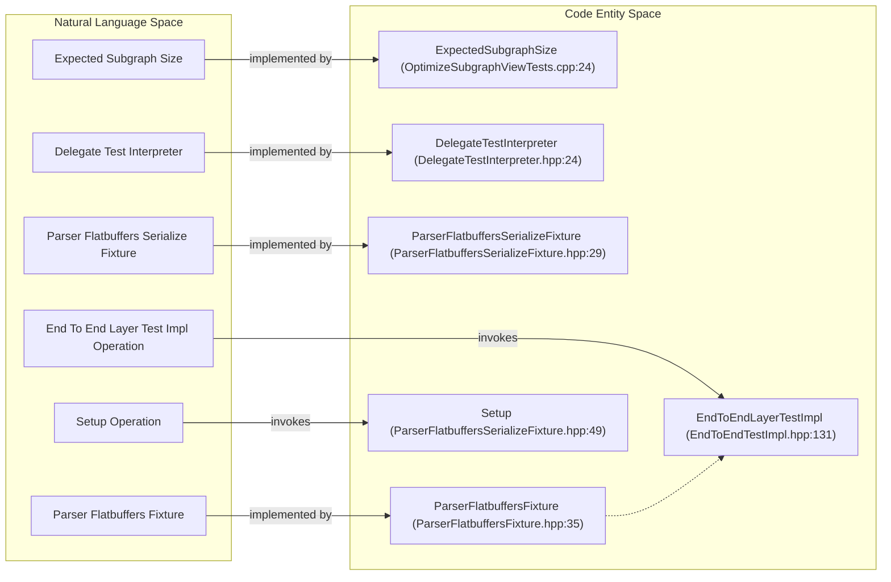

# Testing, Validation and Profiling

> Architectural overview of Testing, Validation and Profiling, spanning 40 source files and 4535 code symbols across 1 subsystems.

Relevant source files

The following files were used as context for generating this wiki page:

- [tests/CMakeLists.txt](tests/CMakeLists.txt)
- [src/backends/backendsCommon/test/EndToEndTestImpl.hpp](src/backends/backendsCommon/test/EndToEndTestImpl.hpp)
- [delegate/common/src/test/DelegateTestInterpreter.hpp](delegate/common/src/test/DelegateTestInterpreter.hpp)
- [src/armnnDeserializer/test/ParserFlatbuffersSerializeFixture.hpp](src/armnnDeserializer/test/ParserFlatbuffersSerializeFixture.hpp)
- [src/armnnTfLiteParser/test/ParserFlatbuffersFixture.hpp](src/armnnTfLiteParser/test/ParserFlatbuffersFixture.hpp)
- [src/backends/backendsCommon/test/OptimizeSubgraphViewTests.cpp](src/backends/backendsCommon/test/OptimizeSubgraphViewTests.cpp)

## Purpose and Scope

This chapter covers **Testing, Validation and Profiling** across the repository, detailing the core abstractions, data structures, transformation pipelines, and runtime/build integrations that implement this layer.

**Scope**: This document provides an architectural hub for the following child subsystems:
- **Tests**: See [[4.1-tests|Tests]].

Sources: [src/backends/backendsCommon/test/OptimizeSubgraphViewTests.cpp:24-29](), [delegate/common/src/test/DelegateTestInterpreter.hpp:24-173](), [src/armnnDeserializer/test/ParserFlatbuffersSerializeFixture.hpp:29-177](), [src/armnnTfLiteParser/test/ParserFlatbuffersFixture.hpp:35-288]()

---

## System Mapping: Natural Language Space to Code Entity Space

Sources: [src/backends/backendsCommon/test/OptimizeSubgraphViewTests.cpp:24-29](), [delegate/common/src/test/DelegateTestInterpreter.hpp:24-173](), [src/armnnDeserializer/test/ParserFlatbuffersSerializeFixture.hpp:29-177](), [src/armnnTfLiteParser/test/ParserFlatbuffersFixture.hpp:35-288](), [src/backends/backendsCommon/test/EndToEndTestImpl.hpp:131-185]()

---

## 1. Tests

Tests subsystem (`tests`), covering 40 files and 4535 symbols. Key symbols include `EndToEndLayerTestImpl`, `ElementwiseTestHelper`, `Setup`, `ComparisonTestImpl`. [src/backends/backendsCommon/test/OptimizeSubgraphViewTests.cpp:24-29](), [delegate/common/src/test/DelegateTestInterpreter.hpp:24-173](), [src/armnnDeserializer/test/ParserFlatbuffersSerializeFixture.hpp:29-177]()

### Primary Code Entities

- **`ExpectedSubgraphSize`** (Class in [src/backends/backendsCommon/test/OptimizeSubgraphViewTests.cpp:24-29]()): // The expected number of layers, input and output slots in a subgraph after a test
- **`DelegateTestInterpreter`** (Class in [delegate/common/src/test/DelegateTestInterpreter.hpp:24-173]()): Core implementation entity.
- **`ParserFlatbuffersSerializeFixture`** (Class in [src/armnnDeserializer/test/ParserFlatbuffersSerializeFixture.hpp:29-177]()): Core implementation entity.
- **`ParserFlatbuffersFixture`** (Class in [src/armnnTfLiteParser/test/ParserFlatbuffersFixture.hpp:35-288]()): Core implementation entity.
- **`EndToEndLayerTestImpl`** (Function in [src/backends/backendsCommon/test/EndToEndTestImpl.hpp:131-185]()): (INetworkPtr network, const std::map<int, std::vector<TInput>>& inputTensorData, const std::map<int, std::vector<TOutput>>& expectedOutputData, std::vector<BackendId> backends, flo
- **`ElementwiseTestHelper`** (Function in [src/backends/backendsCommon/test/layerTests/ElementwiseTestImpl.hpp:212-272]()): // Elementwise Binary Operations

### Tests Architecture Flow

```mermaid
flowchart TD
  subgraph sub_this["Tests"]
    subgraph sg_0["Core Code Entities"]
      n_tests["tests/"]
    end
    subgraph sg_1["delegate/common/src"]
      n_delegate_common_src_test["test/"]
    end
    subgraph sg_2["src/backends/backendsCommon"]
      n_src_backends_backendsCommon_test["test/"]
    end
    subgraph sg_3["src/armnnDeserializer"]
      n_src_armnnDeserializer_test["test/"]
    end
    subgraph sg_4["src/armnnTfLiteParser"]
      n_src_armnnTfLiteParser_test["test/"]
    end
  end
  n_page_2_build_system_and_infrastructure(["Build System and Infrastructure"])
  n_page_3_backend_delegation_and_hardware_providers(["Backend Delegation and Hardware Providers"])
  n_page_5_6_other_runtime_components(["Other Runtime Components"])
  n_page_5_runtime_execution_and_kernel_dispatch(["Runtime Execution and Kernel Dispatch"])
  n_src_backends_backendsCommon_test_layerTests -.-> n_page_5_runtime_execution_and_kernel_dispatch
  n_delegate_common_src_test --> n_delegate_test
  n_src_backends_backendsCommon_test -.-> n_page_5_runtime_execution_and_kernel_dispatch
  n_delegate_test -.-> n_page_5_runtime_execution_and_kernel_dispatch
  n_src_backends_backendsCommon_test_layerTests -.-> n_page_5_6_other_runtime_components
  n_src_backends_backendsCommon_test -.-> n_page_3_backend_delegation_and_hardware_providers
  n_tests -.-> n_page_2_build_system_and_infrastructure
  n_delegate_classic_src_test --> n_delegate_test
  n_delegate_test -.-> n_page_5_6_other_runtime_components
  n_delegate_test -.-> n_page_3_backend_delegation_and_hardware_providers
  n_src_profiling_test -.-> n_page_5_runtime_execution_and_kernel_dispatch
  n_src_backends_backendsCommon_test_layerTests -.-> n_page_3_backend_delegation_and_hardware_providers
  n_tests_ImageCSVFileGenerator -.-> n_page_2_build_system_and_infrastructure
  n_tests_ExecuteNetwork -.-> n_page_5_runtime_execution_and_kernel_dispatch
  n_delegate_test -.-> n_page_2_build_system_and_infrastructure
  n_src_backends_backendsCommon_test_layerTests -.-> n_page_2_build_system_and_infrastructure
  n_tests_ImageTensorGenerator -.-> n_page_2_build_system_and_infrastructure
```

For details, see [[4.1-tests|Tests]].

Sources: [src/backends/backendsCommon/test/OptimizeSubgraphViewTests.cpp:24-29](), [delegate/common/src/test/DelegateTestInterpreter.hpp:24-173](), [src/armnnDeserializer/test/ParserFlatbuffersSerializeFixture.hpp:29-177](), [src/armnnTfLiteParser/test/ParserFlatbuffersFixture.hpp:35-288]()

---

## Official Documentation & Architectural References

- **Tests** ([wiki/4.1-tests.md]()): # Tests ↑ [[4-testing-validation-and-profiling|Testing, Validation and Profiling]] > Tests subsystem (`tests`), covering 40 files and 4535 symbols. Key symbols include `EndToEndLayerTestImpl`, `ElementwiseTestHelper`, `Setup`, `ComparisonTestImpl`. 
 
Relevant source files
 The following files were used as context for generating this
- **Other Runtime Components** ([wiki/5.6-other-runtime-components.md]()): # Other Runtime Components ↑ [[5-runtime-execution-and-kernel-dispatch|Runtime Execution and Kernel Dispatch]] > Other Runtime Components subsystem (consolidating `ArmNN Optimizations`, `Armnntestutils`, `ArmNN Layers`, `Samples Common`, `Armnntestutils`, `Samples Objectdetection`), covering 28 files and 1895 symbols. Key symbols include `Run`, `FoldPadIntoL
- **ArmNN DeepWiki** ([wiki/index.md]()): # ArmNN DeepWiki Generated from `home-jason-Project-deepwiki-armnn` at commit `2b61cecc9df7` (2026-11-14T15:13:53+00:00). ## Pages - [[1-overview|Overview]] — End-to-end architecture overview of ArmNN: core subsystems, compilation/execution pipeline, entry points, and cross-module dependencies. - [[2-build-system-and-infrastructure|Build System and Infrastru
- **Overview** ([wiki/1-overview.md]()): # Overview > End-to-end architecture overview of ArmNN: core subsystems, compilation/execution pipeline, entry points, and cross-module dependencies. 
 
Relevant source files
 The following files were used as context for generating this wiki page: - [src/armnn/Tensor.cpp](src/armnn/Tensor.cpp) - [include/armnn/Exceptions.hpp](include

Sources: [wiki/4.1-tests.md](), [wiki/5.6-other-runtime-components.md](), [wiki/index.md](), [wiki/1-overview.md]()

## Sub-pages

- [[4.1-tests|Tests]]

## Related pages

- [[1-overview|Overview]]
- [[3-backend-delegation-and-hardware-providers|Backend Delegation and Hardware Providers]]
- [[3.1-backends-backendscommon|Backends Backendscommon]]
- [[3.2-backends-reference|Backends Reference]]
- [[3.3-backends-opencl|Backends OpenCL]]
- [[3.4-backends-aclcommon|Backends Aclcommon]]
- [[3.6-other-backends|Other Backends]]
- [[5-runtime-execution-and-kernel-dispatch|Runtime Execution and Kernel Dispatch]]

## Related documents

- `wiki/4.1-tests.md` — Tests (score 114.6489, via bm25)
- `wiki/5.6-other-runtime-components.md` — Other Runtime Components (score 56.9984, via bm25)
- `wiki/index.md` — ArmNN DeepWiki (score 55.6386, via bm25)
- `wiki/1-overview.md` — Overview (score 45.0069, via bm25)
- `wiki/5-runtime-execution-and-kernel-dispatch.md` — Runtime Execution and Kernel Dispatch (score 42.0507, via bm25)

## Sources

- [`tests/CMakeLists.txt`](https://github.com/ARM-software/armnn/blob/branches/armnn_24_11/tests/CMakeLists.txt)
- [`src/backends/backendsCommon/test/EndToEndTestImpl.hpp`](https://github.com/ARM-software/armnn/blob/branches/armnn_24_11/src/backends/backendsCommon/test/EndToEndTestImpl.hpp)
- [`delegate/common/src/test/DelegateTestInterpreter.hpp`](https://github.com/ARM-software/armnn/blob/branches/armnn_24_11/delegate/common/src/test/DelegateTestInterpreter.hpp)
- [`src/armnnDeserializer/test/ParserFlatbuffersSerializeFixture.hpp`](https://github.com/ARM-software/armnn/blob/branches/armnn_24_11/src/armnnDeserializer/test/ParserFlatbuffersSerializeFixture.hpp)
- [`src/armnnTfLiteParser/test/ParserFlatbuffersFixture.hpp`](https://github.com/ARM-software/armnn/blob/branches/armnn_24_11/src/armnnTfLiteParser/test/ParserFlatbuffersFixture.hpp)
- [`src/backends/backendsCommon/test/OptimizeSubgraphViewTests.cpp`](https://github.com/ARM-software/armnn/blob/branches/armnn_24_11/src/backends/backendsCommon/test/OptimizeSubgraphViewTests.cpp)

## Dynamic Knowledge Links (Code Graph ↔ LLM-Wiki / RAG)

### Linked Architecture & Design Documents

| Document | Match Channel | Score | Shared Code Symbols |
|---|---|---|---|
| [[4.1-tests|Tests]] | `bm25+entity(7)` | `125.149` | `AddInputLayer`, `AllocateTensors`, `DelegateTestInterpreter`, `EndToEndLayerTestImpl`, `Invoke` |
| [[5.6-other-runtime-components|Other Runtime Components]] | `bm25+entity(2)` | `59.998` | `EndToEndLayerTestImpl`, `Setup` |
| [[index|ArmNN DeepWiki]] | `bm25+entity(2)` | `58.639` | `EndToEndLayerTestImpl`, `Setup` |
| [[7-glossary|Glossary]] | `wikilink:4.1-tests` | `57.324` | *(lexical/graph match)* |
| [[2.1-build-infrastructure|Build Infrastructure]] | `wikilink:4.1-tests` | `57.324` | *(lexical/graph match)* |
| [[2-build-system-and-infrastructure|Build System and Infrastructure]] | `wikilink:4.1-tests` | `57.324` | *(lexical/graph match)* |

### High-Centrality Bridge Symbols (CBM Graph)

| Symbol | Kind | Source Location | Fan-In / Fan-Out |
|---|---|---|---|
| `ExpectedSubgraphSize` | Class | [src/backends/backendsCommon/test/OptimizeSubgraphViewTests.cpp:24-29]() | in: `0` / out: `0` |
| `DelegateTestInterpreter` | Class | [delegate/common/src/test/DelegateTestInterpreter.hpp:24-173]() | in: `0` / out: `0` |
| `ParserFlatbuffersSerializeFixture` | Class | [src/armnnDeserializer/test/ParserFlatbuffersSerializeFixture.hpp:29-177]() | in: `0` / out: `0` |
| `ParserFlatbuffersFixture` | Class | [src/armnnTfLiteParser/test/ParserFlatbuffersFixture.hpp:35-288]() | in: `0` / out: `0` |
| `EndToEndLayerTestImpl` | Function | [src/backends/backendsCommon/test/EndToEndTestImpl.hpp:131-185]() | in: `115` / out: `10` |
| `Setup` | Method | [src/armnnDeserializer/test/ParserFlatbuffersSerializeFixture.hpp:49-81]() | in: `93` / out: `5` |

Sources: [src/backends/backendsCommon/test/OptimizeSubgraphViewTests.cpp:24-29](), [delegate/common/src/test/DelegateTestInterpreter.hpp:24-173](), [src/armnnDeserializer/test/ParserFlatbuffersSerializeFixture.hpp:29-177](), [src/armnnTfLiteParser/test/ParserFlatbuffersFixture.hpp:35-288]()

### Cross-Subsystem Coupling

- [[7-glossary|Glossary]] — call/import coupling weight `215.0`
- [[5-runtime-execution-and-kernel-dispatch|Runtime Execution and Kernel Dispatch]] — call/import coupling weight `209.0`
- [[5.1-armnn|ArmNN]] — call/import coupling weight `151.0`
- [[2.1-build-infrastructure|Build Infrastructure]] — call/import coupling weight `115.0`
- [[2-build-system-and-infrastructure|Build System and Infrastructure]] — call/import coupling weight `105.0`
- [[5.2-armnn|ArmNN]] — call/import coupling weight `87.0`
