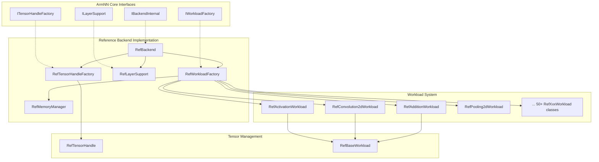
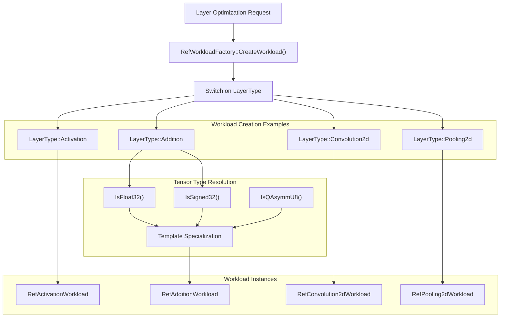
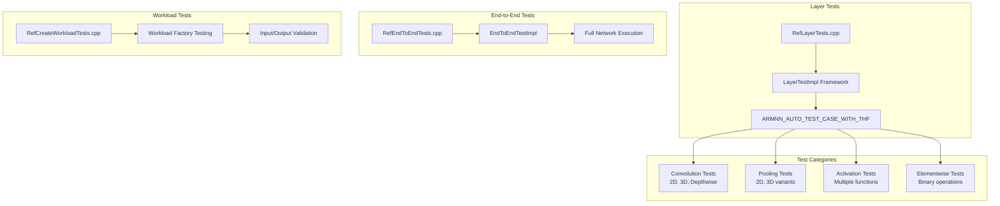

# Reference Backend

Relevant source files

The following files were used as context for generating this wiki page:

- [src/backends/backendsCommon/WorkloadData.cpp](src/backends/backendsCommon/WorkloadData.cpp)
- [src/backends/backendsCommon/common.mk](src/backends/backendsCommon/common.mk)
- [src/backends/backendsCommon/test/CMakeLists.txt](src/backends/backendsCommon/test/CMakeLists.txt)
- [src/backends/backendsCommon/test/EndToEndTestImpl.hpp](src/backends/backendsCommon/test/EndToEndTestImpl.hpp)
- [src/backends/backendsCommon/test/LayerTests.hpp](src/backends/backendsCommon/test/LayerTests.hpp)
- [src/backends/cl/test/ClEndToEndTests.cpp](src/backends/cl/test/ClEndToEndTests.cpp)
- [src/backends/neon/test/NeonEndToEndTests.cpp](src/backends/neon/test/NeonEndToEndTests.cpp)
- [src/backends/reference/RefLayerSupport.cpp](src/backends/reference/RefLayerSupport.cpp)
- [src/backends/reference/RefLayerSupport.hpp](src/backends/reference/RefLayerSupport.hpp)
- [src/backends/reference/RefWorkloadFactory.cpp](src/backends/reference/RefWorkloadFactory.cpp)
- [src/backends/reference/RefWorkloadFactory.hpp](src/backends/reference/RefWorkloadFactory.hpp)
- [src/backends/reference/backend.mk](src/backends/reference/backend.mk)
- [src/backends/reference/test/RefCreateWorkloadTests.cpp](src/backends/reference/test/RefCreateWorkloadTests.cpp)
- [src/backends/reference/test/RefEndToEndTests.cpp](src/backends/reference/test/RefEndToEndTests.cpp)
- [src/backends/reference/test/RefLayerTests.cpp](src/backends/reference/test/RefLayerTests.cpp)
- [src/backends/reference/workloads/CMakeLists.txt](src/backends/reference/workloads/CMakeLists.txt)
- [src/backends/reference/workloads/RefWorkloads.hpp](src/backends/reference/workloads/RefWorkloads.hpp)
- [src/backends/tosaCommon/TosaMappings.cpp](src/backends/tosaCommon/TosaMappings.cpp)
- [src/backends/tosaCommon/operatorMappings/CMakeLists.txt](src/backends/tosaCommon/operatorMappings/CMakeLists.txt)
- [src/backends/tosaCommon/operatorMappings/TosaCommonOperators.hpp](src/backends/tosaCommon/operatorMappings/TosaCommonOperators.hpp)
- [src/backends/tosaCommon/operatorMappings/TosaOperatorUtils.hpp](src/backends/tosaCommon/operatorMappings/TosaOperatorUtils.hpp)
- [src/backends/tosaCommon/test/OneToManyMappingTests.cpp](src/backends/tosaCommon/test/OneToManyMappingTests.cpp)
- [src/backends/tosaCommon/test/OneToOneMappingTests.cpp](src/backends/tosaCommon/test/OneToOneMappingTests.cpp)
- [src/backends/tosaCommon/test/TosaTestUtils.hpp](src/backends/tosaCommon/test/TosaTestUtils.hpp)
- [src/backends/tosaReference/TosaRefLayerSupport.cpp](src/backends/tosaReference/TosaRefLayerSupport.cpp)
- [src/backends/tosaReference/test/TosaRefEndToEndTests.cpp](src/backends/tosaReference/test/TosaRefEndToEndTests.cpp)
- [src/backends/tosaReference/test/TosaRefLayerSupportTests.cpp](src/backends/tosaReference/test/TosaRefLayerSupportTests.cpp)

The Reference Backend provides a CPU-based reference implementation for all ArmNN operations, serving as the foundational fallback backend when hardware-accelerated backends like NEON or OpenCL cannot execute specific layers. This backend implements operations using portable C++ code without hardware-specific optimizations, ensuring correctness and broad compatibility across platforms.

For information about other backends like NEON acceleration, see [[4.2-neon-backend|NEON Backend]]. For OpenCL GPU acceleration, see [[4.3-opencl-backend|OpenCL Backend]]. For TOSA specification compliance, see [[4.4-tosa-backend|TOSA Backend]].

## Architecture Overview

The Reference Backend follows ArmNN's standard backend architecture pattern, implementing the `IBackendInternal` interface and providing layer support validation, workload factories, and tensor handle management.

### Reference Backend Core Architecture

Sources: [src/backends/reference/RefWorkloadFactory.cpp:1-580](), [src/backends/reference/RefLayerSupport.cpp:1-558](), [src/backends/reference/workloads/RefWorkloads.hpp:1-70]()

## Core Components

### RefBackend

The `RefBackend` class serves as the main entry point and factory for all Reference Backend components. It inherits from `IBackendInternal` and provides the backend registration and component creation functionality.

**Key responsibilities:**
- Backend identification with `RefBackendId`
- Component factory creation (`RefWorkloadFactory`, `RefLayerSupport`)
- Memory manager instantiation
- Integration with ArmNN's backend registry

### RefLayerSupport

The `RefLayerSupport` class implements comprehensive layer support validation for the Reference Backend, supporting virtually all ArmNN layer types through the `IsLayerSupported` method.

**Supported layer categories:**
- **Activation layers**: ReLU, Sigmoid, TanH, BoundedReLU, LeakyReLU, and more
- **Convolution layers**: Convolution2d, Convolution3d, DepthwiseConvolution2d
- **Pooling layers**: Pooling2d, Pooling3d with Max, Average, and L2 algorithms
- **Elementwise operations**: Addition, Subtraction, Multiplication, Division
- **Matrix operations**: BatchMatMul, FullyConnected
- **Data manipulation**: Reshape, Transpose, Concat, Split, Slice
- **Normalization**: BatchNormalization, InstanceNormalization, L2Normalization

### RefWorkloadFactory

The `RefWorkloadFactory` creates workload instances for specific layer types and manages the `RefMemoryManager`. It implements a comprehensive switch statement covering over 50 layer types.

### Workload Creation Flow

Sources: [src/backends/reference/RefWorkloadFactory.cpp:146-580]()

## Workload System

The Reference Backend implements workloads for each supported layer type, typically inheriting from `RefBaseWorkload` and implementing the `Execute()` method with CPU-based algorithms.

### Common Workload Patterns

**Template-based workloads** handle multiple data types:
- `RefAdditionWorkload<T>` supports float and int32 operations
- `RefElementwiseWorkload` handles various elementwise operations
- `RefDebugWorkload` specializes for different data types

**Specialized workloads** implement complex algorithms:
- `RefConvolution2dWorkload` implements 2D convolution with optimized loops
- `RefBatchMatMulWorkload` handles batch matrix multiplication
- `RefPooling2dWorkload` supports Max, Average, and L2 pooling

### Memory Management

The Reference Backend uses `RefMemoryManager` and `RefTensorHandle` for efficient memory allocation and management:

- **RefTensorHandle**: Manages tensor data storage and access
- **RefMemoryManager**: Coordinates memory allocation across workloads
- **Memory alignment**: Ensures proper alignment for CPU operations

Sources: [src/backends/reference/workloads/CMakeLists.txt:1-189](), [src/backends/reference/RefWorkloadFactory.cpp:85-144]()

## Testing Infrastructure

The Reference Backend includes comprehensive testing covering layer functionality, end-to-end execution, and workload creation.

### Testing Architecture

Sources: [src/backends/reference/test/RefLayerTests.cpp:1-6000](), [src/backends/reference/test/RefEndToEndTests.cpp:1-2500](), [src/backends/reference/test/RefCreateWorkloadTests.cpp:1-500]()

### Test Coverage Examples

**Layer tests** validate individual operations across data types:
- Convolution tests cover NCHW/NHWC layouts, quantized types, and various kernel sizes
- Pooling tests include Max, Average, L2 pooling with different padding strategies  
- Activation tests verify all activation functions with multiple data types

**End-to-end tests** execute complete networks:
- `TrivialAdd` test validates simple addition networks
- `MultipleOutputs` test verifies networks with multiple output paths
- Quantized network tests ensure proper quantization handling

## Integration with ArmNN

The Reference Backend integrates with ArmNN through the standard backend interfaces and serves critical roles in the overall system:

### Backend Registration

The backend registers itself through `RefRegistryInitializer` and uses `RefBackendId()` for identification within ArmNN's backend selection system.

### Fallback Mechanism

When optimized backends cannot handle specific operations, ArmNN automatically falls back to the Reference Backend, ensuring universal operation support across all platforms.

### Build System Integration

The Reference Backend includes comprehensive build configuration through:
- `backend.mk` for Android builds with conditional compilation
- CMake integration for cross-platform builds
- Conditional compilation flags (`ARMNN_REF_ENABLED`)

Sources: [src/backends/reference/backend.mk:1-160](), [src/backends/backendsCommon/common.mk:1-45]()

## Related Wiki Pages

- [[4-compute-backends|Compute Backends]]
- [[4.2-neon-backend|NEON Backend]]
- [[4.3-opencl-backend|OpenCL Backend]]
- [[4.4-tosa-backend|TOSA Backend]]

## Dynamic Knowledge Links (Code Graph ↔ LLM-Wiki / RAG)

### Linked Architecture & Design Documents

| Document | Match Channel | Score | Shared Code Symbols |
|---|---|---|---|
| [[6.2-testing-framework|6.2 Testing Framework]] | `bm25+entity(11)` | `86.383` | `ArmNNToDType`, `CheckInputOutput`, `EndToEndLayerTestImpl`, `GetTosaMapping`, `GetTosaTensorShape` |
| [[4.4-tosa-backend|4.4 TOSA Backend]] | `bm25+entity(7)` | `68.078` | `ArmNNToDType`, `EndToEndLayerTestImpl`, `GenerateUniqueInputName`, `GenerateUniqueOutputName`, `GetTosaMapping` |
| [[6-development-guide|6 Development Guide]] | `bm25+entity(7)` | `61.481` | `ArmNNToDType`, `EndToEndLayerTestImpl`, `GenerateUniqueInputName`, `GenerateUniqueOutputName`, `GetTosaMapping` |
| [[2.3-runtime-and-execution|2.3 Runtime and Execution]] | `bm25` | `61.404` | *(lexical/graph match)* |
| [[3.1-tensorflow-lite-parser|3.1 TensorFlow Lite Parser]] | `bm25` | `49.564` | *(lexical/graph match)* |
| [[6.1-build-system|6.1 Build System]] | `wikilink:6.2-testing-framework` | `34.941` | *(lexical/graph match)* |

### High-Centrality Bridge Symbols (CBM Graph)

| Symbol | Kind | Source Location | Fan-In / Fan-Out |
|---|---|---|---|
| `to_string` | Function | [src/backends/backendsCommon/WorkloadData.cpp:52-58]() | in: `218` / out: `1` |
| `ValidateInputsOutputs` | Method | [src/backends/backendsCommon/WorkloadData.cpp:447-452]() | in: `122` / out: `1` |
| `EndToEndLayerTestImpl` | Function | [src/backends/backendsCommon/test/EndToEndTestImpl.hpp:131-185]() | in: `115` / out: `10` |
| `ValidateNumInputs` | Function | [src/backends/backendsCommon/WorkloadData.cpp:85-93]() | in: `74` / out: `3` |
| `ValidateNumOutputs` | Function | [src/backends/backendsCommon/WorkloadData.cpp:96-104]() | in: `73` / out: `3` |
| `ValidateDataTypes` | Function | [src/backends/backendsCommon/WorkloadData.cpp:266-276]() | in: `60` / out: `6` |

Sources: [src/backends/backendsCommon/WorkloadData.cpp:52-58](), [src/backends/backendsCommon/WorkloadData.cpp:447-452](), [src/backends/backendsCommon/test/EndToEndTestImpl.hpp:131-185](), [src/backends/backendsCommon/WorkloadData.cpp:85-93]()

### Cross-Subsystem Coupling

- [[2-core-architecture|2 Core Architecture]] — call/import coupling weight `134.0`
- [[2.1-network-and-graph-system|2.1 Network and Graph System]] — call/import coupling weight `134.0`
- [[1-armnn-overview|1 ArmNN Overview]] — call/import coupling weight `81.0`
- [[2.3-runtime-and-execution|2.3 Runtime and Execution]] — call/import coupling weight `43.0`
- [[2.2-backend-system|2.2 Backend System]] — call/import coupling weight `9.0`
- [[4-compute-backends|4 Compute Backends]] — call/import coupling weight `9.0`
