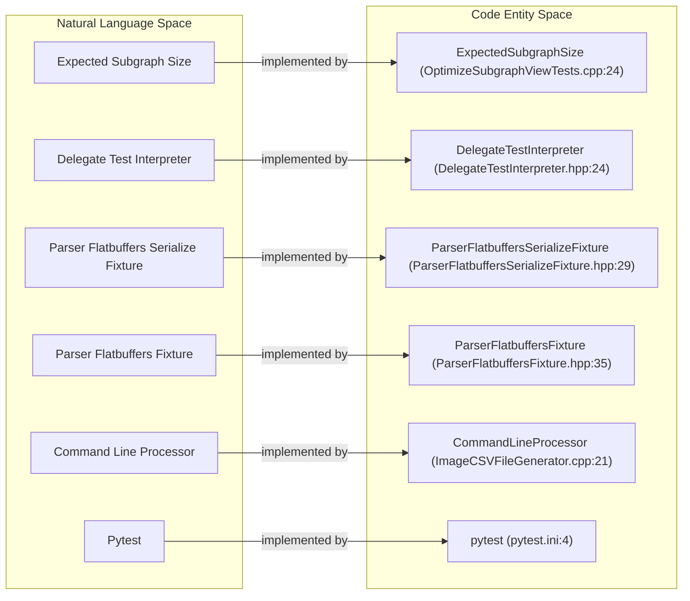
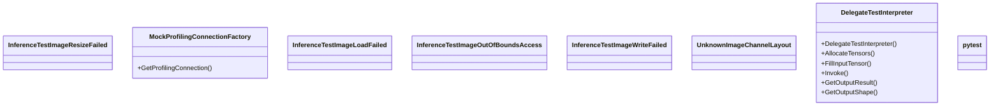
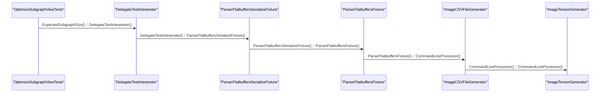

# Tests

↑ [[4-testing-validation-and-profiling|Testing, Validation and Profiling]]

> Tests subsystem (`tests`), covering 40 files and 4535 symbols. Key symbols include `EndToEndLayerTestImpl`, `ElementwiseTestHelper`, `Setup`, `ComparisonTestImpl`.

<details>
<summary>Relevant source files</summary>

The following files were used as context for generating this wiki page:

- [tests/CMakeLists.txt](tests/CMakeLists.txt)
- [delegate/common/src/test/DelegateTestInterpreter.hpp](delegate/common/src/test/DelegateTestInterpreter.hpp)
- [src/backends/backendsCommon/test/EndToEndTestImpl.hpp](src/backends/backendsCommon/test/EndToEndTestImpl.hpp)
- [src/armnnDeserializer/test/ParserFlatbuffersSerializeFixture.hpp](src/armnnDeserializer/test/ParserFlatbuffersSerializeFixture.hpp)
- [src/armnnTfLiteParser/test/ParserFlatbuffersFixture.hpp](src/armnnTfLiteParser/test/ParserFlatbuffersFixture.hpp)
- [src/backends/backendsCommon/test/OptimizeSubgraphViewTests.cpp](src/backends/backendsCommon/test/OptimizeSubgraphViewTests.cpp)
- [delegate/classic/src/test/DelegateTestInterpreter.cpp](delegate/classic/src/test/DelegateTestInterpreter.cpp)
- [delegate/test/ConvolutionTestHelper.hpp](delegate/test/ConvolutionTestHelper.hpp)
- [delegate/test/DelegateOptionsTestHelper.hpp](delegate/test/DelegateOptionsTestHelper.hpp)
- [delegate/python/test/pytest.ini](delegate/python/test/pytest.ini)
- [delegate/test/ComparisonTestHelper.hpp](delegate/test/ComparisonTestHelper.hpp)
- [delegate/test/ComparisonTest.cpp](delegate/test/ComparisonTest.cpp)
- [delegate/common/src/test/DelegateTestInterpreterUtils.hpp](delegate/common/src/test/DelegateTestInterpreterUtils.hpp)
- [delegate/test/ArgMinMaxTestHelper.hpp](delegate/test/ArgMinMaxTestHelper.hpp)
- [tests/TfLiteYoloV3Big-Armnn/TfLiteYoloV3Big-Armnn.cpp](tests/TfLiteYoloV3Big-Armnn/TfLiteYoloV3Big-Armnn.cpp)
- [delegate/test/ActivationTestHelper.hpp](delegate/test/ActivationTestHelper.hpp)
- [delegate/test/ControlTestHelper.hpp](delegate/test/ControlTestHelper.hpp)
- [delegate/test/BatchSpaceTestHelper.hpp](delegate/test/BatchSpaceTestHelper.hpp)
- [delegate/python/test/test_external_delegate.py](delegate/python/test/test_external_delegate.py)
- [delegate/test/BatchMatMulTestHelper.hpp](delegate/test/BatchMatMulTestHelper.hpp)
- [tests/InferenceTestImage.hpp](tests/InferenceTestImage.hpp)
- [delegate/python/test/utils.py](delegate/python/test/utils.py)
- [delegate/test/ArgMinMaxTest.cpp](delegate/test/ArgMinMaxTest.cpp)
- [delegate/test/BatchSpaceTest.cpp](delegate/test/BatchSpaceTest.cpp)
- [delegate/test/ElementwiseBinaryTestHelper.hpp](delegate/test/ElementwiseBinaryTestHelper.hpp)
- [src/backends/backendsCommon/test/layerTests/ElementwiseTestImpl.hpp](src/backends/backendsCommon/test/layerTests/ElementwiseTestImpl.hpp)
- [src/backends/backendsCommon/test/layerTests/ComparisonTestImpl.cpp](src/backends/backendsCommon/test/layerTests/ComparisonTestImpl.cpp)
- [delegate/test/BroadcastToTestHelper.hpp](delegate/test/BroadcastToTestHelper.hpp)
- [tests/InferenceModel.hpp](tests/InferenceModel.hpp)
- [delegate/test/CastTestHelper.hpp](delegate/test/CastTestHelper.hpp)
- [delegate/test/ControlTest.cpp](delegate/test/ControlTest.cpp)
- [tests/ImageTensorGenerator/ImageTensorGenerator.cpp](tests/ImageTensorGenerator/ImageTensorGenerator.cpp)
- [delegate/test/ElementwiseBinaryTest.cpp](delegate/test/ElementwiseBinaryTest.cpp)
- [delegate/python/test/conftest.py](delegate/python/test/conftest.py)
- [src/profiling/test/ProfilingMocks.hpp](src/profiling/test/ProfilingMocks.hpp)

</details>

## Purpose and Scope

Tests subsystem (`tests`), covering 40 files and 4535 symbols. Key symbols include `EndToEndLayerTestImpl`, `ElementwiseTestHelper`, `Setup`, `ComparisonTestImpl`.

Primary code entities analyzed on this page include `ExpectedSubgraphSize` ([src/backends/backendsCommon/test/OptimizeSubgraphViewTests.cpp:24-29]()), `DelegateTestInterpreter` ([delegate/common/src/test/DelegateTestInterpreter.hpp:24-173]()), `ParserFlatbuffersSerializeFixture` ([src/armnnDeserializer/test/ParserFlatbuffersSerializeFixture.hpp:29-177]()), `ParserFlatbuffersFixture` ([src/armnnTfLiteParser/test/ParserFlatbuffersFixture.hpp:35-288]()), `CommandLineProcessor` ([tests/ImageCSVFileGenerator/ImageCSVFileGenerator.cpp:21-193]()).

For the parent architectural layer, see [[4-testing-validation-and-profiling|Testing, Validation and Profiling]].

Sources: [src/backends/backendsCommon/test/OptimizeSubgraphViewTests.cpp:24-29](), [delegate/common/src/test/DelegateTestInterpreter.hpp:24-173](), [src/armnnDeserializer/test/ParserFlatbuffersSerializeFixture.hpp:29-177](), [src/armnnTfLiteParser/test/ParserFlatbuffersFixture.hpp:35-288]()

---

## 1. High-Level Architecture and Data Flow

### Natural Language Space to Code Entity Space Mapping

The following diagram maps domain concepts in this subsystem to their concrete code entities:



### Subsystem Component & Dependency Flow

```mermaid
flowchart TD
  subgraph sub_this["Tests"]
    subgraph sg_0["Core Code Entities"]
      n_tests["tests/"]
    end
    subgraph sg_1["delegate/common/src"]
      n_delegate_common_src_test["test/"]
    end
    subgraph sg_2["src/backends/backendsCommon"]
      n_src_backends_backendsCommon_test["test/"]
    end
    subgraph sg_3["src/armnnDeserializer"]
      n_src_armnnDeserializer_test["test/"]
    end
    subgraph sg_4["src/armnnTfLiteParser"]
      n_src_armnnTfLiteParser_test["test/"]
    end
  end
  n_page_2_build_system_and_infrastructure(["Build System and Infrastructure"])
  n_page_3_backend_delegation_and_hardware_providers(["Backend Delegation and Hardware Providers"])
  n_page_5_6_other_runtime_components(["Other Runtime Components"])
  n_page_5_runtime_execution_and_kernel_dispatch(["Runtime Execution and Kernel Dispatch"])
  n_src_backends_backendsCommon_test_layerTests -.-> n_page_5_runtime_execution_and_kernel_dispatch
  n_delegate_common_src_test --> n_delegate_test
  n_src_backends_backendsCommon_test -.-> n_page_5_runtime_execution_and_kernel_dispatch
  n_delegate_test -.-> n_page_5_runtime_execution_and_kernel_dispatch
  n_src_backends_backendsCommon_test_layerTests -.-> n_page_5_6_other_runtime_components
  n_src_backends_backendsCommon_test -.-> n_page_3_backend_delegation_and_hardware_providers
  n_tests -.-> n_page_2_build_system_and_infrastructure
  n_delegate_classic_src_test --> n_delegate_test
  n_delegate_test -.-> n_page_5_6_other_runtime_components
  n_delegate_test -.-> n_page_3_backend_delegation_and_hardware_providers
  n_src_profiling_test -.-> n_page_5_runtime_execution_and_kernel_dispatch
  n_src_backends_backendsCommon_test_layerTests -.-> n_page_3_backend_delegation_and_hardware_providers
  n_tests_ImageCSVFileGenerator -.-> n_page_2_build_system_and_infrastructure
  n_tests_ExecuteNetwork -.-> n_page_5_runtime_execution_and_kernel_dispatch
  n_delegate_test -.-> n_page_2_build_system_and_infrastructure
  n_src_backends_backendsCommon_test_layerTests -.-> n_page_2_build_system_and_infrastructure
  n_tests_ImageTensorGenerator -.-> n_page_2_build_system_and_infrastructure
```



Cross-subsystem call and import edges connect **Tests** with [[5-runtime-execution-and-kernel-dispatch|Runtime Execution and Kernel Dispatch]] (coupling `562.0`), [[7-glossary|Glossary]] (coupling `554.0`), [[2.1-build-infrastructure|Build Infrastructure]] (coupling `399.0`), [[2-build-system-and-infrastructure|Build System and Infrastructure]] (coupling `380.0`), [[5.2-armnn|ArmNN]] (coupling `238.0`).

| Module Directory | Files | Primary Code Entities | Source Citations |
|---|---|---|---|
| `delegate/test` | 17 | `StreamRedirector`, `ElementwiseBinaryTest`, `ComparisonTest`, `ConvolutionTest` | [delegate/test/DelegateOptionsTestHelper.hpp:18-29]() [delegate/test/ElementwiseBinaryTestHelper.hpp:179-229]() |
| `delegate/python/test` | 4 | `pytest`, `compare_outputs`, `run_inference`, `pytest_addoption` | [delegate/python/test/pytest.ini:4-7]() [delegate/python/test/utils.py:48-53]() |
| `src/backends/backendsCommon/test/layerTests` | 3 | `Broadcast1ElementTestData`, `Broadcast1dVectorTestData`, `ComparisonTestData`, `SimpleTestData` | [src/backends/backendsCommon/test/layerTests/ComparisonTestImpl.cpp:258-278]() [src/backends/backendsCommon/test/layerTests/ComparisonTestImpl.cpp:280-334]() |
| `tests` | 3 | `InferenceTestImageResizeFailed`, `InferenceTestImageLoadFailed`, `InferenceTestImageOutOfBoundsAccess`, `InferenceTestImageWriteFailed` | [tests/InferenceTestImage.hpp:33-37]() [tests/InferenceTestImage.hpp:21-25]() |
| `delegate/common/src/test` | 2 | `DelegateTestInterpreter`, `GetOutputShape`, `AllocateTensors`, `Invoke` | [delegate/common/src/test/DelegateTestInterpreter.hpp:24-173]() [delegate/common/src/test/DelegateTestInterpreter.hpp:149-163]() |
| `src/backends/backendsCommon/test` | 2 | `ExpectedSubgraphSize`, `EndToEndLayerTestImpl`, `SubStringCounter`, `AddInputLayer` | [src/backends/backendsCommon/test/OptimizeSubgraphViewTests.cpp:24-29]() [src/backends/backendsCommon/test/EndToEndTestImpl.hpp:131-185]() |
| `delegate/classic/src/test` | 1 | `DelegateTestInterpreter`, `Cleanup` | [delegate/classic/src/test/DelegateTestInterpreter.cpp:44-65]() [delegate/classic/src/test/DelegateTestInterpreter.cpp:67-75]() |
| `delegate/opaque/src/test` | 1 | `GetBackendOption`, `CountBackendOptions`, `BuildDelegateOptions` | [delegate/opaque/src/test/ArmnnOpaqueDelegateTest.cpp:200-229]() [delegate/opaque/src/test/ArmnnOpaqueDelegateTest.cpp:181-198]() |

Sources: [src/backends/backendsCommon/test/OptimizeSubgraphViewTests.cpp:24-29](), [delegate/common/src/test/DelegateTestInterpreter.hpp:24-173](), [src/armnnDeserializer/test/ParserFlatbuffersSerializeFixture.hpp:29-177](), [src/armnnTfLiteParser/test/ParserFlatbuffersFixture.hpp:35-288](), [tests/ImageCSVFileGenerator/ImageCSVFileGenerator.cpp:21-193]()

---

## 2. Core Data Structures and Implementation Details

### Class and Entity Relationship Diagram



### `ExpectedSubgraphSize` (Class)

- **Source Location**: [src/backends/backendsCommon/test/OptimizeSubgraphViewTests.cpp:24-29]()
- **Declaration**: `Class ExpectedSubgraphSize`
- **Graph Centrality**: fan-in `0` callers, fan-out `0` callees
- **Responsibility**: // The expected number of layers, input and output slots in a subgraph after a test

```cpp
// src/backends/backendsCommon/test/OptimizeSubgraphViewTests.cpp:24-29
struct ExpectedSubgraphSize
{
    size_t m_NumInputSlots  = 0;
    size_t m_NumOutputSlots = 0;
    size_t m_NumLayers      = 0;
};
```

### `DelegateTestInterpreter` (Class)

- **Source Location**: [delegate/common/src/test/DelegateTestInterpreter.hpp:24-173]()
- **Declaration**: `Class DelegateTestInterpreter`
- **Graph Centrality**: fan-in `0` callers, fan-out `0` callees

```cpp
// delegate/common/src/test/DelegateTestInterpreter.hpp:24-39
class DelegateTestInterpreter
{
public:
    /// Create TfLite Interpreter only
    DelegateTestInterpreter(std::vector<char>& modelBuffer, const std::string& customOp = "")
    {
        TfLiteModel* model = delegateTestInterpreter::CreateTfLiteModel(modelBuffer);

        TfLiteInterpreterOptions* options = delegateTestInterpreter::CreateTfLiteInterpreterOptions();
        if (!customOp.empty())
        {
            options->mutable_op_resolver = delegateTestInterpreter::GenerateCustomOpResolver(customOp);
        }

        m_TfLiteInterpreter = TfLiteInterpreterCreate(model, options);
        m_TfLiteDelegate = nullptr;
```

### `ParserFlatbuffersSerializeFixture` (Class)

- **Source Location**: [src/armnnDeserializer/test/ParserFlatbuffersSerializeFixture.hpp:29-177]()
- **Declaration**: `Class ParserFlatbuffersSerializeFixture`
- **Graph Centrality**: fan-in `0` callers, fan-out `0` callees

```cpp
// src/armnnDeserializer/test/ParserFlatbuffersSerializeFixture.hpp:29-44
struct ParserFlatbuffersSerializeFixture
{
    ParserFlatbuffersSerializeFixture() :
        m_Parser(IDeserializer::Create()),
        m_Runtime(armnn::IRuntime::Create(armnn::IRuntime::CreationOptions())),
        m_NetworkIdentifier(-1)
    {
    }

    std::vector<uint8_t> m_GraphBinary;
    std::string m_JsonString;
    std::unique_ptr<IDeserializer, void (*)(IDeserializer* parser)> m_Parser;
    armnn::IRuntimePtr m_Runtime;
    armnn::NetworkId m_NetworkIdentifier;

    /// If the single-input-single-output overload of Setup() is called, these will store the input and output name
```

### `ParserFlatbuffersFixture` (Class)

- **Source Location**: [src/armnnTfLiteParser/test/ParserFlatbuffersFixture.hpp:35-288]()
- **Declaration**: `Class ParserFlatbuffersFixture`
- **Graph Centrality**: fan-in `0` callers, fan-out `0` callees

### `CommandLineProcessor` (Class)

- **Source Location**: [tests/ImageCSVFileGenerator/ImageCSVFileGenerator.cpp:21-193]()
- **Declaration**: `Class CommandLineProcessor`
- **Graph Centrality**: fan-in `0` callers, fan-out `0` callees
- **Responsibility**: // parses the command line to extract // * the directory -i to look through .raw files from (must exist) // * the name of the file -o the output CSV file path (must not already exist)

### `EndToEndLayerTestImpl` (Function)

- **Source Location**: [src/backends/backendsCommon/test/EndToEndTestImpl.hpp:131-185]()
- **Declaration**: `(INetworkPtr network, const std::map<int, std::vector<TInput>>& inputTensorData, const std::map<int, std::vector<TOutput>>& expectedOutputDa`
- **Graph Centrality**: fan-in `115` callers, fan-out `10` callees

Sources: [src/backends/backendsCommon/test/OptimizeSubgraphViewTests.cpp:24-29](), [delegate/common/src/test/DelegateTestInterpreter.hpp:24-173](), [src/armnnDeserializer/test/ParserFlatbuffersSerializeFixture.hpp:29-177](), [src/armnnTfLiteParser/test/ParserFlatbuffersFixture.hpp:35-288](), [tests/ImageCSVFileGenerator/ImageCSVFileGenerator.cpp:21-193]()

---

## 3. Execution and Call Flow

The sequence diagram below traces the runtime/compile-time call chain across components in this module:



Sources: [src/backends/backendsCommon/test/OptimizeSubgraphViewTests.cpp:24-29](), [delegate/common/src/test/DelegateTestInterpreter.hpp:24-173](), [src/armnnDeserializer/test/ParserFlatbuffersSerializeFixture.hpp:29-177](), [src/armnnTfLiteParser/test/ParserFlatbuffersFixture.hpp:35-288](), [tests/ImageCSVFileGenerator/ImageCSVFileGenerator.cpp:21-193]()

---

## 4. Key API and Symbol Reference

| Code Entity | Kind | Location | Fan-In / Out | Role & Signature |
|---|---|---|---|---|
| `ExpectedSubgraphSize` | Class | [src/backends/backendsCommon/test/OptimizeSubgraphViewTests.cpp:24-29]() | `0` / `0` | // The expected number of layers, input and output slots in a subgraph after a test |
| `DelegateTestInterpreter` | Class | [delegate/common/src/test/DelegateTestInterpreter.hpp:24-173]() | `0` / `0` | — |
| `ParserFlatbuffersSerializeFixture` | Class | [src/armnnDeserializer/test/ParserFlatbuffersSerializeFixture.hpp:29-177]() | `0` / `0` | — |
| `ParserFlatbuffersFixture` | Class | [src/armnnTfLiteParser/test/ParserFlatbuffersFixture.hpp:35-288]() | `0` / `0` | — |
| `CommandLineProcessor` | Class | [tests/ImageCSVFileGenerator/ImageCSVFileGenerator.cpp:21-193]() | `0` / `0` | // parses the command line to extract |
| `CommandLineProcessor` | Class | [tests/ImageTensorGenerator/ImageTensorGenerator.cpp:27-280]() | `0` / `0` | // parses the command line to extract |
| `pytest` | Class | [delegate/python/test/pytest.ini:4-7]() | `0` / `0` | — |
| `StreamRedirector` | Class | [delegate/test/DelegateOptionsTestHelper.hpp:18-29]() | `0` / `0` | — |
| `InferenceTestImageResizeFailed` | Class | [tests/InferenceTestImage.hpp:33-37]() | `2` / `0` | — |
| `ParseArgs` | Class | [tests/TfLiteYoloV3Big-Armnn/TfLiteYoloV3Big-Armnn.cpp:312-484]() | `0` / `0` | — |
| `InferenceTestImageLoadFailed` | Class | [tests/InferenceTestImage.hpp:21-25]() | `1` / `0` | — |
| `InferenceTestImageOutOfBoundsAccess` | Class | [tests/InferenceTestImage.hpp:27-31]() | `1` / `0` | — |
| `InferenceTestImageWriteFailed` | Class | [tests/InferenceTestImage.hpp:39-43]() | `1` / `0` | — |
| `UnknownImageChannelLayout` | Class | [tests/InferenceTestImage.hpp:45-49]() | `1` / `0` | — |
| `MockProfilingConnectionFactory` | Class | [src/profiling/test/ProfilingMocks.hpp:166-174]() | `1` / `0` | — |
| `InferenceTestImage` | Class | [tests/InferenceTestImage.hpp:51-110]() | `0` / `0` | — |
| `InferenceTestImageException` | Class | [tests/InferenceTestImage.hpp:15-19]() | `0` / `0` | — |
| `Broadcast1ElementTestData` | Class | [src/backends/backendsCommon/test/layerTests/ComparisonTestImpl.cpp:258-278]() | `0` / `0` | — |
| `Broadcast1dVectorTestData` | Class | [src/backends/backendsCommon/test/layerTests/ComparisonTestImpl.cpp:280-334]() | `0` / `0` | — |
| `ComparisonTestData` | Class | [src/backends/backendsCommon/test/layerTests/ComparisonTestImpl.cpp:177-196]() | `0` / `0` | — |
| `SimpleTestData` | Class | [src/backends/backendsCommon/test/layerTests/ComparisonTestImpl.cpp:198-256]() | `0` / `0` | — |
| `FullyConnectedBiasTypeForInputType<float>` | Class | [src/backends/backendsCommon/test/layerTests/Conv2dTestImpl.cpp:149-152]() | `0` / `0` | — |

Sources: [src/backends/backendsCommon/test/OptimizeSubgraphViewTests.cpp:24-29](), [delegate/common/src/test/DelegateTestInterpreter.hpp:24-173](), [src/armnnDeserializer/test/ParserFlatbuffersSerializeFixture.hpp:29-177](), [src/armnnTfLiteParser/test/ParserFlatbuffersFixture.hpp:35-288](), [tests/ImageCSVFileGenerator/ImageCSVFileGenerator.cpp:21-193](), [tests/ImageTensorGenerator/ImageTensorGenerator.cpp:27-280]()

---

## 5. Official Documentation and Design Context

The following linked documentation sections from `llm-wiki` (`raw/`) provide additional architectural context, tutorials, and design invariants for this subsystem:

- **Testing, Validation and Profiling** ([wiki/4-testing-validation-and-profiling.md](), score `109.937`) (sections: `Testing, Validation and Profiling`, `Purpose and Scope`, `System Mapping: Natural Language Space to Code Entity Space`, `1. Tests`): # Testing, Validation and Profiling > Architectural overview of Testing, Validation and Profiling, spanning 40 source files and 4535 code symbols across 1 subsystems. <details> <summary>Relevant source files</summary> The following files were used as context for generating this wiki page: - [tests/CMakeLists.txt](tests/CMakeLists.txt) - [src/backends/backendsCommon/test/EndToEndTestImpl.hpp](src/backends/backendsComm
- **FAQ** ([raw/armnn/FAQ.md](), score `71.9273`): Frequently asked questions ========================== Problems seen when trying to build armnn and ComputeLibrary obtained from GitHub ----------------------------------------------------------------------------- Some users have encountered difficulties when attempting to build armnn and ComputeLibrary obtained from GitHub. The build generally fails reporting missing dependencies or fields in aclCommon, backendsCommo
- **Build Infrastructure** ([wiki/2.1-build-infrastructure.md](), score `68.7329`) (sections: `Build Infrastructure`, `Purpose and Scope`, `1. High-Level Architecture and Data Flow`, `Natural Language Space to Code Entity Space Mapping`): # Build Infrastructure ↑ [[2-build-system-and-infrastructure|Build System and Infrastructure]] > Build Infrastructure subsystem (`build/infrastructure`), covering 28 files and 2092 symbols. Key symbols include `push_back`, `data`, `move`, `get`. <details> <summary>Relevant source files</summary> The following files were used as context for generating this wiki page: - [third-party/fmt/format.h](third-party/fmt/format
- **Other Runtime Components** ([wiki/5.6-other-runtime-components.md](), score `62.4512`) (sections: `Other Runtime Components`, `Purpose and Scope`, `1. High-Level Architecture and Data Flow`, `Natural Language Space to Code Entity Space Mapping`): # Other Runtime Components ↑ [[5-runtime-execution-and-kernel-dispatch|Runtime Execution and Kernel Dispatch]] > Other Runtime Components subsystem (consolidating `ArmNN Optimizations`, `Armnntestutils`, `ArmNN Layers`, `Samples Common`, `Armnntestutils`, `Samples Objectdetection`), covering 28 files and 1895 symbols. Key symbols include `Run`, `FoldPadIntoLayer2dImpl`, `ReplaceConstDequantisationLayer`, `CreateWorkl

Sources: [wiki/4-testing-validation-and-profiling.md](), [raw/armnn/FAQ.md](), [wiki/2.1-build-infrastructure.md](), [wiki/5.6-other-runtime-components.md]()

## Related pages

- [[4-testing-validation-and-profiling|Testing, Validation and Profiling]]
- [[3-backend-delegation-and-hardware-providers|Backend Delegation and Hardware Providers]]
- [[3.1-backends-backendscommon|Backends Backendscommon]]
- [[3.2-backends-reference|Backends Reference]]
- [[3.3-backends-opencl|Backends OpenCL]]
- [[3.4-backends-aclcommon|Backends Aclcommon]]
- [[3.6-other-backends|Other Backends]]
- [[5-runtime-execution-and-kernel-dispatch|Runtime Execution and Kernel Dispatch]]

## Related documents

- `wiki/4-testing-validation-and-profiling.md` — Testing, Validation and Profiling (score 109.937, via bm25)
- `raw/armnn/FAQ.md` — FAQ (score 71.9273, via bm25)
- `wiki/2.1-build-infrastructure.md` — Build Infrastructure (score 68.7329, via bm25)
- `wiki/5.6-other-runtime-components.md` — Other Runtime Components (score 62.4512, via bm25)
- `wiki/index.md` — ArmNN DeepWiki (score 54.3039, via bm25)

## Sources

- [`tests/CMakeLists.txt`](https://github.com/ARM-software/armnn/blob/branches/armnn_24_11/tests/CMakeLists.txt)
- [`delegate/common/src/test/DelegateTestInterpreter.hpp`](https://github.com/ARM-software/armnn/blob/branches/armnn_24_11/delegate/common/src/test/DelegateTestInterpreter.hpp)
- [`src/backends/backendsCommon/test/EndToEndTestImpl.hpp`](https://github.com/ARM-software/armnn/blob/branches/armnn_24_11/src/backends/backendsCommon/test/EndToEndTestImpl.hpp)
- [`src/armnnDeserializer/test/ParserFlatbuffersSerializeFixture.hpp`](https://github.com/ARM-software/armnn/blob/branches/armnn_24_11/src/armnnDeserializer/test/ParserFlatbuffersSerializeFixture.hpp)
- [`src/armnnTfLiteParser/test/ParserFlatbuffersFixture.hpp`](https://github.com/ARM-software/armnn/blob/branches/armnn_24_11/src/armnnTfLiteParser/test/ParserFlatbuffersFixture.hpp)
- [`src/backends/backendsCommon/test/OptimizeSubgraphViewTests.cpp`](https://github.com/ARM-software/armnn/blob/branches/armnn_24_11/src/backends/backendsCommon/test/OptimizeSubgraphViewTests.cpp)
- [`delegate/classic/src/test/DelegateTestInterpreter.cpp`](https://github.com/ARM-software/armnn/blob/branches/armnn_24_11/delegate/classic/src/test/DelegateTestInterpreter.cpp)
- [`delegate/test/ConvolutionTestHelper.hpp`](https://github.com/ARM-software/armnn/blob/branches/armnn_24_11/delegate/test/ConvolutionTestHelper.hpp)
- [`delegate/test/DelegateOptionsTestHelper.hpp`](https://github.com/ARM-software/armnn/blob/branches/armnn_24_11/delegate/test/DelegateOptionsTestHelper.hpp)
- [`delegate/python/test/pytest.ini`](https://github.com/ARM-software/armnn/blob/branches/armnn_24_11/delegate/python/test/pytest.ini)
- [`delegate/test/ComparisonTestHelper.hpp`](https://github.com/ARM-software/armnn/blob/branches/armnn_24_11/delegate/test/ComparisonTestHelper.hpp)
- [`delegate/test/ComparisonTest.cpp`](https://github.com/ARM-software/armnn/blob/branches/armnn_24_11/delegate/test/ComparisonTest.cpp)
- [`delegate/common/src/test/DelegateTestInterpreterUtils.hpp`](https://github.com/ARM-software/armnn/blob/branches/armnn_24_11/delegate/common/src/test/DelegateTestInterpreterUtils.hpp)
- [`delegate/test/ArgMinMaxTestHelper.hpp`](https://github.com/ARM-software/armnn/blob/branches/armnn_24_11/delegate/test/ArgMinMaxTestHelper.hpp)
- [`tests/TfLiteYoloV3Big-Armnn/TfLiteYoloV3Big-Armnn.cpp`](https://github.com/ARM-software/armnn/blob/branches/armnn_24_11/tests/TfLiteYoloV3Big-Armnn/TfLiteYoloV3Big-Armnn.cpp)
- [`delegate/test/ActivationTestHelper.hpp`](https://github.com/ARM-software/armnn/blob/branches/armnn_24_11/delegate/test/ActivationTestHelper.hpp)
- [`delegate/test/ControlTestHelper.hpp`](https://github.com/ARM-software/armnn/blob/branches/armnn_24_11/delegate/test/ControlTestHelper.hpp)
- [`delegate/test/BatchSpaceTestHelper.hpp`](https://github.com/ARM-software/armnn/blob/branches/armnn_24_11/delegate/test/BatchSpaceTestHelper.hpp)
- [`delegate/python/test/test_external_delegate.py`](https://github.com/ARM-software/armnn/blob/branches/armnn_24_11/delegate/python/test/test_external_delegate.py)
- [`delegate/test/BatchMatMulTestHelper.hpp`](https://github.com/ARM-software/armnn/blob/branches/armnn_24_11/delegate/test/BatchMatMulTestHelper.hpp)
- [`tests/InferenceTestImage.hpp`](https://github.com/ARM-software/armnn/blob/branches/armnn_24_11/tests/InferenceTestImage.hpp)
- [`delegate/python/test/utils.py`](https://github.com/ARM-software/armnn/blob/branches/armnn_24_11/delegate/python/test/utils.py)
- [`delegate/test/ArgMinMaxTest.cpp`](https://github.com/ARM-software/armnn/blob/branches/armnn_24_11/delegate/test/ArgMinMaxTest.cpp)
- [`delegate/test/BatchSpaceTest.cpp`](https://github.com/ARM-software/armnn/blob/branches/armnn_24_11/delegate/test/BatchSpaceTest.cpp)
- [`delegate/test/ElementwiseBinaryTestHelper.hpp`](https://github.com/ARM-software/armnn/blob/branches/armnn_24_11/delegate/test/ElementwiseBinaryTestHelper.hpp)
- [`src/backends/backendsCommon/test/layerTests/ElementwiseTestImpl.hpp`](https://github.com/ARM-software/armnn/blob/branches/armnn_24_11/src/backends/backendsCommon/test/layerTests/ElementwiseTestImpl.hpp)
- [`src/backends/backendsCommon/test/layerTests/ComparisonTestImpl.cpp`](https://github.com/ARM-software/armnn/blob/branches/armnn_24_11/src/backends/backendsCommon/test/layerTests/ComparisonTestImpl.cpp)
- [`delegate/test/BroadcastToTestHelper.hpp`](https://github.com/ARM-software/armnn/blob/branches/armnn_24_11/delegate/test/BroadcastToTestHelper.hpp)
- [`tests/InferenceModel.hpp`](https://github.com/ARM-software/armnn/blob/branches/armnn_24_11/tests/InferenceModel.hpp)
- [`delegate/test/CastTestHelper.hpp`](https://github.com/ARM-software/armnn/blob/branches/armnn_24_11/delegate/test/CastTestHelper.hpp)
- [`delegate/test/ControlTest.cpp`](https://github.com/ARM-software/armnn/blob/branches/armnn_24_11/delegate/test/ControlTest.cpp)
- [`tests/ImageTensorGenerator/ImageTensorGenerator.cpp`](https://github.com/ARM-software/armnn/blob/branches/armnn_24_11/tests/ImageTensorGenerator/ImageTensorGenerator.cpp)
- [`delegate/test/ElementwiseBinaryTest.cpp`](https://github.com/ARM-software/armnn/blob/branches/armnn_24_11/delegate/test/ElementwiseBinaryTest.cpp)
- [`delegate/python/test/conftest.py`](https://github.com/ARM-software/armnn/blob/branches/armnn_24_11/delegate/python/test/conftest.py)
- [`src/profiling/test/ProfilingMocks.hpp`](https://github.com/ARM-software/armnn/blob/branches/armnn_24_11/src/profiling/test/ProfilingMocks.hpp)
- [`src/backends/backendsCommon/test/layerTests/Conv2dTestImpl.cpp`](https://github.com/ARM-software/armnn/blob/branches/armnn_24_11/src/backends/backendsCommon/test/layerTests/Conv2dTestImpl.cpp)
- [`delegate/opaque/src/test/ArmnnOpaqueDelegateTest.cpp`](https://github.com/ARM-software/armnn/blob/branches/armnn_24_11/delegate/opaque/src/test/ArmnnOpaqueDelegateTest.cpp)
- [`delegate/test/BroadcastToTest.cpp`](https://github.com/ARM-software/armnn/blob/branches/armnn_24_11/delegate/test/BroadcastToTest.cpp)
- [`tests/ExecuteNetwork/ArmNNExecutor.cpp`](https://github.com/ARM-software/armnn/blob/branches/armnn_24_11/tests/ExecuteNetwork/ArmNNExecutor.cpp)
- [`tests/ImageCSVFileGenerator/ImageCSVFileGenerator.cpp`](https://github.com/ARM-software/armnn/blob/branches/armnn_24_11/tests/ImageCSVFileGenerator/ImageCSVFileGenerator.cpp)


## Dynamic Knowledge Links (Code Graph ↔ LLM-Wiki / RAG)

### Linked Architecture & Design Documents

| Document | Match Channel | Score | Shared Code Symbols |
|---|---|---|---|
| [[4-testing-validation-and-profiling|Testing, Validation and Profiling]] | `bm25+entity(6)` | `118.937` | `DelegateTestInterpreter`, `ElementwiseTestHelper`, `EndToEndLayerTestImpl`, `ExpectedSubgraphSize`, `ParserFlatbuffersFixture` |
| [[5-runtime-execution-and-kernel-dispatch|Runtime Execution and Kernel Dispatch]] | `wikilink:4.1-tests` | `96.17` | *(lexical/graph match)* |
| [[7-glossary|Glossary]] | `wikilink:4.1-tests` | `96.17` | *(lexical/graph match)* |
| [[2-build-system-and-infrastructure|Build System and Infrastructure]] | `wikilink:4.1-tests` | `96.17` | *(lexical/graph match)* |
| `raw/armnn/FAQ.md` (FAQ) | `bm25` | `71.927` | *(lexical/graph match)* |
| [[2.1-build-infrastructure|Build Infrastructure]] | `bm25` | `68.733` | *(lexical/graph match)* |

### High-Centrality Bridge Symbols (CBM Graph)

| Symbol | Kind | Source Location | Fan-In / Fan-Out |
|---|---|---|---|
| `ExpectedSubgraphSize` | Class | [src/backends/backendsCommon/test/OptimizeSubgraphViewTests.cpp:24-29]() | in: `0` / out: `0` |
| `DelegateTestInterpreter` | Class | [delegate/common/src/test/DelegateTestInterpreter.hpp:24-173]() | in: `0` / out: `0` |
| `ParserFlatbuffersSerializeFixture` | Class | [src/armnnDeserializer/test/ParserFlatbuffersSerializeFixture.hpp:29-177]() | in: `0` / out: `0` |
| `ParserFlatbuffersFixture` | Class | [src/armnnTfLiteParser/test/ParserFlatbuffersFixture.hpp:35-288]() | in: `0` / out: `0` |
| `CommandLineProcessor` | Class | [tests/ImageCSVFileGenerator/ImageCSVFileGenerator.cpp:21-193]() | in: `0` / out: `0` |
| `CommandLineProcessor` | Class | [tests/ImageTensorGenerator/ImageTensorGenerator.cpp:27-280]() | in: `0` / out: `0` |

Sources: [src/backends/backendsCommon/test/OptimizeSubgraphViewTests.cpp:24-29](), [delegate/common/src/test/DelegateTestInterpreter.hpp:24-173](), [src/armnnDeserializer/test/ParserFlatbuffersSerializeFixture.hpp:29-177](), [src/armnnTfLiteParser/test/ParserFlatbuffersFixture.hpp:35-288]()

### Cross-Subsystem Coupling

- [[5-runtime-execution-and-kernel-dispatch|Runtime Execution and Kernel Dispatch]] — call/import coupling weight `562.0`
- [[7-glossary|Glossary]] — call/import coupling weight `554.0`
- [[2.1-build-infrastructure|Build Infrastructure]] — call/import coupling weight `399.0`
- [[2-build-system-and-infrastructure|Build System and Infrastructure]] — call/import coupling weight `380.0`
- [[5.2-armnn|ArmNN]] — call/import coupling weight `238.0`
- [[5.6-other-runtime-components|Other Runtime Components]] — call/import coupling weight `227.0`
