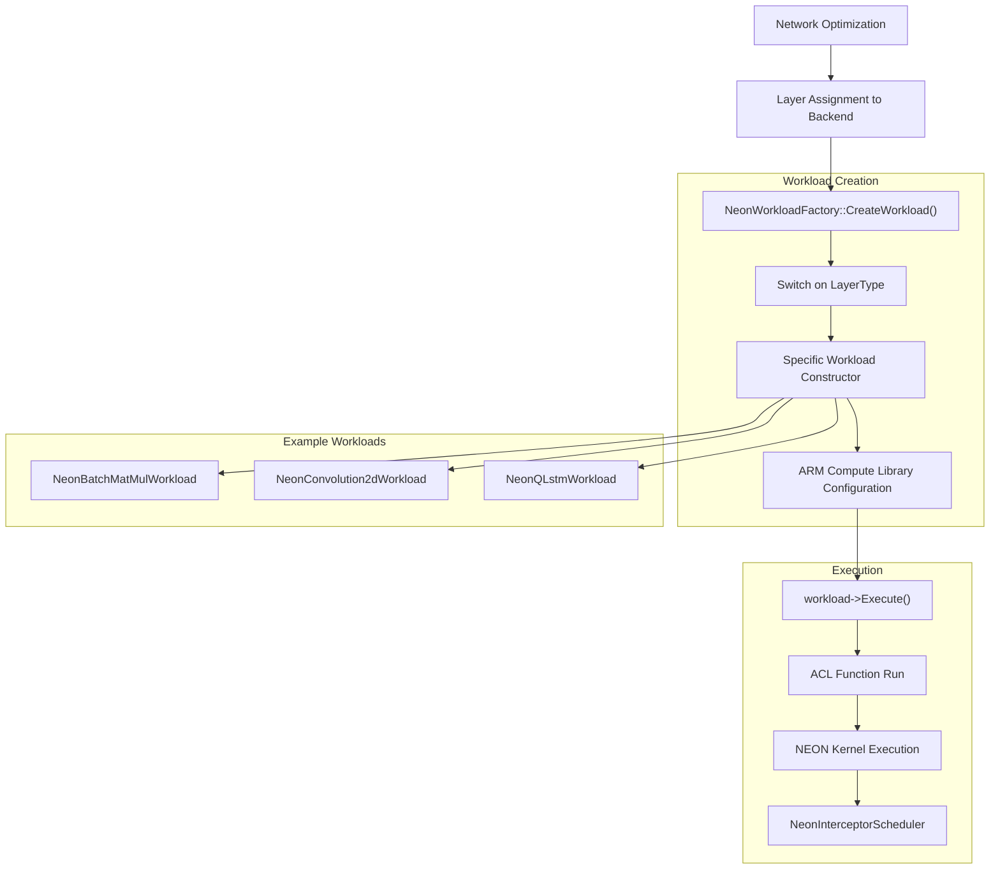

# NEON Backend

<details>
<summary>Relevant source files</summary>

The following files were used as context for generating this wiki page:

- [delegate/test/BatchMatMulTest.cpp](delegate/test/BatchMatMulTest.cpp)
- [scripts/get_compute_library.sh](scripts/get_compute_library.sh)
- [src/backends/backendsCommon/test/JsonPrinterTestImpl.cpp](src/backends/backendsCommon/test/JsonPrinterTestImpl.cpp)
- [src/backends/backendsCommon/test/layerTests/BatchMatMulTestImpl.cpp](src/backends/backendsCommon/test/layerTests/BatchMatMulTestImpl.cpp)
- [src/backends/cl/workloads/ClBatchMatMulWorkload.cpp](src/backends/cl/workloads/ClBatchMatMulWorkload.cpp)
- [src/backends/cl/workloads/ClBatchMatMulWorkload.hpp](src/backends/cl/workloads/ClBatchMatMulWorkload.hpp)
- [src/backends/cl/workloads/ClQLstmWorkload.cpp](src/backends/cl/workloads/ClQLstmWorkload.cpp)
- [src/backends/neon/NeonInterceptorScheduler.cpp](src/backends/neon/NeonInterceptorScheduler.cpp)
- [src/backends/neon/NeonInterceptorScheduler.hpp](src/backends/neon/NeonInterceptorScheduler.hpp)
- [src/backends/neon/NeonLayerSupport.cpp](src/backends/neon/NeonLayerSupport.cpp)
- [src/backends/neon/NeonLayerSupport.hpp](src/backends/neon/NeonLayerSupport.hpp)
- [src/backends/neon/NeonWorkloadFactory.cpp](src/backends/neon/NeonWorkloadFactory.cpp)
- [src/backends/neon/NeonWorkloadFactory.hpp](src/backends/neon/NeonWorkloadFactory.hpp)
- [src/backends/neon/backend.mk](src/backends/neon/backend.mk)
- [src/backends/neon/test/NeonCreateWorkloadTests.cpp](src/backends/neon/test/NeonCreateWorkloadTests.cpp)
- [src/backends/neon/test/NeonLayerTests.cpp](src/backends/neon/test/NeonLayerTests.cpp)
- [src/backends/neon/workloads/CMakeLists.txt](src/backends/neon/workloads/CMakeLists.txt)
- [src/backends/neon/workloads/NeonBatchMatMulWorkload.cpp](src/backends/neon/workloads/NeonBatchMatMulWorkload.cpp)
- [src/backends/neon/workloads/NeonBatchMatMulWorkload.hpp](src/backends/neon/workloads/NeonBatchMatMulWorkload.hpp)
- [src/backends/neon/workloads/NeonQLstmWorkload.cpp](src/backends/neon/workloads/NeonQLstmWorkload.cpp)
- [src/backends/neon/workloads/NeonWorkloads.hpp](src/backends/neon/workloads/NeonWorkloads.hpp)

</details>


The NEON Backend provides ARM NEON CPU acceleration for ArmNN's machine learning inference engine. It leverages the ARM Compute Library (ACL) to deliver optimized implementations of neural network operations using NEON SIMD instructions on ARM processors.

For information about other compute backends, see [[4.1-reference-backend|Reference Backend]], [[4.3-opencl-backend|OpenCL Backend]], and [[4.4-tosa-backend|TOSA Backend]]. For details about the overall backend system architecture, see [[2.2-backend-system|Backend System]].

## Architecture Overview

The NEON Backend follows ArmNN's standard backend architecture pattern, implementing the `IBackendInternal` interface and providing specialized components for NEON-accelerated computation.

### Backend Architecture

```mermaid
graph TB
    subgraph "ArmNN Core"
        IBackendInternal["IBackendInternal"]
        IWorkloadFactory["IWorkloadFactory"]
        ILayerSupport["ILayerSupport"]
        ITensorHandleFactory["ITensorHandleFactory"]
    end
    
    subgraph "NEON Backend Implementation"
        NeonBackend["NeonBackend"]
        NeonWorkloadFactory["NeonWorkloadFactory"]
        NeonLayerSupport["NeonLayerSupport"]
        NeonTensorHandleFactory["NeonTensorHandleFactory"]
        NeonMemoryManager["NeonMemoryManager"]
    end
    
    subgraph "Model Context"
        NeonBackendModelContext["NeonBackendModelContext"]
        NumberOfThreads["NumberOfThreads"]
        FastMathEnabled["FastMathEnabled"]
    end
    
    subgraph "Workload System"
        NeonBatchMatMulWorkload["NeonBatchMatMulWorkload"]
        NeonConvolution2dWorkload["NeonConvolution2dWorkload"]
        NeonQLstmWorkload["NeonQLstmWorkload"]
        OtherWorkloads["50+ Other Workloads"]
    end
    
    subgraph "ARM Compute Library"
        NEMatMul["arm_compute::NEMatMul"]
        NEConvolutionLayer["arm_compute::NEConvolutionLayer"]
        NELSTM["arm_compute::NELSTM"]
        Scheduler["arm_compute::Scheduler"]
    end
    
    subgraph "Profiling"
        NeonInterceptorScheduler["NeonInterceptorScheduler"]
        NeonTimer["NeonTimer"]
    end
    
    IBackendInternal -.-> NeonBackend
    IWorkloadFactory -.-> NeonWorkloadFactory
    ILayerSupport -.-> NeonLayerSupport
    ITensorHandleFactory -.-> NeonTensorHandleFactory
    
    NeonBackend --> NeonWorkloadFactory
    NeonBackend --> NeonLayerSupport
    NeonBackend --> NeonTensorHandleFactory
    NeonBackend --> NeonBackendModelContext
    
    NeonWorkloadFactory --> NeonMemoryManager
    NeonWorkloadFactory --> NeonBatchMatMulWorkload
    NeonWorkloadFactory --> NeonConvolution2dWorkload
    NeonWorkloadFactory --> NeonQLstmWorkload
    NeonWorkloadFactory --> OtherWorkloads
    
    NeonBatchMatMulWorkload --> NEMatMul
    NeonConvolution2dWorkload --> NEConvolutionLayer
    NeonQLstmWorkload --> NELSTM
    
    NeonInterceptorScheduler --> Scheduler
    NeonInterceptorScheduler --> NeonTimer
    
    NeonBackendModelContext --> NumberOfThreads
    NeonBackendModelContext --> FastMathEnabled
```



**Sources:** [src/backends/neon/NeonBackend.cpp](), [src/backends/neon/NeonWorkloadFactory.hpp:20-63](), [src/backends/neon/NeonLayerSupport.hpp:14-373]()

## Core Components

### NeonBackend

The `NeonBackend` class serves as the main entry point and factory for all NEON backend components. It implements `IBackendInternal` and coordinates the creation of workload factories, layer support, and memory managers.

**Sources:** [src/backends/neon/NeonBackend.cpp]()

### NeonWorkloadFactory

The `NeonWorkloadFactory` creates specialized workload instances for different layer types. It manages memory through `NeonMemoryManager` and can be configured with model-specific options like thread count and fast math settings.

Key responsibilities:
- Creating workloads for 50+ layer types
- Managing tensor handles and memory allocation
- Configuring ARM Compute Library scheduler settings
- Supporting model context parameters

**Sources:** [src/backends/neon/NeonWorkloadFactory.cpp:20-63](), [src/backends/neon/NeonWorkloadFactory.cpp:54-84]()

### NeonLayerSupport

The `NeonLayerSupport` class determines which operations and data types are supported by the NEON backend. It validates tensor information and operation parameters before workload creation.

**Sources:** [src/backends/neon/NeonLayerSupport.cpp:175-183](), [src/backends/neon/NeonLayerSupport.hpp:14-373]()

## Workload System

### Workload Creation and Execution Flow



**Sources:** [src/backends/neon/NeonWorkloadFactory.cpp:134-157](), [src/backends/neon/workloads/NeonBatchMatMulWorkload.cpp:103-107]()

### Workload Implementation Pattern

All NEON workloads follow a consistent pattern:

1. **Constructor**: Validates inputs, configures ACL functions, and sets up tensor mappings
2. **Execute**: Calls the configured ACL function to perform the computation
3. **Validation**: Static methods for pre-creation validation

| Component | Purpose | Example |
|-----------|---------|---------|
| Constructor | Setup and ACL configuration | `NeonBatchMatMulWorkload::NeonBatchMatMulWorkload()` |
| Execute | Run computation | `m_MatMulLayer.run()` |
| Validate | Pre-creation checks | `NeonBatchMatMulValidate()` |

**Sources:** [src/backends/neon/workloads/NeonBatchMatMulWorkload.cpp:57-101](), [src/backends/neon/workloads/NeonBatchMatMulWorkload.cpp:103-107]()

## ARM Compute Library Integration

### Dependency Management

The NEON backend's integration with ARM Compute Library is managed through a dedicated script that pins to specific ACL versions:

```bash
# From get_compute_library.sh
DEFAULT_CLFRAMEWORKREVISION="7d6fc756b2a9dfd8776be1c5c17ba45e2652c9fc"
```

The script clones ACL from the ML Platform server and checks out the pinned version to ensure compatibility.

**Sources:** [scripts/get_compute_library.sh:13](), [scripts/get_compute_library.sh:80-94]()

### ACL Function Mapping

NEON workloads wrap ARM Compute Library functions, providing a mapping between ArmNN operations and ACL implementations:

| ArmNN Operation | NEON Workload | ACL Function |
|-----------------|---------------|--------------|
| BatchMatMul | `NeonBatchMatMulWorkload` | `arm_compute::NEMatMul` |
| Convolution2d | `NeonConvolution2dWorkload` | `arm_compute::NEConvolutionLayer` |
| QLstm | `NeonQLstmWorkload` | `arm_compute::NELSTM` |
| Pooling2d | `NeonPooling2dWorkload` | `arm_compute::NEPoolingLayer` |

**Sources:** [src/backends/neon/workloads/NeonBatchMatMulWorkload.hpp:10](), [src/backends/neon/workloads/CMakeLists.txt:6-154]()

## Configuration and Model Context

### Threading Configuration

The NEON backend supports configurable thread counts through `NeonBackendModelContext`:

```cpp
// Thread count validation and setting
const unsigned int MIN_THREADS = 1;
const unsigned int MAX_THREADS = 64;
arm_compute::Scheduler::get().set_num_threads(numberOfThreads);
```

**Sources:** [src/backends/neon/NeonWorkloadFactory.cpp:58-70]()

### Fast Math Support

Operations like `BatchMatMul` and `Convolution2d` support fast math optimizations when enabled through model options:

```cpp
arm_compute::CpuMatMulSettings settings;
settings.fast_math(isFastMathEnabled);
```

**Sources:** [src/backends/neon/workloads/NeonBatchMatMulWorkload.cpp:88-90](), [src/backends/neon/NeonWorkloadFactory.cpp:158-170]()

## Performance and Profiling

### NeonInterceptorScheduler

The `NeonInterceptorScheduler` provides profiling capabilities by intercepting ARM Compute Library kernel executions and measuring their performance:

```cpp
void schedule_op(arm_compute::ICPPKernel* kernel,
                 const Hints& hints,
                 const arm_compute::Window& window,
                 arm_compute::ITensorPack& tensors)
```

**Sources:** [src/backends/neon/NeonInterceptorScheduler.hpp:17-43](), [src/backends/neon/NeonInterceptorScheduler.cpp:55-67]()

### Kernel Timing

The interceptor measures kernel execution time and stores measurements for profiling analysis:

```cpp
const auto delta = std::chrono::duration<double, std::micro>(stopTime - startTime);
m_Kernels->emplace_back(kernel->name(), delta.count(), Measurement::Unit::TIME_US);
```

**Sources:** [src/backends/neon/NeonInterceptorScheduler.cpp:65-66]()

## Build Configuration

### Backend Source Files

The NEON backend's build configuration defines all source files through `backend.mk`:

```makefile
BACKEND_SOURCES := \
    NeonBackend.cpp \
    NeonWorkloadFactory.cpp \
    NeonLayerSupport.cpp \
    workloads/NeonBatchMatMulWorkload.cpp \
    # ... 50+ additional workload files
```

**Sources:** [src/backends/neon/backend.mk:16-97]()

### Conditional Compilation

The backend is conditionally compiled based on the `ARMNN_COMPUTE_NEON_ENABLED` flag, allowing for builds without NEON support when not available.

**Sources:** [src/backends/neon/backend.mk:11-106](), [src/backends/neon/NeonLayerSupport.cpp:128-134]()

## Testing Infrastructure

The NEON backend includes comprehensive testing through multiple test suites:

| Test Type | Purpose | Example File |
|-----------|---------|--------------|
| Layer Tests | Functional validation | `NeonLayerTests.cpp` |
| Workload Creation | Constructor testing | `NeonCreateWorkloadTests.cpp` |
| End-to-End | Integration testing | `NeonEndToEndTests.cpp` |
| Performance | Profiling validation | `NeonTimerTest.cpp` |

**Sources:** [src/backends/neon/test/NeonLayerTests.cpp:19-21](), [src/backends/neon/backend.mk:118-141]()

## Related Wiki Pages

- [[4-compute-backends|Compute Backends]]
- [[4.1-reference-backend|Reference Backend]]
- [[4.3-opencl-backend|OpenCL Backend]]
- [[4.4-tosa-backend|TOSA Backend]]
- [[2.2-backend-system|Backend System]]


## Dynamic Knowledge Links (Code Graph ↔ LLM-Wiki / RAG)

### Linked Architecture & Design Documents

| Document | Match Channel | Score | Shared Code Symbols |
|---|---|---|---|
| [[2.2-backend-system|2.2 Backend System]] | `bm25+entity(4)` | `75.648` | `AreParenthesesMatching`, `BatchMatMulTestImpl`, `ExtractMeasurements`, `NeonWorkloadFactory` |
| [[7-advanced-topics|7 Advanced Topics]] | `bm25+entity(6)` | `72.823` | `AreParenthesesMatching`, `BatchMatMulTestImpl`, `ExtractMeasurements`, `GetSoftmaxProfilerJson`, `ValidateProfilerJson` |
| [[7.2-workload-system|7.2 Workload System]] | `bm25+entity(8)` | `72.562` | `AreParenthesesMatching`, `BatchMatMulTestImpl`, `ExtractMeasurements`, `GetSoftmaxProfilerJson`, `IsLayerTypeSupported` |
| [[4-compute-backends|4 Compute Backends]] | `bm25+entity(5)` | `67.152` | `AreParenthesesMatching`, `BatchMatMulTestImpl`, `ExtractMeasurements`, `GetSoftmaxProfilerJson`, `NeonWorkloadFactory` |
| [[4.3-opencl-backend|4.3 OpenCL Backend]] | `bm25+entity(4)` | `64.754` | `AreParenthesesMatching`, `BatchMatMulTestImpl`, `ExtractMeasurements`, `GetSoftmaxProfilerJson` |
| [[2.3-runtime-and-execution|2.3 Runtime and Execution]] | `wikilink:2.2-backend-system` | `34.824` | *(lexical/graph match)* |

### High-Centrality Bridge Symbols (CBM Graph)

| Symbol | Kind | Source Location | Fan-In / Fan-Out |
|---|---|---|---|
| `IsNeonBackendSupported` | Function | [src/backends/neon/NeonLayerSupport.cpp:124-134]() | in: `64` / out: `2` |
| `IsLayerTypeSupported` | Function | [src/backends/neon/NeonLayerSupport.cpp:185-729]() | in: `1` / out: `78` |
| `OptimizeSubgraphView` | Method | [src/backends/neon/NeonBackend.cpp:140-618]() | in: `0` / out: `53` |
| `BatchMatMulTestImpl` | Function | [src/backends/backendsCommon/test/layerTests/BatchMatMulTestImpl.cpp:20-80]() | in: `13` / out: `16` |
| `TestNeonTensorHandleInfo` | Function | [src/backends/neon/test/NeonCreateWorkloadTests.cpp:32-63]() | in: `17` / out: `2` |
| `ClQLstmWorkloadValidate` | Function | [src/backends/cl/workloads/ClQLstmWorkload.cpp:247-395]() | in: `0` / out: `22` |

Sources: [src/backends/neon/NeonLayerSupport.cpp:124-134](), [src/backends/neon/NeonLayerSupport.cpp:185-729](), [src/backends/neon/NeonBackend.cpp:140-618](), [src/backends/backendsCommon/test/layerTests/BatchMatMulTestImpl.cpp:20-80]()

### Cross-Subsystem Coupling

- [[2-core-architecture|2 Core Architecture]] — call/import coupling weight `36.0`
- [[2.1-network-and-graph-system|2.1 Network and Graph System]] — call/import coupling weight `36.0`
- [[2.2-backend-system|2.2 Backend System]] — call/import coupling weight `24.0`
- [[4-compute-backends|4 Compute Backends]] — call/import coupling weight `24.0`
- [[3.3-model-serialization|3.3 Model Serialization]] — call/import coupling weight `17.0`
- [[1-armnn-overview|1 ArmNN Overview]] — call/import coupling weight `9.0`
