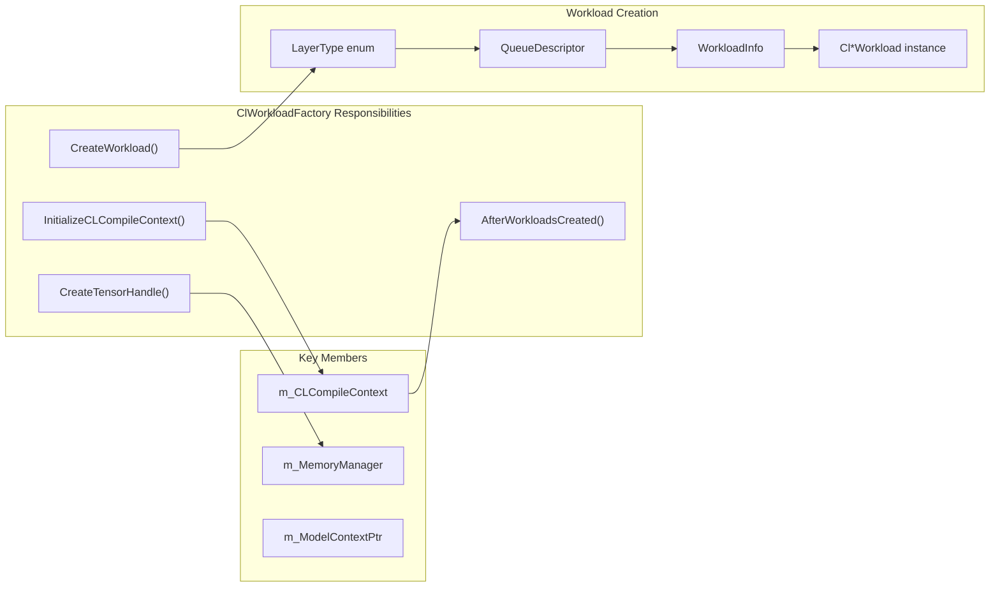
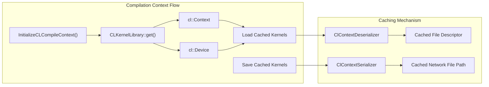

# OpenCL Backend

<details>
<summary>Relevant source files</summary>

The following files were used as context for generating this wiki page:

- [delegate/test/BatchMatMulTest.cpp](delegate/test/BatchMatMulTest.cpp)
- [docs/02_operator_list.dox](docs/02_operator_list.dox)
- [scripts/get_compute_library.sh](scripts/get_compute_library.sh)
- [src/backends/backendsCommon/test/JsonPrinterTestImpl.cpp](src/backends/backendsCommon/test/JsonPrinterTestImpl.cpp)
- [src/backends/backendsCommon/test/layerTests/BatchMatMulTestImpl.cpp](src/backends/backendsCommon/test/layerTests/BatchMatMulTestImpl.cpp)
- [src/backends/cl/ClLayerSupport.cpp](src/backends/cl/ClLayerSupport.cpp)
- [src/backends/cl/ClLayerSupport.hpp](src/backends/cl/ClLayerSupport.hpp)
- [src/backends/cl/ClWorkloadFactory.cpp](src/backends/cl/ClWorkloadFactory.cpp)
- [src/backends/cl/ClWorkloadFactory.hpp](src/backends/cl/ClWorkloadFactory.hpp)
- [src/backends/cl/backend.mk](src/backends/cl/backend.mk)
- [src/backends/cl/test/ClCreateWorkloadTests.cpp](src/backends/cl/test/ClCreateWorkloadTests.cpp)
- [src/backends/cl/test/ClLayerTests.cpp](src/backends/cl/test/ClLayerTests.cpp)
- [src/backends/cl/workloads/CMakeLists.txt](src/backends/cl/workloads/CMakeLists.txt)
- [src/backends/cl/workloads/ClBatchMatMulWorkload.cpp](src/backends/cl/workloads/ClBatchMatMulWorkload.cpp)
- [src/backends/cl/workloads/ClBatchMatMulWorkload.hpp](src/backends/cl/workloads/ClBatchMatMulWorkload.hpp)
- [src/backends/cl/workloads/ClQLstmWorkload.cpp](src/backends/cl/workloads/ClQLstmWorkload.cpp)
- [src/backends/cl/workloads/ClWorkloads.hpp](src/backends/cl/workloads/ClWorkloads.hpp)
- [src/backends/neon/NeonInterceptorScheduler.cpp](src/backends/neon/NeonInterceptorScheduler.cpp)
- [src/backends/neon/NeonInterceptorScheduler.hpp](src/backends/neon/NeonInterceptorScheduler.hpp)
- [src/backends/neon/workloads/NeonBatchMatMulWorkload.cpp](src/backends/neon/workloads/NeonBatchMatMulWorkload.cpp)
- [src/backends/neon/workloads/NeonBatchMatMulWorkload.hpp](src/backends/neon/workloads/NeonBatchMatMulWorkload.hpp)
- [src/backends/neon/workloads/NeonQLstmWorkload.cpp](src/backends/neon/workloads/NeonQLstmWorkload.cpp)

</details>


This document covers the OpenCL backend implementation in ArmNN, which provides GPU acceleration through OpenCL. The OpenCL backend leverages the ARM Compute Library to execute neural network operations on GPU hardware.

For information about other compute backends, see [[4.2-neon-backend|NEON Backend]] for ARM CPU acceleration, [[4.1-reference-backend|Reference Backend]] for the CPU reference implementation, and [[4.4-tosa-backend|TOSA Backend]] for TOSA specification compliance.

## Architecture Overview

The OpenCL backend follows ArmNN's standard backend architecture pattern, implementing the `IBackendInternal` interface to provide GPU acceleration capabilities. The backend integrates with the ARM Compute Library's OpenCL implementation to execute workloads on compatible GPU hardware.

```mermaid
graph TB
    subgraph "ArmNN Core"
        IBackendInternal["IBackendInternal"]
        IWorkloadFactory["IWorkloadFactory"]
        ILayerSupport["ILayerSupport"]
    end
    
    subgraph "OpenCL Backend"
        ClBackend["ClBackend"]
        ClWorkloadFactory["ClWorkloadFactory"]
        ClLayerSupport["ClLayerSupport"]
        ClTensorHandleFactory["ClTensorHandleFactory"]
        ClMemoryManager["ClMemoryManager"]
    end
    
    subgraph "Workload Implementation"
        ClBaseWorkload["ClBaseWorkload<T>"]
        ClConvolution2dWorkload["ClConvolution2dWorkload"]
        ClBatchMatMulWorkload["ClBatchMatMulWorkload"]
        ClActivationWorkload["ClActivationWorkload"]
        ClPooling2dWorkload["ClPooling2dWorkload"]
    end
    
    subgraph "ARM Compute Library"
        CLCompileContext["CLCompileContext"]
        CLKernelLibrary["CLKernelLibrary"]
        CLScheduler["CLScheduler"]
        CLFunctions["CL Functions (CLConvolution, CLMatMul, etc.)"]
    end
    
    subgraph "OpenCL Runtime"
        CLContext["cl::Context"]
        CLDevice["cl::Device"]
        CLKernels["Compiled Kernels"]
    end
    
    IBackendInternal <|-- ClBackend
    IWorkloadFactory <|-- ClWorkloadFactory
    ILayerSupport <|-- ClLayerSupport
    
    ClBackend --> ClWorkloadFactory
    ClBackend --> ClLayerSupport
    ClBackend --> ClTensorHandleFactory
    ClBackend --> ClMemoryManager
    
    ClWorkloadFactory --> ClBaseWorkload
    ClBaseWorkload <|-- ClConvolution2dWorkload
    ClBaseWorkload <|-- ClBatchMatMulWorkload
    ClBaseWorkload <|-- ClActivationWorkload
    ClBaseWorkload <|-- ClPooling2dWorkload
    
    ClWorkloadFactory --> CLCompileContext
    CLCompileContext --> CLKernelLibrary
    CLKernelLibrary --> CLScheduler
    CLFunctions --> CLContext
    CLFunctions --> CLDevice
    CLFunctions --> CLKernels
```

Sources: [src/backends/cl/ClWorkloadFactory.hpp:1-79](), [src/backends/cl/ClLayerSupport.hpp:1-384](), [src/backends/cl/workloads/ClWorkloads.hpp:1-78]()

## Core Components

### ClWorkloadFactory

The `ClWorkloadFactory` is the central component responsible for creating OpenCL workloads and managing the compilation context. It inherits from `WorkloadFactoryBase` and provides OpenCL-specific workload creation.



The factory supports over 70 different layer types, each mapped to a specific OpenCL workload implementation. The `CreateWorkload` method uses a large switch statement to instantiate the appropriate workload based on the layer type.

Sources: [src/backends/cl/ClWorkloadFactory.cpp:247-815](), [src/backends/cl/ClWorkloadFactory.hpp:20-79]()

### ClLayerSupport

The `ClLayerSupport` class determines which operations are supported by the OpenCL backend and validates tensor information for compatibility. It implements comprehensive validation for each supported layer type.

Key validation methods include:
- `IsConvolution2dSupported()` - Validates 2D convolution parameters
- `IsBatchMatMulSupported()` - Validates batch matrix multiplication
- `IsActivationSupported()` - Validates activation functions
- `IsPooling2dSupported()` - Validates pooling operations

Sources: [src/backends/cl/ClLayerSupport.cpp:190-750](), [src/backends/cl/ClLayerSupport.hpp:21-381]()

### Workload System

Each OpenCL operation is implemented as a workload class that inherits from `ClBaseWorkload`. The workloads wrap ARM Compute Library functions and manage OpenCL-specific execution details.

```mermaid
graph TB
    subgraph "Workload Hierarchy"
        ClBaseWorkload["ClBaseWorkload<QueueDescriptorType>"]
        ClConvolution2dWorkload["ClConvolution2dWorkload"]
        ClBatchMatMulWorkload["ClBatchMatMulWorkload"]
        ClActivationWorkload["ClActivationWorkload"]
        ClPooling2dWorkload["ClPooling2dWorkload"]
        ClFullyConnectedWorkload["ClFullyConnectedWorkload"]
    end
    
    subgraph "ARM Compute Integration"
        CLConvolutionLayer["arm_compute::CLConvolutionLayer"]
        CLMatMul["arm_compute::CLMatMul"]
        CLActivationLayer["arm_compute::CLActivationLayer"]
        CLPoolingLayer["arm_compute::CLPoolingLayer"]
        CLFullyConnectedLayer["arm_compute::CLFullyConnectedLayer"]
    end
    
    subgraph "Execution Flow"
        Configure["configure()"]
        Execute["Execute()"]
        RunClFunction["RunClFunction()"]
    end
    
    ClBaseWorkload <|-- ClConvolution2dWorkload
    ClBaseWorkload <|-- ClBatchMatMulWorkload
    ClBaseWorkload <|-- ClActivationWorkload
    ClBaseWorkload <|-- ClPooling2dWorkload
    ClBaseWorkload <|-- ClFullyConnectedWorkload
    
    ClConvolution2dWorkload --> CLConvolutionLayer
    ClBatchMatMulWorkload --> CLMatMul
    ClActivationWorkload --> CLActivationLayer
    ClPooling2dWorkload --> CLPoolingLayer
    ClFullyConnectedWorkload --> CLFullyConnectedLayer
    
    Configure --> Execute
    Execute --> RunClFunction
```

Sources: [src/backends/cl/workloads/ClWorkloads.hpp:1-78](), [src/backends/cl/workloads/ClBatchMatMulWorkload.cpp:57-113]()

## ARM Compute Library Integration

The OpenCL backend depends heavily on the ARM Compute Library (ACL) for GPU kernel implementations. The integration is managed through several key mechanisms:

### Dependency Management

The `get_compute_library.sh` script manages the ACL dependency by cloning and checking out a specific version of the ARM Compute Library:

```bash
DEFAULT_CLFRAMEWORKREVISION="7d6fc756b2a9dfd8776be1c5c17ba45e2652c9fc"
```

This ensures reproducible builds with a known-compatible version of ACL.

Sources: [scripts/get_compute_library.sh:13]()

### Compilation Context

The `CLCompileContext` manages OpenCL kernel compilation and caching:



The compilation context supports kernel caching to improve startup performance by avoiding recompilation of frequently used kernels.

Sources: [src/backends/cl/ClWorkloadFactory.cpp:137-186]()

## Memory Management

The OpenCL backend uses specialized tensor handles and memory management:

### ClTensorHandle

Manages OpenCL tensor memory and provides the interface between ArmNN tensors and ARM Compute Library tensors. Key features include:
- GPU memory allocation and deallocation
- Memory mapping for CPU-GPU data transfers
- Integration with ACL tensor formats

### Memory Groups

The backend uses memory groups for efficient GPU memory management:
- `GetInterLayerMemoryGroup()` - For tensors passed between layers
- `GetIntraLayerManager()` - For temporary allocations within layers

Sources: [src/backends/cl/ClWorkloadFactory.cpp:201-220]()

## Supported Operations

The OpenCL backend supports a comprehensive set of neural network operations:

| Operation Category | Key Workloads | ARM Compute Functions |
|-------------------|---------------|----------------------|
| **Convolution** | `ClConvolution2dWorkload`, `ClConvolution3dWorkload`, `ClDepthwiseConvolutionWorkload` | `CLConvolutionLayer`, `CLDepthwiseConvolutionLayer` |
| **Matrix Operations** | `ClBatchMatMulWorkload`, `ClFullyConnectedWorkload` | `CLMatMul`, `CLFullyConnectedLayer` |
| **Activation** | `ClActivationWorkload` | `CLActivationLayer` |
| **Pooling** | `ClPooling2dWorkload`, `ClPooling3dWorkload` | `CLPoolingLayer` |
| **Elementwise** | `ClAdditionWorkload`, `ClMultiplicationWorkload` | `CLArithmeticAddition`, `CLPixelWiseMultiplication` |
| **Normalization** | `ClBatchNormalizationFloatWorkload`, `ClInstanceNormalizationWorkload` | `CLBatchNormalizationLayer` |

Sources: [src/backends/cl/backend.mk:16-99](), [src/backends/cl/workloads/CMakeLists.txt:6-150]()

## Testing Infrastructure

The OpenCL backend includes comprehensive testing across multiple levels:

### Layer Tests

The `ClLayerTests.cpp` file contains over 1000 test cases covering various operations and data types:
- Activation functions (ReLU, Sigmoid, Tanh, etc.)
- Convolution operations (2D, 3D, depthwise)
- Matrix operations (BatchMatMul, FullyConnected)
- Pooling operations (Max, Average, L2)

### Workload Creation Tests

The `ClCreateWorkloadTests.cpp` validates workload instantiation and tensor handle creation:
- Tensor shape validation
- Data type compatibility
- Memory import/export functionality

### Performance Testing

Integration with ArmNN's profiling system provides detailed performance metrics:
- OpenCL kernel execution times
- GPU memory usage
- Queue synchronization overhead

Sources: [src/backends/cl/test/ClLayerTests.cpp:27-28](), [src/backends/cl/test/ClCreateWorkloadTests.cpp:34-35]()

## Build Configuration

The OpenCL backend can be conditionally compiled using the `ARMNN_COMPUTE_CL_ENABLED` flag. When disabled, the backend gracefully reports unsupported operations:

```cpp
#if defined(ARMCOMPUTECL_ENABLED)
    return true;
#else
    if (reasonIfUnsupported)
    {
        reasonIfUnsupported.value() = "The armnn library has been built without CL support";
    }
    return false;
#endif
```

Sources: [src/backends/cl/ClLayerSupport.cpp:124-133](), [src/backends/cl/backend.mk:11-14]()

## Related Wiki Pages

- [[4-compute-backends|Compute Backends]]
- [[4.2-neon-backend|NEON Backend]]
- [[4.1-reference-backend|Reference Backend]]
- [[4.4-tosa-backend|TOSA Backend]]


## Dynamic Knowledge Links (Code Graph ↔ LLM-Wiki / RAG)

### Linked Architecture & Design Documents

| Document | Match Channel | Score | Shared Code Symbols |
|---|---|---|---|
| [[7-advanced-topics|7 Advanced Topics]] | `bm25+entity(5)` | `66.204` | `AreParenthesesMatching`, `BatchMatMulTestImpl`, `ExtractMeasurements`, `GetSoftmaxProfilerJson`, `ValidateProfilerJson` |
| [[7.2-workload-system|7.2 Workload System]] | `bm25+entity(5)` | `64.959` | `AreParenthesesMatching`, `BatchMatMulTestImpl`, `ClWorkloadFactory`, `ExtractMeasurements`, `GetSoftmaxProfilerJson` |
| [[4.2-neon-backend|4.2 NEON Backend]] | `bm25+entity(5)` | `63.481` | `AreParenthesesMatching`, `BatchMatMulTestImpl`, `ClBatchMatMulWorkload`, `ExtractMeasurements`, `GetSoftmaxProfilerJson` |
| [[4-compute-backends|4 Compute Backends]] | `bm25+entity(5)` | `61.241` | `AreParenthesesMatching`, `BatchMatMulTestImpl`, `ClWorkloadFactory`, `ExtractMeasurements`, `GetSoftmaxProfilerJson` |
| [[2.2-backend-system|2.2 Backend System]] | `bm25+entity(4)` | `60.924` | `AreParenthesesMatching`, `BatchMatMulTestImpl`, `ClWorkloadFactory`, `ExtractMeasurements` |
| [[4.1-reference-backend|4.1 Reference Backend]] | `wikilink:4.3-opencl-backend` | `40.475` | *(lexical/graph match)* |

### High-Centrality Bridge Symbols (CBM Graph)

| Symbol | Kind | Source Location | Fan-In / Fan-Out |
|---|---|---|---|
| `IsClBackendSupported` | Function | [src/backends/cl/ClLayerSupport.cpp:120-133]() | in: `64` / out: `2` |
| `IsLayerSupported` | Method | [src/backends/cl/ClLayerSupport.cpp:190-710]() | in: `0` / out: `66` |
| `BatchMatMulTestImpl` | Function | [src/backends/backendsCommon/test/layerTests/BatchMatMulTestImpl.cpp:20-80]() | in: `13` / out: `16` |
| `CompareIClTensorHandleShape` | Function | [src/backends/cl/test/ClCreateWorkloadTests.cpp:28-32]() | in: `16` / out: `1` |
| `ClQLstmWorkloadValidate` | Function | [src/backends/cl/workloads/ClQLstmWorkload.cpp:247-395]() | in: `0` / out: `22` |
| `NeonQLstmWorkloadValidate` | Function | [src/backends/neon/workloads/NeonQLstmWorkload.cpp:243-391]() | in: `0` / out: `22` |

Sources: [src/backends/cl/ClLayerSupport.cpp:120-133](), [src/backends/cl/ClLayerSupport.cpp:190-710](), [src/backends/backendsCommon/test/layerTests/BatchMatMulTestImpl.cpp:20-80](), [src/backends/cl/test/ClCreateWorkloadTests.cpp:28-32]()

### Cross-Subsystem Coupling

- [[2-core-architecture|2 Core Architecture]] — call/import coupling weight `88.0`
- [[2.1-network-and-graph-system|2.1 Network and Graph System]] — call/import coupling weight `88.0`
- [[3.3-model-serialization|3.3 Model Serialization]] — call/import coupling weight `15.0`
- [[1-armnn-overview|1 ArmNN Overview]] — call/import coupling weight `11.0`
- [[2.2-backend-system|2.2 Backend System]] — call/import coupling weight `11.0`
- [[4-compute-backends|4 Compute Backends]] — call/import coupling weight `11.0`
