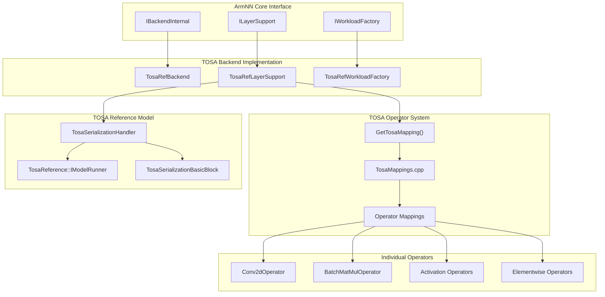
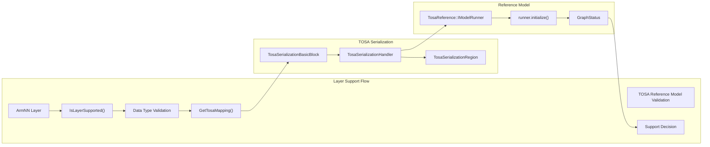
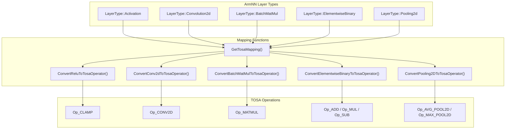
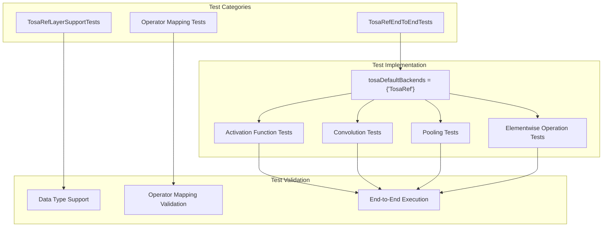

# TOSA Backend

<details>
<summary>Relevant source files</summary>

The following files were used as context for generating this wiki page:

- [src/backends/backendsCommon/common.mk](src/backends/backendsCommon/common.mk)
- [src/backends/backendsCommon/test/CMakeLists.txt](src/backends/backendsCommon/test/CMakeLists.txt)
- [src/backends/backendsCommon/test/EndToEndTestImpl.hpp](src/backends/backendsCommon/test/EndToEndTestImpl.hpp)
- [src/backends/cl/test/ClEndToEndTests.cpp](src/backends/cl/test/ClEndToEndTests.cpp)
- [src/backends/neon/test/NeonEndToEndTests.cpp](src/backends/neon/test/NeonEndToEndTests.cpp)
- [src/backends/reference/test/RefEndToEndTests.cpp](src/backends/reference/test/RefEndToEndTests.cpp)
- [src/backends/tosaCommon/TosaMappings.cpp](src/backends/tosaCommon/TosaMappings.cpp)
- [src/backends/tosaCommon/operatorMappings/CMakeLists.txt](src/backends/tosaCommon/operatorMappings/CMakeLists.txt)
- [src/backends/tosaCommon/operatorMappings/TosaCommonOperators.hpp](src/backends/tosaCommon/operatorMappings/TosaCommonOperators.hpp)
- [src/backends/tosaCommon/operatorMappings/TosaOperatorUtils.hpp](src/backends/tosaCommon/operatorMappings/TosaOperatorUtils.hpp)
- [src/backends/tosaCommon/test/OneToManyMappingTests.cpp](src/backends/tosaCommon/test/OneToManyMappingTests.cpp)
- [src/backends/tosaCommon/test/OneToOneMappingTests.cpp](src/backends/tosaCommon/test/OneToOneMappingTests.cpp)
- [src/backends/tosaCommon/test/TosaTestUtils.hpp](src/backends/tosaCommon/test/TosaTestUtils.hpp)
- [src/backends/tosaReference/TosaRefLayerSupport.cpp](src/backends/tosaReference/TosaRefLayerSupport.cpp)
- [src/backends/tosaReference/test/TosaRefEndToEndTests.cpp](src/backends/tosaReference/test/TosaRefEndToEndTests.cpp)
- [src/backends/tosaReference/test/TosaRefLayerSupportTests.cpp](src/backends/tosaReference/test/TosaRefLayerSupportTests.cpp)

</details>


The TOSA Backend provides a reference implementation for executing ArmNN networks using the TOSA (Tensor Operator Set Architecture) specification. This backend serves as a validation and compliance tool, ensuring that ArmNN operators can be correctly mapped to TOSA operations and executed through the TOSA reference model.

For information about other compute backends in ArmNN, see [[4.1-reference-backend|Reference Backend]], [[4.2-neon-backend|NEON Backend]], and [[4.3-opencl-backend|OpenCL Backend]].

## Architecture Overview

The TOSA Backend implements the standard ArmNN backend interface while providing TOSA-specific functionality through operator mappings and validation against the TOSA reference model.



**Sources:** [src/backends/tosaReference/TosaRefLayerSupport.cpp:1-236](), [src/backends/tosaCommon/TosaMappings.cpp:1-281]()

## Layer Support System

The `TosaRefLayerSupport` class implements layer validation by converting ArmNN operations to TOSA serialization and validating them against the TOSA reference model.



**Key data type restrictions:**
- `DataType::Signed64` is not supported (no TOSA equivalent)
- `DataType::QAsymmU8` is not supported in TOSA reference backend

**Sources:** [src/backends/tosaReference/TosaRefLayerSupport.cpp:21-234]()

## Operator Mappings

The TOSA backend maps ArmNN operations to TOSA operations through a comprehensive mapping system that handles both one-to-one and one-to-many operator conversions.

### Core Mapping Architecture



### Supported Layer Types

The TOSA backend supports the following ArmNN layer types with their corresponding TOSA operations:

| ArmNN Layer | TOSA Operation | Mapping Function |
|-------------|----------------|------------------|
| `Activation` | `Op_CLAMP`, `Op_SIGMOID`, `Op_TANH` | `ConvertReluToTosaOperator` |
| `Addition/Multiplication/Subtraction` | `Op_ADD`, `Op_MUL`, `Op_SUB` | `ConvertElementwiseBinaryToTosaOperator` |
| `BatchMatMul` | `Op_MATMUL` | `ConvertBatchMatMulToTosaOperator` |
| `Concat` | `Op_CONCAT` | `ConvertConcatToTosaOperator` |
| `Convolution2d` | `Op_CONV2D` | `ConvertConv2dToTosaOperator` |
| `DepthwiseConvolution2d` | `Op_DEPTHWISE_CONV2D` | `ConvertDepthwiseConv2dToTosaOperator` |
| `FullyConnected` | `Op_FULLY_CONNECTED` | `ConvertFullyConnectedToTosaOperator` |
| `Pooling2d` | `Op_AVG_POOL2D`, `Op_MAX_POOL2D` | `ConvertPooling2DToTosaOperator` |

**Sources:** [src/backends/tosaCommon/TosaMappings.cpp:24-258](), [src/backends/tosaCommon/operatorMappings/CMakeLists.txt:6-78]()

## Testing Framework

The TOSA backend includes comprehensive end-to-end testing to validate operator implementations and ensure compliance with the TOSA specification.

### Test Structure



### Example Test Cases

The TOSA backend tests cover various activation functions, data types, and operator configurations:

**Activation Tests:**
- `TosaRefLeakyReluActivationFloat32` - Tests LeakyReLU with Float32
- `TosaRefReLuEndToEndTestQAsymmS8` - Tests ReLU with quantized data
- `TosaRefSigmoidEndToEndTestFloat32` - Tests Sigmoid activation

**Convolution Tests:**
- `TosaRefConv2dEndtoEndTestFloat32` - 2D convolution with bias
- `TosaRefConv2dWithoutBiasEndtoEndTestFloat32` - 2D convolution without bias
- `TosaRefDepthwiseConv2dEndtoEndTestInt8` - Depthwise convolution with quantized data

**Sources:** [src/backends/tosaReference/test/TosaRefEndToEndTests.cpp:40-1440](), [src/backends/tosaReference/test/TosaRefLayerSupportTests.cpp:17-234]()

## Implementation Details

### Operator Utility Functions

The TOSA backend provides utility functions for data type conversion and tensor shape handling:

```cpp
// Data type conversion
DType ArmNNToDType(const DataType& type)
DataType DtypeToArmNN(const DType type)

// Tensor shape conversion  
std::vector<int32_t> GetTosaTensorShape(const TensorShape& shape)

// Unique naming for tensors
std::string GenerateUniqueName(const Layer& layer, uint32_t layerSlot)
```

### TOSA Serialization Flow

1. **Layer Analysis:** `TosaRefLayerSupport::IsLayerSupported()` examines input layer and descriptor
2. **Mapping Generation:** `GetTosaMapping()` creates TOSA serialization block
3. **Validation:** TOSA reference model validates the generated operations
4. **Result:** Returns support decision based on validation outcome

### Supported Data Types

The TOSA backend supports the following ArmNN to TOSA data type mappings:

| ArmNN DataType | TOSA DType |
|----------------|------------|
| `Float16` | `DType_FP16` |
| `Float32` | `DType_FP32` |
| `QSymmS8`/`QAsymmS8` | `DType_INT8` |
| `QSymmS16` | `DType_INT16` |
| `Signed32` | `DType_INT32` |
| `Boolean` | `DType_BOOL` |

**Sources:** [src/backends/tosaCommon/operatorMappings/TosaOperatorUtils.hpp:22-76](), [src/backends/tosaReference/TosaRefLayerSupport.cpp:28-36]()

## Related Wiki Pages

- [[4-compute-backends|Compute Backends]]
- [[4.1-reference-backend|Reference Backend]]
- [[4.2-neon-backend|NEON Backend]]
- [[4.3-opencl-backend|OpenCL Backend]]


## Dynamic Knowledge Links (Code Graph ↔ LLM-Wiki / RAG)

### Linked Architecture & Design Documents

| Document | Match Channel | Score | Shared Code Symbols |
|---|---|---|---|
| [[6-development-guide|6 Development Guide]] | `bm25+entity(8)` | `96.131` | `ArmNNToDType`, `EndToEndLayerTestImpl`, `GenerateUniqueInputName`, `GenerateUniqueName`, `GenerateUniqueOutputName` |
| [[6.2-testing-framework|6.2 Testing Framework]] | `bm25+entity(4)` | `77.083` | `ArmNNToDType`, `EndToEndLayerTestImpl`, `GetTosaMapping`, `GetTosaTensorShape` |
| [[2-core-architecture|2 Core Architecture]] | `bm25` | `74.675` | *(lexical/graph match)* |
| [[2.1-network-and-graph-system|2.1 Network and Graph System]] | `bm25` | `64.757` | *(lexical/graph match)* |
| [[2.3-runtime-and-execution|2.3 Runtime and Execution]] | `bm25` | `64.295` | *(lexical/graph match)* |
| [[4.1-reference-backend|4.1 Reference Backend]] | `wikilink:4.4-tosa-backend+entity(4)` | `49.706` | `ArmNNToDType`, `EndToEndLayerTestImpl`, `GetTosaMapping`, `GetTosaTensorShape` |

### High-Centrality Bridge Symbols (CBM Graph)

| Symbol | Kind | Source Location | Fan-In / Fan-Out |
|---|---|---|---|
| `EndToEndLayerTestImpl` | Function | [src/backends/backendsCommon/test/EndToEndTestImpl.hpp:131-185]() | in: `115` / out: `10` |
| `GetTosaTensorShape` | Function | [src/backends/tosaCommon/operatorMappings/TosaOperatorUtils.hpp:83-91]() | in: `39` / out: `2` |
| `GenerateUniqueOutputName` | Function | [src/backends/tosaCommon/operatorMappings/TosaOperatorUtils.hpp:137-151]() | in: `37` / out: `5` |
| `GetUniqueTosaMappingID` | Function | [src/backends/tosaCommon/operatorMappings/TosaOperatorUtils.hpp:155-158]() | in: `39` / out: `1` |
| `GenerateUniqueInputName` | Function | [src/backends/tosaCommon/operatorMappings/TosaOperatorUtils.hpp:113-121]() | in: `37` / out: `4` |
| `ArmNNToDType` | Function | [src/backends/tosaCommon/operatorMappings/TosaOperatorUtils.hpp:26-53]() | in: `38` / out: `0` |

Sources: [src/backends/backendsCommon/test/EndToEndTestImpl.hpp:131-185](), [src/backends/tosaCommon/operatorMappings/TosaOperatorUtils.hpp:83-91](), [src/backends/tosaCommon/operatorMappings/TosaOperatorUtils.hpp:137-151](), [src/backends/tosaCommon/operatorMappings/TosaOperatorUtils.hpp:155-158]()

### Cross-Subsystem Coupling

- [[2-core-architecture|2 Core Architecture]] — call/import coupling weight `109.0`
- [[2.1-network-and-graph-system|2.1 Network and Graph System]] — call/import coupling weight `109.0`
- [[1-armnn-overview|1 ArmNN Overview]] — call/import coupling weight `81.0`
- [[2.3-runtime-and-execution|2.3 Runtime and Execution]] — call/import coupling weight `24.0`
- [[3.3-model-serialization|3.3 Model Serialization]] — call/import coupling weight `4.0`
- [[4.1-reference-backend|4.1 Reference Backend]] — call/import coupling weight `3.0`
