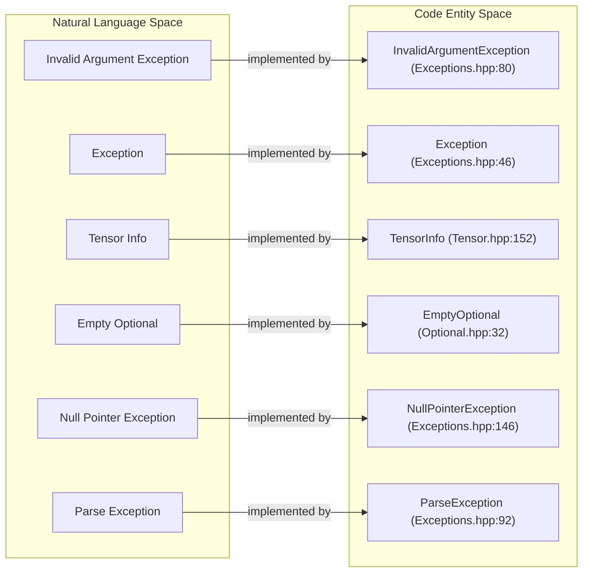
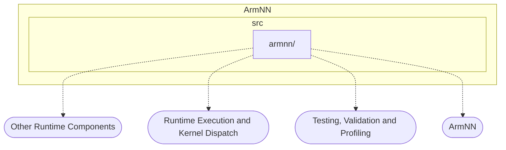
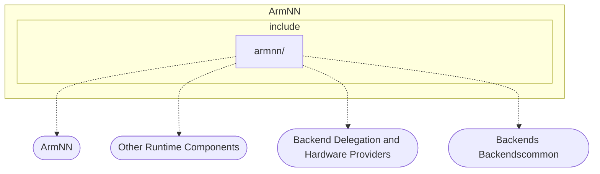
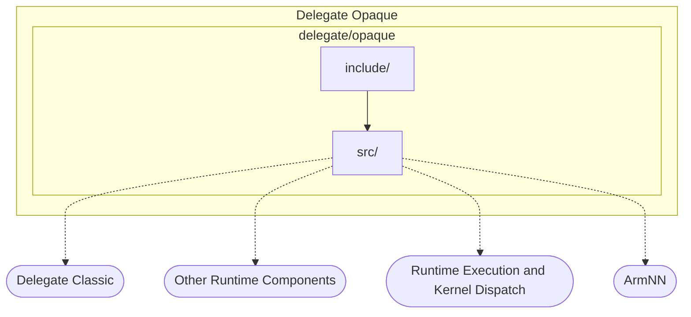
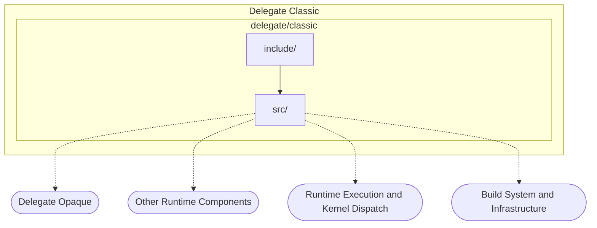
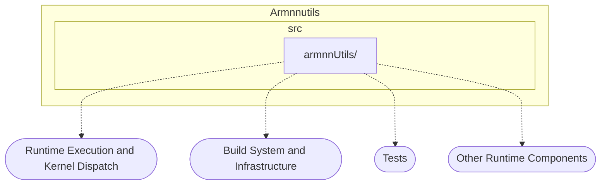
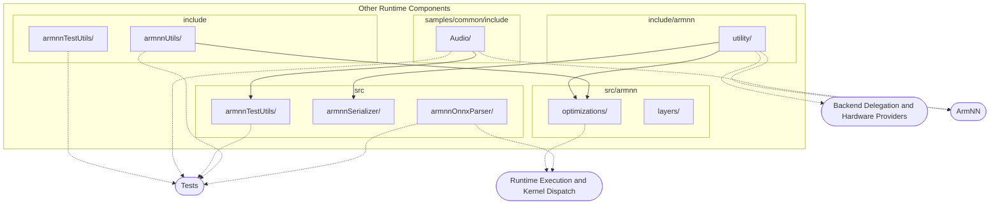

# Runtime Execution and Kernel Dispatch

> Architectural overview of Runtime Execution and Kernel Dispatch, spanning 157 source files and 3718 code symbols across 6 subsystems.

Relevant source files

The following files were used as context for generating this wiki page:

- [samples/common/include/Audio/DataStructures.hpp](samples/common/include/Audio/DataStructures.hpp)
- [src/armnn/Tensor.cpp](src/armnn/Tensor.cpp)
- [include/armnn/Exceptions.hpp](include/armnn/Exceptions.hpp)
- [include/armnn/Tensor.hpp](include/armnn/Tensor.hpp)
- [src/armnn/Layer.cpp](src/armnn/Layer.cpp)
- [include/armnn/utility/IgnoreUnused.hpp](include/armnn/utility/IgnoreUnused.hpp)
- [delegate/classic/src/ClassicDelegateUtils.hpp](delegate/classic/src/ClassicDelegateUtils.hpp)
- [delegate/opaque/src/OpaqueDelegateUtils.hpp](delegate/opaque/src/OpaqueDelegateUtils.hpp)
- [include/armnnTestUtils/WorkloadTestUtils.hpp](include/armnnTestUtils/WorkloadTestUtils.hpp)
- [include/armnn/BackendId.hpp](include/armnn/BackendId.hpp)
- [include/armnn/Types.hpp](include/armnn/Types.hpp)
- [src/armnnTestUtils/TensorCopyUtils.cpp](src/armnnTestUtils/TensorCopyUtils.cpp)
- [include/armnn/Optional.hpp](include/armnn/Optional.hpp)
- [src/armnn/Descriptors.cpp](src/armnn/Descriptors.cpp)
- [include/armnn/utility/PolymorphicDowncast.hpp](include/armnn/utility/PolymorphicDowncast.hpp)
- [src/armnnSerializer/Serializer.cpp](src/armnnSerializer/Serializer.cpp)
- [src/armnn/Layer.hpp](src/armnn/Layer.hpp)
- [include/armnn/LstmParams.hpp](include/armnn/LstmParams.hpp)
- [src/armnn/Graph.hpp](src/armnn/Graph.hpp)
- [src/armnn/Exceptions.cpp](src/armnn/Exceptions.cpp)
- [src/armnnUtils/Permute.cpp](src/armnnUtils/Permute.cpp)
- [src/armnnUtils/TensorUtils.cpp](src/armnnUtils/TensorUtils.cpp)
- [delegate/classic/src/armnn_delegate.cpp](delegate/classic/src/armnn_delegate.cpp)

## Purpose and Scope

This chapter covers **Runtime Execution and Kernel Dispatch** across the repository, detailing the core abstractions, data structures, transformation pipelines, and runtime/build integrations that implement this layer.

**Scope**: This document provides an architectural hub for the following child subsystems:
- **ArmNN**: See [[5.1-armnn|ArmNN]].
- **ArmNN**: See [[5.2-armnn|ArmNN]].
- **Delegate Opaque**: See [[5.3-delegate-opaque|Delegate Opaque]].
- **Delegate Classic**: See [[5.4-delegate-classic|Delegate Classic]].
- **Armnnutils**: See [[5.5-armnnutils|Armnnutils]].
- **Other Runtime Components**: See [[5.6-other-runtime-components|Other Runtime Components]].

Sources: [include/armnn/Exceptions.hpp:80-84](), [include/armnn/Exceptions.hpp:46-65](), [include/armnn/Tensor.hpp:152-274](), [include/armnn/Optional.hpp:32-32]()

---

## System Mapping: Natural Language Space to Code Entity Space

Sources: [include/armnn/Exceptions.hpp:80-84](), [include/armnn/Exceptions.hpp:46-65](), [include/armnn/Tensor.hpp:152-274](), [include/armnn/Optional.hpp:32-32](), [include/armnn/Exceptions.hpp:146-150]()

---

## 1. ArmNN

ArmNN subsystem (`src/armnn`), covering 28 files and 1007 symbols. Key symbols include `SetTensorInfo`, `Connect`, `end`, `GetName`. [src/armnn/Layer.hpp:470-495](), [src/armnn/LoadedNetwork.cpp:693-711](), [src/armnn/LoadedNetwork.cpp:734-779]()

### Primary Code Entities

- **`BindableLayer`** (Class in [src/armnn/Layer.hpp:470-495]()): // A layer user-provided data can be bound to (e.g. inputs, outputs).
- **`TensorPin`** (Class in [src/armnn/LoadedNetwork.cpp:693-711]()): // Non-copyable class owning accelerator-specific tensor data.
- **`WorkloadData`** (Class in [src/armnn/LoadedNetwork.cpp:734-779]()): // Stores data that needs to be kept accessible for the entire execution of a workload.
- **`IExecutionFrame`** (Class in [src/armnn/ExecutionFrame.hpp:16-25]()): /// ExecutionFrame interface to enqueue a workload computation.
- **`SetTensorInfo`** (Method in [src/armnn/Layer.cpp:609-612]()): (const TensorInfo tensorInfo)
- **`Connect`** (Method in [src/armnn/Layer.cpp:123-129]()): (InputSlot& destination)

### ArmNN Architecture Flow

For details, see [[5.1-armnn|ArmNN]].

Sources: [src/armnn/Layer.hpp:470-495](), [src/armnn/LoadedNetwork.cpp:693-711](), [src/armnn/LoadedNetwork.cpp:734-779](), [src/armnn/ExecutionFrame.hpp:16-25]()

---

## 2. ArmNN

ArmNN subsystem (`include/armnn`), covering 21 files and 440 symbols. Key symbols include `GetShape`, `InvalidArgumentException`, `GetNumElements`, `Exception`. [include/armnn/Exceptions.hpp:80-84](), [include/armnn/Exceptions.hpp:46-65](), [include/armnn/Tensor.hpp:152-274]()

### Primary Code Entities

- **`InvalidArgumentException`** (Class in [include/armnn/Exceptions.hpp:80-84]()): Core implementation entity.
- **`Exception`** (Class in [include/armnn/Exceptions.hpp:46-65]()): /// Base class for all ArmNN exceptions so that users can filter to just those.
- **`TensorInfo`** (Class in [include/armnn/Tensor.hpp:152-274]()): Core implementation entity.
- **`EmptyOptional`** (Class in [include/armnn/Optional.hpp:32-32]()): /// EmptyOptional is used to initialize the Optional class in case we want /// to have default value for an Optional in a function declaration.
- **`GetShape`** (Method in [include/armnn/Tensor.hpp:194-194]()): ()
- **`GetNumElements`** (Method in [include/armnn/Tensor.hpp:198-198]()): ()

### ArmNN Architecture Flow

For details, see [[5.2-armnn|ArmNN]].

Sources: [include/armnn/Exceptions.hpp:80-84](), [include/armnn/Exceptions.hpp:46-65](), [include/armnn/Tensor.hpp:152-274](), [include/armnn/Optional.hpp:32-32]()

---

## 3. Delegate Opaque

Delegate Opaque subsystem (`delegate/opaque`), covering 28 files and 128 symbols. Key symbols include `GetTensorInfoForTfLiteOpaqueTensor`, `GetName`, `ValidateNumOutputs`, `IsValid`. [delegate/opaque/include/armnn_delegate.hpp:48-86](), [delegate/opaque/include/armnn_delegate.hpp:124-167](), [delegate/opaque/include/armnn_delegate.hpp:96-121]()

### Primary Code Entities

- **`ArmnnOpaqueDelegate`** (Class in [delegate/opaque/include/armnn_delegate.hpp:48-86]()): /// ArmNN Opaque Delegate
- **`ArmnnSubgraph`** (Class in [delegate/opaque/include/armnn_delegate.hpp:124-167]()): /// ArmnnSubgraph class where parsing the nodes to ArmNN format and creating the ArmNN Graph
- **`ArmnnDelegatePlugin`** (Class in [delegate/opaque/include/armnn_delegate.hpp:96-121]()): Core implementation entity.
- **`DelegateData`** (Class in [delegate/opaque/include/armnn_delegate.hpp:24-34]()): Core implementation entity.
- **`GetTensorInfoForTfLiteOpaqueTensor`** (Function in [delegate/opaque/src/OpaqueDelegateUtils.hpp:479-590]()): (const TfLiteOpaqueTensor* tfLiteTensor, bool isOutput = false)
- **`GetName`** (Function in [delegate/opaque/src/OpaqueDelegateUtils.hpp:61-64]()): (armnn::LayerType layerType, int nodeIndex, std::string subname = \"\")

### Delegate Opaque Architecture Flow

For details, see [[5.3-delegate-opaque|Delegate Opaque]].

Sources: [delegate/opaque/include/armnn_delegate.hpp:48-86](), [delegate/opaque/include/armnn_delegate.hpp:124-167](), [delegate/opaque/include/armnn_delegate.hpp:96-121](), [delegate/opaque/include/armnn_delegate.hpp:24-34]()

---

## 4. Delegate Classic

Delegate Classic subsystem (`delegate/classic`), covering 28 files and 114 symbols. Key symbols include `GetTensorInfoForTfLiteTensor`, `GetLayerName`, `Connect`, `ValidateNumOutputs`. [delegate/classic/include/armnn_delegate.hpp:94-141](), [delegate/classic/include/armnn_delegate.hpp:53-91](), [delegate/classic/include/armnn_delegate.hpp:31-41]()

### Primary Code Entities

- **`ArmnnSubgraph`** (Class in [delegate/classic/include/armnn_delegate.hpp:94-141]()): /// ArmnnSubgraph class where parsing the nodes to ArmNN format and creating the ArmNN Graph
- **`Delegate`** (Class in [delegate/classic/include/armnn_delegate.hpp:53-91]()): /// ArmNN Delegate
- **`DelegateData`** (Class in [delegate/classic/include/armnn_delegate.hpp:31-41]()): Core implementation entity.
- **`GetTensorInfoForTfLiteTensor`** (Function in [delegate/classic/src/ClassicDelegateUtils.hpp:362-466]()): (const TfLiteTensor& tfLiteTensor, bool isOutput = false)
- **`GetLayerName`** (Function in [delegate/classic/src/ClassicDelegateUtils.hpp:107-110]()): (armnn::LayerType layerType, int nodeIndex, std::string name = \"\")
- **`Connect`** (Function in [delegate/classic/src/ClassicDelegateUtils.hpp:192-218]()): (armnn::IConnectableLayer* layer, TfLiteNode* tfLiteNode, armnnDelegate::DelegateData& data)

### Delegate Classic Architecture Flow

For details, see [[5.4-delegate-classic|Delegate Classic]].

Sources: [delegate/classic/include/armnn_delegate.hpp:94-141](), [delegate/classic/include/armnn_delegate.hpp:53-91](), [delegate/classic/include/armnn_delegate.hpp:31-41](), [delegate/classic/src/ClassicDelegateUtils.hpp:362-466]()

---

## 5. Armnnutils

Armnnutils subsystem (`src/armnnUtils`), covering 24 files and 134 symbols. Key symbols include `Permuted`, `Permute`, `GetTensorInfo`, `GetStream`. [src/armnnUtils/BFloat16.hpp:15-120](), [src/armnnUtils/Permute.cpp:17-118](), [src/armnnUtils/DotSerializer.hpp:64-75]()

### Primary Code Entities

- **`BFloat16`** (Class in [src/armnnUtils/BFloat16.hpp:15-120]()): Core implementation entity.
- **`PermuteLoop`** (Class in [src/armnnUtils/Permute.cpp:17-118]()): Core implementation entity.
- **`DotAttributeSet`** (Class in [src/armnnUtils/DotSerializer.hpp:64-75]()): Core implementation entity.
- **`DotBase`** (Class in [src/armnnUtils/DotSerializer.hpp:17-27]()): Core implementation entity.
- **`Permuted`** (Function in [src/armnnUtils/Permute.cpp:148-162]()): (const armnn::TensorInfo& info, const armnn::PermutationVector& mappings)
- **`Permute`** (Function in [src/armnnUtils/Permute.cpp:164-168]()): (const armnn::TensorShape& dstShape, const armnn::PermutationVector& mappings, const void* src, void* dst, size_t dataTypeSize)

### Armnnutils Architecture Flow

For details, see [[5.5-armnnutils|Armnnutils]].

Sources: [src/armnnUtils/BFloat16.hpp:15-120](), [src/armnnUtils/Permute.cpp:17-118](), [src/armnnUtils/DotSerializer.hpp:64-75](), [src/armnnUtils/DotSerializer.hpp:17-27]()

---

## 6. Other Runtime Components

Other Runtime Components subsystem (consolidating `ArmNN Optimizations`, `Armnntestutils`, `ArmNN Layers`, `Samples Common`, `Armnntestutils`, `Samples Objectdetection`), covering 28 files and 1895 symbols. Key symbols include `Run`, `FoldPadIntoLayer2dImpl`, `ReplaceConstDequantisationLayer`, `CreateWorkload`. [include/armnnUtils/DataLayoutIndexed.hpp:17-81](), [include/armnnTestUtils/LayerTestResult.hpp:15-59](), [samples/common/include/Audio/DataStructures.hpp:26-102]()

### Primary Code Entities

- **`DataLayoutIndexed`** (Class in [include/armnnUtils/DataLayoutIndexed.hpp:17-81]()): /// Provides access to the appropriate indexes for Channels, Height and Width based on DataLayout
- **`LayerTestResult`** (Class in [include/armnnTestUtils/LayerTestResult.hpp:15-59]()): Core implementation entity.
- **`Array2d`** (Class in [samples/common/include/Audio/DataStructures.hpp:26-102]()): Core implementation entity.
- **`FoldPadIntoConvolution2dImpl`** (Class in [src/armnn/optimizations/FoldPadIntoLayer2d.hpp:211-236]()): Core implementation entity.
- **`size`** (Method in [samples/common/include/Audio/DataStructures.hpp:71-82]()): /** * Gets rows number of the current array2d. * @return number of rows. */
- **`IgnoreUnused`** (Function in [include/armnn/utility/IgnoreUnused.hpp:13-14]()): (Ts&&...)

### Other Runtime Components Architecture Flow

For details, see [[5.6-other-runtime-components|Other Runtime Components]].

Sources: [include/armnnUtils/DataLayoutIndexed.hpp:17-81](), [include/armnnTestUtils/LayerTestResult.hpp:15-59](), [samples/common/include/Audio/DataStructures.hpp:26-102](), [src/armnn/optimizations/FoldPadIntoLayer2d.hpp:211-236]()

---

## Official Documentation & Architectural References

- **ArmNN** ([wiki/5.2-armnn.md]()): # ArmNN ↑ [[5-runtime-execution-and-kernel-dispatch|Runtime Execution and Kernel Dispatch]] > ArmNN subsystem (`include/armnn`), covering 21 files and 440 symbols. Key symbols include `GetShape`, `InvalidArgumentException`, `GetNumElements`, `Exception`. 
 
Relevant source files
 The following files were used as context for generatin
- **Overview** ([wiki/1-overview.md]()): # Overview > End-to-end architecture overview of ArmNN: core subsystems, compilation/execution pipeline, entry points, and cross-module dependencies. 
 
Relevant source files
 The following files were used as context for generating this wiki page: - [src/armnn/Tensor.cpp](src/armnn/Tensor.cpp) - [include/armnn/Exceptions.hpp](include
- **ArmNN DeepWiki** ([wiki/index.md]()): # ArmNN DeepWiki Generated from `home-jason-Project-deepwiki-armnn` at commit `2b61cecc9df7` (2026-11-14T15:13:53+00:00). ## Pages - [[1-overview|Overview]] — End-to-end architecture overview of ArmNN: core subsystems, compilation/execution pipeline, entry points, and cross-module dependencies. - [[2-build-system-and-infrastructure|Build System and Infrastru
- **Profiling Common** ([wiki/6.1-profiling-common.md]()): # Profiling Common ↑ [[6-developer-tools-and-platform-targets|Developer Tools and Platform Targets]] > Profiling Common subsystem (`profiling/common`), covering 28 files and 244 symbols. Key symbols include `IgnoreUnused`, `ProfilingException`, `CentreAlignFormatting`, `InvalidArgumentException`. 
 
Relevant source files
 The followi

Sources: [wiki/5.2-armnn.md](), [wiki/1-overview.md](), [wiki/index.md](), [wiki/6.1-profiling-common.md]()

## Sub-pages

- [[5.1-armnn|ArmNN]]
- [[5.2-armnn|ArmNN]]
- [[5.3-delegate-opaque|Delegate Opaque]]
- [[5.4-delegate-classic|Delegate Classic]]
- [[5.5-armnnutils|Armnnutils]]
- [[5.6-other-runtime-components|Other Runtime Components]]

## Related pages

- [[1-overview|Overview]]
- [[3-backend-delegation-and-hardware-providers|Backend Delegation and Hardware Providers]]
- [[3.1-backends-backendscommon|Backends Backendscommon]]
- [[3.2-backends-reference|Backends Reference]]
- [[3.3-backends-opencl|Backends OpenCL]]
- [[3.4-backends-aclcommon|Backends Aclcommon]]
- [[3.6-other-backends|Other Backends]]
- [[5.1-armnn|ArmNN]]

## Related documents

- `wiki/5.2-armnn.md` — ArmNN (score 69.4917, via bm25)
- `wiki/1-overview.md` — Overview (score 58.0957, via bm25)
- `wiki/index.md` — ArmNN DeepWiki (score 49.868, via bm25)
- `wiki/6.1-profiling-common.md` — Profiling Common (score 48.6649, via bm25)
- `wiki/7-glossary.md` — Glossary (score 46.0961, via bm25)

## Sources

- [`samples/common/include/Audio/DataStructures.hpp`](https://github.com/ARM-software/armnn/blob/branches/armnn_24_11/samples/common/include/Audio/DataStructures.hpp)
- [`src/armnn/Tensor.cpp`](https://github.com/ARM-software/armnn/blob/branches/armnn_24_11/src/armnn/Tensor.cpp)
- [`include/armnn/Exceptions.hpp`](https://github.com/ARM-software/armnn/blob/branches/armnn_24_11/include/armnn/Exceptions.hpp)
- [`include/armnn/Tensor.hpp`](https://github.com/ARM-software/armnn/blob/branches/armnn_24_11/include/armnn/Tensor.hpp)
- [`src/armnn/Layer.cpp`](https://github.com/ARM-software/armnn/blob/branches/armnn_24_11/src/armnn/Layer.cpp)
- [`include/armnn/utility/IgnoreUnused.hpp`](https://github.com/ARM-software/armnn/blob/branches/armnn_24_11/include/armnn/utility/IgnoreUnused.hpp)
- [`delegate/classic/src/ClassicDelegateUtils.hpp`](https://github.com/ARM-software/armnn/blob/branches/armnn_24_11/delegate/classic/src/ClassicDelegateUtils.hpp)
- [`delegate/opaque/src/OpaqueDelegateUtils.hpp`](https://github.com/ARM-software/armnn/blob/branches/armnn_24_11/delegate/opaque/src/OpaqueDelegateUtils.hpp)
- [`include/armnnTestUtils/WorkloadTestUtils.hpp`](https://github.com/ARM-software/armnn/blob/branches/armnn_24_11/include/armnnTestUtils/WorkloadTestUtils.hpp)
- [`include/armnn/BackendId.hpp`](https://github.com/ARM-software/armnn/blob/branches/armnn_24_11/include/armnn/BackendId.hpp)
- [`include/armnn/Types.hpp`](https://github.com/ARM-software/armnn/blob/branches/armnn_24_11/include/armnn/Types.hpp)
- [`src/armnnTestUtils/TensorCopyUtils.cpp`](https://github.com/ARM-software/armnn/blob/branches/armnn_24_11/src/armnnTestUtils/TensorCopyUtils.cpp)
- [`include/armnn/Optional.hpp`](https://github.com/ARM-software/armnn/blob/branches/armnn_24_11/include/armnn/Optional.hpp)
- [`src/armnn/Descriptors.cpp`](https://github.com/ARM-software/armnn/blob/branches/armnn_24_11/src/armnn/Descriptors.cpp)
- [`include/armnn/utility/PolymorphicDowncast.hpp`](https://github.com/ARM-software/armnn/blob/branches/armnn_24_11/include/armnn/utility/PolymorphicDowncast.hpp)
- [`src/armnnSerializer/Serializer.cpp`](https://github.com/ARM-software/armnn/blob/branches/armnn_24_11/src/armnnSerializer/Serializer.cpp)
- [`src/armnn/Layer.hpp`](https://github.com/ARM-software/armnn/blob/branches/armnn_24_11/src/armnn/Layer.hpp)
- [`include/armnn/LstmParams.hpp`](https://github.com/ARM-software/armnn/blob/branches/armnn_24_11/include/armnn/LstmParams.hpp)
- [`src/armnn/Graph.hpp`](https://github.com/ARM-software/armnn/blob/branches/armnn_24_11/src/armnn/Graph.hpp)
- [`src/armnn/Exceptions.cpp`](https://github.com/ARM-software/armnn/blob/branches/armnn_24_11/src/armnn/Exceptions.cpp)
- [`src/armnnUtils/Permute.cpp`](https://github.com/ARM-software/armnn/blob/branches/armnn_24_11/src/armnnUtils/Permute.cpp)
- [`src/armnnUtils/TensorUtils.cpp`](https://github.com/ARM-software/armnn/blob/branches/armnn_24_11/src/armnnUtils/TensorUtils.cpp)
- [`delegate/classic/src/armnn_delegate.cpp`](https://github.com/ARM-software/armnn/blob/branches/armnn_24_11/delegate/classic/src/armnn_delegate.cpp)

## Dynamic Knowledge Links (Code Graph ↔ LLM-Wiki / RAG)

### Linked Architecture & Design Documents

| Document | Match Channel | Score | Shared Code Symbols |
|---|---|---|---|
| [[5.2-armnn|ArmNN]] | `bm25+entity(13)` | `88.992` | `BackendId`, `ConstTensor`, `EmptyOptional`, `Exception`, `InvalidArgumentException` |
| [[1-overview|Overview]] | `bm25+entity(6)` | `67.096` | `Exception`, `InvalidArgumentException`, `LayerValidationException`, `NullPointerException`, `ParseException` |
| [[7-glossary|Glossary]] | `bm25+entity(10)` | `61.096` | `BackendId`, `ConstTensor`, `Exception`, `InvalidArgumentException`, `LayerValidationException` |
| [[6.1-profiling-common|Profiling Common]] | `bm25+entity(8)` | `60.665` | `BadOptionalAccessException`, `EmptyOptional`, `Exception`, `InvalidArgumentException`, `Optional` |
| [[index|ArmNN DeepWiki]] | `bm25+entity(2)` | `52.868` | `Exception`, `InvalidArgumentException` |
| [[5.1-armnn|ArmNN]] | `wikilink:5.2-armnn+entity(2)` | `37.746` | `Tensor`, `TensorInfo` |

### High-Centrality Bridge Symbols (CBM Graph)

| Symbol | Kind | Source Location | Fan-In / Fan-Out |
|---|---|---|---|
| `InvalidArgumentException` | Class | [include/armnn/Exceptions.hpp:80-84]() | in: `273` / out: `0` |
| `Exception` | Class | [include/armnn/Exceptions.hpp:46-65]() | in: `181` / out: `0` |
| `TensorInfo` | Class | [include/armnn/Tensor.hpp:152-274]() | in: `121` / out: `0` |
| `EmptyOptional` | Class | [include/armnn/Optional.hpp:32-32]() | in: `102` / out: `0` |
| `NullPointerException` | Class | [include/armnn/Exceptions.hpp:146-150]() | in: `101` / out: `0` |
| `ParseException` | Class | [include/armnn/Exceptions.hpp:92-96]() | in: `98` / out: `0` |

Sources: [include/armnn/Exceptions.hpp:80-84](), [include/armnn/Exceptions.hpp:46-65](), [include/armnn/Tensor.hpp:152-274](), [include/armnn/Optional.hpp:32-32]()

### Cross-Subsystem Coupling

- [[5.6-other-runtime-components|Other Runtime Components]] — call/import coupling weight `601.0`
- [[4.1-tests|Tests]] — call/import coupling weight `562.0`
- [[5.4-delegate-classic|Delegate Classic]] — call/import coupling weight `516.0`
- [[5.1-armnn|ArmNN]] — call/import coupling weight `506.0`
- [[5.3-delegate-opaque|Delegate Opaque]] — call/import coupling weight `488.0`
- [[3-backend-delegation-and-hardware-providers|Backend Delegation and Hardware Providers]] — call/import coupling weight `431.0`
