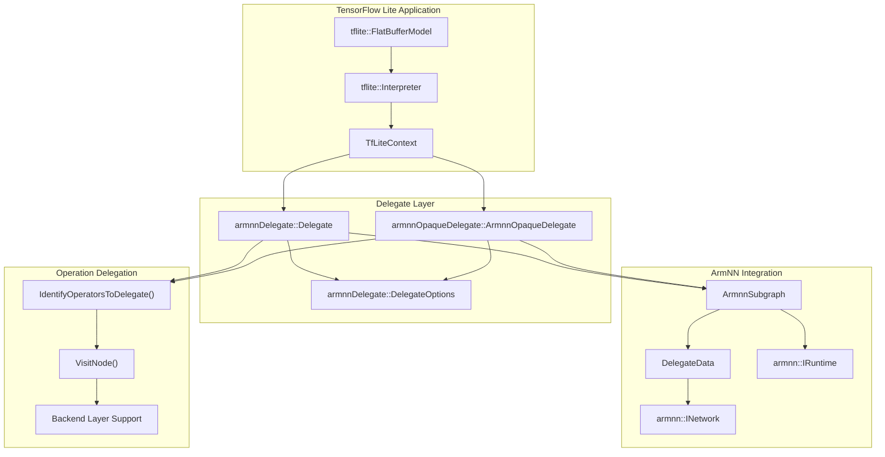
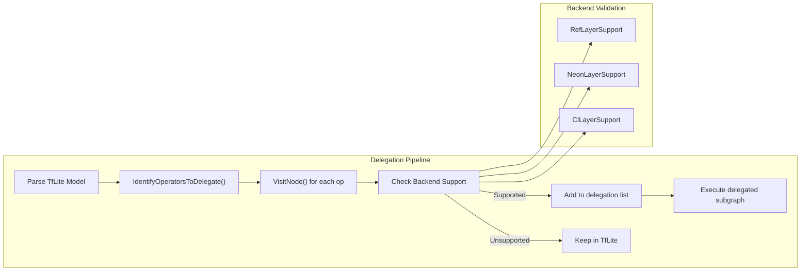
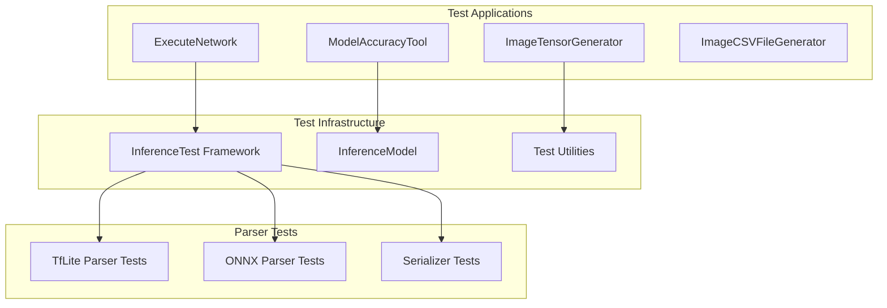

# Tools and Applications

<details>
<summary>Relevant source files</summary>

The following files were used as context for generating this wiki page:

- [delegate/CMakeLists.txt](delegate/CMakeLists.txt)
- [delegate/classic/CMakeLists.txt](delegate/classic/CMakeLists.txt)
- [delegate/classic/include/armnn_delegate.hpp](delegate/classic/include/armnn_delegate.hpp)
- [delegate/classic/src/ScatterNd.hpp](delegate/classic/src/ScatterNd.hpp)
- [delegate/classic/src/armnn_delegate.cpp](delegate/classic/src/armnn_delegate.cpp)
- [delegate/classic/src/test/ArmnnClassicDelegateTest.cpp](delegate/classic/src/test/ArmnnClassicDelegateTest.cpp)
- [delegate/common/include/DelegateOptions.hpp](delegate/common/include/DelegateOptions.hpp)
- [delegate/common/src/DelegateOptions.cpp](delegate/common/src/DelegateOptions.cpp)
- [delegate/opaque/CMakeLists.txt](delegate/opaque/CMakeLists.txt)
- [delegate/opaque/include/armnn_delegate.hpp](delegate/opaque/include/armnn_delegate.hpp)
- [delegate/opaque/src/ScatterNd.hpp](delegate/opaque/src/ScatterNd.hpp)
- [delegate/opaque/src/armnn_delegate.cpp](delegate/opaque/src/armnn_delegate.cpp)
- [delegate/opaque/src/armnn_external_delegate.cpp](delegate/opaque/src/armnn_external_delegate.cpp)
- [delegate/opaque/src/test/ArmnnOpaqueDelegateTest.cpp](delegate/opaque/src/test/ArmnnOpaqueDelegateTest.cpp)
- [delegate/opaque/src/test/DelegateTestInterpreter.cpp](delegate/opaque/src/test/DelegateTestInterpreter.cpp)
- [delegate/test/ScatterNdTestHelper.hpp](delegate/test/ScatterNdTestHelper.hpp)
- [docs/05_03_delegate.dox](docs/05_03_delegate.dox)
- [tests/CMakeLists.txt](tests/CMakeLists.txt)
- [tests/ExecuteNetwork/ArmNNExecutor.cpp](tests/ExecuteNetwork/ArmNNExecutor.cpp)
- [tests/ExecuteNetwork/ArmNNExecutor.hpp](tests/ExecuteNetwork/ArmNNExecutor.hpp)
- [tests/ExecuteNetwork/ExecuteNetwork.cpp](tests/ExecuteNetwork/ExecuteNetwork.cpp)
- [tests/ExecuteNetwork/ExecuteNetworkParams.cpp](tests/ExecuteNetwork/ExecuteNetworkParams.cpp)
- [tests/ExecuteNetwork/ExecuteNetworkParams.hpp](tests/ExecuteNetwork/ExecuteNetworkParams.hpp)
- [tests/ExecuteNetwork/ExecuteNetworkProgramOptions.cpp](tests/ExecuteNetwork/ExecuteNetworkProgramOptions.cpp)
- [tests/ExecuteNetwork/IExecutor.hpp](tests/ExecuteNetwork/IExecutor.hpp)
- [tests/ExecuteNetwork/TfliteExecutor.cpp](tests/ExecuteNetwork/TfliteExecutor.cpp)
- [tests/ExecuteNetwork/TfliteExecutor.hpp](tests/ExecuteNetwork/TfliteExecutor.hpp)
- [tests/InferenceModel.hpp](tests/InferenceModel.hpp)
- [tests/NetworkExecutionUtils/NetworkExecutionUtils.cpp](tests/NetworkExecutionUtils/NetworkExecutionUtils.cpp)
- [tests/NetworkExecutionUtils/NetworkExecutionUtils.hpp](tests/NetworkExecutionUtils/NetworkExecutionUtils.hpp)

</details>


This document covers the command-line tools, utilities, and integration applications provided by ArmNN for model execution, testing, and integration with external frameworks. These tools enable users to run neural network models, benchmark performance, validate outputs, and integrate ArmNN acceleration into existing TensorFlow Lite workflows.

For information about the core ArmNN runtime and backend systems, see [[2-core-architecture|Core Architecture]]. For details about model parsing and import, see [[3-model-support|Model Support]].

## ExecuteNetwork CLI Tool

The `ExecuteNetwork` tool is the primary command-line application for running neural network models with ArmNN. It provides a comprehensive interface for model execution, performance benchmarking, output validation, and comparison between different execution modes.

### ExecuteNetwork Architecture

```mermaid
graph TB
    subgraph "ExecuteNetwork Main"
        Main["ExecuteNetwork::main()"]
        ProgramOptions["ProgramOptions"]
        BuildExecutor["BuildExecutor()"]
    end
    
    subgraph "Executor Pattern"
        IExecutor["IExecutor Interface"]
        ArmNNExecutor["ArmNNExecutor"]
        TfLiteExecutor["TfLiteExecutor"]
        FileComparisonExecutor["FileComparisonExecutor"]
    end
    
    subgraph "ArmNN Execution Path"
        ArmNNRuntime["armnn::IRuntime"]
        Parsers["Model Parsers"]
        Backends["Compute Backends"]
    end
    
    subgraph "TfLite Execution Path"
        TfLiteInterpreter["tflite::Interpreter"]
        ArmNNDelegate["ArmNN Delegates"]
        TfLiteKernels["TfLite Kernels"]
    end
    
    Main --> ProgramOptions
    Main --> BuildExecutor
    BuildExecutor --> IExecutor
    
    IExecutor <|-- ArmNNExecutor
    IExecutor <|-- TfLiteExecutor
    IExecutor <|-- FileComparisonExecutor
    
    ArmNNExecutor --> ArmNNRuntime
    ArmNNExecutor --> Parsers
    ArmNNRuntime --> Backends
    
    TfLiteExecutor --> TfLiteInterpreter
    TfLiteExecutor --> ArmNNDelegate
    TfLiteInterpreter --> TfLiteKernels
```

Sources: [tests/ExecuteNetwork/ExecuteNetwork.cpp:14-32](), [tests/ExecuteNetwork/IExecutor.hpp:9-24](), [tests/ExecuteNetwork/ArmNNExecutor.hpp:36-47](), [tests/ExecuteNetwork/TfliteExecutor.hpp:21-34]()

### Execution Modes

ExecuteNetwork supports multiple execution modes through the `TfLiteExecutor` parameter:

| Mode | Class | Description |
|------|-------|-------------|
| `ArmNNTfLiteParser` | `ArmNNExecutor` | Native ArmNN execution using TfLite parser |
| `ArmNNTfLiteDelegate` | `TfLiteExecutor` | TfLite with classic ArmNN delegate |
| `ArmNNTfLiteOpaqueDelegate` | `TfLiteExecutor` | TfLite with opaque ArmNN delegate |
| `TfliteInterpreter` | `TfLiteExecutor` | Pure TensorFlow Lite execution |

Sources: [tests/ExecuteNetwork/ExecuteNetworkParams.hpp:19-25](), [tests/ExecuteNetwork/ExecuteNetwork.cpp:16-31]()

### Key Features

ExecuteNetwork provides extensive functionality for model testing and validation:

**Model Execution Options:**
- Multiple backend support (`CpuRef`, `CpuAcc`, `GpuAcc`)
- Configurable iteration counts and performance thresholds
- Input data from files or auto-generated dummy data
- Output saving and comparison capabilities

**Performance Analysis:**
- Built-in profiling with `armnn::IProfiler`
- Inference timing and threshold validation
- Memory usage tracking with heap profiling
- Backend-specific optimization flags

**Output Validation:**
- Cross-backend comparison via `m_ComparisonComputeDevices`
- File-based output comparison with RMSE calculation
- TensorFlow Lite reference comparison mode

Sources: [tests/ExecuteNetwork/ExecuteNetworkProgramOptions.cpp:201-351](), [tests/ExecuteNetwork/ArmNNExecutor.cpp:224-275]()

## TensorFlow Lite Delegate

The ArmNN TensorFlow Lite delegate enables seamless acceleration of TfLite models by delegating supported operations to ArmNN backends while falling back to TensorFlow Lite for unsupported operations.

### Delegate Architecture



Sources: [delegate/classic/src/armnn_delegate.cpp:81-138](), [delegate/opaque/src/armnn_delegate.cpp:172-262](), [delegate/opaque/include/armnn_delegate.hpp:47-86]()

### Classic vs Opaque Delegates

ArmNN provides two delegate implementations for different TensorFlow Lite API versions:

**Classic Delegate:**
- Uses traditional TensorFlow Lite C API
- Implemented in `delegate/classic/`
- Entry points: `TfLiteArmnnDelegateCreate()`, `TfLiteArmnnDelegateDelete()`
- Registration via `TfLiteRegistration` structure

**Opaque Delegate:**
- Uses newer TensorFlow Lite Opaque API (TF 2.6+)
- Implemented in `delegate/opaque/`
- Entry points: `TfLiteArmnnOpaqueDelegateCreate()`, `TfLiteArmnnOpaqueDelegateDelete()`
- Registration via `TfLiteRegistrationExternal` structure

Sources: [delegate/classic/src/armnn_delegate.cpp:67-79](), [delegate/opaque/src/armnn_delegate.cpp:264-283](), [delegate/CMakeLists.txt:13-16]()

### Delegation Process

The delegation process follows a systematic approach to identify and delegate supported operations:



Sources: [delegate/classic/src/armnn_delegate.cpp:181-264](), [delegate/opaque/src/armnn_delegate.cpp:289-383]()

### Delegate Configuration

Delegate behavior is controlled through `DelegateOptions` which supports extensive configuration:

**Backend Selection:**
- Primary and fallback backend specification
- Dynamic backend loading from custom paths
- Backend-specific optimization options

**Execution Options:**
- FP16 turbo mode for performance
- Fast math optimizations
- Profiling and debugging controls
- Memory import/export settings

**Integration Features:**
- Fallback disable for testing
- External profiling integration
- Custom debug callback registration

Sources: [delegate/common/include/DelegateOptions.hpp:19-43](), [delegate/common/src/DelegateOptions.cpp:118-201]()

## Supporting Applications

### Model Serialization Tools

ArmNN provides tools for network serialization and deserialization:

**Network Serialization:**
- Save optimized networks to `.armnn` format
- Serialize network topology and weights
- Support for cross-platform model deployment

**Visualization Tools:**
- DOT file generation for network graphs
- Post-optimization network visualization
- Integration with ExecuteNetwork via `--visualize-optimized-model`

Sources: [tests/ExecuteNetwork/ArmNNExecutor.cpp:25-68](), [tests/ExecuteNetwork/ArmNNExecutor.cpp:78-123]()

### Testing and Validation Framework

The test infrastructure provides comprehensive validation capabilities:



Sources: [tests/CMakeLists.txt:146-205](), [tests/InferenceModel.hpp:339-677](), [tests/NetworkExecutionUtils/NetworkExecutionUtils.hpp:40-306]()

### Build Integration

The tools are integrated into the ArmNN build system with conditional compilation:

**Build Targets:**
- `ExecuteNetwork` - Core execution tool
- `ModelAccuracyTool` - Accuracy validation
- `ImageTensorGenerator` - Test data generation
- Parser-specific test applications

**Conditional Features:**
- TensorFlow Lite delegate support (`BUILD_CLASSIC_DELEGATE`, `BUILD_OPAQUE_DELEGATE`)
- Parser availability (`BUILD_TF_LITE_PARSER`, `BUILD_ONNX_PARSER`)
- Serialization support (`BUILD_ARMNN_SERIALIZER`)

Sources: [tests/CMakeLists.txt:24-35](), [tests/CMakeLists.txt:160-166](), [delegate/CMakeLists.txt:13-18]()

# Tools and Applications

This document covers the command-line tools, utilities, and integration applications provided by ArmNN for model execution, testing, and integration with external frameworks. These tools enable users to run neural network models, benchmark performance, validate outputs, and integrate ArmNN acceleration into existing TensorFlow Lite workflows.

For information about the core ArmNN runtime and backend systems, see [[2-core-architecture|Core Architecture]]. For details about model parsing and import, see [[3-model-support|Model Support]].

## ExecuteNetwork CLI Tool

The `ExecuteNetwork` tool is the primary command-line application for running neural network models with ArmNN. It provides a comprehensive interface for model execution, performance benchmarking, output validation, and comparison between different execution modes.

### ExecuteNetwork Architecture

```mermaid
graph TB
    subgraph "ExecuteNetwork Main"
        Main["ExecuteNetwork::main()"]
        ProgramOptions["ProgramOptions"]
        BuildExecutor["BuildExecutor()"]
    end
    
    subgraph "Executor Pattern"
        IExecutor["IExecutor Interface"]
        ArmNNExecutor["ArmNNExecutor"]
        TfLiteExecutor["TfLiteExecutor"]
        FileComparisonExecutor["FileComparisonExecutor"]
    end
    
    subgraph "ArmNN Execution Path"
        ArmNNRuntime["armnn::IRuntime"]
        Parsers["Model Parsers"]
        Backends["Compute Backends"]
    end
    
    subgraph "TfLite Execution Path"
        TfLiteInterpreter["tflite::Interpreter"]
        ArmNNDelegate["ArmNN Delegates"]
        TfLiteKernels["TfLite Kernels"]
    end
    
    Main --> ProgramOptions
    Main --> BuildExecutor
    BuildExecutor --> IExecutor
    
    IExecutor <|-- ArmNNExecutor
    IExecutor <|-- TfLiteExecutor
    IExecutor <|-- FileComparisonExecutor
    
    ArmNNExecutor --> ArmNNRuntime
    ArmNNExecutor --> Parsers
    ArmNNRuntime --> Backends
    
    TfLiteExecutor --> TfLiteInterpreter
    TfLiteExecutor --> ArmNNDelegate
    TfLiteInterpreter --> TfLiteKernels
```

Sources: [tests/ExecuteNetwork/ExecuteNetwork.cpp:14-32](), [tests/ExecuteNetwork/IExecutor.hpp:9-24](), [tests/ExecuteNetwork/ArmNNExecutor.hpp:36-47](), [tests/ExecuteNetwork/TfliteExecutor.hpp:21-34]()

### Execution Modes

ExecuteNetwork supports multiple execution modes through the `TfLiteExecutor` parameter:

| Mode | Class | Description |
|------|-------|-------------|
| `ArmNNTfLiteParser` | `ArmNNExecutor` | Native ArmNN execution using TfLite parser |
| `ArmNNTfLiteDelegate` | `TfLiteExecutor` | TfLite with classic ArmNN delegate |
| `ArmNNTfLiteOpaqueDelegate` | `TfLiteExecutor` | TfLite with opaque ArmNN delegate |
| `TfliteInterpreter` | `TfLiteExecutor` | Pure TensorFlow Lite execution |

Sources: [tests/ExecuteNetwork/ExecuteNetworkParams.hpp:19-25](), [tests/ExecuteNetwork/ExecuteNetwork.cpp:16-31]()

### Key Features

ExecuteNetwork provides extensive functionality for model testing and validation:

**Model Execution Options:**
- Multiple backend support (`CpuRef`, `CpuAcc`, `GpuAcc`)
- Configurable iteration counts and performance thresholds
- Input data from files or auto-generated dummy data
- Output saving and comparison capabilities

**Performance Analysis:**
- Built-in profiling with `armnn::IProfiler`
- Inference timing and threshold validation
- Memory usage tracking with heap profiling
- Backend-specific optimization flags

**Output Validation:**
- Cross-backend comparison via `m_ComparisonComputeDevices`
- File-based output comparison with RMSE calculation
- TensorFlow Lite reference comparison mode

Sources: [tests/ExecuteNetwork/ExecuteNetworkProgramOptions.cpp:201-351](), [tests/ExecuteNetwork/ArmNNExecutor.cpp:224-275]()

## TensorFlow Lite Delegate

The ArmNN TensorFlow Lite delegate enables seamless acceleration of TfLite models by delegating supported operations to ArmNN backends while falling back to TensorFlow Lite for unsupported operations.

### Delegate Architecture


Sources: [delegate/classic/src/armnn_delegate.cpp:81-138](), [delegate/opaque/src/armnn_delegate.cpp:172-262](), [delegate/opaque/include/armnn_delegate.hpp:47-86]()

### Classic vs Opaque Delegates

ArmNN provides two delegate implementations for different TensorFlow Lite API versions:

**Classic Delegate:**
- Uses traditional TensorFlow Lite C API
- Implemented in `delegate/classic/`
- Entry points: `TfLiteArmnnDelegateCreate()`, `TfLiteArmnnDelegateDelete()`
- Registration via `TfLiteRegistration` structure

**Opaque Delegate:**
- Uses newer TensorFlow Lite Opaque API (TF 2.6+)
- Implemented in `delegate/opaque/`
- Entry points: `TfLiteArmnnOpaqueDelegateCreate()`, `TfLiteArmnnOpaqueDelegateDelete()`
- Registration via `TfLiteRegistrationExternal` structure

Sources: [delegate/classic/src/armnn_delegate.cpp:67-79](), [delegate/opaque/src/armnn_delegate.cpp:264-283](), [delegate/CMakeLists.txt:13-16]()

### Delegation Process

The delegation process follows a systematic approach to identify and delegate supported operations:


Sources: [delegate/classic/src/armnn_delegate.cpp:181-264](), [delegate/opaque/src/armnn_delegate.cpp:289-383]()

### Delegate Configuration

Delegate behavior is controlled through `DelegateOptions` which supports extensive configuration:

**Backend Selection:**
- Primary and fallback backend specification
- Dynamic backend loading from custom paths
- Backend-specific optimization options

**Execution Options:**
- FP16 turbo mode for performance
- Fast math optimizations
- Profiling and debugging controls
- Memory import/export settings

**Integration Features:**
- Fallback disable for testing
- External profiling integration
- Custom debug callback registration

Sources: [delegate/common/include/DelegateOptions.hpp:19-43](), [delegate/common/src/DelegateOptions.cpp:118-201]()

## Supporting Applications

### Model Serialization Tools

ArmNN provides tools for network serialization and deserialization:

**Network Serialization:**
- Save optimized networks to `.armnn` format
- Serialize network topology and weights
- Support for cross-platform model deployment

**Visualization Tools:**
- DOT file generation for network graphs
- Post-optimization network visualization
- Integration with ExecuteNetwork via `--visualize-optimized-model`

Sources: [tests/ExecuteNetwork/ArmNNExecutor.cpp:25-68](), [tests/ExecuteNetwork/ArmNNExecutor.cpp:78-123]()

### Testing and Validation Framework

The test infrastructure provides comprehensive validation capabilities:


Sources: [tests/CMakeLists.txt:146-205](), [tests/InferenceModel.hpp:339-677](), [tests/NetworkExecutionUtils/NetworkExecutionUtils.hpp:40-306]()

### Build Integration

The tools are integrated into the ArmNN build system with conditional compilation:

**Build Targets:**
- `ExecuteNetwork` - Core execution tool
- `ModelAccuracyTool` - Accuracy validation
- `ImageTensorGenerator` - Test data generation
- Parser-specific test applications

**Conditional Features:**
- TensorFlow Lite delegate support (`BUILD_CLASSIC_DELEGATE`, `BUILD_OPAQUE_DELEGATE`)
- Parser availability (`BUILD_TF_LITE_PARSER`, `BUILD_ONNX_PARSER`)
- Serialization support (`BUILD_ARMNN_SERIALIZER`)

Sources: [tests/CMakeLists.txt:24-35](), [tests/CMakeLists.txt:160-166](), [delegate/CMakeLists.txt:13-18]()

## Related Wiki Pages

- [[5.1-executenetwork-tool|ExecuteNetwork Tool]]
- [[5.2-tensorflow-lite-delegate|TensorFlow Lite Delegate]]
- [[2-core-architecture|Core Architecture]]
- [[3-model-support|Model Support]]


## Dynamic Knowledge Links (Code Graph ↔ LLM-Wiki / RAG)

### Linked Architecture & Design Documents

| Document | Match Channel | Score | Shared Code Symbols |
|---|---|---|---|
| [[5.2-tensorflow-lite-delegate|5.2 TensorFlow Lite Delegate]] | `bm25+entity(6)` | `73.584` | `ArmnnOpaqueDelegate`, `Delegate`, `ScatterNdTestImpl`, `TfLiteArmnnDelegateCreate`, `TfLiteArmnnOpaqueDelegateCreate` |
| [[5.1-executenetwork-tool|5.1 ExecuteNetwork Tool]] | `bm25+entity(6)` | `46.773` | `CheckRequestedBackendsAreValid`, `Delegate`, `ExecuteSync`, `LogAndThrow`, `ParseOptions` |
| [[3.1-tensorflow-lite-parser|3.1 TensorFlow Lite Parser]] | `bm25+entity(1)` | `33.969` | `Delegate` |
| [[2-core-architecture|2 Core Architecture]] | `wikilink:5.2-tensorflow-lite-delegate+entity(1)` | `33.792` | `Delegate` |
| [[index|ARM-software/armnn DeepWiki]] | `wikilink:5.2-tensorflow-lite-delegate+entity(1)` | `33.792` | `Delegate` |
| [[2.1-network-and-graph-system|2.1 Network and Graph System]] | `wikilink:5.2-tensorflow-lite-delegate` | `32.292` | *(lexical/graph match)* |

### High-Centrality Bridge Symbols (CBM Graph)

| Symbol | Kind | Source Location | Fan-In / Fan-Out |
|---|---|---|---|
| `Create` | Method | [delegate/classic/src/armnn_delegate.cpp:348-497]() | in: `15` / out: `26` |
| `VisitNode` | Method | [delegate/classic/src/armnn_delegate.cpp:543-1131]() | in: `2` / out: `47` |
| `VisitNode` | Method | [delegate/opaque/src/armnn_delegate.cpp:706-1298]() | in: `2` / out: `47` |
| `Create` | Method | [delegate/opaque/src/armnn_delegate.cpp:471-619]() | in: `1` / out: `26` |
| `ParseOptions` | Method | [tests/ExecuteNetwork/ExecuteNetworkProgramOptions.cpp:507-621]() | in: `2` / out: `21` |
| `DelegateOptions` | Method | [delegate/common/src/DelegateOptions.cpp:138-424]() | in: `0` / out: `22` |

Sources: [delegate/classic/src/armnn_delegate.cpp:348-497](), [delegate/classic/src/armnn_delegate.cpp:543-1131](), [delegate/opaque/src/armnn_delegate.cpp:706-1298](), [delegate/opaque/src/armnn_delegate.cpp:471-619]()

### Cross-Subsystem Coupling

- [[2-core-architecture|2 Core Architecture]] — call/import coupling weight `48.0`
- [[2.1-network-and-graph-system|2.1 Network and Graph System]] — call/import coupling weight `48.0`
- [[1-armnn-overview|1 ArmNN Overview]] — call/import coupling weight `45.0`
- [[2.3-runtime-and-execution|2.3 Runtime and Execution]] — call/import coupling weight `19.0`
- [[5.1-executenetwork-tool|5.1 ExecuteNetwork Tool]] — call/import coupling weight `16.0`
- [[3-model-support|3 Model Support]] — call/import coupling weight `7.0`
