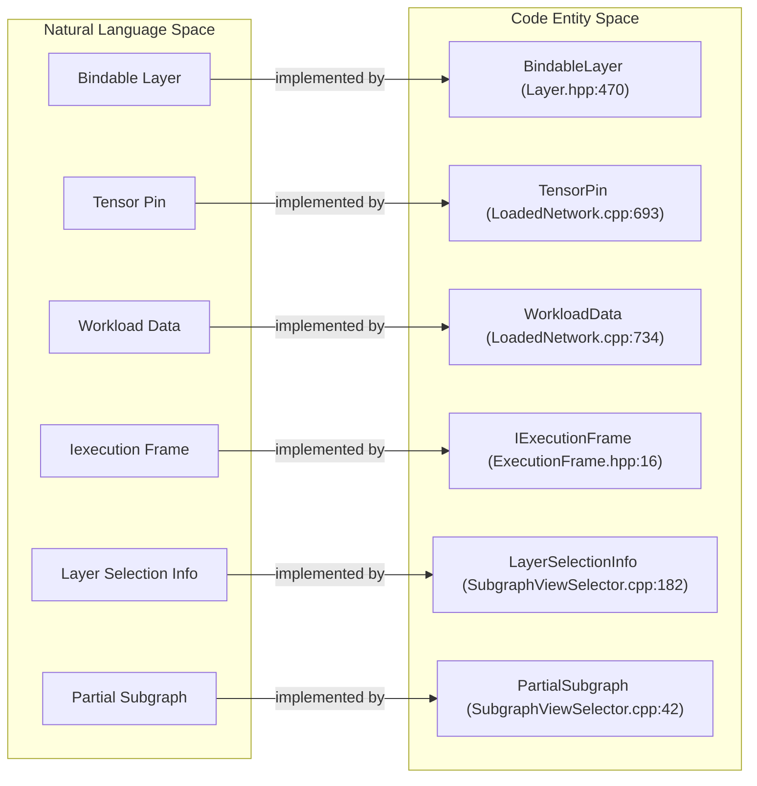
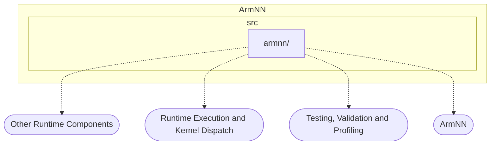
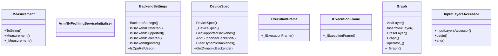
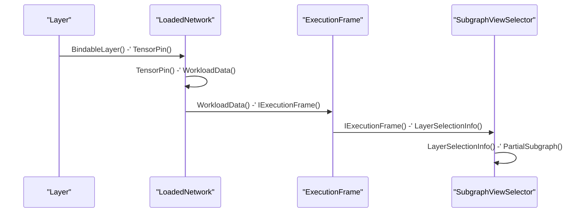

# ArmNN

↑ [[5-runtime-execution-and-kernel-dispatch|Runtime Execution and Kernel Dispatch]]

> ArmNN subsystem (`src/armnn`), covering 28 files and 1007 symbols. Key symbols include `SetTensorInfo`, `Connect`, `end`, `GetName`.

<details>
<summary>Relevant source files</summary>

The following files were used as context for generating this wiki page:

- [src/armnn/Tensor.cpp](src/armnn/Tensor.cpp)
- [src/armnn/Layer.cpp](src/armnn/Layer.cpp)
- [src/armnn/Descriptors.cpp](src/armnn/Descriptors.cpp)
- [src/armnn/Layer.hpp](src/armnn/Layer.hpp)
- [src/armnn/Graph.hpp](src/armnn/Graph.hpp)
- [src/armnn/Exceptions.cpp](src/armnn/Exceptions.cpp)
- [src/armnn/LoadedNetwork.cpp](src/armnn/LoadedNetwork.cpp)
- [src/armnn/BackendRegistry.cpp](src/armnn/BackendRegistry.cpp)
- [src/armnn/Graph.cpp](src/armnn/Graph.cpp)
- [src/armnn/JsonPrinter.hpp](src/armnn/JsonPrinter.hpp)
- [src/armnn/SubgraphView.cpp](src/armnn/SubgraphView.cpp)
- [src/armnn/Sme2ShapePolicy.cpp](src/armnn/Sme2ShapePolicy.cpp)
- [src/armnn/BackendSettings.hpp](src/armnn/BackendSettings.hpp)
- [src/armnn/DeviceSpec.hpp](src/armnn/DeviceSpec.hpp)
- [src/armnn/JsonUtils.hpp](src/armnn/JsonUtils.hpp)
- [src/armnn/BackendHelper.cpp](src/armnn/BackendHelper.cpp)
- [src/armnn/ArmNNProfilingServiceInitialiser.hpp](src/armnn/ArmNNProfilingServiceInitialiser.hpp)
- [src/armnn/Logging.cpp](src/armnn/Logging.cpp)
- [src/armnn/SubgraphViewSelector.cpp](src/armnn/SubgraphViewSelector.cpp)
- [src/armnn/ExecutionFrame.hpp](src/armnn/ExecutionFrame.hpp)
- [src/armnn/Instrument.hpp](src/armnn/Instrument.hpp)
- [src/armnn/IGraphObservable.hpp](src/armnn/IGraphObservable.hpp)
- [src/armnn/Runtime.cpp](src/armnn/Runtime.cpp)
- [src/armnn/ISubgraphViewConverter.hpp](src/armnn/ISubgraphViewConverter.hpp)
- [src/armnn/ArmNNProfilingServiceInitialiser.cpp](src/armnn/ArmNNProfilingServiceInitialiser.cpp)
- [src/armnn/LayerSupportCommon.hpp](src/armnn/LayerSupportCommon.hpp)
- [src/armnn/InternalTypes.cpp](src/armnn/InternalTypes.cpp)
- [src/armnn/Network.hpp](src/armnn/Network.hpp)

</details>

## Purpose and Scope

ArmNN subsystem (`src/armnn`), covering 28 files and 1007 symbols. Key symbols include `SetTensorInfo`, `Connect`, `end`, `GetName`.

Primary code entities analyzed on this page include `BindableLayer` ([src/armnn/Layer.hpp:470-495]()), `TensorPin` ([src/armnn/LoadedNetwork.cpp:693-711]()), `WorkloadData` ([src/armnn/LoadedNetwork.cpp:734-779]()), `IExecutionFrame` ([src/armnn/ExecutionFrame.hpp:16-25]()), `LayerSelectionInfo` ([src/armnn/SubgraphViewSelector.cpp:182-264]()).

For the parent architectural layer, see [[5-runtime-execution-and-kernel-dispatch|Runtime Execution and Kernel Dispatch]]. Related sibling subsystems: [[5.2-armnn|ArmNN]], [[5.3-delegate-opaque|Delegate Opaque]], [[5.4-delegate-classic|Delegate Classic]], [[5.5-armnnutils|Armnnutils]].

Sources: [src/armnn/Layer.hpp:470-495](), [src/armnn/LoadedNetwork.cpp:693-711](), [src/armnn/LoadedNetwork.cpp:734-779](), [src/armnn/ExecutionFrame.hpp:16-25]()

---

## 1. High-Level Architecture and Data Flow

### Natural Language Space to Code Entity Space Mapping

The following diagram maps domain concepts in this subsystem to their concrete code entities:



### Subsystem Component & Dependency Flow



Cross-subsystem call and import edges connect **ArmNN** with [[5.6-other-runtime-components|Other Runtime Components]] (coupling `460.0`), [[5-runtime-execution-and-kernel-dispatch|Runtime Execution and Kernel Dispatch]] (coupling `456.0`), [[5.2-armnn|ArmNN]] (coupling `431.0`), [[7-glossary|Glossary]] (coupling `382.0`), [[4.1-tests|Tests]] (coupling `219.0`).

| Module Directory | Files | Primary Code Entities | Source Citations |
|---|---|---|---|
| `src/armnn` | 28 | `BindableLayer`, `TensorPin`, `WorkloadData`, `IExecutionFrame` | [src/armnn/Layer.hpp:470-495]() [src/armnn/LoadedNetwork.cpp:693-711]() |

Sources: [src/armnn/Layer.hpp:470-495](), [src/armnn/LoadedNetwork.cpp:693-711](), [src/armnn/LoadedNetwork.cpp:734-779](), [src/armnn/ExecutionFrame.hpp:16-25](), [src/armnn/SubgraphViewSelector.cpp:182-264]()

---

## 2. Core Data Structures and Implementation Details

### Class and Entity Relationship Diagram



### `BindableLayer` (Class)

- **Source Location**: [src/armnn/Layer.hpp:470-495]()
- **Declaration**: `Class BindableLayer`
- **Graph Centrality**: fan-in `0` callers, fan-out `0` callees
- **Responsibility**: // A layer user-provided data can be bound to (e.g. inputs, outputs).

```cpp
// src/armnn/Layer.hpp:470-485
class BindableLayer : public Layer
{
public:
    BindableLayer(unsigned int numInputSlots,
        unsigned int numOutputSlots,
        LayerType type,
        const char* name,
        LayerBindingId id)
    : Layer(numInputSlots, numOutputSlots, type, name)
    , m_Id(id)
    {
    }

    LayerBindingId GetBindingId() const { return m_Id; };

    void ExecuteStrategy(IStrategy& strategy) const override
```

### `TensorPin` (Class)

- **Source Location**: [src/armnn/LoadedNetwork.cpp:693-711]()
- **Declaration**: `Class TensorPin`
- **Graph Centrality**: fan-in `0` callers, fan-out `0` callees
- **Responsibility**: // Non-copyable class owning accelerator-specific tensor data.

```cpp
// src/armnn/LoadedNetwork.cpp:693-708
class TensorPin
{
public:
    TensorPin(std::unique_ptr<ITensorHandle> handle, const TensorInfo& info, LayerBindingId id)
        : m_TensorHandle(std::move(handle))
        , m_TensorInfo(info)
        , m_Id(id)
    {
    }

    ITensorHandle* GetTensorHandle() const { return m_TensorHandle.get(); }
    const TensorInfo& GetTensorInfo() const { return m_TensorInfo; }
    LayerBindingId GetBindingId() const { return m_Id; }

private:
    std::unique_ptr<ITensorHandle> m_TensorHandle;
```

### `WorkloadData` (Class)

- **Source Location**: [src/armnn/LoadedNetwork.cpp:734-779]()
- **Declaration**: `Class WorkloadData`
- **Graph Centrality**: fan-in `0` callers, fan-out `0` callees
- **Responsibility**: // Stores data that needs to be kept accessible for the entire execution of a workload.

```cpp
// src/armnn/LoadedNetwork.cpp:734-749
class WorkloadData
{
public:
    WorkloadData(const InputTensors& inputTensors, const OutputTensors& outputTensors)
    {
        m_InputTensorPins.reserve(inputTensors.size());
        m_OutputTensorPins.reserve(outputTensors.size());

        for (auto inputTensorPair : inputTensors)
        {
            auto inputTensor = inputTensorPair.second;

            std::unique_ptr<ITensorHandle> tensorHandle =
                std::make_unique<ConstPassthroughTensorHandle>(inputTensor.GetInfo(),inputTensor.GetMemoryArea());
            LayerBindingId layerId = inputTensorPair.first;
```

### `IExecutionFrame` (Class)

- **Source Location**: [src/armnn/ExecutionFrame.hpp:16-25]()
- **Declaration**: `Class IExecutionFrame`
- **Graph Centrality**: fan-in `0` callers, fan-out `0` callees
- **Responsibility**: /// ExecutionFrame interface to enqueue a workload computation.

### `LayerSelectionInfo` (Class)

- **Source Location**: [src/armnn/SubgraphViewSelector.cpp:182-264]()
- **Declaration**: `Class LayerSelectionInfo`
- **Graph Centrality**: fan-in `0` callers, fan-out `0` callees
- **Responsibility**: /// Intermediate data structure to store information associated with a particular layer.

### `SetTensorInfo` (Method)

- **Source Location**: [src/armnn/Layer.cpp:609-612]()
- **Declaration**: `(const TensorInfo tensorInfo)`
- **Graph Centrality**: fan-in `207` callers, fan-out `1` callees

Sources: [src/armnn/Layer.hpp:470-495](), [src/armnn/LoadedNetwork.cpp:693-711](), [src/armnn/LoadedNetwork.cpp:734-779](), [src/armnn/ExecutionFrame.hpp:16-25](), [src/armnn/SubgraphViewSelector.cpp:182-264]()

---

## 3. Execution and Call Flow

The sequence diagram below traces the runtime/compile-time call chain across components in this module:



Sources: [src/armnn/Layer.hpp:470-495](), [src/armnn/LoadedNetwork.cpp:693-711](), [src/armnn/LoadedNetwork.cpp:734-779](), [src/armnn/ExecutionFrame.hpp:16-25](), [src/armnn/SubgraphViewSelector.cpp:182-264]()

---

## 4. Key API and Symbol Reference

| Code Entity | Kind | Location | Fan-In / Out | Role & Signature |
|---|---|---|---|---|
| `BindableLayer` | Class | [src/armnn/Layer.hpp:470-495]() | `0` / `0` | // A layer user-provided data can be bound to (e.g. inputs, outputs). |
| `TensorPin` | Class | [src/armnn/LoadedNetwork.cpp:693-711]() | `0` / `0` | // Non-copyable class owning accelerator-specific tensor data. |
| `WorkloadData` | Class | [src/armnn/LoadedNetwork.cpp:734-779]() | `0` / `0` | // Stores data that needs to be kept accessible for the entire execution of a workload. |
| `IExecutionFrame` | Class | [src/armnn/ExecutionFrame.hpp:16-25]() | `0` / `0` | /// ExecutionFrame interface to enqueue a workload computation. |
| `LayerSelectionInfo` | Class | [src/armnn/SubgraphViewSelector.cpp:182-264]() | `0` / `0` | /// Intermediate data structure to store information associated with a particular layer. |
| `PartialSubgraph` | Class | [src/armnn/SubgraphViewSelector.cpp:42-179]() | `0` / `0` | /// Intermediate data-structure to store the subgraph that a layer has been assigned to. |
| `InputSlot` | Class | [src/armnn/Layer.hpp:42-98]() | `0` / `0` | — |
| `Layer` | Class | [src/armnn/Layer.hpp:230-467]() | `0` / `0` | — |
| `OutputSlot` | Class | [src/armnn/Layer.hpp:100-195]() | `0` / `0` | — |
| `Graph` | Class | [src/armnn/Graph.hpp:30-308]() | `0` / `0` | — |
| `InputLayersAccessor` | Class | [src/armnn/Graph.hpp:61-77]() | `0` / `0` | — |
| `OutputLayersAccessor` | Class | [src/armnn/Graph.hpp:80-96]() | `0` / `0` | — |
| `Graph::LayerInGraph` | Class | [src/armnn/Graph.hpp:358-377]() | `0` / `0` | — |
| `Graph::LayerInGraph<ConstantLayer>` | Class | [src/armnn/Graph.hpp:380-397]() | `0` / `0` | — |
| `Graph::LayerInGraph<InputLayer>` | Class | [src/armnn/Graph.hpp:401-428]() | `0` / `0` | — |
| `Graph::LayerInGraph<OutputLayer>` | Class | [src/armnn/Graph.hpp:432-453]() | `0` / `0` | — |
| `Graph::LayerInGraphBase` | Class | [src/armnn/Graph.hpp:312-354]() | `0` / `0` | — |
| `NetworkImpl` | Class | [src/armnn/Network.hpp:32-261]() | `0` / `0` | /// Private implementation of INetwork. |
| `JsonChildObject` | Class | [src/armnn/JsonPrinter.hpp:27-112]() | `0` / `0` | — |
| `JsonPrinter` | Class | [src/armnn/JsonPrinter.hpp:114-133]() | `0` / `0` | — |
| `Sme2ShapeProfile` | Class | [src/armnn/Sme2ShapePolicy.cpp:23-36]() | `0` / `0` | — |
| `SubgraphView::SubgraphViewWorkingCopy` | Class | [src/armnn/SubgraphView.cpp:381-394]() | `0` / `0` | — |

Sources: [src/armnn/Layer.hpp:470-495](), [src/armnn/LoadedNetwork.cpp:693-711](), [src/armnn/LoadedNetwork.cpp:734-779](), [src/armnn/ExecutionFrame.hpp:16-25](), [src/armnn/SubgraphViewSelector.cpp:182-264](), [src/armnn/SubgraphViewSelector.cpp:42-179]()

---

## 5. Official Documentation and Design Context

The following linked documentation sections from `llm-wiki` (`raw/`) provide additional architectural context, tutorials, and design invariants for this subsystem:

- **Runtime Execution and Kernel Dispatch** ([wiki/5-runtime-execution-and-kernel-dispatch.md](), score `48.6842`) (sections: `Runtime Execution and Kernel Dispatch`, `Purpose and Scope`, `System Mapping: Natural Language Space to Code Entity Space`, `1. ArmNN`): # Runtime Execution and Kernel Dispatch > Architectural overview of Runtime Execution and Kernel Dispatch, spanning 157 source files and 3718 code symbols across 6 subsystems. <details> <summary>Relevant source files</summary> The following files were used as context for generating this wiki page: - [samples/common/include/Audio/DataStructures.hpp](samples/common/include/Audio/DataStructures.hpp) - [src/armnn/Tensor.
- **ArmNN DeepWiki** ([wiki/index.md](), score `35.9163`) (sections: `ArmNN DeepWiki`, `Pages`): # ArmNN DeepWiki Generated from `home-jason-Project-deepwiki-armnn` at commit `2b61cecc9df7` (2026-11-14T15:13:53+00:00). ## Pages - [[1-overview|Overview]] — End-to-end architecture overview of ArmNN: core subsystems, compilation/execution pipeline, entry points, and cross-module dependencies. - [[2-build-system-and-infrastructure|Build System and Infrastructure]] — Architectural overview of Build System and Infrast
- **Backends Tosacommon** ([wiki/3.5-backends-tosacommon.md](), score `32.5202`) (sections: `Backends Tosacommon`, `Purpose and Scope`, `1. High-Level Architecture and Data Flow`, `Natural Language Space to Code Entity Space Mapping`): # Backends Tosacommon ↑ [[3-backend-delegation-and-hardware-providers|Backend Delegation and Hardware Providers]] > Backends Tosacommon subsystem (`backends/tosaCommon`), covering 28 files and 86 symbols. Key symbols include `GetTosaTensorShape`, `GenerateUniqueOutputName`, `GetUniqueTosaMappingID`, `GenerateUniqueInputName`. <details> <summary>Relevant source files</summary> The following files were used as context 
- **Backend Delegation and Hardware Providers** ([wiki/3-backend-delegation-and-hardware-providers.md](), score `32.2732`) (sections: `Backend Delegation and Hardware Providers`, `Purpose and Scope`, `System Mapping: Natural Language Space to Code Entity Space`, `1. Backends Backendscommon`): # Backend Delegation and Hardware Providers > Architectural overview of Backend Delegation and Hardware Providers, spanning 150 source files and 2618 code symbols across 6 subsystems. <details> <summary>Relevant source files</summary> The following files were used as context for generating this wiki page: - [src/backends/aclCommon/ArmComputeTensorUtils.hpp](src/backends/aclCommon/ArmComputeTensorUtils.hpp) - [src/bac

Sources: [wiki/5-runtime-execution-and-kernel-dispatch.md](), [wiki/index.md](), [wiki/3.5-backends-tosacommon.md](), [wiki/3-backend-delegation-and-hardware-providers.md]()

## Related pages

- [[5-runtime-execution-and-kernel-dispatch|Runtime Execution and Kernel Dispatch]]
- [[3-backend-delegation-and-hardware-providers|Backend Delegation and Hardware Providers]]
- [[3.1-backends-backendscommon|Backends Backendscommon]]
- [[3.2-backends-reference|Backends Reference]]
- [[3.3-backends-opencl|Backends OpenCL]]
- [[3.4-backends-aclcommon|Backends Aclcommon]]
- [[3.6-other-backends|Other Backends]]
- [[5.2-armnn|ArmNN]]

## Related documents

- `wiki/5-runtime-execution-and-kernel-dispatch.md` — Runtime Execution and Kernel Dispatch (score 48.6842, via bm25)
- `wiki/index.md` — ArmNN DeepWiki (score 35.9163, via bm25)
- `wiki/3.5-backends-tosacommon.md` — Backends Tosacommon (score 32.5202, via bm25)
- `wiki/3-backend-delegation-and-hardware-providers.md` — Backend Delegation and Hardware Providers (score 32.2732, via bm25)
- `wiki/5.6-other-runtime-components.md` — Other Runtime Components (score 31.5781, via bm25)

## Sources

- [`src/armnn/Tensor.cpp`](https://github.com/ARM-software/armnn/blob/branches/armnn_24_11/src/armnn/Tensor.cpp)
- [`src/armnn/Layer.cpp`](https://github.com/ARM-software/armnn/blob/branches/armnn_24_11/src/armnn/Layer.cpp)
- [`src/armnn/Descriptors.cpp`](https://github.com/ARM-software/armnn/blob/branches/armnn_24_11/src/armnn/Descriptors.cpp)
- [`src/armnn/Layer.hpp`](https://github.com/ARM-software/armnn/blob/branches/armnn_24_11/src/armnn/Layer.hpp)
- [`src/armnn/Graph.hpp`](https://github.com/ARM-software/armnn/blob/branches/armnn_24_11/src/armnn/Graph.hpp)
- [`src/armnn/Exceptions.cpp`](https://github.com/ARM-software/armnn/blob/branches/armnn_24_11/src/armnn/Exceptions.cpp)
- [`src/armnn/LoadedNetwork.cpp`](https://github.com/ARM-software/armnn/blob/branches/armnn_24_11/src/armnn/LoadedNetwork.cpp)
- [`src/armnn/BackendRegistry.cpp`](https://github.com/ARM-software/armnn/blob/branches/armnn_24_11/src/armnn/BackendRegistry.cpp)
- [`src/armnn/Graph.cpp`](https://github.com/ARM-software/armnn/blob/branches/armnn_24_11/src/armnn/Graph.cpp)
- [`src/armnn/JsonPrinter.hpp`](https://github.com/ARM-software/armnn/blob/branches/armnn_24_11/src/armnn/JsonPrinter.hpp)
- [`src/armnn/SubgraphView.cpp`](https://github.com/ARM-software/armnn/blob/branches/armnn_24_11/src/armnn/SubgraphView.cpp)
- [`src/armnn/Sme2ShapePolicy.cpp`](https://github.com/ARM-software/armnn/blob/branches/armnn_24_11/src/armnn/Sme2ShapePolicy.cpp)
- [`src/armnn/BackendSettings.hpp`](https://github.com/ARM-software/armnn/blob/branches/armnn_24_11/src/armnn/BackendSettings.hpp)
- [`src/armnn/DeviceSpec.hpp`](https://github.com/ARM-software/armnn/blob/branches/armnn_24_11/src/armnn/DeviceSpec.hpp)
- [`src/armnn/JsonUtils.hpp`](https://github.com/ARM-software/armnn/blob/branches/armnn_24_11/src/armnn/JsonUtils.hpp)
- [`src/armnn/BackendHelper.cpp`](https://github.com/ARM-software/armnn/blob/branches/armnn_24_11/src/armnn/BackendHelper.cpp)
- [`src/armnn/ArmNNProfilingServiceInitialiser.hpp`](https://github.com/ARM-software/armnn/blob/branches/armnn_24_11/src/armnn/ArmNNProfilingServiceInitialiser.hpp)
- [`src/armnn/Logging.cpp`](https://github.com/ARM-software/armnn/blob/branches/armnn_24_11/src/armnn/Logging.cpp)
- [`src/armnn/SubgraphViewSelector.cpp`](https://github.com/ARM-software/armnn/blob/branches/armnn_24_11/src/armnn/SubgraphViewSelector.cpp)
- [`src/armnn/ExecutionFrame.hpp`](https://github.com/ARM-software/armnn/blob/branches/armnn_24_11/src/armnn/ExecutionFrame.hpp)
- [`src/armnn/Instrument.hpp`](https://github.com/ARM-software/armnn/blob/branches/armnn_24_11/src/armnn/Instrument.hpp)
- [`src/armnn/IGraphObservable.hpp`](https://github.com/ARM-software/armnn/blob/branches/armnn_24_11/src/armnn/IGraphObservable.hpp)
- [`src/armnn/Runtime.cpp`](https://github.com/ARM-software/armnn/blob/branches/armnn_24_11/src/armnn/Runtime.cpp)
- [`src/armnn/ISubgraphViewConverter.hpp`](https://github.com/ARM-software/armnn/blob/branches/armnn_24_11/src/armnn/ISubgraphViewConverter.hpp)
- [`src/armnn/ArmNNProfilingServiceInitialiser.cpp`](https://github.com/ARM-software/armnn/blob/branches/armnn_24_11/src/armnn/ArmNNProfilingServiceInitialiser.cpp)
- [`src/armnn/LayerSupportCommon.hpp`](https://github.com/ARM-software/armnn/blob/branches/armnn_24_11/src/armnn/LayerSupportCommon.hpp)
- [`src/armnn/InternalTypes.cpp`](https://github.com/ARM-software/armnn/blob/branches/armnn_24_11/src/armnn/InternalTypes.cpp)
- [`src/armnn/Network.hpp`](https://github.com/ARM-software/armnn/blob/branches/armnn_24_11/src/armnn/Network.hpp)


## Dynamic Knowledge Links (Code Graph ↔ LLM-Wiki / RAG)

### Linked Architecture & Design Documents

| Document | Match Channel | Score | Shared Code Symbols |
|---|---|---|---|
| [[5-runtime-execution-and-kernel-dispatch|Runtime Execution and Kernel Dispatch]] | `bm25+entity(2)` | `51.684` | `Connect`, `SetTensorInfo` |
| [[5.3-delegate-opaque|Delegate Opaque]] | `wikilink:5.1-armnn+entity(2)` | `50.425` | `Connect`, `Graph` |
| [[5.4-delegate-classic|Delegate Classic]] | `wikilink:5.1-armnn+entity(2)` | `50.425` | `Connect`, `Graph` |
| [[5.2-armnn|ArmNN]] | `wikilink:5.1-armnn` | `47.425` | *(lexical/graph match)* |
| [[index|ArmNN DeepWiki]] | `bm25+entity(2)` | `38.916` | `Connect`, `SetTensorInfo` |
| [[3.5-backends-tosacommon|Backends Tosacommon]] | `bm25+entity(1)` | `34.02` | `Graph` |

### High-Centrality Bridge Symbols (CBM Graph)

| Symbol | Kind | Source Location | Fan-In / Fan-Out |
|---|---|---|---|
| `BindableLayer` | Class | [src/armnn/Layer.hpp:470-495]() | in: `0` / out: `0` |
| `TensorPin` | Class | [src/armnn/LoadedNetwork.cpp:693-711]() | in: `0` / out: `0` |
| `WorkloadData` | Class | [src/armnn/LoadedNetwork.cpp:734-779]() | in: `0` / out: `0` |
| `IExecutionFrame` | Class | [src/armnn/ExecutionFrame.hpp:16-25]() | in: `0` / out: `0` |
| `LayerSelectionInfo` | Class | [src/armnn/SubgraphViewSelector.cpp:182-264]() | in: `0` / out: `0` |
| `PartialSubgraph` | Class | [src/armnn/SubgraphViewSelector.cpp:42-179]() | in: `0` / out: `0` |

Sources: [src/armnn/Layer.hpp:470-495](), [src/armnn/LoadedNetwork.cpp:693-711](), [src/armnn/LoadedNetwork.cpp:734-779](), [src/armnn/ExecutionFrame.hpp:16-25]()

### Cross-Subsystem Coupling

- [[5.6-other-runtime-components|Other Runtime Components]] — call/import coupling weight `460.0`
- [[5-runtime-execution-and-kernel-dispatch|Runtime Execution and Kernel Dispatch]] — call/import coupling weight `456.0`
- [[5.2-armnn|ArmNN]] — call/import coupling weight `431.0`
- [[7-glossary|Glossary]] — call/import coupling weight `382.0`
- [[4.1-tests|Tests]] — call/import coupling weight `219.0`
- [[2.1-build-infrastructure|Build Infrastructure]] — call/import coupling weight `208.0`
