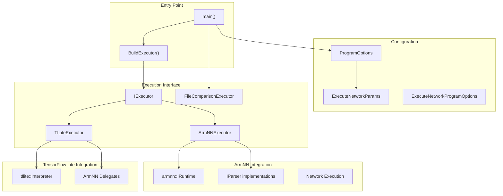
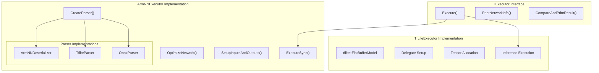
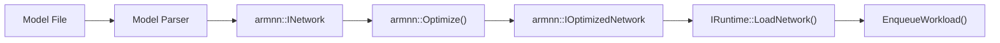
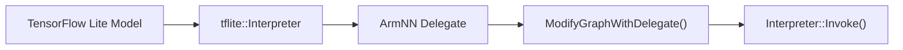
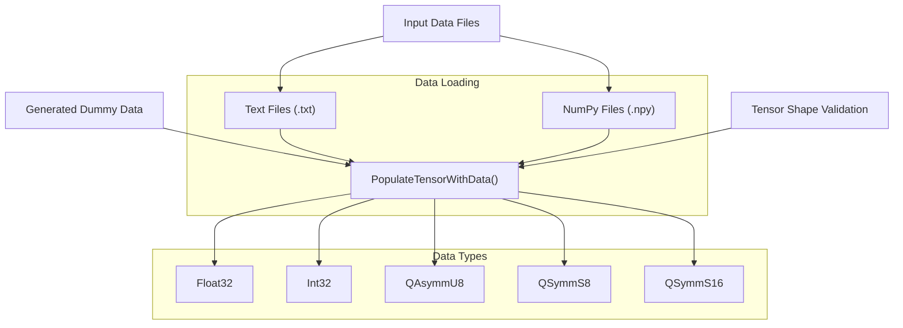
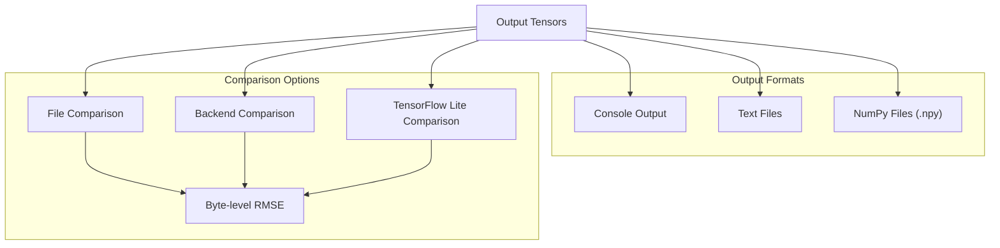
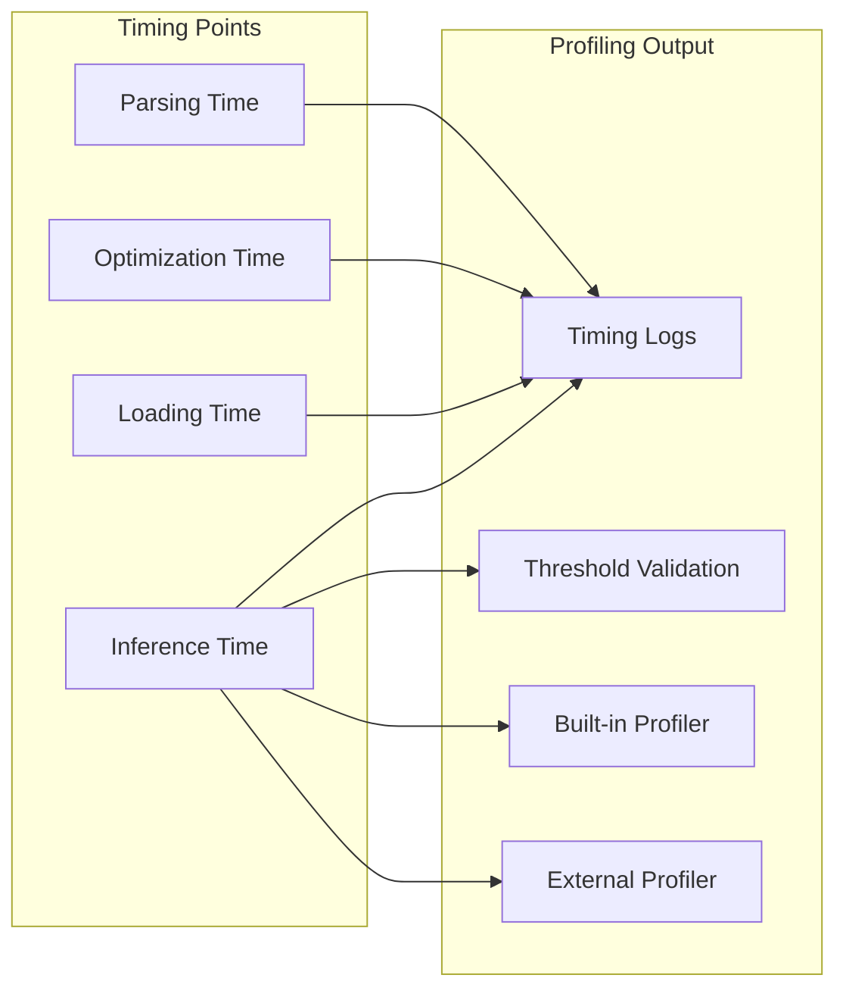
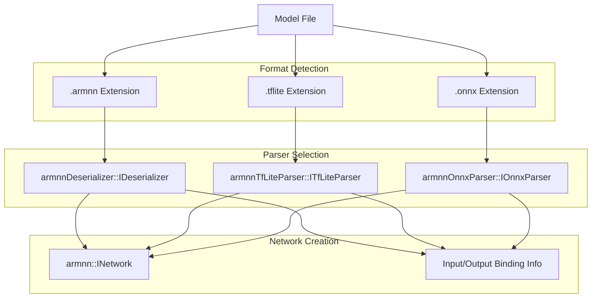

# ExecuteNetwork Tool

<details>
<summary>Relevant source files</summary>

The following files were used as context for generating this wiki page:

- [tests/CMakeLists.txt](tests/CMakeLists.txt)
- [tests/ExecuteNetwork/ArmNNExecutor.cpp](tests/ExecuteNetwork/ArmNNExecutor.cpp)
- [tests/ExecuteNetwork/ArmNNExecutor.hpp](tests/ExecuteNetwork/ArmNNExecutor.hpp)
- [tests/ExecuteNetwork/ExecuteNetwork.cpp](tests/ExecuteNetwork/ExecuteNetwork.cpp)
- [tests/ExecuteNetwork/ExecuteNetworkParams.cpp](tests/ExecuteNetwork/ExecuteNetworkParams.cpp)
- [tests/ExecuteNetwork/ExecuteNetworkParams.hpp](tests/ExecuteNetwork/ExecuteNetworkParams.hpp)
- [tests/ExecuteNetwork/ExecuteNetworkProgramOptions.cpp](tests/ExecuteNetwork/ExecuteNetworkProgramOptions.cpp)
- [tests/ExecuteNetwork/IExecutor.hpp](tests/ExecuteNetwork/IExecutor.hpp)
- [tests/ExecuteNetwork/TfliteExecutor.cpp](tests/ExecuteNetwork/TfliteExecutor.cpp)
- [tests/ExecuteNetwork/TfliteExecutor.hpp](tests/ExecuteNetwork/TfliteExecutor.hpp)
- [tests/InferenceModel.hpp](tests/InferenceModel.hpp)
- [tests/NetworkExecutionUtils/NetworkExecutionUtils.cpp](tests/NetworkExecutionUtils/NetworkExecutionUtils.cpp)
- [tests/NetworkExecutionUtils/NetworkExecutionUtils.hpp](tests/NetworkExecutionUtils/NetworkExecutionUtils.hpp)

</details>


The ExecuteNetwork tool is a comprehensive command-line utility for testing, benchmarking, and validating neural network models using ArmNN. It supports multiple model formats (TensorFlow Lite, ONNX, ArmNN serialized), execution backends (CPU, GPU, NEON), and provides detailed performance profiling and output comparison capabilities.

For information about the TensorFlow Lite delegate integration, see [[5.2-tensorflow-lite-delegate|TensorFlow Lite Delegate]]. For details about the underlying runtime and execution system, see [[2.3-runtime-and-execution|Runtime and Execution]].

## Architecture Overview

The ExecuteNetwork tool follows a modular architecture with clear separation between command-line parsing, execution strategies, and output handling.

### Core Components



Sources: [tests/ExecuteNetwork/ExecuteNetwork.cpp:14-113](), [tests/ExecuteNetwork/IExecutor.hpp:9-25](), [tests/ExecuteNetwork/ExecuteNetworkProgramOptions.hpp](), [tests/ExecuteNetwork/ExecuteNetworkParams.hpp:15-78]()

### Executor Implementation Strategy



Sources: [tests/ExecuteNetwork/ArmNNExecutor.hpp:36-174](), [tests/ExecuteNetwork/TfliteExecutor.hpp:21-35](), [tests/ExecuteNetwork/ArmNNExecutor.cpp:647-684]()

## Command Line Interface

The ExecuteNetwork tool provides extensive command-line options organized into logical groups for different use cases.

### Required Parameters

| Parameter | Description | Type |
|-----------|-------------|------|
| `--compute` / `-c` | Compute devices (CpuRef, CpuAcc, GpuAcc) | `std::vector<std::string>` |
| `--model-path` / `-m` | Path to model file (.armnn, .tflite, .onnx) | `std::string` |

### Input/Output Configuration

| Parameter | Description | Default |
|-----------|-------------|---------|
| `--input-tensor-data` / `-d` | Input data file paths | Empty (generates dummy data) |
| `--input-tensor-shape` / `-s` | Input tensor shapes | Auto-detected |
| `--write-outputs-to-file` / `-w` | Output file paths | Console output |
| `--iterations` / `-I` | Number of execution iterations | 1 |

### Optimization Parameters

| Parameter | Description | Default |
|-----------|-------------|---------|
| `--fp16-turbo-mode` | Enable FP16 optimization | false |
| `--enable-fast-math` | Enable fast math optimizations | false |
| `--number-of-threads` | CpuAcc backend threads | 0 (auto) |
| `--cached-network-filepath` | GPU kernel cache file | Empty |

Sources: [tests/ExecuteNetwork/ExecuteNetworkProgramOptions.cpp:200-621](), [tests/ExecuteNetwork/ExecuteNetworkParams.hpp:17-78]()

## Execution Modes

The ExecuteNetwork tool supports multiple execution modes through the `--tflite-executor` parameter.

### ArmNN Native Execution



**Usage**: `--tflite-executor parser` (default)
- Direct ArmNN execution using model parsers
- Full optimization pipeline
- Backend-specific optimizations
- Complete profiling support

### TensorFlow Lite Delegate Execution



**Usage**: `--tflite-executor delegate` or `--tflite-executor opaquedelegate`
- TensorFlow Lite runtime with ArmNN acceleration
- Automatic operator delegation
- Fallback to TensorFlow Lite for unsupported operations

### TensorFlow Lite Native Execution

**Usage**: `--tflite-executor tflite`
- Pure TensorFlow Lite execution without ArmNN
- Useful for baseline comparisons

Sources: [tests/ExecuteNetwork/ExecuteNetwork.cpp:14-32](), [tests/ExecuteNetwork/ExecuteNetworkProgramOptions.cpp:545-567](), [tests/ExecuteNetwork/TfliteExecutor.cpp:76-149]()

## Input and Output Handling

### Input Data Processing

The tool supports multiple input data formats and processing strategies:



**Input Processing Features**:
- Automatic data type detection and conversion
- Support for multiple input tensors
- Tensor shape validation and inference
- Quantization parameter handling

Sources: [tests/NetworkExecutionUtils/NetworkExecutionUtils.hpp:132-210](), [tests/ExecuteNetwork/ArmNNExecutor.cpp:361-542]()

### Output Generation and Comparison



**Output Processing Features**:
- Multiple output format support
- Quantized output dequantization
- Root Mean Square Error (RMSE) calculations
- Cross-backend result validation

Sources: [tests/ExecuteNetwork/FileComparisonExecutor.cpp](), [tests/NetworkExecutionUtils/NetworkExecutionUtils.cpp:81-98](), [tests/ExecuteNetwork/ArmNNExecutor.cpp:686-780]()

## Performance Analysis and Profiling

### Profiling Configuration

The tool provides comprehensive profiling capabilities through multiple parameters:

| Profiling Option | Description | Usage |
|------------------|-------------|-------|
| `--enable-external-profiling` | External profiling service | Performance analysis |
| `--event-based-profiling` | Built-in ArmNN profiler | Layer-level timing |
| `--output-network-details` | Network structure info | Debugging |
| `--timeline-profiling` | Timeline event capture | Advanced analysis |

### Timing Measurements



**Performance Features**:
- Automatic timing measurement for all phases
- Configurable inference time thresholds
- Layer-by-layer performance breakdown
- Memory usage tracking with heap profiling

Sources: [tests/ExecuteNetwork/ArmNNExecutor.cpp:224-276](), [tests/NetworkExecutionUtils/NetworkExecutionUtils.cpp:17-38](), [tests/InferenceModel.hpp:439-443]()

## Integration with ArmNN Ecosystem

### Parser Integration

The ExecuteNetwork tool automatically detects model formats and uses appropriate parsers:



### Backend Configuration

The tool supports all ArmNN compute backends with specific optimization options:

| Backend | Options | Purpose |
|---------|---------|---------|
| `CpuRef` | Reference implementation | Debugging, validation |
| `CpuAcc` | `NumberOfThreads`, `FastMathEnabled` | ARM NEON acceleration |
| `GpuAcc` | `TuningLevel`, `CachedNetworkFilePath`, `MLGOTuningFilePath` | OpenCL GPU acceleration |

**Backend Selection Strategy**:
- Primary backend for layer execution
- Automatic fallback to secondary backends
- Backend-specific optimization parameters
- Dynamic backend loading support

Sources: [tests/ExecuteNetwork/ArmNNExecutor.cpp:581-645](), [tests/ExecuteNetwork/ExecuteNetworkParams.cpp:112-201](), [tests/ExecuteNetwork/ExecuteNetworkProgramOptions.cpp:596-611]()

## Advanced Features

### Model Serialization

The tool can serialize optimized networks for later use:

```bash
ExecuteNetwork --model-path model.tflite --serialize-to-armnn
```

This generates:
- Optimized `.armnn` serialized network
- `.dot` file for network visualization
- Performance diagnostic files

### Network Visualization

Enable detailed network visualization:

```bash
ExecuteNetwork --model-path model.tflite --visualize-optimized-model
```

Outputs a `.dot` file showing the optimized network graph structure.

### Multi-iteration Testing

Support for stress testing and performance averaging:

```bash
ExecuteNetwork --model-path model.tflite --iterations 100
```

Executes the network multiple times with timing statistics and threshold validation.

Sources: [tests/ExecuteNetwork/ArmNNExecutor.cpp:140-158](), [tests/ExecuteNetwork/ArmNNExecutor.cpp:635-642](), [tests/ExecuteNetwork/ExecuteNetworkProgramOptions.cpp:256-264]()

## Related Wiki Pages

- [[5-tools-and-applications|Tools and Applications]]
- [[5.2-tensorflow-lite-delegate|TensorFlow Lite Delegate]]
- [[2.3-runtime-and-execution|Runtime and Execution]]


## Dynamic Knowledge Links (Code Graph ↔ LLM-Wiki / RAG)

### Linked Architecture & Design Documents

| Document | Match Channel | Score | Shared Code Symbols |
|---|---|---|---|
| [[5-tools-and-applications|5 Tools and Applications]] | `bm25+entity(5)` | `61.641` | `ExecuteSync`, `OptimizeNetwork`, `ParseOptions`, `PopulateTensorWithData`, `SetupInputsAndOutputs` |
| [[5.2-tensorflow-lite-delegate|5.2 TensorFlow Lite Delegate]] | `wikilink:5.1-executenetwork-tool` | `35.926` | *(lexical/graph match)* |
| [[2.3-runtime-and-execution|2.3 Runtime and Execution]] | `wikilink:5.1-executenetwork-tool` | `35.926` | *(lexical/graph match)* |
| [[index|ARM-software/armnn DeepWiki]] | `wikilink:5.1-executenetwork-tool` | `35.926` | *(lexical/graph match)* |
| [[3-model-support|3 Model Support]] | `bm25` | `35.287` | *(lexical/graph match)* |
| [[3.2-onnx-parser|3.2 ONNX Parser]] | `bm25` | `34.065` | *(lexical/graph match)* |

### High-Centrality Bridge Symbols (CBM Graph)

| Symbol | Kind | Source Location | Fan-In / Fan-Out |
|---|---|---|---|
| `ParseOptions` | Method | [tests/ExecuteNetwork/ExecuteNetworkProgramOptions.cpp:507-621]() | in: `2` / out: `21` |
| `InferenceModel` | Method | [tests/InferenceModel.hpp:405-514]() | in: `0` / out: `17` |
| `CheckRequestedBackendsAreValid` | Function | [tests/NetworkExecutionUtils/NetworkExecutionUtils.hpp:43-74]() | in: `4` / out: `9` |
| `LogAndThrow` | Function | [tests/NetworkExecutionUtils/NetworkExecutionUtils.cpp:75-79]() | in: `8` / out: `1` |
| `OptimizeNetwork` | Method | [tests/ExecuteNetwork/ArmNNExecutor.cpp:581-645]() | in: `1` / out: `14` |
| `ToDelegateOptions` | Method | [tests/ExecuteNetwork/ExecuteNetworkParams.cpp:118-201]() | in: `1` / out: `14` |

Sources: [tests/ExecuteNetwork/ExecuteNetworkProgramOptions.cpp:507-621](), [tests/InferenceModel.hpp:405-514](), [tests/NetworkExecutionUtils/NetworkExecutionUtils.hpp:43-74](), [tests/NetworkExecutionUtils/NetworkExecutionUtils.cpp:75-79]()

### Cross-Subsystem Coupling

- [[1-armnn-overview|1 ArmNN Overview]] — call/import coupling weight `25.0`
- [[2-core-architecture|2 Core Architecture]] — call/import coupling weight `23.0`
- [[2.1-network-and-graph-system|2.1 Network and Graph System]] — call/import coupling weight `23.0`
- [[5-tools-and-applications|5 Tools and Applications]] — call/import coupling weight `18.0`
- [[5.2-tensorflow-lite-delegate|5.2 TensorFlow Lite Delegate]] — call/import coupling weight `18.0`
- [[2.3-runtime-and-execution|2.3 Runtime and Execution]] — call/import coupling weight `16.0`
