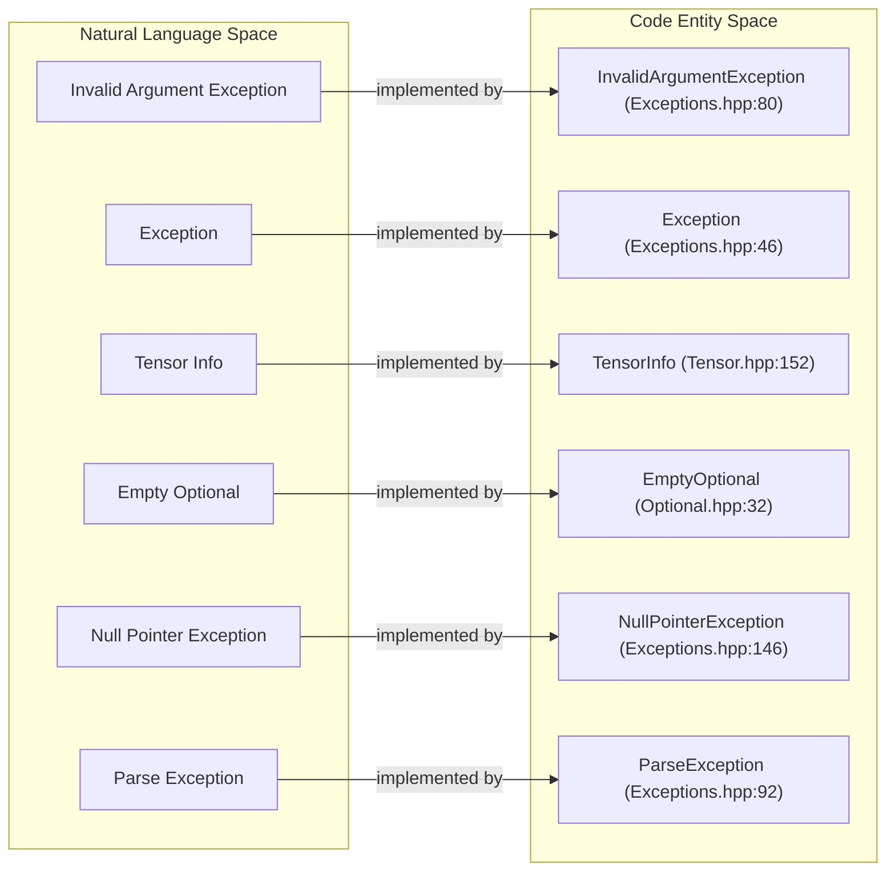
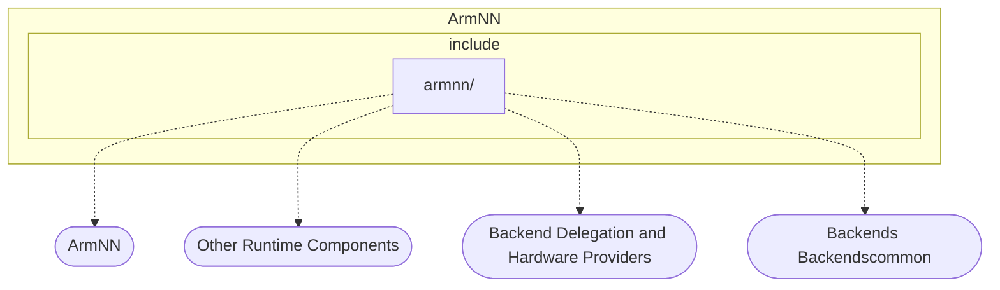
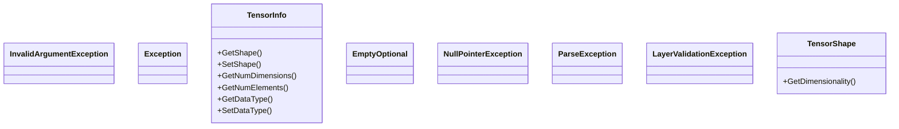
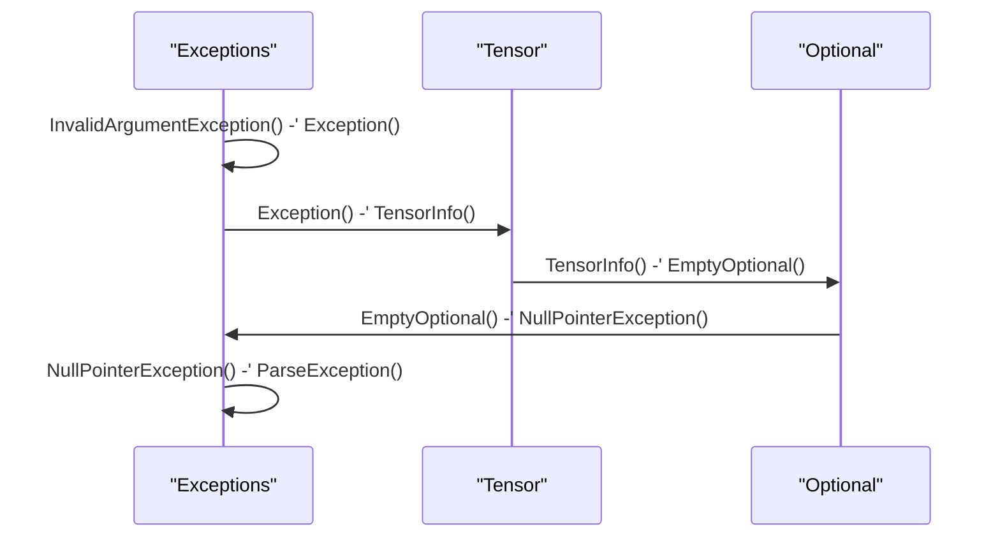

# ArmNN

↑ [[5-runtime-execution-and-kernel-dispatch|Runtime Execution and Kernel Dispatch]]

> ArmNN subsystem (`include/armnn`), covering 21 files and 440 symbols. Key symbols include `GetShape`, `InvalidArgumentException`, `GetNumElements`, `Exception`.

<details>
<summary>Relevant source files</summary>

The following files were used as context for generating this wiki page:

- [include/armnn/Exceptions.hpp](include/armnn/Exceptions.hpp)
- [include/armnn/Tensor.hpp](include/armnn/Tensor.hpp)
- [include/armnn/BackendId.hpp](include/armnn/BackendId.hpp)
- [include/armnn/Types.hpp](include/armnn/Types.hpp)
- [include/armnn/Optional.hpp](include/armnn/Optional.hpp)
- [include/armnn/LstmParams.hpp](include/armnn/LstmParams.hpp)
- [include/armnn/TypesUtils.hpp](include/armnn/TypesUtils.hpp)
- [include/armnn/Descriptors.hpp](include/armnn/Descriptors.hpp)
- [include/armnn/BackendOptions.hpp](include/armnn/BackendOptions.hpp)
- [include/armnn/QuantizedLstmParams.hpp](include/armnn/QuantizedLstmParams.hpp)
- [include/armnn/Numpy.hpp](include/armnn/Numpy.hpp)
- [include/armnn/IRuntime.hpp](include/armnn/IRuntime.hpp)
- [include/armnn/Logging.hpp](include/armnn/Logging.hpp)
- [include/armnn/INetwork.hpp](include/armnn/INetwork.hpp)
- [include/armnn/BackendHelper.hpp](include/armnn/BackendHelper.hpp)
- [include/armnn/BackendRegistry.hpp](include/armnn/BackendRegistry.hpp)
- [include/armnn/StrategyBase.hpp](include/armnn/StrategyBase.hpp)
- [include/armnn/IProfiler.hpp](include/armnn/IProfiler.hpp)
- [include/armnn/IStrategy.hpp](include/armnn/IStrategy.hpp)
- [include/armnn/MemorySources.hpp](include/armnn/MemorySources.hpp)
- [include/armnn/Utils.hpp](include/armnn/Utils.hpp)

</details>

## Purpose and Scope

ArmNN subsystem (`include/armnn`), covering 21 files and 440 symbols. Key symbols include `GetShape`, `InvalidArgumentException`, `GetNumElements`, `Exception`.

Primary code entities analyzed on this page include `InvalidArgumentException` ([include/armnn/Exceptions.hpp:80-84]()), `Exception` ([include/armnn/Exceptions.hpp:46-65]()), `TensorInfo` ([include/armnn/Tensor.hpp:152-274]()), `EmptyOptional` ([include/armnn/Optional.hpp:32-32]()), `NullPointerException` ([include/armnn/Exceptions.hpp:146-150]()).

For the parent architectural layer, see [[5-runtime-execution-and-kernel-dispatch|Runtime Execution and Kernel Dispatch]]. Related sibling subsystems: [[5.1-armnn|ArmNN]], [[5.3-delegate-opaque|Delegate Opaque]], [[5.4-delegate-classic|Delegate Classic]], [[5.5-armnnutils|Armnnutils]].

Sources: [include/armnn/Exceptions.hpp:80-84](), [include/armnn/Exceptions.hpp:46-65](), [include/armnn/Tensor.hpp:152-274](), [include/armnn/Optional.hpp:32-32]()

---

## 1. High-Level Architecture and Data Flow

### Natural Language Space to Code Entity Space Mapping

The following diagram maps domain concepts in this subsystem to their concrete code entities:



### Subsystem Component & Dependency Flow



Cross-subsystem call and import edges connect **ArmNN** with [[5.1-armnn|ArmNN]] (coupling `431.0`), [[5.6-other-runtime-components|Other Runtime Components]] (coupling `244.0`), [[4.1-tests|Tests]] (coupling `238.0`), [[3-backend-delegation-and-hardware-providers|Backend Delegation and Hardware Providers]] (coupling `226.0`), [[5-runtime-execution-and-kernel-dispatch|Runtime Execution and Kernel Dispatch]] (coupling `218.0`).

| Module Directory | Files | Primary Code Entities | Source Citations |
|---|---|---|---|
| `include/armnn` | 21 | `InvalidArgumentException`, `Exception`, `TensorInfo`, `EmptyOptional` | [include/armnn/Exceptions.hpp:80-84]() [include/armnn/Exceptions.hpp:46-65]() |

Sources: [include/armnn/Exceptions.hpp:80-84](), [include/armnn/Exceptions.hpp:46-65](), [include/armnn/Tensor.hpp:152-274](), [include/armnn/Optional.hpp:32-32](), [include/armnn/Exceptions.hpp:146-150]()

---

## 2. Core Data Structures and Implementation Details

### Class and Entity Relationship Diagram



### `InvalidArgumentException` (Class)

- **Source Location**: [include/armnn/Exceptions.hpp:80-84]()
- **Declaration**: `Class InvalidArgumentException`
- **Graph Centrality**: fan-in `273` callers, fan-out `0` callees

```cpp
// include/armnn/Exceptions.hpp:80-84
class InvalidArgumentException : public Exception
{
public:
    using Exception::Exception;
};
```

### `Exception` (Class)

- **Source Location**: [include/armnn/Exceptions.hpp:46-65]()
- **Declaration**: `Class Exception`
- **Graph Centrality**: fan-in `181` callers, fan-out `0` callees
- **Responsibility**: /// Base class for all ArmNN exceptions so that users can filter to just those.

```cpp
// include/armnn/Exceptions.hpp:46-61
class Exception : public std::exception
{
public:
    explicit Exception(const std::string& message);

    /// exception with context
    explicit Exception(const std::string& message,
                       const CheckLocation& location);

    /// preserving previous exception context
    /// and adding local context information
    explicit Exception(const Exception& other,
                       const std::string& message,
                       const CheckLocation& location);

    virtual const char* what() const noexcept override;
```

### `TensorInfo` (Class)

- **Source Location**: [include/armnn/Tensor.hpp:152-274]()
- **Declaration**: `Class TensorInfo`
- **Graph Centrality**: fan-in `121` callers, fan-out `0` callees

```cpp
// include/armnn/Tensor.hpp:152-167
class TensorInfo
{
public:
    /// Empty (invalid) constructor.
    TensorInfo();

    TensorInfo(const TensorShape& shape,
               DataType dataType,
               float quantizationScale = 1.0f,
               int32_t quantizationOffset = 0,
               bool isConstant = false);

    TensorInfo(unsigned int numDimensions,
               const unsigned int* dimensionSizes,
               DataType dataType,
               float quantizationScale = 1.0f,
```

### `EmptyOptional` (Class)

- **Source Location**: [include/armnn/Optional.hpp:32-32]()
- **Declaration**: `Class EmptyOptional`
- **Graph Centrality**: fan-in `102` callers, fan-out `0` callees
- **Responsibility**: /// EmptyOptional is used to initialize the Optional class in case we want /// to have default value for an Optional in a function declaration.

### `NullPointerException` (Class)

- **Source Location**: [include/armnn/Exceptions.hpp:146-150]()
- **Declaration**: `Class NullPointerException`
- **Graph Centrality**: fan-in `101` callers, fan-out `0` callees

### `GetShape` (Method)

- **Source Location**: [include/armnn/Tensor.hpp:194-194]()
- **Declaration**: `()`
- **Graph Centrality**: fan-in `338` callers, fan-out `0` callees

Sources: [include/armnn/Exceptions.hpp:80-84](), [include/armnn/Exceptions.hpp:46-65](), [include/armnn/Tensor.hpp:152-274](), [include/armnn/Optional.hpp:32-32](), [include/armnn/Exceptions.hpp:146-150]()

---

## 3. Execution and Call Flow

The sequence diagram below traces the runtime/compile-time call chain across components in this module:



Sources: [include/armnn/Exceptions.hpp:80-84](), [include/armnn/Exceptions.hpp:46-65](), [include/armnn/Tensor.hpp:152-274](), [include/armnn/Optional.hpp:32-32](), [include/armnn/Exceptions.hpp:146-150]()

---

## 4. Key API and Symbol Reference

| Code Entity | Kind | Location | Fan-In / Out | Role & Signature |
|---|---|---|---|---|
| `InvalidArgumentException` | Class | [include/armnn/Exceptions.hpp:80-84]() | `273` / `0` | — |
| `Exception` | Class | [include/armnn/Exceptions.hpp:46-65]() | `181` / `0` | /// Base class for all ArmNN exceptions so that users can filter to just those. |
| `TensorInfo` | Class | [include/armnn/Tensor.hpp:152-274]() | `121` / `0` | — |
| `EmptyOptional` | Class | [include/armnn/Optional.hpp:32-32]() | `102` / `0` | /// EmptyOptional is used to initialize the Optional class in case we want |
| `NullPointerException` | Class | [include/armnn/Exceptions.hpp:146-150]() | `101` / `0` | — |
| `ParseException` | Class | [include/armnn/Exceptions.hpp:92-96]() | `98` / `0` | — |
| `LayerValidationException` | Class | [include/armnn/Exceptions.hpp:105-108]() | `73` / `0` | — |
| `TensorShape` | Class | [include/armnn/Tensor.hpp:20-150]() | `53` / `0` | — |
| `BackendId` | Class | [include/armnn/BackendId.hpp:78-148]() | `48` / `0` | — |
| `Tensor` | Class | [include/armnn/Tensor.hpp:321-326]() | `39` / `0` | /// A tensor defined by a TensorInfo (shape and data type) and a mutable backing store. |
| `BaseDescriptor` | Class | [include/armnn/Descriptors.hpp:22-26]() | `34` / `0` | /// Base class for all descriptors. |
| `ConstTensor` | Class | [include/armnn/Tensor.hpp:329-392]() | `32` / `0` | /// A tensor defined by a TensorInfo (shape and data type) and an immutable backing store. |
| `UnimplementedException` | Class | [include/armnn/Exceptions.hpp:98-103]() | `35` / `0` | — |
| `RuntimeException` | Class | [include/armnn/Exceptions.hpp:120-123]() | `18` / `0` | — |
| `BatchMatMulDescriptor` | Class | [include/armnn/Descriptors.hpp:1584-1638]() | `13` / `0` | /// A BatchMatMulDescriptor for the BatchMatMul operator |
| `CreationOptions` | Class | [include/armnn/IRuntime.hpp:70-183]() | `14` / `0` | — |
| `MemoryImportException` | Class | [include/armnn/Exceptions.hpp:125-128]() | `10` / `0` | — |
| `BroadcastToDescriptor` | Class | [include/armnn/Descriptors.hpp:1659-1676]() | `9` / `0` | — |
| `FileNotFoundException` | Class | [include/armnn/Exceptions.hpp:86-90]() | `7` / `0` | — |
| `GraphValidationException` | Class | [include/armnn/Exceptions.hpp:110-113]() | `6` / `0` | — |
| `BatchToSpaceNdDescriptor` | Class | [include/armnn/Descriptors.hpp:875-903]() | `2` / `0` | /// A BatchToSpaceNdDescriptor for the BatchToSpaceNdLayer. |
| `ComparisonDescriptor` | Class | [include/armnn/Descriptors.hpp:89-106]() | `2` / `0` | /// A ComparisonDescriptor for the ComparisonLayer |

Sources: [include/armnn/Exceptions.hpp:80-84](), [include/armnn/Exceptions.hpp:46-65](), [include/armnn/Tensor.hpp:152-274](), [include/armnn/Optional.hpp:32-32](), [include/armnn/Exceptions.hpp:146-150](), [include/armnn/Exceptions.hpp:92-96]()

---

## 5. Official Documentation and Design Context

The following linked documentation sections from `llm-wiki` (`raw/`) provide additional architectural context, tutorials, and design invariants for this subsystem:

- **Runtime Execution and Kernel Dispatch** ([wiki/5-runtime-execution-and-kernel-dispatch.md](), score `69.9913`) (sections: `Runtime Execution and Kernel Dispatch`, `Purpose and Scope`, `System Mapping: Natural Language Space to Code Entity Space`, `1. ArmNN`): # Runtime Execution and Kernel Dispatch > Architectural overview of Runtime Execution and Kernel Dispatch, spanning 157 source files and 3718 code symbols across 6 subsystems. <details> <summary>Relevant source files</summary> The following files were used as context for generating this wiki page: - [samples/common/include/Audio/DataStructures.hpp](samples/common/include/Audio/DataStructures.hpp) - [src/armnn/Tensor.
- **Overview** ([wiki/1-overview.md](), score `67.1583`) (sections: `Overview`, `1. Architecture Overview & System Component Map`, `Core Concept to Code Entity Mapping`, `Core Compilation & Runtime Class Hierarchy`): # Overview > End-to-end architecture overview of ArmNN: core subsystems, compilation/execution pipeline, entry points, and cross-module dependencies. <details> <summary>Relevant source files</summary> The following files were used as context for generating this wiki page: - [src/armnn/Tensor.cpp](src/armnn/Tensor.cpp) - [include/armnn/Exceptions.hpp](include/armnn/Exceptions.hpp) - [include/armnn/Tensor.hpp](include/
- **ArmNN DeepWiki** ([wiki/index.md](), score `60.277`) (sections: `ArmNN DeepWiki`, `Pages`): # ArmNN DeepWiki Generated from `home-jason-Project-deepwiki-armnn` at commit `2b61cecc9df7` (2026-11-14T15:13:53+00:00). ## Pages - [[1-overview|Overview]] — End-to-end architecture overview of ArmNN: core subsystems, compilation/execution pipeline, entry points, and cross-module dependencies. - [[2-build-system-and-infrastructure|Build System and Infrastructure]] — Architectural overview of Build System and Infrast
- **Glossary** ([wiki/7-glossary.md](), score `48.5843`) (sections: `Glossary`, `Purpose and Scope`, `1. Core Compilation, IR & Graph Concepts`, ``compile_string` (Compile String)`): # Glossary > Definitions and technical context for ArmNN domain terms, acronyms, file formats, and core code entities. <details> <summary>Relevant source files</summary> The following files were used as context for generating this wiki page: - [src/armnn/Tensor.cpp](src/armnn/Tensor.cpp) - [include/armnn/Exceptions.hpp](include/armnn/Exceptions.hpp) - [include/armnn/Tensor.hpp](include/armnn/Tensor.hpp) - [third-part

Sources: [wiki/5-runtime-execution-and-kernel-dispatch.md](), [wiki/1-overview.md](), [wiki/index.md](), [wiki/7-glossary.md]()

## Related pages

- [[5-runtime-execution-and-kernel-dispatch|Runtime Execution and Kernel Dispatch]]
- [[3-backend-delegation-and-hardware-providers|Backend Delegation and Hardware Providers]]
- [[3.1-backends-backendscommon|Backends Backendscommon]]
- [[3.2-backends-reference|Backends Reference]]
- [[3.3-backends-opencl|Backends OpenCL]]
- [[3.4-backends-aclcommon|Backends Aclcommon]]
- [[3.6-other-backends|Other Backends]]
- [[5.1-armnn|ArmNN]]

## Related documents

- `wiki/5-runtime-execution-and-kernel-dispatch.md` — Runtime Execution and Kernel Dispatch (score 69.9913, via bm25)
- `wiki/1-overview.md` — Overview (score 67.1583, via bm25)
- `wiki/index.md` — ArmNN DeepWiki (score 60.277, via bm25)
- `wiki/7-glossary.md` — Glossary (score 48.5843, via bm25)
- `wiki/6.1-profiling-common.md` — Profiling Common (score 47.0874, via bm25)

## Sources

- [`include/armnn/Exceptions.hpp`](https://github.com/ARM-software/armnn/blob/branches/armnn_24_11/include/armnn/Exceptions.hpp)
- [`include/armnn/Tensor.hpp`](https://github.com/ARM-software/armnn/blob/branches/armnn_24_11/include/armnn/Tensor.hpp)
- [`include/armnn/BackendId.hpp`](https://github.com/ARM-software/armnn/blob/branches/armnn_24_11/include/armnn/BackendId.hpp)
- [`include/armnn/Types.hpp`](https://github.com/ARM-software/armnn/blob/branches/armnn_24_11/include/armnn/Types.hpp)
- [`include/armnn/Optional.hpp`](https://github.com/ARM-software/armnn/blob/branches/armnn_24_11/include/armnn/Optional.hpp)
- [`include/armnn/LstmParams.hpp`](https://github.com/ARM-software/armnn/blob/branches/armnn_24_11/include/armnn/LstmParams.hpp)
- [`include/armnn/TypesUtils.hpp`](https://github.com/ARM-software/armnn/blob/branches/armnn_24_11/include/armnn/TypesUtils.hpp)
- [`include/armnn/Descriptors.hpp`](https://github.com/ARM-software/armnn/blob/branches/armnn_24_11/include/armnn/Descriptors.hpp)
- [`include/armnn/BackendOptions.hpp`](https://github.com/ARM-software/armnn/blob/branches/armnn_24_11/include/armnn/BackendOptions.hpp)
- [`include/armnn/QuantizedLstmParams.hpp`](https://github.com/ARM-software/armnn/blob/branches/armnn_24_11/include/armnn/QuantizedLstmParams.hpp)
- [`include/armnn/Numpy.hpp`](https://github.com/ARM-software/armnn/blob/branches/armnn_24_11/include/armnn/Numpy.hpp)
- [`include/armnn/IRuntime.hpp`](https://github.com/ARM-software/armnn/blob/branches/armnn_24_11/include/armnn/IRuntime.hpp)
- [`include/armnn/Logging.hpp`](https://github.com/ARM-software/armnn/blob/branches/armnn_24_11/include/armnn/Logging.hpp)
- [`include/armnn/INetwork.hpp`](https://github.com/ARM-software/armnn/blob/branches/armnn_24_11/include/armnn/INetwork.hpp)
- [`include/armnn/BackendHelper.hpp`](https://github.com/ARM-software/armnn/blob/branches/armnn_24_11/include/armnn/BackendHelper.hpp)
- [`include/armnn/BackendRegistry.hpp`](https://github.com/ARM-software/armnn/blob/branches/armnn_24_11/include/armnn/BackendRegistry.hpp)
- [`include/armnn/StrategyBase.hpp`](https://github.com/ARM-software/armnn/blob/branches/armnn_24_11/include/armnn/StrategyBase.hpp)
- [`include/armnn/IProfiler.hpp`](https://github.com/ARM-software/armnn/blob/branches/armnn_24_11/include/armnn/IProfiler.hpp)
- [`include/armnn/IStrategy.hpp`](https://github.com/ARM-software/armnn/blob/branches/armnn_24_11/include/armnn/IStrategy.hpp)
- [`include/armnn/MemorySources.hpp`](https://github.com/ARM-software/armnn/blob/branches/armnn_24_11/include/armnn/MemorySources.hpp)
- [`include/armnn/Utils.hpp`](https://github.com/ARM-software/armnn/blob/branches/armnn_24_11/include/armnn/Utils.hpp)


## Dynamic Knowledge Links (Code Graph ↔ LLM-Wiki / RAG)

### Linked Architecture & Design Documents

| Document | Match Channel | Score | Shared Code Symbols |
|---|---|---|---|
| [[5-runtime-execution-and-kernel-dispatch|Runtime Execution and Kernel Dispatch]] | `bm25+entity(10)` | `84.991` | `BackendId`, `ConstTensor`, `EmptyOptional`, `Exception`, `InvalidArgumentException` |
| [[1-overview|Overview]] | `bm25+entity(6)` | `76.158` | `Exception`, `InvalidArgumentException`, `LayerValidationException`, `NullPointerException`, `ParseException` |
| [[7-glossary|Glossary]] | `bm25+entity(10)` | `63.584` | `BackendId`, `ConstTensor`, `CreationOptions`, `Exception`, `InvalidArgumentException` |
| [[index|ArmNN DeepWiki]] | `bm25+entity(2)` | `63.277` | `Exception`, `InvalidArgumentException` |
| [[6.1-profiling-common|Profiling Common]] | `bm25+entity(5)` | `54.587` | `EmptyOptional`, `Exception`, `InvalidArgumentException`, `Tensor`, `UnimplementedException` |
| [[5.1-armnn|ArmNN]] | `wikilink:5.2-armnn+entity(2)` | `43.224` | `Tensor`, `TensorInfo` |

### High-Centrality Bridge Symbols (CBM Graph)

| Symbol | Kind | Source Location | Fan-In / Fan-Out |
|---|---|---|---|
| `InvalidArgumentException` | Class | [include/armnn/Exceptions.hpp:80-84]() | in: `273` / out: `0` |
| `Exception` | Class | [include/armnn/Exceptions.hpp:46-65]() | in: `181` / out: `0` |
| `TensorInfo` | Class | [include/armnn/Tensor.hpp:152-274]() | in: `121` / out: `0` |
| `EmptyOptional` | Class | [include/armnn/Optional.hpp:32-32]() | in: `102` / out: `0` |
| `NullPointerException` | Class | [include/armnn/Exceptions.hpp:146-150]() | in: `101` / out: `0` |
| `ParseException` | Class | [include/armnn/Exceptions.hpp:92-96]() | in: `98` / out: `0` |

Sources: [include/armnn/Exceptions.hpp:80-84](), [include/armnn/Exceptions.hpp:46-65](), [include/armnn/Tensor.hpp:152-274](), [include/armnn/Optional.hpp:32-32]()

### Cross-Subsystem Coupling

- [[5.1-armnn|ArmNN]] — call/import coupling weight `431.0`
- [[5.6-other-runtime-components|Other Runtime Components]] — call/import coupling weight `244.0`
- [[4.1-tests|Tests]] — call/import coupling weight `238.0`
- [[3-backend-delegation-and-hardware-providers|Backend Delegation and Hardware Providers]] — call/import coupling weight `226.0`
- [[5-runtime-execution-and-kernel-dispatch|Runtime Execution and Kernel Dispatch]] — call/import coupling weight `218.0`
- [[3.1-backends-backendscommon|Backends Backendscommon]] — call/import coupling weight `218.0`
