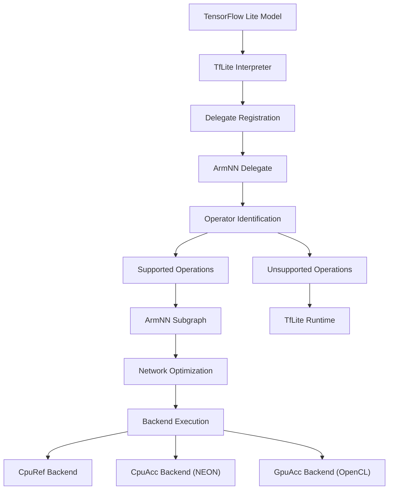
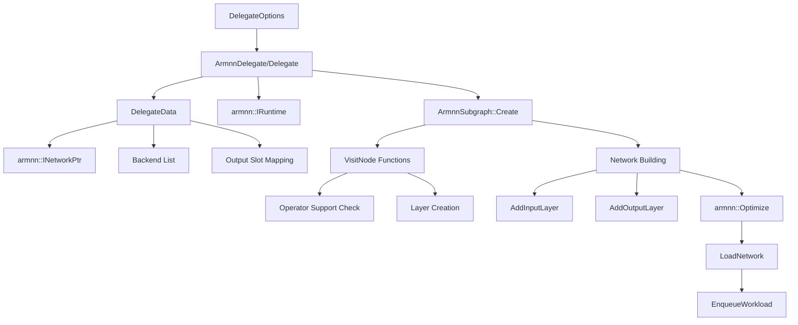
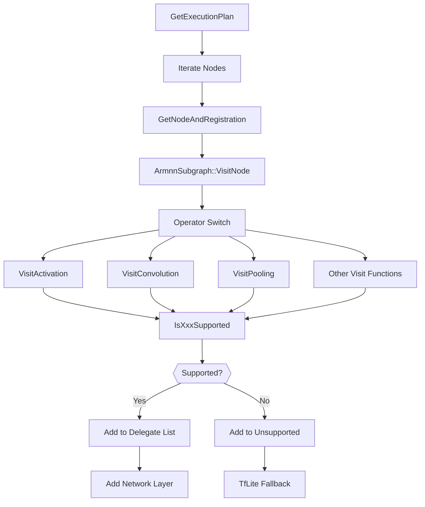

# TensorFlow Lite Delegate

<details>
<summary>Relevant source files</summary>

The following files were used as context for generating this wiki page:

- [BuildGuideAndroidNDK.md](BuildGuideAndroidNDK.md)
- [CONTRIBUTING.md](CONTRIBUTING.md)
- [CONTRIBUTING.md.license](CONTRIBUTING.md.license)
- [InstallationViaAptRepository.md](InstallationViaAptRepository.md)
- [InstallationViaAptRepository.md.license](InstallationViaAptRepository.md.license)
- [README.md](README.md)
- [delegate/BuildGuideNative.md](delegate/BuildGuideNative.md)
- [delegate/CMakeLists.txt](delegate/CMakeLists.txt)
- [delegate/DelegateQuickStartGuide.md](delegate/DelegateQuickStartGuide.md)
- [delegate/classic/CMakeLists.txt](delegate/classic/CMakeLists.txt)
- [delegate/classic/include/armnn_delegate.hpp](delegate/classic/include/armnn_delegate.hpp)
- [delegate/classic/src/ScatterNd.hpp](delegate/classic/src/ScatterNd.hpp)
- [delegate/classic/src/armnn_delegate.cpp](delegate/classic/src/armnn_delegate.cpp)
- [delegate/classic/src/test/ArmnnClassicDelegateTest.cpp](delegate/classic/src/test/ArmnnClassicDelegateTest.cpp)
- [delegate/common/include/DelegateOptions.hpp](delegate/common/include/DelegateOptions.hpp)
- [delegate/common/src/DelegateOptions.cpp](delegate/common/src/DelegateOptions.cpp)
- [delegate/opaque/CMakeLists.txt](delegate/opaque/CMakeLists.txt)
- [delegate/opaque/include/armnn_delegate.hpp](delegate/opaque/include/armnn_delegate.hpp)
- [delegate/opaque/src/ScatterNd.hpp](delegate/opaque/src/ScatterNd.hpp)
- [delegate/opaque/src/armnn_delegate.cpp](delegate/opaque/src/armnn_delegate.cpp)
- [delegate/opaque/src/armnn_external_delegate.cpp](delegate/opaque/src/armnn_external_delegate.cpp)
- [delegate/opaque/src/test/ArmnnOpaqueDelegateTest.cpp](delegate/opaque/src/test/ArmnnOpaqueDelegateTest.cpp)
- [delegate/opaque/src/test/DelegateTestInterpreter.cpp](delegate/opaque/src/test/DelegateTestInterpreter.cpp)
- [delegate/test/ScatterNdTestHelper.hpp](delegate/test/ScatterNdTestHelper.hpp)
- [docs/05_03_delegate.dox](docs/05_03_delegate.dox)
- [docs/FAQ.md](docs/FAQ.md)
- [samples/ObjectDetection/Readme.md](samples/ObjectDetection/Readme.md)
- [samples/serialized/Readme.md.license](samples/serialized/Readme.md.license)
- [scripts/build_android_ndk_guide.sh](scripts/build_android_ndk_guide.sh)

</details>


The ArmNN TensorFlow Lite Delegate provides hardware acceleration for TensorFlow Lite models by delegating supported operations to ArmNN backends. This document covers the delegate architecture, implementation, and configuration options.

For general ArmNN TensorFlow Lite model parsing (without delegation), see [[3.1-tensorflow-lite-parser|TensorFlow Lite Parser]]. For building and using the delegate, see the build guides referenced in the main documentation.

## Architecture Overview

The ArmNN TensorFlow Lite Delegate integrates with TensorFlow Lite's delegation mechanism to accelerate ML inference on Arm hardware. The delegate identifies supported operations, creates optimized ArmNN subgraphs, and executes them using ArmNN backends while falling back to TensorFlow Lite for unsupported operations.

### High-Level Integration



Sources: [delegate/opaque/src/armnn_delegate.cpp:172-383](), [delegate/classic/src/armnn_delegate.cpp:81-264]()

### Delegate Component Architecture



Sources: [delegate/opaque/include/armnn_delegate.hpp:24-167](), [delegate/classic/include/armnn_delegate.hpp:31-126]()

## Delegate Types

ArmNN provides two delegate implementations that differ in their TensorFlow Lite API usage:

### Classic Delegate

The classic delegate uses the traditional TensorFlow Lite C API and is compatible with older TensorFlow Lite versions.

**Key Classes:**
- `armnnDelegate::Delegate` - Main delegate class
- `armnnDelegate::ArmnnSubgraph` - Subgraph execution
- `TfLiteDelegate` - TensorFlow Lite delegate structure

**Entry Points:**
- `TfLiteArmnnDelegateCreate()` - Creates delegate instance
- `TfLiteArmnnDelegateDelete()` - Destroys delegate instance
- `DoPrepare()` - Preparation callback

Sources: [delegate/classic/src/armnn_delegate.cpp:67-79](), [delegate/classic/include/armnn_delegate.hpp:44-91]()

### Opaque Delegate

The opaque delegate uses the newer TensorFlow Lite Opaque C API, providing better forward compatibility and additional features.

**Key Classes:**
- `armnnOpaqueDelegate::ArmnnOpaqueDelegate` - Main delegate class
- `armnnOpaqueDelegate::ArmnnSubgraph` - Subgraph execution
- `TfLiteOpaqueDelegate` - Opaque delegate structure

**Entry Points:**
- `TfLiteArmnnOpaqueDelegateCreate()` - Creates opaque delegate
- `TfLiteArmnnOpaqueDelegateDelete()` - Destroys opaque delegate
- `DoPrepare()` - Preparation callback

**Plugin Support:**
- `ArmnnDelegatePlugin` - Plugin interface for dynamic loading
- External delegate registration through `TFL_TheStableDelegate`

Sources: [delegate/opaque/src/armnn_delegate.cpp:264-283](), [delegate/opaque/include/armnn_delegate.hpp:48-121](), [delegate/opaque/src/armnn_external_delegate.cpp:30-46]()

## Core Components

### DelegateOptions Configuration

The `DelegateOptions` class provides comprehensive configuration for delegate behavior:

| Option Category | Key Options | Description |
|----------------|-------------|-------------|
| **Backends** | `backends` | Comma-separated list: "CpuRef,CpuAcc,GpuAcc" |
| **Optimization** | `enable-fast-math` | Enable fast math optimizations |
| **Optimization** | `reduce-fp32-to-fp16` | Reduce precision for faster processing |
| **Debugging** | `logging-severity` | Set logging level: trace/debug/info/warning/error/fatal |
| **GPU Options** | `gpu-tuning-level` | GPU tuning: 0=UseOnly, 1=Rapid, 2=Normal, 3=Exhaustive |
| **CPU Options** | `number-of-threads` | Thread count for CpuAcc backend |
| **Profiling** | `enable-internal-profiling` | Enable internal profiling |

**Constructor Options:**
```cpp
// Backend-based construction
DelegateOptions(std::vector<armnn::BackendId> backends)

// Command-line style construction  
DelegateOptions(char const* const* keys, char const* const* values, size_t num_options)

// OptimizerOptions construction
DelegateOptions(std::vector<armnn::BackendId> backends, 
                armnn::OptimizerOptionsOpaque optimizerOptions)
```

Sources: [delegate/common/src/DelegateOptions.cpp:138-400](), [delegate/common/include/DelegateOptions.hpp:44-170]()

### Operation Delegation Flow



Sources: [delegate/opaque/src/armnn_delegate.cpp:289-382](), [delegate/opaque/src/armnn_delegate.cpp:704-1003]()

### Subgraph Creation and Execution

The `ArmnnSubgraph` class manages the lifecycle of delegated operations:

**Creation Process:**
1. **Input/Output Layer Addition** - `AddInputLayer()` and `AddOutputLayer()`
2. **Node Parsing** - Convert TfLite nodes to ArmNN layers
3. **Network Optimization** - `armnn::Optimize()` with backend preferences
4. **Network Loading** - `LoadNetwork()` into runtime
5. **Binding Setup** - Configure input/output bindings

**Execution Process:**
1. **Input Preparation** - `Invoke()` extracts input tensors
2. **Workload Enqueue** - `EnqueueWorkload()` submits to runtime
3. **Output Extraction** - Results written to output tensors

Sources: [delegate/opaque/src/armnn_delegate.cpp:469-617](), [delegate/opaque/src/armnn_delegate.cpp:625-702]()

## Supported Operations

The delegate supports a comprehensive set of TensorFlow Lite operations through dedicated visit functions:

| Category | Operations |
|----------|------------|
| **Activation** | ABS, ELU, GELU, HARD_SWISH, RELU, RELU6, LOGISTIC, TANH |
| **Arithmetic** | ADD, DIV, MUL, SUB, MAXIMUM, MINIMUM, POW |
| **Comparison** | EQUAL, GREATER, GREATER_EQUAL, LESS, LESS_EQUAL, NOT_EQUAL |
| **Convolution** | CONV_2D, CONV_3D, DEPTHWISE_CONV_2D, TRANSPOSE_CONV |
| **Pooling** | AVERAGE_POOL_2D, AVERAGE_POOL_3D, MAX_POOL_2D, MAX_POOL_3D, L2_POOL_2D |
| **Reshape** | RESHAPE, SQUEEZE, EXPAND_DIMS, TRANSPOSE |
| **Reduction** | MEAN, REDUCE_MAX, REDUCE_MIN, REDUCE_PROD, SUM |
| **Normalization** | L2_NORMALIZATION, LOCAL_RESPONSE_NORMALIZATION |

**Operation Registration:**
Each operation is handled through a dedicated `Visit*` function that:
1. Validates input/output tensors
2. Extracts operation parameters
3. Checks backend support via `IsXxxSupported()`
4. Creates corresponding ArmNN layer
5. Connects layer to network graph

Sources: [delegate/opaque/src/armnn_delegate.cpp:710-1003](), [docs/05_03_delegate.dox:29-217]()

## Build Configuration

The delegate supports flexible build configurations through CMake options:

| Build Option | Description | Default |
|--------------|-------------|---------|
| `BUILD_CLASSIC_DELEGATE` | Build classic delegate | ON |
| `BUILD_OPAQUE_DELEGATE` | Build opaque delegate | OFF |
| `BUILD_UNIT_TESTS` | Build delegate unit tests | ON |
| `BUILD_DELEGATE_JNI_INTERFACE` | Build JNI interface | ON |

**Dependencies:**
- **ArmNN Core** - `find_package(Armnn REQUIRED)`
- **TensorFlow Lite** - `find_package(TfLite REQUIRED)`
- **Flatbuffers** - `find_package(Flatbuffers REQUIRED)`

**Library Outputs:**
- `libarmnnDelegate.so` - Classic delegate library
- `libarmnnOpaqueDelegate.so` - Opaque delegate library
- `DelegateUnitTests` / `OpaqueDelegateUnitTests` - Test executables

Sources: [delegate/CMakeLists.txt:13-352](), [delegate/opaque/CMakeLists.txt:51-110](), [delegate/classic/CMakeLists.txt:52-105]()

## Related Wiki Pages

- [[5-tools-and-applications|Tools and Applications]]
- [[3.1-tensorflow-lite-parser|TensorFlow Lite Parser]]


## Dynamic Knowledge Links (Code Graph ↔ LLM-Wiki / RAG)

### Linked Architecture & Design Documents

| Document | Match Channel | Score | Shared Code Symbols |
|---|---|---|---|
| [[5-tools-and-applications|5 Tools and Applications]] | `bm25+entity(7)` | `90.972` | `ArmnnOpaqueDelegate`, `Delegate`, `DelegateTestInterpreter`, `TfLiteArmnnDelegateCreate`, `TfLiteArmnnDelegateDelete` |
| [[2-core-architecture|2 Core Architecture]] | `wikilink:5.2-tensorflow-lite-delegate+entity(3)` | `51.151` | `AddInputLayer`, `AddOutputLayer`, `Delegate` |
| [[5.1-executenetwork-tool|5.1 ExecuteNetwork Tool]] | `wikilink:5.2-tensorflow-lite-delegate+entity(2)` | `49.651` | `Delegate`, `Invoke` |
| [[2.1-network-and-graph-system|2.1 Network and Graph System]] | `wikilink:5.2-tensorflow-lite-delegate+entity(2)` | `49.651` | `AddInputLayer`, `AddOutputLayer` |
| [[3.1-tensorflow-lite-parser|3.1 TensorFlow Lite Parser]] | `bm25+entity(1)` | `46.291` | `Delegate` |
| [[3-model-support|3 Model Support]] | `bm25+entity(1)` | `43.117` | `Delegate` |

### High-Centrality Bridge Symbols (CBM Graph)

| Symbol | Kind | Source Location | Fan-In / Fan-Out |
|---|---|---|---|
| `Create` | Method | [delegate/classic/src/armnn_delegate.cpp:348-497]() | in: `15` / out: `26` |
| `VisitNode` | Method | [delegate/classic/src/armnn_delegate.cpp:543-1131]() | in: `2` / out: `47` |
| `VisitNode` | Method | [delegate/opaque/src/armnn_delegate.cpp:706-1298]() | in: `2` / out: `47` |
| `Create` | Method | [delegate/opaque/src/armnn_delegate.cpp:471-619]() | in: `1` / out: `26` |
| `DelegateOptions` | Method | [delegate/common/src/DelegateOptions.cpp:138-424]() | in: `0` / out: `22` |
| `ScatterNdTestImpl` | Function | [delegate/test/ScatterNdTestHelper.hpp:122-172]() | in: `7` / out: `8` |

Sources: [delegate/classic/src/armnn_delegate.cpp:348-497](), [delegate/classic/src/armnn_delegate.cpp:543-1131](), [delegate/opaque/src/armnn_delegate.cpp:706-1298](), [delegate/opaque/src/armnn_delegate.cpp:471-619]()

### Cross-Subsystem Coupling

- [[2-core-architecture|2 Core Architecture]] — call/import coupling weight `26.0`
- [[2.1-network-and-graph-system|2.1 Network and Graph System]] — call/import coupling weight `26.0`
- [[1-armnn-overview|1 ArmNN Overview]] — call/import coupling weight `23.0`
- [[5-tools-and-applications|5 Tools and Applications]] — call/import coupling weight `18.0`
- [[5.1-executenetwork-tool|5.1 ExecuteNetwork Tool]] — call/import coupling weight `18.0`
- [[2.3-runtime-and-execution|2.3 Runtime and Execution]] — call/import coupling weight `7.0`
