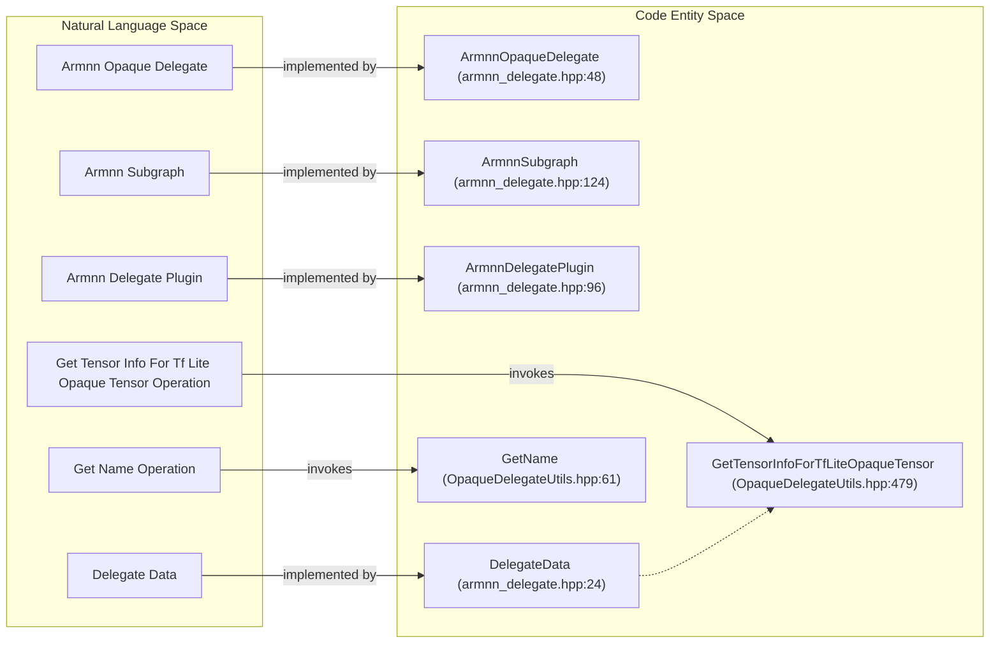
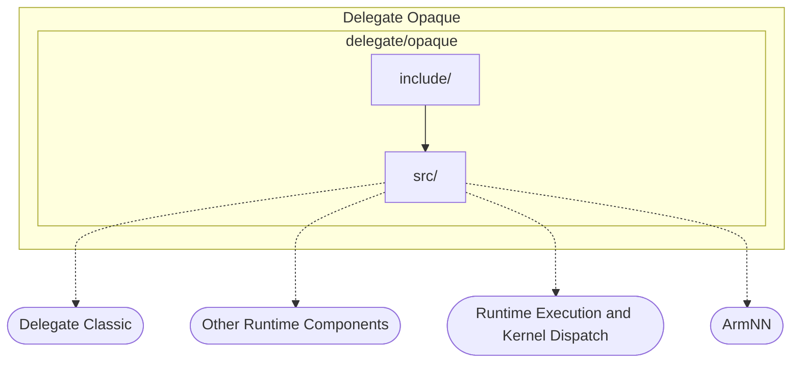
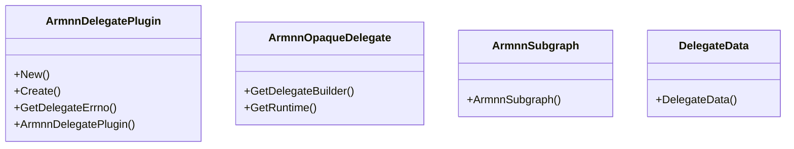
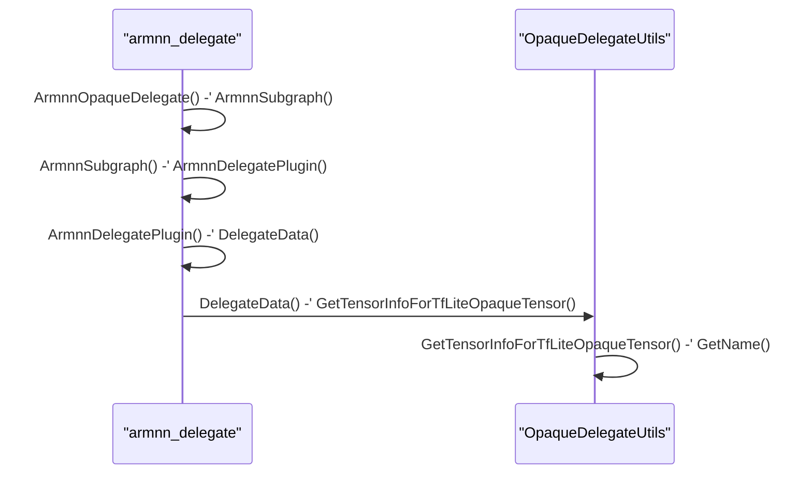

# Delegate Opaque

↑ [[5-runtime-execution-and-kernel-dispatch|Runtime Execution and Kernel Dispatch]]

> Delegate Opaque subsystem (`delegate/opaque`), covering 28 files and 128 symbols. Key symbols include `GetTensorInfoForTfLiteOpaqueTensor`, `GetName`, `ValidateNumOutputs`, `IsValid`.

<details>
<summary>Relevant source files</summary>

The following files were used as context for generating this wiki page:

- [delegate/opaque/src/OpaqueDelegateUtils.hpp](delegate/opaque/src/OpaqueDelegateUtils.hpp)
- [delegate/opaque/include/armnn_delegate.hpp](delegate/opaque/include/armnn_delegate.hpp)
- [delegate/opaque/src/Convolution.hpp](delegate/opaque/src/Convolution.hpp)
- [delegate/opaque/src/ElementwiseBinary.hpp](delegate/opaque/src/ElementwiseBinary.hpp)
- [delegate/opaque/src/armnn_delegate.cpp](delegate/opaque/src/armnn_delegate.cpp)
- [delegate/opaque/src/Control.hpp](delegate/opaque/src/Control.hpp)
- [delegate/opaque/src/Activation.hpp](delegate/opaque/src/Activation.hpp)
- [delegate/opaque/src/BatchSpace.hpp](delegate/opaque/src/BatchSpace.hpp)
- [delegate/opaque/src/ArgMinMax.hpp](delegate/opaque/src/ArgMinMax.hpp)
- [delegate/opaque/src/BatchMatMul.hpp](delegate/opaque/src/BatchMatMul.hpp)
- [delegate/opaque/src/BroadcastTo.hpp](delegate/opaque/src/BroadcastTo.hpp)
- [delegate/opaque/src/Comparison.hpp](delegate/opaque/src/Comparison.hpp)
- [delegate/opaque/src/Redefine.hpp](delegate/opaque/src/Redefine.hpp)
- [delegate/opaque/src/FullyConnected.hpp](delegate/opaque/src/FullyConnected.hpp)
- [delegate/opaque/src/ElementwiseUnary.hpp](delegate/opaque/src/ElementwiseUnary.hpp)
- [delegate/opaque/src/Fill.hpp](delegate/opaque/src/Fill.hpp)
- [delegate/opaque/src/Gather.hpp](delegate/opaque/src/Gather.hpp)
- [delegate/opaque/src/LogicalBinary.hpp](delegate/opaque/src/LogicalBinary.hpp)
- [delegate/opaque/src/Normalization.hpp](delegate/opaque/src/Normalization.hpp)
- [delegate/opaque/src/Pooling.hpp](delegate/opaque/src/Pooling.hpp)
- [delegate/opaque/src/GatherNd.hpp](delegate/opaque/src/GatherNd.hpp)
- [delegate/opaque/src/Lstm.hpp](delegate/opaque/src/Lstm.hpp)
- [delegate/opaque/src/Quantization.hpp](delegate/opaque/src/Quantization.hpp)
- [delegate/opaque/src/Pack.hpp](delegate/opaque/src/Pack.hpp)
- [delegate/opaque/src/Pad.hpp](delegate/opaque/src/Pad.hpp)
- [delegate/opaque/src/Prelu.hpp](delegate/opaque/src/Prelu.hpp)
- [delegate/opaque/src/SharedFunctions.cpp](delegate/opaque/src/SharedFunctions.cpp)
- [delegate/opaque/src/Split.hpp](delegate/opaque/src/Split.hpp)

</details>

## Purpose and Scope

Delegate Opaque subsystem (`delegate/opaque`), covering 28 files and 128 symbols. Key symbols include `GetTensorInfoForTfLiteOpaqueTensor`, `GetName`, `ValidateNumOutputs`, `IsValid`.

Primary code entities analyzed on this page include `ArmnnOpaqueDelegate` ([delegate/opaque/include/armnn_delegate.hpp:48-86]()), `ArmnnSubgraph` ([delegate/opaque/include/armnn_delegate.hpp:124-167]()), `ArmnnDelegatePlugin` ([delegate/opaque/include/armnn_delegate.hpp:96-121]()), `DelegateData` ([delegate/opaque/include/armnn_delegate.hpp:24-34]()), `GetTensorInfoForTfLiteOpaqueTensor` ([delegate/opaque/src/OpaqueDelegateUtils.hpp:479-590]()).

For the parent architectural layer, see [[5-runtime-execution-and-kernel-dispatch|Runtime Execution and Kernel Dispatch]]. Related sibling subsystems: [[5.1-armnn|ArmNN]], [[5.2-armnn|ArmNN]], [[5.4-delegate-classic|Delegate Classic]], [[5.5-armnnutils|Armnnutils]].

Sources: [delegate/opaque/include/armnn_delegate.hpp:48-86](), [delegate/opaque/include/armnn_delegate.hpp:124-167](), [delegate/opaque/include/armnn_delegate.hpp:96-121](), [delegate/opaque/include/armnn_delegate.hpp:24-34]()

---

## 1. High-Level Architecture and Data Flow

### Natural Language Space to Code Entity Space Mapping

The following diagram maps domain concepts in this subsystem to their concrete code entities:



### Subsystem Component & Dependency Flow



Cross-subsystem call and import edges connect **Delegate Opaque** with [[7-glossary|Glossary]] (coupling `240.0`), [[5-runtime-execution-and-kernel-dispatch|Runtime Execution and Kernel Dispatch]] (coupling `192.0`), [[5.2-armnn|ArmNN]] (coupling `119.0`), [[2-build-system-and-infrastructure|Build System and Infrastructure]] (coupling `86.0`), [[2.1-build-infrastructure|Build Infrastructure]] (coupling `86.0`).

| Module Directory | Files | Primary Code Entities | Source Citations |
|---|---|---|---|
| `delegate/opaque/src` | 27 | `GetTensorInfoForTfLiteOpaqueTensor`, `GetName`, `Connect`, `ValidateNumOutputs` | [delegate/opaque/src/OpaqueDelegateUtils.hpp:479-590]() [delegate/opaque/src/OpaqueDelegateUtils.hpp:61-64]() |
| `delegate/opaque/include` | 1 | `ArmnnOpaqueDelegate`, `ArmnnSubgraph`, `ArmnnDelegatePlugin`, `DelegateData` | [delegate/opaque/include/armnn_delegate.hpp:48-86]() [delegate/opaque/include/armnn_delegate.hpp:124-167]() |

Sources: [delegate/opaque/include/armnn_delegate.hpp:48-86](), [delegate/opaque/include/armnn_delegate.hpp:124-167](), [delegate/opaque/include/armnn_delegate.hpp:96-121](), [delegate/opaque/include/armnn_delegate.hpp:24-34](), [delegate/opaque/src/OpaqueDelegateUtils.hpp:479-590]()

---

## 2. Core Data Structures and Implementation Details

### Class and Entity Relationship Diagram



### `ArmnnOpaqueDelegate` (Class)

- **Source Location**: [delegate/opaque/include/armnn_delegate.hpp:48-86]()
- **Declaration**: `Class ArmnnOpaqueDelegate`
- **Graph Centrality**: fan-in `0` callers, fan-out `0` callees
- **Responsibility**: /// ArmNN Opaque Delegate

```cpp
// delegate/opaque/include/armnn_delegate.hpp:48-63
class ArmnnOpaqueDelegate
{
    friend class ArmnnSubgraph;
public:
    explicit ArmnnOpaqueDelegate(armnnDelegate::DelegateOptions options);

    TfLiteIntArray* IdentifyOperatorsToDelegate(TfLiteOpaqueContext* context);

    TfLiteOpaqueDelegateBuilder* GetDelegateBuilder() { return &m_Builder; }

    /// Retrieve version in X.Y.Z form
    static const std::string GetVersion();

private:
    /**
     * Returns a pointer to the armnn::IRuntime* this will be shared by all armnn_delegates.
```

### `ArmnnSubgraph` (Class)

- **Source Location**: [delegate/opaque/include/armnn_delegate.hpp:124-167]()
- **Declaration**: `Class ArmnnSubgraph`
- **Graph Centrality**: fan-in `0` callers, fan-out `0` callees
- **Responsibility**: /// ArmnnSubgraph class where parsing the nodes to ArmNN format and creating the ArmNN Graph

```cpp
// delegate/opaque/include/armnn_delegate.hpp:124-139
class ArmnnSubgraph
{
public:
    static ArmnnSubgraph* Create(TfLiteOpaqueContext* tfLiteContext,
                                 const TfLiteOpaqueDelegateParams* parameters,
                                 const ArmnnOpaqueDelegate* delegate);

    ~ArmnnSubgraph();

    TfLiteStatus Prepare(TfLiteOpaqueContext* tfLiteContext);

    TfLiteStatus Invoke(TfLiteOpaqueContext* tfLiteContext, TfLiteOpaqueNode* tfLiteNode);

    static TfLiteStatus VisitNode(DelegateData& delegateData,
                                  TfLiteOpaqueContext* tfLiteContext,
                                  TfLiteRegistrationExternal* tfLiteRegistration,
```

### `ArmnnDelegatePlugin` (Class)

- **Source Location**: [delegate/opaque/include/armnn_delegate.hpp:96-121]()
- **Declaration**: `Class ArmnnDelegatePlugin`
- **Graph Centrality**: fan-in `0` callers, fan-out `0` callees

```cpp
// delegate/opaque/include/armnn_delegate.hpp:96-111
class ArmnnDelegatePlugin : public DelegatePluginInterface
{
public:
    static std::unique_ptr<ArmnnDelegatePlugin> New(const tflite::TFLiteSettings& tfliteSettings)
    {
        return std::make_unique<ArmnnDelegatePlugin>(tfliteSettings);
    }

    tflite::delegates::TfLiteDelegatePtr Create() override
    {
        return tflite::delegates::TfLiteDelegatePtr(TfLiteArmnnOpaqueDelegateCreate(m_delegateOptions),
                                                    TfLiteArmnnOpaqueDelegateDelete);
    }

    int GetDelegateErrno(TfLiteOpaqueDelegate* from_delegate) override
    {
```

### `DelegateData` (Class)

- **Source Location**: [delegate/opaque/include/armnn_delegate.hpp:24-34]()
- **Declaration**: `Class DelegateData`
- **Graph Centrality**: fan-in `0` callers, fan-out `0` callees

### `GetTensorInfoForTfLiteOpaqueTensor` (Function)

- **Source Location**: [delegate/opaque/src/OpaqueDelegateUtils.hpp:479-590]()
- **Declaration**: `(const TfLiteOpaqueTensor* tfLiteTensor, bool isOutput = false)`
- **Graph Centrality**: fan-in `55` callers, fan-out `12` callees

### `GetName` (Function)

- **Source Location**: [delegate/opaque/src/OpaqueDelegateUtils.hpp:61-64]()
- **Declaration**: `(armnn::LayerType layerType, int nodeIndex, std::string subname = \"\")`
- **Graph Centrality**: fan-in `52` callers, fan-out `8` callees

Sources: [delegate/opaque/include/armnn_delegate.hpp:48-86](), [delegate/opaque/include/armnn_delegate.hpp:124-167](), [delegate/opaque/include/armnn_delegate.hpp:96-121](), [delegate/opaque/include/armnn_delegate.hpp:24-34](), [delegate/opaque/src/OpaqueDelegateUtils.hpp:479-590]()

---

## 3. Execution and Call Flow

The sequence diagram below traces the runtime/compile-time call chain across components in this module:



Sources: [delegate/opaque/include/armnn_delegate.hpp:48-86](), [delegate/opaque/include/armnn_delegate.hpp:124-167](), [delegate/opaque/include/armnn_delegate.hpp:96-121](), [delegate/opaque/include/armnn_delegate.hpp:24-34](), [delegate/opaque/src/OpaqueDelegateUtils.hpp:479-590]()

---

## 4. Key API and Symbol Reference

| Code Entity | Kind | Location | Fan-In / Out | Role & Signature |
|---|---|---|---|---|
| `ArmnnOpaqueDelegate` | Class | [delegate/opaque/include/armnn_delegate.hpp:48-86]() | `0` / `0` | /// ArmNN Opaque Delegate |
| `ArmnnSubgraph` | Class | [delegate/opaque/include/armnn_delegate.hpp:124-167]() | `0` / `0` | /// ArmnnSubgraph class where parsing the nodes to ArmNN format and creating the ArmNN Graph |
| `ArmnnDelegatePlugin` | Class | [delegate/opaque/include/armnn_delegate.hpp:96-121]() | `0` / `0` | — |
| `DelegateData` | Class | [delegate/opaque/include/armnn_delegate.hpp:24-34]() | `0` / `0` | — |
| `GetTensorInfoForTfLiteOpaqueTensor` | Function | [delegate/opaque/src/OpaqueDelegateUtils.hpp:479-590]() | `55` / `12` | (const TfLiteOpaqueTensor* tfLiteTensor, bool isOutput = false) |
| `GetName` | Function | [delegate/opaque/src/OpaqueDelegateUtils.hpp:61-64]() | `52` / `8` | (armnn::LayerType layerType, int nodeIndex, std::string subname = \"\") |
| `Connect` | Function | [delegate/opaque/src/OpaqueDelegateUtils.hpp:205-258]() | `47` / `0` | // Connects the layer to the graph |
| `ValidateNumOutputs` | Function | [delegate/opaque/src/OpaqueDelegateUtils.hpp:129-143]() | `49` / `0` | (TfLiteOpaqueContext* tfLiteContext, TfLiteOpaqueNode* tfLiteNode, const unsigned int expectedSize, int nodeIn |
| `IsValid` | Function | [delegate/opaque/src/OpaqueDelegateUtils.hpp:170-192]() | `48` / `1` | (TfLiteOpaqueContext* tfLiteContext, const TfLiteOpaqueTensor* tfLiteTensor, int32_t operatorCode, int32_t nod |
| `ProcessInputs` | Function | [delegate/opaque/src/OpaqueDelegateUtils.hpp:637-692]() | `41` / `7` | (armnn::IConnectableLayer* layer, armnnOpaqueDelegate::DelegateData& delegateData, TfLiteOpaqueContext* tfLite |
| `ValidateNumInputs` | Function | [delegate/opaque/src/OpaqueDelegateUtils.hpp:113-127]() | `41` / `0` | (TfLiteOpaqueContext* tfLiteContext, TfLiteOpaqueNode* tfLiteNode, const unsigned int expectedSize, int nodeIn |
| `VisitNode` | Method | [delegate/opaque/src/armnn_delegate.cpp:706-1298]() | `2` / `47` | (DelegateData& delegateData, TfLiteOpaqueContext* tfLiteContext, TfLiteRegistrationExternal* tfLiteRegistratio |
| `VisitElementwiseBinaryOperator` | Function | [delegate/opaque/src/ElementwiseBinary.hpp:291-537]() | `1` / `25` | (DelegateData& delegateData, TfLiteOpaqueContext* tfLiteContext, TfLiteOpaqueNode* tfLiteNode, int nodeIndex, |
| `IsConstantTensor` | Function | [delegate/opaque/src/OpaqueDelegateUtils.hpp:145-153]() | `13` / `0` | (const TfLiteOpaqueTensor* tfLiteTensor) |
| `Create` | Method | [delegate/opaque/src/armnn_delegate.cpp:471-619]() | `1` / `26` | (TfLiteOpaqueContext* tfLiteContext, const TfLiteOpaqueDelegateParams* parameters, const ArmnnOpaqueDelegate* |
| `VisitConv2dOperator` | Function | [delegate/opaque/src/Convolution.hpp:18-246]() | `1` / `23` | (DelegateData& delegateData, TfLiteOpaqueContext* tfLiteContext, TfLiteOpaqueNode* tfLiteNode, int nodeIndex, |
| `VisitTransposeConv2dOperator` | Function | [delegate/opaque/src/Convolution.hpp:687-965]() | `1` / `23` | (DelegateData& delegateData, TfLiteOpaqueContext* tfLiteContext, TfLiteOpaqueNode* tfLiteNode, int nodeIndex, |
| `VisitDepthwiseConv2dOperator` | Function | [delegate/opaque/src/Convolution.hpp:248-469]() | `1` / `22` | (DelegateData& delegateData, TfLiteOpaqueContext* tfLiteContext, TfLiteOpaqueNode* tfLiteNode, int nodeIndex, |
| `FusedActivation` | Function | [delegate/opaque/src/OpaqueDelegateUtils.hpp:260-357]() | `9` / `4` | (TfLiteOpaqueContext* tfLiteContext, TfLiteOpaqueNode* tfLiteNode, TfLiteFusedActivation activationType, armnn |
| `VisitConv3dOperator` | Function | [delegate/opaque/src/Convolution.hpp:471-683]() | `1` / `19` | (DelegateData& delegateData, TfLiteOpaqueContext* tfLiteContext, TfLiteOpaqueNode* tfLiteNode, int nodeIndex, |
| `VisitFullyConnectedOperator` | Function | [delegate/opaque/src/FullyConnected.hpp:14-305]() | `1` / `23` | (DelegateData& delegateData, TfLiteOpaqueContext* tfLiteContext, TfLiteOpaqueNode* tfLiteNode, int nodeIndex, |
| `ArmnnOpaqueDelegate` | Method | [delegate/opaque/src/armnn_delegate.cpp:133-172]() | `1` / `17` | (armnnDelegate::DelegateOptions options) |

Sources: [delegate/opaque/include/armnn_delegate.hpp:48-86](), [delegate/opaque/include/armnn_delegate.hpp:124-167](), [delegate/opaque/include/armnn_delegate.hpp:96-121](), [delegate/opaque/include/armnn_delegate.hpp:24-34](), [delegate/opaque/src/OpaqueDelegateUtils.hpp:479-590](), [delegate/opaque/src/OpaqueDelegateUtils.hpp:61-64]()

---

## 5. Official Documentation and Design Context

The following linked documentation sections from `llm-wiki` (`raw/`) provide additional architectural context, tutorials, and design invariants for this subsystem:

- **Delegate Classic** ([wiki/5.4-delegate-classic.md](), score `104.3637`) (sections: `Delegate Classic`, `Purpose and Scope`, `1. High-Level Architecture and Data Flow`, `Natural Language Space to Code Entity Space Mapping`): # Delegate Classic ↑ [[5-runtime-execution-and-kernel-dispatch|Runtime Execution and Kernel Dispatch]] > Delegate Classic subsystem (`delegate/classic`), covering 28 files and 114 symbols. Key symbols include `GetTensorInfoForTfLiteTensor`, `GetLayerName`, `Connect`, `ValidateNumOutputs`. <details> <summary>Relevant source files</summary> The following files were used as context for generating this wiki page: - [dele
- **ArmNN DeepWiki** ([wiki/index.md](), score `90.9353`) (sections: `ArmNN DeepWiki`, `Pages`): # ArmNN DeepWiki Generated from `home-jason-Project-deepwiki-armnn` at commit `2b61cecc9df7` (2026-11-14T15:13:53+00:00). ## Pages - [[1-overview|Overview]] — End-to-end architecture overview of ArmNN: core subsystems, compilation/execution pipeline, entry points, and cross-module dependencies. - [[2-build-system-and-infrastructure|Build System and Infrastructure]] — Architectural overview of Build System and Infrast
- **Runtime Execution and Kernel Dispatch** ([wiki/5-runtime-execution-and-kernel-dispatch.md](), score `85.2801`) (sections: `Runtime Execution and Kernel Dispatch`, `Purpose and Scope`, `System Mapping: Natural Language Space to Code Entity Space`, `1. ArmNN`): # Runtime Execution and Kernel Dispatch > Architectural overview of Runtime Execution and Kernel Dispatch, spanning 157 source files and 3718 code symbols across 6 subsystems. <details> <summary>Relevant source files</summary> The following files were used as context for generating this wiki page: - [samples/common/include/Audio/DataStructures.hpp](samples/common/include/Audio/DataStructures.hpp) - [src/armnn/Tensor.
- **Overview** ([wiki/1-overview.md](), score `64.6376`) (sections: `Overview`, `1. Architecture Overview & System Component Map`, `Core Concept to Code Entity Mapping`, `Core Compilation & Runtime Class Hierarchy`): # Overview > End-to-end architecture overview of ArmNN: core subsystems, compilation/execution pipeline, entry points, and cross-module dependencies. <details> <summary>Relevant source files</summary> The following files were used as context for generating this wiki page: - [src/armnn/Tensor.cpp](src/armnn/Tensor.cpp) - [include/armnn/Exceptions.hpp](include/armnn/Exceptions.hpp) - [include/armnn/Tensor.hpp](include/

Sources: [wiki/5.4-delegate-classic.md](), [wiki/index.md](), [wiki/5-runtime-execution-and-kernel-dispatch.md](), [wiki/1-overview.md]()

## Related pages

- [[5-runtime-execution-and-kernel-dispatch|Runtime Execution and Kernel Dispatch]]
- [[3-backend-delegation-and-hardware-providers|Backend Delegation and Hardware Providers]]
- [[3.1-backends-backendscommon|Backends Backendscommon]]
- [[3.2-backends-reference|Backends Reference]]
- [[3.3-backends-opencl|Backends OpenCL]]
- [[3.4-backends-aclcommon|Backends Aclcommon]]
- [[3.6-other-backends|Other Backends]]
- [[5.2-armnn|ArmNN]]

## Related documents

- `wiki/5.4-delegate-classic.md` — Delegate Classic (score 104.3637, via bm25)
- `wiki/index.md` — ArmNN DeepWiki (score 90.9353, via bm25)
- `wiki/5-runtime-execution-and-kernel-dispatch.md` — Runtime Execution and Kernel Dispatch (score 85.2801, via bm25)
- `wiki/1-overview.md` — Overview (score 64.6376, via bm25)
- `wiki/5.1-armnn.md` — ArmNN (score 55.6606, via bm25)

## Sources

- [`delegate/opaque/src/OpaqueDelegateUtils.hpp`](https://github.com/ARM-software/armnn/blob/branches/armnn_24_11/delegate/opaque/src/OpaqueDelegateUtils.hpp)
- [`delegate/opaque/include/armnn_delegate.hpp`](https://github.com/ARM-software/armnn/blob/branches/armnn_24_11/delegate/opaque/include/armnn_delegate.hpp)
- [`delegate/opaque/src/Convolution.hpp`](https://github.com/ARM-software/armnn/blob/branches/armnn_24_11/delegate/opaque/src/Convolution.hpp)
- [`delegate/opaque/src/ElementwiseBinary.hpp`](https://github.com/ARM-software/armnn/blob/branches/armnn_24_11/delegate/opaque/src/ElementwiseBinary.hpp)
- [`delegate/opaque/src/armnn_delegate.cpp`](https://github.com/ARM-software/armnn/blob/branches/armnn_24_11/delegate/opaque/src/armnn_delegate.cpp)
- [`delegate/opaque/src/Control.hpp`](https://github.com/ARM-software/armnn/blob/branches/armnn_24_11/delegate/opaque/src/Control.hpp)
- [`delegate/opaque/src/Activation.hpp`](https://github.com/ARM-software/armnn/blob/branches/armnn_24_11/delegate/opaque/src/Activation.hpp)
- [`delegate/opaque/src/BatchSpace.hpp`](https://github.com/ARM-software/armnn/blob/branches/armnn_24_11/delegate/opaque/src/BatchSpace.hpp)
- [`delegate/opaque/src/ArgMinMax.hpp`](https://github.com/ARM-software/armnn/blob/branches/armnn_24_11/delegate/opaque/src/ArgMinMax.hpp)
- [`delegate/opaque/src/BatchMatMul.hpp`](https://github.com/ARM-software/armnn/blob/branches/armnn_24_11/delegate/opaque/src/BatchMatMul.hpp)
- [`delegate/opaque/src/BroadcastTo.hpp`](https://github.com/ARM-software/armnn/blob/branches/armnn_24_11/delegate/opaque/src/BroadcastTo.hpp)
- [`delegate/opaque/src/Comparison.hpp`](https://github.com/ARM-software/armnn/blob/branches/armnn_24_11/delegate/opaque/src/Comparison.hpp)
- [`delegate/opaque/src/Redefine.hpp`](https://github.com/ARM-software/armnn/blob/branches/armnn_24_11/delegate/opaque/src/Redefine.hpp)
- [`delegate/opaque/src/FullyConnected.hpp`](https://github.com/ARM-software/armnn/blob/branches/armnn_24_11/delegate/opaque/src/FullyConnected.hpp)
- [`delegate/opaque/src/ElementwiseUnary.hpp`](https://github.com/ARM-software/armnn/blob/branches/armnn_24_11/delegate/opaque/src/ElementwiseUnary.hpp)
- [`delegate/opaque/src/Fill.hpp`](https://github.com/ARM-software/armnn/blob/branches/armnn_24_11/delegate/opaque/src/Fill.hpp)
- [`delegate/opaque/src/Gather.hpp`](https://github.com/ARM-software/armnn/blob/branches/armnn_24_11/delegate/opaque/src/Gather.hpp)
- [`delegate/opaque/src/LogicalBinary.hpp`](https://github.com/ARM-software/armnn/blob/branches/armnn_24_11/delegate/opaque/src/LogicalBinary.hpp)
- [`delegate/opaque/src/Normalization.hpp`](https://github.com/ARM-software/armnn/blob/branches/armnn_24_11/delegate/opaque/src/Normalization.hpp)
- [`delegate/opaque/src/Pooling.hpp`](https://github.com/ARM-software/armnn/blob/branches/armnn_24_11/delegate/opaque/src/Pooling.hpp)
- [`delegate/opaque/src/GatherNd.hpp`](https://github.com/ARM-software/armnn/blob/branches/armnn_24_11/delegate/opaque/src/GatherNd.hpp)
- [`delegate/opaque/src/Lstm.hpp`](https://github.com/ARM-software/armnn/blob/branches/armnn_24_11/delegate/opaque/src/Lstm.hpp)
- [`delegate/opaque/src/Quantization.hpp`](https://github.com/ARM-software/armnn/blob/branches/armnn_24_11/delegate/opaque/src/Quantization.hpp)
- [`delegate/opaque/src/Pack.hpp`](https://github.com/ARM-software/armnn/blob/branches/armnn_24_11/delegate/opaque/src/Pack.hpp)
- [`delegate/opaque/src/Pad.hpp`](https://github.com/ARM-software/armnn/blob/branches/armnn_24_11/delegate/opaque/src/Pad.hpp)
- [`delegate/opaque/src/Prelu.hpp`](https://github.com/ARM-software/armnn/blob/branches/armnn_24_11/delegate/opaque/src/Prelu.hpp)
- [`delegate/opaque/src/SharedFunctions.cpp`](https://github.com/ARM-software/armnn/blob/branches/armnn_24_11/delegate/opaque/src/SharedFunctions.cpp)
- [`delegate/opaque/src/Split.hpp`](https://github.com/ARM-software/armnn/blob/branches/armnn_24_11/delegate/opaque/src/Split.hpp)


## Dynamic Knowledge Links (Code Graph ↔ LLM-Wiki / RAG)

### Linked Architecture & Design Documents

| Document | Match Channel | Score | Shared Code Symbols |
|---|---|---|---|
| [[5.4-delegate-classic|Delegate Classic]] | `bm25+entity(11)` | `120.864` | `ArmnnSubgraph`, `Connect`, `FusedActivation`, `GetRuntime`, `GetTensorInfoForTfLiteOpaqueTensor` |
| [[index|ArmNN DeepWiki]] | `bm25+entity(4)` | `96.935` | `Connect`, `GetTensorInfoForTfLiteOpaqueTensor`, `ValidateNumInputs`, `ValidateNumOutputs` |
| [[5-runtime-execution-and-kernel-dispatch|Runtime Execution and Kernel Dispatch]] | `bm25+entity(4)` | `91.28` | `Connect`, `GetTensorInfoForTfLiteOpaqueTensor`, `IsValid`, `ValidateNumOutputs` |
| [[1-overview|Overview]] | `bm25+entity(2)` | `67.638` | `Connect`, `GetTensorInfoForTfLiteOpaqueTensor` |
| [[5.1-armnn|ArmNN]] | `bm25+entity(1)` | `57.161` | `Connect` |
| [[5.2-armnn|ArmNN]] | `wikilink:5.3-delegate-opaque` | `55.605` | *(lexical/graph match)* |

### High-Centrality Bridge Symbols (CBM Graph)

| Symbol | Kind | Source Location | Fan-In / Fan-Out |
|---|---|---|---|
| `ArmnnOpaqueDelegate` | Class | [delegate/opaque/include/armnn_delegate.hpp:48-86]() | in: `0` / out: `0` |
| `ArmnnSubgraph` | Class | [delegate/opaque/include/armnn_delegate.hpp:124-167]() | in: `0` / out: `0` |
| `ArmnnDelegatePlugin` | Class | [delegate/opaque/include/armnn_delegate.hpp:96-121]() | in: `0` / out: `0` |
| `DelegateData` | Class | [delegate/opaque/include/armnn_delegate.hpp:24-34]() | in: `0` / out: `0` |
| `GetTensorInfoForTfLiteOpaqueTensor` | Function | [delegate/opaque/src/OpaqueDelegateUtils.hpp:479-590]() | in: `55` / out: `12` |
| `GetName` | Function | [delegate/opaque/src/OpaqueDelegateUtils.hpp:61-64]() | in: `52` / out: `8` |

Sources: [delegate/opaque/include/armnn_delegate.hpp:48-86](), [delegate/opaque/include/armnn_delegate.hpp:124-167](), [delegate/opaque/include/armnn_delegate.hpp:96-121](), [delegate/opaque/include/armnn_delegate.hpp:24-34]()

### Cross-Subsystem Coupling

- [[7-glossary|Glossary]] — call/import coupling weight `240.0`
- [[5-runtime-execution-and-kernel-dispatch|Runtime Execution and Kernel Dispatch]] — call/import coupling weight `192.0`
- [[5.2-armnn|ArmNN]] — call/import coupling weight `119.0`
- [[2-build-system-and-infrastructure|Build System and Infrastructure]] — call/import coupling weight `86.0`
- [[2.1-build-infrastructure|Build Infrastructure]] — call/import coupling weight `86.0`
- [[5.1-armnn|ArmNN]] — call/import coupling weight `77.0`
