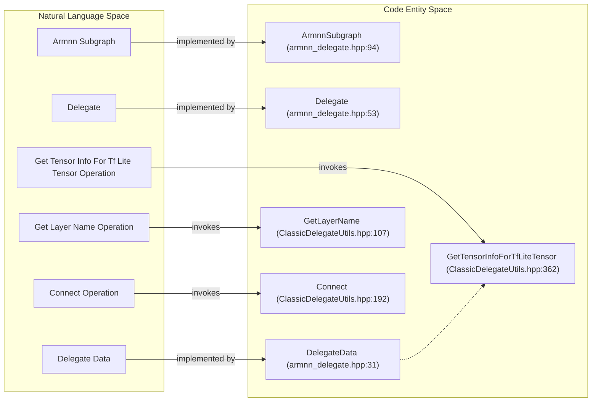
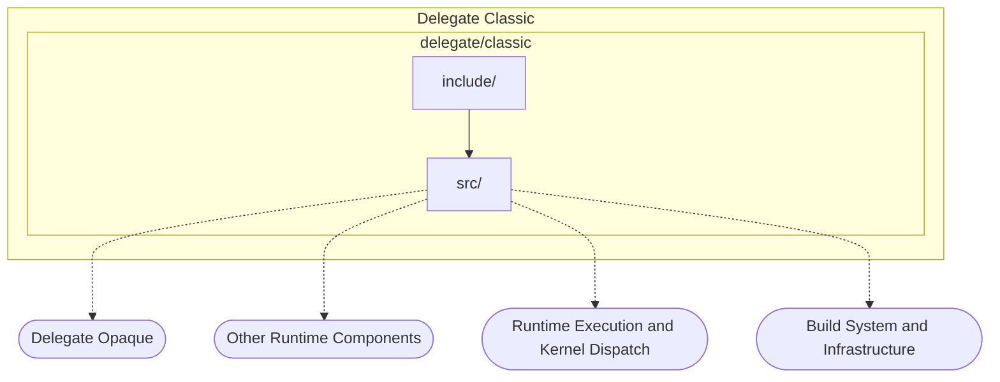
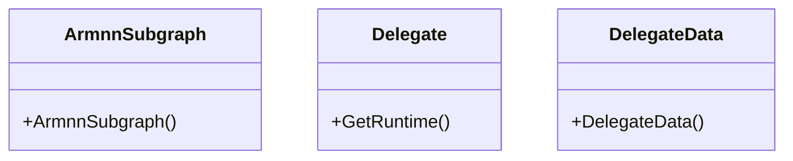
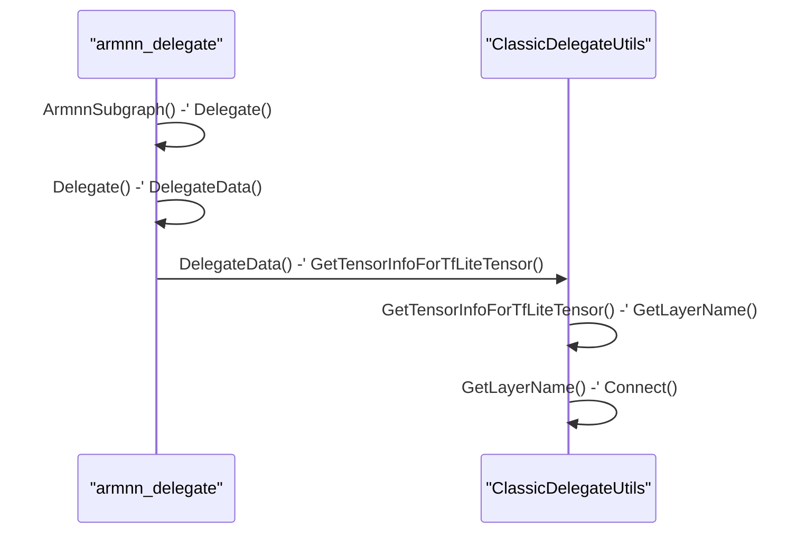

# Delegate Classic

↑ [[5-runtime-execution-and-kernel-dispatch|Runtime Execution and Kernel Dispatch]]

> Delegate Classic subsystem (`delegate/classic`), covering 28 files and 114 symbols. Key symbols include `GetTensorInfoForTfLiteTensor`, `GetLayerName`, `Connect`, `ValidateNumOutputs`.

<details>
<summary>Relevant source files</summary>

The following files were used as context for generating this wiki page:

- [delegate/classic/src/ClassicDelegateUtils.hpp](delegate/classic/src/ClassicDelegateUtils.hpp)
- [delegate/classic/src/Convolution.hpp](delegate/classic/src/Convolution.hpp)
- [delegate/classic/src/armnn_delegate.cpp](delegate/classic/src/armnn_delegate.cpp)
- [delegate/classic/include/armnn_delegate.hpp](delegate/classic/include/armnn_delegate.hpp)
- [delegate/classic/src/ElementwiseBinary.hpp](delegate/classic/src/ElementwiseBinary.hpp)
- [delegate/classic/src/Control.hpp](delegate/classic/src/Control.hpp)
- [delegate/classic/src/BatchSpace.hpp](delegate/classic/src/BatchSpace.hpp)
- [delegate/classic/src/Activation.hpp](delegate/classic/src/Activation.hpp)
- [delegate/classic/src/ArgMinMax.hpp](delegate/classic/src/ArgMinMax.hpp)
- [delegate/classic/src/BroadcastTo.hpp](delegate/classic/src/BroadcastTo.hpp)
- [delegate/classic/src/BatchMatMul.hpp](delegate/classic/src/BatchMatMul.hpp)
- [delegate/classic/src/Redefine.hpp](delegate/classic/src/Redefine.hpp)
- [delegate/classic/src/Comparison.hpp](delegate/classic/src/Comparison.hpp)
- [delegate/classic/src/FullyConnected.hpp](delegate/classic/src/FullyConnected.hpp)
- [delegate/classic/src/ElementwiseUnary.hpp](delegate/classic/src/ElementwiseUnary.hpp)
- [delegate/classic/src/Fill.hpp](delegate/classic/src/Fill.hpp)
- [delegate/classic/src/Pooling.hpp](delegate/classic/src/Pooling.hpp)
- [delegate/classic/src/Gather.hpp](delegate/classic/src/Gather.hpp)
- [delegate/classic/src/Normalization.hpp](delegate/classic/src/Normalization.hpp)
- [delegate/classic/src/GatherNd.hpp](delegate/classic/src/GatherNd.hpp)
- [delegate/classic/src/LogicalBinary.hpp](delegate/classic/src/LogicalBinary.hpp)
- [delegate/classic/src/Lstm.hpp](delegate/classic/src/Lstm.hpp)
- [delegate/classic/src/Quantization.hpp](delegate/classic/src/Quantization.hpp)
- [delegate/classic/src/Pack.hpp](delegate/classic/src/Pack.hpp)
- [delegate/classic/src/Pad.hpp](delegate/classic/src/Pad.hpp)
- [delegate/classic/src/Prelu.hpp](delegate/classic/src/Prelu.hpp)
- [delegate/classic/src/SharedFunctions.cpp](delegate/classic/src/SharedFunctions.cpp)
- [delegate/classic/src/Reduce.hpp](delegate/classic/src/Reduce.hpp)

</details>

## Purpose and Scope

Delegate Classic subsystem (`delegate/classic`), covering 28 files and 114 symbols. Key symbols include `GetTensorInfoForTfLiteTensor`, `GetLayerName`, `Connect`, `ValidateNumOutputs`.

Primary code entities analyzed on this page include `ArmnnSubgraph` ([delegate/classic/include/armnn_delegate.hpp:94-141]()), `Delegate` ([delegate/classic/include/armnn_delegate.hpp:53-91]()), `DelegateData` ([delegate/classic/include/armnn_delegate.hpp:31-41]()), `GetTensorInfoForTfLiteTensor` ([delegate/classic/src/ClassicDelegateUtils.hpp:362-466]()), `GetLayerName` ([delegate/classic/src/ClassicDelegateUtils.hpp:107-110]()).

For the parent architectural layer, see [[5-runtime-execution-and-kernel-dispatch|Runtime Execution and Kernel Dispatch]]. Related sibling subsystems: [[5.1-armnn|ArmNN]], [[5.2-armnn|ArmNN]], [[5.3-delegate-opaque|Delegate Opaque]], [[5.5-armnnutils|Armnnutils]].

Sources: [delegate/classic/include/armnn_delegate.hpp:94-141](), [delegate/classic/include/armnn_delegate.hpp:53-91](), [delegate/classic/include/armnn_delegate.hpp:31-41](), [delegate/classic/src/ClassicDelegateUtils.hpp:362-466]()

---

## 1. High-Level Architecture and Data Flow

### Natural Language Space to Code Entity Space Mapping

The following diagram maps domain concepts in this subsystem to their concrete code entities:



### Subsystem Component & Dependency Flow



Cross-subsystem call and import edges connect **Delegate Classic** with [[7-glossary|Glossary]] (coupling `219.0`), [[5-runtime-execution-and-kernel-dispatch|Runtime Execution and Kernel Dispatch]] (coupling `193.0`), [[5.2-armnn|ArmNN]] (coupling `115.0`), [[2-build-system-and-infrastructure|Build System and Infrastructure]] (coupling `90.0`), [[2.1-build-infrastructure|Build Infrastructure]] (coupling `90.0`).

| Module Directory | Files | Primary Code Entities | Source Citations |
|---|---|---|---|
| `delegate/classic/src` | 27 | `GetTensorInfoForTfLiteTensor`, `GetLayerName`, `Connect`, `ValidateNumOutputs` | [delegate/classic/src/ClassicDelegateUtils.hpp:362-466]() [delegate/classic/src/ClassicDelegateUtils.hpp:107-110]() |
| `delegate/classic/include` | 1 | `ArmnnSubgraph`, `Delegate`, `DelegateData`, `GetRuntime` | [delegate/classic/include/armnn_delegate.hpp:94-141]() [delegate/classic/include/armnn_delegate.hpp:53-91]() |

Sources: [delegate/classic/include/armnn_delegate.hpp:94-141](), [delegate/classic/include/armnn_delegate.hpp:53-91](), [delegate/classic/include/armnn_delegate.hpp:31-41](), [delegate/classic/src/ClassicDelegateUtils.hpp:362-466](), [delegate/classic/src/ClassicDelegateUtils.hpp:107-110]()

---

## 2. Core Data Structures and Implementation Details

### Class and Entity Relationship Diagram



### `ArmnnSubgraph` (Class)

- **Source Location**: [delegate/classic/include/armnn_delegate.hpp:94-141]()
- **Declaration**: `Class ArmnnSubgraph`
- **Graph Centrality**: fan-in `0` callers, fan-out `0` callees
- **Responsibility**: /// ArmnnSubgraph class where parsing the nodes to ArmNN format and creating the ArmNN Graph

```cpp
// delegate/classic/include/armnn_delegate.hpp:94-109
class ArmnnSubgraph
{
public:
    static ArmnnSubgraph* Create(TfLiteContext* tfLiteContext,
                                 const TfLiteDelegateParams* parameters,
                                 const Delegate* delegate);

    ~ArmnnSubgraph();

    TfLiteStatus Prepare(TfLiteContext* tfLiteContext);

    TfLiteStatus Invoke(TfLiteContext* tfLiteContext, TfLiteNode* tfLiteNode);

    static TfLiteStatus VisitNode(DelegateData& delegateData,
                                  TfLiteContext* tfLiteContext,
                                  TfLiteRegistration* tfLiteRegistration,
```

### `Delegate` (Class)

- **Source Location**: [delegate/classic/include/armnn_delegate.hpp:53-91]()
- **Declaration**: `Class Delegate`
- **Graph Centrality**: fan-in `0` callers, fan-out `0` callees
- **Responsibility**: /// ArmNN Delegate

```cpp
// delegate/classic/include/armnn_delegate.hpp:53-68
class Delegate
{
    friend class ArmnnSubgraph;
public:
    explicit Delegate(armnnDelegate::DelegateOptions options);

    TfLiteIntArray* IdentifyOperatorsToDelegate(TfLiteContext* context);

    TfLiteDelegate* GetDelegate();

    /// Retrieve version in X.Y.Z form
    static const std::string GetVersion();

private:
    /**
     * Returns a pointer to the armnn::IRuntime* this will be shared by all armnn_delegates.
```

### `DelegateData` (Class)

- **Source Location**: [delegate/classic/include/armnn_delegate.hpp:31-41]()
- **Declaration**: `Class DelegateData`
- **Graph Centrality**: fan-in `0` callers, fan-out `0` callees

```cpp
// delegate/classic/include/armnn_delegate.hpp:31-41
struct DelegateData
{
    DelegateData(const std::vector<armnn::BackendId>& backends)
            : m_Backends(backends)
            , m_Network(nullptr, nullptr)
    {}

    const std::vector<armnn::BackendId>       m_Backends;
    armnn::INetworkPtr                        m_Network;
    std::vector<armnn::IOutputSlot*>          m_OutputSlotForNode;
};
```

### `GetTensorInfoForTfLiteTensor` (Function)

- **Source Location**: [delegate/classic/src/ClassicDelegateUtils.hpp:362-466]()
- **Declaration**: `(const TfLiteTensor& tfLiteTensor, bool isOutput = false)`
- **Graph Centrality**: fan-in `55` callers, fan-out `12` callees

### `GetLayerName` (Function)

- **Source Location**: [delegate/classic/src/ClassicDelegateUtils.hpp:107-110]()
- **Declaration**: `(armnn::LayerType layerType, int nodeIndex, std::string name = \"\")`
- **Graph Centrality**: fan-in `51` callers, fan-out `8` callees

### `Connect` (Function)

- **Source Location**: [delegate/classic/src/ClassicDelegateUtils.hpp:192-218]()
- **Declaration**: `(armnn::IConnectableLayer* layer, TfLiteNode* tfLiteNode, armnnDelegate::DelegateData& data)`
- **Graph Centrality**: fan-in `50` callers, fan-out `0` callees

Sources: [delegate/classic/include/armnn_delegate.hpp:94-141](), [delegate/classic/include/armnn_delegate.hpp:53-91](), [delegate/classic/include/armnn_delegate.hpp:31-41](), [delegate/classic/src/ClassicDelegateUtils.hpp:362-466](), [delegate/classic/src/ClassicDelegateUtils.hpp:107-110]()

---

## 3. Execution and Call Flow

The sequence diagram below traces the runtime/compile-time call chain across components in this module:



Sources: [delegate/classic/include/armnn_delegate.hpp:94-141](), [delegate/classic/include/armnn_delegate.hpp:53-91](), [delegate/classic/include/armnn_delegate.hpp:31-41](), [delegate/classic/src/ClassicDelegateUtils.hpp:362-466](), [delegate/classic/src/ClassicDelegateUtils.hpp:107-110]()

---

## 4. Key API and Symbol Reference

| Code Entity | Kind | Location | Fan-In / Out | Role & Signature |
|---|---|---|---|---|
| `ArmnnSubgraph` | Class | [delegate/classic/include/armnn_delegate.hpp:94-141]() | `0` / `0` | /// ArmnnSubgraph class where parsing the nodes to ArmNN format and creating the ArmNN Graph |
| `Delegate` | Class | [delegate/classic/include/armnn_delegate.hpp:53-91]() | `0` / `0` | /// ArmNN Delegate |
| `DelegateData` | Class | [delegate/classic/include/armnn_delegate.hpp:31-41]() | `0` / `0` | — |
| `GetTensorInfoForTfLiteTensor` | Function | [delegate/classic/src/ClassicDelegateUtils.hpp:362-466]() | `55` / `12` | (const TfLiteTensor& tfLiteTensor, bool isOutput = false) |
| `GetLayerName` | Function | [delegate/classic/src/ClassicDelegateUtils.hpp:107-110]() | `51` / `8` | (armnn::LayerType layerType, int nodeIndex, std::string name = \"\") |
| `Connect` | Function | [delegate/classic/src/ClassicDelegateUtils.hpp:192-218]() | `50` / `0` | (armnn::IConnectableLayer* layer, TfLiteNode* tfLiteNode, armnnDelegate::DelegateData& data) |
| `ValidateNumOutputs` | Function | [delegate/classic/src/ClassicDelegateUtils.hpp:128-142]() | `49` / `0` | (TfLiteContext* tfLiteContext, TfLiteNode* tfLiteNode, const unsigned int expectedSize, int nodeIndex) |
| `ProcessInputs` | Function | [delegate/classic/src/ClassicDelegateUtils.hpp:498-540]() | `40` / `6` | (armnn::IConnectableLayer* layer, armnnDelegate::DelegateData& delegateData, TfLiteContext* tfLiteContext, TfL |
| `ValidateNumInputs` | Function | [delegate/classic/src/ClassicDelegateUtils.hpp:112-126]() | `41` / `0` | (TfLiteContext* tfLiteContext, TfLiteNode* tfLiteNode, const unsigned int expectedSize, int nodeIndex) |
| `IsValid` | Function | [delegate/classic/src/ClassicDelegateUtils.hpp:159-180]() | `36` / `1` | (TfLiteContext* tfLiteContext, const TfLiteTensor& tfLiteTensor, int32_t operatorCode, int32_t nodeIndex) |
| `Create` | Method | [delegate/classic/src/armnn_delegate.cpp:348-497]() | `15` / `26` | (TfLiteContext* tfLiteContext, const TfLiteDelegateParams* parameters, const Delegate* delegate) |
| `VisitNode` | Method | [delegate/classic/src/armnn_delegate.cpp:543-1131]() | `2` / `47` | (DelegateData& delegateData, TfLiteContext* tfLiteContext, TfLiteRegistration* tfLiteRegistration, TfLiteNode* |
| `IsDynamicTensor` | Function | [delegate/classic/src/ClassicDelegateUtils.hpp:144-152]() | `18` / `0` | (const TfLiteTensor& tfLiteTensor) |
| `VisitTransposeConv2dOperator` | Function | [delegate/classic/src/Convolution.hpp:613-880]() | `1` / `28` | (DelegateData& delegateData, TfLiteContext* tfLiteContext, TfLiteNode* tfLiteNode, int nodeIndex, int32_t oper |
| `VisitConv2dOperator` | Function | [delegate/classic/src/Convolution.hpp:21-224]() | `1` / `24` | (DelegateData& delegateData, TfLiteContext* tfLiteContext, TfLiteNode* tfLiteNode, int nodeIndex, int32_t oper |
| `VisitDepthwiseConv2dOperator` | Function | [delegate/classic/src/Convolution.hpp:416-611]() | `1` / `23` | (DelegateData& delegateData, TfLiteContext* tfLiteContext, TfLiteNode* tfLiteNode, int nodeIndex, int32_t oper |
| `VisitElementwiseBinaryOperator` | Function | [delegate/classic/src/ElementwiseBinary.hpp:299-525]() | `1` / `25` | (DelegateData& delegateData, TfLiteContext* tfLiteContext, TfLiteNode* tfLiteNode, int nodeIndex, int32_t elem |
| `FusedActivation` | Function | [delegate/classic/src/ClassicDelegateUtils.hpp:220-312]() | `9` / `4` | (TfLiteContext* tfLiteContext, TfLiteNode* tfLiteNode, TfLiteFusedActivation activationType, armnn::IConnectab |
| `VisitConv3dOperator` | Function | [delegate/classic/src/Convolution.hpp:228-413]() | `1` / `19` | (DelegateData& delegateData, TfLiteContext* tfLiteContext, TfLiteNode* tfLiteNode, int nodeIndex, int32_t oper |
| `VisitFullyConnectedOperator` | Function | [delegate/classic/src/FullyConnected.hpp:21-292]() | `1` / `23` | (DelegateData& delegateData, TfLiteContext* tfLiteContext, TfLiteNode* tfLiteNode, int nodeIndex, int32_t oper |
| `Delegate` | Method | [delegate/classic/src/armnn_delegate.cpp:140-179]() | `1` / `17` | (armnnDelegate::DelegateOptions options) |
| `VisitMeanOperator` | Function | [delegate/classic/src/Control.hpp:164-302]() | `1` / `16` | (DelegateData& delegateData, TfLiteContext* tfLiteContext, TfLiteNode* tfLiteNode, int nodeIndex, int32_t tfLi |

Sources: [delegate/classic/include/armnn_delegate.hpp:94-141](), [delegate/classic/include/armnn_delegate.hpp:53-91](), [delegate/classic/include/armnn_delegate.hpp:31-41](), [delegate/classic/src/ClassicDelegateUtils.hpp:362-466](), [delegate/classic/src/ClassicDelegateUtils.hpp:107-110](), [delegate/classic/src/ClassicDelegateUtils.hpp:192-218]()

---

## 5. Official Documentation and Design Context

The following linked documentation sections from `llm-wiki` (`raw/`) provide additional architectural context, tutorials, and design invariants for this subsystem:

- **Delegate Opaque** ([wiki/5.3-delegate-opaque.md](), score `92.8592`) (sections: `Delegate Opaque`, `Purpose and Scope`, `1. High-Level Architecture and Data Flow`, `Natural Language Space to Code Entity Space Mapping`): # Delegate Opaque ↑ [[5-runtime-execution-and-kernel-dispatch|Runtime Execution and Kernel Dispatch]] > Delegate Opaque subsystem (`delegate/opaque`), covering 28 files and 128 symbols. Key symbols include `GetTensorInfoForTfLiteOpaqueTensor`, `GetName`, `ValidateNumOutputs`, `IsValid`. <details> <summary>Relevant source files</summary> The following files were used as context for generating this wiki page: - [delega
- **ArmNN DeepWiki** ([wiki/index.md](), score `81.7027`) (sections: `ArmNN DeepWiki`, `Pages`): # ArmNN DeepWiki Generated from `home-jason-Project-deepwiki-armnn` at commit `2b61cecc9df7` (2026-11-14T15:13:53+00:00). ## Pages - [[1-overview|Overview]] — End-to-end architecture overview of ArmNN: core subsystems, compilation/execution pipeline, entry points, and cross-module dependencies. - [[2-build-system-and-infrastructure|Build System and Infrastructure]] — Architectural overview of Build System and Infrast
- **Runtime Execution and Kernel Dispatch** ([wiki/5-runtime-execution-and-kernel-dispatch.md](), score `73.5679`) (sections: `Runtime Execution and Kernel Dispatch`, `Purpose and Scope`, `System Mapping: Natural Language Space to Code Entity Space`, `1. ArmNN`): # Runtime Execution and Kernel Dispatch > Architectural overview of Runtime Execution and Kernel Dispatch, spanning 157 source files and 3718 code symbols across 6 subsystems. <details> <summary>Relevant source files</summary> The following files were used as context for generating this wiki page: - [samples/common/include/Audio/DataStructures.hpp](samples/common/include/Audio/DataStructures.hpp) - [src/armnn/Tensor.
- **Overview** ([wiki/1-overview.md](), score `57.0923`) (sections: `Overview`, `1. Architecture Overview & System Component Map`, `Core Concept to Code Entity Mapping`, `Core Compilation & Runtime Class Hierarchy`): # Overview > End-to-end architecture overview of ArmNN: core subsystems, compilation/execution pipeline, entry points, and cross-module dependencies. <details> <summary>Relevant source files</summary> The following files were used as context for generating this wiki page: - [src/armnn/Tensor.cpp](src/armnn/Tensor.cpp) - [include/armnn/Exceptions.hpp](include/armnn/Exceptions.hpp) - [include/armnn/Tensor.hpp](include/

Sources: [wiki/5.3-delegate-opaque.md](), [wiki/index.md](), [wiki/5-runtime-execution-and-kernel-dispatch.md](), [wiki/1-overview.md]()

## Related pages

- [[5-runtime-execution-and-kernel-dispatch|Runtime Execution and Kernel Dispatch]]
- [[3-backend-delegation-and-hardware-providers|Backend Delegation and Hardware Providers]]
- [[3.1-backends-backendscommon|Backends Backendscommon]]
- [[3.2-backends-reference|Backends Reference]]
- [[3.3-backends-opencl|Backends OpenCL]]
- [[3.4-backends-aclcommon|Backends Aclcommon]]
- [[3.6-other-backends|Other Backends]]
- [[5.2-armnn|ArmNN]]

## Related documents

- `wiki/5.3-delegate-opaque.md` — Delegate Opaque (score 92.8592, via bm25)
- `wiki/index.md` — ArmNN DeepWiki (score 81.7027, via bm25)
- `wiki/5-runtime-execution-and-kernel-dispatch.md` — Runtime Execution and Kernel Dispatch (score 73.5679, via bm25)
- `wiki/1-overview.md` — Overview (score 57.0923, via bm25)
- `wiki/5.1-armnn.md` — ArmNN (score 51.5231, via bm25)

## Sources

- [`delegate/classic/src/ClassicDelegateUtils.hpp`](https://github.com/ARM-software/armnn/blob/branches/armnn_24_11/delegate/classic/src/ClassicDelegateUtils.hpp)
- [`delegate/classic/src/Convolution.hpp`](https://github.com/ARM-software/armnn/blob/branches/armnn_24_11/delegate/classic/src/Convolution.hpp)
- [`delegate/classic/src/armnn_delegate.cpp`](https://github.com/ARM-software/armnn/blob/branches/armnn_24_11/delegate/classic/src/armnn_delegate.cpp)
- [`delegate/classic/include/armnn_delegate.hpp`](https://github.com/ARM-software/armnn/blob/branches/armnn_24_11/delegate/classic/include/armnn_delegate.hpp)
- [`delegate/classic/src/ElementwiseBinary.hpp`](https://github.com/ARM-software/armnn/blob/branches/armnn_24_11/delegate/classic/src/ElementwiseBinary.hpp)
- [`delegate/classic/src/Control.hpp`](https://github.com/ARM-software/armnn/blob/branches/armnn_24_11/delegate/classic/src/Control.hpp)
- [`delegate/classic/src/BatchSpace.hpp`](https://github.com/ARM-software/armnn/blob/branches/armnn_24_11/delegate/classic/src/BatchSpace.hpp)
- [`delegate/classic/src/Activation.hpp`](https://github.com/ARM-software/armnn/blob/branches/armnn_24_11/delegate/classic/src/Activation.hpp)
- [`delegate/classic/src/ArgMinMax.hpp`](https://github.com/ARM-software/armnn/blob/branches/armnn_24_11/delegate/classic/src/ArgMinMax.hpp)
- [`delegate/classic/src/BroadcastTo.hpp`](https://github.com/ARM-software/armnn/blob/branches/armnn_24_11/delegate/classic/src/BroadcastTo.hpp)
- [`delegate/classic/src/BatchMatMul.hpp`](https://github.com/ARM-software/armnn/blob/branches/armnn_24_11/delegate/classic/src/BatchMatMul.hpp)
- [`delegate/classic/src/Redefine.hpp`](https://github.com/ARM-software/armnn/blob/branches/armnn_24_11/delegate/classic/src/Redefine.hpp)
- [`delegate/classic/src/Comparison.hpp`](https://github.com/ARM-software/armnn/blob/branches/armnn_24_11/delegate/classic/src/Comparison.hpp)
- [`delegate/classic/src/FullyConnected.hpp`](https://github.com/ARM-software/armnn/blob/branches/armnn_24_11/delegate/classic/src/FullyConnected.hpp)
- [`delegate/classic/src/ElementwiseUnary.hpp`](https://github.com/ARM-software/armnn/blob/branches/armnn_24_11/delegate/classic/src/ElementwiseUnary.hpp)
- [`delegate/classic/src/Fill.hpp`](https://github.com/ARM-software/armnn/blob/branches/armnn_24_11/delegate/classic/src/Fill.hpp)
- [`delegate/classic/src/Pooling.hpp`](https://github.com/ARM-software/armnn/blob/branches/armnn_24_11/delegate/classic/src/Pooling.hpp)
- [`delegate/classic/src/Gather.hpp`](https://github.com/ARM-software/armnn/blob/branches/armnn_24_11/delegate/classic/src/Gather.hpp)
- [`delegate/classic/src/Normalization.hpp`](https://github.com/ARM-software/armnn/blob/branches/armnn_24_11/delegate/classic/src/Normalization.hpp)
- [`delegate/classic/src/GatherNd.hpp`](https://github.com/ARM-software/armnn/blob/branches/armnn_24_11/delegate/classic/src/GatherNd.hpp)
- [`delegate/classic/src/LogicalBinary.hpp`](https://github.com/ARM-software/armnn/blob/branches/armnn_24_11/delegate/classic/src/LogicalBinary.hpp)
- [`delegate/classic/src/Lstm.hpp`](https://github.com/ARM-software/armnn/blob/branches/armnn_24_11/delegate/classic/src/Lstm.hpp)
- [`delegate/classic/src/Quantization.hpp`](https://github.com/ARM-software/armnn/blob/branches/armnn_24_11/delegate/classic/src/Quantization.hpp)
- [`delegate/classic/src/Pack.hpp`](https://github.com/ARM-software/armnn/blob/branches/armnn_24_11/delegate/classic/src/Pack.hpp)
- [`delegate/classic/src/Pad.hpp`](https://github.com/ARM-software/armnn/blob/branches/armnn_24_11/delegate/classic/src/Pad.hpp)
- [`delegate/classic/src/Prelu.hpp`](https://github.com/ARM-software/armnn/blob/branches/armnn_24_11/delegate/classic/src/Prelu.hpp)
- [`delegate/classic/src/SharedFunctions.cpp`](https://github.com/ARM-software/armnn/blob/branches/armnn_24_11/delegate/classic/src/SharedFunctions.cpp)
- [`delegate/classic/src/Reduce.hpp`](https://github.com/ARM-software/armnn/blob/branches/armnn_24_11/delegate/classic/src/Reduce.hpp)


## Dynamic Knowledge Links (Code Graph ↔ LLM-Wiki / RAG)

### Linked Architecture & Design Documents

| Document | Match Channel | Score | Shared Code Symbols |
|---|---|---|---|
| [[5.3-delegate-opaque|Delegate Opaque]] | `bm25+entity(11)` | `109.359` | `Connect`, `FusedActivation`, `GetLayerName`, `GetRuntime`, `GetTensorInfoForTfLiteTensor` |
| [[index|ArmNN DeepWiki]] | `bm25+entity(5)` | `89.203` | `Connect`, `GetLayerName`, `GetTensorInfoForTfLiteTensor`, `ValidateNumInputs`, `ValidateNumOutputs` |
| [[5-runtime-execution-and-kernel-dispatch|Runtime Execution and Kernel Dispatch]] | `bm25+entity(5)` | `81.068` | `Connect`, `GetLayerName`, `GetTensorInfoForTfLiteTensor`, `IsValid`, `ValidateNumOutputs` |
| [[1-overview|Overview]] | `bm25+entity(3)` | `61.592` | `Connect`, `GetLayerName`, `GetTensorInfoForTfLiteTensor` |
| [[5.1-armnn|ArmNN]] | `bm25+entity(1)` | `53.023` | `Connect` |
| [[5.5-armnnutils|Armnnutils]] | `wikilink:5.4-delegate-classic+entity(1)` | `49.402` | `Delegate` |

### High-Centrality Bridge Symbols (CBM Graph)

| Symbol | Kind | Source Location | Fan-In / Fan-Out |
|---|---|---|---|
| `ArmnnSubgraph` | Class | [delegate/classic/include/armnn_delegate.hpp:94-141]() | in: `0` / out: `0` |
| `Delegate` | Class | [delegate/classic/include/armnn_delegate.hpp:53-91]() | in: `0` / out: `0` |
| `DelegateData` | Class | [delegate/classic/include/armnn_delegate.hpp:31-41]() | in: `0` / out: `0` |
| `GetTensorInfoForTfLiteTensor` | Function | [delegate/classic/src/ClassicDelegateUtils.hpp:362-466]() | in: `55` / out: `12` |
| `GetLayerName` | Function | [delegate/classic/src/ClassicDelegateUtils.hpp:107-110]() | in: `51` / out: `8` |
| `Connect` | Function | [delegate/classic/src/ClassicDelegateUtils.hpp:192-218]() | in: `50` / out: `0` |

Sources: [delegate/classic/include/armnn_delegate.hpp:94-141](), [delegate/classic/include/armnn_delegate.hpp:53-91](), [delegate/classic/include/armnn_delegate.hpp:31-41](), [delegate/classic/src/ClassicDelegateUtils.hpp:362-466]()

### Cross-Subsystem Coupling

- [[7-glossary|Glossary]] — call/import coupling weight `219.0`
- [[5-runtime-execution-and-kernel-dispatch|Runtime Execution and Kernel Dispatch]] — call/import coupling weight `193.0`
- [[5.2-armnn|ArmNN]] — call/import coupling weight `115.0`
- [[2-build-system-and-infrastructure|Build System and Infrastructure]] — call/import coupling weight `90.0`
- [[2.1-build-infrastructure|Build Infrastructure]] — call/import coupling weight `90.0`
- [[5.1-armnn|ArmNN]] — call/import coupling weight `69.0`
