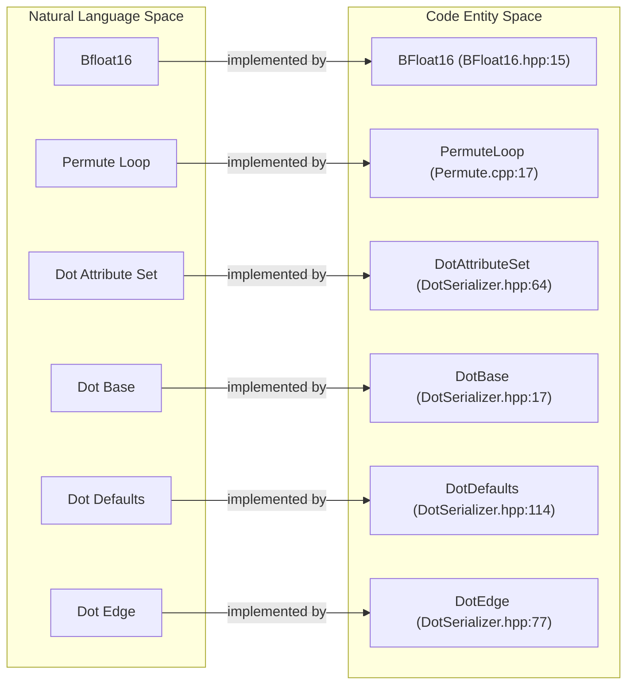
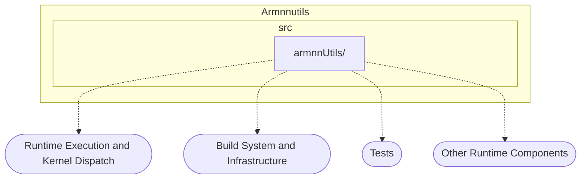
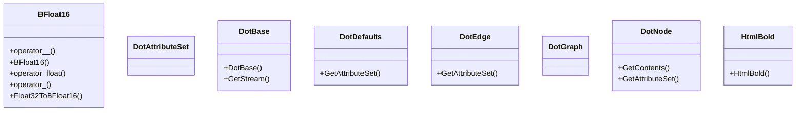
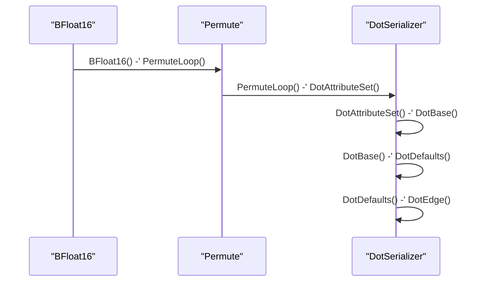

# Armnnutils

↑ [[5-runtime-execution-and-kernel-dispatch|Runtime Execution and Kernel Dispatch]]

> Armnnutils subsystem (`src/armnnUtils`), covering 24 files and 134 symbols. Key symbols include `Permuted`, `Permute`, `GetTensorInfo`, `GetStream`.

<details>
<summary>Relevant source files</summary>

The following files were used as context for generating this wiki page:

- [src/armnnUtils/Permute.cpp](src/armnnUtils/Permute.cpp)
- [src/armnnUtils/TensorUtils.cpp](src/armnnUtils/TensorUtils.cpp)
- [src/armnnUtils/DotSerializer.hpp](src/armnnUtils/DotSerializer.hpp)
- [src/armnnUtils/BFloat16.hpp](src/armnnUtils/BFloat16.hpp)
- [src/armnnUtils/LeakChecking.cpp](src/armnnUtils/LeakChecking.cpp)
- [src/armnnUtils/DotSerializer.cpp](src/armnnUtils/DotSerializer.cpp)
- [src/armnnUtils/Half.hpp](src/armnnUtils/Half.hpp)
- [src/armnnUtils/HeapProfiling.hpp](src/armnnUtils/HeapProfiling.hpp)
- [src/armnnUtils/LeakChecking.hpp](src/armnnUtils/LeakChecking.hpp)
- [src/armnnUtils/Transpose.cpp](src/armnnUtils/Transpose.cpp)
- [src/armnnUtils/ParserPrototxtFixture.hpp](src/armnnUtils/ParserPrototxtFixture.hpp)
- [src/armnnUtils/Filesystem.cpp](src/armnnUtils/Filesystem.cpp)
- [src/armnnUtils/ModelAccuracyChecker.hpp](src/armnnUtils/ModelAccuracyChecker.hpp)
- [src/armnnUtils/FloatingPointConverter.cpp](src/armnnUtils/FloatingPointConverter.cpp)
- [src/armnnUtils/DataLayoutIndexed.cpp](src/armnnUtils/DataLayoutIndexed.cpp)
- [src/armnnUtils/GraphTopologicalSort.hpp](src/armnnUtils/GraphTopologicalSort.hpp)
- [src/armnnUtils/CompatibleTypes.cpp](src/armnnUtils/CompatibleTypes.cpp)
- [src/armnnUtils/ParserHelper.cpp](src/armnnUtils/ParserHelper.cpp)
- [src/armnnUtils/HeapProfiling.cpp](src/armnnUtils/HeapProfiling.cpp)
- [src/armnnUtils/ModelAccuracyChecker.cpp](src/armnnUtils/ModelAccuracyChecker.cpp)
- [src/armnnUtils/TensorIOUtils.hpp](src/armnnUtils/TensorIOUtils.hpp)
- [src/armnnUtils/ProfilingOptionsConverter.cpp](src/armnnUtils/ProfilingOptionsConverter.cpp)
- [src/armnnUtils/PrototxtConversions.cpp](src/armnnUtils/PrototxtConversions.cpp)
- [src/armnnUtils/VerificationHelpers.cpp](src/armnnUtils/VerificationHelpers.cpp)

</details>

## Purpose and Scope

Armnnutils subsystem (`src/armnnUtils`), covering 24 files and 134 symbols. Key symbols include `Permuted`, `Permute`, `GetTensorInfo`, `GetStream`.

Primary code entities analyzed on this page include `BFloat16` ([src/armnnUtils/BFloat16.hpp:15-120]()), `PermuteLoop` ([src/armnnUtils/Permute.cpp:17-118]()), `DotAttributeSet` ([src/armnnUtils/DotSerializer.hpp:64-75]()), `DotBase` ([src/armnnUtils/DotSerializer.hpp:17-27]()), `DotDefaults` ([src/armnnUtils/DotSerializer.hpp:114-123]()).

For the parent architectural layer, see [[5-runtime-execution-and-kernel-dispatch|Runtime Execution and Kernel Dispatch]]. Related sibling subsystems: [[5.1-armnn|ArmNN]], [[5.2-armnn|ArmNN]], [[5.3-delegate-opaque|Delegate Opaque]], [[5.4-delegate-classic|Delegate Classic]].

Sources: [src/armnnUtils/BFloat16.hpp:15-120](), [src/armnnUtils/Permute.cpp:17-118](), [src/armnnUtils/DotSerializer.hpp:64-75](), [src/armnnUtils/DotSerializer.hpp:17-27]()

---

## 1. High-Level Architecture and Data Flow

### Natural Language Space to Code Entity Space Mapping

The following diagram maps domain concepts in this subsystem to their concrete code entities:



### Subsystem Component & Dependency Flow



Cross-subsystem call and import edges connect **Armnnutils** with [[7-glossary|Glossary]] (coupling `201.0`), [[5-runtime-execution-and-kernel-dispatch|Runtime Execution and Kernel Dispatch]] (coupling `160.0`), [[2.1-build-infrastructure|Build Infrastructure]] (coupling `128.0`), [[5.2-armnn|ArmNN]] (coupling `114.0`), [[2-build-system-and-infrastructure|Build System and Infrastructure]] (coupling `112.0`).

| Module Directory | Files | Primary Code Entities | Source Citations |
|---|---|---|---|
| `src/armnnUtils` | 24 | `BFloat16`, `PermuteLoop`, `DotAttributeSet`, `DotBase` | [src/armnnUtils/BFloat16.hpp:15-120]() [src/armnnUtils/Permute.cpp:17-118]() |

Sources: [src/armnnUtils/BFloat16.hpp:15-120](), [src/armnnUtils/Permute.cpp:17-118](), [src/armnnUtils/DotSerializer.hpp:64-75](), [src/armnnUtils/DotSerializer.hpp:17-27](), [src/armnnUtils/DotSerializer.hpp:114-123]()

---

## 2. Core Data Structures and Implementation Details

### Class and Entity Relationship Diagram



### `BFloat16` (Class)

- **Source Location**: [src/armnnUtils/BFloat16.hpp:15-120]()
- **Declaration**: `Class BFloat16`
- **Graph Centrality**: fan-in `1` callers, fan-out `0` callees

```cpp
// src/armnnUtils/BFloat16.hpp:15-30
class BFloat16
{
public:
    BFloat16()
    : m_Value(0)
    {}

    BFloat16(const BFloat16& v) = default;

    explicit BFloat16(uint16_t v)
    : m_Value(v)
    {}

    explicit BFloat16(float v)
    {
        m_Value = Float32ToBFloat16(v).Val();
```

### `PermuteLoop` (Class)

- **Source Location**: [src/armnnUtils/Permute.cpp:17-118]()
- **Declaration**: `Class PermuteLoop`
- **Graph Centrality**: fan-in `0` callers, fan-out `0` callees

```cpp
// src/armnnUtils/Permute.cpp:17-32
class PermuteLoop
{
public:
    using size_type = unsigned int;

    PermuteLoop(const armnn::TensorShape& dstShape, const armnn::PermutationVector& mappings)
        : m_DstShape(dstShape)
    {
        if (dstShape.GetNumDimensions() != mappings.GetSize())
        {
            std::stringstream msg;
            msg << "Permute: Number of shape dimensions (" << dstShape.GetNumDimensions() <<
                ") does not match the size of the mappings (" << mappings.GetSize() << ")";
            throw armnn::InvalidArgumentException(msg.str());
        }
```

### `DotAttributeSet` (Class)

- **Source Location**: [src/armnnUtils/DotSerializer.hpp:64-75]()
- **Declaration**: `Class DotAttributeSet`
- **Graph Centrality**: fan-in `0` callers, fan-out `0` callees

```cpp
// src/armnnUtils/DotSerializer.hpp:64-75
class DotAttributeSet : public DotBase
{
public:
    explicit DotAttributeSet(std::ostream& stream);
    ~DotAttributeSet();

    DotAttributeSet & AddAttribute(const std::string& name, const std::stringstream& value);
    DotAttributeSet & AddAttribute(const std::string& name, int value);
    DotAttributeSet & AddAttribute(const std::string& name, const std::string& value);
private:
    std::vector<std::string> m_Attributes;
};
```

### `DotBase` (Class)

- **Source Location**: [src/armnnUtils/DotSerializer.hpp:17-27]()
- **Declaration**: `Class DotBase`
- **Graph Centrality**: fan-in `0` callers, fan-out `0` callees

### `DotDefaults` (Class)

- **Source Location**: [src/armnnUtils/DotSerializer.hpp:114-123]()
- **Declaration**: `Class DotDefaults`
- **Graph Centrality**: fan-in `0` callers, fan-out `0` callees

### `Permuted` (Function)

- **Source Location**: [src/armnnUtils/Permute.cpp:148-162]()
- **Declaration**: `(const armnn::TensorInfo& info, const armnn::PermutationVector& mappings)`
- **Graph Centrality**: fan-in `30` callers, fan-out `11` callees

Sources: [src/armnnUtils/BFloat16.hpp:15-120](), [src/armnnUtils/Permute.cpp:17-118](), [src/armnnUtils/DotSerializer.hpp:64-75](), [src/armnnUtils/DotSerializer.hpp:17-27](), [src/armnnUtils/DotSerializer.hpp:114-123]()

---

## 3. Execution and Call Flow

The sequence diagram below traces the runtime/compile-time call chain across components in this module:



Sources: [src/armnnUtils/BFloat16.hpp:15-120](), [src/armnnUtils/Permute.cpp:17-118](), [src/armnnUtils/DotSerializer.hpp:64-75](), [src/armnnUtils/DotSerializer.hpp:17-27](), [src/armnnUtils/DotSerializer.hpp:114-123]()

---

## 4. Key API and Symbol Reference

| Code Entity | Kind | Location | Fan-In / Out | Role & Signature |
|---|---|---|---|---|
| `BFloat16` | Class | [src/armnnUtils/BFloat16.hpp:15-120]() | `1` / `0` | — |
| `PermuteLoop` | Class | [src/armnnUtils/Permute.cpp:17-118]() | `0` / `0` | — |
| `DotAttributeSet` | Class | [src/armnnUtils/DotSerializer.hpp:64-75]() | `0` / `0` | — |
| `DotBase` | Class | [src/armnnUtils/DotSerializer.hpp:17-27]() | `0` / `0` | — |
| `DotDefaults` | Class | [src/armnnUtils/DotSerializer.hpp:114-123]() | `0` / `0` | — |
| `DotEdge` | Class | [src/armnnUtils/DotSerializer.hpp:77-86]() | `0` / `0` | — |
| `DotGraph` | Class | [src/armnnUtils/DotSerializer.hpp:125-131]() | `0` / `0` | — |
| `DotNode` | Class | [src/armnnUtils/DotSerializer.hpp:101-112]() | `0` / `0` | — |
| `HtmlBold` | Class | [src/armnnUtils/DotSerializer.hpp:49-54]() | `0` / `0` | — |
| `HtmlFont` | Class | [src/armnnUtils/DotSerializer.hpp:56-62]() | `0` / `0` | — |
| `HtmlSection` | Class | [src/armnnUtils/DotSerializer.hpp:29-35]() | `0` / `0` | — |
| `HtmlSimpleTag` | Class | [src/armnnUtils/DotSerializer.hpp:37-47]() | `0` / `0` | — |
| `NodeContent` | Class | [src/armnnUtils/DotSerializer.hpp:88-99]() | `0` / `0` | — |
| `ScopedDisableLeakChecking::Impl` | Class | [src/armnnUtils/LeakChecking.cpp:51-54]() | `0` / `0` | — |
| `ScopedLeakChecker::Impl` | Class | [src/armnnUtils/LeakChecking.cpp:14-22]() | `0` / `0` | — |
| `IsArmnnHalf` | Class | [src/armnnUtils/Half.hpp:25-27]() | `0` / `0` | — |
| `IsFloatingPoint` | Class | [src/armnnUtils/Half.hpp:30-32]() | `0` / `0` | — |
| `ScopedHeapProfiler` | Class | [src/armnnUtils/HeapProfiling.hpp:20-36]() | `0` / `0` | — |
| `ScopedDisableLeakChecking` | Class | [src/armnnUtils/LeakChecking.hpp:43-58]() | `0` / `0` | — |
| `ScopedLeakChecker` | Class | [src/armnnUtils/LeakChecking.hpp:16-41]() | `0` / `0` | — |
| `TransposeLoop` | Class | [src/armnnUtils/Transpose.cpp:17-118]() | `0` / `0` | — |
| `ParserPrototxtFixture` | Class | [src/armnnUtils/ParserPrototxtFixture.hpp:24-86]() | `0` / `0` | — |

Sources: [src/armnnUtils/BFloat16.hpp:15-120](), [src/armnnUtils/Permute.cpp:17-118](), [src/armnnUtils/DotSerializer.hpp:64-75](), [src/armnnUtils/DotSerializer.hpp:17-27](), [src/armnnUtils/DotSerializer.hpp:114-123](), [src/armnnUtils/DotSerializer.hpp:77-86]()

---

## 5. Official Documentation and Design Context

The following linked documentation sections from `llm-wiki` (`raw/`) provide additional architectural context, tutorials, and design invariants for this subsystem:

- **Runtime Execution and Kernel Dispatch** ([wiki/5-runtime-execution-and-kernel-dispatch.md](), score `71.444`) (sections: `Runtime Execution and Kernel Dispatch`, `Purpose and Scope`, `System Mapping: Natural Language Space to Code Entity Space`, `1. ArmNN`): # Runtime Execution and Kernel Dispatch > Architectural overview of Runtime Execution and Kernel Dispatch, spanning 157 source files and 3718 code symbols across 6 subsystems. <details> <summary>Relevant source files</summary> The following files were used as context for generating this wiki page: - [samples/common/include/Audio/DataStructures.hpp](samples/common/include/Audio/DataStructures.hpp) - [src/armnn/Tensor.
- **Overview** ([wiki/1-overview.md](), score `42.5559`) (sections: `Overview`, `1. Architecture Overview & System Component Map`, `Core Concept to Code Entity Mapping`, `Core Compilation & Runtime Class Hierarchy`): # Overview > End-to-end architecture overview of ArmNN: core subsystems, compilation/execution pipeline, entry points, and cross-module dependencies. <details> <summary>Relevant source files</summary> The following files were used as context for generating this wiki page: - [src/armnn/Tensor.cpp](src/armnn/Tensor.cpp) - [include/armnn/Exceptions.hpp](include/armnn/Exceptions.hpp) - [include/armnn/Tensor.hpp](include/
- **ArmNN DeepWiki** ([wiki/index.md](), score `33.1545`) (sections: `ArmNN DeepWiki`, `Pages`): # ArmNN DeepWiki Generated from `home-jason-Project-deepwiki-armnn` at commit `2b61cecc9df7` (2026-11-14T15:13:53+00:00). ## Pages - [[1-overview|Overview]] — End-to-end architecture overview of ArmNN: core subsystems, compilation/execution pipeline, entry points, and cross-module dependencies. - [[2-build-system-and-infrastructure|Build System and Infrastructure]] — Architectural overview of Build System and Infrast
- **Arm NN** ([raw/armnn/README.md](), score `30.3772`) (sections: `Arm NN`, `Quick Start Guides`, `Pre-Built Binaries`, `Software Overview`): <br> <div align="center">  </div> * [Quick Start Guides](#quick-start-guides) * [Pre-Built Binaries](#pre-built-binaries) * [Software Overview](#software-overview) * [Get Involved](#get-involved) * [Contributions](#contributions) * [Disclaimer](#disclaimer) * [License](#license) * [Inclusive language commitment](#inclusive-language-commitment) * [Th

Sources: [wiki/5-runtime-execution-and-kernel-dispatch.md](), [wiki/1-overview.md](), [wiki/index.md](), [raw/armnn/README.md]()

## Related pages

- [[5-runtime-execution-and-kernel-dispatch|Runtime Execution and Kernel Dispatch]]
- [[3-backend-delegation-and-hardware-providers|Backend Delegation and Hardware Providers]]
- [[3.1-backends-backendscommon|Backends Backendscommon]]
- [[3.2-backends-reference|Backends Reference]]
- [[3.6-other-backends|Other Backends]]
- [[5.1-armnn|ArmNN]]
- [[5.2-armnn|ArmNN]]
- [[5.6-other-runtime-components|Other Runtime Components]]

## Related documents

- `wiki/5-runtime-execution-and-kernel-dispatch.md` — Runtime Execution and Kernel Dispatch (score 71.444, via bm25)
- `wiki/1-overview.md` — Overview (score 42.5559, via bm25)
- `wiki/index.md` — ArmNN DeepWiki (score 33.1545, via bm25)
- `raw/armnn/README.md` — Arm NN (score 30.3772, via bm25)
- `raw/armnn/05_04_runtimeoptions.dox` — 05_04_runtimeoptions (score 28.248, via bm25)

## Sources

- [`src/armnnUtils/Permute.cpp`](https://github.com/ARM-software/armnn/blob/branches/armnn_24_11/src/armnnUtils/Permute.cpp)
- [`src/armnnUtils/TensorUtils.cpp`](https://github.com/ARM-software/armnn/blob/branches/armnn_24_11/src/armnnUtils/TensorUtils.cpp)
- [`src/armnnUtils/DotSerializer.hpp`](https://github.com/ARM-software/armnn/blob/branches/armnn_24_11/src/armnnUtils/DotSerializer.hpp)
- [`src/armnnUtils/BFloat16.hpp`](https://github.com/ARM-software/armnn/blob/branches/armnn_24_11/src/armnnUtils/BFloat16.hpp)
- [`src/armnnUtils/LeakChecking.cpp`](https://github.com/ARM-software/armnn/blob/branches/armnn_24_11/src/armnnUtils/LeakChecking.cpp)
- [`src/armnnUtils/DotSerializer.cpp`](https://github.com/ARM-software/armnn/blob/branches/armnn_24_11/src/armnnUtils/DotSerializer.cpp)
- [`src/armnnUtils/Half.hpp`](https://github.com/ARM-software/armnn/blob/branches/armnn_24_11/src/armnnUtils/Half.hpp)
- [`src/armnnUtils/HeapProfiling.hpp`](https://github.com/ARM-software/armnn/blob/branches/armnn_24_11/src/armnnUtils/HeapProfiling.hpp)
- [`src/armnnUtils/LeakChecking.hpp`](https://github.com/ARM-software/armnn/blob/branches/armnn_24_11/src/armnnUtils/LeakChecking.hpp)
- [`src/armnnUtils/Transpose.cpp`](https://github.com/ARM-software/armnn/blob/branches/armnn_24_11/src/armnnUtils/Transpose.cpp)
- [`src/armnnUtils/ParserPrototxtFixture.hpp`](https://github.com/ARM-software/armnn/blob/branches/armnn_24_11/src/armnnUtils/ParserPrototxtFixture.hpp)
- [`src/armnnUtils/Filesystem.cpp`](https://github.com/ARM-software/armnn/blob/branches/armnn_24_11/src/armnnUtils/Filesystem.cpp)
- [`src/armnnUtils/ModelAccuracyChecker.hpp`](https://github.com/ARM-software/armnn/blob/branches/armnn_24_11/src/armnnUtils/ModelAccuracyChecker.hpp)
- [`src/armnnUtils/FloatingPointConverter.cpp`](https://github.com/ARM-software/armnn/blob/branches/armnn_24_11/src/armnnUtils/FloatingPointConverter.cpp)
- [`src/armnnUtils/DataLayoutIndexed.cpp`](https://github.com/ARM-software/armnn/blob/branches/armnn_24_11/src/armnnUtils/DataLayoutIndexed.cpp)
- [`src/armnnUtils/GraphTopologicalSort.hpp`](https://github.com/ARM-software/armnn/blob/branches/armnn_24_11/src/armnnUtils/GraphTopologicalSort.hpp)
- [`src/armnnUtils/CompatibleTypes.cpp`](https://github.com/ARM-software/armnn/blob/branches/armnn_24_11/src/armnnUtils/CompatibleTypes.cpp)
- [`src/armnnUtils/ParserHelper.cpp`](https://github.com/ARM-software/armnn/blob/branches/armnn_24_11/src/armnnUtils/ParserHelper.cpp)
- [`src/armnnUtils/HeapProfiling.cpp`](https://github.com/ARM-software/armnn/blob/branches/armnn_24_11/src/armnnUtils/HeapProfiling.cpp)
- [`src/armnnUtils/ModelAccuracyChecker.cpp`](https://github.com/ARM-software/armnn/blob/branches/armnn_24_11/src/armnnUtils/ModelAccuracyChecker.cpp)
- [`src/armnnUtils/TensorIOUtils.hpp`](https://github.com/ARM-software/armnn/blob/branches/armnn_24_11/src/armnnUtils/TensorIOUtils.hpp)
- [`src/armnnUtils/ProfilingOptionsConverter.cpp`](https://github.com/ARM-software/armnn/blob/branches/armnn_24_11/src/armnnUtils/ProfilingOptionsConverter.cpp)
- [`src/armnnUtils/PrototxtConversions.cpp`](https://github.com/ARM-software/armnn/blob/branches/armnn_24_11/src/armnnUtils/PrototxtConversions.cpp)
- [`src/armnnUtils/VerificationHelpers.cpp`](https://github.com/ARM-software/armnn/blob/branches/armnn_24_11/src/armnnUtils/VerificationHelpers.cpp)


## Dynamic Knowledge Links (Code Graph ↔ LLM-Wiki / RAG)

### Linked Architecture & Design Documents

| Document | Match Channel | Score | Shared Code Symbols |
|---|---|---|---|
| [[5-runtime-execution-and-kernel-dispatch|Runtime Execution and Kernel Dispatch]] | `bm25+entity(1)` | `72.944` | `Permuted` |
| [[5.1-armnn|ArmNN]] | `wikilink:5.5-armnnutils` | `68.164` | *(lexical/graph match)* |
| [[5.2-armnn|ArmNN]] | `wikilink:5.5-armnnutils` | `68.164` | *(lexical/graph match)* |
| [[5.3-delegate-opaque|Delegate Opaque]] | `wikilink:5.5-armnnutils` | `68.164` | *(lexical/graph match)* |
| [[1-overview|Overview]] | `bm25` | `42.556` | *(lexical/graph match)* |
| [[index|ArmNN DeepWiki]] | `bm25` | `33.154` | *(lexical/graph match)* |

### High-Centrality Bridge Symbols (CBM Graph)

| Symbol | Kind | Source Location | Fan-In / Fan-Out |
|---|---|---|---|
| `BFloat16` | Class | [src/armnnUtils/BFloat16.hpp:15-120]() | in: `1` / out: `0` |
| `PermuteLoop` | Class | [src/armnnUtils/Permute.cpp:17-118]() | in: `0` / out: `0` |
| `DotAttributeSet` | Class | [src/armnnUtils/DotSerializer.hpp:64-75]() | in: `0` / out: `0` |
| `DotBase` | Class | [src/armnnUtils/DotSerializer.hpp:17-27]() | in: `0` / out: `0` |
| `DotDefaults` | Class | [src/armnnUtils/DotSerializer.hpp:114-123]() | in: `0` / out: `0` |
| `DotEdge` | Class | [src/armnnUtils/DotSerializer.hpp:77-86]() | in: `0` / out: `0` |

Sources: [src/armnnUtils/BFloat16.hpp:15-120](), [src/armnnUtils/Permute.cpp:17-118](), [src/armnnUtils/DotSerializer.hpp:64-75](), [src/armnnUtils/DotSerializer.hpp:17-27]()

### Cross-Subsystem Coupling

- [[7-glossary|Glossary]] — call/import coupling weight `201.0`
- [[5-runtime-execution-and-kernel-dispatch|Runtime Execution and Kernel Dispatch]] — call/import coupling weight `160.0`
- [[2.1-build-infrastructure|Build Infrastructure]] — call/import coupling weight `128.0`
- [[5.2-armnn|ArmNN]] — call/import coupling weight `114.0`
- [[2-build-system-and-infrastructure|Build System and Infrastructure]] — call/import coupling weight `112.0`
- [[5.1-armnn|ArmNN]] — call/import coupling weight `60.0`
