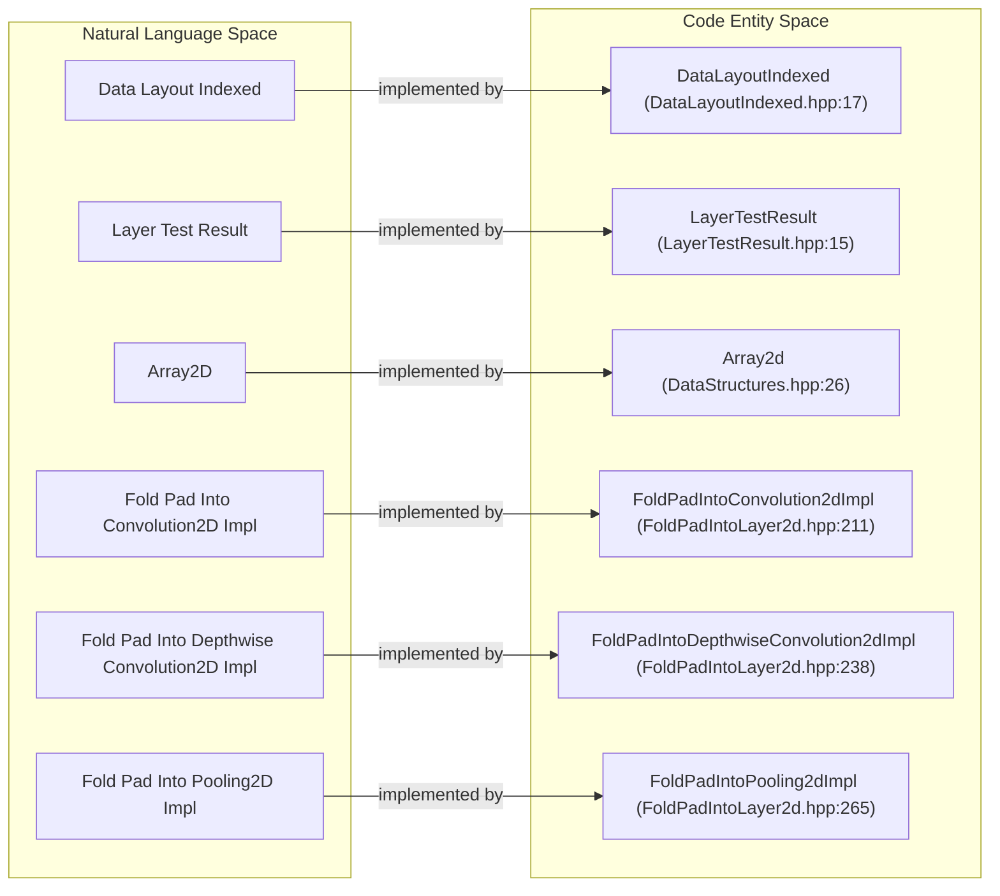
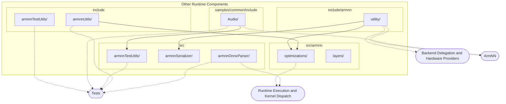
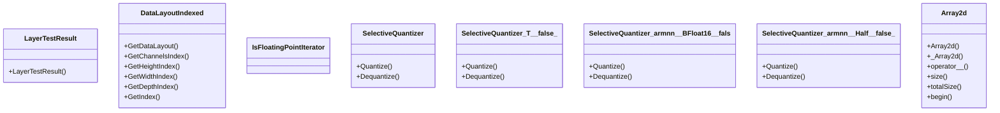
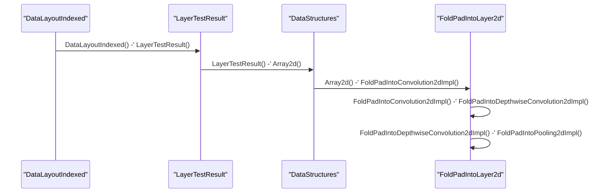

# Other Runtime Components

↑ [[5-runtime-execution-and-kernel-dispatch|Runtime Execution and Kernel Dispatch]]

> Other Runtime Components subsystem (consolidating `ArmNN Optimizations`, `Armnntestutils`, `ArmNN Layers`, `Samples Common`, `Armnntestutils`, `Samples Objectdetection`), covering 28 files and 1895 symbols. Key symbols include `Run`, `FoldPadIntoLayer2dImpl`, `ReplaceConstDequantisationLayer`, `CreateWorkload`.

<details>
<summary>Relevant source files</summary>

The following files were used as context for generating this wiki page:

- [samples/common/include/Audio/DataStructures.hpp](samples/common/include/Audio/DataStructures.hpp)
- [include/armnn/utility/IgnoreUnused.hpp](include/armnn/utility/IgnoreUnused.hpp)
- [src/armnnTestUtils/TensorCopyUtils.cpp](src/armnnTestUtils/TensorCopyUtils.cpp)
- [include/armnnTestUtils/WorkloadTestUtils.hpp](include/armnnTestUtils/WorkloadTestUtils.hpp)
- [include/armnn/utility/PolymorphicDowncast.hpp](include/armnn/utility/PolymorphicDowncast.hpp)
- [src/armnnSerializer/Serializer.cpp](src/armnnSerializer/Serializer.cpp)
- [include/armnnUtils/DataLayoutIndexed.hpp](include/armnnUtils/DataLayoutIndexed.hpp)
- [src/armnn/optimizations/FoldPadIntoLayer2d.hpp](src/armnn/optimizations/FoldPadIntoLayer2d.hpp)
- [include/armnnTestUtils/LayerTestResult.hpp](include/armnnTestUtils/LayerTestResult.hpp)
- [include/armnnUtils/QuantizeHelper.hpp](include/armnnUtils/QuantizeHelper.hpp)
- [src/armnnTestUtils/CreateWorkload.hpp](src/armnnTestUtils/CreateWorkload.hpp)
- [src/armnn/layers/LayerWithParameters.hpp](src/armnn/layers/LayerWithParameters.hpp)
- [src/armnn/optimizations/ConvertConstDequantisationLayersToConstLayers.hpp](src/armnn/optimizations/ConvertConstDequantisationLayersToConstLayers.hpp)
- [src/armnn/optimizations/MaxMinIntoBoundedRelu.hpp](src/armnn/optimizations/MaxMinIntoBoundedRelu.hpp)
- [src/armnn/optimizations/Optimization.hpp](src/armnn/optimizations/Optimization.hpp)
- [src/armnn/optimizations/ConvertConstants.hpp](src/armnn/optimizations/ConvertConstants.hpp)
- [src/armnn/optimizations/AddBroadcastReshapeLayer.hpp](src/armnn/optimizations/AddBroadcastReshapeLayer.hpp)
- [delegate/common/src/DelegateUtils.hpp](delegate/common/src/DelegateUtils.hpp)
- [src/armnn/optimizations/FuseBatchNorm.hpp](src/armnn/optimizations/FuseBatchNorm.hpp)
- [src/armnn/optimizations/AddDebug.hpp](src/armnn/optimizations/AddDebug.hpp)
- [src/armnn/optimizations/MovePermuteUp.hpp](src/armnn/optimizations/MovePermuteUp.hpp)
- [src/armnnOnnxParser/OnnxParser.cpp](src/armnnOnnxParser/OnnxParser.cpp)
- [src/armnnTestUtils/TestUtils.hpp](src/armnnTestUtils/TestUtils.hpp)
- [src/armnn/optimizations/MoveTransposeUp.hpp](src/armnn/optimizations/MoveTransposeUp.hpp)
- [src/armnn/optimizations/ConvertFp32NetworkToFp16.hpp](src/armnn/optimizations/ConvertFp32NetworkToFp16.hpp)
- [src/armnn/optimizations/TurboConvertConstDequantisationLayersToConstLayers.hpp](src/armnn/optimizations/TurboConvertConstDequantisationLayersToConstLayers.hpp)
- [src/armnn/optimizations/ConvertConstPermuteLayersToConstLayers.hpp](src/armnn/optimizations/ConvertConstPermuteLayersToConstLayers.hpp)
- [src/armnn/optimizations/PermuteAsReshape.hpp](src/armnn/optimizations/PermuteAsReshape.hpp)

</details>

## Purpose and Scope

Other Runtime Components subsystem (consolidating `ArmNN Optimizations`, `Armnntestutils`, `ArmNN Layers`, `Samples Common`, `Armnntestutils`, `Samples Objectdetection`), covering 28 files and 1895 symbols. Key symbols include `Run`, `FoldPadIntoLayer2dImpl`, `ReplaceConstDequantisationLayer`, `CreateWorkload`.

Primary code entities analyzed on this page include `DataLayoutIndexed` ([include/armnnUtils/DataLayoutIndexed.hpp:17-81]()), `LayerTestResult` ([include/armnnTestUtils/LayerTestResult.hpp:15-59]()), `Array2d` ([samples/common/include/Audio/DataStructures.hpp:26-102]()), `FoldPadIntoConvolution2dImpl` ([src/armnn/optimizations/FoldPadIntoLayer2d.hpp:211-236]()), `FoldPadIntoDepthwiseConvolution2dImpl` ([src/armnn/optimizations/FoldPadIntoLayer2d.hpp:238-263]()).

For the parent architectural layer, see [[5-runtime-execution-and-kernel-dispatch|Runtime Execution and Kernel Dispatch]]. Related sibling subsystems: [[5.1-armnn|ArmNN]], [[5.2-armnn|ArmNN]], [[5.3-delegate-opaque|Delegate Opaque]], [[5.4-delegate-classic|Delegate Classic]].

Sources: [include/armnnUtils/DataLayoutIndexed.hpp:17-81](), [include/armnnTestUtils/LayerTestResult.hpp:15-59](), [samples/common/include/Audio/DataStructures.hpp:26-102](), [src/armnn/optimizations/FoldPadIntoLayer2d.hpp:211-236]()

---

## 1. High-Level Architecture and Data Flow

### Natural Language Space to Code Entity Space Mapping

The following diagram maps domain concepts in this subsystem to their concrete code entities:



### Subsystem Component & Dependency Flow



Cross-subsystem call and import edges connect **Other Runtime Components** with [[5-runtime-execution-and-kernel-dispatch|Runtime Execution and Kernel Dispatch]] (coupling `575.0`), [[7-glossary|Glossary]] (coupling `552.0`), [[5.1-armnn|ArmNN]] (coupling `460.0`), [[5.2-armnn|ArmNN]] (coupling `244.0`), [[4.1-tests|Tests]] (coupling `227.0`).

| Module Directory | Files | Primary Code Entities | Source Citations |
|---|---|---|---|
| `src/armnn/optimizations` | 14 | `FoldPadIntoConvolution2dImpl`, `FoldPadIntoDepthwiseConvolution2dImpl`, `FoldPadIntoPooling2dImpl`, `ConvertConstDequantisationLayersToConstLayersImpl` | [src/armnn/optimizations/FoldPadIntoLayer2d.hpp:211-236]() [src/armnn/optimizations/FoldPadIntoLayer2d.hpp:238-263]() |
| `src/armnnTestUtils` | 3 | `CopyDataFromITensorHandle`, `CopyDataToITensorHandle`, `MakeAndCheckWorkload`, `CreateTensorHandles` | [src/armnnTestUtils/TensorCopyUtils.cpp:15-18]() [src/armnnTestUtils/TensorCopyUtils.cpp:10-13]() |
| `include/armnn/utility` | 2 | `IgnoreUnused`, `PolymorphicDowncast`, `PolymorphicPointerDowncast`, `DynamicPointerCast` | [include/armnn/utility/IgnoreUnused.hpp:13-14]() [include/armnn/utility/PolymorphicDowncast.hpp:73-81]() |
| `include/armnnTestUtils` | 2 | `LayerTestResult`, `AddOutputToWorkload`, `AddInputToWorkload`, `LayerTestResult` | [include/armnnTestUtils/LayerTestResult.hpp:15-59]() [include/armnnTestUtils/WorkloadTestUtils.hpp:32-40]() |
| `include/armnnUtils` | 2 | `DataLayoutIndexed`, `IsFloatingPointIterator`, `SelectiveQuantizer`, `SelectiveQuantizer<T, false>` | [include/armnnUtils/DataLayoutIndexed.hpp:17-81]() [include/armnnUtils/QuantizeHelper.hpp:97-100]() |
| `delegate/common/src` | 1 | `ZeroDimPresent`, `NonNegative`, `CalcPadding`, `GetDataType` | [delegate/common/src/DelegateUtils.hpp:312-325]() [delegate/common/src/DelegateUtils.hpp:79-90]() |
| `samples/common/include/Audio` | 1 | `Array2d`, `size`, `end`, `begin` | [samples/common/include/Audio/DataStructures.hpp:26-102]() [samples/common/include/Audio/DataStructures.hpp:71-82]() |
| `src/armnn/layers` | 1 | `LayerWithParameters`, `GetParameters`, `GetConnectedConstantAsInputTensors`, `SerializeLayerParameters` | [src/armnn/layers/LayerWithParameters.hpp:14-77]() [src/armnn/layers/LayerWithParameters.hpp:19-19]() |

Sources: [include/armnnUtils/DataLayoutIndexed.hpp:17-81](), [include/armnnTestUtils/LayerTestResult.hpp:15-59](), [samples/common/include/Audio/DataStructures.hpp:26-102](), [src/armnn/optimizations/FoldPadIntoLayer2d.hpp:211-236](), [src/armnn/optimizations/FoldPadIntoLayer2d.hpp:238-263]()

---

## 2. Core Data Structures and Implementation Details

### Class and Entity Relationship Diagram



### `DataLayoutIndexed` (Class)

- **Source Location**: [include/armnnUtils/DataLayoutIndexed.hpp:17-81]()
- **Declaration**: `Class DataLayoutIndexed`
- **Graph Centrality**: fan-in `2` callers, fan-out `0` callees
- **Responsibility**: /// Provides access to the appropriate indexes for Channels, Height and Width based on DataLayout

```cpp
// include/armnnUtils/DataLayoutIndexed.hpp:17-32
class DataLayoutIndexed
{
public:
    DataLayoutIndexed(armnn::DataLayout dataLayout);

    armnn::DataLayout GetDataLayout()    const { return m_DataLayout; }
    unsigned int      GetChannelsIndex() const { return m_ChannelsIndex; }
    unsigned int      GetHeightIndex()   const { return m_HeightIndex; }
    unsigned int      GetWidthIndex()    const { return m_WidthIndex; }
    unsigned int      GetDepthIndex()    const { return m_DepthIndex; }

    inline unsigned int GetIndex(const armnn::TensorShape& shape,
                                 unsigned int batchIndex, unsigned int channelIndex,
                                 unsigned int heightIndex, unsigned int widthIndex) const
    {
        if (batchIndex >= shape[0] && !( shape[0] == 0 && batchIndex == 0))
```

### `LayerTestResult` (Class)

- **Source Location**: [include/armnnTestUtils/LayerTestResult.hpp:15-59]()
- **Declaration**: `Class LayerTestResult`
- **Graph Centrality**: fan-in `6` callers, fan-out `0` callees

```cpp
// include/armnnTestUtils/LayerTestResult.hpp:15-30
struct LayerTestResult
{
    LayerTestResult(const armnn::TensorInfo& outputInfo)
        : m_Supported(true)
        , m_CompareBoolean(false)
    {
        m_ActualData.reserve(outputInfo.GetNumElements());
        m_ExpectedData.reserve(outputInfo.GetNumElements());
        m_ActualShape = outputInfo.GetShape();
        m_ExpectedShape = outputInfo.GetShape();
    }

    LayerTestResult(const std::vector<T>& actualData,
                    const std::vector<T>& expectedData,
                    const armnn::TensorShape& actualShape,
                    const armnn::TensorShape& expectedShape)
```

### `Array2d` (Class)

- **Source Location**: [samples/common/include/Audio/DataStructures.hpp:26-102]()
- **Declaration**: `Class Array2d`
- **Graph Centrality**: fan-in `0` callers, fan-out `0` callees

```cpp
// samples/common/include/Audio/DataStructures.hpp:26-41
class Array2d
{
private:
    size_t m_rows;
    size_t m_cols;
    T* m_data;

public:
    /**
     * Creates the array2d with the given sizes.
     *
     * @param rows  number of rows.
     * @param cols  number of columns.
     */
    Array2d(unsigned rows, unsigned cols)
    {
```

### `FoldPadIntoConvolution2dImpl` (Class)

- **Source Location**: [src/armnn/optimizations/FoldPadIntoLayer2d.hpp:211-236]()
- **Declaration**: `Class FoldPadIntoConvolution2dImpl`
- **Graph Centrality**: fan-in `0` callers, fan-out `0` callees

### `FoldPadIntoDepthwiseConvolution2dImpl` (Class)

- **Source Location**: [src/armnn/optimizations/FoldPadIntoLayer2d.hpp:238-263]()
- **Declaration**: `Class FoldPadIntoDepthwiseConvolution2dImpl`
- **Graph Centrality**: fan-in `0` callers, fan-out `0` callees

### `size` (Method)

- **Source Location**: [samples/common/include/Audio/DataStructures.hpp:71-82]()
- **Declaration**: `(size_t dim)`
- **Graph Centrality**: fan-in `792` callers, fan-out `0` callees
- **Responsibility**: /** * Gets rows number of the current array2d. * @return number of rows. */

Sources: [include/armnnUtils/DataLayoutIndexed.hpp:17-81](), [include/armnnTestUtils/LayerTestResult.hpp:15-59](), [samples/common/include/Audio/DataStructures.hpp:26-102](), [src/armnn/optimizations/FoldPadIntoLayer2d.hpp:211-236](), [src/armnn/optimizations/FoldPadIntoLayer2d.hpp:238-263]()

---

## 3. Execution and Call Flow

The sequence diagram below traces the runtime/compile-time call chain across components in this module:



Sources: [include/armnnUtils/DataLayoutIndexed.hpp:17-81](), [include/armnnTestUtils/LayerTestResult.hpp:15-59](), [samples/common/include/Audio/DataStructures.hpp:26-102](), [src/armnn/optimizations/FoldPadIntoLayer2d.hpp:211-236](), [src/armnn/optimizations/FoldPadIntoLayer2d.hpp:238-263]()

---

## 4. Key API and Symbol Reference

| Code Entity | Kind | Location | Fan-In / Out | Role & Signature |
|---|---|---|---|---|
| `DataLayoutIndexed` | Class | [include/armnnUtils/DataLayoutIndexed.hpp:17-81]() | `2` / `0` | /// Provides access to the appropriate indexes for Channels, Height and Width based on DataLayout |
| `LayerTestResult` | Class | [include/armnnTestUtils/LayerTestResult.hpp:15-59]() | `6` / `0` | — |
| `Array2d` | Class | [samples/common/include/Audio/DataStructures.hpp:26-102]() | `0` / `0` | — |
| `FoldPadIntoConvolution2dImpl` | Class | [src/armnn/optimizations/FoldPadIntoLayer2d.hpp:211-236]() | `0` / `0` | — |
| `FoldPadIntoDepthwiseConvolution2dImpl` | Class | [src/armnn/optimizations/FoldPadIntoLayer2d.hpp:238-263]() | `0` / `0` | — |
| `FoldPadIntoPooling2dImpl` | Class | [src/armnn/optimizations/FoldPadIntoLayer2d.hpp:265-276]() | `0` / `0` | — |
| `IsFloatingPointIterator` | Class | [include/armnnUtils/QuantizeHelper.hpp:97-100]() | `0` / `0` | — |
| `SelectiveQuantizer` | Class | [include/armnnUtils/QuantizeHelper.hpp:23-34]() | `0` / `0` | — |
| `SelectiveQuantizer<T, false>` | Class | [include/armnnUtils/QuantizeHelper.hpp:37-50]() | `0` / `0` | — |
| `SelectiveQuantizer<armnn::BFloat16, false>` | Class | [include/armnnUtils/QuantizeHelper.hpp:69-82]() | `0` / `0` | — |
| `SelectiveQuantizer<armnn::Half, false>` | Class | [include/armnnUtils/QuantizeHelper.hpp:53-66]() | `0` / `0` | — |
| `LayerWithParameters` | Class | [src/armnn/layers/LayerWithParameters.hpp:14-77]() | `0` / `0` | — |
| `ConvertConstDequantisationLayersToConstLayersImpl` | Class | [src/armnn/optimizations/ConvertConstDequantisationLayersToConstLayers.hpp:18-168]() | `0` / `0` | — |
| `MaxMinIntoBoundedReluImpl` | Class | [src/armnn/optimizations/MaxMinIntoBoundedRelu.hpp:13-130]() | `0` / `0` | — |
| `ConvertConstants` | Class | [src/armnn/optimizations/ConvertConstants.hpp:64-80]() | `0` / `0` | — |
| `Float16ToFloat32` | Class | [src/armnn/optimizations/ConvertConstants.hpp:21-40]() | `0` / `0` | — |
| `Float32ToFloat16` | Class | [src/armnn/optimizations/ConvertConstants.hpp:42-61]() | `0` / `0` | — |
| `IsFloat16Layer` | Class | [src/armnn/optimizations/ConvertConstants.hpp:90-96]() | `0` / `0` | — |
| `IsFloat32Layer` | Class | [src/armnn/optimizations/ConvertConstants.hpp:82-88]() | `0` / `0` | — |
| `Optimization` | Class | [src/armnn/optimizations/Optimization.hpp:15-22]() | `0` / `0` | — |
| `OptimizeForConnection` | Class | [src/armnn/optimizations/Optimization.hpp:118-123]() | `0` / `0` | — |
| `OptimizeForConnectionImpl` | Class | [src/armnn/optimizations/Optimization.hpp:79-115]() | `0` / `0` | — |

Sources: [include/armnnUtils/DataLayoutIndexed.hpp:17-81](), [include/armnnTestUtils/LayerTestResult.hpp:15-59](), [samples/common/include/Audio/DataStructures.hpp:26-102](), [src/armnn/optimizations/FoldPadIntoLayer2d.hpp:211-236](), [src/armnn/optimizations/FoldPadIntoLayer2d.hpp:238-263](), [src/armnn/optimizations/FoldPadIntoLayer2d.hpp:265-276]()

---

## 5. Official Documentation and Design Context

The following linked documentation sections from `llm-wiki` (`raw/`) provide additional architectural context, tutorials, and design invariants for this subsystem:

- **Runtime Execution and Kernel Dispatch** ([wiki/5-runtime-execution-and-kernel-dispatch.md](), score `110.4362`) (sections: `Runtime Execution and Kernel Dispatch`, `Purpose and Scope`, `System Mapping: Natural Language Space to Code Entity Space`, `1. ArmNN`): # Runtime Execution and Kernel Dispatch > Architectural overview of Runtime Execution and Kernel Dispatch, spanning 157 source files and 3718 code symbols across 6 subsystems. <details> <summary>Relevant source files</summary> The following files were used as context for generating this wiki page: - [samples/common/include/Audio/DataStructures.hpp](samples/common/include/Audio/DataStructures.hpp) - [src/armnn/Tensor.
- **ArmNN DeepWiki** ([wiki/index.md](), score `97.7639`) (sections: `ArmNN DeepWiki`, `Pages`): # ArmNN DeepWiki Generated from `home-jason-Project-deepwiki-armnn` at commit `2b61cecc9df7` (2026-11-14T15:13:53+00:00). ## Pages - [[1-overview|Overview]] — End-to-end architecture overview of ArmNN: core subsystems, compilation/execution pipeline, entry points, and cross-module dependencies. - [[2-build-system-and-infrastructure|Build System and Infrastructure]] — Architectural overview of Build System and Infrast
- **Backends Reference** ([wiki/3.2-backends-reference.md](), score `74.9274`) (sections: `Backends Reference`, `Purpose and Scope`, `1. High-Level Architecture and Data Flow`, `Natural Language Space to Code Entity Space Mapping`): # Backends Reference ↑ [[3-backend-delegation-and-hardware-providers|Backend Delegation and Hardware Providers]] > Backends Reference subsystem (`backends/reference`), covering 28 files and 634 symbols. Key symbols include `GetNumDimensions`, `GetTensorInfo`, `MakeDecoder`, `MakeEncoder`. <details> <summary>Relevant source files</summary> The following files were used as context for generating this wiki page: - [src/
- **Overview** ([wiki/1-overview.md](), score `50.1845`) (sections: `Overview`, `1. Architecture Overview & System Component Map`, `Core Concept to Code Entity Mapping`, `Core Compilation & Runtime Class Hierarchy`): # Overview > End-to-end architecture overview of ArmNN: core subsystems, compilation/execution pipeline, entry points, and cross-module dependencies. <details> <summary>Relevant source files</summary> The following files were used as context for generating this wiki page: - [src/armnn/Tensor.cpp](src/armnn/Tensor.cpp) - [include/armnn/Exceptions.hpp](include/armnn/Exceptions.hpp) - [include/armnn/Tensor.hpp](include/

Sources: [wiki/5-runtime-execution-and-kernel-dispatch.md](), [wiki/index.md](), [wiki/3.2-backends-reference.md](), [wiki/1-overview.md]()

## Related pages

- [[5-runtime-execution-and-kernel-dispatch|Runtime Execution and Kernel Dispatch]]
- [[3-backend-delegation-and-hardware-providers|Backend Delegation and Hardware Providers]]
- [[3.1-backends-backendscommon|Backends Backendscommon]]
- [[3.2-backends-reference|Backends Reference]]
- [[3.3-backends-opencl|Backends OpenCL]]
- [[3.4-backends-aclcommon|Backends Aclcommon]]
- [[3.6-other-backends|Other Backends]]
- [[5.2-armnn|ArmNN]]

## Related documents

- `wiki/5-runtime-execution-and-kernel-dispatch.md` — Runtime Execution and Kernel Dispatch (score 110.4362, via bm25)
- `wiki/index.md` — ArmNN DeepWiki (score 97.7639, via bm25)
- `wiki/3.2-backends-reference.md` — Backends Reference (score 74.9274, via bm25)
- `wiki/1-overview.md` — Overview (score 50.1845, via bm25)
- `wiki/5.5-armnnutils.md` — Armnnutils (score 46.2304, via bm25)

## Sources

- [`samples/common/include/Audio/DataStructures.hpp`](https://github.com/ARM-software/armnn/blob/branches/armnn_24_11/samples/common/include/Audio/DataStructures.hpp)
- [`include/armnn/utility/IgnoreUnused.hpp`](https://github.com/ARM-software/armnn/blob/branches/armnn_24_11/include/armnn/utility/IgnoreUnused.hpp)
- [`src/armnnTestUtils/TensorCopyUtils.cpp`](https://github.com/ARM-software/armnn/blob/branches/armnn_24_11/src/armnnTestUtils/TensorCopyUtils.cpp)
- [`include/armnnTestUtils/WorkloadTestUtils.hpp`](https://github.com/ARM-software/armnn/blob/branches/armnn_24_11/include/armnnTestUtils/WorkloadTestUtils.hpp)
- [`include/armnn/utility/PolymorphicDowncast.hpp`](https://github.com/ARM-software/armnn/blob/branches/armnn_24_11/include/armnn/utility/PolymorphicDowncast.hpp)
- [`src/armnnSerializer/Serializer.cpp`](https://github.com/ARM-software/armnn/blob/branches/armnn_24_11/src/armnnSerializer/Serializer.cpp)
- [`include/armnnUtils/DataLayoutIndexed.hpp`](https://github.com/ARM-software/armnn/blob/branches/armnn_24_11/include/armnnUtils/DataLayoutIndexed.hpp)
- [`src/armnn/optimizations/FoldPadIntoLayer2d.hpp`](https://github.com/ARM-software/armnn/blob/branches/armnn_24_11/src/armnn/optimizations/FoldPadIntoLayer2d.hpp)
- [`include/armnnTestUtils/LayerTestResult.hpp`](https://github.com/ARM-software/armnn/blob/branches/armnn_24_11/include/armnnTestUtils/LayerTestResult.hpp)
- [`include/armnnUtils/QuantizeHelper.hpp`](https://github.com/ARM-software/armnn/blob/branches/armnn_24_11/include/armnnUtils/QuantizeHelper.hpp)
- [`src/armnnTestUtils/CreateWorkload.hpp`](https://github.com/ARM-software/armnn/blob/branches/armnn_24_11/src/armnnTestUtils/CreateWorkload.hpp)
- [`src/armnn/layers/LayerWithParameters.hpp`](https://github.com/ARM-software/armnn/blob/branches/armnn_24_11/src/armnn/layers/LayerWithParameters.hpp)
- [`src/armnn/optimizations/ConvertConstDequantisationLayersToConstLayers.hpp`](https://github.com/ARM-software/armnn/blob/branches/armnn_24_11/src/armnn/optimizations/ConvertConstDequantisationLayersToConstLayers.hpp)
- [`src/armnn/optimizations/MaxMinIntoBoundedRelu.hpp`](https://github.com/ARM-software/armnn/blob/branches/armnn_24_11/src/armnn/optimizations/MaxMinIntoBoundedRelu.hpp)
- [`src/armnn/optimizations/Optimization.hpp`](https://github.com/ARM-software/armnn/blob/branches/armnn_24_11/src/armnn/optimizations/Optimization.hpp)
- [`src/armnn/optimizations/ConvertConstants.hpp`](https://github.com/ARM-software/armnn/blob/branches/armnn_24_11/src/armnn/optimizations/ConvertConstants.hpp)
- [`src/armnn/optimizations/AddBroadcastReshapeLayer.hpp`](https://github.com/ARM-software/armnn/blob/branches/armnn_24_11/src/armnn/optimizations/AddBroadcastReshapeLayer.hpp)
- [`delegate/common/src/DelegateUtils.hpp`](https://github.com/ARM-software/armnn/blob/branches/armnn_24_11/delegate/common/src/DelegateUtils.hpp)
- [`src/armnn/optimizations/FuseBatchNorm.hpp`](https://github.com/ARM-software/armnn/blob/branches/armnn_24_11/src/armnn/optimizations/FuseBatchNorm.hpp)
- [`src/armnn/optimizations/AddDebug.hpp`](https://github.com/ARM-software/armnn/blob/branches/armnn_24_11/src/armnn/optimizations/AddDebug.hpp)
- [`src/armnn/optimizations/MovePermuteUp.hpp`](https://github.com/ARM-software/armnn/blob/branches/armnn_24_11/src/armnn/optimizations/MovePermuteUp.hpp)
- [`src/armnnOnnxParser/OnnxParser.cpp`](https://github.com/ARM-software/armnn/blob/branches/armnn_24_11/src/armnnOnnxParser/OnnxParser.cpp)
- [`src/armnnTestUtils/TestUtils.hpp`](https://github.com/ARM-software/armnn/blob/branches/armnn_24_11/src/armnnTestUtils/TestUtils.hpp)
- [`src/armnn/optimizations/MoveTransposeUp.hpp`](https://github.com/ARM-software/armnn/blob/branches/armnn_24_11/src/armnn/optimizations/MoveTransposeUp.hpp)
- [`src/armnn/optimizations/ConvertFp32NetworkToFp16.hpp`](https://github.com/ARM-software/armnn/blob/branches/armnn_24_11/src/armnn/optimizations/ConvertFp32NetworkToFp16.hpp)
- [`src/armnn/optimizations/TurboConvertConstDequantisationLayersToConstLayers.hpp`](https://github.com/ARM-software/armnn/blob/branches/armnn_24_11/src/armnn/optimizations/TurboConvertConstDequantisationLayersToConstLayers.hpp)
- [`src/armnn/optimizations/ConvertConstPermuteLayersToConstLayers.hpp`](https://github.com/ARM-software/armnn/blob/branches/armnn_24_11/src/armnn/optimizations/ConvertConstPermuteLayersToConstLayers.hpp)
- [`src/armnn/optimizations/PermuteAsReshape.hpp`](https://github.com/ARM-software/armnn/blob/branches/armnn_24_11/src/armnn/optimizations/PermuteAsReshape.hpp)


## Dynamic Knowledge Links (Code Graph ↔ LLM-Wiki / RAG)

### Linked Architecture & Design Documents

| Document | Match Channel | Score | Shared Code Symbols |
|---|---|---|---|
| [[5-runtime-execution-and-kernel-dispatch|Runtime Execution and Kernel Dispatch]] | `bm25+entity(3)` | `114.936` | `IgnoreUnused`, `LayerTestResult`, `PolymorphicDowncast` |
| [[5.1-armnn|ArmNN]] | `wikilink:5.6-other-runtime-components` | `114.393` | *(lexical/graph match)* |
| [[5.2-armnn|ArmNN]] | `wikilink:5.6-other-runtime-components` | `114.393` | *(lexical/graph match)* |
| [[5.3-delegate-opaque|Delegate Opaque]] | `wikilink:5.6-other-runtime-components` | `114.393` | *(lexical/graph match)* |
| [[index|ArmNN DeepWiki]] | `bm25+entity(1)` | `99.264` | `IgnoreUnused` |
| [[3.2-backends-reference|Backends Reference]] | `bm25` | `74.927` | *(lexical/graph match)* |

### High-Centrality Bridge Symbols (CBM Graph)

| Symbol | Kind | Source Location | Fan-In / Fan-Out |
|---|---|---|---|
| `DataLayoutIndexed` | Class | [include/armnnUtils/DataLayoutIndexed.hpp:17-81]() | in: `2` / out: `0` |
| `LayerTestResult` | Class | [include/armnnTestUtils/LayerTestResult.hpp:15-59]() | in: `6` / out: `0` |
| `Array2d` | Class | [samples/common/include/Audio/DataStructures.hpp:26-102]() | in: `0` / out: `0` |
| `FoldPadIntoConvolution2dImpl` | Class | [src/armnn/optimizations/FoldPadIntoLayer2d.hpp:211-236]() | in: `0` / out: `0` |
| `FoldPadIntoDepthwiseConvolution2dImpl` | Class | [src/armnn/optimizations/FoldPadIntoLayer2d.hpp:238-263]() | in: `0` / out: `0` |
| `FoldPadIntoPooling2dImpl` | Class | [src/armnn/optimizations/FoldPadIntoLayer2d.hpp:265-276]() | in: `0` / out: `0` |

Sources: [include/armnnUtils/DataLayoutIndexed.hpp:17-81](), [include/armnnTestUtils/LayerTestResult.hpp:15-59](), [samples/common/include/Audio/DataStructures.hpp:26-102](), [src/armnn/optimizations/FoldPadIntoLayer2d.hpp:211-236]()

### Cross-Subsystem Coupling

- [[5-runtime-execution-and-kernel-dispatch|Runtime Execution and Kernel Dispatch]] — call/import coupling weight `575.0`
- [[7-glossary|Glossary]] — call/import coupling weight `552.0`
- [[5.1-armnn|ArmNN]] — call/import coupling weight `460.0`
- [[5.2-armnn|ArmNN]] — call/import coupling weight `244.0`
- [[4.1-tests|Tests]] — call/import coupling weight `227.0`
- [[2.1-build-infrastructure|Build Infrastructure]] — call/import coupling weight `210.0`
