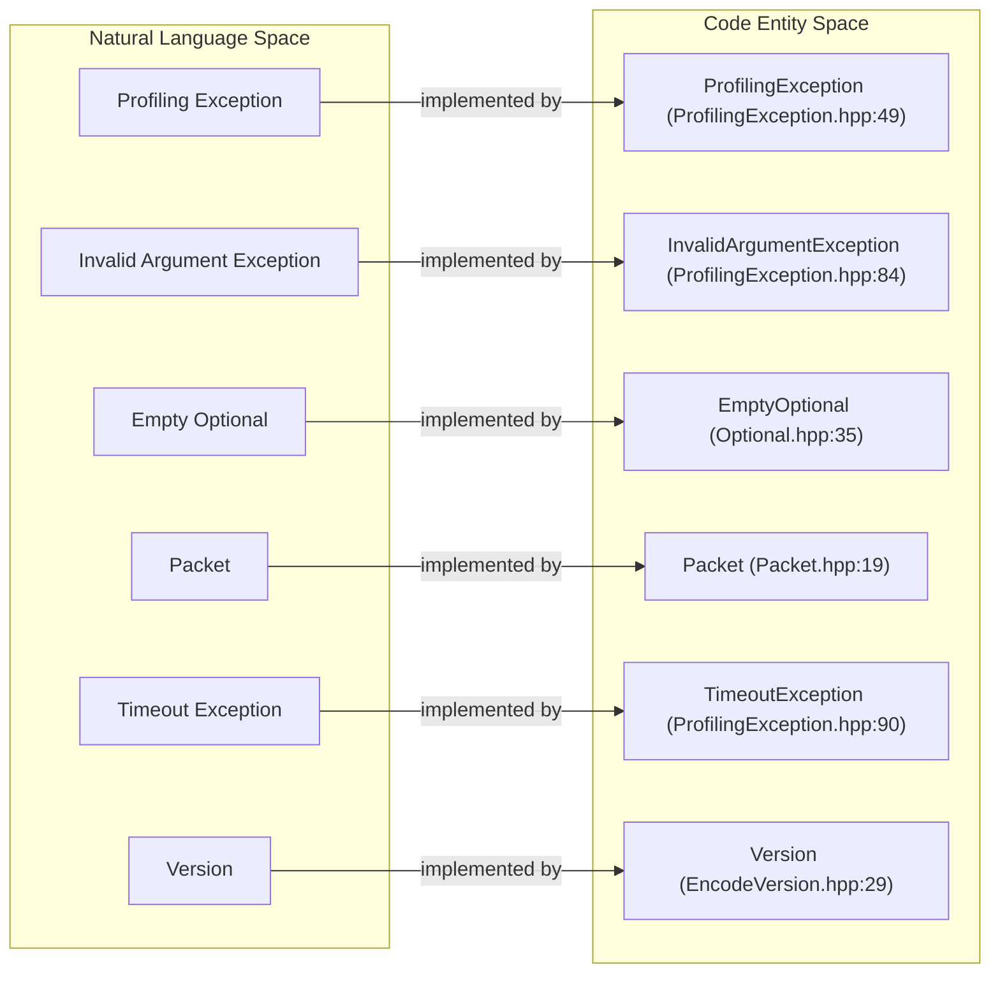
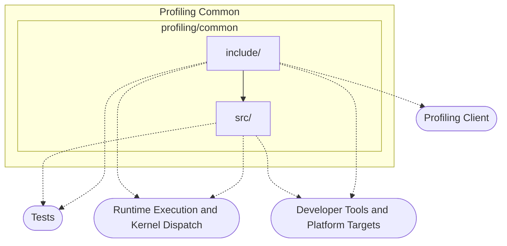
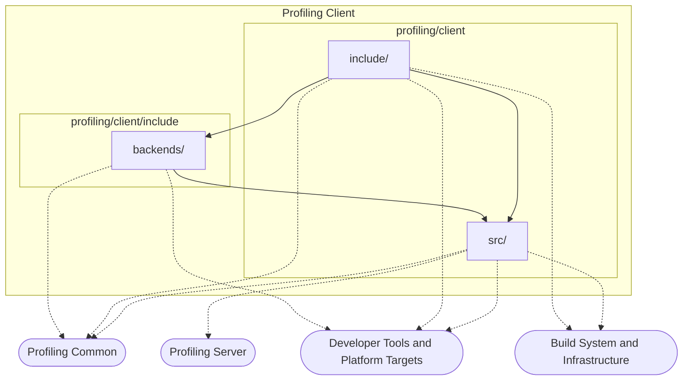
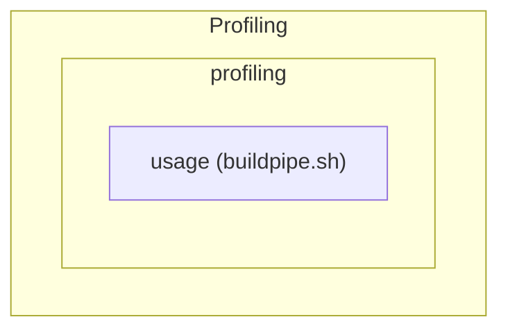

# Developer Tools and Platform Targets

> Architectural overview of Developer Tools and Platform Targets, spanning 70 source files and 662 code symbols across 4 subsystems.

Relevant source files

The following files were used as context for generating this wiki page:

- [profiling/common/include/ProfilingException.hpp](profiling/common/include/ProfilingException.hpp)
- [profiling/common/include/Packet.hpp](profiling/common/include/Packet.hpp)
- [profiling/common/include/Optional.hpp](profiling/common/include/Optional.hpp)
- [profiling/common/include/EncodeVersion.hpp](profiling/common/include/EncodeVersion.hpp)
- [profiling/common/include/Logging.hpp](profiling/common/include/Logging.hpp)
- [profiling/common/include/CounterDirectory.hpp](profiling/common/include/CounterDirectory.hpp)
- [profiling/client/include/CounterIdMap.hpp](profiling/client/include/CounterIdMap.hpp)
- [profiling/client/include/ICounterValues.hpp](profiling/client/include/ICounterValues.hpp)
- [profiling/client/include/CounterStatus.hpp](profiling/client/include/CounterStatus.hpp)
- [profiling/client/include/Holder.hpp](profiling/client/include/Holder.hpp)
- [profiling/client/include/ILocalPacketHandler.hpp](profiling/client/include/ILocalPacketHandler.hpp)
- [profiling/client/include/CounterValue.hpp](profiling/client/include/CounterValue.hpp)
- [profiling/server/include/basePipeServer/BasePipeServer.hpp](profiling/server/include/basePipeServer/BasePipeServer.hpp)
- [profiling/server/include/timelineDecoder/DirectoryCaptureCommandHandler.hpp](profiling/server/include/timelineDecoder/DirectoryCaptureCommandHandler.hpp)
- [profiling/server/include/timelineDecoder/ITimelineDecoder.hpp](profiling/server/include/timelineDecoder/ITimelineDecoder.hpp)
- [profiling/server/include/basePipeServer/ConnectionHandler.hpp](profiling/server/include/basePipeServer/ConnectionHandler.hpp)
- [profiling/server/src/basePipeServer/BasePipeServer.cpp](profiling/server/src/basePipeServer/BasePipeServer.cpp)
- [profiling/server/include/timelineDecoder/TimelineCaptureCommandHandler.hpp](profiling/server/include/timelineDecoder/TimelineCaptureCommandHandler.hpp)
- [profiling/buildpipe.sh](profiling/buildpipe.sh)

## Purpose and Scope

This chapter covers **Developer Tools and Platform Targets** across the repository, detailing the core abstractions, data structures, transformation pipelines, and runtime/build integrations that implement this layer.

**Scope**: This document provides an architectural hub for the following child subsystems:
- **Profiling Common**: See [[6.1-profiling-common|Profiling Common]].
- **Profiling Client**: See [[6.2-profiling-client|Profiling Client]].
- **Profiling Server**: See [[6.3-profiling-server|Profiling Server]].
- **Profiling**: See [[6.4-profiling|Profiling]].

Sources: [profiling/common/include/ProfilingException.hpp:49-65](), [profiling/common/include/ProfilingException.hpp:84-88](), [profiling/common/include/Optional.hpp:35-35](), [profiling/common/include/Packet.hpp:19-88]()

---

## System Mapping: Natural Language Space to Code Entity Space

Sources: [profiling/common/include/ProfilingException.hpp:49-65](), [profiling/common/include/ProfilingException.hpp:84-88](), [profiling/common/include/Optional.hpp:35-35](), [profiling/common/include/Packet.hpp:19-88](), [profiling/common/include/ProfilingException.hpp:90-94]()

---

## 1. Profiling Common

Profiling Common subsystem (`profiling/common`), covering 28 files and 244 symbols. Key symbols include `IgnoreUnused`, `ProfilingException`, `CentreAlignFormatting`, `InvalidArgumentException`. [profiling/common/include/ProfilingException.hpp:49-65](), [profiling/common/include/ProfilingException.hpp:84-88](), [profiling/common/include/Optional.hpp:35-35]()

### Primary Code Entities

- **`ProfilingException`** (Class in [profiling/common/include/ProfilingException.hpp:49-65]()): /// General Exception class for Profiling code
- **`InvalidArgumentException`** (Class in [profiling/common/include/ProfilingException.hpp:84-88]()): Core implementation entity.
- **`EmptyOptional`** (Class in [profiling/common/include/Optional.hpp:35-35]()): /// EmptyOptional is used to initialize the Optional class in case we want /// to have default value for an Optional in a function declaration.
- **`Packet`** (Class in [profiling/common/include/Packet.hpp:19-88]()): Core implementation entity.
- **`IgnoreUnused`** (Function in [profiling/common/include/IgnoreUnused.hpp:15-16]()): (Ts&&...)
- **`CentreAlignFormatting`** (Function in [profiling/common/src/CommonProfilingUtils.cpp:126-144]()): (const std::string& stringToPass, const int spacingWidth)

### Profiling Common Architecture Flow

For details, see [[6.1-profiling-common|Profiling Common]].

Sources: [profiling/common/include/ProfilingException.hpp:49-65](), [profiling/common/include/ProfilingException.hpp:84-88](), [profiling/common/include/Optional.hpp:35-35](), [profiling/common/include/Packet.hpp:19-88]()

---

## 2. Profiling Client

Profiling Client subsystem (`profiling/client`), covering 28 files and 340 symbols. Key symbols include `ReadUint32`, `GetCurrentState`, `WriteUint32`, `GetNextGuid`. [profiling/client/include/ILocalPacketHandler.hpp:29-39](), [profiling/client/include/CounterIdMap.hpp:34-49](), [profiling/client/include/CounterIdMap.hpp:16-22]()

### Primary Code Entities

- **`IInternalProfilingConnection`** (Class in [profiling/client/include/ILocalPacketHandler.hpp:29-39]()): // the handlers need to be able to do two // things to service the FileOnlyProfilingConnection // and any other implementation of IProfilingConnection // set the endianness and wri
- **`CounterIdMap`** (Class in [profiling/client/include/CounterIdMap.hpp:34-49]()): Core implementation entity.
- **`ICounterMappings`** (Class in [profiling/client/include/CounterIdMap.hpp:16-22]()): Core implementation entity.
- **`IRegisterCounterMapping`** (Class in [profiling/client/include/CounterIdMap.hpp:24-32]()): Core implementation entity.
- **`ReadUint32`** (Function in [profiling/client/src/ProfilingUtils.cpp:90-95]()): (const IPacketBufferPtr& packetBuffer, unsigned int offset)
- **`WriteUint32`** (Function in [profiling/client/src/ProfilingUtils.cpp:55-60]()): (const IPacketBufferPtr& packetBuffer, unsigned int offset, uint32_t value)

### Profiling Client Architecture Flow

For details, see [[6.2-profiling-client|Profiling Client]].

Sources: [profiling/client/include/ILocalPacketHandler.hpp:29-39](), [profiling/client/include/CounterIdMap.hpp:34-49](), [profiling/client/include/CounterIdMap.hpp:16-22](), [profiling/client/include/CounterIdMap.hpp:24-32]()

---

## 3. Profiling Server

Profiling Server subsystem (`profiling/server`), covering 13 files and 77 symbols. Key symbols include `ParseData`, `ReceivePacket`, `ReadCategoryRecords`, `ParseData`. [profiling/server/include/basePipeServer/BasePipeServer.hpp:30-112](), [profiling/server/include/timelineDecoder/DirectoryCaptureCommandHandler.hpp:19-31](), [profiling/server/include/timelineDecoder/DirectoryCaptureCommandHandler.hpp:33-86]()

### Primary Code Entities

- **`BasePipeServer`** (Class in [profiling/server/include/basePipeServer/BasePipeServer.hpp:30-112]()): Core implementation entity.
- **`CounterDirectoryEventRecord`** (Class in [profiling/server/include/timelineDecoder/DirectoryCaptureCommandHandler.hpp:19-31]()): Core implementation entity.
- **`DirectoryCaptureCommandHandler`** (Class in [profiling/server/include/timelineDecoder/DirectoryCaptureCommandHandler.hpp:33-86]()): Core implementation entity.
- **`ConnectionHandler`** (Class in [profiling/server/include/basePipeServer/ConnectionHandler.hpp:17-45]()): Core implementation entity.
- **`TranslateUIDCopyToOriginal`** (Method in [profiling/server/include/timelineDecoder/DirectoryCaptureCommandHandler.hpp:63-66]()): /** * Given a Uid that came from a copy of the counter directory translate it to the original. * * @param copyUid * @return the original Uid that the copy maps to. */
- **`Close`** (Method in [profiling/server/include/basePipeServer/BasePipeServer.hpp:54-57]()): /// Close the client connection /// @return 0 if successful

### Profiling Server Architecture Flow

```mermaid
flowchart TD
  subgraph sub_this["Profiling Server"]
    subgraph sg_0["profiling/server/include/basePipeServer"]
      n_profiling_server_include_basePipeServer_BasePipe["BasePipeServer (BasePipeServer.hpp)"]
      n_profiling_server_include_basePipeServer_Connecti["ConnectionHandler (ConnectionHandler.hpp)"]
    end
    subgraph sg_1["profiling/server/include/timelineDecoder"]
      n_profiling_server_include_timelineDecoder_Directo["CounterDirectoryEventRecord (DirectoryCaptureCommandHandler.hpp)"]
      n_profiling_server_include_timelineDecoder_ITimeli["ITimelineDecoder (ITimelineDecoder.hpp)"]
      n_profiling_server_include_timelineDecoder_Timelin["TimelineCaptureCommandHandler (TimelineCaptureCommandHandler.hpp)"]
    end
    subgraph sg_2["profiling/server/src/basePipeServer"]
      n_profiling_server_src_basePipeServer_BasePipeServ["ReceivePacket (BasePipeServer.cpp)"]
      n_profiling_server_src_basePipeServer_ConnectionHa["ConnectionHandler (ConnectionHandler.cpp)"]
    end
    subgraph sg_3["profiling/server/src/timelineDecoder"]
      n_profiling_server_src_timelineDecoder_TimelineDec["print (TimelineDecoder.cpp)"]
      n_profiling_server_src_timelineDecoder_DirectoryCa["ParseData (DirectoryCaptureCommandHandler.cpp)"]
      n_profiling_server_src_timelineDecoder_TimelineCap["ParseData (TimelineCaptureCommandHandler.cpp)"]
      n_profiling_server_src_timelineDecoder_TimelineDir["ParseData (TimelineDirectoryCaptureCommandHandler.cpp)"]
    end
  end
  n_page_2_build_system_and_infrastructure(["Build System and Infrastructure"])
  n_page_6_1_profiling_common(["Profiling Common"])
  n_page_6_2_profiling_client(["Profiling Client"])
  n_page_6_developer_tools_and_platform_targets(["Developer Tools and Platform Targets"])
  n_profiling_server_src_timelineDecoder_TimelineCap -.-> n_page_6_2_profiling_client
  n_profiling_server_include_timelineDecoder_Timelin -.-> n_page_6_1_profiling_common
  n_profiling_server_src_timelineDecoder_DirectoryCa -.-> n_page_6_2_profiling_client
  n_profiling_server_src_basePipeServer_BasePipeServ -.-> n_page_6_1_profiling_common
  n_profiling_server_include_timelineDecoder_ITimeli --> n_profiling_server_include_timelineDecoder_Timelin
  n_profiling_server_include_timelineDecoder_Timelin --> n_profiling_server_src_timelineDecoder_TimelineDec
  n_profiling_server_include_timelineDecoder_Directo -.-> n_page_6_1_profiling_common
  n_profiling_server_include_basePipeServer_BasePipe -.-> n_page_6_1_profiling_common
  n_profiling_server_src_timelineDecoder_TimelineDec -.-> n_page_6_1_profiling_common
  n_profiling_server_src_timelineDecoder_TimelineDec -.-> n_page_2_build_system_and_infrastructure
  n_profiling_server_src_timelineDecoder_TimelineCap -.-> n_page_6_developer_tools_and_platform_targets
  n_profiling_server_src_basePipeServer_ConnectionHa -.-> n_page_6_1_profiling_common
  n_profiling_server_include_timelineDecoder_Timelin --> n_profiling_server_src_timelineDecoder_TimelineDir
  n_profiling_server_src_timelineDecoder_TimelineDir -.-> n_page_2_build_system_and_infrastructure
  n_profiling_server_src_basePipeServer_BasePipeServ -.-> n_page_6_developer_tools_and_platform_targets
  n_profiling_server_src_timelineDecoder_TimelineDir -.-> n_page_6_1_profiling_common
  n_profiling_server_include_timelineDecoder_Directo --> n_profiling_server_src_timelineDecoder_DirectoryCa
  n_profiling_server_src_basePipeServer_BasePipeServ -.-> n_page_2_build_system_and_infrastructure
  n_profiling_server_src_basePipeServer_ConnectionHa -.-> n_page_2_build_system_and_infrastructure
  n_profiling_server_include_timelineDecoder_Directo -.-> n_page_6_2_profiling_client
  n_profiling_server_src_timelineDecoder_TimelineDir -.-> n_page_6_2_profiling_client
```

For details, see [[6.3-profiling-server|Profiling Server]].

Sources: [profiling/server/include/basePipeServer/BasePipeServer.hpp:30-112](), [profiling/server/include/timelineDecoder/DirectoryCaptureCommandHandler.hpp:19-31](), [profiling/server/include/timelineDecoder/DirectoryCaptureCommandHandler.hpp:33-86](), [profiling/server/include/basePipeServer/ConnectionHandler.hpp:17-45]()

---

## 4. Profiling

Profiling subsystem (`profiling`), covering 1 files and 1 symbols. Key symbols include `usage`. [profiling/buildpipe.sh:23-30]()

### Primary Code Entities

- **`usage`** (Function in [profiling/buildpipe.sh:23-30]()): Core implementation entity.

### Profiling Architecture Flow

For details, see [[6.4-profiling|Profiling]].

Sources: [profiling/buildpipe.sh:23-30]()

---

## Official Documentation & Architectural References

- **Profiling Common** ([wiki/6.1-profiling-common.md]()): # Profiling Common ↑ [[6-developer-tools-and-platform-targets|Developer Tools and Platform Targets]] > Profiling Common subsystem (`profiling/common`), covering 28 files and 244 symbols. Key symbols include `IgnoreUnused`, `ProfilingException`, `CentreAlignFormatting`, `InvalidArgumentException`. 
 
Relevant source files
 The followi
- **Runtime Execution and Kernel Dispatch** ([wiki/5-runtime-execution-and-kernel-dispatch.md]()): # Runtime Execution and Kernel Dispatch > Architectural overview of Runtime Execution and Kernel Dispatch, spanning 157 source files and 3718 code symbols across 6 subsystems. 
 
Relevant source files
 The following files were used as context for generating this wiki page: - [samples/common/include/Audio/DataStructures.hpp](samples/c
- **ArmNN** ([wiki/5.2-armnn.md]()): # ArmNN ↑ [[5-runtime-execution-and-kernel-dispatch|Runtime Execution and Kernel Dispatch]] > ArmNN subsystem (`include/armnn`), covering 21 files and 440 symbols. Key symbols include `GetShape`, `InvalidArgumentException`, `GetNumElements`, `Exception`. 
 
Relevant source files
 The following files were used as context for generatin
- **Profiling Client** ([wiki/6.2-profiling-client.md]()): # Profiling Client ↑ [[6-developer-tools-and-platform-targets|Developer Tools and Platform Targets]] > Profiling Client subsystem (`profiling/client`), covering 28 files and 340 symbols. Key symbols include `ReadUint32`, `GetCurrentState`, `WriteUint32`, `GetNextGuid`. 
 
Relevant source files
 The following files were used as contex

Sources: [wiki/6.1-profiling-common.md](), [wiki/5-runtime-execution-and-kernel-dispatch.md](), [wiki/5.2-armnn.md](), [wiki/6.2-profiling-client.md]()

## Sub-pages

- [[6.1-profiling-common|Profiling Common]]
- [[6.2-profiling-client|Profiling Client]]
- [[6.3-profiling-server|Profiling Server]]
- [[6.4-profiling|Profiling]]

## Related pages

- [[1-overview|Overview]]
- [[3-backend-delegation-and-hardware-providers|Backend Delegation and Hardware Providers]]
- [[3.1-backends-backendscommon|Backends Backendscommon]]
- [[3.2-backends-reference|Backends Reference]]
- [[3.3-backends-opencl|Backends OpenCL]]
- [[3.4-backends-aclcommon|Backends Aclcommon]]
- [[3.6-other-backends|Other Backends]]
- [[5-runtime-execution-and-kernel-dispatch|Runtime Execution and Kernel Dispatch]]

## Related documents

- `wiki/6.1-profiling-common.md` — Profiling Common (score 95.8057, via bm25)
- `wiki/5-runtime-execution-and-kernel-dispatch.md` — Runtime Execution and Kernel Dispatch (score 67.127, via bm25)
- `wiki/5.2-armnn.md` — ArmNN (score 66.5761, via bm25)
- `wiki/6.2-profiling-client.md` — Profiling Client (score 63.6636, via bm25)
- `wiki/6.3-profiling-server.md` — Profiling Server (score 62.4389, via bm25)

## Sources

- [`profiling/common/include/ProfilingException.hpp`](https://github.com/ARM-software/armnn/blob/branches/armnn_24_11/profiling/common/include/ProfilingException.hpp)
- [`profiling/common/include/Packet.hpp`](https://github.com/ARM-software/armnn/blob/branches/armnn_24_11/profiling/common/include/Packet.hpp)
- [`profiling/common/include/Optional.hpp`](https://github.com/ARM-software/armnn/blob/branches/armnn_24_11/profiling/common/include/Optional.hpp)
- [`profiling/common/include/EncodeVersion.hpp`](https://github.com/ARM-software/armnn/blob/branches/armnn_24_11/profiling/common/include/EncodeVersion.hpp)
- [`profiling/common/include/Logging.hpp`](https://github.com/ARM-software/armnn/blob/branches/armnn_24_11/profiling/common/include/Logging.hpp)
- [`profiling/common/include/CounterDirectory.hpp`](https://github.com/ARM-software/armnn/blob/branches/armnn_24_11/profiling/common/include/CounterDirectory.hpp)
- [`profiling/client/include/CounterIdMap.hpp`](https://github.com/ARM-software/armnn/blob/branches/armnn_24_11/profiling/client/include/CounterIdMap.hpp)
- [`profiling/client/include/ICounterValues.hpp`](https://github.com/ARM-software/armnn/blob/branches/armnn_24_11/profiling/client/include/ICounterValues.hpp)
- [`profiling/client/include/CounterStatus.hpp`](https://github.com/ARM-software/armnn/blob/branches/armnn_24_11/profiling/client/include/CounterStatus.hpp)
- [`profiling/client/include/Holder.hpp`](https://github.com/ARM-software/armnn/blob/branches/armnn_24_11/profiling/client/include/Holder.hpp)
- [`profiling/client/include/ILocalPacketHandler.hpp`](https://github.com/ARM-software/armnn/blob/branches/armnn_24_11/profiling/client/include/ILocalPacketHandler.hpp)
- [`profiling/client/include/CounterValue.hpp`](https://github.com/ARM-software/armnn/blob/branches/armnn_24_11/profiling/client/include/CounterValue.hpp)
- [`profiling/server/include/basePipeServer/BasePipeServer.hpp`](https://github.com/ARM-software/armnn/blob/branches/armnn_24_11/profiling/server/include/basePipeServer/BasePipeServer.hpp)
- [`profiling/server/include/timelineDecoder/DirectoryCaptureCommandHandler.hpp`](https://github.com/ARM-software/armnn/blob/branches/armnn_24_11/profiling/server/include/timelineDecoder/DirectoryCaptureCommandHandler.hpp)
- [`profiling/server/include/timelineDecoder/ITimelineDecoder.hpp`](https://github.com/ARM-software/armnn/blob/branches/armnn_24_11/profiling/server/include/timelineDecoder/ITimelineDecoder.hpp)
- [`profiling/server/include/basePipeServer/ConnectionHandler.hpp`](https://github.com/ARM-software/armnn/blob/branches/armnn_24_11/profiling/server/include/basePipeServer/ConnectionHandler.hpp)
- [`profiling/server/src/basePipeServer/BasePipeServer.cpp`](https://github.com/ARM-software/armnn/blob/branches/armnn_24_11/profiling/server/src/basePipeServer/BasePipeServer.cpp)
- [`profiling/server/include/timelineDecoder/TimelineCaptureCommandHandler.hpp`](https://github.com/ARM-software/armnn/blob/branches/armnn_24_11/profiling/server/include/timelineDecoder/TimelineCaptureCommandHandler.hpp)
- [`profiling/buildpipe.sh`](https://github.com/ARM-software/armnn/blob/branches/armnn_24_11/profiling/buildpipe.sh)

## Dynamic Knowledge Links (Code Graph ↔ LLM-Wiki / RAG)

### Linked Architecture & Design Documents

| Document | Match Channel | Score | Shared Code Symbols |
|---|---|---|---|
| [[6.1-profiling-common|Profiling Common]] | `bm25+entity(8)` | `107.806` | `BadOptionalAccessException`, `EmptyOptional`, `InvalidArgumentException`, `Optional`, `Packet` |
| [[5.2-armnn|ArmNN]] | `bm25+entity(4)` | `72.576` | `EmptyOptional`, `InvalidArgumentException`, `ProfilingException`, `UnimplementedException` |
| [[5-runtime-execution-and-kernel-dispatch|Runtime Execution and Kernel Dispatch]] | `bm25+entity(3)` | `71.627` | `EmptyOptional`, `InvalidArgumentException`, `ProfilingException` |
| [[6.2-profiling-client|Profiling Client]] | `bm25+entity(4)` | `69.664` | `CaptureData`, `InvalidArgumentException`, `Packet`, `ProfilingException` |
| [[6.3-profiling-server|Profiling Server]] | `bm25+entity(4)` | `68.439` | `InvalidArgumentException`, `Optional`, `Packet`, `ProfilingException` |
| [[6.4-profiling|Profiling]] | `wikilink:6.1-profiling-common+entity(3)` | `52.403` | `Entity`, `Location`, `ProfilingException` |

### High-Centrality Bridge Symbols (CBM Graph)

| Symbol | Kind | Source Location | Fan-In / Fan-Out |
|---|---|---|---|
| `ProfilingException` | Class | [profiling/common/include/ProfilingException.hpp:49-65]() | in: `32` / out: `0` |
| `InvalidArgumentException` | Class | [profiling/common/include/ProfilingException.hpp:84-88]() | in: `18` / out: `0` |
| `EmptyOptional` | Class | [profiling/common/include/Optional.hpp:35-35]() | in: `4` / out: `0` |
| `Packet` | Class | [profiling/common/include/Packet.hpp:19-88]() | in: `6` / out: `0` |
| `TimeoutException` | Class | [profiling/common/include/ProfilingException.hpp:90-94]() | in: `6` / out: `0` |
| `Version` | Class | [profiling/common/include/EncodeVersion.hpp:29-73]() | in: `0` / out: `0` |

Sources: [profiling/common/include/ProfilingException.hpp:49-65](), [profiling/common/include/ProfilingException.hpp:84-88](), [profiling/common/include/Optional.hpp:35-35](), [profiling/common/include/Packet.hpp:19-88]()

### Cross-Subsystem Coupling

- [[6.1-profiling-common|Profiling Common]] — call/import coupling weight `77.0`
- [[6.2-profiling-client|Profiling Client]] — call/import coupling weight `66.0`
- [[2-build-system-and-infrastructure|Build System and Infrastructure]] — call/import coupling weight `37.0`
- [[2.1-build-infrastructure|Build Infrastructure]] — call/import coupling weight `37.0`
- [[6.3-profiling-server|Profiling Server]] — call/import coupling weight `24.0`
- [[7-glossary|Glossary]] — call/import coupling weight `16.0`
