# Development Guide

<details>
<summary>Relevant source files</summary>

The following files were used as context for generating this wiki page:

- [cmake/GlobalConfig.cmake](cmake/GlobalConfig.cmake)
- [delegate/armnnDelegateJNI/CMakeLists.txt](delegate/armnnDelegateJNI/CMakeLists.txt)
- [delegate/armnnDelegateJNI/README.md](delegate/armnnDelegateJNI/README.md)
- [delegate/armnnDelegateJNI/README.md.license](delegate/armnnDelegateJNI/README.md.license)
- [delegate/armnnDelegateJNI/src/armnn_delegate_jni.cpp](delegate/armnnDelegateJNI/src/armnn_delegate_jni.cpp)
- [delegate/armnnDelegateJNI/version_script](delegate/armnnDelegateJNI/version_script)
- [profiling/client/src/ProfilingService.cpp](profiling/client/src/ProfilingService.cpp)
- [profiling/server/src/timelineDecoder/CMakeLists.txt](profiling/server/src/timelineDecoder/CMakeLists.txt)
- [samples/CMakeLists.txt](samples/CMakeLists.txt)
- [src/armnnDeserializer/CMakeLists.txt](src/armnnDeserializer/CMakeLists.txt)
- [src/armnnSerializer/CMakeLists.txt](src/armnnSerializer/CMakeLists.txt)
- [src/armnnTestUtils/CMakeLists.txt](src/armnnTestUtils/CMakeLists.txt)
- [src/armnnTfLiteParser/CMakeLists.txt](src/armnnTfLiteParser/CMakeLists.txt)
- [src/backends/backendsCommon/common.mk](src/backends/backendsCommon/common.mk)
- [src/backends/backendsCommon/test/CMakeLists.txt](src/backends/backendsCommon/test/CMakeLists.txt)
- [src/backends/backendsCommon/test/EndToEndTestImpl.hpp](src/backends/backendsCommon/test/EndToEndTestImpl.hpp)
- [src/backends/cl/test/ClEndToEndTests.cpp](src/backends/cl/test/ClEndToEndTests.cpp)
- [src/backends/dynamic/reference/CMakeLists.txt](src/backends/dynamic/reference/CMakeLists.txt)
- [src/backends/neon/test/NeonEndToEndTests.cpp](src/backends/neon/test/NeonEndToEndTests.cpp)
- [src/backends/reference/test/RefEndToEndTests.cpp](src/backends/reference/test/RefEndToEndTests.cpp)
- [src/backends/tosaCommon/TosaMappings.cpp](src/backends/tosaCommon/TosaMappings.cpp)
- [src/backends/tosaCommon/operatorMappings/CMakeLists.txt](src/backends/tosaCommon/operatorMappings/CMakeLists.txt)
- [src/backends/tosaCommon/operatorMappings/TosaCommonOperators.hpp](src/backends/tosaCommon/operatorMappings/TosaCommonOperators.hpp)
- [src/backends/tosaCommon/operatorMappings/TosaOperatorUtils.hpp](src/backends/tosaCommon/operatorMappings/TosaOperatorUtils.hpp)
- [src/backends/tosaCommon/test/OneToManyMappingTests.cpp](src/backends/tosaCommon/test/OneToManyMappingTests.cpp)
- [src/backends/tosaCommon/test/OneToOneMappingTests.cpp](src/backends/tosaCommon/test/OneToOneMappingTests.cpp)
- [src/backends/tosaCommon/test/TosaTestUtils.hpp](src/backends/tosaCommon/test/TosaTestUtils.hpp)
- [src/backends/tosaReference/TosaRefLayerSupport.cpp](src/backends/tosaReference/TosaRefLayerSupport.cpp)
- [src/backends/tosaReference/test/TosaRefEndToEndTests.cpp](src/backends/tosaReference/test/TosaRefEndToEndTests.cpp)
- [src/backends/tosaReference/test/TosaRefLayerSupportTests.cpp](src/backends/tosaReference/test/TosaRefLayerSupportTests.cpp)

</details>


This guide provides essential information for developers working on the ArmNN codebase, covering build configuration, testing frameworks, backend development, and debugging tools. It focuses on the practical aspects of developing, testing, and contributing to ArmNN.

For information about ArmNN's overall architecture and components, see [[2-core-architecture|Core Architecture]]. For details about specific tools and applications, see [[5-tools-and-applications|Tools and Applications]].

## Build System Configuration

ArmNN uses CMake with extensive configuration options to control which components are built and how they are configured. The primary build configuration is managed through [cmake/GlobalConfig.cmake:1-496]().

### Core Build Options

The build system provides numerous options that control feature availability and backend support:

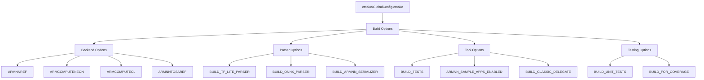

Key configuration options include:

| Option | Description | Default |
|--------|-------------|---------|
| `BUILD_UNIT_TESTS` | Build unit test infrastructure | ON |
| `BUILD_TESTS` | Build test applications | OFF |
| `ARMNNREF` | Reference CPU backend | ON |
| `ARMCOMPUTENEON` | ARM NEON acceleration | OFF |
| `ARMCOMPUTECL` | OpenCL GPU acceleration | OFF |
| `BUILD_TF_LITE_PARSER` | TensorFlow Lite parser | OFF |
| `BUILD_ONNX_PARSER` | ONNX model parser | OFF |

Sources: [cmake/GlobalConfig.cmake:7-66]()

### Dependency Management

The build system automatically manages external dependencies including ARM Compute Library, Flatbuffers, and protocol buffers. ARM Compute Library integration is handled through version-specific scripts:

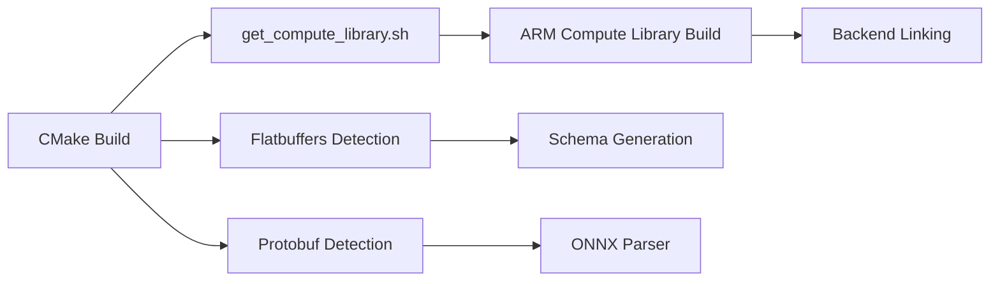

Sources: [cmake/GlobalConfig.cmake:295-443]()

## Testing Framework Architecture

ArmNN employs a comprehensive multi-layered testing strategy with specialized test frameworks for different validation levels.

### Test Infrastructure Overview

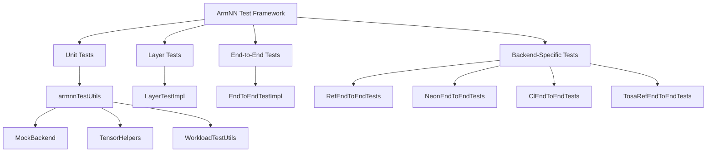

The testing framework is built around several core components defined in [src/armnnTestUtils/CMakeLists.txt:6-52]() and [src/backends/backendsCommon/test/CMakeLists.txt:6-245]().

### End-to-End Testing Pattern

End-to-end tests validate complete inference pipelines across different backends using a common pattern:

```cpp
// Pattern used across all backend tests
template<DataType ArmnnIType, DataType ArmnnOType>
void EndToEndLayerTestImpl(INetworkPtr network,
                           const std::map<int, std::vector<TInput>>& inputTensorData,
                           const std::map<int, std::vector<TOutput>>& expectedOutputData,
                           std::vector<BackendId> backends)
```

Each backend implements comprehensive test suites following this pattern:
- **Reference Backend**: [src/backends/reference/test/RefEndToEndTests.cpp:56-58]()
- **NEON Backend**: [src/backends/neon/test/NeonEndToEndTests.cpp:42-43]()
- **OpenCL Backend**: [src/backends/cl/test/ClEndToEndTests.cpp:40-42]()
- **TOSA Reference**: [src/backends/tosaReference/test/TosaRefEndToEndTests.cpp:40-42]()

Sources: [src/backends/backendsCommon/test/EndToEndTestImpl.hpp:131-185](), [src/backends/reference/test/RefEndToEndTests.cpp:1-65]()

### Layer Support Testing

Backend layer support is validated through the `IsLayerSupported` interface, with backends implementing validation logic:

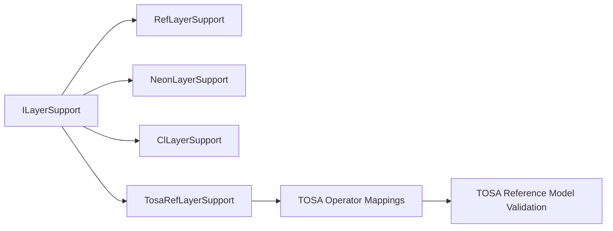

TOSA backend testing demonstrates advanced validation using the TOSA reference model for compliance checking [src/backends/tosaReference/TosaRefLayerSupport.cpp:203-233]().

Sources: [src/backends/tosaReference/TosaRefLayerSupport.cpp:21-234](), [src/backends/tosaReference/test/TosaRefLayerSupportTests.cpp:17-159]()

## Backend Development Process

Developing a new backend requires implementing several key interfaces and providing comprehensive test coverage.

### Backend Implementation Structure

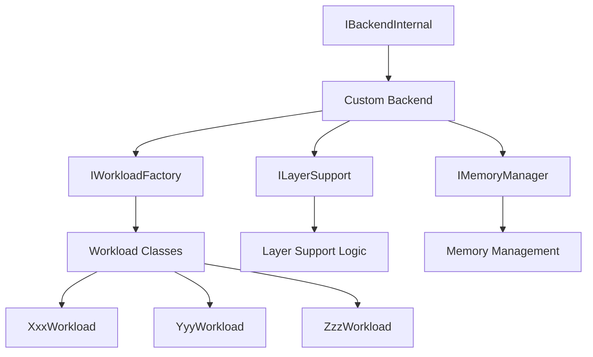

### Testing Requirements for Backends

Backend developers must provide comprehensive test coverage following established patterns:

1. **Unit Tests**: Individual workload validation
2. **Layer Tests**: Layer-specific functionality testing using templates from [src/backends/backendsCommon/test/layerTests/]()
3. **End-to-End Tests**: Complete inference pipeline validation
4. **Operator Mapping Tests**: For backends with operator transformations (like TOSA)

Example test structure for TOSA backend operator mappings:
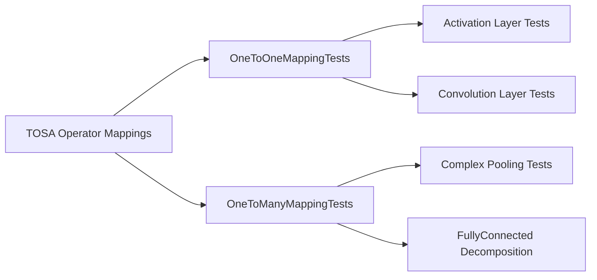

Sources: [src/backends/tosaCommon/test/OneToOneMappingTests.cpp:14-25](), [src/backends/tosaCommon/test/OneToManyMappingTests.cpp:18-46]()

### Dynamic Backend Support

ArmNN supports dynamic backend loading for runtime extensibility. The test infrastructure includes comprehensive dynamic backend testing:

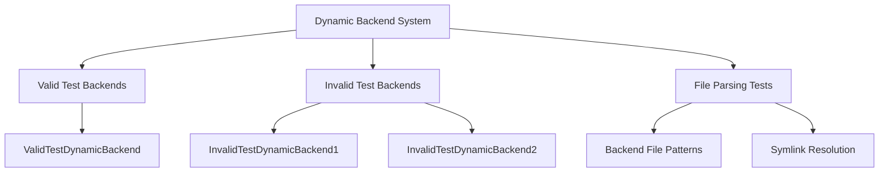

Sources: [src/backends/backendsCommon/test/CMakeLists.txt:267-395]()

## Profiling and Performance Analysis

ArmNN provides extensive profiling infrastructure for performance analysis and optimization during development.

### Profiling Service Architecture

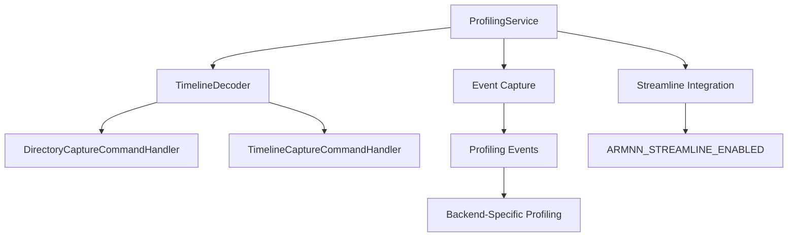

The profiling system supports:
- Timeline data collection for execution analysis
- Backend-specific performance metrics
- Integration with ARM Streamline for detailed profiling
- Event capture for debugging and optimization

Sources: [profiling/client/src/ProfilingService.cpp:1-26](), [profiling/server/src/timelineDecoder/CMakeLists.txt:6-12]()

### Development Build Options

For development and debugging, several specialized build configurations are available:

| Option | Purpose | Usage |
|--------|---------|-------|
| `BUILD_FOR_COVERAGE` | Code coverage analysis | Adds coverage flags and gcov support |
| `HEAP_PROFILING` | Memory profiling | Links with gperftools for heap analysis |
| `LEAK_CHECKING` | Memory leak detection | Enables leak checking infrastructure |
| `PROFILING_BACKEND_STREAMLINE` | Streamline profiling | Forward events to DS-5/Streamline |

Sources: [cmake/GlobalConfig.cmake:17-20](), [cmake/GlobalConfig.cmake:149-161]()

## Schema and Code Generation

ArmNN uses Flatbuffers for serialization and requires code generation for parser development.

### Flatbuffers Schema Workflow

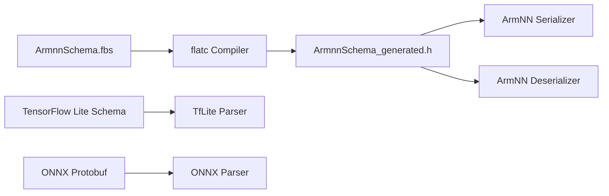

The build system automatically manages schema compilation:
- ArmNN serialization schemas: [src/armnnSerializer/CMakeLists.txt:19-26]()
- TensorFlow Lite schema integration: [src/armnnTfLiteParser/CMakeLists.txt:28-31]()
- ONNX protobuf handling: [cmake/GlobalConfig.cmake:217-244]()

Sources: [src/armnnSerializer/CMakeLists.txt:19-26](), [src/armnnTfLiteParser/CMakeLists.txt:5-18]()

## Sample Applications and Examples

ArmNN provides several sample applications demonstrating different usage patterns and integration approaches.

### Sample Application Types

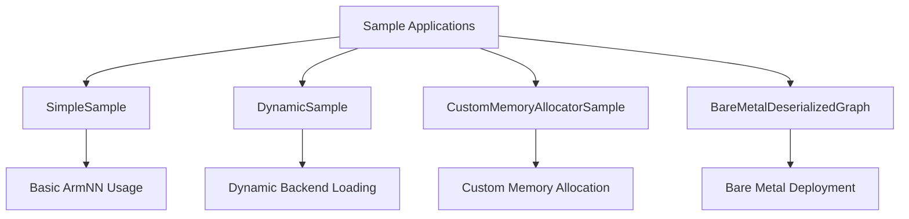

Each sample demonstrates specific development patterns:
- **SimpleSample**: Basic network creation and execution
- **DynamicSample**: Runtime backend loading
- **CustomMemoryAllocatorSample**: Custom memory management for resource-constrained environments
- **BareMetalDeserializedGraph**: Deployment without operating system support

Sources: [samples/CMakeLists.txt:6-25]()

## JNI Development Support

For Android and Java integration, ArmNN provides experimental JNI (Java Native Interface) support for the TensorFlow Lite delegate.

### JNI Build Configuration

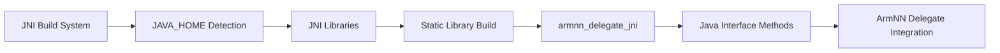

The JNI interface requires static builds and specific configuration options as documented in [delegate/armnnDelegateJNI/README.md:3-8]().

Sources: [delegate/armnnDelegateJNI/CMakeLists.txt:10-32](), [delegate/armnnDelegateJNI/src/armnn_delegate_jni.cpp:16-21]()

## Related Wiki Pages

- [[6.1-build-system|Build System]]
- [[6.2-testing-framework|Testing Framework]]
- [[6.3-profiling-system|Profiling System]]
- [[6.4-documentation-generation|Documentation Generation]]
- [[2-core-architecture|Core Architecture]]
- [[5-tools-and-applications|Tools and Applications]]


## Dynamic Knowledge Links (Code Graph ↔ LLM-Wiki / RAG)

### Linked Architecture & Design Documents

| Document | Match Channel | Score | Shared Code Symbols |
|---|---|---|---|
| [[4.4-tosa-backend|4.4 TOSA Backend]] | `bm25+entity(8)` | `91.066` | `ArmNNToDType`, `EndToEndLayerTestImpl`, `GenerateUniqueInputName`, `GenerateUniqueName`, `GenerateUniqueOutputName` |
| [[6.2-testing-framework|6.2 Testing Framework]] | `bm25+entity(4)` | `75.476` | `ArmNNToDType`, `EndToEndLayerTestImpl`, `GetTosaMapping`, `GetTosaTensorShape` |
| [[2-core-architecture|2 Core Architecture]] | `bm25` | `70.173` | *(lexical/graph match)* |
| [[2.3-runtime-and-execution|2.3 Runtime and Execution]] | `bm25` | `69.628` | *(lexical/graph match)* |
| [[2.1-network-and-graph-system|2.1 Network and Graph System]] | `bm25` | `64.132` | *(lexical/graph match)* |
| [[6.1-build-system|6.1 Build System]] | `wikilink:6-development-guide+entity(2)` | `44.801` | `CheckCounterUid`, `Update` |

### High-Centrality Bridge Symbols (CBM Graph)

| Symbol | Kind | Source Location | Fan-In / Fan-Out |
|---|---|---|---|
| `EndToEndLayerTestImpl` | Function | [src/backends/backendsCommon/test/EndToEndTestImpl.hpp:131-185]() | in: `115` / out: `10` |
| `GetTosaTensorShape` | Function | [src/backends/tosaCommon/operatorMappings/TosaOperatorUtils.hpp:83-91]() | in: `39` / out: `2` |
| `GenerateUniqueOutputName` | Function | [src/backends/tosaCommon/operatorMappings/TosaOperatorUtils.hpp:137-151]() | in: `37` / out: `5` |
| `GetUniqueTosaMappingID` | Function | [src/backends/tosaCommon/operatorMappings/TosaOperatorUtils.hpp:155-158]() | in: `39` / out: `1` |
| `GenerateUniqueInputName` | Function | [src/backends/tosaCommon/operatorMappings/TosaOperatorUtils.hpp:113-121]() | in: `37` / out: `4` |
| `ArmNNToDType` | Function | [src/backends/tosaCommon/operatorMappings/TosaOperatorUtils.hpp:26-53]() | in: `38` / out: `0` |

Sources: [src/backends/backendsCommon/test/EndToEndTestImpl.hpp:131-185](), [src/backends/tosaCommon/operatorMappings/TosaOperatorUtils.hpp:83-91](), [src/backends/tosaCommon/operatorMappings/TosaOperatorUtils.hpp:137-151](), [src/backends/tosaCommon/operatorMappings/TosaOperatorUtils.hpp:155-158]()

### Cross-Subsystem Coupling

- [[2-core-architecture|2 Core Architecture]] — call/import coupling weight `109.0`
- [[2.1-network-and-graph-system|2.1 Network and Graph System]] — call/import coupling weight `109.0`
- [[1-armnn-overview|1 ArmNN Overview]] — call/import coupling weight `81.0`
- [[2.3-runtime-and-execution|2.3 Runtime and Execution]] — call/import coupling weight `26.0`
- [[6.3-profiling-system|6.3 Profiling System]] — call/import coupling weight `15.0`
- [[3.3-model-serialization|3.3 Model Serialization]] — call/import coupling weight `4.0`
