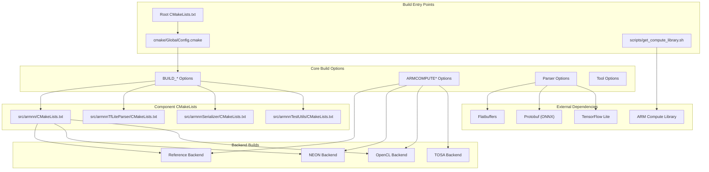
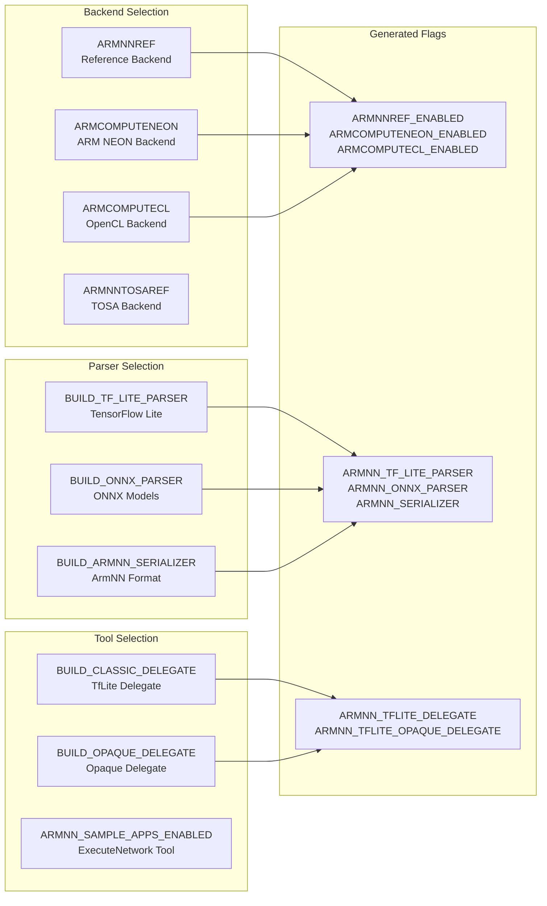
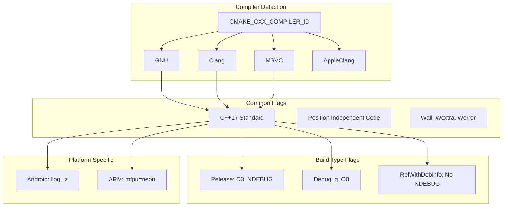
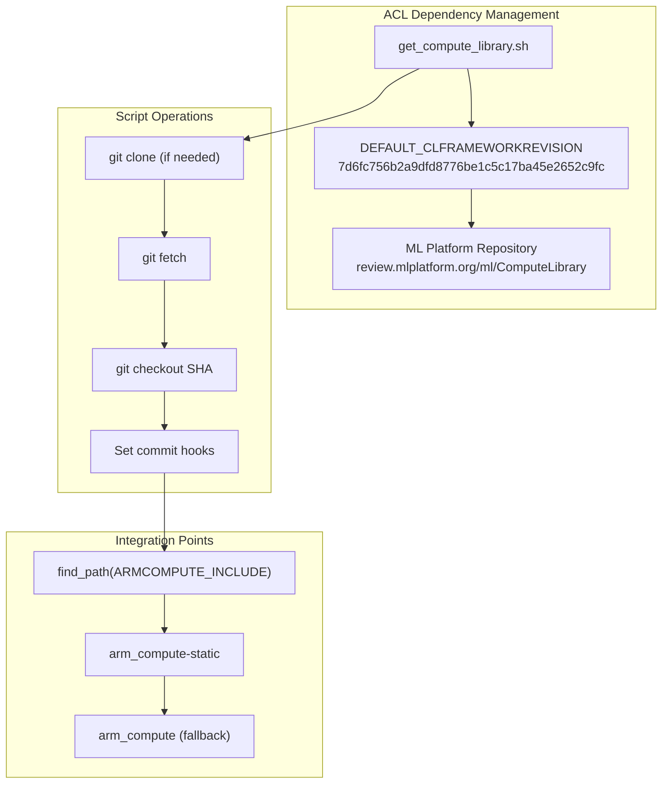
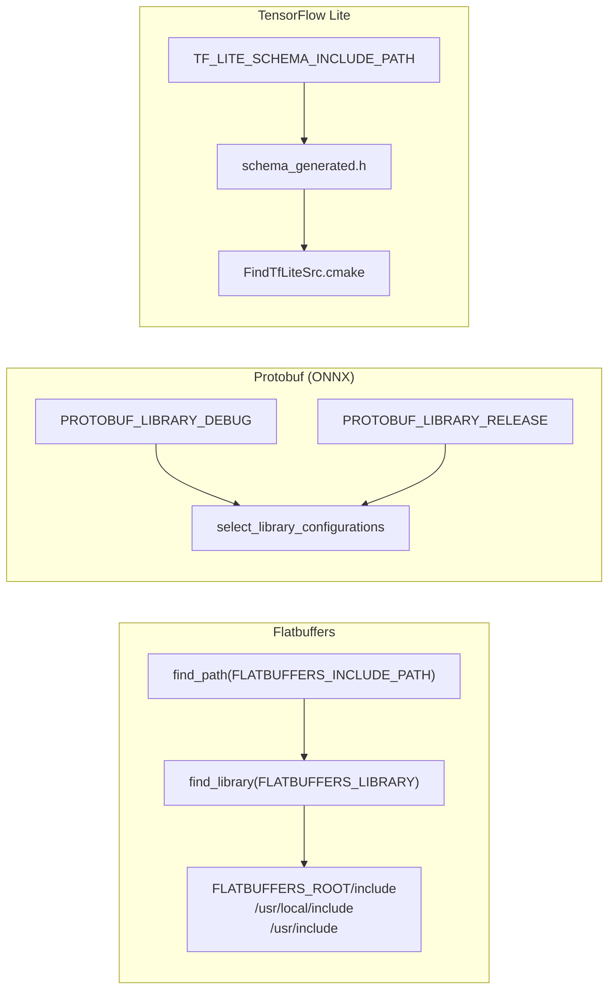
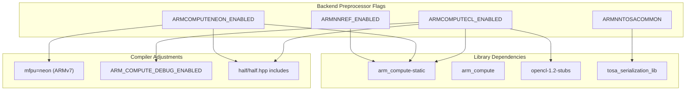
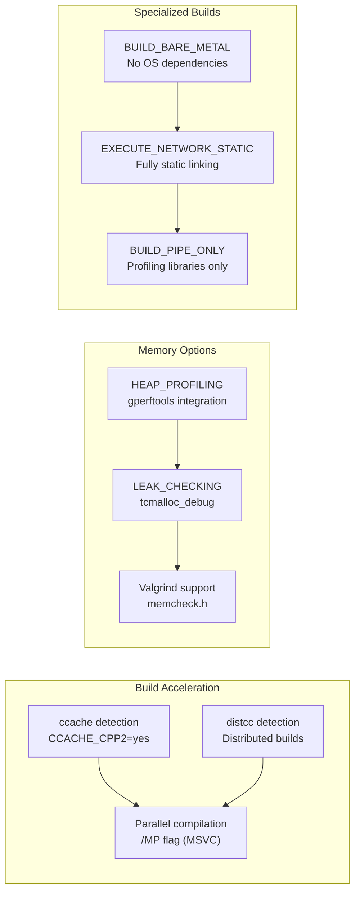
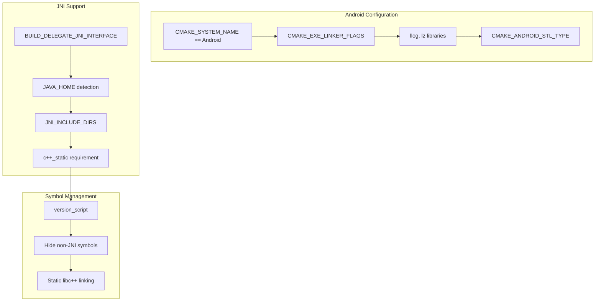
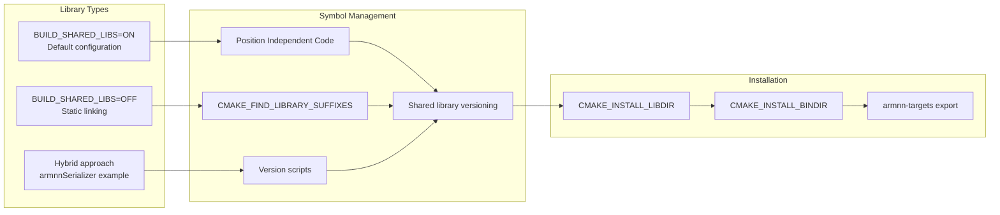

# Build System

Relevant source files

The following files were used as context for generating this wiki page:

- [cmake/GlobalConfig.cmake](cmake/GlobalConfig.cmake)
- [delegate/armnnDelegateJNI/CMakeLists.txt](delegate/armnnDelegateJNI/CMakeLists.txt)
- [delegate/armnnDelegateJNI/README.md](delegate/armnnDelegateJNI/README.md)
- [delegate/armnnDelegateJNI/README.md.license](delegate/armnnDelegateJNI/README.md.license)
- [delegate/armnnDelegateJNI/src/armnn_delegate_jni.cpp](delegate/armnnDelegateJNI/src/armnn_delegate_jni.cpp)
- [delegate/armnnDelegateJNI/version_script](delegate/armnnDelegateJNI/version_script)
- [delegate/test/BatchMatMulTest.cpp](delegate/test/BatchMatMulTest.cpp)
- [profiling/client/src/ProfilingService.cpp](profiling/client/src/ProfilingService.cpp)
- [profiling/server/src/timelineDecoder/CMakeLists.txt](profiling/server/src/timelineDecoder/CMakeLists.txt)
- [samples/CMakeLists.txt](samples/CMakeLists.txt)
- [scripts/get_compute_library.sh](scripts/get_compute_library.sh)
- [src/armnnDeserializer/CMakeLists.txt](src/armnnDeserializer/CMakeLists.txt)
- [src/armnnSerializer/CMakeLists.txt](src/armnnSerializer/CMakeLists.txt)
- [src/armnnTestUtils/CMakeLists.txt](src/armnnTestUtils/CMakeLists.txt)
- [src/armnnTfLiteParser/CMakeLists.txt](src/armnnTfLiteParser/CMakeLists.txt)
- [src/backends/backendsCommon/test/JsonPrinterTestImpl.cpp](src/backends/backendsCommon/test/JsonPrinterTestImpl.cpp)
- [src/backends/backendsCommon/test/layerTests/BatchMatMulTestImpl.cpp](src/backends/backendsCommon/test/layerTests/BatchMatMulTestImpl.cpp)
- [src/backends/cl/workloads/ClBatchMatMulWorkload.cpp](src/backends/cl/workloads/ClBatchMatMulWorkload.cpp)
- [src/backends/cl/workloads/ClBatchMatMulWorkload.hpp](src/backends/cl/workloads/ClBatchMatMulWorkload.hpp)
- [src/backends/cl/workloads/ClQLstmWorkload.cpp](src/backends/cl/workloads/ClQLstmWorkload.cpp)
- [src/backends/dynamic/reference/CMakeLists.txt](src/backends/dynamic/reference/CMakeLists.txt)
- [src/backends/neon/NeonInterceptorScheduler.cpp](src/backends/neon/NeonInterceptorScheduler.cpp)
- [src/backends/neon/NeonInterceptorScheduler.hpp](src/backends/neon/NeonInterceptorScheduler.hpp)
- [src/backends/neon/workloads/NeonBatchMatMulWorkload.cpp](src/backends/neon/workloads/NeonBatchMatMulWorkload.cpp)
- [src/backends/neon/workloads/NeonBatchMatMulWorkload.hpp](src/backends/neon/workloads/NeonBatchMatMulWorkload.hpp)
- [src/backends/neon/workloads/NeonQLstmWorkload.cpp](src/backends/neon/workloads/NeonQLstmWorkload.cpp)

This document covers ArmNN's CMake-based build system, including configuration options, dependency management, backend selection, and cross-compilation setup. For information about testing infrastructure, see [[6.2-testing-framework|Testing Framework]]. For details about the tools and applications that are built, see [[5-tools-and-applications|Tools and Applications]].

## Overview

ArmNN uses CMake as its primary build system, with a modular architecture that allows selective compilation of components. The build system manages dependencies, backend selection, parser integration, and cross-platform compilation through a combination of CMake configuration files and shell scripts.

Sources: [cmake/GlobalConfig.cmake:1-496](), [scripts/get_compute_library.sh:1-112]()

## Core Build Configuration

The central build configuration is managed through `GlobalConfig.cmake`, which defines all major build options and their dependencies. This file establishes the foundation for conditional compilation across the entire codebase.

### Primary Build Options

| Option | Default | Purpose |
|--------|---------|---------|
| `BUILD_UNIT_TESTS` | ON | Build unit test suite |
| `BUILD_TESTS` | OFF | Build test applications |
| `ARMNN_SAMPLE_APPS_ENABLED` | ON | Build sample applications |
| `BUILD_SHARED_LIBS` | ON | Build as shared libraries |
| `ARMNNREF` | ON | Include reference backend |

Sources: [cmake/GlobalConfig.cmake:7-66](), [cmake/GlobalConfig.cmake:394-452]()

### Compiler Configuration

The build system configures compiler flags based on the detected compiler and target platform:

Sources: [cmake/GlobalConfig.cmake:75-147](), [cmake/GlobalConfig.cmake:342-349]()

## Dependency Management

### ARM Compute Library Integration

The `get_compute_library.sh` script manages the critical ARM Compute Library dependency, which provides optimized kernels for NEON and OpenCL backends.

Sources: [scripts/get_compute_library.sh:9-13](), [scripts/get_compute_library.sh:80-111](), [cmake/GlobalConfig.cmake:295-338]()

### Library Resolution

The build system uses a sophisticated approach to find and link external libraries:

Sources: [cmake/GlobalConfig.cmake:254-282](), [cmake/GlobalConfig.cmake:217-244](), [src/armnnTfLiteParser/CMakeLists.txt:31-44]()

## Component Build Configuration

### Parser Libraries

Each parser has its own CMakeLists.txt that handles specific build requirements:

```mermaid
graph TD
    subgraph "TensorFlow Lite Parser"
        TfLiteCMake["src/armnnTfLiteParser/CMakeLists.txt"]
        TfLiteCheck["BUILD_TF_LITE_PARSER check"]
        TfLiteLib["armnnTfLiteParser library"]
        TfLiteHeaders["tflite_version_headers interface"]
    end
    
    subgraph "Serializer/Deserializer"
        SerializerCMake["src/armnnSerializer/CMakeLists.txt"]
        FlatcTool["flatc compiler"]
        SchemaGen["ArmnnSchema_generated.h"]
        SerializerLib["armnnSerializer library"]
    end
    
    subgraph "Test Utilities"
        TestUtilsCMake["src/armnnTestUtils/CMakeLists.txt"]
        MockBackend["MockBackend classes"]
        TestUtils["armnnTestUtils library"]
    end
    
    TfLiteCheck --> TfLiteLib
    TfLiteLib --> TfLiteHeaders
    TfLiteHeaders --> TfLiteCMake
    
    FlatcTool --> SchemaGen
    SchemaGen --> SerializerLib
    SerializerLib --> SerializerCMake
    
    MockBackend --> TestUtils
    TestUtils --> TestUtilsCMake
```

Sources: [src/armnnTfLiteParser/CMakeLists.txt:5-73](), [src/armnnSerializer/CMakeLists.txt:5-85](), [src/armnnTestUtils/CMakeLists.txt:5-72]()

### Backend Integration

Backend selection affects compilation through preprocessor definitions and library linking:

Sources: [cmake/GlobalConfig.cmake:342-382](), [cmake/GlobalConfig.cmake:386-392](), [cmake/GlobalConfig.cmake:399-442]()

## Build Optimization Features

### Performance Optimizations

The build system includes several performance-oriented features:

| Feature | CMake Option | Description |
|---------|--------------|-------------|
| CCache | `USE_CCACHE` | Compiler cache for faster rebuilds |
| DistCC | `USE_DISTCC` | Distributed compilation |
| Static Linking | `EXECUTE_NETWORK_STATIC` | Fully static ExecuteNetwork tool |
| Fast Math | Backend-specific | Enable fast math optimizations |

Sources: [cmake/GlobalConfig.cmake:82-96](), [cmake/GlobalConfig.cmake:463-485](), [cmake/GlobalConfig.cmake:168-187]()

## Cross-Compilation and Platform Support

### Android Support

The build system provides specific support for Android compilation:

Sources: [cmake/GlobalConfig.cmake:116-120](), [delegate/armnnDelegateJNI/CMakeLists.txt:10-62]()

### Library Configuration

The build system handles both static and shared library builds with careful attention to symbol visibility and linking requirements:

Sources: [cmake/GlobalConfig.cmake:201-205](), [src/armnnSerializer/CMakeLists.txt:41-57](), [src/armnnTestUtils/CMakeLists.txt:63-71]()

## Related Wiki Pages

- [[6-development-guide|Development Guide]]
- [[6.2-testing-framework|Testing Framework]]
- [[5-tools-and-applications|Tools and Applications]]

## Dynamic Knowledge Links (Code Graph ↔ LLM-Wiki / RAG)

### Linked Architecture & Design Documents

| Document | Match Channel | Score | Shared Code Symbols |
|---|---|---|---|
| [[7-advanced-topics|7 Advanced Topics]] | `bm25+entity(7)` | `73.494` | `AreParenthesesMatching`, `BatchMatMulTestImpl`, `ClBatchMatMulValidate`, `ExtractMeasurements`, `GetSoftmaxProfilerJson` |
| [[4.2-neon-backend|4.2 NEON Backend]] | `bm25+entity(6)` | `63.759` | `AreParenthesesMatching`, `BatchMatMulTestImpl`, `ClBatchMatMulWorkload`, `ClQLstmWorkload`, `ExtractMeasurements` |
| [[7.2-workload-system|7.2 Workload System]] | `bm25+entity(4)` | `63.069` | `AreParenthesesMatching`, `BatchMatMulTestImpl`, `ExtractMeasurements`, `GetSoftmaxProfilerJson` |
| [[4-compute-backends|4 Compute Backends]] | `bm25+entity(4)` | `56.972` | `AreParenthesesMatching`, `BatchMatMulTestImpl`, `ExtractMeasurements`, `GetSoftmaxProfilerJson` |
| [[4.3-opencl-backend|4.3 OpenCL Backend]] | `bm25+entity(4)` | `55.932` | `AreParenthesesMatching`, `BatchMatMulTestImpl`, `ExtractMeasurements`, `GetSoftmaxProfilerJson` |
| [[2.3-runtime-and-execution|2.3 Runtime and Execution]] | `wikilink:7-advanced-topics` | `31.497` | *(lexical/graph match)* |

### High-Centrality Bridge Symbols (CBM Graph)

| Symbol | Kind | Source Location | Fan-In / Fan-Out |
|---|---|---|---|
| `BatchMatMulTestImpl` | Function | [src/backends/backendsCommon/test/layerTests/BatchMatMulTestImpl.cpp:20-80]() | in: `13` / out: `16` |
| `ClQLstmWorkloadValidate` | Function | [src/backends/cl/workloads/ClQLstmWorkload.cpp:247-395]() | in: `0` / out: `22` |
| `NeonQLstmWorkloadValidate` | Function | [src/backends/neon/workloads/NeonQLstmWorkload.cpp:243-391]() | in: `0` / out: `22` |
| `GetSoftmaxProfilerJson` | Function | [src/backends/backendsCommon/test/JsonPrinterTestImpl.cpp:120-203]() | in: `1` / out: `19` |
| `CheckCounterUid` | Method | [profiling/client/src/ProfilingService.cpp:417-427]() | in: `6` / out: `4` |
| `Update` | Method | [profiling/client/src/ProfilingService.cpp:112-193]() | in: `1` / out: `13` |

Sources: [src/backends/backendsCommon/test/layerTests/BatchMatMulTestImpl.cpp:20-80](), [src/backends/cl/workloads/ClQLstmWorkload.cpp:247-395](), [src/backends/neon/workloads/NeonQLstmWorkload.cpp:243-391](), [src/backends/backendsCommon/test/JsonPrinterTestImpl.cpp:120-203]()

### Cross-Subsystem Coupling

- [[3.3-model-serialization|3.3 Model Serialization]] — call/import coupling weight `15.0`
- [[6.3-profiling-system|6.3 Profiling System]] — call/import coupling weight `15.0`
- [[2-core-architecture|2 Core Architecture]] — call/import coupling weight `12.0`
- [[2.1-network-and-graph-system|2.1 Network and Graph System]] — call/import coupling weight `12.0`
- [[1-armnn-overview|1 ArmNN Overview]] — call/import coupling weight `9.0`
- [[2.3-runtime-and-execution|2.3 Runtime and Execution]] — call/import coupling weight `5.0`
